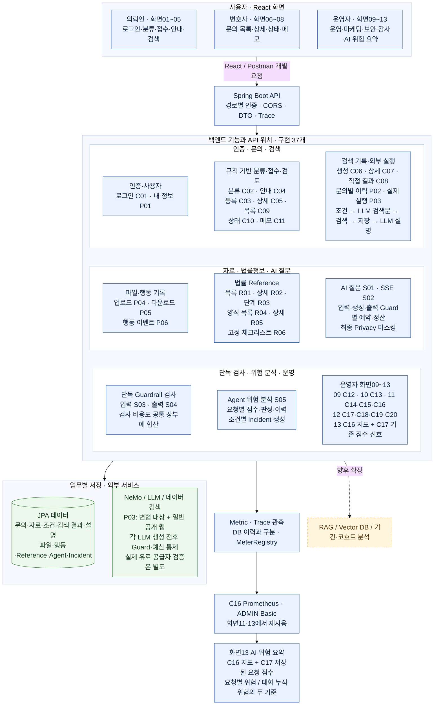
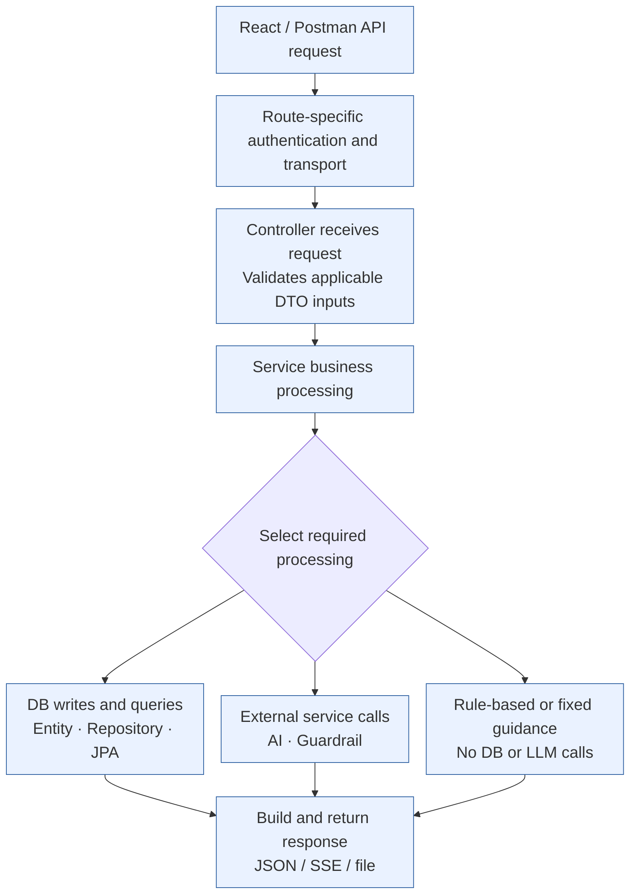
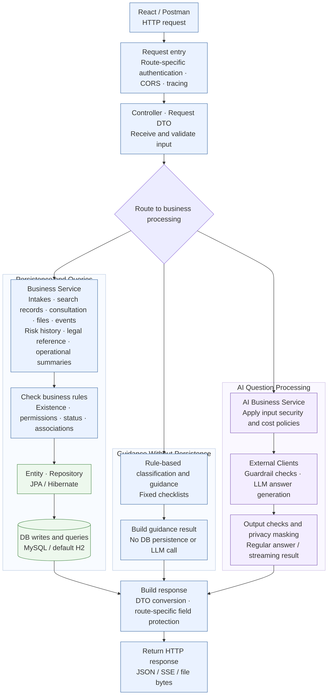
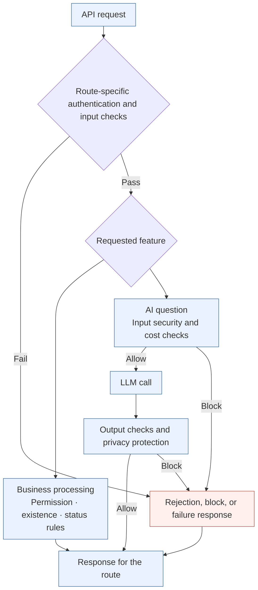
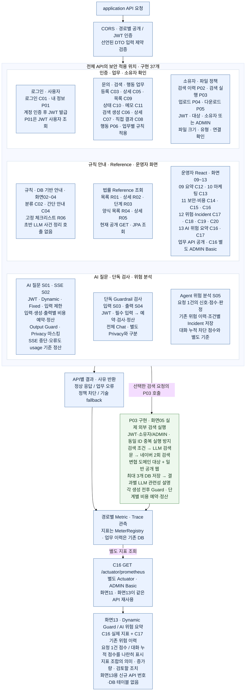

# Security-Aware Legal AI Intake System

**Updated 2026-10-22:** P03 and operator screens09–13 are implemented. Screen13 reuses C16 metrics and C17 history; no new endpoint ID or screen13 database table. Shared Mermaid figures match the Korean source. Live paid-provider verification remains pending.

[English](README.en.md) | [한국어](README.md)

## Reading Controller → Service Branches and Shared Responsibilities

**A core guide to the backend structure:** after locating an API, follow where its processing path branches and which Services share business rules across entry points. Controllers handle HTTP input and response channels; Services coordinate business rules, persistence, queries, and external calls.

```text
One AI question-and-answer feature · AiController
├─ S01 chat()       → S.chat() → one completed JSON response
└─ S02 chatStream() → AiStreamingService.stream() → SSE events

Multiple entry points for the same intake
├─ C02: classification preview
├─ C03, C05–C09: intake creation, queries, and search records
├─ C10: status change
├─ C11: consultation memo
└─ P02: search history for an intake
   → share the relevant methods and rules in LegalIntakeRecordService

P02: sequential composition within one request
IntakeSearchHistoryController.history()
  → 1. IntakeAccessService.requireAccess()
  → 2. LegalIntakeRecordService.findSearchRequests()
```

S01 and S02 are both Chat. Their Services differ because response delivery and connection management differ. Check `sendAsync`, callbacks, and `SseEmitter` to identify asynchronous processing. Intake classification, status, and memos share rules for the same intake. P02 checks access before querying history. Sharing a Service does not automatically execute the other APIs. A Service with the same name prefix as its Controller is abbreviated as `→ S.`; different names are written in full.

Full inventory: [Controller → Service branch, sharing, and response composition guide](docs/BACKEND_CONTROLLER_SERVICE_BRANCH_MERGE_GUIDE.md) · **[Dark-mode-only PDF · 36 pages](output/pdf/BACKEND_CONTROLLER_SERVICE_BRANCH_MERGE_DARK_TABLET.pdf)**. The guide and PDF are in Korean.

The guide covers **19 Controllers, 18 Services**, 9 shared Services, 15 internal business flows, and 128 code references. Its coverage table checks the **37 project and assignment Previewer items: 35 Controller APIs + Actuator C16 + unimplemented proposal P03**. Authentication, current-user information, and Actuator paths without a dedicated business Service are identified separately.

Suggested reading order: **overall architecture → API specification and flow mapping → branch and sharing guide → DDD · Policy / Read Model / Code → actual code**. Continue with the [API specification and flow mapping](docs/BACKEND_DRAFT_STATUS_AND_API_SPEC.md) and [DDD · Policy / Read Model / Code mapping](docs/BACKEND_DDD_POLICY_READ_CODE_MAPPING.md).

## LLM Questions, Response Latency, and Virtual Threads

The project uses Java 21 and Spring Boot with `spring.threads.virtual.enabled=true` in [application.properties](backend/guardrail-ready-policy-checker/src/main/resources/application.properties#L2). This configures web request processing to use virtual threads. S01 follows **AiController.chat → AiService.chat → input NeMo check → synchronous LLM HTTP call → output NeMo check**. The purpose is to handle I/O waits across concurrent requests while keeping the synchronous Controller–Service structure. It does not establish a reduction in a single answer's generation time. S02 uses sendAsync and callbacks, whose execution threads must be checked separately. Runtime thread verification and controlled throughput, P50/P95, and error-rate comparisons remain follow-up work. See the [requirements and code mapping](docs/DEVELOPMENT_REQUIREMENTS_CHECK.md).

## Overall Architecture and User Flow

Start with the overview to locate each feature, then follow **API ID → API catalog → individual flow and feature table → code**. The C/R/S/P labels match the IDs in the API catalog. P03 is a proposed feature.



Overview source: [01_SYSTEM_OVERVIEW.md](docs/diagrams/01_SYSTEM_OVERVIEW.md) · [Mermaid source](docs/diagrams/01_SYSTEM_OVERVIEW.mmd).

## API Catalog

As of **2026-10-18**, the catalog contains **37 APIs = 20 C + 6 R + 5 S + 6 P**, comprising **37 implemented APIs, including P03**. An API used by multiple screens is counted once. Inputs and success contracts follow [API_STATUS_SPEC.md](docs/API_STATUS_SPEC.md) and the [individual flows and feature mapping tables](docs/BACKEND_DRAFT_STATUS_AND_API_SPEC.md). Screen numbers describe the integration design; they do not indicate completed screen implementations.

**P has not been renamed to S.** S01–S05 identify AI and guardrail support features. P01–P06 track additional common, search, file, and behavior features. P03 external search execution is implemented with JWT/owner checks, guarded generation, two Naver searches and stored explanations. Live provider verification remains pending.

### Intake, Search, and Consultation Review

| ID / Screen | Feature | HTTP API | Input | Success Response / Behavior | Controller |
|---|---|---|---|---|---|
| C01 / 01 | Login | `POST /api/auth/login` | Required: `username`, `password` | 200: `accessToken`, `username`, `role` | `AuthController` |
| C02 / 02 | Case classification preview | `POST /api/intakes/classify-preview` | Required: `coreStatement`, up to 300 characters; optional: `caseType` | 200: classification, recommended documents, and guidance; not persisted | `LegalIntakeClassificationController` |
| C03 / 03 | Create intake | `POST /api/intakes` | Intake JSON; optional JWT records the owner when provided | 201: `LegalIntakeResponse`; saves document types and search conditions together; uploadedDocuments is initially empty | `LegalIntakeRecordController` |
| C04 / 04 | Generate minimal guidance | `POST /api/legal-intake/minimal` | `MinimalLegalIntakeRequest` | 200: rule-based case type, recommended documents, and guidance; no persistence or LLM call | `MinimalLegalIntakeController` |
| C05 / 04·07 | Intake details | `GET /api/intakes/{id}` | Path: `id` | 200: intake, documents, conditions, consultation memos, and uploadedDocuments | `LegalIntakeRecordController` |
| C06 / 05 | Create search request | `POST /api/intakes/{intakeId}/search-requests` | Path ID; JSON `{}` or purpose/source fields | 201: `AiSearchRequestResponse`, `PREVIEW_READY` | `LegalIntakeRecordController` |
| C07 / 05 | Search request details | `GET /api/intakes/search-requests/{searchRequestId}` | Path ID | 200: request, search query, and ordered results | `LegalIntakeRecordController` |
| C08 / 05 | Save result snapshot | `POST /api/intakes/search-requests/{searchRequestId}/results` | Source, title, URL, summary, and order | 201: search request DTO including results | `LegalIntakeRecordController` |
| C09 / 06 | Intake list | `GET /api/intakes` | None | 200: up to 50 `LegalIntakeResponse[]` entries, newest first | `LegalIntakeRecordController` |
| C10 / 08 | Change intake status | `PATCH /api/intakes/{id}/status` | Path ID; required: `status` | 200: `id`, `previousStatus`, `status`, `changed` | `LegalIntakeStatusController` |
| C11 / 08 | Add consultation memo | `POST /api/intakes/{id}/memo` | Path ID; required: `content`; optional: `followUpItems` | 201: ID, masked content, follow-up items, and creation time | `ConsultationMemoController` |

### Operations, Marketing, and Audit

| ID / Screen | Feature | HTTP API | Input | Success Response / Behavior | Controller |
|---|---|---|---|---|---|
| C12 / 09 | Operations summary | `GET /api/admin/dashboard/summary` | None | 200: counts of Agent runs, risk history, security events, and open incidents; `riskSummary` | `AdminDashboardController` |
| C13 / 10 | Basic marketing summary | `GET /api/admin/dashboard/marketing-funnel` | None | 200: intake, search, and current consultation-ready counts; distributions and reported behavior event counts | `MarketingDashboardController` |
| C14 / 11 | Recent security events | `GET /api/admin/dashboard/security-events` | None | 200: up to 50 recent security events | `AdminDashboardController` |
| C15 / 11 | Risk summary | `GET /api/agent/risk/summary` | None | 200: total and counts by risk level, decision, and action | `AgentRiskHistoryController` |
| C16 / 11·13 | Prometheus metrics | `GET /actuator/prometheus` | ADMIN Basic authentication | 200: Prometheus text; registry and endpoint exposure configured | Spring Boot Actuator |
| C17 / 12·13 | Risk history | `GET /api/agent/risk/history` | Optional query: `riskLevel`, `decision`; riskLevel takes precedence | 200: risk history array | `AgentRiskHistoryController` |
| C18 / 12 | Incident list | `GET /api/incidents` | None | 200: recent incidents | `RiskIncidentController` |
| C19 / 12 | Acknowledge incident | `PATCH /api/incidents/{incidentId}/ack` | Path ID | 200: updated incident DTO | `RiskIncidentController` |
| C20 / 12 | Resolve incident | `PATCH /api/incidents/{incidentId}/resolve` | Path ID | 200: updated incident DTO | `RiskIncidentController` |

### Legal Reference APIs

| ID / Screen | Feature | HTTP API | Input | Success Response / Behavior | Controller |
|---|---|---|---|---|---|
| R01 / 02 support | Procedure list | `GET /api/legal/procedures` | Optional query: `domain` | 200: array of `code`, `domain`, `title`, `summary`, and `userRole` | `LegalProcedureController` |
| R02 / 02·03·04 support | Procedure details | `GET /api/legal/procedures/{code}` | Path: `code` | 200: basic information, `steps`, `forms`, and `knowledgeGraphEdges` | `LegalProcedureController` |
| R03 / 03 support | Procedure steps | `GET /api/legal/procedures/{code}/steps` | Path: `code` | 200: array of order, code, title, description, and checklist | `LegalProcedureController` |
| R04 / 03 support | Form list | `GET /api/legal/forms` | Optional query: `procedure` | 200: array of form code, procedure code, title, file type, and usage guidance | `LegalProcedureController` |
| R05 / 03 support | Form details | `GET /api/legal/forms/{formCode}` | Path: `formCode` | 200: form DTO | `LegalProcedureController` |
| R06 / 04 support | Criminal supplementary-investigation checklist | `GET /api/legal/criminal/checklist/supplementary-investigation` | None | 200: `domain`, `role`, `stageCode`, `stageLabel`, `checklist`, `recommendedAction` | `LegalProcedureController` |

### AI and Guardrail Support APIs

S01–S05 are backend APIs for AI processing, security checks, and verification. **No dedicated screen is needed** in the current service scope; this is not a pending screen assignment. See the [screen 09–13 API connections](docs/SCREEN09_13_API_CONNECTIONS.md), including screen 13’s reuse of C16 and C17.

| ID / Screen | Feature | HTTP API | Input | Success Response / Behavior | Controller |
|---|---|---|---|---|---|
| S01 / AI questions; no dedicated screen needed | Synchronous AI Chat | `POST /api/ai/chat` | Required: `message`; DTO limit: 30 characters; experimental Cost Control default: 10 characters; optional: `sessionId` | 200: `answer`, `blocked`, `fallback`, `traceId`, `model`, compatibility field `reason`, `reasonCode`, `detailCode`, `usageAvailable`, `costSource` | `AiController` |
| S02 / AI questions; no dedicated screen needed | SSE AI Chat | `POST /api/ai/chat/stream` | Required: `message`; DTO limit: 30 characters; experimental Cost Control default: 10 characters; optional: `sessionId` | `text/event-stream`; meta first, then token/done after the full answer is checked and masked; done includes usageAvailable and costSource; unknown token counts are null | `AiController` |
| S03 / Standalone check | Standalone Input Guardrail | `POST /api/legal/guardrail/input` | Required: `message` | 200: `status`, `allowed`, `content`, `rail`, `traceId` | `LegalGuardrailController` |
| S04 / Standalone check | Standalone Output Guardrail | `POST /api/legal/guardrail/output` | Required: `response` | 200: `status`, `allowed`, `content`, `rail`, `traceId` | `LegalOutputGuardrailController` |
| S05 / Operations support | Agent risk analysis | `POST /api/agent/risk/analyze` | `userInput`, `toolName`, retry/token counts, Boolean risk signals, etc. | 200: `decision`, `riskScore`, `riskLevel`, `signals`, `recommendedAction`, `guardrailReady`, `historyId`, `traceId` | `AgentRiskDecisionController` |

### Additional Common, File, and Behavior APIs

| ID / Screen | Feature | HTTP API | Input | Success Response / Behavior | Controller |
|---|---|---|---|---|---|
| P01 / 01·Common | Current user | `GET /api/me` | No body; JWT required | 200: username, role | `CurrentUserController` |
| P02 / 05 | Search history by intake | `GET /api/intakes/{intakeId}/search-requests` | Path: `intakeId`; JWT; owner or administrator | 200: search requests and results, newest first; [] when none exist | `IntakeSearchHistoryController` |
| P03 / 05 | External search execution | `POST /api/intakes/search-requests/{searchRequestId}/execute` | JWT, owner/ADMIN, optional retryExplanation | 202: execution metadata; LLM query → Naver KBA-targeted/general search → stored results → guarded explanations | SearchExecutionController |
| P04 / Intake details·Common | File upload | `POST /api/intakes/{intakeId}/documents` | Path: `intakeId`; JWT; owner/admin; multipart file required; documentType optional | 201: id, intakeId, documentType, originalFilename, contentType, sizeBytes, createdAt, downloadUrl | `IntakeDocumentController` |
| P05 / Intake details·Common | File download | `GET /api/intakes/{intakeId}/documents/{documentId}/download` | Path: `intakeId`, `documentId`; JWT; owner/admin; intake-file association checked | 200: file bytes; attachment, nosniff, no-store; download request recorded | `IntakeDocumentController` |
| P06 / Behavior collection·Common | Record behavior event | `POST /api/intake-events` | Required: eventId, eventType, sessionId; optional: intakeId; SUMMARY_VIEWED requires intakeId | First request: 201/created=true; identical retry: 200/false; ID reused with different content: 409 | `IntakeEventController` |

## Service, Backend, and Security Flows by API ID

| Diagram | Reading Focus | Implemented APIs Located in the API Map | Omissions and Reasons |
|---|---|---|---|
| [01_SYSTEM_OVERVIEW.md](docs/diagrams/01_SYSTEM_OVERVIEW.md) | Overall architecture, user flow, and module locations | **37/37** | None; P03 is implemented; screen13 reuses C16/C17 |
| [02A_BACKEND_FLOW.md](docs/diagrams/02A_BACKEND_FLOW.md) | Backend processing structure for presentation | [Reference API map: 36/36](docs/diagrams/02A_BACKEND_FLOW_API_MAP.md) | The presentation diagram focuses on business and data processing without API IDs; auxiliary Jobs appear in the expanded appendix |
| [02_BACKEND_SECURITY_FLOW.md](docs/diagrams/02_BACKEND_SECURITY_FLOW.md) | Authentication, business checks, AI guards, blocking, and output protection | **37/37** | C13, R01–R06, P06: ordinary marketing, reference, and behavior processing are omitted from the security-focused expansion |

Use the IDs beside each feature to locate it in the overview, security diagram, and reference API map. Grouped IDs represent separate APIs, not an automatic call sequence. The backend presentation diagram focuses on processing structure without IDs; the reference API map locates all 36 implemented APIs. P03 appears as future work in 01 and 02-A, and its security checks are not finalized. Each linked diagram also has a corresponding `.mmd` source.

### Backend Business and Data Processing

Start with the simple flow, then use the presentation diagram to connect business processing, persistence, and external calls. API locations are provided in a separate reference map.

#### Simple Version



#### Backend Business and Data Processing — Presentation Version



[Backend flow explanation](docs/diagrams/02A_BACKEND_FLOW.md) · [API ID map](docs/diagrams/02A_BACKEND_FLOW_API_MAP.md) · [Expanded processing diagram](docs/diagrams/02A_BACKEND_FLOW_EXPANDED.md).

### Backend and Security Processing

Start with the simple flow, then locate features in the API ID map.

#### Simple Version



#### Version with API IDs



Explanations and omissions: [02_BACKEND_SECURITY_FLOW.md](docs/diagrams/02_BACKEND_SECURITY_FLOW.md) · [Expanded processing diagram](docs/diagrams/02_BACKEND_SECURITY_FLOW_EXPANDED.md).

### Where to Find APIs Omitted from the Security Diagram

| Implemented APIs Omitted | Reason | Diagram Location |
|---|---|---|
| C13 | Marketing aggregates are a read model of intake, search, and behavior data, so they are omitted from the security-focused expansion | Marketing summary in 01; operational queries in 02-A |
| R01, R02, R03, R04, R05 | Public legal procedure, step, and form queries use a separate path from AI guards | Legal reference in 01; JPA reference queries in 02-A |
| R06 | Public fixed checklist; separate from DB and LLM security decisions | Fixed checklist in 01 and 02-A |
| P06 | DTO validation, intake/session association, and event deduplication are omitted from the security-focused expansion | Behavior events in 01; event persistence in 02-A |

The existing asynchronous Job routes—`POST /api/agent/jobs`, `GET /api/agent/jobs/{jobId}`, and `GET /api/agent/jobs`—are auxiliary endpoints outside the 36 implemented APIs in the submission catalog. They do not share the S05 synchronous analysis ID. All experimental Controller routes are listed separately in the [route inventory](docs/BACKEND_ROUTE_INVENTORY.md).

---

The presentation schedule and subsequent work follow the [12-day development plan](docs/PROJECT_12_DAY_PLAN.md).

For MySQL experiments, follow the [connection setup and Postman checks](docs/MYSQL_CONNECTION_CHECK.md). H2 is the default; the `mysql` profile uses the developer's local root account and a dedicated project database. JDBC/JPA connectivity, basic queries, and data persistence after a restart have been checked.

> This repository is a security-focused MVP draft. The core goal is not to build a full legal consultation chatbot, but to design a PM-driven legal intake flow with AI security controls.

## PM Positioning

`Legal AI Intake System` is a PM-led, security-focused chatbot project that considers client experience, attorney efficiency, operational metrics, and AI security together.

The project was approached as a product and system design exercise as well as a feature implementation task. The PM perspective covered:

- Which market problem the service addresses.
- Who uses it and what efficiency or value they gain.
- Where clients struggle to provide information.
- Which information attorneys need before a consultation.
- Which security and cost risks can arise during operation.
- Which metrics and dashboards help operators observe and control those risks.

As AI accelerates code generation, PM work includes defining the right problem, structuring the user experience, and designing an operable architecture with security and cost controls.

This project emphasizes identifying a legal intake problem and connecting it to a guided user experience and an AI security architecture.

## Problem → Solution

| Perspective | Problem | Solution |
|---|---|---|
| Market | Small law offices may lack a structured intake system, allowing initial inquiries to drop off before consultation. | Organize inquiries by case type, available documents, and desired next step. |
| UX | Clients unfamiliar with legal terminology may struggle to explain a case in free text. | Use guided selections and checklists, then turn those selections into readable guidance. |
| Technology | Open-ended chat can produce lengthy, inconsistent input. | Structure input through a Legal Intake Form and Spring/Java, then classify case types and preparation materials. |
| Security | AI services face harmful requests, repeated attacks, excessive spending, and re-exposure of personal data. | Apply Fixed Guard, Dynamic Guard, Cost Control, and Privacy Output Guard around LLM calls. |
| Operations | Without recorded block reasons and intake flows, operators struggle to diagnose problems. | Make intake flows and security blocks observable through reasonCode, Prometheus metrics, and dashboard design. |
| Expansion | The first version does not cover deep legal document retrieval, attorney handoff summaries, or automated follow-up. | Plan a practical MVP expansion in December using RAG, Python actions.py, Vector DB, and Kakao/email integration. |

## Product Definition

The product provides legal information through a `Legal Intake Form`. Its scope is structured intake and guidance rather than open-ended legal consultation.

The core UX is:

```text
The client selects; the chatbot organizes.
```

Clients select the inquiry purpose, case type, party role, key facts, available documents, and desired next step. The system uses those selections to explain the likely inquiry category, possible dispute area, preparation materials, and next steps in natural language.

Example:

```text
Input:
Inquiry purpose: Identify required documents
Case type: Civil
Party role: Plaintiff
Available documents: Transfer records, KakaoTalk messages
Desired next step: Consultation
Key statement: I have not been repaid money I lent.

Output:
This inquiry appears to concern a civil matter.

It may involve repayment or a loan dispute.
Before consultation, organize transfer records, KakaoTalk/text messages,
and requests for repayment in chronological order.

Prepare any contract or written agreement you have.
Personal data is masked rather than reproduced directly in the response.
```

## Minimal Legal Intake Form

The intake scope is limited to the following six categories. Deeper legal analysis and RAG-based document retrieval are reserved for the December expansion.

### 1. Inquiry Purpose

- Procedure guidance
- Identify required documents
- Review a prepared document
- Attorney engagement / contract review
- Electronic litigation filing guidance

### 2. Case Type

- Civil
- Criminal
- Family
- Electronic litigation
- Unsure

### 3. Party Role

- Victim
- Person named in a criminal complaint
- Plaintiff
- Defendant
- Applicant
- Opposing party
- Unsure

### 4. Key Facts

- Incident date
- Opposing party
- Amount in dispute or extent of harm
- Current stage
- One-sentence summary

### 5. Available Documents

- Contracts
- Transfer records
- KakaoTalk / text messages
- Photos / videos
- Civil complaint / criminal complaint / notice
- None

### 6. Desired Next Step

- Consultation
- Document review
- Litigation preparation
- Electronic filing
- Attorney engagement

Implemented endpoint:

```http
POST /api/legal-intake/minimal
```

## Mini Legal Ontology

The project structures the problem of inquiries dropping off before consultation through a `guided Legal Intake Form` and a `mini legal ontology`.

Here, the ontology is a minimal classification system that connects selections and keywords to case types, dispute areas, and preparation materials.

```text
Client input
-> Selected values
-> Case type
-> Dispute area
-> Preparation materials
-> Next organizational step
```

Guided intake and the mini ontology can reduce effort for clients, attorneys, and the system:

- Clients can select options without knowing legal terminology.
- Attorneys can review case types and available documents before consultation, reducing basic fact-finding.
- Structured input and template-based responses can reduce lengthy free text and LLM usage.

## Reusing the Earlier Project

The `legal-procedure-viewer`, implemented in an earlier Spring Boot–React integration assignment, serves as this project's **Legal Reference module**. Its six procedure, step, form, and checklist APIs are reused. Integration with the case classification, intake, and result screens is planned to help users check procedures and preparation materials.

| Current Project Screen | Use of Existing Features |
|---|---|
| Screen 2: Case type guidance | Procedure lists and details provide reference information for understanding case types |
| Screen 3: Intake form | Procedure steps, checklists, and form guidance help users organize documents and next steps |
| Screen 4: Result guidance | Related procedures and preparation materials accompany the intake result; the criminal supplementary-investigation checklist is provided when relevant |

Three features are currently connected in the existing React app: procedure lists, procedure details, and the criminal checklist. Integration with the new Screens 2–4 is scheduled for the later React phase. Classification preview, intake persistence, and LLM search execution are separate features.

The 36 implemented APIs include the six reused Reference APIs. The project builds on the earlier React–API integration work by adding intake persistence, consultation review, search records, security, and cost management.

Earlier implementation: [Legal Procedure Viewer](frontend/legal-procedure-viewer/README.md). Current integration scope: [screen/API mapping](docs/SCREEN_API_CONTROLLER_MAPPING.md), [API specification](docs/API_STATUS_SPEC.md).

## Security Architecture Summary

Security is central to the project.

The architecture applies controls before LLM calls to address harmful requests, repeated attacks, and excessive spending, and masks personal data after output generation.

```text
Fixed Guard
-> Blocks jailbreak, prompt injection, legal harm, secret/API key requests,
   and authentication/e-signature bypass requests

Dynamic Guard
-> Scores repeated risky requests within the same sessionId
   and blocks the session when its threshold is exceeded

Cost Control
-> Limits long input and excessive token spending before an LLM call

Privacy Output Guard
-> Allows personal data in input and masks it in output
```

Representative reason and detail codes:

```text
BLOCKED_JAILBREAK
BLOCKED_PROMPT_INJECTION
BLOCKED_LEGAL_HARM
BLOCKED_SECRET_REQUEST
BLOCKED_AUTH_BYPASS
COST_LIMIT_BLOCKED
REQUEST_TOO_LONG
DYNAMIC_SESSION_BLOCKED
PII_OUTPUT_MASKED
```

Personal data masking examples (including a Korean name):

```text
홍길동 -> 홍**
010-1234-5678 -> 010-1***-****
900101-1234567 -> 900101-*******
123-456-789012 -> 123-***-******
```

## PM Multi-Layer Analysis

The legal intake problem was examined from market, client, attorney, technology, security, and operations perspectives before the system was designed.

### 1. Market Perspective

Initial intake at small law offices can depend on phone calls, free-form explanations, and individual staff experience. Inquiries that remain unstructured may fail to convert into consultations.

### 2. Client Perspective

Clients encountering a legal issue for the first time may not know whether it is civil, criminal, or family-related. Guided selections and document preparation guidance can reduce the burden of explaining everything in free text.

### 3. Attorney Perspective

Unstructured consultations consume time on fact-finding and basic checks. Organizing case types, available documents, and requested help in advance lets attorneys focus more consultation time on issues and strategy.

### 4. Technology Perspective

A `Legal Intake Form` with information guidance was chosen for the MVP. Guided selections and checklists make input structure, DTO validation, reasonCode, and metric design easier to define.

### 5. Security Perspective

Controls are needed for harmful requests, repeated attacks, excessive spending, and personal data exposure. Fixed Guard, Dynamic Guard, Cost Control, and Privacy Output Guard were designed as separate modules.

### 6. Operations Perspective

The operational design calls for visibility into where inquiries stop, which requests are blocked, and how often cost limits are triggered, using Prometheus/Grafana metrics.

Block reasons and conversion losses are therefore part of the reasonCode, metric, and dashboard design.

## Boards and Dashboards

The interface design gives clients chatbot guidance and gives attorneys separate views for case review, marketing/operations, and security.

```text
1. Client Chatbot Screen
   -> Turns client selections into readable guidance

2. Attorney Case Review Board
   -> Shows case type, party role, available documents,
      and requested help before consultation

3. Marketing / Operation Board
   -> Lets attorney business owners review inquiry counts, case types,
      consultation readiness, and drop-off

4. Security Check Board
   -> Shows Fixed Guard, Dynamic Guard, Cost Control,
      Privacy Masking, and prevented LLM calls
```

## Observability

The operational design includes metrics such as:

```text
Inquiry count
Inbound inquiries by case type
Consultation readiness rate
Drop-off
Fixed Guard block count
Dynamic Guard block count
Cost Control block count
Privacy masking count
Prevented LLM call count
```

The project aims to provide intake observability, including visibility into where initial inquiries stop progressing.

## Current Implementation

```text
Minimal Legal Intake Flow
-> POST /api/legal-intake/minimal

Fixed Guard
-> Jailbreak / Prompt Injection / Legal Harm / Secret Request / Auth Bypass

Dynamic Guard
-> sessionId-based riskScore accumulation and repeated-risk session blocking

Cost Control
-> Input length and estimated token cost limits

Privacy Output Guard
-> Personal data allowed in input, masked in output

Metric
-> guardrail block, cost block, dynamic block,
   privacy output masking, llm call prevented
```

Postman scenarios: [POSTMAN_SECURITY_SCENARIOS.md](POSTMAN_SECURITY_SCENARIOS.md).
Detailed experiment playbook: [POSTMAN_EXPERIMENT_PLAYBOOK.md](POSTMAN_EXPERIMENT_PLAYBOOK.md).
Mermaid security review diagram: [SECURITY_FLOW.md](SECURITY_FLOW.md).

## Expansion Plan

This is an October security-focused prototype. A practical MVP expansion is planned for December after further work with Python, RAG, and Vector DB.

```text
RAG / Vector DB
-> Retrieval from the Korean electronic court system,
   official documents, and internal FAQs

Python actions.py
-> Advanced NeMo Guardrails policy execution

Attorney Summary
-> Pre-consultation summary for attorney handoff

Kakao / Email Integration
-> Client follow-up, document requests, and consultation handoff

Dashboard Enhancement
-> Inquiry conversion, drop-off points, and case-type distribution
```

## Core Message

```text
The client selects; the chatbot organizes.
Security controls apply before LLM calls.
Operators observe the system through metrics.
```

## Significance of This Design

Enterprise AI increasingly emphasizes policy-based usage controls, privacy, cost management, and operational visibility alongside model capabilities. This direction is reflected in [OpenAI's security and operations guidance](https://learn.chatgpt.com/docs/enterprise/security-cookbook) and [Claude's admin analytics and cost controls](https://claude.com/resources/articles/giving-admins-more-visibility-and-control-over-claude-usage-and-spend).

This project separates Fixed Guard, Dynamic Guard, Privacy Output Guard, and Cost Control into modules, with reasonCode, metrics, and operational query APIs to inspect processing outcomes. Applying this structure to a legal intake service provided hands-on experience designing and implementing the foundational control and observability mechanisms relevant to enterprise AI.
