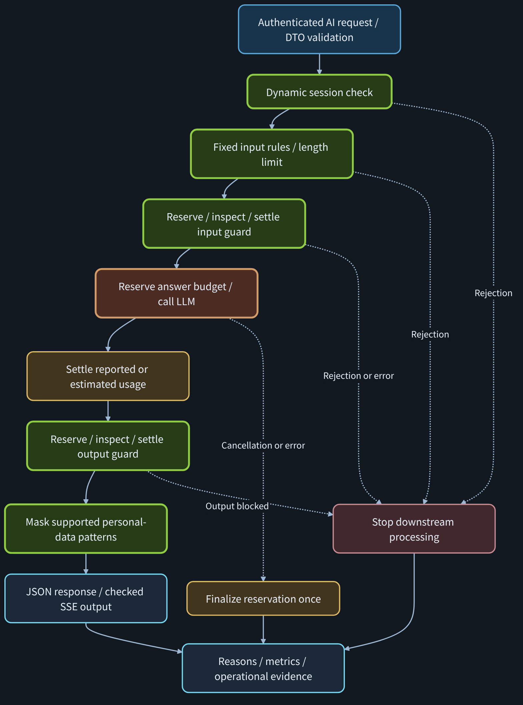
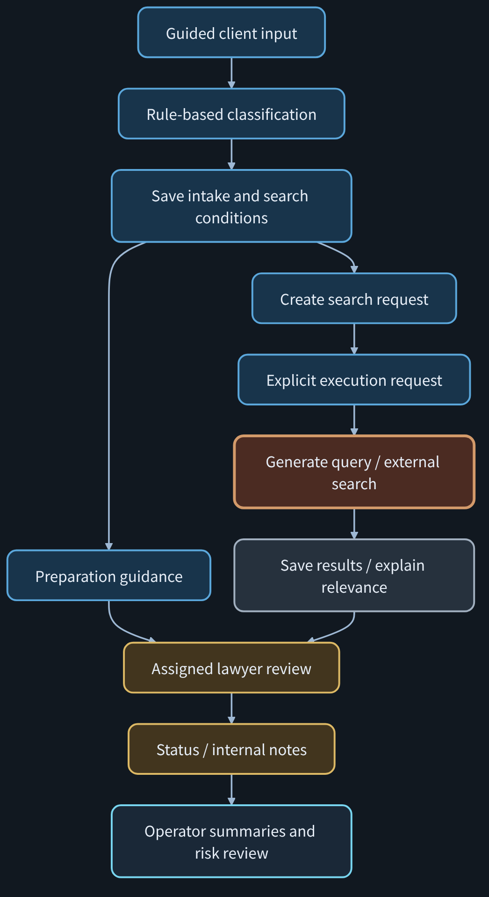

# Security-Aware Legal AI Intake System

[한국어](README.md) | **English**

> Connecting AI is straightforward. Engineering a backend that stops on failure and accounts for cost is the harder part. That is the focus of this project.

**A security-focused AI backend for legal intake, with staged cost accounting and an operator dashboard.**

Legal intake is the application domain. The central engineering work is the backbone around AI calls: policy enforcement, repeated-risk handling, budget reservation and settlement, output privacy, and operational visibility.

## At a Glance

| Area | What this project demonstrates |
|---|---|
| Product thinking | Translate an intake problem into structured UX, backend policies, and operational evidence |
| Security | Fixed input rules, session-based risk accumulation, input/output guardrail integration, and supported-pattern output masking |
| Cost control | Reserve before paid stages, settle reported or estimated usage, and release unused reservations |
| Reliability | Stop downstream processing on rejection; handle retries, stale writes, cancellation, and partial search results |
| Operations | Role-based workspaces, reason codes, incident review, cost metrics, and risk time series |
| Stack | Java 21, Spring Boot, Spring Security, JPA, React, Micrometer, and Prometheus |
| Direction | Extending to a Spring Boot + FastAPI hybrid with a memvid memory layer; commercial release planned |

This is a prototype with documented experiments and limitations. It does not claim production readiness, legal-advice accuracy, or a provider-enforced spending ceiling.

## PM Positioning

The design connects **market problem → user experience → backend policy → verification → operational visibility**.

Small legal practices can receive inquiries that are difficult to structure before a consultation. Clients may not know legal terminology; lawyers need facts and documents; operators need to understand failures, risk, and spending.

| Perspective | Design response |
|---|---|
| Market | Structure initial inquiries into consultation preparation; conversion improvement remains a product hypothesis |
| Client | Guided choices, short descriptions, and preparation checklists |
| Lawyer | Review assigned inquiries, available materials, status, and internal notes |
| Engineering | Explicit request/response contracts, DTO validation, access rules, and traceable processing paths |
| Security | Separate current-input policy checks, repeated-risk controls, budget decisions, and output privacy |
| Operations | Explain decisions through reasons, metrics, history, and incident actions |

The portfolio emphasis is the ability to turn a product problem into an architecture whose behavior can be explained and tested, including its failure paths.

[PM, security, and operations brief — Korean PDF](docs/presentation-pdfs/PM_SECURITY_CORE_DARK_TABLET.pdf)

## Security and Cost Backbone

[](docs/diagrams/ai-security-cost-backbone-en.svg)

This diagram describes the AI chat pipeline. Classification, reference queries, intake storage, and external-search stages have their own processing paths; they do not all execute the full chat pipeline.

| Control | Responsibility |
|---|---|
| Fixed Guard | Detect configured jailbreak, prompt-injection, legal-harm, secret-request, and authentication-bypass patterns |
| Dynamic Guard | Accumulate repeated risk within a session and restrict the session at configured thresholds |
| Cost Control | Check limits and account for input inspection, answer generation, output inspection, search-query generation, and search explanation |
| Input/output guardrails | Integrate external inspection before and after generation; actual behavior depends on the configured provider |
| Privacy Output Guard | Mask supported personal-data patterns before returning protected output |
| Observability | Expose decisions, cost states, risk history, and incidents for operator review |

**Two risk tracks remain distinct:** the request-pattern score of 80 supports a block recommendation; the conversation-level accumulated score of 100 is a separate session-restriction rule. A dashboard recommendation does not imply automatic enforcement by every endpoint.

### Cost and failure semantics

| Situation | Accounting behavior |
|---|---|
| Successful generation | Settle using reported usage when available |
| Output rejected after generation | Account for generation already performed |
| Provider call dispatched, usage unavailable | Use the documented estimated-accounting path |
| Reserved stage never started | Release its reservation |
| SSE cancellation or overlapping callbacks | Finalize a reservation once; avoid duplicate settlement/release |

Guardrail calls are part of the cost model, not a free step outside the ledger. Application estimates must match the selected model and provider pricing. In-memory budgets are not a durable, distributed billing system and do not replace provider-side controls.

SSE buffers the generated answer for inspection and masking before emitting checked output. It does not forward raw provider tokens directly to the browser.

### Read the reason, not only the HTTP status

| Signal | Interpretation |
|---|---|
| `BLOCKED_JAILBREAK`, `BLOCKED_PROMPT_INJECTION`, `BLOCKED_LEGAL_HARM` | A configured input policy rejected the request |
| `BLOCKED_SECRET_REQUEST`, `BLOCKED_AUTH_BYPASS` | Secret extraction or authentication-bypass pattern detected |
| `COST_LIMIT_BLOCKED` / `REQUEST_TOO_LONG` | Common cost reason versus input-length detail; inspect branch-specific fields |
| `DYNAMIC_SESSION_BLOCKED` | An accumulated session restriction, not just a label for the latest message |
| `PII_OUTPUT_MASKED` | A protection-result label; not a universal response reason code |

An HTTP 200 AI response can still represent a blocked or fallback result. Inspect the response fields and reason details. Privacy protection covers supported patterns and fields, not every possible form of personal data.

## Verification and Evidence

The reports connect **experiment ID → purpose → observed result → original capture → accounting/provider evidence**.

| Evidence | What to look for |
|---|---|
| [Cost Control PDF](docs/presentation-pdfs/COST_CONTROL_DARK_TABLET.pdf) | A4–A7 budget rejection and cross-stage accounting; V02–V03/C1 usage, reservation finalization, and provider-usage comparison |
| [Error Stop Flow PDF](docs/presentation-pdfs/ERROR_STOP_FLOW_DARK_TABLET.pdf) | A1 input-length rejection, A2 secret-request rejection, and B2 timeout accounting |
| [Dynamic Guard PDF](docs/presentation-pdfs/DYNAMIC_GUARD_DARK_TABLET.pdf) | A3-1 repeated-risk restriction and A3-2 restriction retained after switching to a benign question |
| [Experiment/result mapping](docs/presentation-pdfs/EXPERIMENT_RESULT_MAPPING.md) | Trace individual claims to their recorded evidence and verification scope |

Mock-provider experiments, internal cost estimates, and real paid-provider observations are separate categories. These documents record particular runs; they are not evidence that every current deployment or provider configuration has passed the same tests. The Korean evidence index identifies unverified cases.

## Product: Guided Intake and Lawyer Search

**Clients choose. The system organizes. Lawyers review. Operators observe.**

The client provides purpose, case category, party position, core facts, available materials, and the desired next step. Initial classification and preparation guidance use rules/templates, without an LLM call. LLM-based search-query generation and result explanations are separate stages.

[](docs/diagrams/guided-intake-and-search-en.svg)

Creation, search-request creation, and search execution are separate API calls. The implementation includes NAVER public-web search targeting the Korean Bar Association domain plus general web results; this is not a dedicated Bar Association API. Provider-specific demo bridges and real-call observations depend on the chosen runtime configuration. Search results are references for review, not verified endorsements or guaranteed lawyer recommendations.

[Product introduction — Korean PDF](docs/presentation-pdfs/PRODUCT_INTRODUCTION_DARK_TABLET.pdf)

### Roles and workspaces

| Role | Workspace |
|---|---|
| USER | Own intake, preparation guidance, and search requests |
| LAWYER | Assigned inquiries, materials, status changes, and internal consultation notes |
| ADMIN | Cross-intake oversight, assignment, operations, marketing summaries, and security review |

Ownership and assignment checks constrain intake access. Internal consultation notes are excluded from USER response DTOs. Business JWT authentication and the separate ADMIN Basic authentication for Actuator metrics are distinct boundaries.

## Backend Flows

| Flow | Concrete processing path |
|---|---|
| Intake to search | C03 validates and saves intake/material selections/search conditions → C06 creates a `PREVIEW_READY` request → P03 claims execution and returns 202 → query/search/results/explanations → C07/P02 read-back |
| Status and notes | C05/C09 provide the intake ID/version → C10 changes status or C11 records a note in a separate transaction → C05/C09 refresh |
| AI and SSE | Authenticate/validate → Dynamic/Fixed/input-length checks → staged guard/generation accounting → output inspection/masking → response and metrics |

- `intakeId`: intake detail, status, notes, search-request creation, and intake search history.
- `conditionId`: returned in saved search conditions and linked by the server; not required again in the C06 body.
- `searchRequestId`: execution, request detail, and result snapshots.
- `expectedVersion`: send the version read by the client to detect stale writes. It remains optional for compatibility; omission is not equivalent protection.
- Idempotency keys identify supported retry operations. Notes without a key use a bounded duplicate-detection window, not a permanent identity guarantee.
- Partial search completion preserves saved results; explanation retry can target unfinished explanations.

[Detailed backend flows](docs/presentation-2026-10-25/BACKEND_CONCRETE_FLOWS.md) · [Screen–API–Controller mapping](docs/SCREEN_API_CONTROLLER_MAPPING.md) · [ERD](docs/BACKEND_ERD.md) · [DDD and event-storming mapping](docs/BACKEND_DDD_EVENT_STORMING.md)

## Core API Map

| Capability | ID | HTTP endpoint |
|---|---|---|
| Login / current user | C01 / P01 | `POST /api/auth/login` · `GET /api/me` |
| Classification / intake creation | C02 / C03 | `POST /api/intakes/classify-preview` · `POST /api/intakes` |
| Minimal preparation guidance | C04 | `POST /api/legal-intake/minimal` |
| Intake list / detail | C09 / C05 | `GET /api/intakes` · `GET /api/intakes/{id}` |
| Search-request creation | C06 | `POST /api/intakes/{intakeId}/search-requests` |
| Search execution | P03 | `POST /api/intakes/search-requests/{searchRequestId}/execute` |
| Search detail / intake history | C07 / P02 | `GET /api/intakes/search-requests/{searchRequestId}` · `GET /api/intakes/{intakeId}/search-requests` |
| Status / internal note | C10 / C11 | `PATCH /api/intakes/{id}/status` · `POST /api/intakes/{id}/memo` |
| Operations / marketing | C12 / C13 | `GET /api/admin/dashboard/summary` · `GET /api/admin/dashboard/marketing-funnel` |
| Metrics / risk history | C16 / C17 | `GET /actuator/prometheus` · `GET /api/agent/risk/history` |
| AI chat / SSE | S01 / S02 | `POST /api/ai/chat` · `POST /api/ai/chat/stream` |

See the full mapping for per-endpoint authentication, fields, IDs, and controller names. This compact table does not imply identical authorization policies across all routes.

## Operator Experience

| Board | Operational value |
|---|---|
| Marketing | Intake/search counts, current consultation-ready count, and category/region distributions |
| Security and incidents | Review block reasons, protection results, risk history, and incident acknowledgement/resolution |
| Client | Guided intake, preparation guidance, and search requests |
| Lawyer | Review assigned cases and manage status/internal notes |

**Screen 13: observe → inspect risk evidence → decide → act.**

Current C16 metrics, C17 risk history, and Prometheus time series help operators interpret repeated blocked behavior, risky actions, and external-transfer risk signals. Refresh/scrape intervals determine freshness. Missing observations are distinct from measured zero; actual, estimated, accounted, and reserved costs remain separate.

Marketing aggregates describe current database state. Post-consultation conversion and dropout explanations have a separate dummy-demo mode. Stage totals alone do not establish a measured customer conversion or abandonment rate.

## Current Implementation

```text
Minimal legal intake → rule/template-based preparation guidance
Fixed Guard         → configured input-policy checks
Dynamic Guard       → session risk accumulation and restriction
Cost Control        → input limits, staged reservation and accounting
Privacy Output      → supported-pattern masking, including checked SSE output
Search Routing      → explicit execution, persisted results, relevance explanations
Observability       → reason codes, metrics, risk history, operator review
```

## Direction: Commercial Extension

This repository is a documented prototype of the AI-call backbone. Development continues on a **Spring Boot + FastAPI hybrid with a memvid memory layer**, with a commercial release planned.

| Layer | Role |
|---|---|
| **Spring Boot** | Single boundary for authentication, role-based access, business transactions, and policy and cost enforcement. Carries over the current implementation. |
| **FastAPI (Python)** | AI processing, retrieval, and memory adapters, connected to Spring only through narrow, explicit JSON contracts. |
| **memvid** | Evidence-oriented memory layer: answers carry sources and update dates, and reads stay within the caller's permissions. Evaluated against a retrieval-augmented (RAG) baseline by experiment. |

**Principles**

- Security and cost controls are enforced in code before the AI call and never depend on model judgment.
- When evidence is insufficient, the answer is limited and sources and dates are shown.
- Every extension keeps regression checks for normal, failed, and blocked paths.

**Commercial-readiness work (planned)**

- Operations: HTTPS, static frontend hosting, managed secrets, durable storage for business data and budgets
- Accounts and access: a member database and stronger administrator authentication
- Product: attorney-ready consultation summaries, follow-up messaging, and a dashboard based on measured conversion and drop-off

These items are in development and are not completed features; the implemented scope is described under Current Implementation. The service does not claim legal-advice accuracy; it helps prepare consultations with lawyers.

Diagram sources (Mermaid): [`docs/diagrams/*-en.mmd`](docs/diagrams)

## Retrospective and Next Steps

The most valuable learning was to trace a feature beyond its happy path: where it stops, what is persisted, what has already incurred cost, and what the operator can verify afterward.

1. **Deepen Top–Middle–Bottom understanding.** Trace API → Controller → Service/Policy → persistence/external calls → response/metrics, and explain normal, failed, and blocked paths.
2. **Extend security with Python actions.** Start with small NeMo policy-checking/masking actions and verify timeouts, errors, and the contract with existing Spring controls.
3. **Add a small, source-grounded RAG workflow.** Begin with official procedures, forms, and FAQs; show sources and document dates; limit answers when evidence is insufficient. Expand later to permission-filtered internal documents and retrieval-injection tests.
4. **Harden the deployment boundary.** HTTPS, production frontend hosting, managed secrets, durable data/budgets, and cross-device regression remain separate from a local demo.

Python actions, RAG/Vector DB, automated follow-up messaging, and measured post-consultation conversion are future work, not completed features.

**The goal is an AI service whose decisions, failures, and costs an operator can understand.**