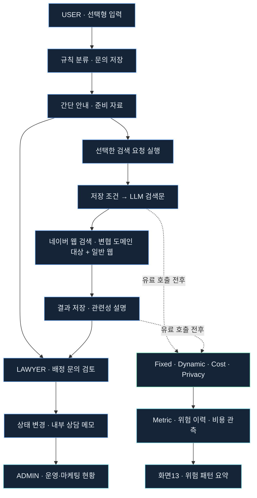
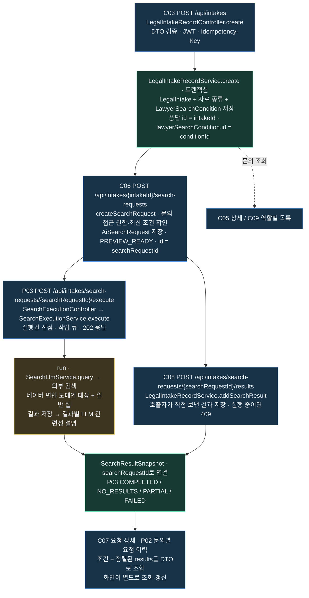
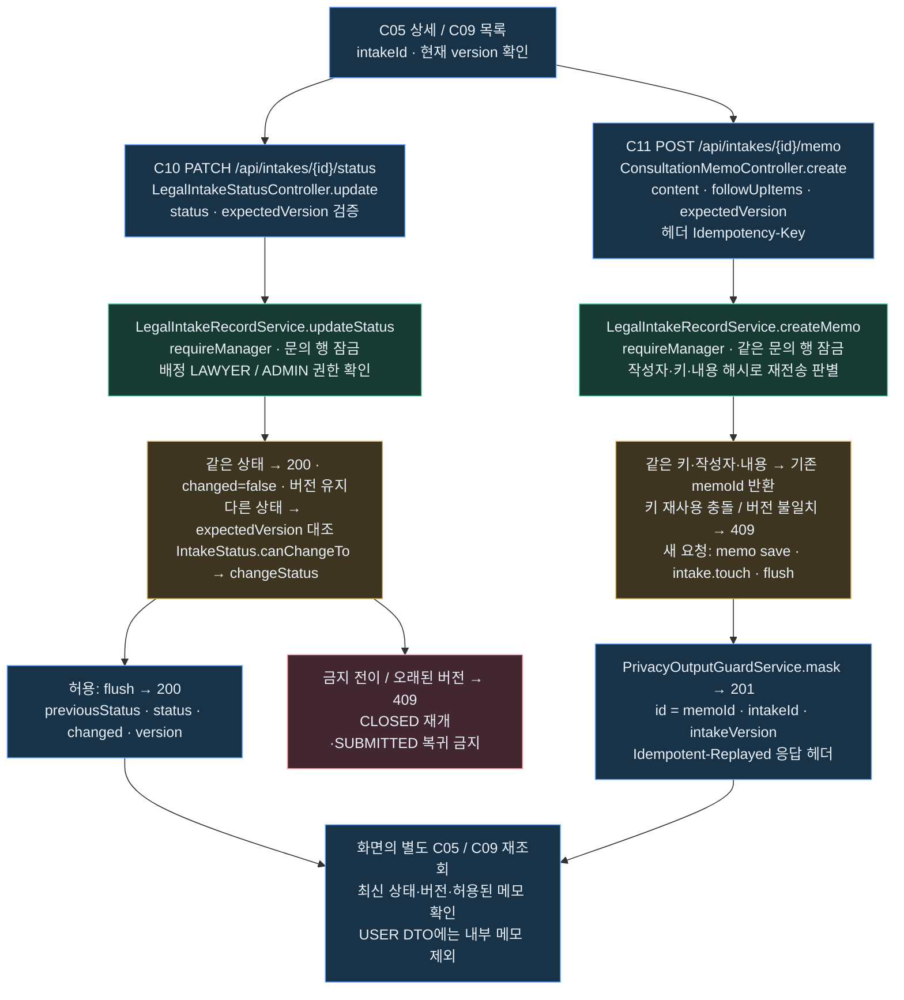
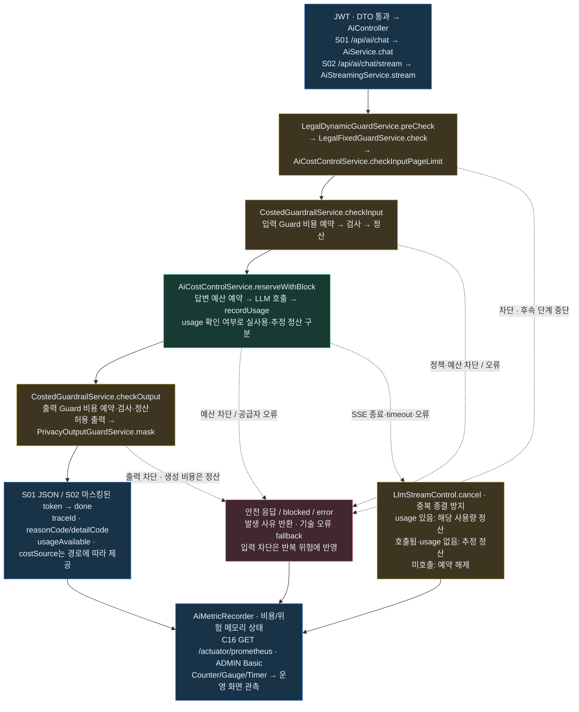

# Security-Aware Legal AI Intake System

**한국어** | [English](README.en.md)

> 고객은 선택하고, 챗봇은 정리하며, 운영자는 근거를 보고 통제합니다.

**최종 자료:** [팀 프로젝트 결과보고서 PDF · 76쪽](docs/presentation-pdfs/LEGAL_AI_INTAKE_TEAM_PROJECT_REPORT_FINAL_2026-10-26.pdf) · [보고서 목차·편집 원본](docs/presentation-2026-10-25/FINAL_REPORT_STRUCTURE.md)

전체·핵심 흐름도는 7쪽·12~16쪽, 전체 API 지도는 17쪽, 회고·확장 계획은 67~76쪽에서 확인할 수 있습니다.

## 목차

1. [PM Positioning](#pm-positioning)
2. [PM Multi-Layer Analysis](#pm-multi-layer-analysis)
3. [Problem → Solution](#problem--solution)
4. [Security Architecture](#security-architecture)
5. [차단 이유를 읽을 수 있어야 합니다](#차단-이유를-읽을-수-있어야-합니다)
6. [Product Introduction](#product-introduction)
7. [핵심 기능 Flow](#핵심-기능-flow)
8. [백엔드 구체적 흐름](#백엔드-구체적-흐름)
9. [핵심 API](#핵심-api)
10. [쉬운 운영 관리 · Boards](#쉬운-운영-관리--boards)
11. [직관적인 실시간 보안 관측·대응 시스템](#직관적인-실시간-보안-관측대응-시스템)
12. [Current Implementation](#current-implementation)
13. [Core Message](#core-message)
14. [이번 설계의 의미](#이번-설계의-의미)
15. [회고](#retrospective) · [오늘의 회고](#retrospective-today) · [시연·배포 체크리스트](#retrospective-preparation) · [앞으로의 확장 계획](#retrospective-expansion)

## PM Positioning

법률 문의를 상담 준비로 연결하고, AI의 보안·비용까지 운영할 수 있도록 설계한 PM 중심 프로젝트입니다.

**시장 문제 → 선택형 UX → 보안·비용 통제 → 운영 관측**을 하나의 흐름으로 연결했습니다.

[PM·보안·운영 핵심 PDF](docs/presentation-pdfs/PM_SECURITY_CORE_DARK_TABLET.pdf)

## PM Multi-Layer Analysis

하나의 서비스를 **시장·의뢰인·변호사·기술·보안·운영**의 여섯 관점으로 나누어 설계했습니다.

| 관점 | 설계에 반영한 내용 |
|---|---|
| **시장** | 초기 문의를 구조화해 상담 준비로 연결하고, 전환 손실 감소 가설을 검증할 기반을 만듭니다. |
| **의뢰인** | 법률 유형을 몰라도 선택할 수 있도록 짧은 설명·선택형 질문·준비 자료 안내를 제공합니다. |
| **변호사** | 사건 유형·당사자·자료를 상담 전에 확인해 기본 사실 확인과 쟁점 검토를 돕습니다. |
| **기술** | 입력·응답 계약을 정형화하고 DTO 검증·사유 코드·지표를 연결합니다. |
| **보안** | 위험 요청·반복 공격·과도한 비용을 통제하고 출력의 개인정보 재노출을 줄입니다. |
| **운영** | 문의·검색·상담 준비 현황과 차단 사유·비용·위험 이력을 근거로 판단합니다. |

전환 손실 감소는 제품 가설입니다. 현재 집계만으로 실제 전환율 개선을 입증했다고 설명하지 않습니다.

## Problem → Solution


## Security Architecture

| 통제 | 핵심 역할 |
|---|---|
| **Fixed Guard** | 탈옥·프롬프트 주입·법률 위해·비밀 요청·인증 우회 차단 |
| **Dynamic Guard** | 같은 세션의 반복 위험을 누적하고 세션 제한 |
| **Cost Control** | 입력·출력 범위와 예산을 확인하고 단계별 예약·정산 |
| **Privacy Output Guard** | 응답·SSE 출력의 개인정보 패턴 마스킹 |
| **Observability** | 사유 코드·비용·위험 이력·지표를 관리자 화면에서 확인 |

화면13은 **요청 위험 패턴 80점 차단 권고**와 **대화 누적 100점 등 세션 제한**을 구분해 보여줍니다.

## 차단 이유를 읽을 수 있어야 합니다

운영자는 **HTTP 상태 + 정책 사유 + 세부 사유 + 보호 결과**를 함께 확인합니다.

| 구분 | 대표 표시 | 읽는 기준 |
|---|---|---|
| 고정 정책 | `BLOCKED_JAILBREAK`, `BLOCKED_PROMPT_INJECTION`, `BLOCKED_LEGAL_HARM`, `BLOCKED_SECRET_REQUEST`, `BLOCKED_AUTH_BYPASS` | 어떤 위험 정책에 의해 입력이 차단됐는지 구분합니다. |
| 비용·입력 길이 | `COST_LIMIT_BLOCKED` / `REQUEST_TOO_LONG` | 공통 비용 사유와 세부 길이 사유를 구분합니다. 분기별 `reasonCode`·`detailCode`를 함께 읽습니다. |
| 세션 반복 제한 | `DYNAMIC_SESSION_BLOCKED` | 이전 위험 요청이 누적된 세션의 제한 상태입니다. 현재 문장만의 위험 판정과 다릅니다. |
| 개인정보 출력 보호 | 지원 패턴·필드의 마스킹, `PII_OUTPUT_MASKED` 보호 결과 표시 | 모든 요청의 `reasonCode`로 반환된다는 뜻이 아닙니다. 마스킹 결과·지표를 경로별로 확인합니다. |

AI 응답은 HTTP200이어도 `blocked`·`fallback`과 사유 필드를 함께 확인합니다. 개인정보 마스킹은 지원 패턴·필드 범위에 적용합니다.

## Product Introduction

**고객은 선택하고, 챗봇은 정리한다.**

문의 목적·사건 유형·당사자 위치·핵심 사실·보유 자료·다음 단계를 입력하면, 규칙·템플릿으로 문의 유형과 준비 자료를 안내합니다. 초기 안내는 LLM을 호출하지 않으며, 저장된 검색 조건을 활용하는 검색문 구성·관련성 설명을 별도 LLM 단계로 연결했습니다.

[제품 설명 PDF](docs/presentation-pdfs/PRODUCT_INTRODUCTION_DARK_TABLET.pdf)

| 사용자 | 사용하는 기능 |
|---|---|
| USER | 선택형 접수 → 간단 안내 → 공개 정보 검색 |
| LAWYER | 배정 문의 → 자료 확인 → 상태·내부 메모 |
| ADMIN | 전체 현황·배정 → 보안·비용 → 화면13 위험 요약 |

## 핵심 기능 Flow



변협 전용 API가 아닌 네이버 공개 웹 검색입니다. 내부 상담 메모는 USER 응답에서 제외하며, 개인정보 마스킹은 지원 패턴에 적용합니다.

<!-- BACKEND_CONCRETE_FLOWS:START -->
## 백엔드 구체적 흐름

HTTP 진입점 → 서비스·정책 → 저장·응답·관측을 세 흐름으로 연결했습니다. 현재 소스 기준이며 새 실행 검수 결과는 아닙니다.

### 1. 문의 등록 → 검색 요청 → 실행·결과 → 이력



- **자동 연쇄 실행이 아닙니다.** C03 저장, C06 요청 생성, P03 실행은 각각 별도 요청입니다. C08 수동 저장과 P03 내부 저장도 별도 경로입니다.
- `conditionId`는 서버가 연결하므로 C06 본문으로 다시 보내지 않습니다. 검색 실행·상세·결과 추가에는 `searchRequestId`, 문의별 이력에는 `intakeId`를 사용합니다.
- 조회·검색 접근은 문의 소유자·배정 변호사·ADMIN 범위입니다. P03의 PARTIAL 상태에서 `retryExplanation:true`를 보내면 저장 결과를 유지하며 미완료 설명만 재시도합니다.

### 2. 상태 변경·상담 메모 → 문의 재조회



- 상태와 메모는 **각각 별도 트랜잭션**이며 서로를 자동 호출하지 않습니다. 동일 문의 행 잠금으로 상태 변경·메모·재배정을 직렬화합니다.
- `expectedVersion`은 현행 호환 정책상 선택값입니다. 보내야 오래된 편집을409로 검출합니다. 같은 상태와 기존 메모 재전송 판별은 버전 검사보다 먼저 수행합니다.
- 메모 키가 없으면 같은 작성자·같은 내용의 기본120초 재전송 추정만 적용하며 영구 멱등 보장이 아닙니다. C11의201은 새 저장과 기존 응답 재전송 모두에 사용하므로 헤더·ID로 구분합니다.

### 3. AI 동기·SSE → 사유·비용·마스킹·지표



- S02는 공급자 원본 조각을 내부 버퍼에 모은 뒤 **전체 출력 검사·패턴 마스킹 후** 전송합니다. 원본 토큰을 실시간으로 그대로 중계하지 않습니다.
- 출력이 차단돼도 이미 생성한 답변 비용은 남습니다. 입력 Guard·답변·출력 Guard는 각각 비용 처리 단계입니다. C16 조회는 LLM을 호출하지 않습니다.
- `reason`은 기존 호환 필드이며 공통 사유·세부 사유가 항상 같은 의미는 아닙니다. `usageAvailable`·`costSource`가 없는 분기에서 임의의0·실측으로 해석하지 않습니다.
- 초기 화면02~04의 규칙·템플릿 안내와 이 S01·S02 AI 파이프라인은 구분합니다. Prometheus는 지표이고, DB 위험 이력·Incident는 별도 저장·조회 경로입니다.

[편집 원본·코드 대조 진입점](docs/presentation-2026-10-25/BACKEND_CONCRETE_FLOWS.md) · [제품 소개 PDF 11~13쪽](docs/presentation-pdfs/PRODUCT_INTRODUCTION_DARK_TABLET.pdf)
<!-- BACKEND_CONCRETE_FLOWS:END -->

## 핵심 API

| 기능 | 번호 | HTTP API |
|---|---|---|
| 로그인·현재 사용자 | C01 · P01 | `POST /api/auth/login` · `GET /api/me` |
| 분류·문의 접수 | C02 · C03 | `POST /api/intakes/classify-preview` · `POST /api/intakes` |
| 간단 안내 | C04 | `POST /api/legal-intake/minimal` |
| 문의 목록·상세 | C09 · C05 | `GET /api/intakes` · `GET /api/intakes/{id}` |
| 검색 요청·실행 | C06 · P03 | `POST /api/intakes/{intakeId}/search-requests` · `POST /api/intakes/search-requests/{searchRequestId}/execute` |
| 검색 결과·이력 조회 | C07 · P02 | `GET /api/intakes/search-requests/{searchRequestId}` · `GET /api/intakes/{intakeId}/search-requests` |
| 상태·메모 | C10 · C11 | `PATCH /api/intakes/{id}/status` · `POST /api/intakes/{id}/memo` |
| 운영·마케팅 | C12 · C13 | `GET /api/admin/dashboard/summary` · `GET /api/admin/dashboard/marketing-funnel` |
| 지표·위험 이력 | C16 · C17 | `GET /actuator/prometheus` · `GET /api/agent/risk/history` |
| AI 질문·SSE | S01 · S02 | `POST /api/ai/chat` · `POST /api/ai/chat/stream` |

[전체 화면·API·Controller 매핑 및 인증·Postman 입력값](docs/SCREEN_API_CONTROLLER_MAPPING.md)

업무 API의 JWT·역할/문의 접근 권한과 C16의 별도 ADMIN Basic 인증을 구분합니다. 운영 집계는 실데이터, 상담 후 전환·이탈 사유는 별도 더미 시연입니다.

## 쉬운 운영 관리 · Boards

마케팅·보안 현황 처리·고객·변호사 업무를 역할별 보드로 쉽게 관리합니다.

| 보드 | 운영 목적·기능 |
|---|---|
| **마케팅 보드** | 문의·검색·현재 상담 준비·유형/지역 분포 확인. 상담 후 전환·이탈 분석은 별도 더미 시연 |
| **보안 현황·처리 보드** | 차단·비용·보호 결과·위험 이력 확인, Incident 확인·종결 |
| **고객 보드** | 선택형 문의 접수·준비 자료 안내·검색 요청 |
| **변호사 보드** | 배정 문의·사건 자료 검토, 상태·내부 상담 메모 관리 |

## 직관적인 실시간 보안 관측·대응 시스템

**관측 → 위험 근거 확인 → 운영자 판단 → Incident 확인·종결**로 이어집니다.

C16 현재 지표·C17 위험 이력·Prometheus 시계열을 연결해 반복 차단·위험 행동·외부 전송 위험 신호를 쉽게 확인합니다. 실시간은 수집·갱신 주기 기준이며, 관측 화면이 모든 위험에 자동 대응하는 것은 아닙니다.

결측과 실제0, 실사용·추정·정산·진행 예약 비용을 구분합니다. `REQUEST_TOO_LONG`은 비용 세부 사유, `PII_OUTPUT_MASKED`는 보호 결과입니다. 요청80점 차단 권고와 대화 누적100점 등 세션 제한도 별도 기준입니다.

문의 단계별 집계만으로 실제 전환율·이탈률을 계산하지 않습니다. 실제 측정에는 고객 여정·상담 결과·수집 기준이 필요합니다.

## Current Implementation

```text
Minimal Legal Intake Flow
-> POST /api/legal-intake/minimal

Fixed Guard
-> Jailbreak / Prompt Injection / Legal Harm / Secret Request / Auth Bypass

Dynamic Guard
-> sessionId 기반 riskScore 누적과 반복 위험 세션 차단

Cost Control
-> 긴 입력과 예상 토큰 비용 제한

Privacy Output Guard
-> 개인정보 입력 허용, 출력 마스킹

Metric
-> guardrail block, cost block, dynamic block, privacy output masking, llm call prevented
```

보안·비용 흐름은 다크 태블릿용 PDF로 확인할 수 있습니다.

| 자료 | 주요 내용 |
|---|---|
| [Cost Control PDF](docs/presentation-pdfs/COST_CONTROL_DARK_TABLET.pdf) | A4~A7 예산 차단·생성 후 차단 개선, V02~V03·C1 실제 usage·예약 종료·OpenAI 증가 대조 |
| [Error Stop Flow PDF](docs/presentation-pdfs/ERROR_STOP_FLOW_DARK_TABLET.pdf) | A1 입력 101자·A2 비밀 요청 사전 차단, B2 시간 초과 후 추정 정산 |
| [Dynamic Guard PDF](docs/presentation-pdfs/DYNAMIC_GUARD_DARK_TABLET.pdf) | A3-1 같은 세션 위험 반복 차단, A3-2 정상 질문으로 바꿔도 차단 유지 |

각 PDF는 **실험 번호·제목 → 확인 의미 → 관측 결과 → 원본 캡처 → 비용·OpenAI 사용량 대조** 순서로 읽습니다. [전체 실험·결과 매칭표](docs/presentation-pdfs/EXPERIMENT_RESULT_MAPPING.md)에서 증거를 찾을 수 있습니다. 모의 장부와 실제 공급자 사용량을 구분하며, 기록이 없는 B1·C1-300은 미검증으로 남겼습니다.

## Core Message

```text
고객은 선택하고, 챗봇은 정리하며,
보안은 LLM 호출 전에 통제하고,
운영자는 metric으로 관찰한다.
```

## 이번 설계의 의미

최근 기업용 AI에서는 모델 활용과 함께 정책에 따른 사용 통제, 개인정보 보호, 비용 관리와 운영 관측을 중요하게 다루고 있습니다. [OpenAI의 보안·운영 구성](https://learn.chatgpt.com/docs/enterprise/security-cookbook)과 [Claude의 관리자 분석·비용 관리 기능](https://claude.com/resources/articles/giving-admins-more-visibility-and-control-over-claude-usage-and-spend)에서도 이러한 방향을 확인할 수 있습니다.

이번 프로젝트에서는 Fixed Guard, Dynamic Guard, Privacy Output Guard, Cost Control을 모듈로 나누고, reasonCode·Metric·운영 조회 API로 처리 결과를 확인할 수 있도록 설계·구현했습니다. 법률 문의 서비스에 이 구조를 적용하면서, 기업용 AI에서 중요하게 다루는 통제와 관측의 기초 구조를 직접 설계하고 구현해본 데 의미가 있습니다.

<!-- RETROSPECTIVE:START -->
<a id="retrospective"></a>
## 회고

개발하면서 얻은 기준, 2026-10-26 시연·배포 과정에서 겪은 오류와 예방 절차, 앞으로의 확장 계획을 하나로 정리했습니다.

**기능 연결뿐 아니라 정상·실패·차단 흐름과 비용·운영 결과까지 직접 설명하고 검증하는 것**을 다음 개발의 기준으로 삼습니다.

[시연·배포 회고 다크 모드 PDF · 9쪽](docs/presentation-pdfs/DEMO_DEPLOYMENT_RETROSPECTIVE_DARK_TABLET.pdf) · [회고·체크리스트 편집 원본](docs/presentation-2026-10-25/14_DEMO_DEPLOYMENT_RETROSPECTIVE.md)

<a id="retrospective-today"></a>
### 1. 오늘의 회고 · 2026-10-26

오늘 오류 11건 중 코드 버그는 2건뿐이고, 나머지 9건은 실행 위치·순서·접속 주소 등 실행 환경 문제였습니다.

> 핵심 교훈: "내 PC에서 된다"가 "다른 PC에서 된다"를 보장하지 않는다.

오류 건수와 수정 완료 상태는 제공받은 회고 기록 기준입니다. 이 문서는 실행 절차를 정리한 것이며, 실제 시연 직전 점검은 별도로 수행합니다.

#### 오늘 겪은 오류 11건

| 증상 | 원인 | 예방 |
| --- | --- | --- |
| 스크립트 경로 오류 | 관리자 창이 C:\WINDOWS\system32에서 시작 | 먼저 cd로 작업 폴더 이동 |
| vite 명령 없음 | 새 작업 폴더에 node_modules 없음 | npm install 먼저 실행 |
| npm run dev 실패 | 저장소 루트에서 실행 | frontend\legal-procedure-viewer에서 실행 |
| 127.0.0.1:5176 안 열림 | Vite가 localhost / ::1에만 바인딩 | --host 0.0.0.0으로 실행 |
| 옛 Previewer 화면 | 주소를 /로 열음 | /intake.html 또는 /operator.html 사용 |
| 외부검색 버튼 회색 | CSS가 항상 흐리게 표시 (코드 버그) | :disabled일 때만 회색 - 수정 완료 |
| 외부 PC 로그인 실패 | CORS 허용 출처에 LAN 주소 없음 | 시작 전 CORS_ALLOWED_ORIGIN_PATTERNS 설정 |
| 방화벽 규칙 거부 | 일반 PowerShell에서 실행 | 관리자 PowerShell에서 실행 |
| 외부 PC 문의 접수 실패 | crypto.randomUUID는 HTTPS·localhost에서만 사용 가능 (코드 버그) | 대체 UUID 생성 - 수정 완료 |
| 다운로드 파일 없음 | 오늘 받은 파일을 확인하지 않음 | 받은 파일 이름·날짜 확인 |
| 비용 숫자 초기화 | 메모리 예산 장부가 재시작 시 0으로 초기화 | 실제 비용은 OpenAI 사용량 화면에서 확인 |

<a id="retrospective-preparation"></a>
### 2. 사전 준비 · 시연 전날

시작 스크립트의 STOP 조건을 미리 없애는 단계입니다.

- [ ] **작업 폴더**: cd로 프로젝트 작업 폴더로 이동합니다. system32에서 시작하지 않습니다.

- [ ] **최신 코드**: git status가 깨끗한지 확인합니다. 패치는 적용 전에 검사합니다.

```powershell
git status
git apply --check <패치파일>
```

- [ ] **백엔드 JAR**: 백엔드 폴더에서 실행 파일을 빌드합니다.

```powershell
cd backend\guardrail-ready-policy-checker
.\gradlew.bat bootJar
```

- [ ] **프론트 의존성**: 프론트 폴더에서 먼저 의존성을 설치합니다.

```powershell
cd frontend\legal-procedure-viewer
npm install
```

- [ ] **키 파일**: .local\secrets\openai-key.dpapi가 있어야 합니다. 없으면 Set-LocalOpenAiKey.ps1을 실행합니다.

- [ ] **환경변수 충돌**: Windows 환경변수에 OPENAI_API_KEY·LLM_API_KEY가 없어야 합니다. 있으면 시작 스크립트가 STOP으로 멈춥니다.

- [ ] **포트**: 18090(Spring)·18181(모의)·18282(브리지)·5176(Vite)가 비어 있는지 확인합니다.

```powershell
Get-NetTCPConnection -State Listen -LocalPort 18090,18181,18282,5176
```

- [ ] **서버 IP**: ipconfig로 서버 PC의 IP를 확인합니다. 오늘 기록: 192.168.10.48. IP가 달라지면 뒤의 예시도 바꿉니다.

```powershell
ipconfig
```

- [ ] **남은 크레딧**: OpenAI 사용량 화면에서 남은 크레딧을 확인합니다.

### 3. 기동 순서 · 창 4개를 이 순서 그대로

각 단계는 앞 단계가 실행 중이어야 시작됩니다. 순서가 바뀌면 스크립트가 STOP으로 멈춥니다.

- [ ] **창 ① | 모의 provider**: Guard용 무료 모의 provider입니다. 저장소 루트에서 실행하며 18181 포트를 사용합니다.

```powershell
node frontend\legal-procedure-viewer\scripts\p03-mock-providers.mjs
```

이 창을 켜 둔 상태에서 다음 창을 시작합니다.

- [ ] **창 ② | 검색 브리지**: 실제 검색은 유료입니다. 저장소 루트에서 실행하고, 확인 질문에 y를 입력합니다. 18282 포트를 사용합니다.

```powershell
.\scripts\Start-OpenAiSearchBridge.ps1 -MaxSearches 20
```

최대 검색 횟수는 20회입니다. 브리지가 실행된 뒤 Spring을 시작합니다.

- [ ] **창 ③ | Spring**: 저장소 루트에서 CORS를 먼저 설정한 뒤 같은 창에서 서버를 시작합니다.

```powershell
$env:CORS_ALLOWED_ORIGIN_PATTERNS = (
  'http://127.0.0.1:[*],http://localhost:[*],' +
  'http://192.168.10.48:[*]'
)
.\scripts\Start-LlmTestServer.ps1 -Mode RealLlm `
  -SearchBridgePort 18282
```

READY: health=UP / lawyer search = OpenAI web search bridge 두 줄을 확인합니다.

- [ ] **창 ④ | Vite**: frontend\legal-procedure-viewer 폴더에서 실행합니다.

```powershell
cd frontend\legal-procedure-viewer
$env:API_PROXY_TARGET='http://127.0.0.1:18090'
npm run dev -- --host 0.0.0.0 --port 5176
```

Network: http://192.168... 줄이 보이는지 확인합니다.

CORS나 프록시 값을 바꾸면 해당 서버를 끄고 다시 시작해야 반영됩니다. Spring을 재시작하면 메모리 DB와 예산 장부도 초기화됩니다.

### 4. 외부 PC 접속

외부에는 5176 하나만 엽니다. Spring(18090)과 브리지(18282)는 127.0.0.1에 두고 Vite 프록시를 통해 연결합니다.

- [ ] **방화벽**: 관리자 PowerShell에서 5176만 엽니다. 네트워크 프로필과 -Profile을 맞춥니다.

```powershell
New-NetFirewallRule -DisplayName 'demo-5176' -Direction Inbound `
  -Protocol TCP -LocalPort 5176 -Action Allow -Profile Private
Get-NetConnectionProfile
```

- [ ] **CORS와 바인딩**: CORS에 서버 LAN 주소가 있고, Vite가 --host 0.0.0.0으로 실행 중이어야 합니다. IP 변경 시 CORS도 변경하고 Spring을 재시작합니다.

- [ ] **시연 PC에서 접속**: 오늘 서버 IP 기준입니다. 시연 PC와 서버 PC가 같은 Wi-Fi 또는 스위치에 연결돼 있어야 합니다.

```text
http://192.168.10.48:5176/intake.html
http://192.168.10.48:5176/operator.html
```

- [ ] **로그인부터 쓰기까지**: 시연 PC에서 로그인과 문의 접수까지 끝까지 확인합니다. 읽기만 되고 쓰기는 실패할 수 있습니다. Ctrl+F5로 새 코드도 받습니다.

브라우저는 HTTP LAN 주소를 보안 연결로 보지 않아 일부 기능을 제한합니다. 반드시 다른 PC에서 끝까지 확인합니다.

방화벽 규칙의 -Profile은 네트워크 프로필과 맞아야 합니다. Get-NetConnectionProfile 결과가 Public이면 -Profile Public으로 바꿉니다.

### 5. 시연 직전 스모크 테스트 · 10분

시연에서 보여 줄 흐름을 시연 PC에서 한 번씩 끝까지 확인합니다. 유료 검색은 1회(약 $0.01)만 사용하는 계획이며 실제 청구액은 사용량 화면에서 확인합니다.

- [ ] **서버 상태**: 서버 PC에서 health가 UP인지 확인합니다.

```powershell
Invoke-RestMethod http://127.0.0.1:18090/actuator/health
```

- [ ] **사용자 흐름**: 시연 PC에서 사용자 로그인 → 선택형 질문 → 문의 접수까지 성공합니다.

- [ ] **실제 LLM 안내**: 시연 PC에서 AI 간단 안내에 실제 LLM 답변이 나오는지 확인합니다.

- [ ] **외부 검색 1회**: 외부검색 버튼이 진한 파란색인지 확인하고, 변호사 검색 1회 후 출처 링크가 나오는지 확인합니다. 최대 90초 기다립니다.

- [ ] **정책 차단**: 탈옥 문장 1회가 BLOCKED_JAILBREAK으로 차단되는지 확인합니다.

- [ ] **운영자 화면**: 관리자 로그인 후 /operator.html의 화면13 그래프와 Incident가 보이는지 확인합니다.

- [ ] **남은 검색 횟수·비용**: 브리지 창의 검색 횟수와 비용 로그를 확인하고, 남은 횟수가 충분한지 확인합니다.

- [ ] **화면 노출 점검**: 비밀번호·키·민감한 터미널 창이 화면에 노출되지 않도록 확인합니다.

하나라도 실패하면 오늘 겪은 오류 표에서 증상을 찾습니다. 해결되지 않으면 시연 영상으로 대체합니다.

### 6. 종료·정리

시연이 끝나면 열어 둔 포트와 유료 프로세스를 바로 닫습니다.

- [ ] **검색 브리지 종료**: 총 검색 횟수·비용을 기록합니다.

```powershell
.\scripts\Start-OpenAiSearchBridge.ps1 -Stop
```

- [ ] **Spring 종료**: 서버를 종료합니다.

```powershell
.\scripts\Stop-LlmTestServer.ps1
```

- [ ] **Vite·모의 provider 종료**: 각 실행 창에서 Ctrl+C를 누릅니다.

- [ ] **방화벽 규칙 삭제**: 관리자 PowerShell에서 삭제합니다.

```powershell
Remove-NetFirewallRule -DisplayName 'demo-5176'
```

- [ ] **포트 종료 확인**: 시연용 포트가 모두 닫혔는지 확인합니다.

```powershell
Get-NetTCPConnection -State Listen -LocalPort 18090,18181,18282,5176
```

- [ ] **실제 비용 확인**: OpenAI 사용량 화면에서 오늘 사용한 비용을 확인합니다.

### 7. 운영 배포로 갈 때 추가할 것

HTTPS와 고정 배포 환경으로 실행 환경 차이를 줄입니다.

- [ ] **HTTPS**: 서비스를 HTTPS로 제공해 secure context 문제를 제거합니다.

- [ ] **정적 프론트 배포**: npm run build 결과물을 정적 배포합니다. Vite 개발 서버 대신 배포용 환경을 사용합니다.

- [ ] **동일 도메인**: 프론트와 API를 같은 도메인으로 묶어 CORS 설정을 최소화합니다.

- [ ] **JWT 비밀값**: JWT_SECRET을 비밀 저장소에서 주입합니다. 개발용 기본값을 사용하지 않습니다.

- [ ] **계정·관리자 인증**: 데모 계정을 제거하고 회원 DB와 관리자 MFA를 적용합니다.

- [ ] **업무·예산 영속 저장**: H2 메모리 DB를 영속 DB로 전환하고 예산 장부도 영속 저장합니다.

- [ ] **H2 콘솔**: 운영 배포에서 H2 콘솔을 비활성화합니다.

- [ ] **배포 전 회귀 검증**: 프론트 테스트·빌드와 백엔드 테스트를 모두 통과합니다.

```powershell
npm run test:intake
npm run test:operator
npm run build
.\gradlew.bat test
```

테스트 실행 위치: 프론트 명령은 frontend\legal-procedure-viewer, Gradle 명령은 backend\guardrail-ready-policy-checker입니다.

<a id="retrospective-expansion"></a>
### 8. 앞으로의 확장 계획

이번 프로젝트는 10월 기준 보안 중심 프로토타입입니다. 기존의 **12월 실무형 MVP 확장 목표**를 유지하며, Python·RAG·Vector DB를 학습하고 현재 구현의 검증 범위를 넓힐 계획입니다. 아래 항목은 현재 구현 완료 기능과 구분하는 향후 개발·학습 계획입니다.

| 순서 | 확장·학습 방향 | 구현할 내용과 확인 기준 |
|---|---|---|
| 1 | **Top–Middle–Bottom 백엔드 이해 강화** | API → Controller → Service·Policy → DB·외부 호출 → 응답·Metric을 추적합니다. 전체 흐름, 도메인 이벤트·정책, 실제 코드·검증 결과를 연결하고 정상·실패·차단 경로를 직접 설명합니다. |
| 2 | **시연 환경에서 운영 배포로 전환** | 위 체크리스트를 기준으로 HTTPS·정적 프론트 배포·동일 도메인·비밀값 주입을 정리합니다. 업무 DB와 예산 장부를 영속화하고, 다른 PC의 로그인·접수·검색·운영자 조회까지 검증합니다. |
| 3 | **Python Action으로 보안 확장** | NeMo Guardrails의 actions.py에 작은 정책 검사·마스킹 Action부터 연결합니다. 오류·시간 초과·권한 분기를 확인하고 기존 Spring의 차단·비용 정책과 연결합니다. |
| 4 | **공식 자료부터 RAG / Vector DB 증강** | 전자법원 등 공식 절차·양식·FAQ를 작은 검색 범위로 시작합니다. 검색 근거·출처·갱신일을 표시하고, 근거가 부족하면 답변을 제한합니다. 이후 권한별 내부 문서와 검색 내용의 주입 공격 검증으로 확장합니다. |
| 5 | **Attorney Summary** | 변호사에게 전달할 상담 전 요약을 생성합니다. 저장된 사실·보유 자료·미확인 항목을 구분하고 개인정보 보호와 검토 권한을 확인합니다. |
| 6 | **Kakao / Email Integration** | 고객 후속 안내·자료 요청·상담 연결을 구현합니다. 수신 동의·대상 권한·중복 발송·실패 재시도를 함께 설계합니다. |
| 7 | **Dashboard Enhancement** | 고객 여정과 상담 결과를 수집해 실제 문의 전환율·이탈 지점·사건 유형별 유입·기간별 추이를 분석합니다. 현재 단계별 집계와 상담 후 더미 시연을 실측 결과와 구분합니다. |
| 8 | **Antigravity·gemini-api 기반 개발·문서화 자동화** | 코드·API 목록·README를 대조하고, 시연영상 분석·자막·발표 자료 정리를 반복 가능한 작업으로 묶습니다. 생성 결과는 실제 코드와 테스트 결과로 대조하며 API 키·호출 비용도 별도로 관리합니다. |

**백엔드 이해 강화 → 운영 기반 정리 → 작은 Python Action → 공식 자료 RAG → 상담·후속 안내·분석 확장** 순서로 발전시키겠습니다. 모든 확장에서도 정상·실패·차단 회귀 검증을 유지합니다.

[회고 목차로 돌아가기](#retrospective) · [전체 목차로 돌아가기](#목차)
<!-- RETROSPECTIVE:END -->
