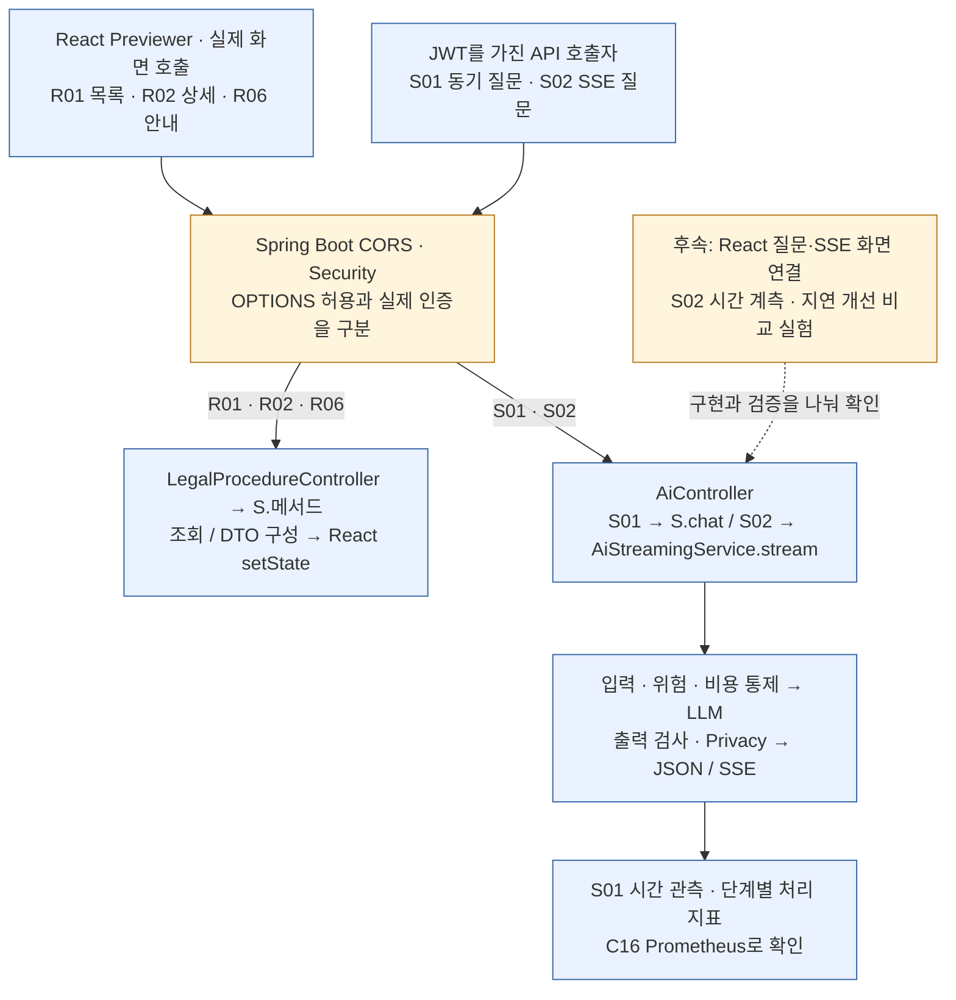
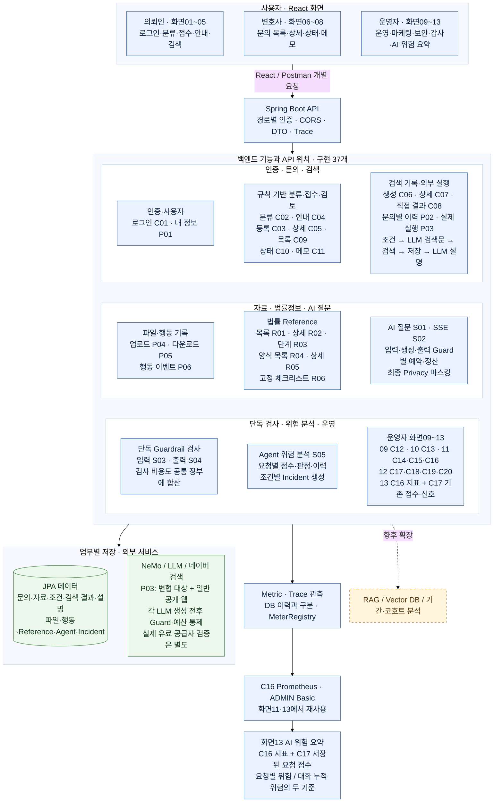
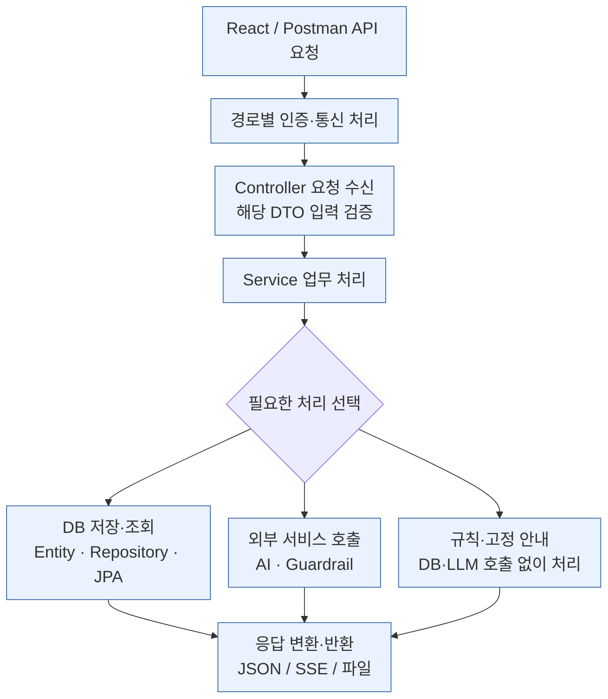
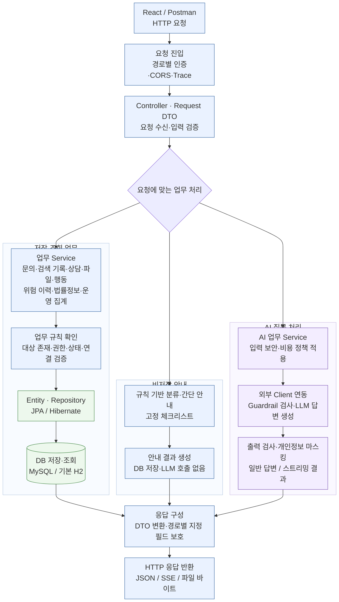
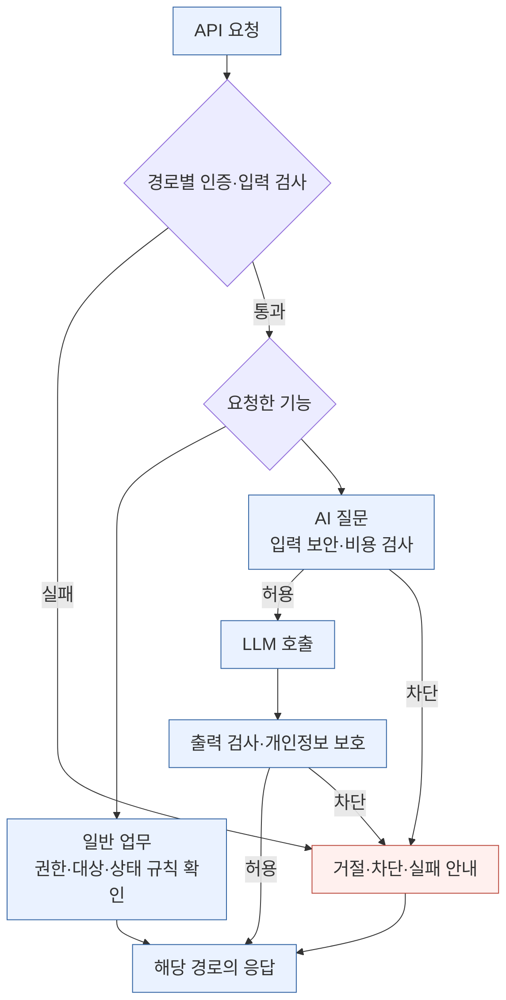
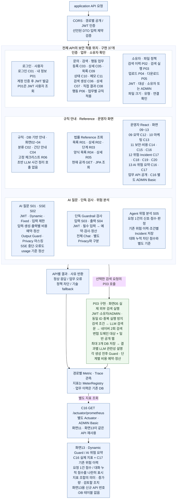
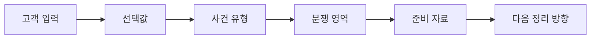

# Security-Aware Legal AI Intake System

**고객은 선택하고, 챗봇은 정리한다.** 선택형 Legal Intake Form으로 문의를 사건 유형·보유 자료·다음 단계로 구조화하고, 변호사의 상담 준비와 관리자의 AI 보안·비용 관측을 연결합니다.

[제품 정의와 Problem → Solution](#problem---solution) · [제품 소개 PDF](docs/presentation-pdfs/PRODUCT_INTRODUCTION_DARK_TABLET.pdf) · [PM·보안·운영 핵심 PDF](docs/presentation-pdfs/PM_SECURITY_CORE_DARK_TABLET.pdf)

아래 날짜별 기록의 테스트 수·미완료 항목은 각 검수 시점의 기록입니다. 제품 소개와 과거 검수 결과를 구분해서 읽어 주세요.

> **2026-10-23 베타:** 화면01~13과 P03·SSE·권한 처리를 포함한 로컬 시연용 소스입니다. 운영자 ADMIN 인가까지 적용했으며 실제 외부 호출·청구 검증과 재전송·상태 처리3건의 보완이 남아 있습니다. [베타 실행/Claude 인수인계](docs/BETA_HANDOFF_2026-10-23.md) · [남은 작업](docs/SCREEN01_12_REMAINING_TASKS.md).

**2026-10-22 현행 반영:** P03 실행·화면05 연결 구현, 운영자 React 화면09~13 구현. 화면13은 기존 C16/C17 재사용이며 새 API 번호·DB 테이블을 추가하지 않았다. 구현 API는 37개다. 외부 LLM·네이버 실제 키 호출·청구 검증은 아직 별도다.

> 2026-10-21 화면05~08 재검수: API·필드·ID·공통 React·라우팅 확인, 실제 API 왕복4개·추가 HTTP20개·React135개·백엔드169개 검증. P03 빈 본문 기본값 수정. 개발용 공개 경로·C08 서버 검증은 보완 필요. [전체 대조·판정](docs/SCREEN05_08_INTEGRATION_REVIEW.md).

> 2026-10-21 P03 구현: LLM 검색문 생성 → 네이버 웹문서 검색 → 기존 요청 ID에 결과 저장 → LLM 관련성 설명과 화면05 실행·폴링·설명 재생성을 연결했다. 실제 키는 미설정이며 **로컬 모의 제공자로 검증**했다. [API·ID·인증·구현·검수·설정](docs/P03_EXTERNAL_SEARCH_REVIEW.md).

> 2026-10-21 SSE 보완: usage 확인/미확인·발송 전 해제, HTTP 취소·본문 deadline, 예약 1회 종료, 한국 시간 예약일 정산과 마스킹을 연결했다. **백엔드 148개 테스트·실행 JAR 빌드 통과**. [구현·예외 처리·검증](docs/SSE_COST_LIFECYCLE_REVIEW.md).

> 2026-10-21 화면01~04 통합 재검수: **공유 API/React 128개·실제 API 13개·빌드 통과**. 로그인→접수→안내 브라우저 흐름과 4개 화면 반응형 확인. 02·03 R02 분야 대조와 미분류 참고 안내 보완. C05는 현재 공개 조회이며 소유자 인가는 별도다. [이번 통합 필드·ID·인증·구현 검수](docs/SCREEN01_04_INTEGRATION_REVIEW.md). 아래 개별 수치·미확인 기록은 이전 회차의 기록이다.

[한국어](README.md) | [English](README.en.md)

2026-10-21 화면01: 첨부 로그인 디자인을 공통 컴포넌트로 구현하고 C01 로그인 → P01 내 정보·실제 역할 확인, 계정 화면·로그아웃·공개 데모를 연결했다. 기본 `intake.html`도 로그인으로 진입한다. [실행 화면](http://127.0.0.1:5175/intake.html#/login), [API·필드·ID·인증·검수서](docs/SCREEN01_REACT_REVIEW.md). API/React 테스트 **126개·빌드 통과**, C01/P01 실제 검수 통과다. 전체 실연동 회귀는 JVM 종료로 14/17이며 재실행 권한 요청 거절로 3개 미확인이다. 아래 이전 수치는 각 회차 기록이다.

2026-10-21 화면04 보완: C05 접수 내용·보호 결과 → C04 간단 안내, R01 실제 코드 → R02 절차, 형사 R06을 React 공통 디자인·컴포넌트·라우팅에 연결했다. 표 너비·모바일 표시와 응답 필드·ID·상태·절차 domain 검증을 보완했다. [화면04 검수서](docs/SCREEN04_REACT_REVIEW.md), [실행 화면](http://127.0.0.1:5175/intake.html#/intake/8). 이번 intake 공유 검수 **128개 및 빌드 통과**. 아래 이전 수치는 각 구현 회차의 기록이다.

2026-10-21 화면05: 첨부 검색 조건·요청·이력·결과 화면을 React 공통 디자인/라우팅으로 구현하고 C05/C06/C07/C08/P02에 연결했다. **후속 구현에서 P03 실행·폴링·설명 재시도를 연결했다.** 최초 준비 화면 검수 기록과 현재 구현을 구분한다. [화면05 API·필드·ID·인증·검수 기록](docs/SCREEN05_REACT_REVIEW.md), [실행 화면](http://127.0.0.1:5175/intake.html#/intake/1/search/1). 최신 intake 검수 122개와 빌드는 통과했다. 운영자 회귀 7개는 로컬 통신 제한 및 재실행 권한 요청 거절로 이번 회차 미확인이다. 아래 125개 등 이전 수치는 해당 화면 구현 시점의 기록이다.

## 개발 필수 요구사항 체크

**2026-10-19 코드 대조.** 두 필수 요소를 구현·화면 연결·실행 확인·성능 검증으로 나누어 추적한다. 새 API 번호를 추가하는 표가 아니며 기존 37개 항목과 과제 Previewer 범위를 유지한다.

| 체크 | 필수 요소·관련 API | 현재 구현과 남은 확인 |
|---|---|---|
| REQ-01 | Spring Boot–React 연동 · R01·R02·R06 | Previewer의 async/await fetch와 목록·상세·체크리스트 상태 갱신 구현. 브라우저 실행 근거는 확인 절차에 따라 기록 |
| REQ-02 | CORS · `/api/**`·`/actuator/**` 공통 | WebMvcConfig 설정을 SecurityConfig의 두 체인에 연결. OPTIONS 테스트 코드 존재. 실제 요청의 JWT·ADMIN Basic 인증은 별도 검사 |
| REQ-03 | LLM 질문 · S01·S02 | AiController → S.chat / AiStreamingService.stream 백엔드 구현. React 질문 화면·외부 서비스 실행 결과 연결은 후속 |
| REQ-04 | 비동기 데이터 처리 · React 조회·S02 | React async/await와 서버 sendAsync·콜백·SseEmitter 구현. React JWT POST·SSE 수신 UI 연결은 후속 |
| REQ-05 | 응답 지연 시간 최적화 · S01·S02·C16 | Java 21 웹 요청 가상 스레드 설정, 사전 차단·출력 상한·타임아웃·S01 시간 관측 구현. 실행 스레드 확인·S02 계측·동시 처리량 및 P50·P95 비교는 후속 |

**LLM API 활용 질문 시스템 개발 + 응답 지연 시간 최적화 — 가상 스레드 적용:** 이번 프로젝트는 Java 21과 Spring Boot를 사용하고, 기본 설정에서 웹 요청을 가상 스레드로 처리하도록 구성했다. 특히 S01 AI 질문은 입력 검사 → 외부 LLM 호출 → 출력 검사처럼 네트워크 응답을 기다리는 구간이 많다. 기존 동기식 Controller–Service 구조를 유지하면서 여러 요청의 I/O 대기를 처리하기 위한 적용이며, 한 답변의 생성 속도보다 동시 요청 처리에 목적이 있다. 설정 위치는 [application.properties:2](backend/guardrail-ready-policy-checker/src/main/resources/application.properties#L2)의 `spring.threads.virtual.enabled=true`이며, 대표 경로는 **S01: AiController.chat → S.chat → 입력 NeMo → LLM → 출력 NeMo**다. S02의 비동기 콜백 실행 스레드는 별도 확인하며, 실제 동시 처리량·지연 개선 수치는 비교 실험 후 제시한다.



Controller는 URL·DTO 검증·응답 통로를 맡고 Service는 조회·업무 판단·비용·외부 Client를 조율한다. 같은 이름의 Service는 `→ S.`로 줄이며 다른 이름은 전체 표시한다. CORS는 업무 Controller·Service 앞의 공통 설정이고 C16은 Spring Boot Actuator 경로다. S02는 전체 답변을 모아 출력 검사·마스킹한 뒤 전송하므로 비동기 구현을 곧바로 첫 답변 시간 단축 실적으로 표시하지 않는다.

전용 페이지·확인 절차·실제 코드: [개발 필수 요구사항 Check / Flow / 기능 / Code Mapping](docs/DEVELOPMENT_REQUIREMENTS_CHECK.md). 같은 전용 페이지를 [API 기능서 flow 및 기능mapping표](docs/BACKEND_DRAFT_STATUS_AND_API_SPEC.md)와 [DDD · Policy / Read Model / Code](docs/BACKEND_DDD_POLICY_READ_CODE_MAPPING.md)에도 포함했다.

요구사항만 읽는 PDF: [일반](output/pdf/DEVELOPMENT_REQUIREMENTS_CHECK_TABLET.pdf) · [다크](output/pdf/DEVELOPMENT_REQUIREMENTS_CHECK_DARK_TABLET.pdf). 이 README 갱신은 새 React 화면 구현이나 새 성능 실험 실행을 뜻하지 않는다.

최종 시연은 [시연 흐름과 최소 실행 근거](docs/DEMO_FLOW_AND_EVIDENCE.md)를 기준으로 문의·검색·상담 검토, 개발 필수 흐름, **P03 구현 후 실제 LLM·검색 실행과 Cost Control 예약·정산·차단**까지 연결한다. P03은 구현·모의 검증을 마쳤으며 실제 키로 검색 품질·usage·청구를 확인하는 단계가 남아 있다.

## Controller → Service 분기·공유 구조 읽기

**백엔드 구조를 읽는 핵심 안내:** API별 기능을 확인한 다음, 어디서 처리 경로가 갈라지고 여러 진입점이 어느 Service의 규칙을 공유하는지 함께 읽는다. Controller는 HTTP 진입점·입력·응답 통로를 나누고, Service는 같은 업무의 규칙·저장·조회·외부 호출을 조율한다.

```text
같은 AI 질문·답변 업무 · AiController
├─ S01 chat()       → S.chat() → 완성된 JSON 한 번
└─ S02 chatStream() → AiStreamingService.stream() → SSE 이벤트 전달

같은 문의 업무의 여러 진입점
├─ C02: 사건 분류 미리보기
├─ C03·C05~C09: 문의 등록·조회·검색 기록
├─ C10: 상태 변경
├─ C11: 상담 메모
└─ P02: 문의별 검색 이력
   → LegalIntakeRecordService의 해당 업무 메서드와 규칙을 공유

P02 한 요청의 순차 조합
IntakeSearchHistoryController.history()
  → ① IntakeAccessService.requireAccess()
  → ② LegalIntakeRecordService.findSearchRequests()
```

S01·S02는 모두 Chat이며, 응답 전달과 연결 관리 책임이 달라 Service를 나눈다. 비동기 여부는 실제 `sendAsync`·콜백·`SseEmitter` 구현으로 확인한다. 문의의 분류·상태·메모는 같은 문의의 규칙을 사용하므로 Service를 공유한다. P02는 접근 확인 후 조회하는 순서다. 같은 Service를 쓴다고 다른 API까지 함께 실행되지는 않는다. 같은 이름의 Controller → Service는 `→ S.`로 줄이고, 다른 이름은 전체 표시한다.

전체 목록: [Controller → Service 분기·공유·응답 조합 가이드](docs/BACKEND_CONTROLLER_SERVICE_BRANCH_MERGE_GUIDE.md) · **[다크 모드 전용 PDF · 36페이지](output/pdf/BACKEND_CONTROLLER_SERVICE_BRANCH_MERGE_DARK_TABLET.pdf)**.

가이드는 **Controller 19개 · Service 18개**, 공유 Service 9개, 내부 업무 흐름 15개와 코드 참조 128곳을 담는다. 이번 프로젝트와 과제 Previewer의 **37개 항목 = Controller API 36개 + Actuator C16**을 확인표로 대조하며, 별도 업무 Service가 없는 인증·내 정보·Actuator도 구분한다.

권장 읽기 순서: **전체 서비스 흐름 → API 기능서·Flow Mapping → 분기·공유 가이드 → DDD · Policy / Read Model / Code → 실제 코드**. [API 기능서·Flow Mapping](docs/BACKEND_DRAFT_STATUS_AND_API_SPEC.md)에서 기능별 처리를 보고, [DDD · Policy / Read Model / Code](docs/BACKEND_DDD_POLICY_READ_CODE_MAPPING.md)에서 업무 규칙과 데이터·코드의 연결을 이어 읽는다.

## 전체 서비스 구성 및 사용자 흐름

먼저 전체 그림에서 기능의 위치를 확인하고, **API 번호 → API 목록 → 개별 flow·기능표 → 코드** 순서로 내려간다. 기능 옆의 C/R/S/P 번호는 API 목록과 같은 ID이며, P03은 구현된 검색 실행 API다.



전체도 원본: [01_SYSTEM_OVERVIEW.md](C:/myLectureWs/legal-ai-intake-security-server/docs/diagrams/01_SYSTEM_OVERVIEW.md) · [Mermaid 소스](C:/myLectureWs/legal-ai-intake-security-server/docs/diagrams/01_SYSTEM_OVERVIEW.mmd).

## API 전체지도

기준: **2026-10-22**. 전체 API는 **37개 = C 20개 + R 6개 + S 5개 + P 6개**이며, **P03을 포함해 37개 모두 구현**되어 있다. 같은 API를 여러 화면에서 사용해도 한 번만 센다. 표의 입력·성공 계약은 [API_STATUS_SPEC.md](docs/API_STATUS_SPEC.md)와 [개별 flow·기능mapping표](docs/BACKEND_DRAFT_STATUS_AND_API_SPEC.md)를 기준으로 한다. 화면 번호는 연결 설계이며 화면 구현 완료를 뜻하지 않는다.

**P는 S로 변경되지 않았다.** S01~S05는 AI·Guardrail 보조 기능, P01~P06는 추가 공통·검색·파일·행동 기능의 추적 ID다. P03 실제 외부 검색 실행도 구현 항목으로 포함하며, JWT·소유자/ADMIN 검사를 적용한다.

### 접수·검색·상담 검토

| ID / 화면 | 기능 | HTTP API | 입력 | 성공 응답 / 동작 | Controller |
|---|---|---|---|---|---|
| C01 / 01 | 로그인 | `POST /api/auth/login` | `username`, `password` 필수 | 200: `accessToken`, `username`, `role` | `AuthController` |
| C02 / 02 | 사건 분류 미리보기 | `POST /api/intakes/classify-preview` | `coreStatement` 필수·최대 100자, `caseType` 선택 | 200: 분류·권장 자료·안내, 무저장 | `LegalIntakeClassificationController` |
| C03 / 03 | 문의 등록 | `POST /api/intakes` | Intake JSON, JWT 선택(전달 시 소유자 기록) | 201: `LegalIntakeResponse`, 자료 종류·검색 조건 동시 저장, uploadedDocuments는 초기 빈 배열 | `LegalIntakeRecordController` |
| C04 / 04 | 간단 안내 생성 | `POST /api/legal-intake/minimal` | `MinimalLegalIntakeRequest` | 200: 규칙 기반 유형·권장 자료·안내. 저장·LLM 없음. | `MinimalLegalIntakeController` |
| C05 / 04·07 | 문의 상세 | `GET /api/intakes/{id}` | Path `id` | 200: 문의·자료·조건·상담 메모·uploadedDocuments | `LegalIntakeRecordController` |
| C06 / 05 | 검색 요청 생성 | `POST /api/intakes/{intakeId}/search-requests` | Path ID, JSON `{}` 또는 목적·출처 | 201: `AiSearchRequestResponse`, `PREVIEW_READY` | `LegalIntakeRecordController` |
| C07 / 05 | 검색 요청 상세 | `GET /api/intakes/search-requests/{searchRequestId}` | Path ID | 200: 요청·검색문·정렬된 결과 | `LegalIntakeRecordController` |
| C08 / 05 | 결과 스냅샷 저장 | `POST /api/intakes/search-requests/{searchRequestId}/results` | 출처·제목·URL, 요약·순서 | 201: 결과 포함 검색 요청 DTO | `LegalIntakeRecordController` |
| C09 / 06 | 문의 목록 | `GET /api/intakes` | 없음 | 200: 최신순 최대 50개 `LegalIntakeResponse[]` | `LegalIntakeRecordController` |
| C10 / 08 | 상태 변경 | `PATCH /api/intakes/{id}/status` | Path ID, `status` 필수 | 200: `id`, `previousStatus`, `status`, `changed` | `LegalIntakeStatusController` |
| C11 / 08 | 상담 메모 추가 | `POST /api/intakes/{id}/memo` | Path ID, `content` 필수, `followUpItems` 선택 | 201: ID·마스킹 본문·후속 조치·생성 시각 | `ConsultationMemoController` |

### 운영·마케팅·감사

큰 흐름: [운영자 화면 09~13 · 데이터 축적 → 조회·집계 → Incident 확인·종결](docs/diagrams/04_OPERATOR_OPERATIONS_MARKETING_AUDIT_FLOW.md). C12~C20의 Controller–Service 연결도 함께 정리했다.

React 구현과 코드 대조: [운영자 09~12 · API·요청/응답·ID·인증·React 연결표](docs/OPERATOR_09_12_API_REACT_MAPPING.md). `frontend/legal-procedure-viewer/operator.html#/overview`에서 공통 헤더와 화면09~13의 5개 화면을 사용한다. 화면13은 #/observability이며 C16/C17을 재사용한다. C12~C20 중 C16은 ADMIN Basic이며, 나머지 운영 업무 API는 현재 서버 설정상 공개 접근이다.

2026-10-21 화면06: [접수된 문의](http://127.0.0.1:5175/intake.html#/lawyer/intakes)를 C09에 연결했다. 첨부 디자인의 업무 레이아웃, 최신 최대 50건 기준 통계·필터·정렬·새로고침, 실제 ID의 C05 상세와 목록 복귀를 구현했다. 요청·응답·ID·인증·공통 React 구성과 검수는 [화면06 구현·검수 기록](docs/SCREEN06_REACT_REVIEW.md)에 정리했다. C09/C05의 변호사 전용 인가는 운영 전 보강 사항이다.

2026-10-21 상세 확장: 사용자 첨부 화면08의 문의 상세를 C05/P05에, 화면07의 상태 변경·메모를 C05/C10/C11에 연결했다. 상세·상태/메모·목록 간 실제 문의 ID를 유지하고 JWT 소유자·관리자 파일 다운로드를 검수했다. 최신 빌드와 테스트 125개가 통과했다. [문의 상세 API·React 대조](docs/SCREEN08_REACT_REVIEW.md), [상태·메모 대조](docs/SCREEN07_REACT_REVIEW.md)에 구현 범위와 서버 인가 한계를 구분했다.

09~13은 모두 React 컴포넌트로 구현했다. 화면13의 구현·검수는 [별도 기록](docs/SCREEN13_OBSERVABILITY_REVIEW.md)에 있다. 2026-10-20 통합 검수에서 문의·검색·상태·행동 기록 → 마케팅 집계, 위험 분석·인증 거절 → DB/지표 → 운영 화면, Incident 선택 → 확인·해결 → 목록·운영 요약 재조회까지 확인했다. 빌드와 테스트 18개가 통과했으며 [실제 API·브라우저 검증 기록](output/verification/OPERATOR_09_12_FULL_FLOW_CHECK.json)을 남겼다. 관리자 권한 강제·서버 Incident 상태 전이 검증은 별도 보강 사항으로 매핑 문서에 구분했다.

| ID / 화면 | 기능 | HTTP API | 입력 | 성공 응답 / 동작 | Controller |
|---|---|---|---|---|---|
| C12 / 09 | 운영 요약 | `GET /api/admin/dashboard/summary` | 없음 | 200: Agent 실행·위험 이력·보안 이벤트·열린 Incident 수, `riskSummary` | `AdminDashboardController` |
| C13 / 10 | 마케팅 기본 집계 | `GET /api/admin/dashboard/marketing-funnel` | 없음 | 200: 접수·검색·현재 상담 준비 수, 분포, 보고된 행동 이벤트 수 | `MarketingDashboardController` |
| C14 / 11 | 최근 보안 이벤트 | `GET /api/admin/dashboard/security-events` | 없음 | 200: 최근 최대 50개 보안 이벤트 배열 | `AdminDashboardController` |
| C15 / 11 | 위험 집계 | `GET /api/agent/risk/summary` | 없음 | 200: 전체·등급별·결정별·조치별 수 | `AgentRiskHistoryController` |
| C16 / 11·13 | Prometheus 지표 | `GET /actuator/prometheus` | ADMIN Basic 인증 | 200: Prometheus 텍스트. Registry·노출 설정 있음. | Spring Boot Actuator |
| C17 / 12·13 | 위험 이력 | `GET /api/agent/risk/history` | Query `riskLevel`, `decision` 선택(riskLevel 우선) | 200: 위험 이력 배열 | `AgentRiskHistoryController` |
| C18 / 12 | Incident 목록 | `GET /api/incidents` | 없음 | 200: 최근 Incident 배열 | `RiskIncidentController` |
| C19 / 12 | Incident 확인 | `PATCH /api/incidents/{incidentId}/ack` | Path ID | 200: 변경된 Incident DTO | `RiskIncidentController` |
| C20 / 12 | Incident 종결 | `PATCH /api/incidents/{incidentId}/resolve` | Path ID | 200: 변경된 Incident DTO | `RiskIncidentController` |

### 법률 Reference API

| ID / 화면 | 기능 | HTTP API | 입력 | 성공 응답 / 동작 | Controller |
|---|---|---|---|---|---|
| R01 / 02 보조 | 절차 목록 | `GET /api/legal/procedures` | Query `domain` 선택 | 200: `code`, `domain`, `title`, `summary`, `userRole` 배열 | `LegalProcedureController` |
| R02 / 02·03·04 보조 | 절차 상세 | `GET /api/legal/procedures/{code}` | Path `code` | 200: 기본 정보·`steps`·`forms`·`knowledgeGraphEdges` | `LegalProcedureController` |
| R03 / 03 보조 | 절차 단계 | `GET /api/legal/procedures/{code}/steps` | Path `code` | 200: 순서·코드·제목·설명·체크리스트 배열 | `LegalProcedureController` |
| R04 / 03 보조 | 양식 목록 | `GET /api/legal/forms` | Query `procedure` 선택 | 200: 양식 코드·절차 코드·제목·파일 유형·사용 안내 배열 | `LegalProcedureController` |
| R05 / 03 보조 | 양식 상세 | `GET /api/legal/forms/{formCode}` | Path `formCode` | 200: 양식 DTO | `LegalProcedureController` |
| R06 / 04 보조 | 형사 보완수사 체크리스트 | `GET /api/legal/criminal/checklist/supplementary-investigation` | 없음 | 200: `domain`, `role`, `stageCode`, `stageLabel`, `checklist`, `recommendedAction` | `LegalProcedureController` |

### AI·Guardrail 보조 API

S01~S05는 AI 처리·보안 검사·검증을 위한 백엔드 API로, 현재 서비스 범위에서는 **별도 전용 화면이 불필요**하다. 화면 지정을 보류했거나 향후 화면 개발이 남았다는 의미가 아니다.

화면13의 C16·C17 재사용을 포함한 [운영자 화면09~13 API 연결표](docs/SCREEN09_13_API_CONNECTIONS.md)를 함께 참고한다.

| ID / 화면 | 기능 | HTTP API | 입력 | 성공 응답 / 동작 | Controller |
|---|---|---|---|---|---|
| S01 / AI 질문·별도 화면 불필요 | 동기 AI Chat | `POST /api/ai/chat` | `message` 필수·DTO/Cost 기본 최대 100자, `sessionId` 선택 | 200: `answer`, `blocked`, `fallback`, `traceId`, `model`, 호환용 `reason`, `reasonCode`, `detailCode`, `usageAvailable`, `costSource` | `AiController` |
| S02 / AI 질문·별도 화면 불필요 | SSE AI Chat | `POST /api/ai/chat/stream` | `message` 필수·DTO/Cost 기본 최대 100자, `sessionId` 선택 | `text/event-stream`; meta 후 전체 답변 검사·마스킹 완료 시 token/done. done에 usageAvailable·costSource, 미확인 토큰 수는 null | `AiController` |
| S03 / 단독 검사 | Input Guardrail 단독 검사 | `POST /api/legal/guardrail/input` | `message` 필수 | 200: `status`, `allowed`, `content`, `rail`, `traceId` | `LegalGuardrailController` |
| S04 / 단독 검사 | Output Guardrail 단독 검사 | `POST /api/legal/guardrail/output` | `response` 필수 | 200: `status`, `allowed`, `content`, `rail`, `traceId` | `LegalOutputGuardrailController` |
| S05 / 운영 보조 | Agent 위험 분석 | `POST /api/agent/risk/analyze` | `userInput`, `toolName`, 재시도·토큰 수, 위험 신호 Boolean 등 | 200: `decision`, `riskScore`, `riskLevel`, `signals`, `recommendedAction`, `guardrailReady`, `historyId`, `traceId` | `AgentRiskDecisionController` |

### 추가 공통·파일·행동 API

| ID / 화면 | 기능 | HTTP API | 입력 | 성공 응답 / 동작 | Controller |
|---|---|---|---|---|---|
| P01 / 01·공통 | 내 정보 | `GET /api/me` | Body 없음. JWT 필수 | 200: username, role | `CurrentUserController` |
| P02 / 05 | 문의별 검색 이력 | `GET /api/intakes/{intakeId}/search-requests` | Path `intakeId`. JWT·소유자 또는 관리자 | 200: 최신순 검색 요청·결과 배열, 없으면 [] | `IntakeSearchHistoryController` |
| P03 / 05 | 실제 외부 검색 실행 | `POST /api/intakes/search-requests/{searchRequestId}/execute` | JWT·소유자/ADMIN, Path ID, 본문 생략 또는 `{retryExplanation?:boolean}` | 202 요청 DTO+execution. 조건→LLM 검색문→네이버 변협 대상/일반 검색→최대3개 저장→결과별 LLM 설명. C07/P02 조회·PARTIAL 설명 재시도 | `SearchExecutionController` → `SearchExecutionService` |
| P04 / 문의 상세·공통 | 파일 업로드 | `POST /api/intakes/{intakeId}/documents` | Path `intakeId`. JWT·소유자/관리자, multipart file 필수, documentType 선택 | 201: id·intakeId·documentType·originalFilename·contentType·sizeBytes·createdAt·downloadUrl | `IntakeDocumentController` |
| P05 / 문의 상세·공통 | 파일 다운로드 | `GET /api/intakes/{intakeId}/documents/{documentId}/download` | Path `intakeId`, `documentId`. JWT·소유자/관리자, 문의·파일 연결 확인 | 200: 파일 바이트, attachment·nosniff·no-store, 다운로드 요청 기록 | `IntakeDocumentController` |
| P06 / 행동 수집·공통 | 행동 이벤트 기록 | `POST /api/intake-events` | eventId·eventType·sessionId 필수, intakeId 선택. SUMMARY_VIEWED는 intakeId 필수 | 최초 201/created=true, 동일 재전송 200/false, 다른 내용으로 ID 재사용 409 | `IntakeEventController` |

## API 번호로 보는 서비스·백엔드·보안 흐름

| 흐름도 | 읽는 관점 | API 번호 지도에 표시한 구현 API | 빠진 번호·이유 |
|---|---|---|---|
| [01_SYSTEM_OVERVIEW.md](docs/diagrams/01_SYSTEM_OVERVIEW.md) | 전체 서비스 구성·사용자 흐름·모듈 위치 | **37/37** | 없음. P03 구현·화면09~13 포함 |
| [02A_BACKEND_FLOW.md](docs/diagrams/02A_BACKEND_FLOW.md) | 제출용 백엔드 처리 구조 | [참고 번호 지도 37/37](docs/diagrams/02A_BACKEND_FLOW_API_MAP.md) | 제출도는 API 번호를 생략하고 업무·데이터 흐름에 집중. 기존 보조 Job은 확대 부록 |
| [02_BACKEND_SECURITY_FLOW.md](docs/diagrams/02_BACKEND_SECURITY_FLOW.md) | 인증·업무 검사·AI Guard·차단·출력 보호 | **37/37** | 없음. P03 및 화면13 C16/C17 재사용 포함 |

전체도·보안도·참고 API 지도에서는 기능 항목 옆 번호로 위치를 찾는다. 묶인 번호는 별도 API이며 자동 호출 순서를 뜻하지 않는다. 백엔드 제출도는 번호를 생략하고 처리 구조를 보여준다. 참고 API 지도에는 구현 37개 모두의 위치가 표시되어 있다. P03은 JWT·소유자/ADMIN·Guard·단계별 예산 정책을 적용하는 구현 경로다. 각 `.md`와 같은 이름의 `.mmd` 원본도 함께 갱신했다.

### 백엔드 업무·데이터 처리

단순 흐름으로 골격을 보고, 제출용 처리도에서 업무·저장·외부 호출의 연결을 확인한다. API 번호별 위치는 별도 참고 지도로 연결한다.

#### 단순 버전



#### 제출용 백엔드 업무·데이터 처리



[백엔드 흐름도 설명](docs/diagrams/02A_BACKEND_FLOW.md) · [API 번호 지도](docs/diagrams/02A_BACKEND_FLOW_API_MAP.md) · [기존 세부 처리도](docs/diagrams/02A_BACKEND_FLOW_EXPANDED.md).

### 백엔드·보안 처리

먼저 단순 흐름을 보고, 다음 API 번호 지도에서 기능의 위치를 확인한다.

#### 단순 버전



#### API 번호를 붙인 버전



설명·생략 이유: [02_BACKEND_SECURITY_FLOW.md](docs/diagrams/02_BACKEND_SECURITY_FLOW.md) · [기존 세부 처리도](docs/diagrams/02_BACKEND_SECURITY_FLOW_EXPANDED.md).

### 보안도에서 생략한 번호를 어디서 볼까?

| 그림에서 생략한 구현 API | 이유 | 위치를 확인할 그림 |
|---|---|---|
| C13 | 마케팅 집계는 문의·검색·행동 데이터의 읽기 모델이므로 보안 판단 확대도에서는 생략 | 01의 마케팅 집계, 02-A의 운영 조회 |
| R01, R02, R03, R04, R05 | 공개 법률 절차·단계·양식 조회이며 AI Guard 경로와 별개 | 01의 법률 Reference, 02-A의 JPA Reference 조회 |
| R06 | 공개 고정 체크리스트 제공이며 DB·LLM 보안 판단 경로와 별개 | 01·02-A의 고정 체크리스트 |
| P06 | 행동 이벤트의 DTO·문의/세션 연결·중복 방지 업무를 보안 확대도에서는 생략 | 01의 행동 이벤트, 02-A의 이벤트 저장 |

기존 비동기 Job의 `POST /api/agent/jobs`, `GET /api/agent/jobs/{jobId}`, `GET /api/agent/jobs`는 현재 37개 제출 목록 밖의 보조 경로다. S05 동기 분석과 번호를 공유하지 않는다. 전체 코드의 모든 실험용 Controller 경로 목록은 [경로 부록](docs/BACKEND_ROUTE_INVENTORY.md)에서 별도로 본다.

---

발표용 일정과 이후 작업 순서는 [12일 개발 계획](docs/PROJECT_12_DAY_PLAN.md)을 기준으로 한다.

MySQL 실험은 [연결 준비와 Postman 확인 순서](docs/MYSQL_CONNECTION_CHECK.md)를 따른다. 기본 실행은 H2이며, `mysql` 프로필은 사용자의 root 계정과 프로젝트 전용 DB를 사용한다. 실제 JDBC·JPA 연결과 기본 조회·재시작 후 데이터 유지를 확인했다.

> This repository is a security-focused MVP draft. The core goal is not to build a full legal consultation chatbot, but to design a PM-driven legal intake flow with AI security controls.

## PM Positioning

[PM 포지셔닝·Problem → Solution·보안 구조·역할별 보드·Observability 핵심 PDF](docs/presentation-pdfs/PM_SECURITY_CORE_DARK_TABLET.pdf) · [편집 원본](docs/presentation-2026-10-25/04_PM_SECURITY_CORE.md)

`Legal AI Intake System`은 고객 경험, 변호사 업무 효율, 운영 지표, AI 보안을 함께 고려한 PM 중심의 보안형 챗봇 프로젝트입니다.

저는 이 프로젝트를 단순히 개발자 관점의 기능 구현 과제로만 접근하지 않았습니다. PM 관점에서 다음 요소를 함께 검토했습니다.

- 이 기능이 어떤 시장 문제를 해결하는가
- 누가 이 서비스를 사용하고 어떤 효율과 가치를 얻는가
- 고객은 어디서 입력을 어려워하는가
- 변호사는 어떤 정보가 정리되어야 상담 효율이 올라가는가
- 운영 중 어떤 보안·비용 리스크가 생기는가
- 그 리스크를 어떤 지표와 dashboard로 관찰하고 통제할 수 있는가

AI가 코드를 빠르게 만들어내는 시대일수록, 시장 문제를 정확히 정의하고, 고객 경험을 구조화하며, 보안과 비용까지 고려한 운영 가능한 아키텍처를 설계하는 PM 역량이 중요하다고 봅니다.

이번 프로젝트에서 강조하고 싶은 역량은 단순 코딩이 아니라, 법률 intake라는 시장 문제를 발견하고, 이를 선택형 사용자 경험과 AI 보안 아키텍처로 연결한 PM 역량입니다.

## Problem -> Solution

| 관점 | Problem | Solution |
|---|---|---|
| 시장 | 소규모 법률 사무소에는 초기 문의를 구조화하는 intake 시스템이 부족합니다. 이로 인해 고객 문의가 상담으로 이어지지 못하는 전환 손실이 발생할 수 있습니다. | Legal AI Intake System을 통해 고객 문의를 사건 유형, 보유 자료, 원하는 다음 단계로 구조화합니다. |
| UX | 고객은 법률 용어를 모르기 때문에 자신의 문제를 처음부터 주관식으로 설명하기 어렵습니다. | 고객은 선택형 입력과 체크리스트를 사용하고, 챗봇은 선택값을 자연어 안내문으로 정리합니다. |
| 기술 | 자유대화형 챗봇은 입력이 길어지고 구조가 불안정해질 수 있습니다. | Legal Intake Form + Spring Java 구조로 입력을 정형화하고, 사건 유형과 준비 자료를 안정적으로 분류합니다. |
| 보안 | AI 서비스는 위험 요청, 반복 공격, 비용 폭주, 개인정보 재출력 위험을 가집니다. | Fixed Guard, Dynamic Guard, Cost Control, Privacy Output Guard로 LLM 호출 전후의 리스크를 통제합니다. |
| 운영 | 차단 이유와 문의 흐름이 기록되지 않으면 운영자가 문제를 파악하기 어렵습니다. | reasonCode, Prometheus metric, dashboard를 통해 문의 흐름과 보안 차단을 관찰 가능하게 설계합니다. |
| 확장 | 1차 버전만으로는 깊은 법률 문서 검색, 변호사 전달 요약, 후속 연락 자동화까지 처리하기 어렵습니다. | 12월에는 RAG, Python actions.py, Vector DB, 카톡/이메일 연동으로 실무형 MVP로 확장할 계획입니다. |

## Product Definition

이 프로젝트는 자유대화형 법률 상담 챗봇이 아닙니다. `Legal Intake Form` 기반의 정보 제공형 챗봇입니다.

핵심 UX는 한 문장으로 정리할 수 있습니다.

```text
고객은 선택하고, 챗봇은 정리한다.
```

고객은 문의 목적, 사건 유형, 당사자 위치, 핵심 사실, 보유 자료, 원하는 다음 단계를 선택·입력합니다. 시스템은 이 선택값을 바탕으로 현재 문의 유형, 분쟁 가능성, 준비 자료, 다음 정리 방향을 자연어 문장으로 안내합니다.

화면02~04의 초반 분류·간단 안내는 **규칙·템플릿 기반**이며, 매번 LLM으로 사건을 요약하지 않습니다. 화면05의 검색문 구성·검색 결과 관련성 설명에서 LLM을 사용합니다. 상담 전환 손실 감소는 제품 목표이며, 실제 전환율 개선을 실증한 수치로 주장하지 않습니다.

예시:

```text
입력:
문의 목적: 필요한 자료 확인
사건 유형: 민사
당사자 위치: 원고
보유 자료: 입금내역, 카카오톡
원하는 다음 단계: 상담
핵심 내용: 빌려준 돈을 못 받고 있습니다.

출력:
현재 문의는 민사 사건에 가까워 보입니다.

금전 반환 또는 대여금 분쟁 가능성이 있습니다.
상담 전에는 입금 내역, 카카오톡/문자 대화,
상대방에게 반환을 요청한 기록을 날짜순으로 정리해 주세요.

계약서나 약정서가 있다면 함께 준비하는 것이 좋습니다.
개인정보 보호를 위해 출력 경로의 패턴 마스킹과 역할별 접근 통제를 적용합니다.
```

위 문장은 안내 예시입니다. 패턴 마스킹이 모든 개인정보를 탐지한다는 의미는 아니며, 안내는 최종 법률 판단을 대신하지 않습니다.

## Minimal Legal Intake Form

이번 프로젝트의 intake 범위는 아래 6개 항목으로 제한합니다. 깊은 법률 판단이나 RAG 기반 문서 검색은 12월 확장 범위로 둡니다.

### 1. 문의 목적

- 절차 안내
- 필요한 자료 확인
- 작성한 문서 검토
- 변호사 선임/계약 검토
- 전자소송 제출 안내

### 2. 사건 유형

- 민사
- 형사
- 가사
- 전자소송
- 잘 모르겠음

### 3. 당사자 위치

- 피해자
- 피고소인
- 원고
- 피고
- 신청인
- 상대방
- 잘 모르겠음

### 4. 핵심 사실

- 사건 발생일
- 상대방
- 문제가 된 금액 또는 피해 규모
- 현재 진행 단계
- 핵심 내용 한 문장: 최대 100자(서버 UTF-16 길이 기준)

### 5. 보유 자료

- 계약서
- 입금 내역
- 카카오톡/문자
- 사진/영상
- 소장/고소장/통지서
- 없음

### 6. 원하는 다음 단계

- 상담
- 서면 검토
- 소송 준비
- 전자소송 제출
- 변호사 선임

Implemented endpoint:

```http
POST /api/legal-intake/minimal
```

이 API는 JWT 인증을 확인하고 입력값을 규칙·템플릿으로 안내합니다. 문의 저장은 별도의 `POST /api/intakes`이며, 간단 안내 API 자체는 문의 저장이나 LLM 생성을 수행하지 않습니다.

## Mini Legal Ontology

본 프로젝트는 법률 상담 전환 손실 문제를 `선택형 Legal Intake Form`과 `미니 법률 온톨로지`로 구조화했습니다.

이 프로젝트에서 온톨로지는 복잡한 법률 지식 그래프가 아니라, 고객의 선택값과 키워드를 사건 유형, 분쟁 영역, 준비 자료로 연결하는 최소 분류 체계입니다.



예: `빌려준 돈을 못 받음` → `민사·원고` → `대여금·금전 반환 가능성` → `입금 내역·대화·계약서` → `반환 요청 기록을 날짜순 정리`.

[편집 가능한 전체 입력·검색 흐름](docs/presentation-2026-10-25/PRODUCT_INTAKE_FLOW.mmd) · [온톨로지 예시 흐름](docs/presentation-2026-10-25/MINI_LEGAL_ONTOLOGY.mmd)

선택형 intake와 미니 법률 온톨로지는 고객, 변호사, 시스템 모두의 비용을 줄이는 구조입니다.

- 고객은 법률 용어를 몰라도 선택할 수 있어 입력 부담이 줄어듭니다.
- 변호사는 상담 전에 사건 유형과 보유 자료를 파악할 수 있어 기본 질문 시간이 줄어듭니다.
- 시스템은 긴 자유입력을 줄이고 템플릿 기반 응답을 활용할 수 있어 LLM 비용을 줄일 수 있습니다.

## 기존 과제와의 연결

이전 Spring Boot–React 연동 과제에서 구현한 `legal-procedure-viewer`를 이번 프로젝트의 **Legal Reference 모듈**로 활용합니다. 기존의 법률 절차·단계·양식·체크리스트 조회 API 6개를 재사용하고, 문의 분류·입력·결과 안내 화면에서 절차와 준비자료를 확인할 수 있도록 연결할 계획입니다.

| 이번 프로젝트 화면 | 기존 기능의 활용 |
|---|---|
| 화면 2: 사건 유형 안내 | 분야별 절차 목록·상세를 사건 유형 이해에 필요한 참고 정보로 제공 |
| 화면 3: 문의 입력 | 절차별 단계·체크리스트·양식 안내를 보며 보유 자료와 다음 단계를 정리 |
| 화면 4: 결과 안내 | 문의 안내 결과와 함께 관련 절차·준비자료를 제시하고, 필요한 경우 형사 보완수사 체크리스트 제공 |

현재 기존 React에서 연결한 기능은 절차 목록·상세·형사 체크리스트 조회 3개입니다. 화면 2~4의 새 화면 연결은 이후 React 단계에서 진행합니다. 사건 분류 preview·Intake 저장·LLM 검색 실행은 각각 별도 기능으로 구분합니다.

현재 구현 API 37개에는 기존 Reference 6개도 포함됩니다. 과제의 React–API 연결 경험을 재사용하면서 문의 저장·상담 검토·검색 기록·보안·비용 관리로 기능을 확장한 프로젝트로 설명합니다.

기존 구현: [Legal Procedure Viewer](C:/myLectureWs/legal-ai-intake-security-server/frontend/legal-procedure-viewer/README.md). 현재 연결 범위: [화면/API 매핑](C:/myLectureWs/legal-ai-intake-security-server/docs/SCREEN_API_CONTROLLER_MAPPING.md), [API 정리서](C:/myLectureWs/legal-ai-intake-security-server/docs/API_STATUS_SPEC.md).

## Security Architecture Summary

이번 프로젝트의 중심은 보안 구조입니다.

단순히 LLM API를 호출하는 것이 아니라, LLM 호출 전에 위험 요청, 반복 공격, 비용 폭주를 통제하고, LLM 출력 이후 개인정보 재노출을 막는 구조를 설계했습니다.

```text
Fixed Guard
-> Jailbreak, Prompt Injection, Legal Harm, Secret/API Key 요청, 인증/전자서명 우회 차단

Dynamic Guard
-> 같은 sessionId의 반복 위험 요청을 점수화하고 임계치 초과 시 세션 차단

Cost Control
-> 긴 입력과 토큰 비용 폭주를 LLM 호출 전에 제한

Privacy Output Guard
-> 개인정보 입력은 허용하되 출력에서는 마스킹
```

대표 정책 사유·세부 사유·보호 결과 (응답 필드와 역할은 구분):

```text
BLOCKED_JAILBREAK
BLOCKED_PROMPT_INJECTION
BLOCKED_LEGAL_HARM
BLOCKED_SECRET_REQUEST
BLOCKED_AUTH_BYPASS
COST_LIMIT_BLOCKED
REQUEST_TOO_LONG
DYNAMIC_SESSION_BLOCKED
PII_OUTPUT_MASKED
```

개인정보 표시 마스킹 예시 (개념 예시이며 실제 출력 형식은 필드·패턴에 따라 다름):

```text
홍길동 -> 홍**
010-1234-5678 -> 010-1***-****
900101-1234567 -> 900101-*******
123-456-789012 -> 123-***-******
```

## PM Multi-Layer Analysis

이 프로젝트는 법률 intake 문제를 시장, 의뢰인, 변호사, 기술, 보안, 운영 관점에서 나누어 분석한 뒤 설계했습니다.

### 1. 시장 관점

소규모 법률 사무소의 초기 응대는 전화 중심, 주관식 설명 중심, 담당자 역량 의존적인 경우가 많습니다. 고객 문의가 사건 정보로 구조화되지 못하면 상담 전환 손실이 발생할 수 있습니다.

### 2. 의뢰인 관점

법률 문제를 처음 겪는 고객은 자신의 사건이 민사인지, 형사인지, 가사인지조차 알기 어렵습니다. 따라서 처음부터 긴 주관식 설명을 요구하기보다, 선택형 입력과 준비자료 안내가 필요합니다.

### 3. 변호사 관점

정리되지 않은 상담은 변호사의 시간을 사실관계 청취와 기본 확인에 소모시킵니다. 상담 전 사건 유형, 보유 자료, 원하는 도움을 구조화하면 변호사는 상담 시간을 자료 분류가 아니라 쟁점 파악과 전략 검토에 사용할 수 있습니다.

### 4. 기술 관점

자유 대화형 챗봇보다 `Legal Intake Form` 기반 정보 제공형 챗봇이 MVP에 적합하다고 판단했습니다. 선택형 입력과 체크리스트를 사용하면 입력 구조화, DTO Validation, reasonCode, metric 설계가 쉬워집니다.

### 5. 보안 관점

AI 서비스는 LLM 호출 전에 위험 요청, 반복 공격, 비용 폭주를 통제해야 하며, 출력 단계에서는 개인정보 재노출을 막아야 합니다. 이를 위해 Fixed Guard, Dynamic Guard, Cost Control, Privacy Output Guard를 분리 설계했습니다.

### 6. 운영 관점

AI 서비스는 운영 중 관찰 가능해야 합니다. 현재 문의·검색·상담 준비 현황은 DB 집계로, 보안·비용은 Prometheus 지표와 운영자 대시보드로 확인합니다. 화면13에서 위험 신호 조합과 이력을 함께 봅니다.

차단 이유는 사유 코드·지표·대시보드에 연결했습니다. 실제 고객 여정의 중도 이탈과 상담 후 계약 전환은 추가 수집이 필요한 범위이며, 현재 마케팅 시연 모드의 더미 결과와 구분합니다.

## Boards And Dashboards

고객은 챗봇으로 안내받고, 변호사는 사건·마케팅·보안을 각각의 보드로 봅니다.

```text
1. Client Chatbot Screen
   -> 고객이 선택한 내용을 자연어 안내문으로 정리

2. Attorney Case Review Board
   -> 변호사가 상담 전 사건 유형, 당사자 위치, 보유 자료, 원하는 도움을 확인

3. Marketing / Operation Board
   -> ADMIN 권한으로 문의 수·사건 유형·검색 수·현재 상담 준비 수 조회
   -> 상담 후 전환·이탈 사유는 별도 더미 시연 모드

4. Security Check Board
   -> Fixed Guard, Dynamic Guard, Cost Control, Privacy Masking, LLM call prevented를 확인
```

## Observability

운영자는 실제 DB 집계와 관측 지표를 확인합니다. 실측하지 않은 전환율과 이탈률은 분리합니다.

```text
문의 수
사건 유형별 유입
검색 요청 수
현재 상담 준비 수
Fixed Guard 차단 수
Dynamic Guard 차단 수
Cost Control 차단 수
Privacy Masking 발생 수
LLM 호출 방지 수
```

이 시스템은 단순 챗봇이 아니라, 초기 문의가 어디서 끊기는지 관찰할 수 있는 intake observability system을 지향합니다.

현재 단계별 집계만으로 고객의 중도 이탈률을 계산하지 않습니다. 상담 후 계약 전환·이탈 사유는 더미 시연이며, 실제 측정에는 고객 여정·상담 결과와 수집 기준이 필요합니다. `REQUEST_TOO_LONG`은 비용 공통 사유와 구분되는 세부 사유이며 `PII_OUTPUT_MASKED`는 보호 결과 맥락에서 읽습니다. 요청 패턴 80점 차단 권고와 대화 누적 100점 세션 제한도 별도 기준입니다.

## Current Implementation

```text
Minimal Legal Intake Flow
-> POST /api/legal-intake/minimal

Fixed Guard
-> Jailbreak / Prompt Injection / Legal Harm / Secret Request / Auth Bypass

Dynamic Guard
-> sessionId 기반 riskScore 누적과 반복 위험 세션 차단

Cost Control
-> 긴 입력과 예상 토큰 비용 제한

Privacy Output Guard
-> 개인정보 입력 허용, 출력 마스킹

Metric
-> guardrail block, cost block, dynamic block, privacy output masking, llm call prevented
```

보안·비용 흐름은 다크 태블릿용 PDF로 확인할 수 있습니다.

| 자료 | 주요 내용 |
|---|---|
| [Cost Control PDF](docs/presentation-pdfs/COST_CONTROL_DARK_TABLET.pdf) | A4~A7 예산 차단·생성 후 차단 개선, V02~V03·C1 실제 usage·예약 종료·OpenAI 증가 대조 |
| [Error Stop Flow PDF](docs/presentation-pdfs/ERROR_STOP_FLOW_DARK_TABLET.pdf) | A1 입력 101자·A2 비밀 요청 사전 차단, B2 시간 초과 후 추정 정산 |
| [Dynamic Guard PDF](docs/presentation-pdfs/DYNAMIC_GUARD_DARK_TABLET.pdf) | A3-1 같은 세션 위험 반복 차단, A3-2 정상 질문으로 바꿔도 차단 유지 |

각 PDF는 **실험 번호·제목 → 확인 의미 → 관측 결과 → 원본 캡처 → 비용·OpenAI 사용량 대조** 순서로 읽습니다. [전체 실험·결과 매칭표](docs/presentation-pdfs/EXPERIMENT_RESULT_MAPPING.md)에서 증거를 찾을 수 있습니다. 모의 장부와 실제 공급자 사용량을 구분하며, 기록이 없는 B1·C1-300은 미검증으로 남겼습니다.

## Expansion Plan

이번 프로젝트는 10월 기준 보안 중심 프로토타입입니다. 12월에는 Python, RAG, Vector DB를 학습한 뒤 실무형 MVP로 확장할 계획입니다.

```text
RAG / Vector DB
-> 전자법원, 공식 문서, 내부 FAQ 기반 검색

Python actions.py
-> NeMo Guardrails 고급 정책 실행

Attorney Summary
-> 변호사 전달용 상담 전 요약 생성

Kakao / Email Integration
-> 고객 후속 안내, 자료 요청, 상담 연결

Dashboard Enhancement
-> 문의 전환율, 이탈 지점, 사건 유형별 유입 분석
```

## Core Message

```text
고객은 선택하고, 챗봇은 정리하며,
보안은 LLM 호출 전에 통제하고,
운영자는 metric으로 관찰한다.
```

## 이번 설계의 의미

최근 기업용 AI에서는 모델 활용과 함께 정책에 따른 사용 통제, 개인정보 보호, 비용 관리와 운영 관측을 중요하게 다루고 있습니다. [OpenAI의 보안·운영 구성](https://learn.chatgpt.com/docs/enterprise/security-cookbook)과 [Claude의 관리자 분석·비용 관리 기능](https://claude.com/resources/articles/giving-admins-more-visibility-and-control-over-claude-usage-and-spend)에서도 이러한 방향을 확인할 수 있습니다.

이번 프로젝트에서는 Fixed Guard, Dynamic Guard, Privacy Output Guard, Cost Control을 모듈로 나누고, reasonCode·Metric·운영 조회 API로 처리 결과를 확인할 수 있도록 설계·구현했습니다. 법률 문의 서비스에 이 구조를 적용하면서, 기업용 AI에서 중요하게 다루는 통제와 관측의 기초 구조를 직접 설계하고 구현해본 데 의미가 있습니다.
# 2026-10-23 로컬 DB·실행본 갱신

현재8080은 최신 SHA별 JAR와 `local-persistent` 파일 H2/validate로 실행한다. 기존 문의3건을 포함한 전체20개 테이블의 원래 데이터 복원·해시 대조와 실제 재시작 보존을 확인했다. 로컬 MySQL의 별도 스키마에도 버전·요청 키/유니크를 이행했다. [D01/D02 검수·기동·복구](docs/DB_DEPLOYMENT_REVIEW_2026-10-23.md).
