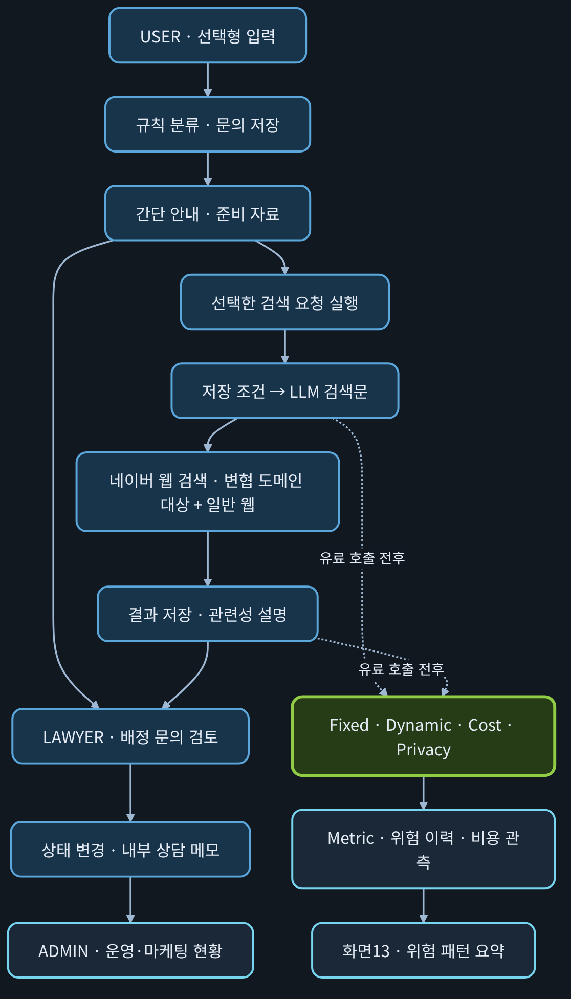
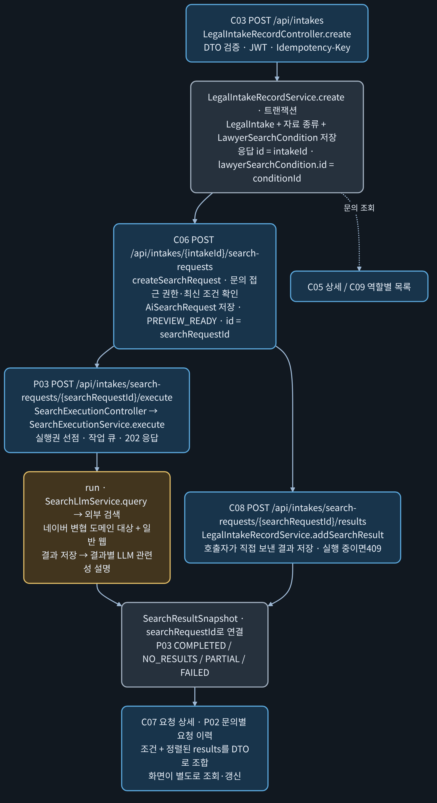
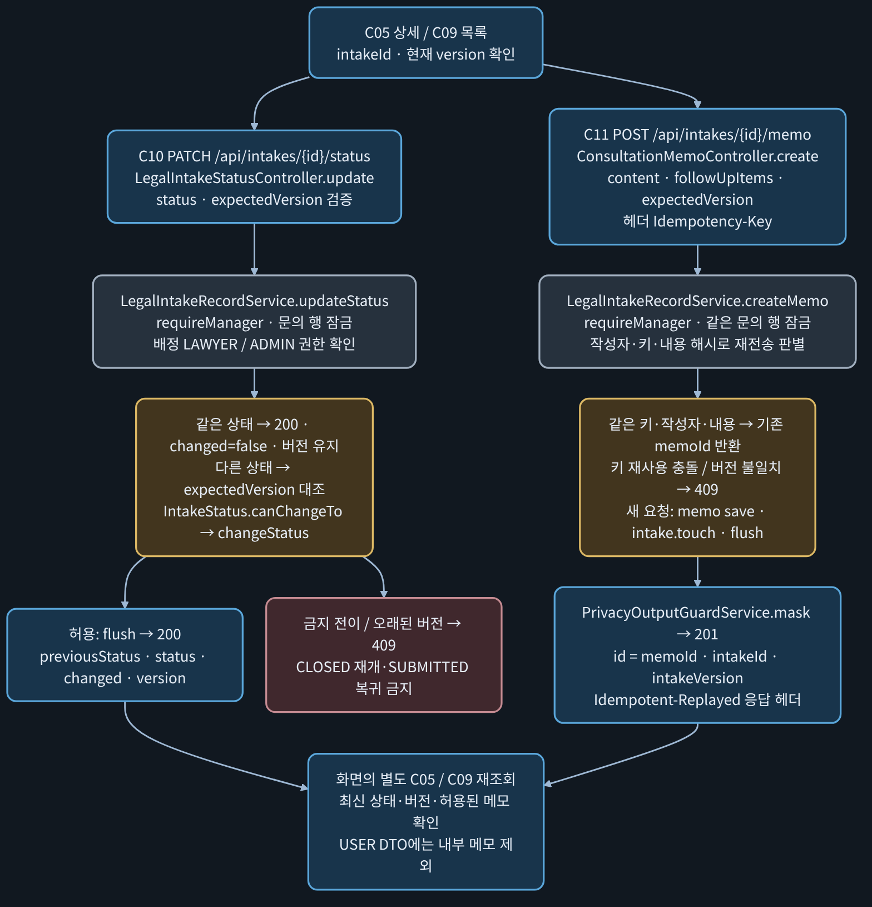
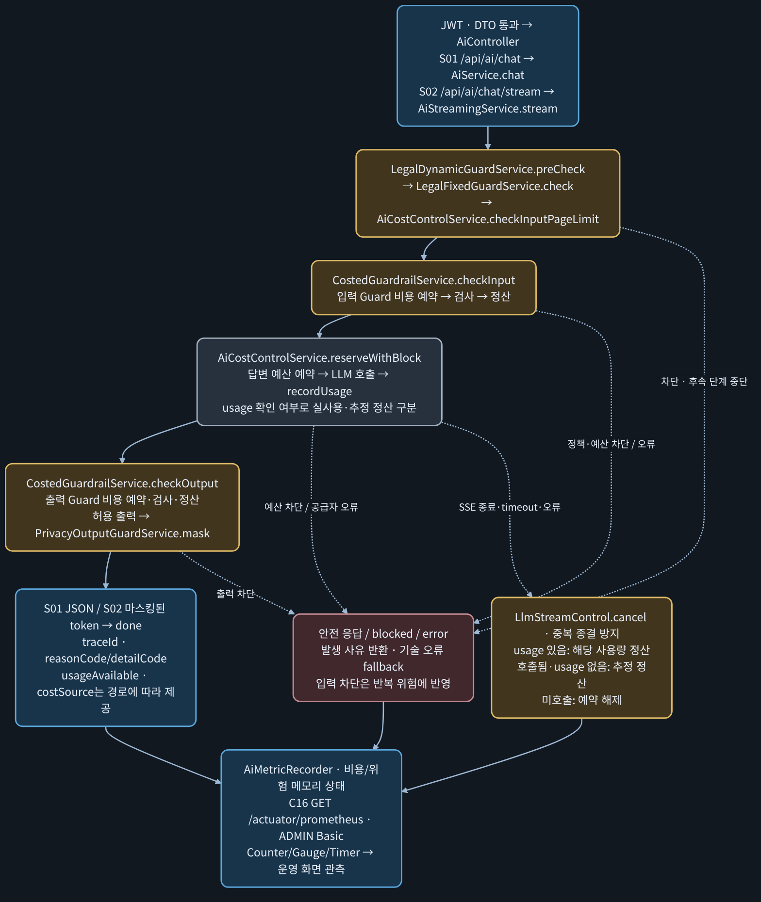

# Security-Aware Legal AI Intake System

**한국어** | [English](README.en.md)

> 고객은 선택하고, 챗봇은 정리하며, 운영자는 근거를 보고 통제합니다.
>
> 현재 **Spring Boot + FastAPI 하이브리드 + memvid** 구조로 확장 개발 중이며, 상용 서비스 출시를 준비하고 있습니다.

**최종 자료:** [팀 프로젝트 결과보고서 PDF · 76쪽](docs/presentation-pdfs/LEGAL_AI_INTAKE_TEAM_PROJECT_REPORT_FINAL_2026-10-26.pdf) · [보고서 목차·편집 원본](docs/presentation-2026-10-25/FINAL_REPORT_STRUCTURE.md)

전체·핵심 흐름도는 7쪽·12~16쪽, 전체 API 지도는 17쪽에서 확인할 수 있습니다.

## 목차

1. [PM Positioning](#pm-positioning)
2. [PM Multi-Layer Analysis](#pm-multi-layer-analysis)
3. [Problem → Solution](#problem--solution)
4. [Security Architecture](#security-architecture)
5. [차단 이유를 읽을 수 있어야 합니다](#차단-이유를-읽을-수-있어야-합니다)
6. [Product Introduction](#product-introduction)
7. [핵심 기능 Flow](#핵심-기능-flow)
8. [백엔드 구체적 흐름](#백엔드-구체적-흐름)
9. [핵심 API](#핵심-api)
10. [쉬운 운영 관리 · Boards](#쉬운-운영-관리--boards)
11. [직관적인 실시간 보안 관측·대응 시스템](#직관적인-실시간-보안-관측대응-시스템)
12. [Current Implementation](#current-implementation)
13. [Core Message](#core-message)
14. [이번 설계의 의미](#이번-설계의-의미)
15. [확장 개발 · 상용화 방향](#확장-개발--상용화-방향)

## PM Positioning

법률 문의를 상담 준비로 연결하고, AI의 보안·비용까지 운영할 수 있도록 설계한 PM 중심 프로젝트입니다.

**시장 문제 → 선택형 UX → 보안·비용 통제 → 운영 관측**을 하나의 흐름으로 연결했습니다.

[PM·보안·운영 핵심 PDF](docs/presentation-pdfs/PM_SECURITY_CORE_DARK_TABLET.pdf)

## PM Multi-Layer Analysis

하나의 서비스를 **시장·의뢰인·변호사·기술·보안·운영**의 여섯 관점으로 나누어 설계했습니다.

| 관점 | 설계에 반영한 내용 |
|---|---|
| **시장** | 초기 문의를 구조화해 상담 준비로 연결하고, 전환 손실 감소 가설을 검증할 기반을 만듭니다. |
| **의뢰인** | 법률 유형을 몰라도 선택할 수 있도록 짧은 설명·선택형 질문·준비 자료 안내를 제공합니다. |
| **변호사** | 사건 유형·당사자·자료를 상담 전에 확인해 기본 사실 확인과 쟁점 검토를 돕습니다. |
| **기술** | 입력·응답 계약을 정형화하고 DTO 검증·사유 코드·지표를 연결합니다. |
| **보안** | 위험 요청·반복 공격·과도한 비용을 통제하고 출력의 개인정보 재노출을 줄입니다. |
| **운영** | 문의·검색·상담 준비 현황과 차단 사유·비용·위험 이력을 근거로 판단합니다. |

전환 손실 감소는 제품 가설입니다. 현재 집계만으로 실제 전환율 개선을 입증했다고 설명하지 않습니다.

## Problem → Solution


## Security Architecture

| 통제 | 핵심 역할 |
|---|---|
| **Fixed Guard** | 탈옥·프롬프트 주입·법률 위해·비밀 요청·인증 우회 차단 |
| **Dynamic Guard** | 같은 세션의 반복 위험을 누적하고 세션 제한 |
| **Cost Control** | 입력·출력 범위와 예산을 확인하고 단계별 예약·정산 |
| **Privacy Output Guard** | 응답·SSE 출력의 개인정보 패턴 마스킹 |
| **Observability** | 사유 코드·비용·위험 이력·지표를 관리자 화면에서 확인 |

화면13은 **요청 위험 패턴 80점 차단 권고**와 **대화 누적 100점 등 세션 제한**을 구분해 보여줍니다.

## 차단 이유를 읽을 수 있어야 합니다

운영자는 **HTTP 상태 + 정책 사유 + 세부 사유 + 보호 결과**를 함께 확인합니다.

| 구분 | 대표 표시 | 읽는 기준 |
|---|---|---|
| 고정 정책 | `BLOCKED_JAILBREAK`, `BLOCKED_PROMPT_INJECTION`, `BLOCKED_LEGAL_HARM`, `BLOCKED_SECRET_REQUEST`, `BLOCKED_AUTH_BYPASS` | 어떤 위험 정책에 의해 입력이 차단됐는지 구분합니다. |
| 비용·입력 길이 | `COST_LIMIT_BLOCKED` / `REQUEST_TOO_LONG` | 공통 비용 사유와 세부 길이 사유를 구분합니다. 분기별 `reasonCode`·`detailCode`를 함께 읽습니다. |
| 세션 반복 제한 | `DYNAMIC_SESSION_BLOCKED` | 이전 위험 요청이 누적된 세션의 제한 상태입니다. 현재 문장만의 위험 판정과 다릅니다. |
| 개인정보 출력 보호 | 지원 패턴·필드의 마스킹, `PII_OUTPUT_MASKED` 보호 결과 표시 | 모든 요청의 `reasonCode`로 반환된다는 뜻이 아닙니다. 마스킹 결과·지표를 경로별로 확인합니다. |

AI 응답은 HTTP200이어도 `blocked`·`fallback`과 사유 필드를 함께 확인합니다. 개인정보 마스킹은 지원 패턴·필드 범위에 적용합니다.

## Product Introduction

**고객은 선택하고, 챗봇은 정리한다.**

문의 목적·사건 유형·당사자 위치·핵심 사실·보유 자료·다음 단계를 입력하면, 규칙·템플릿으로 문의 유형과 준비 자료를 안내합니다. 초기 안내는 LLM을 호출하지 않으며, 저장된 검색 조건을 활용하는 검색문 구성·관련성 설명을 별도 LLM 단계로 연결했습니다.

[제품 설명 PDF](docs/presentation-pdfs/PRODUCT_INTRODUCTION_DARK_TABLET.pdf)

| 사용자 | 사용하는 기능 |
|---|---|
| USER | 선택형 접수 → 간단 안내 → 공개 정보 검색 |
| LAWYER | 배정 문의 → 자료 확인 → 상태·내부 메모 |
| ADMIN | 전체 현황·배정 → 보안·비용 → 화면13 위험 요약 |

## 핵심 기능 Flow

[](docs/diagrams/intake-core-flow-ko.svg)

변협 전용 API가 아닌 네이버 공개 웹 검색입니다. 내부 상담 메모는 USER 응답에서 제외하며, 개인정보 마스킹은 지원 패턴에 적용합니다.

<!-- BACKEND_CONCRETE_FLOWS:START -->
## 백엔드 구체적 흐름

HTTP 진입점 → 서비스·정책 → 저장·응답·관측을 세 흐름으로 연결했습니다. 현재 소스 기준이며 새 실행 검수 결과는 아닙니다.

### 1. 문의 등록 → 검색 요청 → 실행·결과 → 이력

[](docs/diagrams/backend-intake-to-search-ko.svg)

- **자동 연쇄 실행이 아닙니다.** C03 저장, C06 요청 생성, P03 실행은 각각 별도 요청입니다. C08 수동 저장과 P03 내부 저장도 별도 경로입니다.
- `conditionId`는 서버가 연결하므로 C06 본문으로 다시 보내지 않습니다. 검색 실행·상세·결과 추가에는 `searchRequestId`, 문의별 이력에는 `intakeId`를 사용합니다.
- 조회·검색 접근은 문의 소유자·배정 변호사·ADMIN 범위입니다. P03의 PARTIAL 상태에서 `retryExplanation:true`를 보내면 저장 결과를 유지하며 미완료 설명만 재시도합니다.

### 2. 상태 변경·상담 메모 → 문의 재조회

[](docs/diagrams/backend-status-and-memo-ko.svg)

- 상태와 메모는 **각각 별도 트랜잭션**이며 서로를 자동 호출하지 않습니다. 동일 문의 행 잠금으로 상태 변경·메모·재배정을 직렬화합니다.
- `expectedVersion`은 현행 호환 정책상 선택값입니다. 보내야 오래된 편집을409로 검출합니다. 같은 상태와 기존 메모 재전송 판별은 버전 검사보다 먼저 수행합니다.
- 메모 키가 없으면 같은 작성자·같은 내용의 기본120초 재전송 추정만 적용하며 영구 멱등 보장이 아닙니다. C11의201은 새 저장과 기존 응답 재전송 모두에 사용하므로 헤더·ID로 구분합니다.

### 3. AI 동기·SSE → 사유·비용·마스킹·지표

[](docs/diagrams/backend-ai-sse-guard-cost-ko.svg)

- S02는 공급자 원본 조각을 내부 버퍼에 모은 뒤 **전체 출력 검사·패턴 마스킹 후** 전송합니다. 원본 토큰을 실시간으로 그대로 중계하지 않습니다.
- 출력이 차단돼도 이미 생성한 답변 비용은 남습니다. 입력 Guard·답변·출력 Guard는 각각 비용 처리 단계입니다. C16 조회는 LLM을 호출하지 않습니다.
- `reason`은 기존 호환 필드이며 공통 사유·세부 사유가 항상 같은 의미는 아닙니다. `usageAvailable`·`costSource`가 없는 분기에서 임의의0·실측으로 해석하지 않습니다.
- 초기 화면02~04의 규칙·템플릿 안내와 이 S01·S02 AI 파이프라인은 구분합니다. Prometheus는 지표이고, DB 위험 이력·Incident는 별도 저장·조회 경로입니다.

[편집 원본·코드 대조 진입점](docs/presentation-2026-10-25/BACKEND_CONCRETE_FLOWS.md) · [제품 소개 PDF 11~13쪽](docs/presentation-pdfs/PRODUCT_INTRODUCTION_DARK_TABLET.pdf)
<!-- BACKEND_CONCRETE_FLOWS:END -->

## 핵심 API

| 기능 | 번호 | HTTP API |
|---|---|---|
| 로그인·현재 사용자 | C01 · P01 | `POST /api/auth/login` · `GET /api/me` |
| 분류·문의 접수 | C02 · C03 | `POST /api/intakes/classify-preview` · `POST /api/intakes` |
| 간단 안내 | C04 | `POST /api/legal-intake/minimal` |
| 문의 목록·상세 | C09 · C05 | `GET /api/intakes` · `GET /api/intakes/{id}` |
| 검색 요청·실행 | C06 · P03 | `POST /api/intakes/{intakeId}/search-requests` · `POST /api/intakes/search-requests/{searchRequestId}/execute` |
| 검색 결과·이력 조회 | C07 · P02 | `GET /api/intakes/search-requests/{searchRequestId}` · `GET /api/intakes/{intakeId}/search-requests` |
| 상태·메모 | C10 · C11 | `PATCH /api/intakes/{id}/status` · `POST /api/intakes/{id}/memo` |
| 운영·마케팅 | C12 · C13 | `GET /api/admin/dashboard/summary` · `GET /api/admin/dashboard/marketing-funnel` |
| 지표·위험 이력 | C16 · C17 | `GET /actuator/prometheus` · `GET /api/agent/risk/history` |
| AI 질문·SSE | S01 · S02 | `POST /api/ai/chat` · `POST /api/ai/chat/stream` |

[전체 화면·API·Controller 매핑 및 인증·Postman 입력값](docs/SCREEN_API_CONTROLLER_MAPPING.md)

업무 API의 JWT·역할/문의 접근 권한과 C16의 별도 ADMIN Basic 인증을 구분합니다. 운영 집계는 실데이터, 상담 후 전환·이탈 사유는 별도 더미 시연입니다.

## 쉬운 운영 관리 · Boards

마케팅·보안 현황 처리·고객·변호사 업무를 역할별 보드로 쉽게 관리합니다.

| 보드 | 운영 목적·기능 |
|---|---|
| **마케팅 보드** | 문의·검색·현재 상담 준비·유형/지역 분포 확인. 상담 후 전환·이탈 분석은 별도 더미 시연 |
| **보안 현황·처리 보드** | 차단·비용·보호 결과·위험 이력 확인, Incident 확인·종결 |
| **고객 보드** | 선택형 문의 접수·준비 자료 안내·검색 요청 |
| **변호사 보드** | 배정 문의·사건 자료 검토, 상태·내부 상담 메모 관리 |

## 직관적인 실시간 보안 관측·대응 시스템

**관측 → 위험 근거 확인 → 운영자 판단 → Incident 확인·종결**로 이어집니다.

C16 현재 지표·C17 위험 이력·Prometheus 시계열을 연결해 반복 차단·위험 행동·외부 전송 위험 신호를 쉽게 확인합니다. 실시간은 수집·갱신 주기 기준이며, 관측 화면이 모든 위험에 자동 대응하는 것은 아닙니다.

결측과 실제0, 실사용·추정·정산·진행 예약 비용을 구분합니다. `REQUEST_TOO_LONG`은 비용 세부 사유, `PII_OUTPUT_MASKED`는 보호 결과입니다. 요청80점 차단 권고와 대화 누적100점 등 세션 제한도 별도 기준입니다.

문의 단계별 집계만으로 실제 전환율·이탈률을 계산하지 않습니다. 실제 측정에는 고객 여정·상담 결과·수집 기준이 필요합니다.

## Current Implementation

```text
Minimal Legal Intake Flow
-> POST /api/legal-intake/minimal

Fixed Guard
-> Jailbreak / Prompt Injection / Legal Harm / Secret Request / Auth Bypass

Dynamic Guard
-> sessionId 기반 riskScore 누적과 반복 위험 세션 차단

Cost Control
-> 긴 입력과 예상 토큰 비용 제한

Privacy Output Guard
-> 개인정보 입력 허용, 출력 마스킹

Metric
-> guardrail block, cost block, dynamic block, privacy output masking, llm call prevented
```

보안·비용 흐름은 다크 태블릿용 PDF로 확인할 수 있습니다.

| 자료 | 주요 내용 |
|---|---|
| [Cost Control PDF](docs/presentation-pdfs/COST_CONTROL_DARK_TABLET.pdf) | A4~A7 예산 차단·생성 후 차단 개선, V02~V03·C1 실제 usage·예약 종료·OpenAI 증가 대조 |
| [Error Stop Flow PDF](docs/presentation-pdfs/ERROR_STOP_FLOW_DARK_TABLET.pdf) | A1 입력 101자·A2 비밀 요청 사전 차단, B2 시간 초과 후 추정 정산 |
| [Dynamic Guard PDF](docs/presentation-pdfs/DYNAMIC_GUARD_DARK_TABLET.pdf) | A3-1 같은 세션 위험 반복 차단, A3-2 정상 질문으로 바꿔도 차단 유지 |

각 PDF는 **실험 번호·제목 → 확인 의미 → 관측 결과 → 원본 캡처 → 비용·OpenAI 사용량 대조** 순서로 읽습니다. [전체 실험·결과 매칭표](docs/presentation-pdfs/EXPERIMENT_RESULT_MAPPING.md)에서 증거를 찾을 수 있습니다. 모의 장부와 실제 공급자 사용량을 구분하며, 기록이 없는 B1·C1-300은 미검증으로 남겼습니다.

## Core Message

```text
고객은 선택하고, 챗봇은 정리하며,
보안은 LLM 호출 전에 통제하고,
운영자는 metric으로 관찰한다.
```

## 이번 설계의 의미

최근 기업용 AI에서는 모델 활용과 함께 정책에 따른 사용 통제, 개인정보 보호, 비용 관리와 운영 관측을 중요하게 다루고 있습니다. [OpenAI의 보안·운영 구성](https://learn.chatgpt.com/docs/enterprise/security-cookbook)과 [Claude의 관리자 분석·비용 관리 기능](https://claude.com/resources/articles/giving-admins-more-visibility-and-control-over-claude-usage-and-spend)에서도 이러한 방향을 확인할 수 있습니다.

이번 프로젝트에서는 Fixed Guard, Dynamic Guard, Privacy Output Guard, Cost Control을 모듈로 나누고, reasonCode·Metric·운영 조회 API로 처리 결과를 확인할 수 있도록 설계·구현했습니다. 법률 문의 서비스에 이 구조를 적용하면서, 기업용 AI에서 중요하게 다루는 통제와 관측의 기초 구조를 직접 설계하고 구현해본 데 의미가 있습니다.

## 확장 개발 · 상용화 방향

현재 저장소는 법률 문의 접수와 AI 호출 통제(보안·비용·관측)를 검증한 프로토타입입니다. 이 기반 위에 **Spring Boot + FastAPI 하이브리드 + memvid** 구조로 확장 개발을 진행하고 있으며, 상용 서비스 출시를 목표로 합니다.

| 계층 | 역할 |
|---|---|
| **Spring Boot** | 인증·역할 권한, 업무 트랜잭션, 정책·비용 통제를 담당하는 단일 경계입니다. 현재 구현을 그대로 계승합니다. |
| **FastAPI (Python)** | AI 처리·검색·메모리 어댑터를 담당합니다. Spring과는 좁고 명시적인 JSON 계약으로만 연결합니다. |
| **memvid** | 근거 중심 메모리 계층입니다. 답변에 출처·갱신일을 함께 제공하고, 호출자의 권한 범위 안에서만 조회합니다. RAG 방식과의 비교 실험으로 효과를 검증합니다. |

**설계 원칙**

- 보안·비용 통제는 AI 호출 앞단에서 코드로 강제하며, 모델의 판단에 의존하지 않습니다.
- 근거가 부족하면 답변 범위를 제한하고, 출처와 갱신일을 표시합니다.
- 모든 확장에서 정상·실패·차단 경로의 회귀 검증을 유지합니다.

**상용화 준비 항목 (개발 계획)**

- 운영 환경: HTTPS, 정적 프론트 배포, 비밀값 관리, 업무 DB·예산 장부의 영속 저장
- 계정·권한: 회원 DB, 관리자 인증 강화
- 서비스 기능: 변호사 전달용 상담 요약, 고객 후속 안내 연동, 실측 기반 전환·이탈 분석 대시보드

위 항목은 개발 중인 계획이며 구현 완료 기능과 구분합니다. 현재 구현 범위는 [Current Implementation](#current-implementation)을 따릅니다. 이 서비스는 법률 자문의 정확성을 보증하지 않으며, 변호사 상담을 준비하는 도구입니다.

다이어그램 원본(Mermaid): [`docs/diagrams/*-ko.mmd`](docs/diagrams)
