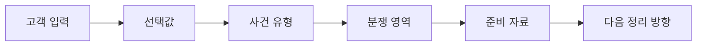

# Security-Aware Legal AI Intake System

> **2026-10-23 베타:** 화면01~13과 P03·SSE·권한 처리를 포함한 로컬 시연용 소스입니다.

> This repository is a security-focused MVP draft. The core goal is not to build a full legal consultation chatbot, but to design a PM-driven legal intake flow with AI security controls.

**고객은 선택하고, 챗봇은 정리한다.** 선택형 Legal Intake Form으로 문의를 사건 유형·보유 자료·다음 단계로 구조화하고, 변호사의 상담 준비와 관리자의 AI 보안·비용 관측을 연결합니다.

[제품 정의와 Problem → Solution](#problem---solution) · [제품 소개 PDF](docs/presentation-pdfs/PRODUCT_INTRODUCTION_DARK_TABLET.pdf) · [PM·보안·운영 핵심 PDF](docs/presentation-pdfs/PM_SECURITY_CORE_DARK_TABLET.pdf)

## PM Positioning

[PM 포지셔닝·Problem → Solution·보안 구조·역할별 보드·Observability 핵심 PDF](docs/presentation-pdfs/PM_SECURITY_CORE_DARK_TABLET.pdf) · [편집 원본](docs/presentation-2026-10-25/04_PM_SECURITY_CORE.md)

`Legal AI Intake System`은 고객 경험, 변호사 업무 효율, 운영 지표, AI 보안을 함께 고려한 PM 중심의 보안형 챗봇 프로젝트입니다.

저는 이 프로젝트를 단순히 개발자 관점의 기능 구현 과제로만 접근하지 않았습니다. PM 관점에서 다음 요소를 함께 검토했습니다.

- 이 기능이 어떤 시장 문제를 해결하는가
- 누가 이 서비스를 사용하고 어떤 효율과 가치를 얻는가
- 고객은 어디서 입력을 어려워하는가
- 변호사는 어떤 정보가 정리되어야 상담 효율이 올라가는가
- 운영 중 어떤 보안·비용 리스크가 생기는가
- 그 리스크를 어떤 지표와 dashboard로 관찰하고 통제할 수 있는가

AI가 코드를 빠르게 만들어내는 시대일수록, 시장 문제를 정확히 정의하고, 고객 경험을 구조화하며, 보안과 비용까지 고려한 운영 가능한 아키텍처를 설계하는 PM 역량이 중요하다고 봅니다.

이번 프로젝트에서 강조하고 싶은 역량은 단순 코딩이 아니라, 법률 intake라는 시장 문제를 발견하고, 이를 선택형 사용자 경험과 AI 보안 아키텍처로 연결한 PM 역량입니다.

## Problem -> Solution

| 관점 | Problem | Solution |
|---|---|---|
| 시장 | 소규모 법률 사무소에는 초기 문의를 구조화하는 intake 시스템이 부족합니다. 이로 인해 고객 문의가 상담으로 이어지지 못하는 전환 손실이 발생할 수 있습니다. | Legal AI Intake System을 통해 고객 문의를 사건 유형, 보유 자료, 원하는 다음 단계로 구조화합니다. |
| UX | 고객은 법률 용어를 모르기 때문에 자신의 문제를 처음부터 주관식으로 설명하기 어렵습니다. | 고객은 선택형 입력과 체크리스트를 사용하고, 챗봇은 선택값을 자연어 안내문으로 정리합니다. |
| 기술 | 자유대화형 챗봇은 입력이 길어지고 구조가 불안정해질 수 있습니다. | Legal Intake Form + Spring Java 구조로 입력을 정형화하고, 사건 유형과 준비 자료를 안정적으로 분류합니다. |
| 보안 | AI 서비스는 위험 요청, 반복 공격, 비용 폭주, 개인정보 재출력 위험을 가집니다. | Fixed Guard, Dynamic Guard, Cost Control, Privacy Output Guard로 LLM 호출 전후의 리스크를 통제합니다. |
| 운영 | 차단 이유와 문의 흐름이 기록되지 않으면 운영자가 문제를 파악하기 어렵습니다. | reasonCode, Prometheus metric, dashboard를 통해 문의 흐름과 보안 차단을 관찰 가능하게 설계합니다. |
| 확장 | 1차 버전만으로는 깊은 법률 문서 검색, 변호사 전달 요약, 후속 연락 자동화까지 처리하기 어렵습니다. | 12월에는 RAG, Python actions.py, Vector DB, 카톡/이메일 연동으로 실무형 MVP로 확장할 계획입니다. |

## Product Definition

이 프로젝트는 자유대화형 법률 상담 챗봇이 아닙니다. `Legal Intake Form` 기반의 정보 제공형 챗봇입니다.

핵심 UX는 한 문장으로 정리할 수 있습니다.

```text
고객은 선택하고, 챗봇은 정리한다.
```

고객은 문의 목적, 사건 유형, 당사자 위치, 핵심 사실, 보유 자료, 원하는 다음 단계를 선택·입력합니다. 시스템은 이 선택값을 바탕으로 현재 문의 유형, 분쟁 가능성, 준비 자료, 다음 정리 방향을 자연어 문장으로 안내합니다.

화면02~04의 초반 분류·간단 안내는 **규칙·템플릿 기반**이며, 매번 LLM으로 사건을 요약하지 않습니다. 화면05의 검색문 구성·검색 결과 관련성 설명에서 LLM을 사용합니다. 상담 전환 손실 감소는 제품 목표이며, 실제 전환율 개선을 실증한 수치로 주장하지 않습니다.

예시:

```text
입력:
문의 목적: 필요한 자료 확인
사건 유형: 민사
당사자 위치: 원고
보유 자료: 입금내역, 카카오톡
원하는 다음 단계: 상담
핵심 내용: 빌려준 돈을 못 받고 있습니다.

출력:
현재 문의는 민사 사건에 가까워 보입니다.

금전 반환 또는 대여금 분쟁 가능성이 있습니다.
상담 전에는 입금 내역, 카카오톡/문자 대화,
상대방에게 반환을 요청한 기록을 날짜순으로 정리해 주세요.

계약서나 약정서가 있다면 함께 준비하는 것이 좋습니다.
개인정보 보호를 위해 출력 경로의 패턴 마스킹과 역할별 접근 통제를 적용합니다.
```

위 문장은 안내 예시입니다. 패턴 마스킹이 모든 개인정보를 탐지한다는 의미는 아니며, 안내는 최종 법률 판단을 대신하지 않습니다.

## Minimal Legal Intake Form

이번 프로젝트의 intake 범위는 아래 6개 항목으로 제한합니다. 깊은 법률 판단이나 RAG 기반 문서 검색은 12월 확장 범위로 둡니다.

### 1. 문의 목적

- 절차 안내
- 필요한 자료 확인
- 작성한 문서 검토
- 변호사 선임/계약 검토
- 전자소송 제출 안내

### 2. 사건 유형

- 민사
- 형사
- 가사
- 전자소송
- 잘 모르겠음

### 3. 당사자 위치

- 피해자
- 피고소인
- 원고
- 피고
- 신청인
- 상대방
- 잘 모르겠음

### 4. 핵심 사실

- 사건 발생일
- 상대방
- 문제가 된 금액 또는 피해 규모
- 현재 진행 단계
- 핵심 내용 한 문장: 최대 100자(서버 UTF-16 길이 기준)

### 5. 보유 자료

- 계약서
- 입금 내역
- 카카오톡/문자
- 사진/영상
- 소장/고소장/통지서
- 없음

### 6. 원하는 다음 단계

- 상담
- 서면 검토
- 소송 준비
- 전자소송 제출
- 변호사 선임

Implemented endpoint:

```http
POST /api/legal-intake/minimal
```

이 API는 JWT 인증을 확인하고 입력값을 규칙·템플릿으로 안내합니다. 문의 저장은 별도의 `POST /api/intakes`이며, 간단 안내 API 자체는 문의 저장이나 LLM 생성을 수행하지 않습니다.

## Mini Legal Ontology

본 프로젝트는 법률 상담 전환 손실 문제를 `선택형 Legal Intake Form`과 `미니 법률 온톨로지`로 구조화했습니다.

이 프로젝트에서 온톨로지는 복잡한 법률 지식 그래프가 아니라, 고객의 선택값과 키워드를 사건 유형, 분쟁 영역, 준비 자료로 연결하는 최소 분류 체계입니다.



예: `빌려준 돈을 못 받음` → `민사·원고` → `대여금·금전 반환 가능성` → `입금 내역·대화·계약서` → `반환 요청 기록을 날짜순 정리`.

[편집 가능한 전체 입력·검색 흐름](docs/presentation-2026-10-25/PRODUCT_INTAKE_FLOW.mmd) · [온톨로지 예시 흐름](docs/presentation-2026-10-25/MINI_LEGAL_ONTOLOGY.mmd)

선택형 intake와 미니 법률 온톨로지는 고객, 변호사, 시스템 모두의 비용을 줄이는 구조입니다.

- 고객은 법률 용어를 몰라도 선택할 수 있어 입력 부담이 줄어듭니다.
- 변호사는 상담 전에 사건 유형과 보유 자료를 파악할 수 있어 기본 질문 시간이 줄어듭니다.
- 시스템은 긴 자유입력을 줄이고 템플릿 기반 응답을 활용할 수 있어 LLM 비용을 줄일 수 있습니다.

## 기존 과제와의 연결

이전 Spring Boot–React 연동 과제에서 구현한 `legal-procedure-viewer`를 이번 프로젝트의 **Legal Reference 모듈**로 활용합니다. 기존의 법률 절차·단계·양식·체크리스트 조회 API 6개를 재사용하고, 문의 분류·입력·결과 안내 화면에서 절차와 준비자료를 확인할 수 있도록 연결할 계획입니다.

| 이번 프로젝트 화면 | 기존 기능의 활용 |
|---|---|
| 화면 2: 사건 유형 안내 | 분야별 절차 목록·상세를 사건 유형 이해에 필요한 참고 정보로 제공 |
| 화면 3: 문의 입력 | 절차별 단계·체크리스트·양식 안내를 보며 보유 자료와 다음 단계를 정리 |
| 화면 4: 결과 안내 | 문의 안내 결과와 함께 관련 절차·준비자료를 제시하고, 필요한 경우 형사 보완수사 체크리스트 제공 |

현재 기존 React에서 연결한 기능은 절차 목록·상세·형사 체크리스트 조회 3개입니다. 화면 2~4의 새 화면 연결은 이후 React 단계에서 진행합니다. 사건 분류 preview·Intake 저장·LLM 검색 실행은 각각 별도 기능으로 구분합니다.

현재 구현 API 37개에는 기존 Reference 6개도 포함됩니다. 과제의 React–API 연결 경험을 재사용하면서 문의 저장·상담 검토·검색 기록·보안·비용 관리로 기능을 확장한 프로젝트로 설명합니다.

기존 구현: [Legal Procedure Viewer](C:/myLectureWs/legal-ai-intake-security-server/frontend/legal-procedure-viewer/README.md). 현재 연결 범위: [화면/API 매핑](C:/myLectureWs/legal-ai-intake-security-server/docs/SCREEN_API_CONTROLLER_MAPPING.md), [API 정리서](C:/myLectureWs/legal-ai-intake-security-server/docs/API_STATUS_SPEC.md).

## Security Architecture Summary

이번 프로젝트의 중심은 보안 구조입니다.

단순히 LLM API를 호출하는 것이 아니라, LLM 호출 전에 위험 요청, 반복 공격, 비용 폭주를 통제하고, LLM 출력 이후 개인정보 재노출을 막는 구조를 설계했습니다.

```text
Fixed Guard
-> Jailbreak, Prompt Injection, Legal Harm, Secret/API Key 요청, 인증/전자서명 우회 차단

Dynamic Guard
-> 같은 sessionId의 반복 위험 요청을 점수화하고 임계치 초과 시 세션 차단

Cost Control
-> 긴 입력과 토큰 비용 폭주를 LLM 호출 전에 제한

Privacy Output Guard
-> 개인정보 입력은 허용하되 출력에서는 마스킹
```

대표 정책 사유·세부 사유·보호 결과 (응답 필드와 역할은 구분):

```text
BLOCKED_JAILBREAK
BLOCKED_PROMPT_INJECTION
BLOCKED_LEGAL_HARM
BLOCKED_SECRET_REQUEST
BLOCKED_AUTH_BYPASS
COST_LIMIT_BLOCKED
REQUEST_TOO_LONG
DYNAMIC_SESSION_BLOCKED
PII_OUTPUT_MASKED
```

개인정보 표시 마스킹 예시 (개념 예시이며 실제 출력 형식은 필드·패턴에 따라 다름):

```text
홍길동 -> 홍**
010-1234-5678 -> 010-1***-****
900101-1234567 -> 900101-*******
123-456-789012 -> 123-***-******
```

## PM Multi-Layer Analysis

이 프로젝트는 법률 intake 문제를 시장, 의뢰인, 변호사, 기술, 보안, 운영 관점에서 나누어 분석한 뒤 설계했습니다.

### 1. 시장 관점

소규모 법률 사무소의 초기 응대는 전화 중심, 주관식 설명 중심, 담당자 역량 의존적인 경우가 많습니다. 고객 문의가 사건 정보로 구조화되지 못하면 상담 전환 손실이 발생할 수 있습니다.

### 2. 의뢰인 관점

법률 문제를 처음 겪는 고객은 자신의 사건이 민사인지, 형사인지, 가사인지조차 알기 어렵습니다. 따라서 처음부터 긴 주관식 설명을 요구하기보다, 선택형 입력과 준비자료 안내가 필요합니다.

### 3. 변호사 관점

정리되지 않은 상담은 변호사의 시간을 사실관계 청취와 기본 확인에 소모시킵니다. 상담 전 사건 유형, 보유 자료, 원하는 도움을 구조화하면 변호사는 상담 시간을 자료 분류가 아니라 쟁점 파악과 전략 검토에 사용할 수 있습니다.

### 4. 기술 관점

자유 대화형 챗봇보다 `Legal Intake Form` 기반 정보 제공형 챗봇이 MVP에 적합하다고 판단했습니다. 선택형 입력과 체크리스트를 사용하면 입력 구조화, DTO Validation, reasonCode, metric 설계가 쉬워집니다.

### 5. 보안 관점

AI 서비스는 LLM 호출 전에 위험 요청, 반복 공격, 비용 폭주를 통제해야 하며, 출력 단계에서는 개인정보 재노출을 막아야 합니다. 이를 위해 Fixed Guard, Dynamic Guard, Cost Control, Privacy Output Guard를 분리 설계했습니다.

### 6. 운영 관점

AI 서비스는 운영 중 관찰 가능해야 합니다. 현재 문의·검색·상담 준비 현황은 DB 집계로, 보안·비용은 Prometheus 지표와 운영자 대시보드로 확인합니다. 화면13에서 위험 신호 조합과 이력을 함께 봅니다.

차단 이유는 사유 코드·지표·대시보드에 연결했습니다. 실제 고객 여정의 중도 이탈과 상담 후 계약 전환은 추가 수집이 필요한 범위이며, 현재 마케팅 시연 모드의 더미 결과와 구분합니다.

## Boards And Dashboards

고객은 챗봇으로 안내받고, 변호사는 사건·마케팅·보안을 각각의 보드로 봅니다.

```text
1. Client Chatbot Screen
   -> 고객이 선택한 내용을 자연어 안내문으로 정리

2. Attorney Case Review Board
   -> 변호사가 상담 전 사건 유형, 당사자 위치, 보유 자료, 원하는 도움을 확인

3. Marketing / Operation Board
   -> ADMIN 권한으로 문의 수·사건 유형·검색 수·현재 상담 준비 수 조회
   -> 상담 후 전환·이탈 사유는 별도 더미 시연 모드

4. Security Check Board
   -> Fixed Guard, Dynamic Guard, Cost Control, Privacy Masking, LLM call prevented를 확인
```

## Observability

운영자는 실제 DB 집계와 관측 지표를 확인합니다. 실측하지 않은 전환율과 이탈률은 분리합니다.

```text
문의 수
사건 유형별 유입
검색 요청 수
현재 상담 준비 수
Fixed Guard 차단 수
Dynamic Guard 차단 수
Cost Control 차단 수
Privacy Masking 발생 수
LLM 호출 방지 수
```

이 시스템은 단순 챗봇이 아니라, 초기 문의가 어디서 끊기는지 관찰할 수 있는 intake observability system을 지향합니다.

현재 단계별 집계만으로 고객의 중도 이탈률을 계산하지 않습니다. 상담 후 계약 전환·이탈 사유는 더미 시연이며, 실제 측정에는 고객 여정·상담 결과와 수집 기준이 필요합니다. `REQUEST_TOO_LONG`은 비용 공통 사유와 구분되는 세부 사유이며 `PII_OUTPUT_MASKED`는 보호 결과 맥락에서 읽습니다. 요청 패턴 80점 차단 권고와 대화 누적 100점 세션 제한도 별도 기준입니다.

## Current Implementation

```text
Minimal Legal Intake Flow
-> POST /api/legal-intake/minimal

Fixed Guard
-> Jailbreak / Prompt Injection / Legal Harm / Secret Request / Auth Bypass

Dynamic Guard
-> sessionId 기반 riskScore 누적과 반복 위험 세션 차단

Cost Control
-> 긴 입력과 예상 토큰 비용 제한

Privacy Output Guard
-> 개인정보 입력 허용, 출력 마스킹

Metric
-> guardrail block, cost block, dynamic block, privacy output masking, llm call prevented
```

보안·비용 흐름은 다크 태블릿용 PDF로 확인할 수 있습니다.

| 자료 | 주요 내용 |
|---|---|
| [Cost Control PDF](docs/presentation-pdfs/COST_CONTROL_DARK_TABLET.pdf) | A4~A7 예산 차단·생성 후 차단 개선, V02~V03·C1 실제 usage·예약 종료·OpenAI 증가 대조 |
| [Error Stop Flow PDF](docs/presentation-pdfs/ERROR_STOP_FLOW_DARK_TABLET.pdf) | A1 입력 101자·A2 비밀 요청 사전 차단, B2 시간 초과 후 추정 정산 |
| [Dynamic Guard PDF](docs/presentation-pdfs/DYNAMIC_GUARD_DARK_TABLET.pdf) | A3-1 같은 세션 위험 반복 차단, A3-2 정상 질문으로 바꿔도 차단 유지 |

각 PDF는 **실험 번호·제목 → 확인 의미 → 관측 결과 → 원본 캡처 → 비용·OpenAI 사용량 대조** 순서로 읽습니다. [전체 실험·결과 매칭표](docs/presentation-pdfs/EXPERIMENT_RESULT_MAPPING.md)에서 증거를 찾을 수 있습니다. 모의 장부와 실제 공급자 사용량을 구분하며, 기록이 없는 B1·C1-300은 미검증으로 남겼습니다.

## Expansion Plan

이번 프로젝트는 10월 기준 보안 중심 프로토타입입니다. 12월에는 Python, RAG, Vector DB를 학습한 뒤 실무형 MVP로 확장할 계획입니다.

```text
RAG / Vector DB
-> 전자법원, 공식 문서, 내부 FAQ 기반 검색

Python actions.py
-> NeMo Guardrails 고급 정책 실행

Attorney Summary
-> 변호사 전달용 상담 전 요약 생성

Kakao / Email Integration
-> 고객 후속 안내, 자료 요청, 상담 연결

Dashboard Enhancement
-> 문의 전환율, 이탈 지점, 사건 유형별 유입 분석
```

## Core Message

```text
고객은 선택하고, 챗봇은 정리하며,
보안은 LLM 호출 전에 통제하고,
운영자는 metric으로 관찰한다.
```

## 이번 설계의 의미

최근 기업용 AI에서는 모델 활용과 함께 정책에 따른 사용 통제, 개인정보 보호, 비용 관리와 운영 관측을 중요하게 다루고 있습니다. [OpenAI의 보안·운영 구성](https://learn.chatgpt.com/docs/enterprise/security-cookbook)과 [Claude의 관리자 분석·비용 관리 기능](https://claude.com/resources/articles/giving-admins-more-visibility-and-control-over-claude-usage-and-spend)에서도 이러한 방향을 확인할 수 있습니다.

이번 프로젝트에서는 Fixed Guard, Dynamic Guard, Privacy Output Guard, Cost Control을 모듈로 나누고, reasonCode·Metric·운영 조회 API로 처리 결과를 확인할 수 있도록 설계·구현했습니다. 법률 문의 서비스에 이 구조를 적용하면서, 기업용 AI에서 중요하게 다루는 통제와 관측의 기초 구조를 직접 설계하고 구현해본 데 의미가 있습니다.
# 2026-10-23 로컬 DB·실행본 갱신

현재8080은 최신 SHA별 JAR와 `local-persistent` 파일 H2/validate로 실행한다. 기존 문의3건을 포함한 전체20개 테이블의 원래 데이터 복원·해시 대조와 실제 재시작 보존을 확인했다. 로컬 MySQL의 별도 스키마에도 버전·요청 키/유니크를 이행했다. [D01/D02 검수·기동·복구](docs/DB_DEPLOYMENT_REVIEW_2026-10-23.md).
