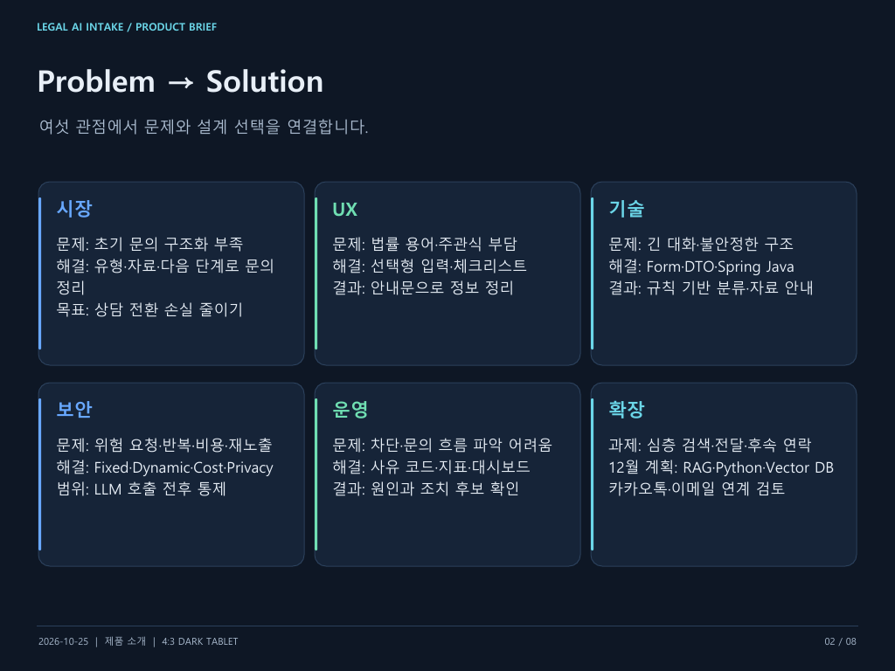
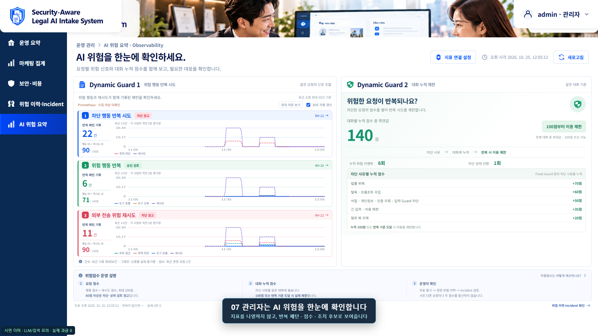
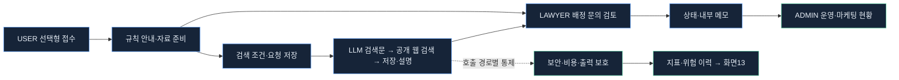

# Security-Aware Legal AI Intake System

> **고객은 선택하고, 챗봇은 정리하며, 운영자는 근거를 보고 통제합니다.**

법률 문의를 상담 준비로 구조화하고, AI의 위험 요청·비용·개인정보와 운영 지표를 함께 설계한 **Technical PM 포트폴리오**입니다.

[PM·보안 설계 PDF](docs/presentation-pdfs/PM_SECURITY_CORE_DARK_TABLET.pdf) · [제품 설명 PDF](docs/presentation-pdfs/PRODUCT_INTRODUCTION_DARK_TABLET.pdf) · [실험·결과 매칭표](docs/presentation-pdfs/EXPERIMENT_RESULT_MAPPING.md)

## Problem → Solution

## 제가 연결한 것

**시장 문제 → 사용자 행동 → 정책 → 데이터·코드 → 실험 → 운영 지표**

문의 구조화 부족을 제품 문제로 정의하고, 선택형 접수·변호사 검토·보안과 비용 통제·관리자 대시보드까지 연결했습니다. 기능의 성공뿐 아니라 **언제 멈추고, 어떤 이유를 남기며, 운영자가 무엇을 확인하는지**를 완료 기준으로 삼았습니다.

| 설계 판단 | 선택한 방식 | 확인할 근거 |
|---|---|---|
| 고객에게 긴 자유대화를 요구하지 않는다 | 선택형 Form + 100자 핵심 사실 + 규칙 기반 안내 | [제품 설명](docs/presentation-pdfs/PRODUCT_INTRODUCTION_DARK_TABLET.pdf) |
| 필요한 단계에 LLM을 사용한다 | 저장 조건으로 검색문 구성 → 공개 웹 검색 → 결과 저장·설명 | [검색 실행 계약·검수](docs/P03_EXTERNAL_SEARCH_REVIEW.md) |
| 정상·실패·차단을 함께 검증한다 | 정책 차단·예산 부족·timeout·usage·예약 종료 확인 | [실험별 결과·캡처](docs/presentation-pdfs/EXPERIMENT_RESULT_MAPPING.md) |
| 관리자가 위험을 해석할 수 있어야 한다 | 지표를 반복 위험 패턴·점수·이력과 연결 | [화면13 설계·검수](docs/SCREEN13_OBSERVABILITY_REVIEW.md) |

## 대표 화면 · 운영자가 이해하는 AI 위험

**모의 시연 캡처입니다.** 표시된 그래프·건수·점수는 실제 고객 트래픽이나 실제 유료 호출 실적이 아닙니다.

| 관리자가 묻는 질문 | 화면에서 확인하는 것 |
|---|---|
| 차단된 행동을 반복하나? | 차단 행동·위험 행동·외부 전송 위험 재시도 패턴 |
| 어떤 요청부터 점검하나? | 요청 신호 조합의 점수·차단 권고·관련 위험 이력 |
| 같은 대화에서 반복되나? | 대화 누적 점수·차단 상태 전환·누적 사유 |
| 비용이 남아 있거나 새고 있나? | 실사용·추정 사용·정산·진행 예약 비용 |

요청 **80점 차단 권고**와 대화 누적 **100점 등 세션 제한**은 별도 기준입니다. 두 점수를 합산하지 않습니다.

## 서비스 흐름

초기 분류·안내는 규칙·템플릿 기반입니다. 검색은 네이버 웹 검색의 **변협 도메인 대상 + 일반 웹**을 활용하며, 변협 전용 API나 변호사 자격 검증 기능은 아닙니다.

## 보안 6단계 · 비용 통제 6단계

아래는 설계 관점의 통제 묶음입니다. 모든 API에 동일한 순서로 여섯 검사를 실행한다는 의미는 아닙니다.

| 단계 | 보안 통제 | 비용 통제 |
|---|---|---|
| 1 | 인증·역할·문의 접근 권한과 입력 계약 | 입력 길이 제한 |
| 2 | Fixed Guard: 위험 목적·탈옥·비밀 요청 차단 | 출력 토큰 상한 |
| 3 | Dynamic Guard: 세션 위험 누적·반복 제한 | 모델·단계별 단가와 예약 |
| 4 | 생성 전 Input Guardrail | 월·일·세션 예산 비교 |
| 5 | 생성 후 Output Guardrail | usage 기반 정산·미확인 추정·중복 종료 방지 |
| 6 | Privacy 출력 마스킹·내부 메모 분리 | 정산·예약 잔여 관측과 공급자 사용량 대조 |

실험 보고서의 외부 Guard는 **모의 제공자**입니다. 실제 OpenAI 생성 확인과 실제 외부 Guard 검증을 구분합니다. 비용·세션 상태는 메모리 기반이므로 영속 청구 원장으로 해석하지 않습니다.

## 실험으로 확인한 것

| 실험 | 확인한 동작 | 결과·증거 |
|---|---|---|
| A1 | 101자 입력을 유료 호출 전에 거절 | HTTP 400·장부 증가 0, 모의 |
| A2 | 비밀 요청을 규칙으로 차단 | `BLOCKED_SECRET_REQUEST`·model none, 모의 |
| A3 | 반복 위험 후 정상 질문으로 바꿔도 차단 유지 | `DYNAMIC_SESSION_BLOCKED`, 모의 |
| A4~A6 | 세션·일·월 예산 부족 시 진행 중단 | 해당 예산 사유·장부 증가 0, 모의 |
| A7 | 생성 후 차단의 비용 빈틈 발견·개선 검증 | 별도 Claude 수정 브랜치의 사전 확인 재실험; 현재 소스 병합 증거와 구분 |
| B2 | timeout에서 usage 미확인 비용 처리 | 추정 정산·예약 종료, OpenAI 사용량 미증가 관측 |
| V02~V03·C1 | 실제 생성·출력 상한·usage 정산 | 확인된 3회 합계 입력132·출력81토큰, 보고서 단가 계산 `$0.0000684` |

OpenAI Spend `$0.00`은 반올림 표시입니다. 위 계산액은 토큰 기준이며, 모의 Guard 장부를 실제 공급자 청구에 더하지 않습니다. B1·C1-300은 기록이 없어 미검증입니다.

| 실험 PDF | 읽는 내용 |
|---|---|
| [Cost Control](docs/presentation-pdfs/COST_CONTROL_DARK_TABLET.pdf) | 예산 차단·비용 빈틈·실제 usage·OpenAI 대조 |
| [Error Stop Flow](docs/presentation-pdfs/ERROR_STOP_FLOW_DARK_TABLET.pdf) | 입력·비밀 요청 차단과 timeout 정산 |
| [Dynamic Guard](docs/presentation-pdfs/DYNAMIC_GUARD_DARK_TABLET.pdf) | 같은 세션의 위험 반복과 차단 유지 |

각 자료는 **실험 제목 → 확인 의미 → 결과 → 원본 캡처 → 비용 영향**으로 연결했습니다.

## 역할별 Dashboard

| 역할·보드 | 업무 |
|---|---|
| USER · Client Chatbot | 선택형 접수·준비 자료 안내·검색 |
| LAWYER · Case Review | 배정 문의·자료 확인·상태·내부 메모 |
| ADMIN · Marketing / Operation | 문의·유형·검색·현재 상담 준비 집계 |
| ADMIN · Security / Observability | 위험 이력·보안·비용·화면13 위험 요약 |

마케팅의 상담 후 전환·이탈 사유는 **별도 더미 시연**입니다. 실제 전환율 개선은 제품 가설이며, 실측에는 고객 여정·상담 결과·수집 기준이 필요합니다.

## 기술 구조와 추적 가능성

**Spring Boot·Java 21·JPA / React / LLM·외부 검색 / Micrometer·Prometheus**

| 레벨 | 읽는 질문 | 자료 |
|---|---|---|
| Top | 서비스와 통제가 어떻게 연결되는가? | [PM·보안 설계 PDF](docs/presentation-pdfs/PM_SECURITY_CORE_DARK_TABLET.pdf) |
| Middle | 사용자 행동이 어떤 정책·데이터로 이어지는가? | [Command·Event·코드 매핑](docs/BACKEND_DDD_EVENT_STORMING.md) |
| Bottom | 어떤 API·Controller에서 확인하는가? | [전체 화면·API·Controller·Postman 입력](docs/SCREEN_API_CONTROLLER_MAPPING.md) |

`POST /api/legal-intake/minimal`은 규칙 기반 안내, `POST /api/intakes`는 문의 저장입니다. 업무 JWT·역할 인가와 지표 C16의 별도 ADMIN Basic 인증을 구분합니다.

## 개발 방식과 다음 단계

[Ground Rule](GROUND_RULE.md)에 따라 **AI 초안 → API 정상·실패·차단 실험 → 피드백 → 리팩터링 → 문서·시연**으로 진행했습니다. API 계약은 Postman, 조건 고정·장부 비교는 PowerShell과 자동 검사로 확인했습니다.

12월에는 RAG·Python actions.py·Vector DB·변호사 전달 요약·카카오톡/이메일 후속 안내를 검토합니다. 현재는 입력 구조화와 보안·비용·운영 관측의 기반을 설명하는 베타입니다.

> **문의는 구조화하고, 위험은 통제하며, 판단의 근거는 화면에 남깁니다.**
