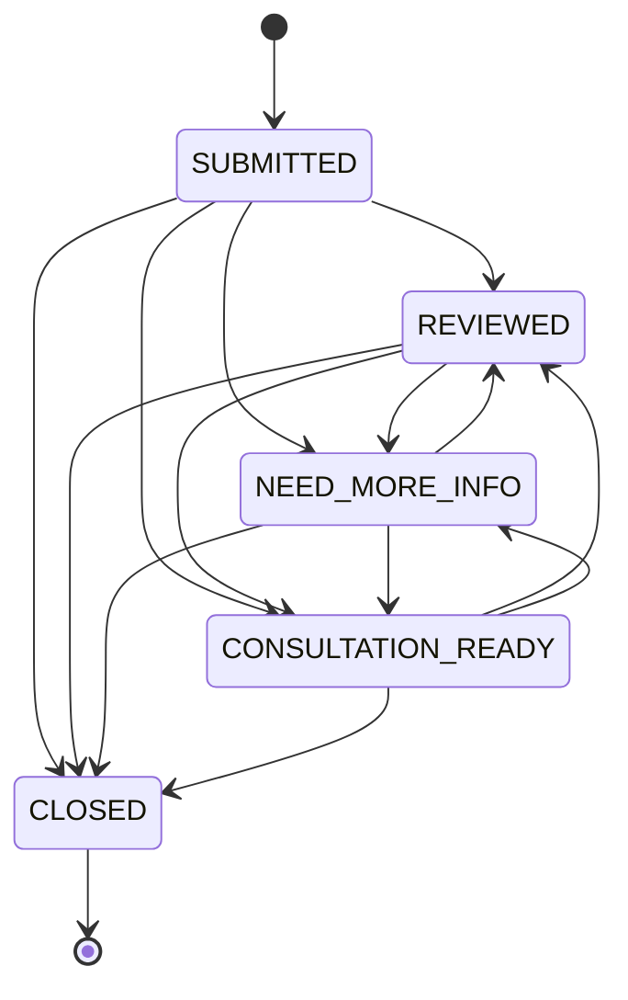

# 백엔드 기본 골격 DDD · Event Storming

[12일 개발 계획](PROJECT_12_DAY_PLAN.md)의 Day 7에서 Day 6의 Postman·코드 매핑 결과를 이 초안에 반영한다. 업무·정책·Read Model·코드를 연결하고 API별 적용 점검 결과를 갱신한다.

기준: **2026-10-25 로컬 코드**. USER·LAWYER·ADMIN 권한 리팩터링, 본문100자 제한, 접수/메모 재전송·버전 충돌, P03 외부 검색 실행, 화면09~13 및 화면10 시연 분석을 반영했다. 목적은 구현한 업무 흐름을 도메인 언어로 설명하고, 정책과 저장 책임을 이해하는 것이다. 아래 이벤트 이름은 업무 사실을 표현한 **설계·학습용 이름**이다. 현재 코드에 업무용 Event Bus, 해당 이름의 이벤트 클래스, Outbox 또는 Event Sourcing이 구현되어 있다는 의미가 아니다. Spring의 `ApplicationReadyEvent`에 의한 검색 중단 복구는 이 업무 이벤트 발행과 별개다.

현재 저장 구조는 [백엔드 ERD](BACKEND_ERD.md)를 함께 본다. Aggregate 후보와 DB FK 제약은 서로 다른 개념이며, 핵심 업무 테이블은 서비스가 연결하는 논리 ID 참조다.

**1. 업무 경계와 용어**

| Bounded Context 초안 | 담당 업무 | 현재 코드 / 데이터 |
|---|---|---|
| Intake 접수·검토 | 문의 접수, 자료 종류, 분류, 검토 상태, 상담 메모 | `LegalIntakeRecordService`, `LegalIntake`, `IntakeDocument`, `LawyerSearchCondition`, `ConsultationMemo` |
| Lawyer Search Routing | 문의 조건→검색문→네이버 두 출처 검색→결과 저장→설명 | `AiSearchRequest`, `SearchResultSnapshot`, `LegalIntakeRecordService`, `SearchExecutionService/Store`, `SearchLlmService`, `ExternalSearchClient` |
| Legal Reference | 법률 절차·단계·양식 안내 | `LegalProcedureService`, 관련 Entity/Repository |
| AI Safety & Cost | 세션 위험·고정 정책·토큰 예산·입출력 가드·출력 마스킹 | `AiService`, Guard/Cost/LLM Client, `PrivacyOutputGuardService` |
| Risk & Operations | Agent 위험 분석, 이력, Incident, 비동기 Job | `AgentRiskDecisionService`, `RiskIncidentService`, `AgentJobService` |
| Reporting | 접수·검색·현재 상담 상태 및 Agent 보안 현황 조회, 화면13 지표/위험 조합 | `MarketingDashboardService`, `AdminDashboardService`, C16 Actuator, C17 위험 이력. 화면10 시연 분석은 프런트 합성 자료로 분리 |

이 경계는 현재 단일 Spring Boot 애플리케이션 안에서의 책임 구분이다. 마이크로서비스 분리나 패키지별 완전한 DDD 전환을 완료한 것은 아니다. 기존 `LegalIntakeHistory`는 readiness 분석 이력이고, `LegalIntake`는 저장형 접수 레코드이므로 같은 데이터로 취급하지 않는다.

| 용어 | 우리 코드에서의 뜻 |
|---|---|
| Intake | 접수된 하나의 문의. 소송 사건 자체나 법률 결론과 구분 |
| Intake Document | 자료 종류 레코드와 업로드한 원본·메타데이터를 함께 관리. uploadedDocuments로 실제 첨부를 구분 |
| Search Condition | 분야·분쟁·지역·선호 조건과 생성된 검색문 |
| Search Request | 특정 Intake와 조건으로 검색을 준비한 기록 |
| Result Snapshot | C08로 직접 기록하거나 P03로 수집해 저장한 제목·URL·요약·설명의 사본 |
| Consultation Ready | 현재 문의 상태가 `CONSULTATION_READY`라는 뜻. 과거 누적 도달 이벤트 수와 구분 |
| Preview | DB에 접수하지 않고 분류 결과를 먼저 확인하는 요청 |

**2. Aggregate와 일관성 규칙 초안**

| Aggregate 후보 / 기준 | 현재 구현 | 불변 조건·정책 |
|---|---|---|
| `LegalIntake` 중심 | 접수·자료·검색 조건의 트랜잭션, 소유자·담당자·version·재전송 지문 | 문의 존재/접근 권한 검사. 상태·메모·배정은 같은 문의 행 잠금으로 직렬화. 상태 전이는 Entity/Enum, 재전송/권한은 Service/Repository에서 보호 |
| `AiSearchRequest` 중심 | 기존 문의·조건 ID 참조, 실행 상태·execution ID/lease, 별도 결과 Repository | 문의/조건 연결과 접근 권한, 실행 claim·중복 실행 방지, 결과 저장·설명·부분 완료. 네트워크 전체를 단일 DB 트랜잭션으로 묶지는 않음 |
| `RiskIncident` | 위험도·권장 조치에 따라 열고 운영자가 확인·종결 | 운영 검토가 필요한 위험을 접수 업무와 분리 |

현재 자료·조건·메모·결과는 별도 JPA Entity와 Repository이다. Aggregate 내부 객체 컬렉션이나 JPA 연관관계로 완전히 캡슐화한 모델은 아니다. 우선 트랜잭션과 존재 확인으로 연결하며, 전체 구조를 이해한 다음 경계를 더 엄격하게 만들 수 있다.

**3. Event Storming: 접수부터 검토까지**

```mermaid
flowchart LR
    A["Actor: 의뢰인·비로그인 가능"] --> C1["Command: 사건 분류 미리보기·100자"]
    C1 --> E1["Event: 분류 결과가 제시됨<br/>비저장"]
    E1 --> C2["Command: 문의 제출"]
    C2 --> P1["Policy: JWT·소유자·필수값·재전송 키"]
    P1 --> AG["Aggregate 후보: LegalIntake"]
    AG --> E2["Event: 문의가 접수됨"]
    E2 --> E3["Event: 자료 종류가 기록됨"]
    E3 --> E4["Event: 검색 조건이 준비됨"]
    E4 --> R1["Read Model: Intake 목록·상세"]
    R1 --> A2["Actor: 배정 LAWYER / ADMIN"]
    A2 --> C3["Command: 상태 변경"]
    C3 --> P2["Policy: 담당 권한·행 잠금·버전·허용 전이"]
    P2 --> E5["Event: 검토 상태가 변경됨"]
    A2 --> C4["Command: 상담 메모 기록"]
    C4 --> P3["Policy: 담당 권한·버전·메모 키·내용 검증"]
    P3 --> E6["Event: 상담 메모가 기록됨"]
    E5 --> R1
    E6 --> R1
    A3["Actor: ADMIN"] --> C5["Command: 담당 변호사 배정·회수"]
    C5 --> P4["Policy: ADMIN·활성 변호사·같은 문의 행 잠금"]
    P4 --> E7["Event: 담당자가 변경됨"]
    E7 --> R1
    R1 --> C6["Command: 권한 있는 사용자의 검색 요청·실행"]
    C6 --> P5["Policy: 문의 접근·조건 소속·실행 claim·비용/Guard"]
    P5 --> E8["Event: 검색 결과 저장·설명 생성 또는 부분 완료"]
    E8 --> R2["Read Model: 같은 검색 ID의 상태·결과"]
```

**4. Command → Event → 코드 매핑**

**4-1. Actor와 서버 권한 — 화면 이름과 API 권한은 별개**

`USER`는 의뢰인, `LAWYER`는 변호사, `ADMIN`은 사무소 운영자다. 문의 접근은 `IntakeAccessService.requireAccess()`, 내부 업무는 `requireManager()`, 배정은 `requireAdmin()`으로 검사한다. 로그인만 했다고 다른 문의에 접근할 수 있는 것은 아니다.

| 기능 / 화면 | 비로그인 | USER | LAWYER | ADMIN |
|---|---|---|---|---|
| 로그인01 / C01·P01 | C01 로그인 가능, P01은 JWT 필요 | 공통 로그인·자기 계정 확인 | 공통 로그인·자기 계정 확인 | 공통 로그인·자기 계정 확인 |
| 분류02 / C02·공개 법률 Reference GET | 허용 | 허용 | 허용 | 허용 |
| 접수03 / C03 | 401 | 생성자의 문의로 저장 | 현재 API는 접수 허용, 생성자 소유 | 현재 API는 접수 허용, 생성자 소유 |
| 간단 안내04 / C04 | 401 | JWT로 규칙 안내 | 동일 | 동일 |
| 문의 목록06 / C09 | 401 | 본인 소유만 | 배정된 문의만 | 전체 |
| 문의 상세04·07·08 / C05 | 401 | 본인 소유만 | 배정 문의 또는 본인 소유 문의 | 전체 |
| 검색05 / C06·C07·C08·P02·P03 | 401 | 본인 문의 | 배정 문의 또는 본인 소유 문의 | 전체 |
| 파일 P04·P05 | 401 | 본인 문의 | 배정 문의 또는 본인 소유 문의 | 전체 |
| 상태·메모07 / C10·C11 | 401 | 금지·403 | 배정된 문의만 | 전체 |
| 배정·회수08 / C21 | 401 | 금지·403 | 금지·403 | 허용 |
| 내부 메모 JSON / C05 | 접근 불가 | 필드 제외 | 배정된 문의에서만 포함 | 포함 |
| 운영자09~13 / C12~C15·C17~C20 | 401 | 금지·403 | 금지·403 | JWT로 조회·변경 |
| 지표11·13 / C16·guardtimeseries | 401 | 금지 | 금지 | **별도 ADMIN Basic**, 업무 JWT와 분리 |
| AI Chat·SSE / S01·S02 | 401 | JWT 필요 | JWT 필요 | JWT 필요 |

- 운영자 로그인은 새 API가 아니라 C01·P01을 공유한다. React `OperatorAuthGate`가 ADMIN을 확인하고, 실제 운영자 업무 API는 서버에서도 ADMIN을 요구한다.
- 소유자 없는 기존 익명 문의는 ADMIN만 접근한다. 이런 문의를 LAWYER에게 배정할 수 없다. 배정이 회수되면 이전 LAWYER의 내부 업무·파일·검색 접근도 서버에서 차단한다.
- LAWYER 목록은 배정 기준이고 직접 상세는 소유자 또는 배정 기준이다. LAWYER가 직접 접수한 미배정 문의까지 목록에서 자동 보여 준다고 설명하지 않는다.
- **현재 공개 경로도 구분한다:** S05 `POST /api/agent/risk/analyze`는 현재 인증 강제가 없는 신호 제출 경로다. ADMIN 전용인 C15/C17 위험 조회와 다르다. P06 `POST /api/intake-events`도 현재 공개이며 eventId·문의/세션 일치를 검사한다. 둘을 ‘모든 API가 ADMIN/JWT 전용’으로 표현하지 않는다.

**4-2. 접수·담당 업무·검색 Command 매핑**

아래 Event 이름은 **설명용 업무 사실**이다. 실제로 같은 이름의 이벤트 객체를 발행하는 구현은 없다. ‘접수 처리 정책’은 로그인 Actor가 아니라 하나의 접수 트랜잭션 안에서 실행되는 내부 책임이다.

| Actor | Command | Domain Event 이름 초안 | Policy | Aggregate / 테이블 | Read Model | 실제 진입점 |
|---|---|---|---|---|---|---|
| 의뢰인·비로그인 허용 / 02 | `PreviewCaseClassification` | `CaseClassificationPresented` | 본문 필수·공백 불가·**최대100자(UTF-16)**, 비저장 규칙 분류 | 저장 없음 | `LegalIntakeClassificationResponse` | C02 `POST /api/intakes/classify-preview` → `LegalIntakeClassificationController.preview()` → `LegalIntakeRecordService.classifyPreview()` |
| 의뢰인 업무 / 03, USER·LAWYER·ADMIN JWT | `SubmitLegalIntake` | `LegalIntakeSubmitted` | 필수/길이·유형·자료 정리, 로그인 주체를 owner로 저장. 같은 소유자/키/내용은 같은 ID, 다른 내용409 | `LegalIntake` / `legal_intake` 및 자료·조건 | `LegalIntakeResponse` | C03 `POST /api/intakes` → `LegalIntakeRecordController.create()` → `LegalIntakeRecordService.create()` |
| 접수 내부 정책 | `RecordSelectedDocuments` | `IntakeDocumentsRecorded` | C03 트랜잭션 내부, null·공백·중복 제거·기본 자료 적용 | `intake_document` | `selectedDocuments` | `LegalIntakeRecordService.create()` → `intakeDocumentRepository.saveAll()` |
| 접수 내부 정책 | `PrepareLawyerSearchCondition` | `LawyerSearchConditionPrepared` | 유형·분쟁·지역으로 조건·규칙 검색문 준비. 이 단계는 LLM 미호출 | `lawyer_search_condition` | `lawyerSearchCondition` | `LegalIntakeRecordService.create()` → `LawyerSearchCondition.create()`·Repository 저장 |
| USER 소유자·배정 LAWYER·ADMIN / 05 | `CreateSearchRequest` | `LawyerSearchRequestCreated` | `requireAccess`, 문의/최신 조건 존재, 목적 최대300자·출처 정책, PREVIEW_READY 생성 | `AiSearchRequest` / `ai_search_request` | `AiSearchRequestResponse` | C06 `POST /api/intakes/{intakeId}/search-requests` → `LegalIntakeRecordController.createSearchRequest()` → RecordService 동명 메서드 |
| USER 소유자·배정 LAWYER·ADMIN / 05 | `AppendSearchResultSnapshot` | `SearchResultSnapshotRecorded` | 접근 권한·요청/조건 존재, 실행 중 수동 추가409, 제목/URL 필수·안전 URL·양수 순서 | `search_result_snapshot` | 같은 검색 ID의 정렬된 `results` | C08 `POST /api/intakes/search-requests/{searchRequestId}/results` → `LegalIntakeRecordController.addSearchResult()` → RecordService 동명 메서드 |
| USER 소유자·배정 LAWYER·ADMIN / 05 | `ExecuteLawyerSearch` | `LawyerSearchExecutionStarted` / `SearchResultSnapshotsSaved` / `LawyerSearchCompleted` | 문의 접근, 조건 소속·출처 정책, 실행 claim/lease로 중복 실행 방지. 검색문→네이버 두 출처→최대3건 저장→설명. 예산·Guard·시간 초과 처리 | `ai_search_request` 실행 필드·`search_result_snapshot` | `AiSearchRequestResponse.execution/results` | P03 `POST /api/intakes/search-requests/{searchRequestId}/execute` → `SearchExecutionController.execute()` → `SearchExecutionService.execute()/run()` → `SearchExecutionStore` |
| 같은 권한 / 05 | `RetrySearchExplanation` | `SearchExplanationRegenerated` / `LawyerSearchCompleted` | PARTIAL + `retryExplanation=true`일 때 저장 결과 유지·미완성 설명만 생성. 외부 검색을 자동 재호출하지 않음 | 같은 검색 요청·저장 결과 | 기존 result ID·설명·실행 상태 | 같은 P03 → `SearchExecutionStore.claim()` → `SearchExecutionService.run()`의 `explanationOnly` 분기 |
| ADMIN / 08 | `AssignIntakeLawyer` / `UnassignIntakeLawyer` | `IntakeLawyerAssigned` / `IntakeLawyerUnassigned` | ADMIN·활성 LAWYER 검증·행 잠금. null로 회수, 변경 시 version 증가·같은 배정 no-op. 현재 배정 API는 expectedVersion 미사용 | `legal_intake.assigned_lawyer_username/version` | 권한에 따른 `LegalIntakeResponse` | C21 `PATCH /api/intakes/{id}/assignment` → `IntakeAssignmentController.assign()` → `LegalIntakeRecordService.assignLawyer()` |
| 배정 LAWYER·ADMIN / 07 | `ChangeIntakeStatus` | `IntakeStatusChanged` | `requireManager` 행 잠금·허용 전이·expectedVersion 불일치409. 같은 상태는 no-op200, CLOSED 재개/SUBMITTED 복귀409 | `LegalIntake` / `legal_intake.status/version` | `LegalIntakeStatusResponse` | C10 `PATCH /api/intakes/{id}/status` → `LegalIntakeStatusController.update()` → `LegalIntakeRecordService.updateStatus()` → `LegalIntake.changeStatus()` |
| 배정 LAWYER·ADMIN / 07 | `RecordConsultationMemo` | `ConsultationMemoRecorded` | 행 잠금·작성자·4,000자·후속코드 최대4개·버전. 같은 문의/키/작성자/내용은 같은 메모, 키 충돌409. 키 없으면120초 중복 추정 | `consultation_memo`, 문의 version | `ConsultationMemoResponse.intakeVersion`, 내부 권한 C05의 `consultationMemos` | C11 `POST /api/intakes/{id}/memo` → `ConsultationMemoController.create()` → `LegalIntakeRecordService.createMemo()` |

LAWYER가 본인 소유 문의로 C06/C08/P03를 호출하는 경우도 `requireAccess`가 허용한다. 표의 ‘배정 LAWYER’는 일반 변호사 업무 흐름을 표현하며, 실제 소유자 예외를 제거한 권한 정책으로 해석하지 않는다.

**4-3. 공통 인증·운영자·AI·조회 매핑**

조회와 시연용 계산은 상태를 바꾸는 Command와 구분한다.

| Actor | Command / Query | Domain Event 이름 초안 | Policy | Aggregate / 테이블 | Read Model | 실제 진입점 |
|---|---|---|---|---|---|---|
| USER·LAWYER·ADMIN / 01 | `AuthenticateUser` | `AccessTokenIssued` (설명용) | 계정 인증 후 서버의 role로 JWT 발급. 화면에서 ADMIN을 선택했다고 관리자 권한을 부여하지 않음 | 현재 InMemoryUserDetailsManager·JWT, 새 업무 행 저장 없음 | `LoginResponse`, P01의 username·role | C01 `POST /api/auth/login` → `security.AuthController.login()` → AuthenticationManager·JwtTokenProvider; P01 `GET /api/me` |
| USER·LAWYER·ADMIN / 04·06·08 | `ViewIntakeDetail` / `ListIntakes` (Query) | 새 도메인 이벤트 없음 | JWT + 역할별 범위. 메모는 `canManage`일 때만 JSON에 포함 | `legal_intake`와 자료·조건·내부 메모 읽기 | `LegalIntakeResponse` / 목록 | C05/C09 `GET /api/intakes/{id}`, `GET /api/intakes` → `LegalIntakeRecordController.findById()/findRecent()` → RecordService 동명 메서드 |
| USER·LAWYER·ADMIN / 04 | `PreviewLegalGuide` | `LegalGuidePresented` (설명용·비저장) | JWT·필수/길이/유형·단계/목적 코드 검사, 규칙·템플릿 안내. 사건 정리 LLM 미호출 | 현재 C04 서비스는 저장/DB 조회 없음. 화면의 별도 R02/R06 조회와 구분 | `MinimalLegalIntakeResponse` | C04 `POST /api/legal-intake/minimal` → `MinimalLegalIntakeController.analyze()` → `MinimalLegalIntakeService.analyze()` |
| ADMIN / 09 | `ViewOperationSummary` (Query) | 새 도메인 이벤트 없음 | ADMIN JWT, 현재 저장 이력·OPEN Incident 집계 | 실행·위험·보안·Incident 읽기 | `AdminDashboardSummaryResponse` | C12 `GET /api/admin/dashboard/summary` → `AdminDashboardController.summary()` → `AdminDashboardService.summary()` |
| ADMIN / 10 | `ViewMarketingSummary` (Query) | 새 도메인 이벤트 없음 | ADMIN JWT·현재 DB 전체·서로 다른 단계 분모를 전환율로 나누지 않음 | 접수·검색·행동 이벤트 읽기 | `MarketingFunnelResponse`, `dropOffMeasured=false` | C13 `GET /api/admin/dashboard/marketing-funnel` → `MarketingDashboardController.funnel()` → `MarketingDashboardService.funnel()` |
| ADMIN / 10 시연 모드 | `PreviewMarketingConversion` (UI 계산) | 없음·서버 저장 없음 | 실제 집계와 분리한 가상40건. 퍼널·수임률·미수임 사유를 계산하고 시연 표시 | 프런트 합성 자료, DB 없음 | `MarketingDemoPanel`의 분석 결과 | React `MarketingPage` → `MarketingDemoPanel` → `analyzeMarketingJourneys()`; **신규 API 없음** |
| ADMIN / 11~13 | `ViewRiskAndObservability` (Query) | 새 도메인 이벤트 없음 | DB 업무는 ADMIN JWT, C16은 ADMIN Basic. 결측/관측0 구분·요청 점수와 대화 누적 분리 | DB 위험/보안 이력 + MeterRegistry + Prometheus 시계열, 신규 업무 테이블 없음 | C14 보안 이력·C15 요약·C17 위험 이력·C16 지표, 화면13 조합 | C14 `GET /api/admin/dashboard/security-events`, C15 `GET /api/agent/risk/summary`, C17 `GET /api/agent/risk/history`; C16 `GET /actuator/prometheus`, 보조 `GET /actuator/guardtimeseries` |
| ADMIN / 12 | `AcknowledgeIncident` / `ResolveIncident` | `IncidentAcknowledged` / `IncidentResolved` | ADMIN JWT·행 잠금·없는 ID404·종결 역행409·같은 상태 no-op200 | `risk_incident` | `RiskIncidentResponse`, C18 목록·C12 재집계 | C19 `PATCH /api/incidents/{incidentId}/ack`, C20 `PATCH /api/incidents/{incidentId}/resolve` → `RiskIncidentController.acknowledge()/resolve()` → `RiskIncidentService` |
| USER·LAWYER·ADMIN JWT / 공통 AI | `RequestAiAnswer` / `StreamAiAnswer` | `AiAnswerProduced` / `AiRequestBlocked` (설명용) | 입력100자·Fixed/Dynamic·비용 예약·입출력 Guard·개인정보 마스킹. usage 확인/추정·한 번 정산/해제 | 메모리 세션·비용 장부·metric·로그 등, 답변을 새 접수로 저장하지 않음 | `AiChatResponse` / SSE 이벤트 | S01 `POST /api/ai/chat` → `AiService.chat()`; S02 `POST /api/ai/chat/stream` → `AiStreamingService.stream()` |
| 신호 제출자·시스템, 현재 공개 | `AnalyzeAgentRisk` | `AgentRiskAssessed` | S05는 현재 ADMIN 전용 아님. 신호 조합·요청 점수/판정/조치, 조건부 Incident. Chat의 대화 누적 차단과 별도 | `agent_run_history`, `agent_risk_history`, 조건부 `risk_incident` | `AgentRiskAnalyzeResponse` 및 ADMIN 위험 조회 | S05 `POST /api/agent/risk/analyze` → `AgentRiskDecisionController.analyze()` → `AgentRiskDecisionService.analyze()` |

P03의 변협 검색은 **네이버를 통한 변협 도메인 대상 검색**이며 변협 전용 API/직접 크롤링과 다르다. 실행은 QUEUED/RUNNING에서 COMPLETED·NO_RESULTS·PARTIAL·FAILED로 종료될 수 있다. 서버 재시작으로 중단된 실행을 새 유료 요청으로 자동 재실행하지 않는다.

조회 요청은 이미 발생한 사실을 읽는다. 목록 조회 때마다 ‘문의가 새로 접수됨’ 같은 업무 이벤트가 발생한다고 모델링하지 않는다. P06의 `VISIT/INTAKE_STARTED/SUMMARY_VIEWED`는 실제 저장 가능한 행동 종류지만 현재 React 자동 수집은 연결되지 않았다. 이 테이블이 위 설명용 Domain Event 전체를 기록하는 구조는 아니다.

본문100자는 `LegalInputLimits.MAX_CASE_STORY_CHARS=100` 기준이다. 검색 목적300자, 결과 제목300자, 메모4,000자는 서로 다른 입력 필드 제한이다. C10/C11 버전 생략은 하위 호환으로 허용하므로 생략한 직접 호출까지 충돌 차단을 보장하지 않는다. 상세 계약은 [서버 정책 최종 대조](SERVER_POLICY_FINAL_REVIEW_2026-10-25.md) 참고.

**5. Intake 상태 정책**

동일 상태 요청은 멱등 성공(`changed=false`)이다. CLOSED에서 다른 상태로 이동하거나, 처리된 문의를 SUBMITTED로 되돌리는 요청은 409이다. 화면 초안의 NEW는 현재 서버의 SUBMITTED에 해당한다. 별도의 재개 업무가 필요하면 `ReopenIntake` 명령과 정책을 먼저 설계한다.

검토 단계부터는 REVIEWED·NEED_MORE_INFO·CONSULTATION_READY 사이의 이동을 허용한다. 초기 접수에서 곧바로 상담 준비 또는 종료로 변경하는 것도 현재 정책상 허용한다. 반드시 순차 검토를 강제하는 정책은 현재 없다. 상태 변경은 배정 LAWYER 또는 ADMIN만 가능하며 버전·권한 검사는 상태 전이 규칙과 함께 적용한다.

**6. 계층을 실제 요청에 대입하기**

예: `POST /api/intakes/12/memo`.

1. Security 체인이 JWT를 확인한다. Controller가 경로12·본문·`Idempotency-Key`·Authentication을 받는다.
2. DTO가 본문 필수·4,000자·후속 조치 최대4개/허용 코드·0 이상 expectedVersion을 검사한다.
3. `requireManager()`가 문의 행 잠금 안에서 존재와 담당 권한을 확인한다. 없는 ID는404, USER/미배정 LAWYER는403이다.
4. 같은 문의/키의 기존 메모가 있으면 작성자·내용을 대조한다. 같은 요청은 같은 메모, 충돌은409. 키가 없으면 기본120초 중복 추정 규칙을 적용한다.
5. 새 저장이면 expectedVersion을 확인한다. 불일치는409이며 자동으로 최신 버전으로 덮어쓰지 않는다. 버전 생략은 호환용으로 허용한다.
6. `ConsultationMemo.create()`·Repository가 메모/후속 조치를 저장하고 문의 version을 갱신한다. 반환 intakeVersion은 flush된 현재 값이다.
7. 메모 DTO에는 표시용 마스킹을 적용한다. 재전송이면 기존 memoId·작성자·작성시각과 재전송 헤더를 유지한다.
8. 이후 C05는 ADMIN/배정 LAWYER에게만 내부 메모를 포함한다. USER 응답에서는 필드 자체를 제외한다.

메모의 DB 원문을 전부 마스킹해 저장하는 정책은 아니다. **작성자·권한·배정·재전송 검사는 구현돼 있다.** 기존 메모를 수정하는 API와 별도의 수정 감사 이력을 이 기능에 포함했다고 설명하지 않는다. 현재 C11은 메모 추가이며, USER에게 감추는 것은 UI만 숨기는 처리가 아니라 서버 응답 범위 정책이다.

**7. 실패 흐름과 검증 근거**

| Hotspot / 질문 | 현재 결정 | 검증 |
|---|---|---|
| 미리보기만 했는데 접수 수가 늘어나도 되는가? | 늘어나면 안 됨 | 분류 전후 Repository count 비교 |
| 없는 문의에 메모를 붙여도 되는가? | 404, 고아 메모 생성 금지 | 없는 ID 요청 후 메모 count 비교 |
| 종료한 문의를 일반 상태 변경으로 재개해도 되는가? | 409 | CLOSED → REVIEWED 실패 |
| 상태 변경을 재시도하면 오류인가? | 같은 상태는 성공 | `changed=false` 확인 |
| 한 문의에서 검색을 두 번 하면 문의도 두 건인가? | 요청은 2건, 검색한 문의는 1건 | 서로 다른 집계값 검증 |
| 방문 데이터가 없는데 0으로 표시해도 되는가? | 수집 API가 있는 단계는 보고된 기록 수 0 | `REPORTED_EVENT`, `dropOffMeasured=false` |
| Intake의 긴 검색 목적을 다음 요청이 상속할 수 있는가? | 최대 300자로 맞춤 | 300자 목적 저장·상속·재조회 |
| 다른 USER 또는 배정 회수된 LAWYER가 볼 수 있는가? | 서버403, 내부 자료 제거 | `IntakePermissionIntegrationTest`, Q01 역할 교차 |
| 같은 접수/메모가 동시에 재전송되면? | 키·행 잠금·unique 제약으로 중복 방지, 충돌409 | `ResubmitConflictIncidentIntegrationTest`, `IntakeConcurrencyIntegrationTest` |
| 종결한 Incident에 과거 탭에서 확인 요청하면? | 역행409, 같은 상태는 no-op | `IncidentTransitionConcurrencyIntegrationTest`, Q03 |
| P03 결과 설명만 실패하면 원문 결과도 사라지는가? | PARTIAL·저장 결과 유지, 설명만 재시도 | `SearchExecutionService/Store`, 화면05 Q02 |
| 화면10 시연 전환율을 실제 성과라고 설명해도 되는가? | 불가, 실제 C13과 프런트 시연40건 분리 | `MarketingPage`, `marketing-demo.test.mjs` |

검증 근거: [서버 정책·동시성35개 대조](SERVER_POLICY_FINAL_REVIEW_2026-10-25.md), [Q01 역할 교차](Q01_CROSS_ROLE_REVIEW_2026-10-25.md), [Q02·Q03 회귀](Q02_Q03_FINAL_REVIEW_2026-10-25.md), [마케팅 시연 분리](MARKETING_DEMO_REVIEW_2026-10-25.md). 기본 동작은 `BackendDraftApiIntegrationTest`도 참고한다. 이번 문서 갱신은 코드 대조이며 검사를 새로 전체 실행한 것으로 집계하지 않는다.

**8. 확장 설계 참고 — 발표 완료의 추가 필수 개발 목록은 아님**

- 상담 메모를 Intake Aggregate 내부로 묶을지, 독립 이력으로 둘지 어떤 불변 조건으로 결정할까?
- 상담 준비 ‘현재 수’와 ‘한 번이라도 도달한 수’를 구분하려면 어떤 상태 이력 또는 이벤트가 필요할까?
- 현재 `SearchExecutionStore`가 소유한 실행 상태/lease를 다중 인스턴스로 확장하려면 작업 소유권·복구 정책을 어떻게 바꿀까?
- 문의 제출과 행동 이벤트 기록을 원자적으로 보장해야 한다면 어떤 저장 정책이 필요할까?
- 현재 owner/assigned-lawyer/ADMIN 정책을 유지하면서 정식 계정 저장소·조직별 권한으로 확장하려면 어떤 추가 경계가 필요할까?

오늘은 실제 요청 하나를 Command, 정책, 저장 대상, 조회 응답까지 설명할 수 있으면 충분하다. Event Bus 도입이나 전체 패키지 재구성은 이 이해가 쌓인 뒤 결정한다.

## 추가 API의 Policy / Read Model / Code Mapping

| Command / Query | 업무 사실(학습용) | Policy | 저장 / Read Model | 코드 |
|---|---|---|---|---|
| ViewCurrentUser (P01) | 새 도메인 이벤트 없음 | USER·LAWYER·ADMIN JWT | username·role | CurrentUserController.me |
| ListSearchRequests (P02) | 새 도메인 이벤트 없음 | JWT·문의 존재·소유자/배정 LAWYER/ADMIN | 최신순 AiSearchRequestResponse[] | IntakeSearchHistoryController → LegalIntakeRecordService.findSearchRequests |
| UploadIntakeDocument (P04) | IntakeFileUploaded (설명용) | JWT·소유자/배정 LAWYER/ADMIN·기본5 MiB·유형/내용 검사 | intake_document BLOB / IntakeDocumentResponse·uploadedDocuments | IntakeDocumentController.upload → IntakeDocumentService.upload |
| DownloadIntakeDocument (P05) | FileDownloadRequested (설명용·다운로드 승인/기록) | 같은 접근 권한·문의/실제 첨부파일 일치 | intake_document_download / 파일 바이트 | IntakeDocumentController.download → IntakeDocumentService.download |
| RecordIntakeEvent (P06) | IntakeBehaviorReported (설명용) | 현재 공개. eventId 중복/충돌·SUMMARY_VIEWED의 intakeId·문의/세션 일치 | intake_event / IntakeEventResponse·MarketingFunnelResponse.eventCounts | IntakeEventController.record → IntakeEventService.record |

이 표의 도메인 이벤트는 설명용 이름이다. `intake_event`는 명시적으로 수집하는 화면 행동 데이터이며 DDD Event Bus가 아니다. **문의·검색·파일·상태·메모·배정의 역할/객체 권한은 위 표대로 반영돼 있다.** 공개 Reference·C02·S05·P06의 경계는 별도로 명시했다. 실제 C13의 방문 등은 보고된 이벤트 수이며 `dropOffMeasured=false`다. 프런트 시연 분석을 실제 고객 전환 수집 또는 신규 DB 이벤트 저장으로 표현하지 않는다.
