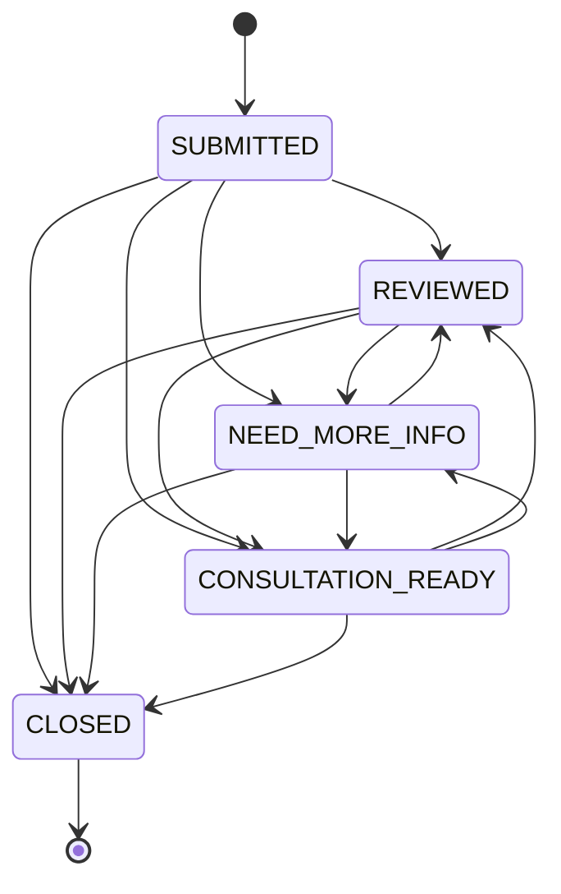

# 백엔드 기본 골격 DDD · Event Storming

[12일 개발 계획](PROJECT_12_DAY_PLAN.md)의 Day 7에서 Day 6의 Postman·코드 매핑 결과를 이 초안에 반영한다. 업무·정책·Read Model·코드를 연결하고 API별 적용 점검 결과를 갱신한다.

기준: 2026-10-17 로컬 코드. 5개 API 추가와 C02의 300자 입력 제한, 93개 자동 검증을 반영했다. 목적은 구현한 업무 흐름을 도메인 언어로 설명하고, 정책과 저장 책임을 이해하는 것이다. 아래 이벤트 이름은 업무 사실을 표현한 **설계·학습용 이름**이다. 현재 코드에 Event Bus, 이벤트 클래스, Outbox 또는 Event Sourcing이 구현되어 있다는 의미가 아니다.

현재 저장 구조는 [백엔드 ERD](C:/myLectureWs/legal-ai-intake-security-server/docs/BACKEND_ERD.md)를 함께 본다. Aggregate 후보와 DB FK 제약은 서로 다른 개념이며, 핵심 업무 테이블은 서비스가 연결하는 논리 ID 참조다.

**1. 업무 경계와 용어**

| Bounded Context 초안 | 담당 업무 | 현재 코드 / 데이터 |
|---|---|---|
| Intake 접수·검토 | 문의 접수, 자료 종류, 분류, 검토 상태, 상담 메모 | `LegalIntakeRecordService`, `LegalIntake`, `IntakeDocument`, `LawyerSearchCondition`, `ConsultationMemo` |
| Lawyer Search Routing | 문의 조건을 검색 요청과 결과 기록으로 연결 | `AiSearchRequest`, `SearchResultSnapshot`, RecordService의 검색 메서드 |
| Legal Reference | 법률 절차·단계·양식 안내 | `LegalProcedureService`, 관련 Entity/Repository |
| AI Safety & Cost | 세션 위험·고정 정책·토큰 예산·입출력 가드·출력 마스킹 | `AiService`, Guard/Cost/LLM Client, `PrivacyOutputGuardService` |
| Risk & Operations | Agent 위험 분석, 이력, Incident, 비동기 Job | `AgentRiskDecisionService`, `RiskIncidentService`, `AgentJobService` |
| Reporting | 접수·검색·현재 상담 상태 및 Agent 보안 현황 조회 | `MarketingDashboardService`, `AdminDashboardService` |

이 경계는 현재 단일 Spring Boot 애플리케이션 안에서의 책임 구분이다. 마이크로서비스 분리나 패키지별 완전한 DDD 전환을 완료한 것은 아니다. 기존 `LegalIntakeHistory`는 readiness 분석 이력이고, `LegalIntake`는 저장형 접수 레코드이므로 같은 데이터로 취급하지 않는다.

| 용어 | 우리 코드에서의 뜻 |
|---|---|
| Intake | 접수된 하나의 문의. 소송 사건 자체나 법률 결론과 구분 |
| Intake Document | 자료 종류 레코드와 업로드한 원본·메타데이터를 함께 관리. uploadedDocuments로 실제 첨부를 구분 |
| Search Condition | 분야·분쟁·지역·선호 조건과 생성된 검색문 |
| Search Request | 특정 Intake와 조건으로 검색을 준비한 기록 |
| Result Snapshot | 호출자가 전달해 저장한 검색 결과의 사본 |
| Consultation Ready | 현재 문의 상태가 `CONSULTATION_READY`라는 뜻. 과거 누적 도달 이벤트 수와 구분 |
| Preview | DB에 접수하지 않고 분류 결과를 먼저 확인하는 요청 |

**2. Aggregate와 일관성 규칙 초안**

| Aggregate 후보 / 기준 | 현재 구현 | 불변 조건·정책 |
|---|---|---|
| `LegalIntake` 중심 | 접수 생성 시 자료·검색 조건을 같은 서비스 트랜잭션에서 저장 | 문의가 없으면 메모·상태 변경·검색 요청을 만들지 않음. 상태 전이 규칙은 Entity/Enum에서 보호. |
| `AiSearchRequest` 중심 | 기존 문의·조건 ID를 참조하며 결과는 별도 Repository로 관리 | 요청·조건이 있어야 결과를 추가. 현재는 검색 실행 Aggregate로 확장하기 전 기록 구조. |
| `RiskIncident` | 위험도·권장 조치에 따라 열고 운영자가 확인·종결 | 운영 검토가 필요한 위험을 접수 업무와 분리 |

현재 자료·조건·메모·결과는 별도 JPA Entity와 Repository이다. Aggregate 내부 객체 컬렉션이나 JPA 연관관계로 완전히 캡슐화한 모델은 아니다. 우선 트랜잭션과 존재 확인으로 연결하며, 전체 구조를 이해한 다음 경계를 더 엄격하게 만들 수 있다.

**3. Event Storming: 접수부터 검토까지**

```mermaid
flowchart LR
    A["Actor: 의뢰인"] --> C1["Command: 사건 분류 미리보기"]
    C1 --> E1["Event: 분류 결과가 제시됨<br/>비저장"]
    E1 --> C2["Command: 문의 제출"]
    C2 --> P1["Policy: 필수값·길이 검증"]
    P1 --> AG["Aggregate 후보: LegalIntake"]
    AG --> E2["Event: 문의가 접수됨"]
    E2 --> E3["Event: 자료 종류가 기록됨"]
    E3 --> E4["Event: 검색 조건이 준비됨"]
    E4 --> R1["Read Model: Intake 목록·상세"]
    R1 --> A2["Actor: 변호사"]
    A2 --> C3["Command: 상태 변경"]
    C3 --> P2["Policy: 상태 전이 규칙"]
    P2 --> E5["Event: 검토 상태가 변경됨"]
    A2 --> C4["Command: 상담 메모 기록"]
    C4 --> P3["Policy: 문의 존재·메모 검증"]
    P3 --> E6["Event: 상담 메모가 기록됨"]
    E5 --> R1
    E6 --> R1
```

**4. Command → Event → 코드 매핑**

| Actor | Command | Domain Event 이름 초안 | Policy | Aggregate / 테이블 | Read Model | 실제 진입점 |
|---|---|---|---|---|---|---|
| 의뢰인 | `PreviewCaseClassification` | `CaseClassificationPresented` | 본문 필수·공백 불가·최대 300자, 저장 없이 기존 분류 규칙 사용 | 저장 없음 | `LegalIntakeClassificationResponse` | `POST /api/intakes/classify-preview` → `classifyPreview()` |
| 의뢰인 | `SubmitLegalIntake` | `LegalIntakeSubmitted` | 필수값·길이, 유형 분류, 자료 중복 제거 | `LegalIntake` / `legal_intake` | Intake 목록·상세 | `POST /api/intakes` → `create()` |
| 접수 처리 정책 | `RecordSelectedDocuments` | `IntakeDocumentsRecorded` | null·공백 제거, 중복 제거, 없으면 기본값 | `intake_document` | `selectedDocuments` | `create()` → `saveAll()` |
| 접수 처리 정책 | `PrepareLawyerSearchCondition` | `LawyerSearchConditionPrepared` | 유형·분쟁·지역으로 조건·검색문 생성 | `lawyer_search_condition` | `lawyerSearchCondition` | `create()` → 검색 조건 저장 |
| 의뢰인 | `CreateSearchRequest` | `LawyerSearchRequestCreated` | 문의·최신 조건 존재, 기본 목적·출처 정책 | `AiSearchRequest` / `ai_search_request` | 검색 요청 상세 | `createSearchRequest()` |
| 결과 제공자 | `AppendSearchResultSnapshot` | `SearchResultSnapshotRecorded` | 요청·조건 존재, 제목·URL 필수 | `search_result_snapshot` | 정렬된 `results` | `addSearchResult()` |
| 변호사 | `ChangeIntakeStatus` | `IntakeStatusChanged` | 허용 상태, 종료 후 재개 금지, 초기 상태로 역행 금지 | `LegalIntake` / `legal_intake.status` | Intake 상세 / 상태 응답 | `updateStatus()` → `LegalIntake.changeStatus()` |
| 변호사 | `RecordConsultationMemo` | `ConsultationMemoRecorded` | 문의 존재, 내용 필수, 후속 조치 코드 제한 | `consultation_memo` | 생성 응답·Intake의 `consultationMemos` | `createMemo()` |
| 운영자 | `ViewMarketingSummary` | 새 도메인 이벤트 없음 | 현재 DB 기준, 미수집 값 추정 금지 | 집계 읽기 | `MarketingFunnelResponse` | `MarketingDashboardService.funnel()` |
| AI 사용자 | `RequestAiAnswer` | `AiAnswerProduced` / `AiRequestBlocked` | Dynamic/Fixed/Cost/NeMo 정책 | 메모리 상태·metric·로그 | `AiChatResponse` | `AiService.chat()` |
| 운영자 | `AnalyzeAgentRisk` | `AgentRiskAssessed` | 신호별 점수·권장 조치 | 위험·실행 이력 | 위험 이력·요약 | `AgentRiskDecisionService.analyze()` |

조회 요청은 이미 발생한 사실을 읽는다. 목록 조회 때마다 ‘문의가 새로 접수됨’ 같은 업무 이벤트가 발생한다고 모델링하지 않는다. UI의 ‘요약 확인’ 행동은 실제 추적을 시작할 때 별도 이벤트로 설계할 수 있다.

**5. Intake 상태 정책**

동일 상태 요청은 멱등 성공(`changed=false`)이다. CLOSED에서 다른 상태로 이동하거나, 처리된 문의를 SUBMITTED로 되돌리는 요청은 409이다. 화면 초안의 NEW는 현재 서버의 SUBMITTED에 해당한다. 별도의 재개 업무가 필요하면 `ReopenIntake` 명령과 정책을 먼저 설계한다.

검토 단계부터는 REVIEWED·NEED_MORE_INFO·CONSULTATION_READY 사이의 이동을 허용한다. 초기 접수에서 곧바로 상담 준비 또는 종료로 변경하는 것도 Draft 정책상 허용한다. 반드시 순차 검토를 강제하는 정책은 현재 없다.

**6. 계층을 실제 요청에 대입하기**

예: `POST /api/intakes/12/memo`.

1. Controller가 경로의 12와 JSON을 받는다.
2. DTO가 본문 필수값·4,000자 제한·후속 조치 코드를 검사한다.
3. Service가 문의 12의 존재를 확인한다. 없으면 404로 멈춘다.
4. `ConsultationMemo.create()`가 메모와 중복 제거된 후속 조치를 만든다.
5. Repository가 `consultation_memo`에 저장한다.
6. Service가 본문의 개인정보 패턴을 마스킹해 DTO로 반환한다.
7. 이후 Intake 조회에서 같은 메모를 읽을 수 있다.

메모의 DB 원문을 전부 마스킹해 저장하는 정책은 아니다. 메모 작성자의 신원·역할·소유권 확인, 메모 수정 이력은 후속 설계중이다. UI에서 누구에게 보이는지와 서버의 현재 권한 규칙을 혼동하지 않는다.

**7. 실패 흐름과 검증 근거**

| Hotspot / 질문 | 현재 결정 | 검증 |
|---|---|---|
| 미리보기만 했는데 접수 수가 늘어나도 되는가? | 늘어나면 안 됨 | 분류 전후 Repository count 비교 |
| 없는 문의에 메모를 붙여도 되는가? | 404, 고아 메모 생성 금지 | 없는 ID 요청 후 메모 count 비교 |
| 종료한 문의를 일반 상태 변경으로 재개해도 되는가? | 409 | CLOSED → REVIEWED 실패 |
| 상태 변경을 재시도하면 오류인가? | 같은 상태는 성공 | `changed=false` 확인 |
| 한 문의에서 검색을 두 번 하면 문의도 두 건인가? | 요청은 2건, 검색한 문의는 1건 | 서로 다른 집계값 검증 |
| 방문 데이터가 없는데 0으로 표시해도 되는가? | 수집 API가 있는 단계는 보고된 기록 수 0 | `REPORTED_EVENT`, `dropOffMeasured=false` |
| Intake의 긴 검색 목적을 다음 요청이 상속할 수 있는가? | 최대 300자로 맞춤 | 300자 목적 저장·상속·재조회 |

검증 파일: [BackendDraftApiIntegrationTest.java](C:/myLectureWs/legal-ai-intake-security-server/backend/guardrail-ready-policy-checker/src/test/java/com/ohgiraffers/handlermethod/api/BackendDraftApiIntegrationTest.java).

**8. 다음 학습 질문**

- 상담 메모를 Intake Aggregate 내부로 묶을지, 독립 이력으로 둘지 어떤 불변 조건으로 결정할까?
- 상담 준비 ‘현재 수’와 ‘한 번이라도 도달한 수’를 구분하려면 어떤 상태 이력 또는 이벤트가 필요할까?
- 검색 요청 실행을 붙일 때 PREVIEW_READY → RUNNING → COMPLETED/FAILED 전이는 누가 소유할까?
- 문의 제출과 행동 이벤트 기록을 원자적으로 보장해야 한다면 어떤 저장 정책이 필요할까?
- 다른 사용자의 Intake를 조회하지 못하게 하려면 세션 문자열 외에 어떤 소유자 정보와 권한 정책이 필요할까?

오늘은 실제 요청 하나를 Command, 정책, 저장 대상, 조회 응답까지 설명할 수 있으면 충분하다. Event Bus 도입이나 전체 패키지 재구성은 이 이해가 쌓인 뒤 결정한다.

## 추가 API의 Policy / Read Model / Code Mapping

| Command / Query | 업무 사실(학습용) | Policy | 저장 / Read Model | 코드 |
|---|---|---|---|---|
| ViewCurrentUser | 새 도메인 이벤트 없음 | JWT 필수 | username·role | CurrentUserController.me |
| ListSearchRequests | 새 도메인 이벤트 없음 | 문의 존재·JWT·소유자/관리자 | 최신순 AiSearchRequestResponse[] | IntakeSearchHistoryController → RecordService.findSearchRequests |
| UploadIntakeDocument | IntakeFileUploaded | JWT·소유자/관리자·5 MiB·허용 유형 | intake_document BLOB / IntakeDocumentResponse·uploadedDocuments | IntakeDocumentService.upload |
| DownloadIntakeDocument | FileDownloadRequested | JWT·소유자/관리자·문의/파일 일치 | intake_document_download / 파일 바이트 | IntakeDocumentService.download |
| RecordIntakeEvent | IntakeBehaviorReported | eventId 중복·충돌, 문의·세션 일치 | intake_event / IntakeEventResponse·MarketingFunnelResponse.eventCounts | IntakeEventService.record → MarketingDashboardService.funnel |

이 표의 도메인 이벤트는 설명용 이름이다. intake_event 테이블은 명시적으로 수집하는 화면 행동 데이터이며 DDD Event Bus가 아니다. 신규 파일/검색 이력에서 소유자 검사를 도입했고 기존 공개 문의 API 전체로의 확대는 후속이다. Marketing의 방문 등은 보고된 이벤트 수이며 dropOffMeasured=false다.
