# DDD · Event Storming · Policy / Read Model / Code Mapping

2026-10-18 코드 기준. API 기능서의 C·R·S·P 번호를 그대로 사용한다. **36개 구현 API + P03 설계 1개**를 Middle → Bottom으로 연결한다.

API 흐름도에서 번호를 고른 뒤 **업무 명령·조회 → 적용 규칙 → Service 메서드 → 저장·조회 대상 → 응답·관측 근거** 순서로 읽는다. 아래 코드 링크는 현재 소스의 해당 선언으로 연결된다.

**개발 필수 요구사항 별도 체크:** React 연동·CORS, LLM 질문·비동기·지연 시간 요구사항의 구현 상태·API·flow·코드·후속 확인을 문서 뒤 전용 페이지와 [분리 문서](DEVELOPMENT_REQUIREMENTS_CHECK.md)에 정리했다.

## 문서 범위와 Service 표기

대상은 **이번 프로젝트의 C01~C20·R01~R06·S01~S05·P01~P06 37개 항목**이다. 구현 36개와 설계 P03 1개를 구분한다. 이전 과제로 제출한 법률 절차 Previewer의 **Reference API 6개(R01~R06)는 이미 이 37개에 포함**돼 있다. 37개에 6개를 다시 더하지 않는다. 프로젝트 밖의 실습·실험 API는 싣지 않는다.

과제 원본 `legal-procedure-viewer-assignment`의 백엔드 6개 경로와 기존 React의 R01·R02·R06 호출을 대조했다. R03·R04·R05는 재사용하는 백엔드 API이며 해당 화면 연결은 후속이다.

**Service 축약 표기:** Controller와 Service의 `Controller`·`Service`를 제외한 앞부분 이름이 같으면 **`→ S.메서드()`**로 쓴다. 예를 들어 `LegalProcedureController.procedures() → S.findProcedures()`에서 `S.`는 `LegalProcedureService`다. 이름이 다른 경우에는 `LegalIntakeRecordService.classifyPreview()`처럼 전체 이름을 쓴다. 표의 코드 링크는 축약해도 실제 Service 파일·선언 줄을 가리킨다. Controller가 함께 표시되지 않는 단독 Policy·Read Model 코드 참조에서는 Service 전체 이름을 유지한다.

### Previewer 재사용 핵심 흐름

이전 과제의 화면과 API를 그대로 연결해서 읽는다. R01~R05는 저장된 법률 절차·단계·양식 조회이고, R06은 고정 체크리스트다. 이 흐름 자체가 문의 등록이나 LLM 호출을 수행하지는 않는다.

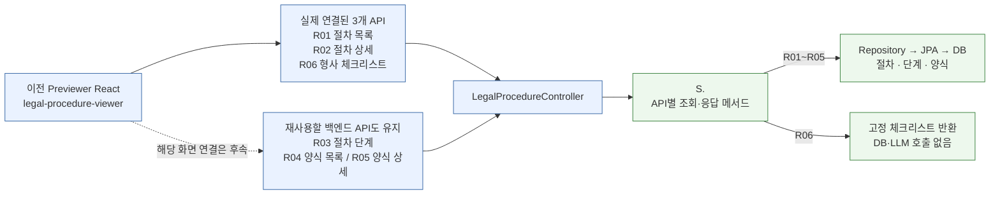

## 1. Top → Middle → Bottom 연결 지도

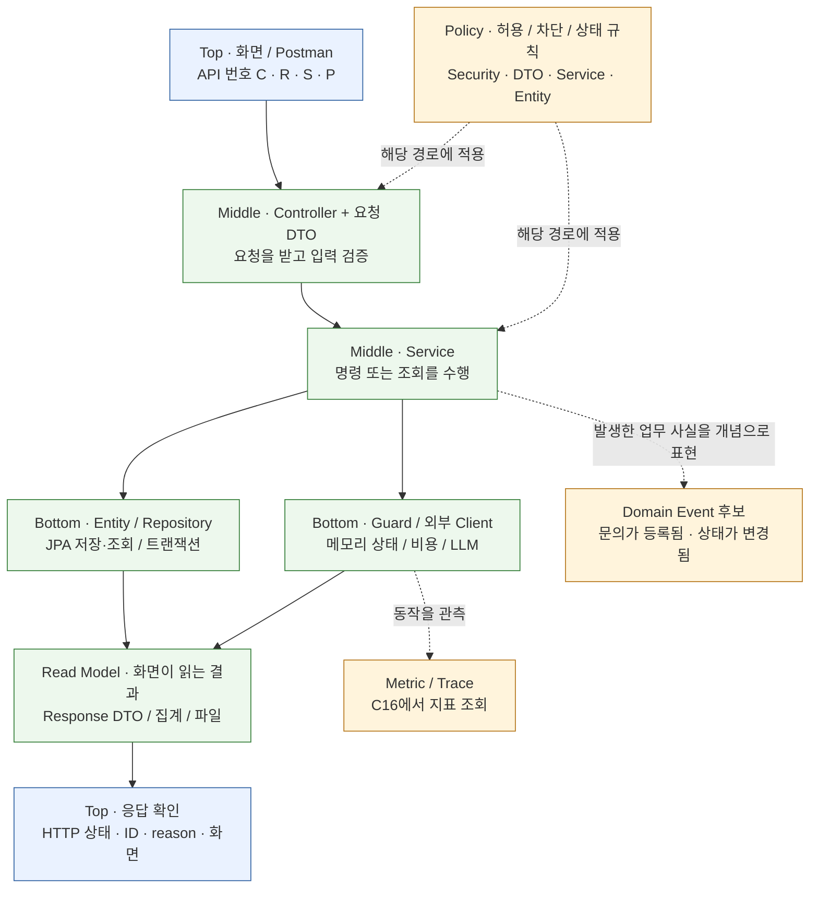

### 용어와 코드에서 찾을 자리

| 개념 | 이 프로젝트에서 읽는 의미 | 코드에서 확인할 것 |
|---|---|---|
| Actor | 요청을 보낸 의뢰인·변호사·운영자·시스템 | 화면 역할과 실제 인증·인가 설정은 별도로 확인한다. |
| Command | 저장·변경·분석·답변 생성을 요청하는 업무 | create, updateStatus, createMemo, chat 등의 진입 메서드 |
| Query | 저장된 자료·상태·집계를 읽는 요청 | findById, findRecent, summarize 등. 조회 자체를 상태 변경 이벤트로 만들지 않는다. |
| Domain Event | 성공한 업무 뒤에 “무엇이 일어났는가”를 과거형으로 표현 | 아래 영어 이벤트명은 **설계·학습용 후보**다. 같은 이름의 이벤트 클래스·발행 코드가 있다는 뜻은 아니다. |
| Policy | 어떤 조건에서 허용·차단·변경할지 결정하는 규칙 | SecurityConfig, DTO 제약, Service 분기, Entity 상태 메서드에 나뉘어 있다. 모두 Service에만 있는 것은 아니다. |
| Aggregate | 함께 일관성을 지켜야 하는 도메인 단위의 후보 | 현재는 Service가 여러 Repository를 조합하는 JPA 구조다. 아래 후보가 완성된 Aggregate Root 구현을 뜻하지는 않는다. |
| Read Model | 화면·운영자가 읽기 좋게 조합한 결과 | Response DTO, 조회 배열, 집계 DTO. 별도 CQRS DB나 이벤트 기반 Projection을 구축했다는 뜻은 아니다. |

현재 업무 처리는 메서드 호출과 JPA 트랜잭션으로 연결된다. **Event Bus·Outbox·Event Sourcing은 구현하지 않았다.** P06의 행동 이벤트는 실제 DB 기록이지만, 다른 도메인 처리를 구독·실행시키는 이벤트 버스와는 구분한다.

## 2. DDD 책임 경계와 데이터 단위

하나의 Spring Boot 서버 안에서 책임을 나누어 읽기 위한 Bounded Context 후보다.

| 책임 경계 | 관련 API | Aggregate·데이터 단위 후보 | 현재 구현 근거 |
|---|---|---|---|
| 인증·접근 | C01, P01, P02, P04, P05 및 보호 경로 | 사용자 식별·접근 결정. 회원 Aggregate는 별도 구현하지 않음 | [SecurityConfig.applicationSecurity](C:/myLectureWs/legal-ai-intake-security-server/backend/guardrail-ready-policy-checker/src/main/java/com/ohgiraffers/handlermethod/config/SecurityConfig.java:66), [IntakeAccessService.requireAccess](C:/myLectureWs/legal-ai-intake-security-server/backend/guardrail-ready-policy-checker/src/main/java/com/ohgiraffers/handlermethod/service/IntakeAccessService.java:16) |
| 문의·상담 검토 | C02~C05, C09~C11, P04~P05 | LegalIntake 중심으로 자료·조건·메모·파일을 연결 | [LegalIntake](C:/myLectureWs/legal-ai-intake-security-server/backend/guardrail-ready-policy-checker/src/main/java/com/ohgiraffers/handlermethod/entity/LegalIntake.java:15), [IntakeDocument](C:/myLectureWs/legal-ai-intake-security-server/backend/guardrail-ready-policy-checker/src/main/java/com/ohgiraffers/handlermethod/entity/IntakeDocument.java:15), [LawyerSearchCondition](C:/myLectureWs/legal-ai-intake-security-server/backend/guardrail-ready-policy-checker/src/main/java/com/ohgiraffers/handlermethod/entity/LawyerSearchCondition.java:14), [ConsultationMemo](C:/myLectureWs/legal-ai-intake-security-server/backend/guardrail-ready-policy-checker/src/main/java/com/ohgiraffers/handlermethod/entity/ConsultationMemo.java:16) |
| 검색 기록·라우팅 | C06~C08, P02, P03 | AiSearchRequest와 결과 스냅샷. 문의·조건은 ID로 참조 | [AiSearchRequest](C:/myLectureWs/legal-ai-intake-security-server/backend/guardrail-ready-policy-checker/src/main/java/com/ohgiraffers/handlermethod/entity/AiSearchRequest.java:14), [SearchResultSnapshot](C:/myLectureWs/legal-ai-intake-security-server/backend/guardrail-ready-policy-checker/src/main/java/com/ohgiraffers/handlermethod/entity/SearchResultSnapshot.java:14), [LegalIntakeRecordService.createSearchRequest](C:/myLectureWs/legal-ai-intake-security-server/backend/guardrail-ready-policy-checker/src/main/java/com/ohgiraffers/handlermethod/service/LegalIntakeRecordService.java:182) |
| 법률 Reference | R01~R06 | LegalProcedure, 단계, 양식. R06은 고정 안내 | [LegalProcedure](C:/myLectureWs/legal-ai-intake-security-server/backend/guardrail-ready-policy-checker/src/main/java/com/ohgiraffers/handlermethod/entity/LegalProcedure.java:15), [LegalProcedureStep](C:/myLectureWs/legal-ai-intake-security-server/backend/guardrail-ready-policy-checker/src/main/java/com/ohgiraffers/handlermethod/entity/LegalProcedureStep.java:15), [LegalFormTemplate](C:/myLectureWs/legal-ai-intake-security-server/backend/guardrail-ready-policy-checker/src/main/java/com/ohgiraffers/handlermethod/entity/LegalFormTemplate.java:15), [LegalProcedureService](C:/myLectureWs/legal-ai-intake-security-server/backend/guardrail-ready-policy-checker/src/main/java/com/ohgiraffers/handlermethod/service/LegalProcedureService.java:21) |
| AI 안전·비용 | S01~S04 | 세션 위험 상태, 호출별 CostReservation, 검사·답변 결과 | [AiService](C:/myLectureWs/legal-ai-intake-security-server/backend/guardrail-ready-policy-checker/src/main/java/com/ohgiraffers/handlermethod/service/AiService.java:26), [AiStreamingService](C:/myLectureWs/legal-ai-intake-security-server/backend/guardrail-ready-policy-checker/src/main/java/com/ohgiraffers/handlermethod/service/AiStreamingService.java:23), [LegalDynamicGuardService](C:/myLectureWs/legal-ai-intake-security-server/backend/guardrail-ready-policy-checker/src/main/java/com/ohgiraffers/handlermethod/riskengine/LegalDynamicGuardService.java:14), [AiCostControlService](C:/myLectureWs/legal-ai-intake-security-server/backend/guardrail-ready-policy-checker/src/main/java/com/ohgiraffers/handlermethod/cost/AiCostControlService.java:20) |
| Agent 위험·운영 | S05, C12, C14~C20 | AgentRiskHistory, AgentRunHistory, RiskIncident, 보안 이력 | [AgentRiskDecisionService](C:/myLectureWs/legal-ai-intake-security-server/backend/guardrail-ready-policy-checker/src/main/java/com/ohgiraffers/handlermethod/service/AgentRiskDecisionService.java:24), [RiskIncident](C:/myLectureWs/legal-ai-intake-security-server/backend/guardrail-ready-policy-checker/src/main/java/com/ohgiraffers/handlermethod/entity/RiskIncident.java:17), [SecurityEventHistory](C:/myLectureWs/legal-ai-intake-security-server/backend/guardrail-ready-policy-checker/src/main/java/com/ohgiraffers/handlermethod/entity/SecurityEventHistory.java:14) |
| 행동 기록·마케팅 | P06, C13 | IntakeEvent와 업무 DB 집계 | [IntakeEvent](C:/myLectureWs/legal-ai-intake-security-server/backend/guardrail-ready-policy-checker/src/main/java/com/ohgiraffers/handlermethod/entity/IntakeEvent.java:9), [IntakeEventService](C:/myLectureWs/legal-ai-intake-security-server/backend/guardrail-ready-policy-checker/src/main/java/com/ohgiraffers/handlermethod/service/IntakeEventService.java:17), [MarketingDashboardService](C:/myLectureWs/legal-ai-intake-security-server/backend/guardrail-ready-policy-checker/src/main/java/com/ohgiraffers/handlermethod/service/MarketingDashboardService.java:19) |

문의·검색·파일의 intakeId, conditionId, searchRequestId 같은 값은 **연결을 위한 논리 ID**다. Entity에 Long 값으로 저장한 참조를 모두 실제 DB 외래키라고 부르지 않는다. Reference의 JPA 연관관계와 구분해서 ERD를 읽는다.

## 3. Event Storming 표

### 저장·변경·처리 요청

이벤트 후보는 **해당 처리에 성공했을 때의 의미**다. 실패·차단됐다면 성공 이벤트가 발생한 것으로 기록하지 않는다. Actor는 화면상 업무 역할이며 실제 권한 보장은 POL-01·02에서 확인한다.

| API / Actor | Command — 요청한 일 | Domain Event 후보 — 성공한 사실 | 바뀌는 대상·후속 관계 |
|---|---|---|---|
| C01 / 사용자 | 로그인하기 | AccessTokenIssued · 접근 토큰이 발급됨 | JWT를 반환. 회원 DB나 도메인 이벤트 저장은 없음 |
| C02·C04 / 의뢰인 | 사건 분류·간단 안내 받기 | ClassificationPreviewPrepared / MinimalGuidePrepared | 계산 결과만 반환. 문의 등록·검색 생성·LLM 호출 없음 |
| C03 / 의뢰인 | 문의 등록하기 | IntakeRegistered · 문의가 등록됨 | 문의·자료 종류·검색 조건 저장. C06 검색 요청은 사용자가 별도로 호출 |
| C06 / 의뢰인·검토자 | 문의로 검색 요청 만들기 | SearchRequestCreated · 검색 요청이 기록됨 | PREVIEW_READY 레코드 생성. 외부 검색 실행 아님 |
| C08 / 검색 결과 입력 주체 | 결과 스냅샷 저장하기 | SearchResultSnapshotStored | 호출자가 준 결과 저장. 외부 수집·검증·검색 완료 상태 전환 없음 |
| C10 / 검토자 | 문의 상태 바꾸기 | IntakeStatusChanged | LegalIntake.status 변경. 같은 상태 재요청은 changed=false이므로 새 변경 사실 없음 |
| C11 / 검토자 | 상담 메모 추가하기 | ConsultationMemoAdded | ConsultationMemo 저장, 마스킹한 본문 응답 |
| P04 / 소유자·관리자 | 문의 파일 올리기 | IntakeDocumentUploaded | 파일 내용·메타데이터를 IntakeDocument에 저장 |
| P05 / 소유자·관리자 | 파일 내려받기 | DocumentDownloadRecorded | 파일 조회와 함께 다운로드 감사 행 저장. GET이지만 이 감사 기록은 남음 |
| P06 / 화면·호출자 | 행동 이벤트 보고하기 | IntakeBehaviorRecorded | 새 eventId만 저장. 같은 내용 재전송은 새 이벤트가 아니라 기존 결과 반환 |
| S01 / 질문 사용자 | AI 답변 받기 | AiAnswerPrepared | Guard·비용·출력 보호를 통과한 답변. 중간 차단은 답변 생성 성공과 구분 |
| S02 / 질문 사용자 | SSE 답변 받기 | SafeStreamResponsePrepared | 전체 답변을 검사·마스킹한 뒤 token/done 전송. 연결 완료를 DB 이벤트로 저장하지 않음 |
| S03·S04 / 검사 호출자 | 입력·출력 검사하기 | InputPolicyChecked / OutputPolicyChecked | 허용 또는 차단 판정 반환, 외부 검사 비용 관리. 전체 Chat 실행 아님 |
| S05 / 위험 분석 호출자 | Agent 위험 분석하기 | AgentRiskAssessed | 위험·실행 이력 저장. 조건 충족 시 RiskIncidentOpened 후보에 해당하는 Incident 생성 |
| C19 / 운영자 | Incident 확인하기 | RiskIncidentAcknowledged | Incident 상태와 변경 시각 저장 |
| C20 / 운영자 | Incident 종결하기 | RiskIncidentResolved | Incident 상태와 변경 시각 저장. 문의 C10의 전이 규칙과 별개 |
| P03 / 후속 설계 | 실제 외부 검색 실행하기 | ExternalSearchCompleted · 후속 설계 후보 | **미구현**. LLM의 검색문 구성·결과 설명과 외부 검색 도구의 자료 수집을 분리할 예정 |

### 조회 요청 — 새 상태 변경 이벤트를 만들지 않는 경로

| API / Actor | Query — 읽는 일 | Read Model | 앞선 처리와의 연결 |
|---|---|---|---|
| P01 / 로그인 사용자 | 내 정보 보기 | RM-01 | JWT에서 인증된 사용자·역할 |
| C05·C09 / 의뢰인·검토자 | 문의 상세·목록 보기 | RM-03 | C03 등록, C10 상태, C11 메모, P04 파일 반영 |
| C07·P02 / 의뢰인·검토자 | 검색 요청 상세·문의별 이력 보기 | RM-04 | C06 요청, C08 스냅샷 반영. P02에 소유권 검사 적용 |
| R01~R05 / 사용자 | 절차·단계·양식 읽기 | RM-08 | Reference DB 자료 조회. 문의나 검색 상태 변경 없음 |
| R06 / 사용자 | 고정 체크리스트 읽기 | RM-08 | Service의 고정 안내. DB 조회 없음 |
| C12·C14 / 운영자 | 운영 요약·보안 이력 읽기 | RM-09 | Agent·Incident·인증 관련 DB 이력. Chat 차단 Metric과 구분 |
| C15·C17 / 운영자 | Agent 위험 집계·이력 읽기 | RM-09 | S05가 저장한 AgentRiskHistory |
| C18 / 운영자 | Incident 목록 읽기 | RM-09 | S05의 조건별 생성, C19·C20 상태 변경 반영 |
| C13 / 운영자 | 마케팅 기본 집계 읽기 | RM-10 | 문의·검색·현재 상태와 P06 보고 이벤트를 각각 집계 |
| C16 / 운영자 | Prometheus 지표 읽기 | RM-11 | 메모리의 Counter·Gauge·Timer 노출. DB 전체 이력을 읽는 API 아님 |

## 4. Policy → API → 코드

POL 번호는 **이 문서의 규칙 색인**이며 API의 P01~P06이나 응답 reasonCode와는 별개다.

| Policy | 적용 규칙 | 적용 API·경로 | Bottom — 실제 코드 |
|---|---|---|---|
| POL-01 인증·통신 | JWT 보호 경로와 ADMIN Basic Actuator를 구분. CORS는 브라우저의 preflight·응답 헤더까지 확인 | JWT: P01·P02·P04·P05·S01~S04. C16: ADMIN Basic. 다른 경로는 현재 설정 확인 | [SecurityConfig.applicationSecurity](C:/myLectureWs/legal-ai-intake-security-server/backend/guardrail-ready-policy-checker/src/main/java/com/ohgiraffers/handlermethod/config/SecurityConfig.java:66), [SecurityConfig.actuatorSecurity](C:/myLectureWs/legal-ai-intake-security-server/backend/guardrail-ready-policy-checker/src/main/java/com/ohgiraffers/handlermethod/config/SecurityConfig.java:42), [WebMvcConfig.corsConfigurationSource](C:/myLectureWs/legal-ai-intake-security-server/backend/guardrail-ready-policy-checker/src/main/java/com/ohgiraffers/handlermethod/config/WebMvcConfig.java:29) |
| POL-02 대상·소유권 | P02·P04·P05에서 문의 존재 후 소유자 또는 ROLE_ADMIN 확인. 404와 403 구분 | P02·P04·P05. C05·C09에는 같은 소유권 필터가 없음 | [IntakeAccessService.requireAccess](C:/myLectureWs/legal-ai-intake-security-server/backend/guardrail-ready-policy-checker/src/main/java/com/ohgiraffers/handlermethod/service/IntakeAccessService.java:16) |
| POL-03 입력 계약 | @Valid가 있는 진입점에서 DTO 제약 검사. C02 coreStatement 최대 300자, S01·S02 message 최대 30자 | C01·C02·C03·C06·C08·C10·C11·P06·S01~S04. C04·S05와 구분 | [LegalIntakeClassificationRequest](C:/myLectureWs/legal-ai-intake-security-server/backend/guardrail-ready-policy-checker/src/main/java/com/ohgiraffers/handlermethod/dto/LegalIntakeClassificationRequest.java:6), [AiChatRequest](C:/myLectureWs/legal-ai-intake-security-server/backend/guardrail-ready-policy-checker/src/main/java/com/ohgiraffers/handlermethod/dto/AiChatRequest.java:6), [ApiExceptionHandler.handleValidationException](C:/myLectureWs/legal-ai-intake-security-server/backend/guardrail-ready-policy-checker/src/main/java/com/ohgiraffers/handlermethod/api/ApiExceptionHandler.java:29) |
| POL-04 접수·저장 | 분류·자료 종류·검색 조건을 문의와 함께 저장. 검색 요청 자동 생성 없음 | C03. C02·C04는 독립 규칙 처리 | [LegalIntakeRecordService.create](C:/myLectureWs/legal-ai-intake-security-server/backend/guardrail-ready-policy-checker/src/main/java/com/ohgiraffers/handlermethod/service/LegalIntakeRecordService.java:107), [LegalIntakeRecordService.classifyPreview](C:/myLectureWs/legal-ai-intake-security-server/backend/guardrail-ready-policy-checker/src/main/java/com/ohgiraffers/handlermethod/service/LegalIntakeRecordService.java:70), [MinimalLegalIntakeService.analyze](C:/myLectureWs/legal-ai-intake-security-server/backend/guardrail-ready-policy-checker/src/main/java/com/ohgiraffers/handlermethod/legal/MinimalLegalIntakeService.java:21) |
| POL-05 문의 상태 | CLOSED에서 다른 상태로 전환 금지, 다른 상태에서 SUBMITTED 복귀 금지. 같은 상태는 허용·changed=false | C10. 대상 없음 404, 금지 전이 409 | [LegalIntakeRecordService.updateStatus](C:/myLectureWs/legal-ai-intake-security-server/backend/guardrail-ready-policy-checker/src/main/java/com/ohgiraffers/handlermethod/service/LegalIntakeRecordService.java:81), [LegalIntake.changeStatus](C:/myLectureWs/legal-ai-intake-security-server/backend/guardrail-ready-policy-checker/src/main/java/com/ohgiraffers/handlermethod/entity/LegalIntake.java:238), [IntakeStatus.canChangeTo](C:/myLectureWs/legal-ai-intake-security-server/backend/guardrail-ready-policy-checker/src/main/java/com/ohgiraffers/handlermethod/legal/IntakeStatus.java:10) |
| POL-06 검색 기록 | 문의·조건 존재 확인 후 PREVIEW_READY 요청 생성. 스냅샷은 호출자 입력을 저장 | C06~C08. P02는 접근 확인 뒤 최신순 조회 | [LegalIntakeRecordService.createSearchRequest](C:/myLectureWs/legal-ai-intake-security-server/backend/guardrail-ready-policy-checker/src/main/java/com/ohgiraffers/handlermethod/service/LegalIntakeRecordService.java:182), [LegalIntakeRecordService.addSearchResult](C:/myLectureWs/legal-ai-intake-security-server/backend/guardrail-ready-policy-checker/src/main/java/com/ohgiraffers/handlermethod/service/LegalIntakeRecordService.java:215), [LegalIntakeRecordService.findSearchRequests](C:/myLectureWs/legal-ai-intake-security-server/backend/guardrail-ready-policy-checker/src/main/java/com/ohgiraffers/handlermethod/service/LegalIntakeRecordService.java:176) |
| POL-07 파일 | 접근 권한, 크기, 파일명, 확장자·내용·Content-Type 조합 검사. 다운로드 감사 저장 | P04·P05. C03의 자료 종류 선택과 실제 파일 업로드를 구분 | [IntakeDocumentService.upload](C:/myLectureWs/legal-ai-intake-security-server/backend/guardrail-ready-policy-checker/src/main/java/com/ohgiraffers/handlermethod/service/IntakeDocumentService.java:41), [IntakeDocumentService.download](C:/myLectureWs/legal-ai-intake-security-server/backend/guardrail-ready-policy-checker/src/main/java/com/ohgiraffers/handlermethod/service/IntakeDocumentService.java:79) |
| POL-08 Fixed·Dynamic | 현재 입력의 고정 위험을 검사하고, 차단 이력을 세션별로 누적·사전 차단 | S01·S02. 단독 S03·S04에 전체 Chat Guard를 자동 적용하는 구조는 아님 | [LegalFixedGuardService.check](C:/myLectureWs/legal-ai-intake-security-server/backend/guardrail-ready-policy-checker/src/main/java/com/ohgiraffers/handlermethod/riskengine/LegalFixedGuardService.java:99), [LegalDynamicGuardService.preCheck](C:/myLectureWs/legal-ai-intake-security-server/backend/guardrail-ready-policy-checker/src/main/java/com/ohgiraffers/handlermethod/riskengine/LegalDynamicGuardService.java:33), [LegalDynamicGuardService.recordBlockedEvent](C:/myLectureWs/legal-ai-intake-security-server/backend/guardrail-ready-policy-checker/src/main/java/com/ohgiraffers/handlermethod/riskengine/LegalDynamicGuardService.java:45) |
| POL-09 비용 | 문자 기반 입력 제한, 전체·하루·세션 예산, 단계별 예약·정산. usage가 없으면 추정 비용 반영 | S01·S02 입력 제한 + 답변 비용. S01~S04의 외부 입력·출력 검사 비용 | [AiCostControlService.checkInputPageLimit](C:/myLectureWs/legal-ai-intake-security-server/backend/guardrail-ready-policy-checker/src/main/java/com/ohgiraffers/handlermethod/cost/AiCostControlService.java:108), [AiCostControlService.reserveStageWithBlock](C:/myLectureWs/legal-ai-intake-security-server/backend/guardrail-ready-policy-checker/src/main/java/com/ohgiraffers/handlermethod/cost/AiCostControlService.java:155), [AiCostControlService.recordUsage](C:/myLectureWs/legal-ai-intake-security-server/backend/guardrail-ready-policy-checker/src/main/java/com/ohgiraffers/handlermethod/cost/AiCostControlService.java:194), [CostedGuardrailService](C:/myLectureWs/legal-ai-intake-security-server/backend/guardrail-ready-policy-checker/src/main/java/com/ohgiraffers/handlermethod/cost/CostedGuardrailService.java:17) |
| POL-10 출력 보호 | Chat 출력 검사 후 Privacy 마스킹. 저장형 문의·메모는 지정 응답 필드만 마스킹 | S01·S02, C03·C05·C09·C11, C04 안내의 지정 항목 | [PrivacyOutputGuardService.mask](C:/myLectureWs/legal-ai-intake-security-server/backend/guardrail-ready-policy-checker/src/main/java/com/ohgiraffers/handlermethod/riskengine/PrivacyOutputGuardService.java:26), [LegalIntakeRecordService.toIntakeResponse](C:/myLectureWs/legal-ai-intake-security-server/backend/guardrail-ready-policy-checker/src/main/java/com/ohgiraffers/handlermethod/service/LegalIntakeRecordService.java:256), [AiStreamingService.flushCompletedResponse](C:/myLectureWs/legal-ai-intake-security-server/backend/guardrail-ready-policy-checker/src/main/java/com/ohgiraffers/handlermethod/service/AiStreamingService.java:243) |
| POL-11 행동 보고 | SUMMARY_VIEWED에 문의 ID 필요. 문의·sessionId 연결 확인. eventId 중복은 같은 내용이면 200, 다르면 409 | P06. 이 sessionId 검사는 사용자 인증을 대신하지 않음 | [IntakeEventService.record](C:/myLectureWs/legal-ai-intake-security-server/backend/guardrail-ready-policy-checker/src/main/java/com/ohgiraffers/handlermethod/service/IntakeEventService.java:26) |
| POL-12 Agent·Incident | 위험 점수·권장 조치 산출, 이력 저장. 점수 80 이상 또는 특정 권장 조치 시 Incident 생성 | S05, C19·C20. 권장 조치 응답이 외부 도구 실행 차단을 뜻하지는 않음 | [AgentRiskDecisionService.analyze](C:/myLectureWs/legal-ai-intake-security-server/backend/guardrail-ready-policy-checker/src/main/java/com/ohgiraffers/handlermethod/service/AgentRiskDecisionService.java:42), [RiskIncidentService.createIfNeeded](C:/myLectureWs/legal-ai-intake-security-server/backend/guardrail-ready-policy-checker/src/main/java/com/ohgiraffers/handlermethod/service/RiskIncidentService.java:23), [RiskIncidentService.acknowledge](C:/myLectureWs/legal-ai-intake-security-server/backend/guardrail-ready-policy-checker/src/main/java/com/ohgiraffers/handlermethod/service/RiskIncidentService.java:55), [RiskIncidentService.resolve](C:/myLectureWs/legal-ai-intake-security-server/backend/guardrail-ready-policy-checker/src/main/java/com/ohgiraffers/handlermethod/service/RiskIncidentService.java:62) |
| POL-13 조회·집계 | 저장된 데이터의 범위와 집계 단위를 유지. 마케팅 집계와 Agent 보안 집계 분리 | C12~C18, R01~R06, C05·C07·C09·P02 | [MarketingDashboardService.funnel](C:/myLectureWs/legal-ai-intake-security-server/backend/guardrail-ready-policy-checker/src/main/java/com/ohgiraffers/handlermethod/service/MarketingDashboardService.java:32), [AdminDashboardService.summary](C:/myLectureWs/legal-ai-intake-security-server/backend/guardrail-ready-policy-checker/src/main/java/com/ohgiraffers/handlermethod/service/AdminDashboardService.java:35), [AgentRiskHistoryQueryService.summarize](C:/myLectureWs/legal-ai-intake-security-server/backend/guardrail-ready-policy-checker/src/main/java/com/ohgiraffers/handlermethod/service/AgentRiskHistoryQueryService.java:41), [LegalProcedureService](C:/myLectureWs/legal-ai-intake-security-server/backend/guardrail-ready-policy-checker/src/main/java/com/ohgiraffers/handlermethod/service/LegalProcedureService.java:21) |

POL-01의 실제 설정에서 C12~C15·C17~C20은 URL에 admin이 있거나 운영 화면에서 쓴다는 이유만으로 ADMIN 권한이 강제되지 않는다. 현재 /api/** 공개 허용에 들어가는 경로와 보호 경로를 코드에서 구분해 읽는다.

## 5. Read Model → 데이터 출처 → API

RM 번호는 읽기 결과를 찾기 위한 문서 색인이다. Entity를 그대로 반환하는 것과 여러 값을 Response DTO로 조합하는 것을 구분한다.

| Read Model | 결과 형태 | 데이터 출처 | 연결 API·확인할 의미 |
|---|---|---|---|
| RM-01 인증 결과 | LoginResponse / CurrentUserResponse | 로그인 인증 결과·JWT Authentication. 별도 회원 JPA 조회 없음 | C01·P01: accessToken, username, role |
| RM-02 규칙 안내 | LegalIntakeClassificationResponse / MinimalLegalIntakeResponse | 요청 입력과 규칙 계산 | C02·C04: 저장형 문의의 생성 결과와 구분 |
| RM-03 문의 보기 | LegalIntakeResponse, LegalIntakeStatusResponse, ConsultationMemoResponse | LegalIntake·자료 종류·최신 검색 조건·메모·업로드 파일 메타데이터 | C03·C05·C09~C11. 지정 응답 필드에 마스킹 적용 |
| RM-04 검색 보기 | AiSearchRequestResponse 및 배열 | AiSearchRequest + LawyerSearchCondition + 정렬된 SearchResultSnapshot | C06~C08·P02. 빈 이력 []는 정상이며 문의 없음 404와 다름 |
| RM-05 파일 | IntakeDocumentResponse / 다운로드 bytes·헤더 | IntakeDocument BLOB·메타데이터, 다운로드 시 IntakeDocumentDownload 추가 | P04·P05. 메타데이터 응답과 파일 본문 응답 구분 |
| RM-06 행동 접수 | IntakeEventResponse | IntakeEvent 신규 저장 또는 중복 조회 | P06: created=true의 201, 같은 이벤트 재전송은 created=false의 200 |
| RM-07 AI·검사 결과 | AiChatResponse / AiStreamEvent / 단독 검사 Response | Guard 결과·LLM 결과·메모리 비용 상태. Chat 응답을 JPA로 저장하지 않음 | S01~S04: reasonCode·detailCode, usageAvailable·costSource. SSE의 done과 JSON 응답 구분 |
| RM-08 Reference | 절차 목록·상세·단계·양식 DTO / LegalChecklistResponse | R01~R05는 Reference Repository. R06은 Service 고정값 | R01~R06. 외부 검색이나 LLM 결과가 아님 |
| RM-09 운영·위험 | AdminDashboardSummaryResponse / SecurityEventHistoryResponse / AgentRiskSummaryResponse / AgentRiskHistoryResponse / RiskIncidentResponse | Agent 실행·위험 이력, 보안 이벤트, Incident DB | C12·C14·C15·C17~C20·S05. C17 두 필터를 함께 주면 riskLevel이 우선 |
| RM-10 마케팅 | MarketingFunnelResponse | 문의 수·검색 요청 수·검색한 문의 수·현재 상담 준비 상태·P06 이벤트 수 | C13. 이벤트 건수와 고유 방문자 수, 현재 상태와 전환율을 같게 보지 않음 |
| RM-11 관측값 | Prometheus Counter·Gauge·Timer 텍스트 | Micrometer MeterRegistry 및 메모리 위험·비용 상태 | C16. DB 이력과 별개이며 서버 재시작 전후 연속성을 자동 보장하지 않음 |

S05는 Agent 위험·실행 이력을 저장한다. SecurityEventHistory는 인증 실패·접근 거절 등을 기록하는 [SecurityMetricRecorder](C:/myLectureWs/legal-ai-intake-security-server/backend/guardrail-ready-policy-checker/src/main/java/com/ohgiraffers/handlermethod/support/SecurityMetricRecorder.java:11)의 별도 경로다. 따라서 S01의 Fixed 차단을 보냈다고 C14에 같은 차단 행이 반드시 생기는 것은 아니다.

## 6. API 37개 → Controller / DTO → Service → 저장·조회

아래 표는 **모든 API 번호의 코드 진입점**이다. Controller와 Service 링크에서 메서드를 열고, 마지막 열의 Repository·RM·POL을 따라가면 된다. P03은 구현 진입점이 없다.
| API | Middle — Controller / 입력 | Middle → Bottom — 업무 진입점 | Bottom — 데이터·외부 연결 / RM·POL |
|---|---|---|---|
| C01 | [AuthController.login](C:/myLectureWs/legal-ai-intake-security-server/backend/guardrail-ready-policy-checker/src/main/java/com/ohgiraffers/handlermethod/security/AuthController.java:27) LoginRequest | AuthenticationManager.authenticate → JWT 발급 | JPA 저장 없음 RM-01 · POL-01·03 |
| C02 | [LegalIntakeClassificationController.preview](C:/myLectureWs/legal-ai-intake-security-server/backend/guardrail-ready-policy-checker/src/main/java/com/ohgiraffers/handlermethod/api/LegalIntakeClassificationController.java:22) [LegalIntakeClassificationRequest](C:/myLectureWs/legal-ai-intake-security-server/backend/guardrail-ready-policy-checker/src/main/java/com/ohgiraffers/handlermethod/dto/LegalIntakeClassificationRequest.java:6) | → [LegalIntakeRecordService.classifyPreview](C:/myLectureWs/legal-ai-intake-security-server/backend/guardrail-ready-policy-checker/src/main/java/com/ohgiraffers/handlermethod/service/LegalIntakeRecordService.java:70) | Repository 없음 RM-02 · POL-03·04 |
| C03 | [LegalIntakeRecordController.create](C:/myLectureWs/legal-ai-intake-security-server/backend/guardrail-ready-policy-checker/src/main/java/com/ohgiraffers/handlermethod/api/LegalIntakeRecordController.java:34) [LegalIntakeCreateRequest](C:/myLectureWs/legal-ai-intake-security-server/backend/guardrail-ready-policy-checker/src/main/java/com/ohgiraffers/handlermethod/dto/LegalIntakeCreateRequest.java:8) | → [S.create](C:/myLectureWs/legal-ai-intake-security-server/backend/guardrail-ready-policy-checker/src/main/java/com/ohgiraffers/handlermethod/service/LegalIntakeRecordService.java:107) | LegalIntakeRepository, IntakeDocumentRepository, LawyerSearchConditionRepository RM-03 · POL-03·04·10 |
| C04 | [MinimalLegalIntakeController.analyze](C:/myLectureWs/legal-ai-intake-security-server/backend/guardrail-ready-policy-checker/src/main/java/com/ohgiraffers/handlermethod/legal/MinimalLegalIntakeController.java:20) [MinimalLegalIntakeRequest](C:/myLectureWs/legal-ai-intake-security-server/backend/guardrail-ready-policy-checker/src/main/java/com/ohgiraffers/handlermethod/legal/MinimalLegalIntakeRequest.java:5) | → [S.analyze](C:/myLectureWs/legal-ai-intake-security-server/backend/guardrail-ready-policy-checker/src/main/java/com/ohgiraffers/handlermethod/legal/MinimalLegalIntakeService.java:21) | Repository·LLM 없음 RM-02 · POL-04·10 |
| C05 | [LegalIntakeRecordController.findById](C:/myLectureWs/legal-ai-intake-security-server/backend/guardrail-ready-policy-checker/src/main/java/com/ohgiraffers/handlermethod/api/LegalIntakeRecordController.java:44) Path id | → [S.findById](C:/myLectureWs/legal-ai-intake-security-server/backend/guardrail-ready-policy-checker/src/main/java/com/ohgiraffers/handlermethod/service/LegalIntakeRecordService.java:156) | 문의·자료·조건·메모 Repository RM-03 · POL-10·13 |
| C06 | [LegalIntakeRecordController.createSearchRequest](C:/myLectureWs/legal-ai-intake-security-server/backend/guardrail-ready-policy-checker/src/main/java/com/ohgiraffers/handlermethod/api/LegalIntakeRecordController.java:50) [AiSearchRequestCreateRequest](C:/myLectureWs/legal-ai-intake-security-server/backend/guardrail-ready-policy-checker/src/main/java/com/ohgiraffers/handlermethod/dto/AiSearchRequestCreateRequest.java:5) | → [S.createSearchRequest](C:/myLectureWs/legal-ai-intake-security-server/backend/guardrail-ready-policy-checker/src/main/java/com/ohgiraffers/handlermethod/service/LegalIntakeRecordService.java:182) | 문의·조건 확인 + AiSearchRequestRepository.save RM-04 · POL-03·06 |
| C07 | [LegalIntakeRecordController.findSearchRequest](C:/myLectureWs/legal-ai-intake-security-server/backend/guardrail-ready-policy-checker/src/main/java/com/ohgiraffers/handlermethod/api/LegalIntakeRecordController.java:56) Path searchRequestId | → [S.findSearchRequest](C:/myLectureWs/legal-ai-intake-security-server/backend/guardrail-ready-policy-checker/src/main/java/com/ohgiraffers/handlermethod/service/LegalIntakeRecordService.java:202) | AiSearchRequest / 조건 / 결과 Repository RM-04 · POL-06·13 |
| C08 | [LegalIntakeRecordController.addSearchResult](C:/myLectureWs/legal-ai-intake-security-server/backend/guardrail-ready-policy-checker/src/main/java/com/ohgiraffers/handlermethod/api/LegalIntakeRecordController.java:62) [SearchResultSnapshotRequest](C:/myLectureWs/legal-ai-intake-security-server/backend/guardrail-ready-policy-checker/src/main/java/com/ohgiraffers/handlermethod/dto/SearchResultSnapshotRequest.java:6) | → [S.addSearchResult](C:/myLectureWs/legal-ai-intake-security-server/backend/guardrail-ready-policy-checker/src/main/java/com/ohgiraffers/handlermethod/service/LegalIntakeRecordService.java:215) | SearchResultSnapshotRepository.save → 결과 재조회 RM-04 · POL-03·06 |
| C09 | [LegalIntakeRecordController.findRecent](C:/myLectureWs/legal-ai-intake-security-server/backend/guardrail-ready-policy-checker/src/main/java/com/ohgiraffers/handlermethod/api/LegalIntakeRecordController.java:39) Body 없음 | → [S.findRecent](C:/myLectureWs/legal-ai-intake-security-server/backend/guardrail-ready-policy-checker/src/main/java/com/ohgiraffers/handlermethod/service/LegalIntakeRecordService.java:165) | LegalIntakeRepository 최신 50개 + 관련 자료 RM-03 · POL-10·13 |
| C10 | [LegalIntakeStatusController.update](C:/myLectureWs/legal-ai-intake-security-server/backend/guardrail-ready-policy-checker/src/main/java/com/ohgiraffers/handlermethod/api/LegalIntakeStatusController.java:23) [LegalIntakeStatusRequest](C:/myLectureWs/legal-ai-intake-security-server/backend/guardrail-ready-policy-checker/src/main/java/com/ohgiraffers/handlermethod/dto/LegalIntakeStatusRequest.java:6) | → [LegalIntakeRecordService.updateStatus](C:/myLectureWs/legal-ai-intake-security-server/backend/guardrail-ready-policy-checker/src/main/java/com/ohgiraffers/handlermethod/service/LegalIntakeRecordService.java:81) → [LegalIntake.changeStatus](C:/myLectureWs/legal-ai-intake-security-server/backend/guardrail-ready-policy-checker/src/main/java/com/ohgiraffers/handlermethod/entity/LegalIntake.java:238) | 조회한 관리 Entity의 변경 감지·커밋 RM-03 · POL-03·05 |
| C11 | [ConsultationMemoController.create](C:/myLectureWs/legal-ai-intake-security-server/backend/guardrail-ready-policy-checker/src/main/java/com/ohgiraffers/handlermethod/api/ConsultationMemoController.java:26) [ConsultationMemoCreateRequest](C:/myLectureWs/legal-ai-intake-security-server/backend/guardrail-ready-policy-checker/src/main/java/com/ohgiraffers/handlermethod/dto/ConsultationMemoCreateRequest.java:9) | → [LegalIntakeRecordService.createMemo](C:/myLectureWs/legal-ai-intake-security-server/backend/guardrail-ready-policy-checker/src/main/java/com/ohgiraffers/handlermethod/service/LegalIntakeRecordService.java:94) | 문의 존재 확인 + ConsultationMemoRepository.save RM-03 · POL-03·10 |
| C12 | [AdminDashboardController.summary](C:/myLectureWs/legal-ai-intake-security-server/backend/guardrail-ready-policy-checker/src/main/java/com/ohgiraffers/handlermethod/api/AdminDashboardController.java:23) Body 없음 | → [S.summary](C:/myLectureWs/legal-ai-intake-security-server/backend/guardrail-ready-policy-checker/src/main/java/com/ohgiraffers/handlermethod/service/AdminDashboardService.java:35) | AgentRunHistory / AgentRiskHistory / SecurityEventHistory / RiskIncident 집계 RM-09 · POL-13 |
| C13 | [MarketingDashboardController.funnel](C:/myLectureWs/legal-ai-intake-security-server/backend/guardrail-ready-policy-checker/src/main/java/com/ohgiraffers/handlermethod/api/MarketingDashboardController.java:19) Body 없음 | → [S.funnel](C:/myLectureWs/legal-ai-intake-security-server/backend/guardrail-ready-policy-checker/src/main/java/com/ohgiraffers/handlermethod/service/MarketingDashboardService.java:32) | LegalIntake / AiSearchRequest / IntakeEvent Repository 집계 RM-10 · POL-13 |
| C14 | [AdminDashboardController.securityEvents](C:/myLectureWs/legal-ai-intake-security-server/backend/guardrail-ready-policy-checker/src/main/java/com/ohgiraffers/handlermethod/api/AdminDashboardController.java:28) Body 없음 | → [S.recentSecurityEvents](C:/myLectureWs/legal-ai-intake-security-server/backend/guardrail-ready-policy-checker/src/main/java/com/ohgiraffers/handlermethod/service/AdminDashboardService.java:46) | SecurityEventHistoryRepository 최신 50개 RM-09 · POL-13 |
| C15 | [AgentRiskHistoryController.summary](C:/myLectureWs/legal-ai-intake-security-server/backend/guardrail-ready-policy-checker/src/main/java/com/ohgiraffers/handlermethod/api/AgentRiskHistoryController.java:30) Body 없음 | → [AgentRiskHistoryQueryService.summarize](C:/myLectureWs/legal-ai-intake-security-server/backend/guardrail-ready-policy-checker/src/main/java/com/ohgiraffers/handlermethod/service/AgentRiskHistoryQueryService.java:41) | AgentRiskHistoryRepository 전체 이력 집계 RM-09 · POL-13 |
| C16 | Spring Boot Actuator ADMIN Basic | [SecurityConfig.actuatorSecurity](C:/myLectureWs/legal-ai-intake-security-server/backend/guardrail-ready-policy-checker/src/main/java/com/ohgiraffers/handlermethod/config/SecurityConfig.java:42) → MeterRegistry 노출 | 직접 작성한 업무 Controller·Repository 없음 RM-11 · POL-01 |
| C17 | [AgentRiskHistoryController.history](C:/myLectureWs/legal-ai-intake-security-server/backend/guardrail-ready-policy-checker/src/main/java/com/ohgiraffers/handlermethod/api/AgentRiskHistoryController.java:24) Query riskLevel, decision | → [AgentRiskHistoryQueryService.findRecent](C:/myLectureWs/legal-ai-intake-security-server/backend/guardrail-ready-policy-checker/src/main/java/com/ohgiraffers/handlermethod/service/AgentRiskHistoryQueryService.java:24) | AgentRiskHistoryRepository 조건별 조회 RM-09 · POL-13 |
| C18 | [RiskIncidentController.findRecent](C:/myLectureWs/legal-ai-intake-security-server/backend/guardrail-ready-policy-checker/src/main/java/com/ohgiraffers/handlermethod/api/RiskIncidentController.java:24) Body 없음 | → [S.findRecent](C:/myLectureWs/legal-ai-intake-security-server/backend/guardrail-ready-policy-checker/src/main/java/com/ohgiraffers/handlermethod/service/RiskIncidentService.java:47) | RiskIncidentRepository 최신 50개 RM-09 · POL-12·13 |
| C19 | [RiskIncidentController.acknowledge](C:/myLectureWs/legal-ai-intake-security-server/backend/guardrail-ready-policy-checker/src/main/java/com/ohgiraffers/handlermethod/api/RiskIncidentController.java:29) Path incidentId | → [S.acknowledge](C:/myLectureWs/legal-ai-intake-security-server/backend/guardrail-ready-policy-checker/src/main/java/com/ohgiraffers/handlermethod/service/RiskIncidentService.java:55) | RiskIncident.acknowledge → save RM-09 · POL-12 |
| C20 | [RiskIncidentController.resolve](C:/myLectureWs/legal-ai-intake-security-server/backend/guardrail-ready-policy-checker/src/main/java/com/ohgiraffers/handlermethod/api/RiskIncidentController.java:34) Path incidentId | → [S.resolve](C:/myLectureWs/legal-ai-intake-security-server/backend/guardrail-ready-policy-checker/src/main/java/com/ohgiraffers/handlermethod/service/RiskIncidentService.java:62) | RiskIncident.resolve → save RM-09 · POL-12 |
| R01 | [LegalProcedureController.procedures](C:/myLectureWs/legal-ai-intake-security-server/backend/guardrail-ready-policy-checker/src/main/java/com/ohgiraffers/handlermethod/api/LegalProcedureController.java:40) Query domain | → [S.findProcedures](C:/myLectureWs/legal-ai-intake-security-server/backend/guardrail-ready-policy-checker/src/main/java/com/ohgiraffers/handlermethod/service/LegalProcedureService.java:49) | LegalProcedureRepository RM-08 · POL-13 |
| R02 | [LegalProcedureController.procedureDetail](C:/myLectureWs/legal-ai-intake-security-server/backend/guardrail-ready-policy-checker/src/main/java/com/ohgiraffers/handlermethod/api/LegalProcedureController.java:58) Path code | → [S.findProcedureDetail](C:/myLectureWs/legal-ai-intake-security-server/backend/guardrail-ready-policy-checker/src/main/java/com/ohgiraffers/handlermethod/service/LegalProcedureService.java:85) | LegalProcedure / Step / FormTemplate Repository RM-08 · POL-13 |
| R03 | [LegalProcedureController.procedureSteps](C:/myLectureWs/legal-ai-intake-security-server/backend/guardrail-ready-policy-checker/src/main/java/com/ohgiraffers/handlermethod/api/LegalProcedureController.java:74) Path code | → [S.findProcedureSteps](C:/myLectureWs/legal-ai-intake-security-server/backend/guardrail-ready-policy-checker/src/main/java/com/ohgiraffers/handlermethod/service/LegalProcedureService.java:112) | LegalProcedureRepository + LegalProcedureStepRepository RM-08 · POL-13 |
| R04 | [LegalProcedureController.forms](C:/myLectureWs/legal-ai-intake-security-server/backend/guardrail-ready-policy-checker/src/main/java/com/ohgiraffers/handlermethod/api/LegalProcedureController.java:86) Query procedure | → [S.findForms](C:/myLectureWs/legal-ai-intake-security-server/backend/guardrail-ready-policy-checker/src/main/java/com/ohgiraffers/handlermethod/service/LegalProcedureService.java:128) | LegalFormTemplateRepository (+ 절차 확인) RM-08 · POL-13 |
| R05 | [LegalProcedureController.form](C:/myLectureWs/legal-ai-intake-security-server/backend/guardrail-ready-policy-checker/src/main/java/com/ohgiraffers/handlermethod/api/LegalProcedureController.java:100) Path formCode | → [S.findForm](C:/myLectureWs/legal-ai-intake-security-server/backend/guardrail-ready-policy-checker/src/main/java/com/ohgiraffers/handlermethod/service/LegalProcedureService.java:152) | LegalFormTemplateRepository RM-08 · POL-13 |
| R06 | [LegalProcedureController.supplementaryInvestigationChecklist](C:/myLectureWs/legal-ai-intake-security-server/backend/guardrail-ready-policy-checker/src/main/java/com/ohgiraffers/handlermethod/api/LegalProcedureController.java:111) Body 없음 | → [S.supplementaryInvestigationChecklist](C:/myLectureWs/legal-ai-intake-security-server/backend/guardrail-ready-policy-checker/src/main/java/com/ohgiraffers/handlermethod/service/LegalProcedureService.java:165) | Repository 없음 · 고정 체크리스트 RM-08 · POL-13 |
| S01 | [AiController.chat](C:/myLectureWs/legal-ai-intake-security-server/backend/guardrail-ready-policy-checker/src/main/java/com/ohgiraffers/handlermethod/api/AiController.java:28) [AiChatRequest](C:/myLectureWs/legal-ai-intake-security-server/backend/guardrail-ready-policy-checker/src/main/java/com/ohgiraffers/handlermethod/dto/AiChatRequest.java:6) | → [S.chat](C:/myLectureWs/legal-ai-intake-security-server/backend/guardrail-ready-policy-checker/src/main/java/com/ohgiraffers/handlermethod/service/AiService.java:67) | Fixed·Dynamic / CostedGuardrailService / LlmClient / Privacy RM-07·11 · POL-01·03·08~10 |
| S02 | [AiController.chatStream](C:/myLectureWs/legal-ai-intake-security-server/backend/guardrail-ready-policy-checker/src/main/java/com/ohgiraffers/handlermethod/api/AiController.java:33) [AiChatRequest](C:/myLectureWs/legal-ai-intake-security-server/backend/guardrail-ready-policy-checker/src/main/java/com/ohgiraffers/handlermethod/dto/AiChatRequest.java:6) | → [AiStreamingService.stream](C:/myLectureWs/legal-ai-intake-security-server/backend/guardrail-ready-policy-checker/src/main/java/com/ohgiraffers/handlermethod/service/AiStreamingService.java:64) | StreamingLlmClient + 전체 응답 버퍼·검사·마스킹·SSE 전송 RM-07·11 · POL-01·03·08~10 |
| S03 | [LegalGuardrailController.checkInput](C:/myLectureWs/legal-ai-intake-security-server/backend/guardrail-ready-policy-checker/src/main/java/com/ohgiraffers/handlermethod/api/LegalGuardrailController.java:26) 내부 InputCheckRequest | → [CostedGuardrailService.checkInput](C:/myLectureWs/legal-ai-intake-security-server/backend/guardrail-ready-policy-checker/src/main/java/com/ohgiraffers/handlermethod/cost/CostedGuardrailService.java:48) | InputGuardrailClient + 비용 예약·정산, Chat 답변 생성 없음 RM-07·11 · POL-01·03·09 |
| S04 | [LegalOutputGuardrailController.checkOutput](C:/myLectureWs/legal-ai-intake-security-server/backend/guardrail-ready-policy-checker/src/main/java/com/ohgiraffers/handlermethod/api/LegalOutputGuardrailController.java:26) 내부 OutputCheckRequest | → [CostedGuardrailService.checkOutput](C:/myLectureWs/legal-ai-intake-security-server/backend/guardrail-ready-policy-checker/src/main/java/com/ohgiraffers/handlermethod/cost/CostedGuardrailService.java:53) | 로컬 출력 차단 또는 OutputGuardrailClient + 비용 관리. Chat Privacy와 별개 RM-07·11 · POL-01·03·09 |
| S05 | [AgentRiskDecisionController.analyze](C:/myLectureWs/legal-ai-intake-security-server/backend/guardrail-ready-policy-checker/src/main/java/com/ohgiraffers/handlermethod/api/AgentRiskDecisionController.java:22) [AgentRiskAnalyzeRequest](C:/myLectureWs/legal-ai-intake-security-server/backend/guardrail-ready-policy-checker/src/main/java/com/ohgiraffers/handlermethod/dto/AgentRiskAnalyzeRequest.java:3) | → [S.analyze](C:/myLectureWs/legal-ai-intake-security-server/backend/guardrail-ready-policy-checker/src/main/java/com/ohgiraffers/handlermethod/service/AgentRiskDecisionService.java:42) | AgentRiskHistoryRepository + AgentRunHistoryRepository + 조건별 Incident RM-09·11 · POL-12 |
| P01 | [CurrentUserController.me](C:/myLectureWs/legal-ai-intake-security-server/backend/guardrail-ready-policy-checker/src/main/java/com/ohgiraffers/handlermethod/security/CurrentUserController.java:10) Authentication | 인증 객체의 사용자·권한 → CurrentUserResponse | 별도 Service·Repository 없음 RM-01 · POL-01 |
| P02 | [IntakeSearchHistoryController.history](C:/myLectureWs/legal-ai-intake-security-server/backend/guardrail-ready-policy-checker/src/main/java/com/ohgiraffers/handlermethod/api/IntakeSearchHistoryController.java:24) Path intakeId | → [IntakeAccessService.requireAccess](C:/myLectureWs/legal-ai-intake-security-server/backend/guardrail-ready-policy-checker/src/main/java/com/ohgiraffers/handlermethod/service/IntakeAccessService.java:16) → [LegalIntakeRecordService.findSearchRequests](C:/myLectureWs/legal-ai-intake-security-server/backend/guardrail-ready-policy-checker/src/main/java/com/ohgiraffers/handlermethod/service/LegalIntakeRecordService.java:176) | 문의 확인 + AiSearchRequest 최신순 / 조건·결과 RM-04 · POL-01·02·06·13 |
| P03 | **설계중 · Controller 없음** 외부 검색 실행 입력은 후속 설계 | LLM 검색문 구성·결과 설명 + 외부 검색 API 자료 수집을 분리 예정 | 실제 호출·예외·비용·결과 저장 연결 미구현 RM·POL은 후속 확정 |
| P04 | [IntakeDocumentController.upload](C:/myLectureWs/legal-ai-intake-security-server/backend/guardrail-ready-policy-checker/src/main/java/com/ohgiraffers/handlermethod/api/IntakeDocumentController.java:25) MultipartFile + documentType | → [S.upload](C:/myLectureWs/legal-ai-intake-security-server/backend/guardrail-ready-policy-checker/src/main/java/com/ohgiraffers/handlermethod/service/IntakeDocumentService.java:41) | IntakeAccessService + IntakeDocumentRepository.save RM-05 · POL-01·02·07 |
| P05 | [IntakeDocumentController.download](C:/myLectureWs/legal-ai-intake-security-server/backend/guardrail-ready-policy-checker/src/main/java/com/ohgiraffers/handlermethod/api/IntakeDocumentController.java:32) Path intakeId, documentId | → [S.download](C:/myLectureWs/legal-ai-intake-security-server/backend/guardrail-ready-policy-checker/src/main/java/com/ohgiraffers/handlermethod/service/IntakeDocumentService.java:79) | IntakeDocument 조회 + IntakeDocumentDownloadRepository.save RM-05 · POL-01·02·07 |
| P06 | [IntakeEventController.record](C:/myLectureWs/legal-ai-intake-security-server/backend/guardrail-ready-policy-checker/src/main/java/com/ohgiraffers/handlermethod/api/IntakeEventController.java:18) [IntakeEventRequest](C:/myLectureWs/legal-ai-intake-security-server/backend/guardrail-ready-policy-checker/src/main/java/com/ohgiraffers/handlermethod/dto/IntakeEventRequest.java:6) | → [S.record](C:/myLectureWs/legal-ai-intake-security-server/backend/guardrail-ready-policy-checker/src/main/java/com/ohgiraffers/handlermethod/service/IntakeEventService.java:26) | IntakeEventRepository + 필요 시 문의 존재·세션 확인 RM-06 · POL-03·11 |

## 7. 대표 흐름을 실제 코드까지 내려가 읽기

기능 묶음은 **입력 → 업무 판단 → 저장·외부 연결 → 응답 → 별도 재조회** 길이로 읽는다. 기존의 개별 API 흐름도와 계약표는 유지한다. 실선은 해당 처리 안의 흐름, API 사이의 점선은 사용자가 보내는 별도 요청 또는 이후 조회다. 아래 10개 묶음은 37개 항목의 연결을 설명하며 새로운 API를 추가하지 않는다. P03 외부 검색 실행은 설계 상태 그대로다.

| 기능 묶음 | 함께 읽을 API | 그림에서 찾을 책임 |
|---|---|---|
| 7-1 문의와 검색 기록 | C03·C05~C09·P02 | 함께 저장하는 값, 별도 요청, 결과 재조합 |
| 7-2 상담 검토 | C05·C09~C11 | Service·Entity 전이 규칙, 메모 저장, 재조회 |
| 7-3 안전한 AI 응답 | S01·S02·C16 | Guard·출력 보호, JSON과 SSE, 관측 근거 |
| 7-4 위험 분석과 사건 처리 | S05·C12·C14·C15·C17~C20 | 위험 이력과 Incident, 운영 집계, 별도 보안 기록 |
| 7-5 행동 보고와 마케팅 | P06·C13 | 중복 처리, 저장 건수와 집계 단위 |
| 7-6 인증과 대상 접근 | C01·P01·P02·P04·P05·C16 | 토큰 인증, 문의 소유권, ADMIN Basic 구분 |
| 7-7 문의 파일 | P04·P05 | 파일 검사·저장, 다운로드 감사 |
| 7-8 과제 Previewer | R01~R06 | 화면 요청, Reference 조회 조합, 고정 안내 |
| 7-9 사건 정리와 등록 | C02·C04·C03 | 규칙 계산과 저장형 문의 연결 |
| 7-10 외부 호출 비용 | S01~S04·C16 | 단계별 예약·정산, 중단, 잔액·지표 |

### 7-1. C03 등록 → C06 검색 기록 → C08 결과 → P02 이력

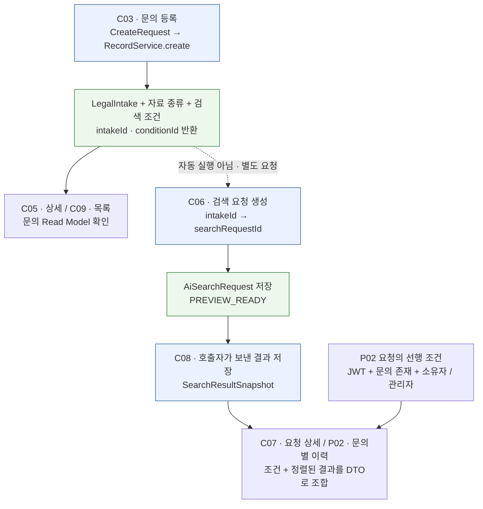

| 단계 | Middle → Bottom에서 읽을 것 | 응답·DB에서 맞춰볼 근거 |
|---|---|---|
| C03 | [LegalIntakeRecordService.create](C:/myLectureWs/legal-ai-intake-security-server/backend/guardrail-ready-policy-checker/src/main/java/com/ohgiraffers/handlermethod/service/LegalIntakeRecordService.java:107)의 @Transactional 안에서 문의 save → 자료 saveAll → 조건 save | id=intakeId. 조건의 intakeId와 문의 id 일치. 아직 AiSearchRequest 행은 생기지 않음 |
| C06 | [LegalIntakeRecordService.createSearchRequest](C:/myLectureWs/legal-ai-intake-security-server/backend/guardrail-ready-policy-checker/src/main/java/com/ohgiraffers/handlermethod/service/LegalIntakeRecordService.java:182)가 문의·최신 조건을 확인하고 요청 저장 | searchRequestId, intakeId, conditionId, status=PREVIEW_READY |
| C08 | [LegalIntakeRecordService.addSearchResult](C:/myLectureWs/legal-ai-intake-security-server/backend/guardrail-ready-policy-checker/src/main/java/com/ohgiraffers/handlermethod/service/LegalIntakeRecordService.java:215)가 결과를 저장하고 displayOrder 순으로 재조회 | 결과의 searchRequestId 일치. 요청 본문의 title·url과 저장값 일치 |
| P02 | Controller에서 [IntakeAccessService.requireAccess](C:/myLectureWs/legal-ai-intake-security-server/backend/guardrail-ready-policy-checker/src/main/java/com/ohgiraffers/handlermethod/service/IntakeAccessService.java:16) 후 [LegalIntakeRecordService.findSearchRequests](C:/myLectureWs/legal-ai-intake-security-server/backend/guardrail-ready-policy-checker/src/main/java/com/ohgiraffers/handlermethod/service/LegalIntakeRecordService.java:176) 호출 | 정상 이력 배열 / 정상 빈 배열 / 401 / 403 / 404를 앞의 개별 flow와 대응 |

JPA는 Repository 호출 시점과 실제 SQL 실행 시점이 항상 같지는 않다. 트랜잭션 flush·커밋까지 연결해 읽는다. 같은 업무에서 함께 저장하는 것과 Entity에 연관 컬렉션이 있어 Aggregate가 스스로 모든 변경을 통제하는 것은 구분한다.

### 7-2. C10 상태 변경 · C11 메모 → 문의 재조회

상담 검토 한 묶음이다. 같은 문의를 읽고 상태를 바꾸거나 메모를 남긴 다음, 다시 조회해 결과를 확인한다. 두 변경 요청은 각각 별도 트랜잭션이며 자동으로 서로를 호출하지 않는다.

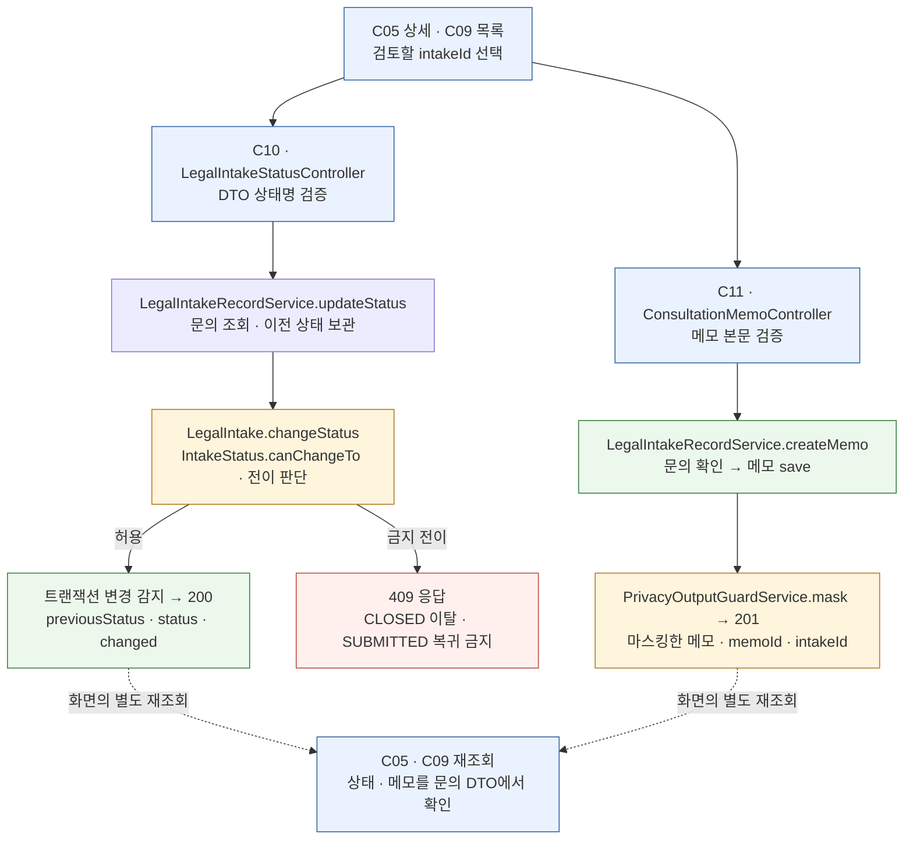

| 연결 | 실제 처리 | 공부할 의미 |
|---|---|---|
| DTO | [LegalIntakeStatusRequest](C:/myLectureWs/legal-ai-intake-security-server/backend/guardrail-ready-policy-checker/src/main/java/com/ohgiraffers/handlermethod/dto/LegalIntakeStatusRequest.java:6)가 허용된 상태명인지 검사 | 입력 형식 검증 |
| Service | [LegalIntakeRecordService.updateStatus](C:/myLectureWs/legal-ai-intake-security-server/backend/guardrail-ready-policy-checker/src/main/java/com/ohgiraffers/handlermethod/service/LegalIntakeRecordService.java:81)가 대상 조회·이전 상태 보관·업무 메서드 호출 | 대상 없음 404. Entity의 금지 전이 예외를 409로 변환 |
| Entity + Policy | [LegalIntake.changeStatus](C:/myLectureWs/legal-ai-intake-security-server/backend/guardrail-ready-policy-checker/src/main/java/com/ohgiraffers/handlermethod/entity/LegalIntake.java:238) → [IntakeStatus.canChangeTo](C:/myLectureWs/legal-ai-intake-security-server/backend/guardrail-ready-policy-checker/src/main/java/com/ohgiraffers/handlermethod/legal/IntakeStatus.java:10) | CLOSED 이탈·SUBMITTED 복귀 금지. 같은 상태 요청은 허용 |
| JPA | 트랜잭션 안에서 조회한 Entity의 status 변경 | 이 메서드는 별도 save 호출 없이 변경 감지로 저장 |
| Read Model | previousStatus, status, changed | changed=true면 상태가 바뀐 사실. false면 동일 상태 재요청 |

메모의 코드 경로는 [ConsultationMemoController.create](C:/myLectureWs/legal-ai-intake-security-server/backend/guardrail-ready-policy-checker/src/main/java/com/ohgiraffers/handlermethod/api/ConsultationMemoController.java:26) → [LegalIntakeRecordService.createMemo](C:/myLectureWs/legal-ai-intake-security-server/backend/guardrail-ready-policy-checker/src/main/java/com/ohgiraffers/handlermethod/service/LegalIntakeRecordService.java:94) → ConsultationMemoRepository.save다. [LegalIntakeRecordService.toMemoResponse](C:/myLectureWs/legal-ai-intake-security-server/backend/guardrail-ready-policy-checker/src/main/java/com/ohgiraffers/handlermethod/service/LegalIntakeRecordService.java:100)에서 응답 본문을 마스킹한다. 상태 전이 규칙과 메모 저장은 별도 책임이며, C05·C09를 다시 호출해야 화면에서 최신 결과를 읽는다.

### 7-3. S01·S02 — 응답 사유·메모리 상태·Metric 연결

한 질문이 안전한 응답이 되기까지를 한 묶음으로 읽는다. 아래 성공 경로의 각 검사는 실패하면 조기 종료한다. Dynamic·Fixed는 각각 LegalDynamicGuardService·LegalFixedGuardService의 메서드다. 비용 예약·정산의 세부 연결은 7-10에 이어진다.

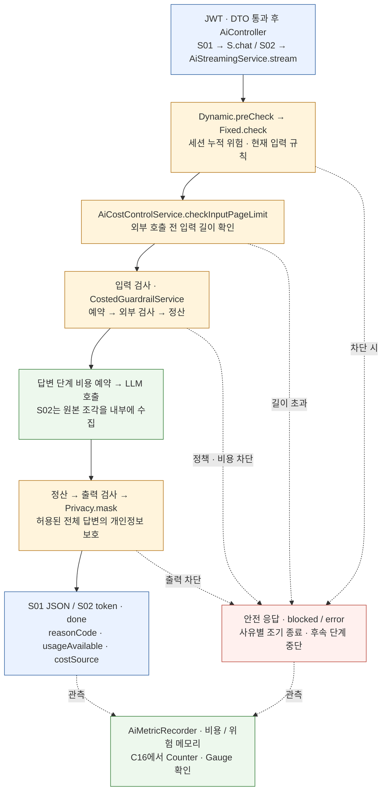

| 실험 지점 | Middle → Bottom 코드 | 응답과 관측값 연결 |
|---|---|---|
| Fixed 차단 | [AiService.chat](C:/myLectureWs/legal-ai-intake-security-server/backend/guardrail-ready-policy-checker/src/main/java/com/ohgiraffers/handlermethod/service/AiService.java:67) / [AiStreamingService.stream](C:/myLectureWs/legal-ai-intake-security-server/backend/guardrail-ready-policy-checker/src/main/java/com/ohgiraffers/handlermethod/service/AiStreamingService.java:64) → [LegalFixedGuardService.check](C:/myLectureWs/legal-ai-intake-security-server/backend/guardrail-ready-policy-checker/src/main/java/com/ohgiraffers/handlermethod/riskengine/LegalFixedGuardService.java:99) | 예: BLOCKED_LEGAL_HARM. [AiMetricRecorder.recordLegalGuardrailBlock](C:/myLectureWs/legal-ai-intake-security-server/backend/guardrail-ready-policy-checker/src/main/java/com/ohgiraffers/handlermethod/support/AiMetricRecorder.java:71)의 reason 라벨과 연결 |
| Dynamic 차단 | preCheck 또는 recordBlockedEvent로 세션 위험 누적 | DYNAMIC_SESSION_BLOCKED. 차단을 만든 원인과 최종 응답 사유가 다를 수 있음 |
| 입력 길이 | DTO 통과 뒤 [AiCostControlService.checkInputPageLimit](C:/myLectureWs/legal-ai-intake-security-server/backend/guardrail-ready-policy-checker/src/main/java/com/ohgiraffers/handlermethod/cost/AiCostControlService.java:108) | COST_LIMIT_BLOCKED / REQUEST_TOO_LONG. DTO 실패는 여기 도달하지 않음 |
| 단계별 예산 | 입력 검사 → 답변 생성 → 출력 검사의 각 예약 | stage=input_guardrail / answer / output_guardrail. 앞 단계 비용이 발생한 뒤 다음 단계 예산이 부족할 수 있음 |
| usage 누락 | [AiCostControlService.recordUsage](C:/myLectureWs/legal-ai-intake-security-server/backend/guardrail-ready-policy-checker/src/main/java/com/ohgiraffers/handlermethod/cost/AiCostControlService.java:194) | usageAvailable=false, costSource=ESTIMATED. 예약액을 추정 사용액으로 전환하므로 비용 0이 아님 |
| 개인정보 출력 | [PrivacyOutputGuardService.mask](C:/myLectureWs/legal-ai-intake-security-server/backend/guardrail-ready-policy-checker/src/main/java/com/ohgiraffers/handlermethod/riskengine/PrivacyOutputGuardService.java:26) 뒤 응답 | 안전하게 바뀐 응답과 개인정보 유형별 마스킹 Metric을 함께 확인 |
| SSE 종료 | [AiStreamingService.settleInterrupted](C:/myLectureWs/legal-ai-intake-security-server/backend/guardrail-ready-policy-checker/src/main/java/com/ohgiraffers/handlermethod/service/AiStreamingService.java:208) 및 emitter 종료 콜백 | 현재 코드는 외부 호출 전이면 예약 해제, 호출 후 사용량 미확인이면 추정 정산. 정산 중복은 예약의 AtomicBoolean으로 막음 |

S01은 JSON 응답을, S02는 meta·token·done 또는 blocked·error 이벤트를 읽는다. S02는 원본 조각을 바로 내보내지 않고 전체 응답을 모아 출력 검사·마스킹한 뒤 나누어 보낸다. 이 표는 **현재 코드의 연결 설명**이며 실제 외부 서비스와 브라우저 연결의 정상·오류·중단 검증을 이번 문서 작업에서 실행했다는 뜻은 아니다.

| 확인 행동 | 코드 Metric → Prometheus 이름 | 비교할 값 |
|---|---|---|
| Fixed 차단 | legal.ai.guardrail.block → legal_ai_guardrail_block_total | reason 라벨별 증가 |
| Dynamic 응답 차단 | legal.ai.dynamic.block.response → legal_ai_dynamic_block_response_total | DYNAMIC_SESSION_BLOCKED 응답 수 |
| 입력 길이 차단 | legal.ai.cost.block → legal_ai_cost_block_total | reason=REQUEST_TOO_LONG. 동기·SSE Chat 기록 경로 |
| 단계별 예산 차단 | ai.cost.blocked → ai_cost_blocked_total | reason·stage 라벨. 단독 Guardrail의 비용 차단도 이 경로에서 확인 |
| usage 미확인 | ai.cost.usage.missing → ai_cost_usage_missing_total | model·stage별 미확인 횟수 |
| 추정 정산 | ai.cost.estimated.usage.usd → ai_cost_estimated_usage_usd | 외부 보고 비용과 구분한 추정 사용액 Gauge |
| 단계별 합산 | ai.cost.stage.accounted.usd → ai_cost_stage_accounted_usd | stage별 보고 비용 + 추정 비용 |
| 출력 마스킹 | legal.ai.privacy.output.masked → legal_ai_privacy_output_masked_total | piiType 라벨별 증가 |

Metric 코드 근거: [AiMetricRecorder](C:/myLectureWs/legal-ai-intake-security-server/backend/guardrail-ready-policy-checker/src/main/java/com/ohgiraffers/handlermethod/support/AiMetricRecorder.java:9), [AiCostControlService](C:/myLectureWs/legal-ai-intake-security-server/backend/guardrail-ready-policy-checker/src/main/java/com/ohgiraffers/handlermethod/cost/AiCostControlService.java:20), [LegalDynamicGuardService](C:/myLectureWs/legal-ai-intake-security-server/backend/guardrail-ready-policy-checker/src/main/java/com/ohgiraffers/handlermethod/riskengine/LegalDynamicGuardService.java:14). C16은 ADMIN Basic으로 읽는다. **요청 전 Metric → 요청 1회 → 응답 사유 → 요청 후 Metric**을 비교한다. Counter·Gauge 이름과 라벨을 구분하며, 다른 동시 요청이 있으면 증가 원인을 하나로 단정하지 않는다.

Dynamic·비용 상태는 현재 프로세스 메모리에 있다. 비용은 실제 보고 사용액·추정 사용액·진행 중 예약액을 예산 판단에 반영한다. daily는 서버 날짜를 확인해 초기화하지만 monthly라는 이름의 한도에 달력 월 자동 초기화·영속 원장이 구현된 것은 아니다.

### 7-4. S05 → C17·C15·C18 → C19·C20

위험 분석, 기록, 조건별 Incident 생성, 운영자 처리까지가 한 기능 묶음이다. 점선은 저장 뒤의 별도 조회이며 자동 후속 API 실행을 뜻하지 않는다. 인증 보안 이력은 별도의 데이터 출처를 유지한다.

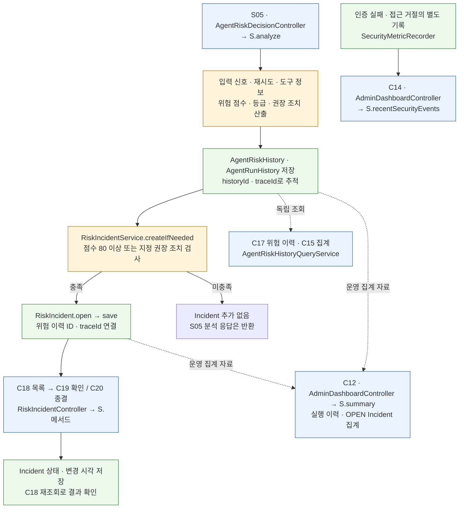

| 순서 | 코드 연결 | 확인할 근거 |
|---|---|---|
| S05 분석 | [AgentRiskDecisionService.analyze](C:/myLectureWs/legal-ai-intake-security-server/backend/guardrail-ready-policy-checker/src/main/java/com/ohgiraffers/handlermethod/service/AgentRiskDecisionService.java:42) → AgentRiskHistoryRepository·AgentRunHistoryRepository | 응답 historyId·traceId와 위험 이력 일치 |
| 조건별 Incident | [RiskIncidentService.createIfNeeded](C:/myLectureWs/legal-ai-intake-security-server/backend/guardrail-ready-policy-checker/src/main/java/com/ohgiraffers/handlermethod/service/RiskIncidentService.java:23) | 점수 80 이상, BLOCK_AND_ESCALATE 또는 CREATE_INCIDENT 권장 조치이면 생성 |
| C17·C15 조회 | [AgentRiskHistoryQueryService.findRecent](C:/myLectureWs/legal-ai-intake-security-server/backend/guardrail-ready-policy-checker/src/main/java/com/ohgiraffers/handlermethod/service/AgentRiskHistoryQueryService.java:24), [AgentRiskHistoryQueryService.summarize](C:/myLectureWs/legal-ai-intake-security-server/backend/guardrail-ready-policy-checker/src/main/java/com/ohgiraffers/handlermethod/service/AgentRiskHistoryQueryService.java:41) | 위험 이력과 등급·결정·조치 집계 연결 |
| C18·C19·C20 | [RiskIncidentService.findRecent](C:/myLectureWs/legal-ai-intake-security-server/backend/guardrail-ready-policy-checker/src/main/java/com/ohgiraffers/handlermethod/service/RiskIncidentService.java:47), acknowledge, resolve | Incident 목록·상태 변화. C10과 같은 전이 검증이 있다고 가정하지 않음 |
| C12·C14 | [AdminDashboardService.summary](C:/myLectureWs/legal-ai-intake-security-server/backend/guardrail-ready-policy-checker/src/main/java/com/ohgiraffers/handlermethod/service/AdminDashboardService.java:35), [AdminDashboardService.recentSecurityEvents](C:/myLectureWs/legal-ai-intake-security-server/backend/guardrail-ready-policy-checker/src/main/java/com/ohgiraffers/handlermethod/service/AdminDashboardService.java:46) | 운영 요약과 보안 이력은 각 Repository의 데이터를 읽음. 한 종류의 로그로 합쳐 보지 않음 |

현재 Reference의 존재하지 않는 코드나 Incident의 존재하지 않는 ID는 IllegalArgumentException 경로가 있으며, C05처럼 모두 404로 변환되는 것은 아니다. 기존 API별 flow의 실제 예상 오류와 코드 분기를 같이 확인한다.

### 7-5. P06 → C13 — 행동 기록과 읽기 모델

화면이 보고한 행동 한 건을 중복 없이 접수하고, 운영 화면에서 업무 데이터와 함께 집계하는 흐름이다. P06 저장과 C13 조회는 별도 요청이다.

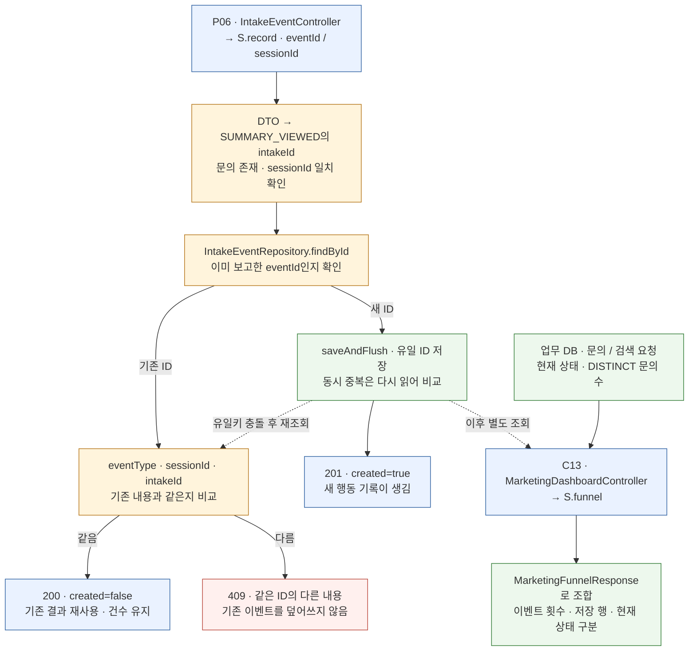

| 단계 | 코드 연결 | 기능상 의미 |
|---|---|---|
| P06 | [IntakeEventService.record](C:/myLectureWs/legal-ai-intake-security-server/backend/guardrail-ready-policy-checker/src/main/java/com/ohgiraffers/handlermethod/service/IntakeEventService.java:26) | 화면이 보고한 행동을 eventId로 중복 처리. 새 기록 201, 같은 내용 재전송 200, 같은 ID의 다른 내용 409 |
| 업무 집계 | [MarketingDashboardService.funnel](C:/myLectureWs/legal-ai-intake-security-server/backend/guardrail-ready-policy-checker/src/main/java/com/ohgiraffers/handlermethod/service/MarketingDashboardService.java:32) | 문의 수는 저장된 문의, 검색 요청 수는 요청 행, 검색한 문의 수는 DISTINCT 문의 |
| 상태 집계 | 현재 CONSULTATION_READY 개수 | 준비 상태에 도달했던 누적 전환 수와 같지 않음 |
| 보고 이벤트 | VISIT·INTAKE_STARTED·SUMMARY_VIEWED 등 건수 | 보고된 횟수이며 고유 방문자·코호트 전환율·이탈률이 자동 계산된 것은 아님 |

### 7-6. C01 로그인 → P01 내 정보 → P02 대상 접근

로그인, 토큰 인증, 특정 문의 접근을 순서대로 따라간다. P04·P05도 같은 대상 접근 규칙을 재사용한다. C16은 별도의 ADMIN Basic 경로다.

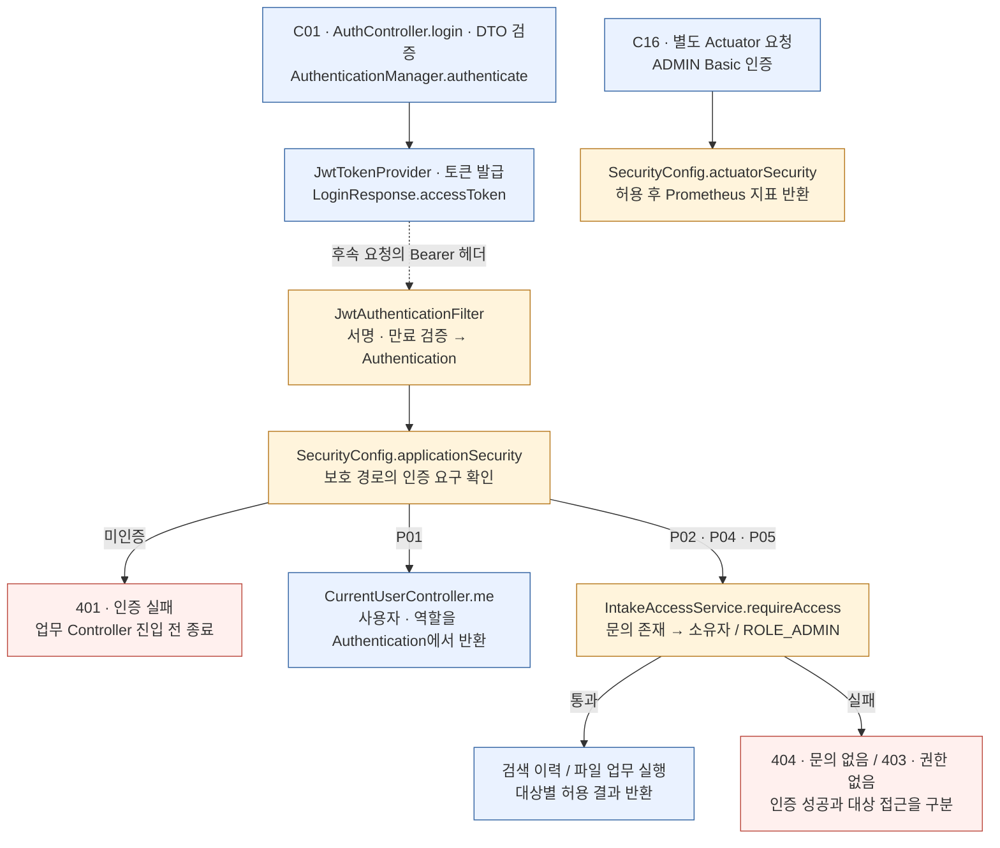

| 읽을 구간 | 실제 코드 진입점 | 확인할 결과 |
|---|---|---|
| 로그인과 토큰 | [AuthController.login](C:/myLectureWs/legal-ai-intake-security-server/backend/guardrail-ready-policy-checker/src/main/java/com/ohgiraffers/handlermethod/security/AuthController.java:27), [JwtTokenProvider](C:/myLectureWs/legal-ai-intake-security-server/backend/guardrail-ready-policy-checker/src/main/java/com/ohgiraffers/handlermethod/security/JwtTokenProvider.java:14) | C01의 accessToken을 후속 요청 Bearer 헤더에 전달. 사용자 저장형 Aggregate를 추가로 생성하지 않음 |
| 인증과 내 정보 | [JwtAuthenticationFilter.doFilterInternal](C:/myLectureWs/legal-ai-intake-security-server/backend/guardrail-ready-policy-checker/src/main/java/com/ohgiraffers/handlermethod/security/JwtAuthenticationFilter.java:34), [CurrentUserController.me](C:/myLectureWs/legal-ai-intake-security-server/backend/guardrail-ready-policy-checker/src/main/java/com/ohgiraffers/handlermethod/security/CurrentUserController.java:10), [SecurityConfig.applicationSecurity](C:/myLectureWs/legal-ai-intake-security-server/backend/guardrail-ready-policy-checker/src/main/java/com/ohgiraffers/handlermethod/config/SecurityConfig.java:66) | 토큰 검증과 P01의 사용자·역할 응답 연결. 미인증 보호 요청은 401 |
| 대상 접근 | [IntakeAccessService.requireAccess](C:/myLectureWs/legal-ai-intake-security-server/backend/guardrail-ready-policy-checker/src/main/java/com/ohgiraffers/handlermethod/service/IntakeAccessService.java:16), [IntakeSearchHistoryController.history](C:/myLectureWs/legal-ai-intake-security-server/backend/guardrail-ready-policy-checker/src/main/java/com/ohgiraffers/handlermethod/api/IntakeSearchHistoryController.java:24) | 문의 없음 404, 소유자·관리자 아님 403, 통과하면 P02 이력 배열. 인증과 대상 접근 판단은 두 단계 |

적용 규칙은 POL-01·02, 읽기 결과는 RM-01·04다. 로그인 후 모든 문의가 자동으로 허용되는지 추측하지 말고, P02·P04·P05가 requireAccess를 호출하는 위치를 확인한다. C05·C09에는 이 대상별 소유권 필터가 적용되지 않는다.

### 7-7. P04 업로드 → P05 다운로드 → 감사 기록

자료 종류 선택과 실제 파일을 구분해서 읽는다. C03의 자료 선택은 종류 기록이고, 여기서는 문의에 파일 본문을 붙이고 다시 내려받는다. P04·P05의 S.는 IntakeDocumentService다.

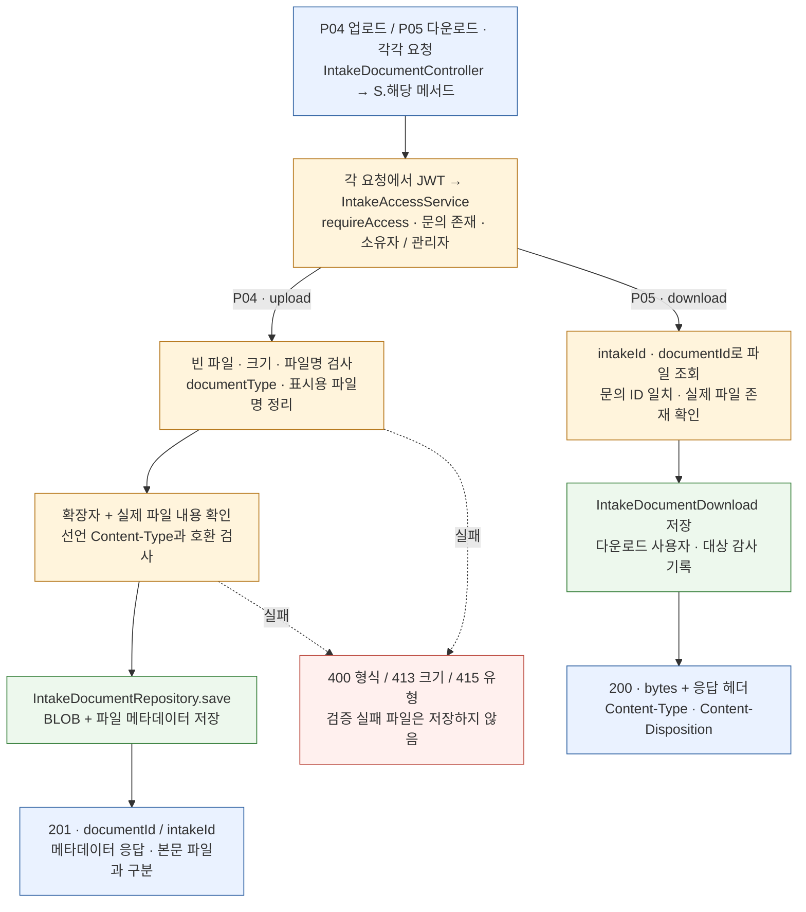

| 읽을 구간 | 실제 코드 진입점 | 확인할 결과 |
|---|---|---|
| 업로드와 권한 | [IntakeDocumentController.upload](C:/myLectureWs/legal-ai-intake-security-server/backend/guardrail-ready-policy-checker/src/main/java/com/ohgiraffers/handlermethod/api/IntakeDocumentController.java:25) → [IntakeDocumentService.upload](C:/myLectureWs/legal-ai-intake-security-server/backend/guardrail-ready-policy-checker/src/main/java/com/ohgiraffers/handlermethod/service/IntakeDocumentService.java:41), [IntakeAccessService.requireAccess](C:/myLectureWs/legal-ai-intake-security-server/backend/guardrail-ready-policy-checker/src/main/java/com/ohgiraffers/handlermethod/service/IntakeAccessService.java:16) | JWT와 문의 접근을 통과한 후 파일 검사. 201 응답의 documentId·intakeId를 저장 행과 비교 |
| 파일 검증과 저장 | [IntakeDocumentService.validateContent](C:/myLectureWs/legal-ai-intake-security-server/backend/guardrail-ready-policy-checker/src/main/java/com/ohgiraffers/handlermethod/service/IntakeDocumentService.java:88), [IntakeDocument.upload](C:/myLectureWs/legal-ai-intake-security-server/backend/guardrail-ready-policy-checker/src/main/java/com/ohgiraffers/handlermethod/entity/IntakeDocument.java:54) | 허용 유형은 PDF·PNG·JPEG·UTF-8 TXT. 확장자·내용·Content-Type 조합 확인. 본문과 메타데이터는 DB에 저장 |
| 다운로드와 감사 | [IntakeDocumentController.download](C:/myLectureWs/legal-ai-intake-security-server/backend/guardrail-ready-policy-checker/src/main/java/com/ohgiraffers/handlermethod/api/IntakeDocumentController.java:32) → [IntakeDocumentService.download](C:/myLectureWs/legal-ai-intake-security-server/backend/guardrail-ready-policy-checker/src/main/java/com/ohgiraffers/handlermethod/service/IntakeDocumentService.java:79), [IntakeDocumentDownload](C:/myLectureWs/legal-ai-intake-security-server/backend/guardrail-ready-policy-checker/src/main/java/com/ohgiraffers/handlermethod/entity/IntakeDocumentDownload.java:8) | 같은 문의에 속하고 실제 파일이 있어야 내려받음. bytes·헤더와 별도로 감사 행이 생김 |

적용 규칙은 POL-01·02·07, 읽기 결과는 RM-05다. P05는 GET이지만 감사 저장이 있는 조회다. C03에서 자료 종류를 골랐다는 이유만으로 다운로드 가능한 파일이 생긴 것은 아니다.

### 7-8. R01~R06 Previewer 목록 → 상세 → 안내

지난 과제의 화면에서 출발해 조회 모델이 만들어지는 곳까지 내려간다. 실제 React 연결 3개와 재사용 가능한 백엔드 3개를 같은 기능 묶음 안에 표시한다. S.는 LegalProcedureService다.

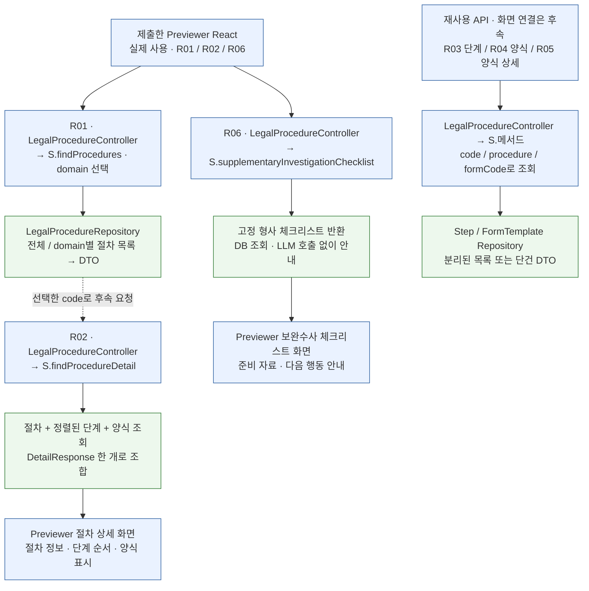

| 읽을 구간 | 실제 코드 진입점 | 확인할 결과 |
|---|---|---|
| 목록과 상세 | [LegalProcedureService.findProcedures](C:/myLectureWs/legal-ai-intake-security-server/backend/guardrail-ready-policy-checker/src/main/java/com/ohgiraffers/handlermethod/service/LegalProcedureService.java:49), [LegalProcedureService.findProcedureDetail](C:/myLectureWs/legal-ai-intake-security-server/backend/guardrail-ready-policy-checker/src/main/java/com/ohgiraffers/handlermethod/service/LegalProcedureService.java:85) | R01 선택 code가 R02 경로에 연결됨. R02는 절차·단계·양식을 한 DTO로 조합 |
| 분리 조회 재사용 | [LegalProcedureService.findProcedureSteps](C:/myLectureWs/legal-ai-intake-security-server/backend/guardrail-ready-policy-checker/src/main/java/com/ohgiraffers/handlermethod/service/LegalProcedureService.java:112), [LegalProcedureService.findForms](C:/myLectureWs/legal-ai-intake-security-server/backend/guardrail-ready-policy-checker/src/main/java/com/ohgiraffers/handlermethod/service/LegalProcedureService.java:128), [LegalProcedureService.findForm](C:/myLectureWs/legal-ai-intake-security-server/backend/guardrail-ready-policy-checker/src/main/java/com/ohgiraffers/handlermethod/service/LegalProcedureService.java:152) | R03 단계 순서, R04 양식 필터, R05 양식 단건. 이번 37개 항목에 포함되며 화면 연결은 후속 |
| 고정 안내 | [LegalProcedureService.supplementaryInvestigationChecklist](C:/myLectureWs/legal-ai-intake-security-server/backend/guardrail-ready-policy-checker/src/main/java/com/ohgiraffers/handlermethod/service/LegalProcedureService.java:165) | R06은 고정 체크리스트이며 Repository·LLM 호출 없음. 절차 DB 응답과 출처를 구분 |

적용 규칙은 POL-13, 읽기 결과는 RM-08이다. 조회만으로 문의·검색 요청이 생기지 않는다. 존재하지 않는 code나 잘못된 domain의 예외는 기존 개별 API 계약과 함께 확인한다.

### 7-9. C02 분류 · C04 간단 안내 → C03 별도 등록

등록 전에 사건을 정리하는 기능 묶음이다. C02와 C04는 서로를 호출하지 않으며 화면에서 필요한 요청을 고른다. 그림의 점선은 사용자가 다음에 실행할 수 있는 별도 업무다.

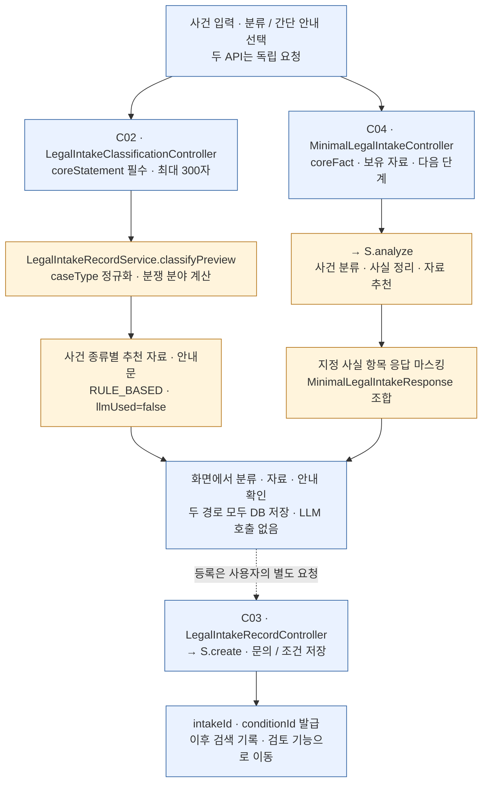

| 읽을 구간 | 실제 코드 진입점 | 확인할 결과 |
|---|---|---|
| 사건 분류 | [LegalIntakeClassificationController.preview](C:/myLectureWs/legal-ai-intake-security-server/backend/guardrail-ready-policy-checker/src/main/java/com/ohgiraffers/handlermethod/api/LegalIntakeClassificationController.java:22) → [LegalIntakeRecordService.classifyPreview](C:/myLectureWs/legal-ai-intake-security-server/backend/guardrail-ready-policy-checker/src/main/java/com/ohgiraffers/handlermethod/service/LegalIntakeRecordService.java:70), [LegalIntakeClassificationRequest](C:/myLectureWs/legal-ai-intake-security-server/backend/guardrail-ready-policy-checker/src/main/java/com/ohgiraffers/handlermethod/dto/LegalIntakeClassificationRequest.java:6) | coreStatement 필수·최대 300자는 이 DTO 계약. RULE_BASED·llmUsed=false. 분류 결과만 반환 |
| 간단 안내 | [MinimalLegalIntakeController.analyze](C:/myLectureWs/legal-ai-intake-security-server/backend/guardrail-ready-policy-checker/src/main/java/com/ohgiraffers/handlermethod/legal/MinimalLegalIntakeController.java:20) → [MinimalLegalIntakeService.analyze](C:/myLectureWs/legal-ai-intake-security-server/backend/guardrail-ready-policy-checker/src/main/java/com/ohgiraffers/handlermethod/legal/MinimalLegalIntakeService.java:21) | coreFact·자료를 바탕으로 사실·추천 자료·안내 구성. 지정 사실 응답 항목을 마스킹 |
| 실제 문의 등록 | [LegalIntakeRecordService.create](C:/myLectureWs/legal-ai-intake-security-server/backend/guardrail-ready-policy-checker/src/main/java/com/ohgiraffers/handlermethod/service/LegalIntakeRecordService.java:107) | C03 별도 호출에서 문의·자료 종류·검색 조건 저장. 이때 intakeId와 conditionId가 생김 |

적용 규칙은 POL-03·04·10, 읽기 결과는 RM-02·03이다. C02의 300자와 S01·S02의 AI message 제한은 입력 계약과 실행 경로가 다르다. 이 그림을 이유로 동일 제한이나 LLM 비용이 두 경로에 자동 적용된다고 해석하지 않는다.

### 7-10. S01~S04 외부 호출의 예약 → 정산 → 다음 단계

한 외부 호출 단계의 비용 생애를 읽는 묶음이다. Chat은 입력 검사·답변·출력 검사 순서로 이 절차를 반복하고, S03·S04는 해당 검사 단계만 실행한다. 앞 단계에서 쓴 비용은 다음 단계 차단으로 취소되지 않는다.

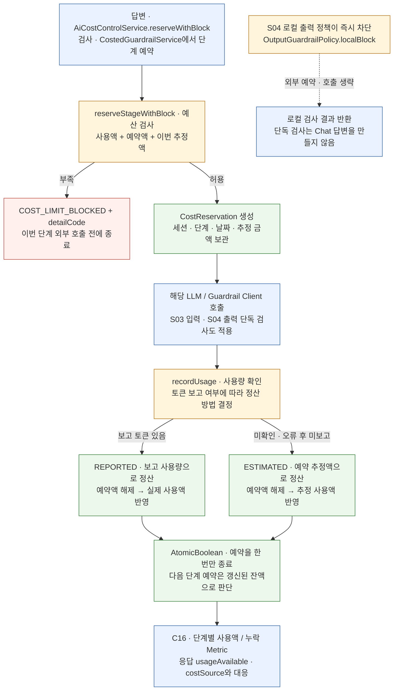

| 읽을 구간 | 실제 코드 진입점 | 확인할 결과 |
|---|---|---|
| 예약 결정 | [AiCostControlService.reserveWithBlock](C:/myLectureWs/legal-ai-intake-security-server/backend/guardrail-ready-policy-checker/src/main/java/com/ohgiraffers/handlermethod/cost/AiCostControlService.java:147), [AiCostControlService.reserveStageWithBlock](C:/myLectureWs/legal-ai-intake-security-server/backend/guardrail-ready-policy-checker/src/main/java/com/ohgiraffers/handlermethod/cost/AiCostControlService.java:155) | 보고 사용액 + 추정 사용액 + 진행 중 예약액 + 이번 추정액으로 예산 검사. 예약은 호출 직전에 생김 |
| 검사와 예외 | [CostedGuardrailService.checkInput](C:/myLectureWs/legal-ai-intake-security-server/backend/guardrail-ready-policy-checker/src/main/java/com/ohgiraffers/handlermethod/cost/CostedGuardrailService.java:48), [CostedGuardrailService.checkOutput](C:/myLectureWs/legal-ai-intake-security-server/backend/guardrail-ready-policy-checker/src/main/java/com/ohgiraffers/handlermethod/cost/CostedGuardrailService.java:53), [OutputGuardrailPolicy.localBlock](C:/myLectureWs/legal-ai-intake-security-server/backend/guardrail-ready-policy-checker/src/main/java/com/ohgiraffers/handlermethod/guardrail/OutputGuardrailPolicy.java:7) | S03·S04도 예약·정산 적용. S04의 로컬 출력 차단은 외부 호출 전에 반환하므로 별도 경로 |
| 정산과 중단 | [AiCostControlService.recordUsage](C:/myLectureWs/legal-ai-intake-security-server/backend/guardrail-ready-policy-checker/src/main/java/com/ohgiraffers/handlermethod/cost/AiCostControlService.java:194), [AiStreamingService.settleInterrupted](C:/myLectureWs/legal-ai-intake-security-server/backend/guardrail-ready-policy-checker/src/main/java/com/ohgiraffers/handlermethod/service/AiStreamingService.java:208) | 보고 usage면 REPORTED, 미확인이면 ESTIMATED. S02 호출 전 중단은 예약 해제, 호출 후 usage 미확인은 추정 정산 |

적용 규칙은 POL-09, 읽기 결과는 RM-07·11이다. 예약의 AtomicBoolean이 중복 정산을 막는다. 메모리 사용액·예약액과 C16 지표를 응답 costSource에 연결해 읽고, 영속 청구 원장이나 실제 청구 대사로 확대 해석하지 않는다.

## 8. 한 API를 공부하고 남길 최소 기록

| Top — 무엇을 요청했나 | Middle — 어디서 결정했나 | Bottom — 무엇이 바뀌거나 읽혔나 | 결과와 재확인 |
|---|---|---|---|
| API 번호, method·URL, 주요 입력, 이전 API에서 받은 ID | Controller·DTO, Service 메서드, POL 번호와 통과·차단 조건 | Entity·Repository·논리 ID 또는 메모리 상태·외부 Client·Metric | HTTP 상태·reason·RM, DB/Metric 근거, 수정했다면 재실행 결과 |

한 번에 전부 외우기보다 **개별 flow → 이 문서의 API 행 → 코드 메서드 → 응답·데이터 근거**를 왕복한다. 먼저 C03·C06·C08·P02를 연결하고, C10 상태 변경과 S01 차단·비용을 이어 읽으면 다른 API도 같은 방식으로 찾을 수 있다.

## 개발 필수 요구사항 체크

**2026-10-19 코드 대조 기준.** 과제의 두 필수 요소를 확인하기 위해 REQ-01~05로 나누었다. REQ 번호는 문서 체크 항목이며 API 번호가 아니다. 기존 프로젝트 37개 항목과 과제 Previewer 범위를 유지한다.

필수 요소 원문은 **① Spring Boot(API Server)와 React(Client Server) 연동 및 CORS 처리 ② LLM API 활용 질문 시스템 개발 + 응답 지연 시간 최적화·비동기 데이터 처리**다. 아래 상태는 현재 코드의 구현 위치이며, 이번 문서 갱신에서 서버·외부 LLM·브라우저 성능 실험을 새로 실행한 결과는 아니다.

| 요구사항 | 현재 구현·확인 상태 | API와 위치 | 남은 완료 근거 |
|---|---|---|---|
| REQ-01 Spring Boot–React 연동 | Previewer 화면과 호출 코드 구현 | R01 목록·R02 상세·R06 체크리스트. App.jsx → legalProcedureApi.js → LegalProcedureController | 실행 환경에서 브라우저 Network·화면 결과를 함께 기록. 새 AI 질문 화면 연결은 후속 |
| REQ-02 CORS 처리 | 공통 설정과 preflight 자동 테스트 코드 구현 | `/api/**`, `/actuator/**`. WebMvcConfig + SecurityConfig. 자체 업무 API 번호 없음 | 실제 브라우저 Origin·OPTIONS·응답 헤더 확인 |
| REQ-03 LLM 질문 시스템 | S01 동기 JSON·S02 SSE 백엔드 구현 | AiController → S.chat / AiStreamingService.stream → 각 LLM Client | 실제 외부 서비스 연동 결과와 React 질문 입력·응답 화면 연결 확인 |
| REQ-04 비동기 데이터 처리 | React 조회의 async/await·S02 sendAsync/콜백·SseEmitter 구현 | React: R01·R02·R06. 서버 LLM 비동기: S02 | React의 JWT POST·SSE 이벤트 수신 UI 연결. 입력·출력 검사 전체를 병렬 처리했다는 의미는 아님 |
| REQ-05 응답 지연 시간 최적화 | 사전 차단·입출력 상한·타임아웃·S01 시간 측정 구현. 개선 효과는 미검증 | S01·S02·C16. AiMetricRecorder·application.properties | S02 첫 안전 답변·전체 시간 측정 보강, 같은 조건의 개선 전후 P50·P95 비교 |

**상태 읽는 법:** 코드 구현, React 화면 연결, 실제 외부 서비스 실행, 성능 개선 검증을 각각 구분한다. S02는 비동기 호출을 구현했지만 전체 답변을 검사·마스킹한 뒤 전송한다. 현재 첫 답변 표시가 몇 초 빨라졌다고 단정하지 않는다.

**Service 표기:** Controller와 Service의 앞부분 이름이 같으면 `→ S.메서드()`로 줄이고, 다르면 전체 Service 이름을 쓴다. Controller 없이 단독으로 인용하는 업무 메서드는 전체 이름을 유지한다.

## 필수 흐름 1. Spring Boot–React 연동 · CORS

REQ-01·02를 한 묶음으로 읽는다. React 개발 서버가 제공한 화면은 브라우저에서 실행되며 Spring Boot에 HTTP 요청을 보낸다. 현재 실제 React 호출 코드는 R01·R02·R06이다.

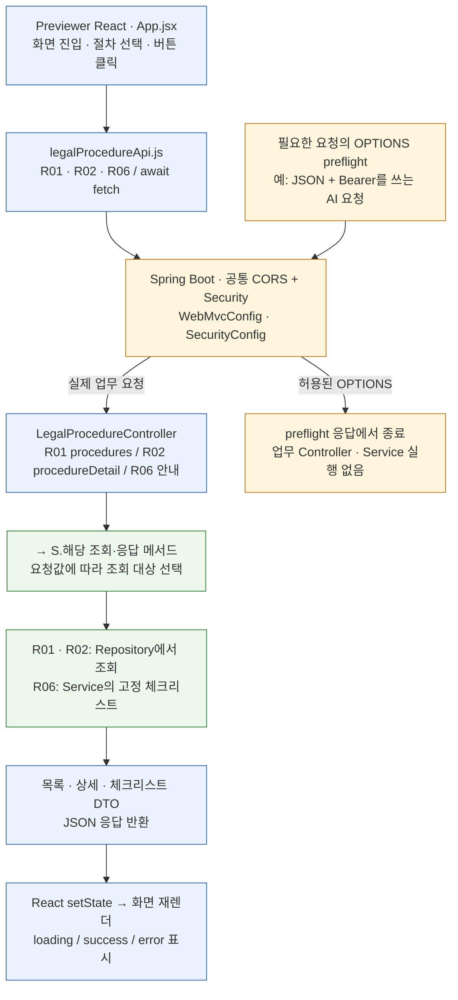

| API·진입점 | Controller의 기능 | Service의 기능 | 응답·화면에서 확인 |
|---|---|---|---|
| R01 목록 | [LegalProcedureController.procedures](C:/myLectureWs/legal-ai-intake-security-server/backend/guardrail-ready-policy-checker/src/main/java/com/ohgiraffers/handlermethod/api/LegalProcedureController.java:40)가 Query domain을 받음 | → [S.findProcedures](C:/myLectureWs/legal-ai-intake-security-server/backend/guardrail-ready-policy-checker/src/main/java/com/ohgiraffers/handlermethod/service/LegalProcedureService.java:49)가 전체·분야별 Repository 조회 후 목록 DTO 구성 | 절차 배열·분야 필터. React fetchProcedures 호출 |
| R02 상세 | [LegalProcedureController.procedureDetail](C:/myLectureWs/legal-ai-intake-security-server/backend/guardrail-ready-policy-checker/src/main/java/com/ohgiraffers/handlermethod/api/LegalProcedureController.java:58)이 Path code를 받음 | → [S.findProcedureDetail](C:/myLectureWs/legal-ai-intake-security-server/backend/guardrail-ready-policy-checker/src/main/java/com/ohgiraffers/handlermethod/service/LegalProcedureService.java:85)이 절차·정렬된 단계·양식을 한 DTO로 조합 | 선택 code의 상세·단계·양식. React fetchProcedureDetail 호출 |
| R06 안내 | [LegalProcedureController.supplementaryInvestigationChecklist](C:/myLectureWs/legal-ai-intake-security-server/backend/guardrail-ready-policy-checker/src/main/java/com/ohgiraffers/handlermethod/api/LegalProcedureController.java:111)가 안내 요청을 받음 | → [S.supplementaryInvestigationChecklist](C:/myLectureWs/legal-ai-intake-security-server/backend/guardrail-ready-policy-checker/src/main/java/com/ohgiraffers/handlermethod/service/LegalProcedureService.java:165)가 고정 체크리스트 구성 | 체크리스트·권장 행동. Repository·LLM 호출 없음 |
| 공통 React 호출 | HTTP 요청을 발생시키는 클라이언트 위치이며 Spring Controller는 아님 | [fetchJson](C:/myLectureWs/legal-ai-intake-security-server/frontend/legal-procedure-viewer/src/api/legalProcedureApi.js:15)의 await fetch·HTTP 오류 확인 | [App.loadProcedures](C:/myLectureWs/legal-ai-intake-security-server/frontend/legal-procedure-viewer/src/App.jsx:63), 상세·체크리스트 상태 갱신. await는 브라우저 전체를 멈추지 않음 |

R01·R02·R06의 S.는 LegalProcedureService다. 현재 API 기본 주소는 http://localhost:8080이며 화면에서 apiBase를 바꿀 수 있다. R03·R04·R05는 기존 37개 항목에 포함된 Reference 백엔드 API이며 현재 React 화면 연결은 후속이다.

| 공통 계층 | 실제 위치 | CORS·인증 책임 |
|---|---|---|
| CORS 허용 설정 | [WebMvcConfig.corsConfigurationSource](C:/myLectureWs/legal-ai-intake-security-server/backend/guardrail-ready-policy-checker/src/main/java/com/ohgiraffers/handlermethod/config/WebMvcConfig.java:29) | `/api/**`: Origin 패턴 `*`, GET·POST·PATCH·OPTIONS, 요청 헤더 `*`. 노출 응답 헤더 Content-Disposition·X-Trace-Id |
| Security 연결 | [SecurityConfig.applicationSecurity](C:/myLectureWs/legal-ai-intake-security-server/backend/guardrail-ready-policy-checker/src/main/java/com/ohgiraffers/handlermethod/config/SecurityConfig.java:66), [SecurityConfig.actuatorSecurity](C:/myLectureWs/legal-ai-intake-security-server/backend/guardrail-ready-policy-checker/src/main/java/com/ohgiraffers/handlermethod/config/SecurityConfig.java:42) | 같은 CORS 설정을 애플리케이션·Actuator 체인에 연결. CORS 허용과 실제 요청의 JWT·ADMIN Basic 인증은 별도 판단 |
| preflight 확인 코드 | [AiSecurityIntegrationTest.preflightIsHandledBeforeJwtOrBasicAuthentication](C:/myLectureWs/legal-ai-intake-security-server/backend/guardrail-ready-policy-checker/src/test/java/com/ohgiraffers/handlermethod/api/AiSecurityIntegrationTest.java:191) | S01·S02·S03·C16 OPTIONS에 허용 Origin·Method 응답 확인. preflight에서 업무 외부 Client가 호출되지 않는지 검사 |

일반 GET에 항상 OPTIONS가 생기는 것은 아니다. 브라우저가 preflight를 요구하는 요청에서 먼저 허용 여부를 확인하고, 이후 실제 요청을 보낸다. S01·S02 실제 POST는 C01에서 받은 JWT가 필요하며 C16은 ADMIN Basic 경로다.

## 필수 흐름 2. LLM 질문 · 비동기 데이터 처리

REQ-03·04의 중심은 S01·S02다. Controller는 요청 검증과 응답 통로를 담당하고, 각 Service가 안전 처리·비용·외부 호출을 조율한다. 아래 호출자는 현재 Postman 등이며 React 질문·SSE 화면은 연결할 부분이다.

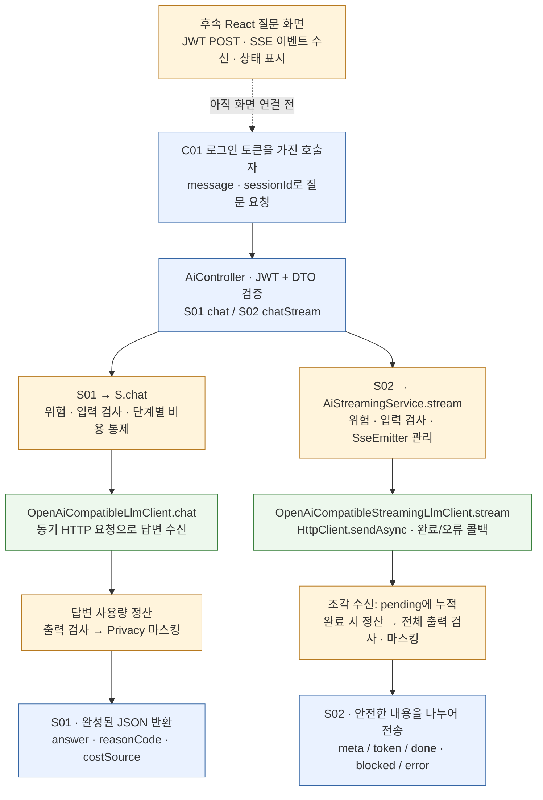

| API·연결 | Controller의 기능 | Service의 기능 | 응답과 구현 위치 |
|---|---|---|---|
| S01 동기 질문 | [AiController.chat](C:/myLectureWs/legal-ai-intake-security-server/backend/guardrail-ready-policy-checker/src/main/java/com/ohgiraffers/handlermethod/api/AiController.java:28): @Valid 요청 DTO를 받고 AiChatResponse 반환 | → [S.chat](C:/myLectureWs/legal-ai-intake-security-server/backend/guardrail-ready-policy-checker/src/main/java/com/ohgiraffers/handlermethod/service/AiService.java:67): Dynamic·Fixed·길이·입력 검사, 비용 예약·정산, LLM 호출, 출력 검사·Privacy 조율 | POST /api/ai/chat. 완성된 JSON 한 번 반환. 실제 LLM HTTP 요청은 [OpenAiCompatibleLlmClient.chat](C:/myLectureWs/legal-ai-intake-security-server/backend/guardrail-ready-policy-checker/src/main/java/com/ohgiraffers/handlermethod/llm/OpenAiCompatibleLlmClient.java:45) |
| S02 SSE 질문 | [AiController.chatStream](C:/myLectureWs/legal-ai-intake-security-server/backend/guardrail-ready-policy-checker/src/main/java/com/ohgiraffers/handlermethod/api/AiController.java:33): @Valid 요청 DTO, 60초 SseEmitter 생성 | → [AiStreamingService.stream](C:/myLectureWs/legal-ai-intake-security-server/backend/guardrail-ready-policy-checker/src/main/java/com/ohgiraffers/handlermethod/service/AiStreamingService.java:64): 안전 검사·예약, 비동기 LLM 콜백, 중단 시 정산, 최종 SSE 이벤트 관리 | POST /api/ai/chat/stream. 외부 비동기 호출은 [OpenAiCompatibleStreamingLlmClient.stream](C:/myLectureWs/legal-ai-intake-security-server/backend/guardrail-ready-policy-checker/src/main/java/com/ohgiraffers/handlermethod/llm/OpenAiCompatibleStreamingLlmClient.java:46)의 sendAsync |
| S03 입력 단독 검사 | [LegalGuardrailController.checkInput](C:/myLectureWs/legal-ai-intake-security-server/backend/guardrail-ready-policy-checker/src/main/java/com/ohgiraffers/handlermethod/api/LegalGuardrailController.java:26)이 message를 받음 | → [CostedGuardrailService.checkInput](C:/myLectureWs/legal-ai-intake-security-server/backend/guardrail-ready-policy-checker/src/main/java/com/ohgiraffers/handlermethod/cost/CostedGuardrailService.java:48): 검사 단계 비용 예약·외부 입력 검사·정산 | 전체 Chat 실행·답변 생성 없음. S01·S02가 S03 URL을 다시 HTTP 호출하는 구조는 아님 |
| S04 출력 단독 검사 | [LegalOutputGuardrailController.checkOutput](C:/myLectureWs/legal-ai-intake-security-server/backend/guardrail-ready-policy-checker/src/main/java/com/ohgiraffers/handlermethod/api/LegalOutputGuardrailController.java:26)이 response를 받음 | → [CostedGuardrailService.checkOutput](C:/myLectureWs/legal-ai-intake-security-server/backend/guardrail-ready-policy-checker/src/main/java/com/ohgiraffers/handlermethod/cost/CostedGuardrailService.java:53): 로컬 차단 또는 예약·외부 출력 검사·정산 | 전체 Chat의 Privacy 마스킹과 구분. S01·S02는 같은 Service를 내부 호출 |

**Controller와 Service가 나뉘는 이유:** Controller는 URL·입력 검증·JSON/SSE 통로를 알고, Service는 업무 순서·차단·비용·외부 Client를 안다. S01의 S.는 AiService이며 이름이 다른 AiStreamingService·CostedGuardrailService는 그대로 표시한다.

| 처리 구간 | 실제 메서드·설정 | 기능·실패 처리 |
|---|---|---|
| 입력 계약·위험 | [AiChatRequest](C:/myLectureWs/legal-ai-intake-security-server/backend/guardrail-ready-policy-checker/src/main/java/com/ohgiraffers/handlermethod/dto/AiChatRequest.java:6), [LegalDynamicGuardService.preCheck](C:/myLectureWs/legal-ai-intake-security-server/backend/guardrail-ready-policy-checker/src/main/java/com/ohgiraffers/handlermethod/riskengine/LegalDynamicGuardService.java:33), [LegalFixedGuardService.check](C:/myLectureWs/legal-ai-intake-security-server/backend/guardrail-ready-policy-checker/src/main/java/com/ohgiraffers/handlermethod/riskengine/LegalFixedGuardService.java:99) | DTO message 필수·최대 30자. 세션 누적 위험·현재 입력 규칙으로 조기 차단 |
| 길이·단계 비용 | [AiCostControlService.checkInputPageLimit](C:/myLectureWs/legal-ai-intake-security-server/backend/guardrail-ready-policy-checker/src/main/java/com/ohgiraffers/handlermethod/cost/AiCostControlService.java:108), [AiCostControlService.reserveStageWithBlock](C:/myLectureWs/legal-ai-intake-security-server/backend/guardrail-ready-policy-checker/src/main/java/com/ohgiraffers/handlermethod/cost/AiCostControlService.java:155), [AiCostControlService.recordUsage](C:/myLectureWs/legal-ai-intake-security-server/backend/guardrail-ready-policy-checker/src/main/java/com/ohgiraffers/handlermethod/cost/AiCostControlService.java:194) | 실험용 길이 기본 최대 10자. 입력 검사·답변·출력 검사별 예약과 보고/추정 정산. 0.3달러는 기본 세션 예산이며 요청마다 새로 주는 예산이 아님 |
| S02 완료·개인정보 보호 | [AiStreamingService.flushCompletedResponse](C:/myLectureWs/legal-ai-intake-security-server/backend/guardrail-ready-policy-checker/src/main/java/com/ohgiraffers/handlermethod/service/AiStreamingService.java:243), [PrivacyOutputGuardService.mask](C:/myLectureWs/legal-ai-intake-security-server/backend/guardrail-ready-policy-checker/src/main/java/com/ohgiraffers/handlermethod/riskengine/PrivacyOutputGuardService.java:26) | 전체 답변을 모아 출력 검사·마스킹한 뒤 안전한 조각 전송. 원문 토큰을 생성 즉시 사용자에게 보내지 않음 |
| S02 중단·중복 정산 방지 | [AiStreamingService.settleInterrupted](C:/myLectureWs/legal-ai-intake-security-server/backend/guardrail-ready-policy-checker/src/main/java/com/ohgiraffers/handlermethod/service/AiStreamingService.java:208), [AiCostControlService.recordUsage](C:/myLectureWs/legal-ai-intake-security-server/backend/guardrail-ready-policy-checker/src/main/java/com/ohgiraffers/handlermethod/cost/AiCostControlService.java:194) | 외부 호출 전 중단은 예약 해제, 호출 후 usage 미확인은 추정 정산. AtomicBoolean으로 예약 중복 정산 방지 |

React의 async/await는 클라이언트 비동기이고, S02의 sendAsync·콜백은 서버의 LLM 비동기다. 입력·출력 검사는 필요한 순서대로 실행된다. SSE와 비동기를 이유로 모든 단계가 병렬 실행되거나 LLM 생성 시간이 자동으로 줄어든다고 설명하지 않는다.

## 필수 흐름 3. 응답 지연 시간 통제 · 측정

REQ-05는 지연을 통제하는 구현과 실제 개선 효과를 함께 확인해야 한다. 현재 사전 차단·상한·타임아웃과 S01 시간 측정은 있고, S02의 첫 안전 답변·전체 시간 및 비교 실험은 보강할 부분이다.

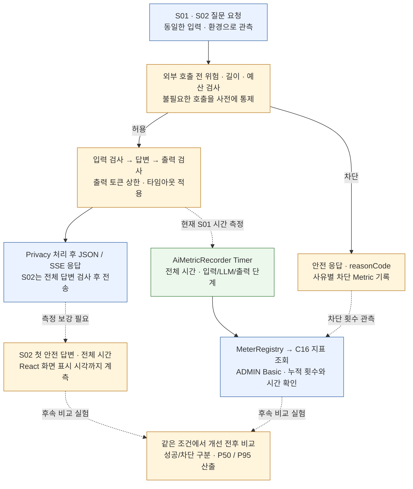

| 구현·관측 항목 | 현재 코드·API | 설명할 효과와 확인할 한계 |
|---|---|---|
| S02 비동기 LLM 호출 | [OpenAiCompatibleStreamingLlmClient.stream](C:/myLectureWs/legal-ai-intake-security-server/backend/guardrail-ready-policy-checker/src/main/java/com/ohgiraffers/handlermethod/llm/OpenAiCompatibleStreamingLlmClient.java:46): sendAsync·thenAccept | LLM 응답 대기 동안 서블릿 요청 스레드를 계속 점유하는 부담을 줄이는 구조. 모델 생성 시간 단축 수치는 별도 실험 필요 |
| 사전 차단·출력 상한 | [AiService.chat](C:/myLectureWs/legal-ai-intake-security-server/backend/guardrail-ready-policy-checker/src/main/java/com/ohgiraffers/handlermethod/service/AiService.java:67), [AiStreamingService.stream](C:/myLectureWs/legal-ai-intake-security-server/backend/guardrail-ready-policy-checker/src/main/java/com/ohgiraffers/handlermethod/service/AiStreamingService.java:64), [LLM 상한·타임아웃 설정](C:/myLectureWs/legal-ai-intake-security-server/backend/guardrail-ready-policy-checker/src/main/resources/application.properties:53) | 차단할 요청의 후속 외부 호출 방지. 출력 토큰 기본 상한 256. 입력 검사·출력 검사 비용·시간도 구분해서 확인 |
| 대기 시간 제한 | 같은 properties의 요청 제한 기본 30초, AiController의 SseEmitter 60초 | 오래 기다리는 요청의 상한. 타임아웃을 짧게 했다는 이유만으로 정상 응답 생성이 빨라진 것은 아님 |
| S01 전체·단계별 시간 | [AiMetricRecorder.start](C:/myLectureWs/legal-ai-intake-security-server/backend/guardrail-ready-policy-checker/src/main/java/com/ohgiraffers/handlermethod/support/AiMetricRecorder.java:17), [AiMetricRecorder.stop](C:/myLectureWs/legal-ai-intake-security-server/backend/guardrail-ready-policy-checker/src/main/java/com/ohgiraffers/handlermethod/support/AiMetricRecorder.java:21), [AiMetricRecorder.stopStage](C:/myLectureWs/legal-ai-intake-security-server/backend/guardrail-ready-policy-checker/src/main/java/com/ohgiraffers/handlermethod/support/AiMetricRecorder.java:27) | ai.chat.duration, ai.chat.stage.duration. 현재 S01은 입력 검사·LLM·출력 검사 구간 Timer를 호출 |
| C16 지표 조회 | [SecurityConfig.actuatorSecurity](C:/myLectureWs/legal-ai-intake-security-server/backend/guardrail-ready-policy-checker/src/main/java/com/ohgiraffers/handlermethod/config/SecurityConfig.java:42) → Spring Boot Actuator → MeterRegistry | GET /actuator/prometheus. 직접 작성한 업무 Controller·Service는 없음. Timer의 횟수·합계로 집계 의미 확인 |
| S02 계측·성능 결과 | AiStreamingService의 단계·결과 Counter와 별개로 확인 | S01과 같은 전체·단계 Timer가 S02에 연결돼 있지는 않음. 첫 안전 답변·완료 시간, P50·P95와 실제 개선율은 이번 구현·문서만으로 검증되지 않음 |

P50·P95는 후속 비교 실험에서 산출할 목표다. 현재 코드에 해당 분위수를 자동 제공하는 histogram 설정까지 갖췄다고 표시하지 않는다. 사용량 추정·세션 예산은 비용 통제이며 지연 개선 수치와 구분한다.

## 필수 요구사항 확인 절차

아래는 실행할 확인 절차다. 이번 문서 갱신에서 이 체크를 새로 실행한 결과로 읽지 않는다. 자동 테스트 코드는 CORS·보안·안전 응답의 근거이며 실제 외부 서비스·브라우저·성능 실험을 대신하지 않는다.

| 확인 단계 | 요청·조작 | 통과 근거와 기록 |
|---|---|---|
| CHECK-01 React 연동 | React와 Spring Boot 실행 → R01 분야 선택 → R02 상세 선택 → R06 체크리스트 버튼 | Network의 요청 URL·HTTP 상태·JSON과 화면 목록·상세·안내 일치. 로딩·오류 상태도 확인 |
| CHECK-02 CORS | 실제 Origin으로 필요한 OPTIONS 요청. S01·S02는 POST 및 authorization·content-type 요청 헤더 지정 | Access-Control-Allow-Origin·Allow-Methods 확인. 허용된 preflight는 인증 정보 없이 끝나며 실제 POST는 JWT 별도 검사 |
| CHECK-03 LLM 질문 | C01 로그인 → JWT로 S01 짧은 정상 질문. 정책·길이·예산 차단도 각각 요청 | 성공 answer·traceId·usageAvailable·costSource, 차단 reasonCode·detailCode 확인. 외부 LLM 설정과 응답 근거 보관 |
| CHECK-04 SSE 비동기 | 같은 조건으로 S02 요청 → meta·token·done, blocked·error·연결 중단 경우 확인 | 전체 검사·마스킹 전 원문 미노출, 이벤트 종료·예약 정산 확인. React POST·SSE 수신 UI 연결은 별도 후속 |
| CHECK-05 지연 비교 | 성공/차단을 구분한 동일 질문·환경·반복 조건으로 계측. C16과 클라이언트 시각 비교 | S01 단계별 시간, S02 첫 안전 답변·전체 시간. 표본 수·P50·P95·오류율과 개선 전후 조건 기록 |

관련 자동 테스트 코드: [AiSecurityIntegrationTest.preflightIsHandledBeforeJwtOrBasicAuthentication](C:/myLectureWs/legal-ai-intake-security-server/backend/guardrail-ready-policy-checker/src/test/java/com/ohgiraffers/handlermethod/api/AiSecurityIntegrationTest.java:191), [LlmUsageClientTest](C:/myLectureWs/legal-ai-intake-security-server/backend/guardrail-ready-policy-checker/src/test/java/com/ohgiraffers/handlermethod/llm/LlmUsageClientTest.java:17). 테스트 코드 존재, 과거 실행 기록, 이번 실행 결과를 구분한다. 이 문서 추가로 새 API·새 React 화면·성능 최적화 코드를 구현한 것은 아니다.

## 필수 요구사항과 DDD · Policy · Read Model 연결

DDD 비교본에 이미 있던 규칙·읽기 모델을 필수 요구사항 번호로 다시 찾을 수 있게 연결한다. 기존 37개 API 매핑·10개 대표 기능 묶음·개별 API 흐름은 그대로 유지한다.

| 체크 항목·API | DDD·Policy·Read Model 연결 | 기존 문서에서 함께 읽을 기능 |
|---|---|---|
| REQ-01 · R01·R02·R06 | Reference 조회 책임. POL-13·RM-08. React는 읽기 결과를 화면 상태로 반영 | DDD 7-8 Previewer 재사용 흐름, API 기능서의 R01·R02·R06 개별 flow |
| REQ-02 · 공통 설정 | POL-01 인증·통신. CORS는 공통 HTTP 경계이며 새 Command·Domain Event가 아님 | DDD 4의 POL-01, 7-6 인증·접근 흐름. C16은 ADMIN Basic 구분 |
| REQ-03 · S01·S02·S03·S04 | AI 안전·비용 책임. POL-03·08·09·10, RM-07. S03·S04는 단독 검사 | DDD 7-3 안전 응답, 7-10 비용 예약·정산, API 기능서 S01~S04 |
| REQ-04 · React 조회·S02 | 비동기는 실행·전달 방식. SSE 이벤트와 업무 Domain Event를 구분. Chat JPA 저장 없음 | DDD 3의 이벤트 후보, 7-3의 SSE 완료·중단·메모리 상태 |
| REQ-05 · S01·S02·C16 | RM-11 관측값과 비용·안전 Policy. 시간 Metric은 DB 감사 행과 다른 근거 | DDD 7-3 Metric 연결, 7-10 비용·중단, C16 개별 flow |

SSE의 meta·token·done은 응답 전달 이벤트다. Event Storming의 AiAnswerPrepared 같은 이름은 업무 사실의 설계·학습용 후보이며 현재 같은 이름의 이벤트 발행 코드가 있다는 뜻은 아니다. Event Bus·Outbox·Event Sourcing 구현 여부도 그대로 구분한다.

발표·제출 설명: **React–Spring Boot 연동과 CORS 처리를 구현했고, LLM 질문 API를 동기 JSON과 비동기 SSE로 제공한다. 위험·비용 사전 검사, 출력량·대기 상한, S01 시간 관측을 갖췄다. React 질문·SSE 화면 연결과 S02 계측·실제 지연 개선 효과 검증은 후속이다.**
