# API 기능서 flow 및 기능mapping표

> **2026-10-23 D01/D02 완료:** 새 버전·요청 키·복합 UNIQUE를 ERD/API 표에 반영하고 실제 MySQL 대상 컬럼8개/UNIQUE2개 이행 및 백업 복원을 확인했다. 앱8080은 기존 데이터를 보존한 최신 파일 H2 실행본이다. 아래 과거의 ‘MySQL 미검증/구버전 서버’ 기록은 [현재 DB·실행본 검수서](DB_DEPLOYMENT_REVIEW_2026-10-23.md)로 갱신한다.

> 2026-10-23 운영자 권한 완료: C12~C15·C17~C20 업무8개 API는 ADMIN Bearer JWT 필수다. React 관리자 로그인·P01 확인·로그아웃·인증 실패 시 자료 제거를 연결했다. C16·guardtimeseries는 ADMIN Basic 유지. 아래 공개 접근 판정은 당시 검수 기록으로 읽는다. [최신 인증 계약·225/46 및 실제 브라우저 검증](OPERATOR_ADMIN_AUTH_REVIEW_2026-10-23.md).

> **2026-10-23 문의 권한 현행 계약:** 기존 번호 API37개에 **C21 담당자 배정**을 더해38개다. 보조 `GET /actuator/guardtimeseries`는 별도다. C03/C04 및 저장 문의 경로는 JWT 필수, 조회/검색/파일은 소유자·배정 LAWYER·ADMIN, C10/C11은 배정 담당자·ADMIN만 허용한다. C21 `PATCH /api/intakes/{id}/assignment`는 ADMIN Bearer와 `{"assignedLawyerUsername":"lawyer"}` 또는 null을 받아 갱신된 문의 DTO를 반환한다(IntakeAssignmentController.assign → LegalIntakeRecordService.assignLawyer). 의뢰인 JSON에서 내부 메모를 제외하고 `permissions`를 추가했다. DB는 담당자/작성자 nullable 컬럼2개 추가이며 실제 MySQL 적용은 미검증이다. 아래 과거 회차의 공개/익명 정책과 API/Controller 수치는 당시 기록으로 읽는다. [최신 전체 매핑](SCREEN_API_CONTROLLER_MAPPING.md) · [권한 구현·검증](SCREEN04_08_ACCESS_CONTROL_REVIEW.md).


> 2026-10-22 추가: 화면13 실제 시계열용 **GET /actuator/guardtimeseries**(ADMIN Basic, 보조 Actuator 경로)가 구현되었다. 기존 번호 API37개와 구분한다. [최신 계약·검수](SCREEN13_OBSERVABILITY_REVIEW.md).

**2026-10-22 현행 반영:** P03 실행·화면05 연결 구현, 운영자 React 화면09~13 구현. 화면13은 기존 C16/C17 재사용이며 새 API 번호·DB 테이블을 추가하지 않았다. 구현 API는 37개다. 외부 LLM·네이버 실제 키 호출·청구 검증은 아직 별도다.

<!-- BRANCH_MERGE_READING_START -->
## Controller → Service 분기·공유 읽기 안내

개별 API flow를 읽을 때는 **같은 업무의 분기 · 여러 Controller의 Service 공유 · 한 요청의 순차 호출 · 응답 자료 조합**을 함께 확인한다. 대표 그림은 아래 **핵심 흐름 2**, 전체 목록은 이 문서의 **10. Controller → Service 분기·공유 전체 목록**에 수록했다.

| 읽을 관계 | 대표 API·코드 연결 | 분리하거나 묶은 이유 |
|---|---|---|
| 같은 Chat의 응답 방식 분기 | S01: AiController.chat → S.chat / S02: chatStream → AiStreamingService.stream | JSON 한 번 반환과 SSE 이벤트·연결 관리의 책임이 다름. 둘 다 Chat이며 입력·비용·출력·Privacy 규칙은 공유 |
| 같은 문의의 업무 규칙 공유 | C02·C03·C05~C11·P02 → LegalIntakeRecordService의 각 업무 메서드 | 분류·등록·조회·검색 기록·상태·메모가 같은 문의를 다루므로 규칙과 응답 구성을 재사용 |
| 한 요청에서 두 Service 순차 호출 | P02: IntakeAccessService.requireAccess → LegalIntakeRecordService.findSearchRequests | 접근 확인을 통과한 뒤 이력 조회. 둘 중 하나를 고르는 분기가 아님 |
| Service가 다른 Service 호출 | S05: AgentRiskDecisionController → S.analyze → RiskIncidentService.createIfNeeded | 위험 판정과 Incident 생애주기 책임을 구분하고 조건에 맞을 때 후속 저장 |
| 여러 자료를 하나의 응답으로 조합 | C05·C09 문의 보기 / R02 절차 상세 / C12 운영 요약 | 화면에 필요한 관련 자료를 DTO로 모음. API 여러 개를 자동 HTTP 호출한다는 뜻이 아님 |

**분기가 있다고 비동기인 것은 아니다.** S02의 비동기는 실제 sendAsync·콜백·SseEmitter 구현으로 확인한다. 같은 Service를 공유해도 다른 API가 함께 실행되지는 않는다. 같은 이름의 Controller → Service는 <code>→ S.</code>로 줄이고 다른 이름만 전체 표시한다.

전체 부록은 **Controller 19개 · Service 18개 · 공유 Service 9개 · 내부 업무 흐름 15개 · 코드 참조 128곳**을 포함한다. 대상은 이번 프로젝트와 과제 Previewer의 **37개 항목 = Controller API 36개 + Actuator C16**이다. 기존 개별 API flow와 기능별 묶음 그림도 계속 함께 읽는다.

읽기 파일: **[통합 다크 모드 API Flow PDF · 분기·공유 부록 포함](../output/pdf/BACKEND_API_FLOW_MAPPING_DARK_TABLET.pdf)** · [분기·공유만 읽는 다크 PDF](../output/pdf/BACKEND_CONTROLLER_SERVICE_BRANCH_MERGE_DARK_TABLET.pdf) · [별도 가이드 원문](BACKEND_CONTROLLER_SERVICE_BRANCH_MERGE_GUIDE.md).
<!-- BRANCH_MERGE_READING_END -->

## 전체 서비스 구성 및 사용자 흐름

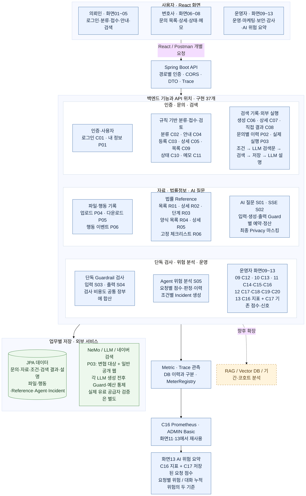

## 이번 프로젝트 범위와 핵심 흐름

이 기능서는 **이번 Legal AI Intake 프로젝트와 이전 법률 절차 Previewer 과제에서 재사용한 기능만** 다룬다. 대상은 C01~C20·R01~R06·S01~S05·P01~P06 **37개 항목**이다. P03을 포함한 구현 API 37개를 다룬다. 실제 외부 공급자 검증 상태는 별도로 구분한다. 저장소에 함께 남아 있는 다른 실습·실험 API는 이 문서의 기능표·예시·흐름도에서 제외한다.

| 포함 범위 | 번호 | 내용 |
|---|---|---|
| 이번 프로젝트 업무·운영 | C01~C20 | 인증, 분류·문의·검색 기록·상담 검토, 운영·마케팅·보안·위험·Incident·지표 |
| 이전 Previewer 과제 재사용 | R01~R06 | 법률 절차 목록·상세·단계, 양식 목록·상세, 형사 보완수사 체크리스트 |
| 이번 프로젝트 AI·보안 | S01~S05 | 동기·SSE AI Chat, 입력·출력 Guardrail, Agent 위험 판정 |
| 이번 프로젝트 공통·파일·행동 | P01~P06 | 현재 사용자, 문의별 검색 이력, 외부 검색 실행 구현, 파일 업로드·다운로드, 행동 이벤트 |

이전 과제의 실제 폴더는 `frontend/legal-procedure-viewer`다. **기존 React에 연결된 API는 R01·R02·R06 세 개**이며, 백엔드에서 제공하는 R01~R06 여섯 개를 이번 프로젝트의 Reference 모듈로 유지한다. R03·R04·R05와 새 화면의 연결을 모두 완료된 것으로 표시하지 않는다. 근거: [저장소 출처](REPOSITORY_ORIGIN.md), [제출 화면·API 연결](SCREEN_API_CONTROLLER_MAPPING.md).

### 핵심 흐름 1. 문의 등록 → 검색 기록 → 상담 검토

아래 화살표는 **사용자가 다음 API를 별도로 요청하면서 ID를 이어 쓰는 업무 순서**다. 앞 API가 뒤 API를 자동 호출한다는 뜻은 아니다. C06은 검색 요청 기록, C08은 호출자가 제공한 결과의 저장이며 실제 외부 검색 실행 P03은 구현되어 명시적으로 실행할 수 있다.

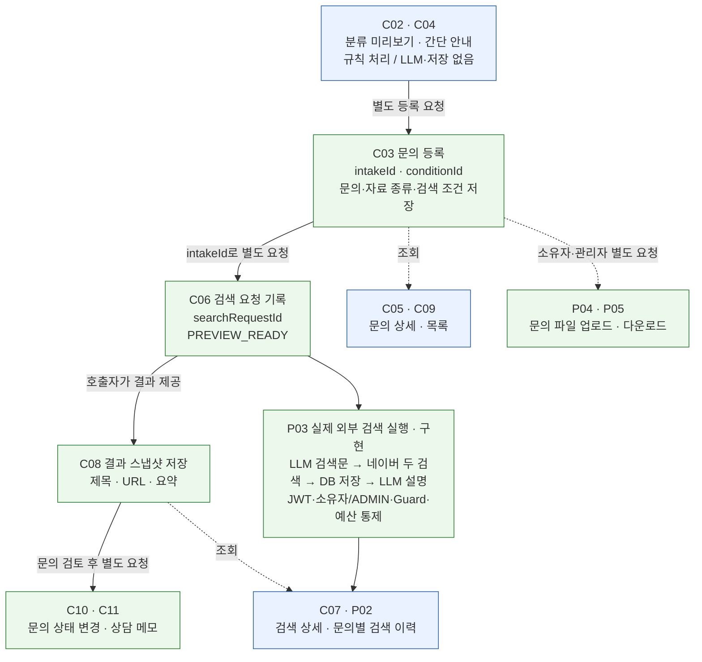

### 핵심 흐름 2. Controller → Service의 공유·분리·추가 호출

같은 프로젝트 안에서도 이름과 호출 구조가 다르다. Controller가 같아도 메서드별로 Service를 고르고, 이름이 다른 Controller들이 한 Service를 공유하기도 한다. S05에서는 Service가 다른 Service를 호출한다.

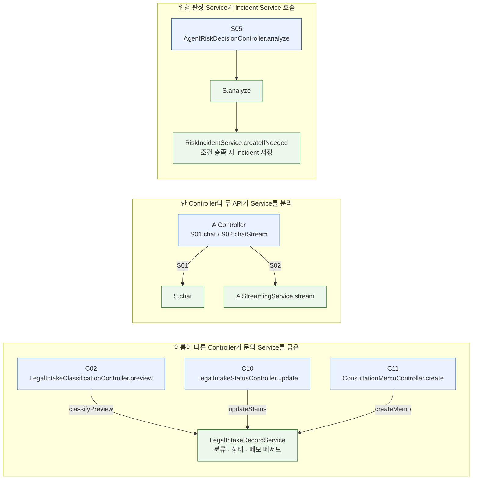

### 핵심 흐름 3. 이전 Previewer → 법률 Reference 재사용

이전 과제의 화면과 API를 그대로 연결해서 읽는다. R01~R05는 저장된 법률 절차·단계·양식 조회이고, R06은 고정 체크리스트다. 이 흐름 자체가 문의 등록이나 LLM 호출을 수행하지는 않는다.

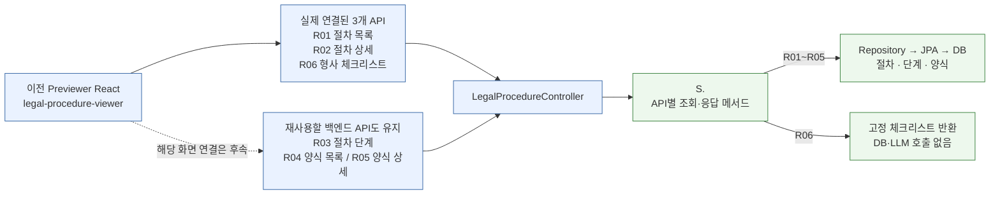

### 핵심 흐름 4. AI 질문 → 보안·비용 통제 → 안전한 응답

이 그림은 S01·S02의 공통 핵심 경로다. 각 단계에서 차단·예산 부족·외부 장애가 생기면 응답·사유로 분기하며 LLM 생성까지 반드시 도달하지는 않는다. 단계별 예약·정산과 S03·S04 단독 검사는 뒤의 개별 API flow에서 상세히 읽는다.

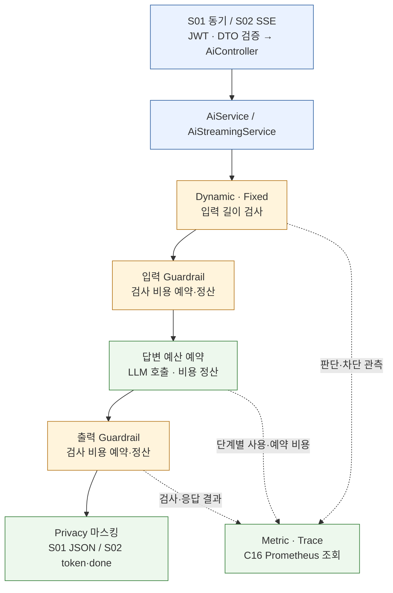

### 기능별 묶음 흐름도 찾아가기

개별 API를 읽기 전후로 **부록 9-7의 기능별 흐름 10개**를 함께 본다. 문의·검색 기록, 상담 검토, AI 응답, 위험 사건 처리, 행동 집계, 인증·대상 접근, 파일, Previewer, 사건 정리, 비용 정산을 각각 한 묶음으로 그렸다. 각 그림 뒤의 코드 표에서 실제 메서드·데이터·응답을 확인할 수 있다. 기존 개별 37개 API flow와 핵심 흐름도는 그대로 유지했다.

## 개발 필수 요구사항 체크

**2026-10-19 코드 대조 기준.** 과제의 두 필수 요소를 확인하기 위해 REQ-01~05로 나누었다. REQ 번호는 문서 체크 항목이며 API 번호가 아니다. 기존 프로젝트 37개 항목과 과제 Previewer 범위를 유지한다.

필수 요소 원문은 **① Spring Boot(API Server)와 React(Client Server) 연동 및 CORS 처리 ② LLM API 활용 질문 시스템 개발 + 응답 지연 시간 최적화·비동기 데이터 처리**다. 아래 상태는 현재 코드의 구현 위치이며, 이번 문서 갱신에서 서버·외부 LLM·브라우저 성능 실험을 새로 실행한 결과는 아니다.

| 요구사항 | 현재 구현·확인 상태 | API와 위치 | 남은 완료 근거 |
|---|---|---|---|
| REQ-01 Spring Boot–React 연동 | Previewer 화면과 호출 코드 구현 | R01 목록·R02 상세·R06 체크리스트. App.jsx → legalProcedureApi.js → LegalProcedureController | 실행 환경에서 브라우저 Network·화면 결과를 함께 기록. 새 AI 질문 화면 연결은 후속 |
| REQ-02 CORS 처리 | 공통 설정과 preflight 자동 테스트 코드 구현 | `/api/**`, `/actuator/**`. WebMvcConfig + SecurityConfig. 자체 업무 API 번호 없음 | 실제 브라우저 Origin·OPTIONS·응답 헤더 확인 |
| REQ-03 LLM 질문 시스템 | S01 동기 JSON·S02 SSE 백엔드 구현 | AiController → S.chat / AiStreamingService.stream → 각 LLM Client | 실제 외부 서비스 연동 결과와 React 질문 입력·응답 화면 연결 확인 |
| REQ-04 비동기 데이터 처리 | React 조회의 async/await·S02 sendAsync/콜백·SseEmitter 구현 | React: R01·R02·R06. 서버 LLM 비동기: S02 | React의 JWT POST·SSE 이벤트 수신 UI 연결. 입력·출력 검사 전체를 병렬 처리했다는 의미는 아님 |
| REQ-05 응답 지연 시간 최적화 | Java 21 웹 요청 가상 스레드 설정, 사전 차단·입출력 상한·타임아웃·S01 시간 측정 구현. 개선 효과는 미검증 | S01 동기 외부 I/O·S02·C16. application.properties:2·AiMetricRecorder | 실행 스레드 확인, S02 시간 계측, 동일 조건의 동시 처리량·P50·P95·오류율 비교 |

**상태 읽는 법:** 코드 구현, React 화면 연결, 실제 외부 서비스 실행, 성능 개선 검증을 각각 구분한다. S02는 비동기 호출을 구현했지만 전체 답변을 검사·마스킹한 뒤 전송한다. 현재 첫 답변 표시가 몇 초 빨라졌다고 단정하지 않는다.

**Service 표기:** Controller와 Service의 앞부분 이름이 같으면 `→ S.메서드()`로 줄이고, 다르면 전체 Service 이름을 쓴다. Controller 없이 단독으로 인용하는 업무 메서드는 전체 이름을 유지한다.

## 필수 흐름 1. Spring Boot–React 연동 · CORS

REQ-01·02를 한 묶음으로 읽는다. React 개발 서버가 제공한 화면은 브라우저에서 실행되며 Spring Boot에 HTTP 요청을 보낸다. 현재 실제 React 호출 코드는 R01·R02·R06이다.

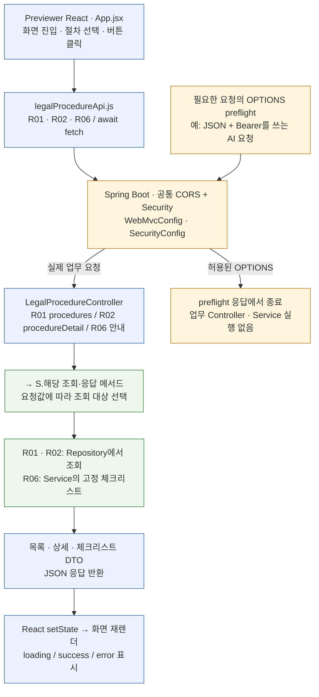

| API·진입점 | Controller의 기능 | Service의 기능 | 응답·화면에서 확인 |
|---|---|---|---|
| R01 목록 | [LegalProcedureController.procedures](C:/myLectureWs/legal-ai-intake-security-server/backend/guardrail-ready-policy-checker/src/main/java/com/ohgiraffers/handlermethod/api/LegalProcedureController.java:40)가 Query domain을 받음 | → [S.findProcedures](C:/myLectureWs/legal-ai-intake-security-server/backend/guardrail-ready-policy-checker/src/main/java/com/ohgiraffers/handlermethod/service/LegalProcedureService.java:49)가 전체·분야별 Repository 조회 후 목록 DTO 구성 | 절차 배열·분야 필터. React fetchProcedures 호출 |
| R02 상세 | [LegalProcedureController.procedureDetail](C:/myLectureWs/legal-ai-intake-security-server/backend/guardrail-ready-policy-checker/src/main/java/com/ohgiraffers/handlermethod/api/LegalProcedureController.java:58)이 Path code를 받음 | → [S.findProcedureDetail](C:/myLectureWs/legal-ai-intake-security-server/backend/guardrail-ready-policy-checker/src/main/java/com/ohgiraffers/handlermethod/service/LegalProcedureService.java:85)이 절차·정렬된 단계·양식을 한 DTO로 조합 | 선택 code의 상세·단계·양식. React fetchProcedureDetail 호출 |
| R06 안내 | [LegalProcedureController.supplementaryInvestigationChecklist](C:/myLectureWs/legal-ai-intake-security-server/backend/guardrail-ready-policy-checker/src/main/java/com/ohgiraffers/handlermethod/api/LegalProcedureController.java:111)가 안내 요청을 받음 | → [S.supplementaryInvestigationChecklist](C:/myLectureWs/legal-ai-intake-security-server/backend/guardrail-ready-policy-checker/src/main/java/com/ohgiraffers/handlermethod/service/LegalProcedureService.java:165)가 고정 체크리스트 구성 | 체크리스트·권장 행동. Repository·LLM 호출 없음 |
| 공통 React 호출 | HTTP 요청을 발생시키는 클라이언트 위치이며 Spring Controller는 아님 | [fetchJson](C:/myLectureWs/legal-ai-intake-security-server/frontend/legal-procedure-viewer/src/api/legalProcedureApi.js:15)의 await fetch·HTTP 오류 확인 | [App.loadProcedures](C:/myLectureWs/legal-ai-intake-security-server/frontend/legal-procedure-viewer/src/App.jsx:63), 상세·체크리스트 상태 갱신. await는 브라우저 전체를 멈추지 않음 |

R01·R02·R06의 S.는 LegalProcedureService다. 현재 API 기본 주소는 http://localhost:8080이며 화면에서 apiBase를 바꿀 수 있다. R03·R04·R05는 기존 37개 항목에 포함된 Reference 백엔드 API이며 현재 React 화면 연결은 후속이다.

| 공통 계층 | 실제 위치 | CORS·인증 책임 |
|---|---|---|
| CORS 허용 설정 | [WebMvcConfig.corsConfigurationSource](C:/myLectureWs/legal-ai-intake-security-server/backend/guardrail-ready-policy-checker/src/main/java/com/ohgiraffers/handlermethod/config/WebMvcConfig.java:29) | `/api/**`: Origin 패턴 `*`, GET·POST·PATCH·OPTIONS, 요청 헤더 `*`. 노출 응답 헤더 Content-Disposition·X-Trace-Id |
| Security 연결 | [SecurityConfig.applicationSecurity](C:/myLectureWs/legal-ai-intake-security-server/backend/guardrail-ready-policy-checker/src/main/java/com/ohgiraffers/handlermethod/config/SecurityConfig.java:66), [SecurityConfig.actuatorSecurity](C:/myLectureWs/legal-ai-intake-security-server/backend/guardrail-ready-policy-checker/src/main/java/com/ohgiraffers/handlermethod/config/SecurityConfig.java:42) | 같은 CORS 설정을 애플리케이션·Actuator 체인에 연결. CORS 허용과 실제 요청의 JWT·ADMIN Basic 인증은 별도 판단 |
| preflight 확인 코드 | [AiSecurityIntegrationTest.preflightIsHandledBeforeJwtOrBasicAuthentication](C:/myLectureWs/legal-ai-intake-security-server/backend/guardrail-ready-policy-checker/src/test/java/com/ohgiraffers/handlermethod/api/AiSecurityIntegrationTest.java:191) | S01·S02·S03·C16 OPTIONS에 허용 Origin·Method 응답 확인. preflight에서 업무 외부 Client가 호출되지 않는지 검사 |

일반 GET에 항상 OPTIONS가 생기는 것은 아니다. 브라우저가 preflight를 요구하는 요청에서 먼저 허용 여부를 확인하고, 이후 실제 요청을 보낸다. S01·S02 실제 POST는 C01에서 받은 JWT가 필요하며 C16은 ADMIN Basic 경로다.

## 필수 흐름 2. LLM 질문 · 비동기 데이터 처리

REQ-03·04의 중심은 S01·S02다. Controller는 요청 검증과 응답 통로를 담당하고, 각 Service가 안전 처리·비용·외부 호출을 조율한다. 아래 호출자는 현재 Postman 등이며 React 질문·SSE 화면은 연결할 부분이다.

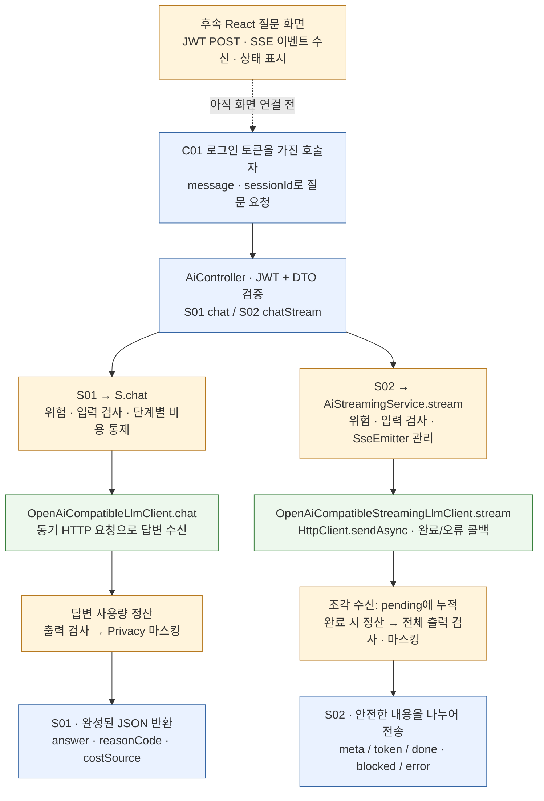

| API·연결 | Controller의 기능 | Service의 기능 | 응답과 구현 위치 |
|---|---|---|---|
| S01 동기 질문 | [AiController.chat](C:/myLectureWs/legal-ai-intake-security-server/backend/guardrail-ready-policy-checker/src/main/java/com/ohgiraffers/handlermethod/api/AiController.java:28): @Valid 요청 DTO를 받고 AiChatResponse 반환 | → [S.chat](C:/myLectureWs/legal-ai-intake-security-server/backend/guardrail-ready-policy-checker/src/main/java/com/ohgiraffers/handlermethod/service/AiService.java:67): Dynamic·Fixed·길이·입력 검사, 비용 예약·정산, LLM 호출, 출력 검사·Privacy 조율 | POST /api/ai/chat. 완성된 JSON 한 번 반환. 실제 LLM HTTP 요청은 [OpenAiCompatibleLlmClient.chat](C:/myLectureWs/legal-ai-intake-security-server/backend/guardrail-ready-policy-checker/src/main/java/com/ohgiraffers/handlermethod/llm/OpenAiCompatibleLlmClient.java:45) |
| S02 SSE 질문 | [AiController.chatStream](C:/myLectureWs/legal-ai-intake-security-server/backend/guardrail-ready-policy-checker/src/main/java/com/ohgiraffers/handlermethod/api/AiController.java:33): @Valid 요청 DTO, 60초 SseEmitter 생성 | → [AiStreamingService.stream](C:/myLectureWs/legal-ai-intake-security-server/backend/guardrail-ready-policy-checker/src/main/java/com/ohgiraffers/handlermethod/service/AiStreamingService.java:64): 안전 검사·예약, 비동기 LLM 콜백, 중단 시 정산, 최종 SSE 이벤트 관리 | POST /api/ai/chat/stream. 외부 비동기 호출은 [OpenAiCompatibleStreamingLlmClient.stream](C:/myLectureWs/legal-ai-intake-security-server/backend/guardrail-ready-policy-checker/src/main/java/com/ohgiraffers/handlermethod/llm/OpenAiCompatibleStreamingLlmClient.java:46)의 sendAsync |
| S03 입력 단독 검사 | [LegalGuardrailController.checkInput](C:/myLectureWs/legal-ai-intake-security-server/backend/guardrail-ready-policy-checker/src/main/java/com/ohgiraffers/handlermethod/api/LegalGuardrailController.java:26)이 message를 받음 | → [CostedGuardrailService.checkInput](C:/myLectureWs/legal-ai-intake-security-server/backend/guardrail-ready-policy-checker/src/main/java/com/ohgiraffers/handlermethod/cost/CostedGuardrailService.java:48): 검사 단계 비용 예약·외부 입력 검사·정산 | 전체 Chat 실행·답변 생성 없음. S01·S02가 S03 URL을 다시 HTTP 호출하는 구조는 아님 |
| S04 출력 단독 검사 | [LegalOutputGuardrailController.checkOutput](C:/myLectureWs/legal-ai-intake-security-server/backend/guardrail-ready-policy-checker/src/main/java/com/ohgiraffers/handlermethod/api/LegalOutputGuardrailController.java:26)이 response를 받음 | → [CostedGuardrailService.checkOutput](C:/myLectureWs/legal-ai-intake-security-server/backend/guardrail-ready-policy-checker/src/main/java/com/ohgiraffers/handlermethod/cost/CostedGuardrailService.java:53): 로컬 차단 또는 예약·외부 출력 검사·정산 | 전체 Chat의 Privacy 마스킹과 구분. S01·S02는 같은 Service를 내부 호출 |

**Controller와 Service가 나뉘는 이유:** Controller는 URL·입력 검증·JSON/SSE 통로를 알고, Service는 업무 순서·차단·비용·외부 Client를 안다. S01의 S.는 AiService이며 이름이 다른 AiStreamingService·CostedGuardrailService는 그대로 표시한다.

| 처리 구간 | 실제 메서드·설정 | 기능·실패 처리 |
|---|---|---|
| 입력 계약·위험 | [AiChatRequest](C:/myLectureWs/legal-ai-intake-security-server/backend/guardrail-ready-policy-checker/src/main/java/com/ohgiraffers/handlermethod/dto/AiChatRequest.java:6), [LegalDynamicGuardService.preCheck](C:/myLectureWs/legal-ai-intake-security-server/backend/guardrail-ready-policy-checker/src/main/java/com/ohgiraffers/handlermethod/riskengine/LegalDynamicGuardService.java:33), [LegalFixedGuardService.check](C:/myLectureWs/legal-ai-intake-security-server/backend/guardrail-ready-policy-checker/src/main/java/com/ohgiraffers/handlermethod/riskengine/LegalFixedGuardService.java:99) | DTO message 필수·최대 100자. 세션 누적 위험·현재 입력 규칙으로 조기 차단 |
| 길이·단계 비용 | [AiCostControlService.checkInputPageLimit](C:/myLectureWs/legal-ai-intake-security-server/backend/guardrail-ready-policy-checker/src/main/java/com/ohgiraffers/handlermethod/cost/AiCostControlService.java:108), [AiCostControlService.reserveStageWithBlock](C:/myLectureWs/legal-ai-intake-security-server/backend/guardrail-ready-policy-checker/src/main/java/com/ohgiraffers/handlermethod/cost/AiCostControlService.java:155), [AiCostControlService.recordUsage](C:/myLectureWs/legal-ai-intake-security-server/backend/guardrail-ready-policy-checker/src/main/java/com/ohgiraffers/handlermethod/cost/AiCostControlService.java:194) | 사건 본문 길이 기본 최대 100자. 입력 검사·답변·출력 검사별 예약과 보고/추정 정산. 현재 기본 0.12달러는 세션 예산이며 요청마다 새로 주는 예산이 아님 |
| S02 완료·개인정보 보호 | [AiStreamingService.flushCompletedResponse](C:/myLectureWs/legal-ai-intake-security-server/backend/guardrail-ready-policy-checker/src/main/java/com/ohgiraffers/handlermethod/service/AiStreamingService.java:243), [PrivacyOutputGuardService.mask](C:/myLectureWs/legal-ai-intake-security-server/backend/guardrail-ready-policy-checker/src/main/java/com/ohgiraffers/handlermethod/riskengine/PrivacyOutputGuardService.java:26) | 전체 답변을 모아 출력 검사·마스킹한 뒤 안전한 조각 전송. 원문 토큰을 생성 즉시 사용자에게 보내지 않음 |
| S02 중단·중복 정산 방지 | [AiStreamingService.settleInterrupted](C:/myLectureWs/legal-ai-intake-security-server/backend/guardrail-ready-policy-checker/src/main/java/com/ohgiraffers/handlermethod/service/AiStreamingService.java:208), [AiCostControlService.recordUsage](C:/myLectureWs/legal-ai-intake-security-server/backend/guardrail-ready-policy-checker/src/main/java/com/ohgiraffers/handlermethod/cost/AiCostControlService.java:194) | 외부 호출 전 중단은 예약 해제, 호출 후 usage 미확인은 추정 정산. AtomicBoolean으로 예약 중복 정산 방지 |

React의 async/await는 클라이언트 비동기이고, S02의 sendAsync·콜백은 서버의 LLM 비동기다. 입력·출력 검사는 필요한 순서대로 실행된다. SSE와 비동기를 이유로 모든 단계가 병렬 실행되거나 LLM 생성 시간이 자동으로 줄어든다고 설명하지 않는다.

## 필수 흐름 3. 응답 지연 시간 통제 · 측정

REQ-05는 지연·동시 요청 대기를 통제하는 구현과 실제 개선 효과를 함께 확인한다. 사전 차단·상한·타임아웃·S01 시간 측정과 웹 요청 가상 스레드 설정은 구현되어 있고, 실행 스레드 확인과 비교 실험은 남아 있다.

**가상 스레드 적용 목적:** 이번 프로젝트는 Java 21과 Spring Boot를 사용하고, 기본 설정에서 웹 요청을 가상 스레드로 처리하도록 구성했다. 특히 S01 AI 질문은 입력 검사 → 외부 LLM 호출 → 출력 검사처럼 네트워크 응답을 기다리는 구간이 많다. 기존 동기식 Controller–Service 구조를 유지하면서 여러 요청의 I/O 대기를 처리하기 위한 적용이며, 한 답변의 생성 속도보다 동시 요청 처리에 목적이 있다.

**실행 경계와 검증:** 가상 스레드는 요청 실행 방식이고, S02의 sendAsync·콜백은 비동기 호출 방식이며, SSE는 응답 전달 방식이다. 웹 요청 설정만으로 S02의 응답 줄 읽기·완료 콜백까지 가상 스레드에서 실행된다고 단정하지 않는다. 실행 시 Thread.currentThread().isVirtual()·스레드 이름 또는 JFR로 경계를 확인하고, 동시 요청 처리량·P50/P95·오류율·메모리·플랫폼 스레드 수를 같은 조건에서 비교해야 한다. 이번 문서 갱신에서 실행 스레드 확인이나 성능 개선 실험을 수행한 것은 아니다.

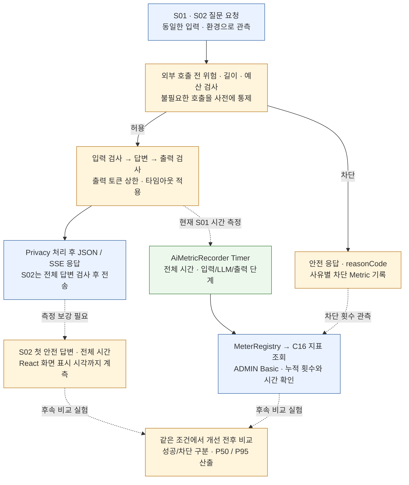

| 구현·관측 항목 | 현재 코드·API | 설명할 효과와 확인할 한계 |
|---|---|---|
| 웹 요청 가상 스레드 · S01 외부 I/O | [Java 21 설정](C:/myLectureWs/legal-ai-intake-security-server/backend/guardrail-ready-policy-checker/build.gradle:15), [application.properties:2](C:/myLectureWs/legal-ai-intake-security-server/backend/guardrail-ready-policy-checker/src/main/resources/application.properties:2)의 spring.threads.virtual.enabled=true → AiController.chat → S.chat → NeMo / [OpenAiCompatibleLlmClient.chat](C:/myLectureWs/legal-ai-intake-security-server/backend/guardrail-ready-policy-checker/src/main/java/com/ohgiraffers/handlermethod/llm/OpenAiCompatibleLlmClient.java:45) | 동기 Controller–Service 구조를 유지하며 여러 요청의 I/O 대기를 처리하는 목적. 단일 LLM 생성 시간 개선 수치는 미검증. S02 콜백의 실행 스레드는 별도 확인 |
| S02 비동기 LLM 호출 | [OpenAiCompatibleStreamingLlmClient.stream](C:/myLectureWs/legal-ai-intake-security-server/backend/guardrail-ready-policy-checker/src/main/java/com/ohgiraffers/handlermethod/llm/OpenAiCompatibleStreamingLlmClient.java:46): sendAsync·thenAccept | LLM 응답 대기 동안 서블릿 요청 스레드를 계속 점유하는 부담을 줄이는 구조. 모델 생성 시간 단축 수치는 별도 실험 필요 |
| 사전 차단·출력 상한 | [AiService.chat](C:/myLectureWs/legal-ai-intake-security-server/backend/guardrail-ready-policy-checker/src/main/java/com/ohgiraffers/handlermethod/service/AiService.java:67), [AiStreamingService.stream](C:/myLectureWs/legal-ai-intake-security-server/backend/guardrail-ready-policy-checker/src/main/java/com/ohgiraffers/handlermethod/service/AiStreamingService.java:64), [LLM 상한·타임아웃 설정](C:/myLectureWs/legal-ai-intake-security-server/backend/guardrail-ready-policy-checker/src/main/resources/application.properties:53) | 차단할 요청의 후속 외부 호출 방지. 출력 토큰 기본 상한 256. 입력 검사·출력 검사 비용·시간도 구분해서 확인 |
| 대기 시간 제한 | 같은 properties의 요청 제한 기본 30초, AiController의 SseEmitter 60초 | 오래 기다리는 요청의 상한. 타임아웃을 짧게 했다는 이유만으로 정상 응답 생성이 빨라진 것은 아님 |
| S01 전체·단계별 시간 | [AiMetricRecorder.start](C:/myLectureWs/legal-ai-intake-security-server/backend/guardrail-ready-policy-checker/src/main/java/com/ohgiraffers/handlermethod/support/AiMetricRecorder.java:17), [AiMetricRecorder.stop](C:/myLectureWs/legal-ai-intake-security-server/backend/guardrail-ready-policy-checker/src/main/java/com/ohgiraffers/handlermethod/support/AiMetricRecorder.java:21), [AiMetricRecorder.stopStage](C:/myLectureWs/legal-ai-intake-security-server/backend/guardrail-ready-policy-checker/src/main/java/com/ohgiraffers/handlermethod/support/AiMetricRecorder.java:27) | ai.chat.duration, ai.chat.stage.duration. 현재 S01은 입력 검사·LLM·출력 검사 구간 Timer를 호출 |
| C16 지표 조회 | [SecurityConfig.actuatorSecurity](C:/myLectureWs/legal-ai-intake-security-server/backend/guardrail-ready-policy-checker/src/main/java/com/ohgiraffers/handlermethod/config/SecurityConfig.java:42) → Spring Boot Actuator → MeterRegistry | GET /actuator/prometheus. 직접 작성한 업무 Controller·Service는 없음. Timer의 횟수·합계로 집계 의미 확인 |
| S02 계측·성능 결과 | AiStreamingService의 단계·결과 Counter와 별개로 확인 | S01과 같은 전체·단계 Timer가 S02에 연결돼 있지는 않음. 첫 안전 답변·완료 시간, P50·P95와 실제 개선율은 이번 구현·문서만으로 검증되지 않음 |

P50·P95는 후속 비교 실험에서 산출할 목표다. 현재 코드에 해당 분위수를 자동 제공하는 histogram 설정까지 갖췄다고 표시하지 않는다. 사용량 추정·세션 예산은 비용 통제이며 지연 개선 수치와 구분한다.

## 필수 요구사항 확인 절차

아래는 실행할 확인 절차다. 이번 문서 갱신에서 이 체크를 새로 실행한 결과로 읽지 않는다. 자동 테스트 코드는 CORS·보안·안전 응답의 근거이며 실제 외부 서비스·브라우저·성능 실험을 대신하지 않는다.

| 확인 단계 | 요청·조작 | 통과 근거와 기록 |
|---|---|---|
| CHECK-01 React 연동 | React와 Spring Boot 실행 → R01 분야 선택 → R02 상세 선택 → R06 체크리스트 버튼 | Network의 요청 URL·HTTP 상태·JSON과 화면 목록·상세·안내 일치. 로딩·오류 상태도 확인 |
| CHECK-02 CORS | 실제 Origin으로 필요한 OPTIONS 요청. S01·S02는 POST 및 authorization·content-type 요청 헤더 지정 | Access-Control-Allow-Origin·Allow-Methods 확인. 허용된 preflight는 인증 정보 없이 끝나며 실제 POST는 JWT 별도 검사 |
| CHECK-03 LLM 질문 | C01 로그인 → JWT로 S01 짧은 정상 질문. 정책·길이·예산 차단도 각각 요청 | 성공 answer·traceId·usageAvailable·costSource, 차단 reasonCode·detailCode 확인. 외부 LLM 설정과 응답 근거 보관 |
| CHECK-04 SSE 비동기 | 같은 조건으로 S02 요청 → meta·token·done, blocked·error·연결 중단 경우 확인 | 전체 검사·마스킹 전 원문 미노출, 이벤트 종료·예약 정산 확인. React POST·SSE 수신 UI 연결은 별도 후속 |
| CHECK-05 지연 비교 | 성공/차단을 구분한 동일 질문·환경·반복 조건으로 계측. C16과 클라이언트 시각 비교 | S01 단계별 시간, S02 첫 안전 답변·전체 시간. 표본 수·P50·P95·오류율과 개선 전후 조건 기록 |
| CHECK-06 가상 스레드 적용·동시 요청 | Controller 진입·동기 외부 호출 전후·S02 콜백에서 isVirtual()·스레드 이름을 확인. 모의 외부 서버와 동일한 동시 요청 조건으로 설정 ON/OFF 비교 | 요청 진입과 콜백 경계를 구분한 실행 근거. 처리량·P50/P95·오류율·메모리·플랫폼 스레드 수 기록. 현재 적용된 S02 콜백 구현을 비교 조건에 명시 |

관련 자동 테스트 코드: [AiSecurityIntegrationTest.preflightIsHandledBeforeJwtOrBasicAuthentication](C:/myLectureWs/legal-ai-intake-security-server/backend/guardrail-ready-policy-checker/src/test/java/com/ohgiraffers/handlermethod/api/AiSecurityIntegrationTest.java:191), [LlmUsageClientTest](C:/myLectureWs/legal-ai-intake-security-server/backend/guardrail-ready-policy-checker/src/test/java/com/ohgiraffers/handlermethod/llm/LlmUsageClientTest.java:17). 테스트 코드 존재, 과거 실행 기록, 이번 실행 결과를 구분한다. 이 문서 추가로 새 API·새 React 화면·성능 최적화 코드를 구현한 것은 아니다.

## 필수 요구사항과 DDD · Policy · Read Model 연결

DDD 비교본에 이미 있던 규칙·읽기 모델을 필수 요구사항 번호로 다시 찾을 수 있게 연결한다. 기존 37개 API 매핑·10개 대표 기능 묶음·개별 API 흐름은 그대로 유지한다.

| 체크 항목·API | DDD·Policy·Read Model 연결 | 기존 문서에서 함께 읽을 기능 |
|---|---|---|
| REQ-01 · R01·R02·R06 | Reference 조회 책임. POL-13·RM-08. React는 읽기 결과를 화면 상태로 반영 | DDD 7-8 Previewer 재사용 흐름, API 기능서의 R01·R02·R06 개별 flow |
| REQ-02 · 공통 설정 | POL-01 인증·통신. CORS는 공통 HTTP 경계이며 새 Command·Domain Event가 아님 | DDD 4의 POL-01, 7-6 인증·접근 흐름. C16은 ADMIN Basic 구분 |
| REQ-03 · S01·S02·S03·S04 | AI 안전·비용 책임. POL-03·08·09·10, RM-07. S03·S04는 단독 검사 | DDD 7-3 안전 응답, 7-10 비용 예약·정산, API 기능서 S01~S04 |
| REQ-04 · React 조회·S02 | 비동기는 실행·전달 방식. SSE 이벤트와 업무 Domain Event를 구분. Chat JPA 저장 없음 | DDD 3의 이벤트 후보, 7-3의 SSE 완료·중단·메모리 상태 |
| REQ-05 · S01·S02·C16 | RM-11 관측값과 비용·안전 Policy. 시간 Metric은 DB 감사 행과 다른 근거 | DDD 7-3 Metric 연결, 7-10 비용·중단, C16 개별 flow |

SSE의 meta·token·done은 응답 전달 이벤트다. Event Storming의 AiAnswerPrepared 같은 이름은 업무 사실의 설계·학습용 후보이며 현재 같은 이름의 이벤트 발행 코드가 있다는 뜻은 아니다. Event Bus·Outbox·Event Sourcing 구현 여부도 그대로 구분한다.

발표·제출 설명: **React–Spring Boot 연동과 CORS 처리를 구현했고, LLM 질문 API를 동기 JSON과 비동기 SSE로 제공한다. Java 21·Spring Boot의 웹 요청 가상 스레드를 설정하여 S01의 입력 검사 → LLM → 출력 검사와 같은 외부 I/O 대기를 여러 요청에서 처리하도록 구성했다. 목적은 동시 요청 처리이며 단일 답변의 생성 속도 개선 실적과 구분한다. 위험·비용 사전 검사, 출력량·대기 상한, S01 시간 관측도 갖췄다. 실행 스레드 확인, React 질문·SSE 화면 연결, S02 계측·실제 성능 개선 효과 검증은 후속이다.**

## API 기능표

### Controller → Service 읽는 법

**Service 축약 표기:** Controller와 Service의 `Controller`·`Service`를 제외한 앞부분 이름이 같으면 **`→ S.메서드()`**로 쓴다. 예를 들어 `LegalProcedureController.procedures() → S.findProcedures()`에서 `S.`는 `LegalProcedureService`다. 이름이 다른 경우에는 `LegalIntakeRecordService.classifyPreview()`처럼 전체 이름을 쓴다. 표의 코드 링크는 축약해도 실제 Service 파일·선언 줄을 가리킨다. Controller가 함께 표시되지 않는 단독 Policy·Read Model 코드 참조에서는 Service 전체 이름을 유지한다.

2026-10-18 실제 소스 기준. 이 열은 **HTTP 요청을 받는 Controller 메서드 → 직접 담당하는 Service 메서드**를 나타낸다. 클래스 이름이 같다고 같은 책임이거나, 이름이 다르다고 별개의 기능인 것은 아니다. 주입받은 객체와 실제 호출 메서드로 구분한다. Service 내부의 Repository·Guard·Client·정책 분기는 뒤의 9-6·9-7절에서 이어 읽는다.

| 구분 | 실제 예 | 읽을 때 구분할 점 |
|---|---|---|
| 앞부분 이름이 같은 기본 연결 | R01 `LegalProcedureController.procedures()` → `S.findProcedures()` | 이전 Previewer에서 재사용하는 법률 절차 조회다. Controller는 HTTP 입력·응답, Service는 업무 처리·Repository 조회를 담당한다. |
| 이름이 다른 연결 | C02 `LegalIntakeClassificationController.preview()` → `LegalIntakeRecordService.classifyPreview()` | 분류 Controller가 문의 업무 Service의 분류 메서드를 재사용한다. C10 상태 변경과 C11 메모도 `LegalIntakeRecordService`를 공유한다. |
| 하나의 Controller가 여러 Service를 선택 | S01 `AiController.chat()` → `S.chat()` / S02 `AiController.chatStream()` → `AiStreamingService.stream()` | 같은 Controller여도 HTTP 경로·메서드에 따라 담당 Service가 달라진다. |
| 한 요청에서 Service 두 개를 순서대로 호출 | P02 `IntakeSearchHistoryController.history()` → 접근 확인 `IntakeAccessService.requireAccess()` + 이력 조회 `LegalIntakeRecordService.findSearchRequests()` | 두 Service를 Controller가 순서대로 호출한다. 접근 확인 Service가 조회 Service를 호출하는 구조로 읽지 않는다. |
| Service가 다른 Service를 호출 | S05 `AgentRiskDecisionController.analyze()` → `S.analyze()` → `RiskIncidentService.createIfNeeded()` | 위험 판정·이력 저장 뒤 Incident 생성 조건을 검사한다. 조건을 충족해야 Incident가 저장되며, 조회·확인·종결은 C18·C19·C20의 별도 API다. |
| 별도 업무 Service가 없는 경로 | C01 `AuthenticationManager`·`JwtTokenProvider`, P01 인증 객체, C16 Spring Boot Actuator | 직접 작성한 업무 Service 없이 처리하는 인증·현재 사용자·지표 경로도 있으므로 실제 코드에 있는 호출만 읽는다. |

**이 작업은 백엔드 Bottom 학습이 맞다.** 이 프로젝트의 Top·Middle·Bottom은 이해의 깊이다. Top은 전체 흐름, Middle은 업무·정책·API 계약, Bottom은 실제 클래스·메서드·DTO·Repository·DB 및 실행 결과를 대조하는 단계다. 따라서 `Controller → Service`의 실제 호출을 확인하는 것도 Bottom이다. 코드 계층으로 부를 때 Controller는 웹 계층, Service는 업무 계층, Repository·DB는 저장 계층이다. “Bottom = Repository만”으로 한정하지 않는다. 뒤의 매핑 그림에서 쓰는 Middle → Bottom은 요청·업무 처리에서 저장·외부 연결로 내려가는 위치를 표현하며, 이 학습 깊이와는 구분한다.

**번호는 세 가지를 구분한다.** `C02`는 API 식별자, `/ 02`는 화면 번호, `3-1-03`은 이 문서의 설명 순서다. 현재 C·R·S·P **각 API 식별자는 HTTP 메서드+경로 하나**에 대응한다. 한 화면 번호에는 API가 여러 개 붙고, 한 Controller에도 API 메서드가 여러 개 있다. GET과 POST는 주소가 같아도 서로 다른 API다. 같은 C05가 화면 04·07에 재사용되는 것은 HTTP API 두 개가 생겼다는 뜻은 아니다.

검증 근거: [학습 깊이 기준](TOP_MIDDLE_BOTTOM_STUDY_GUIDE.md), [제출 화면·API 연결](SCREEN_API_CONTROLLER_MAPPING.md), [프로젝트 번호 API 점검표](POSTMAN_NUMBERED_API_CHECKLIST.md), [LegalProcedureService.findProcedures()](C:/myLectureWs/legal-ai-intake-security-server/backend/guardrail-ready-policy-checker/src/main/java/com/ohgiraffers/handlermethod/service/LegalProcedureService.java:49), [AgentRiskDecisionService.analyze()](C:/myLectureWs/legal-ai-intake-security-server/backend/guardrail-ready-policy-checker/src/main/java/com/ohgiraffers/handlermethod/service/AgentRiskDecisionService.java:42), [RiskIncidentService.createIfNeeded()](C:/myLectureWs/legal-ai-intake-security-server/backend/guardrail-ready-policy-checker/src/main/java/com/ohgiraffers/handlermethod/service/RiskIncidentService.java:23).

### 접수·검색·상담 검토

| ID / 화면 | 기능 | HTTP API | 입력 | 성공 응답 / 동작 | Controller → Service (처리 담당) |
|---|---|---|---|---|---|
| C01 / 01 | 로그인 | `POST /api/auth/login` | `username`, `password` 필수 | 200: `accessToken`, `username`, `role` | `AuthController.login()` → `AuthenticationManager.authenticate()` → `JwtTokenProvider.createToken()` |
| C02 / 02 | 사건 분류 미리보기 | `POST /api/intakes/classify-preview` | `coreStatement` 필수·최대 100자, `caseType` 선택 | 200: 분류·권장 자료·안내, 무저장 | `LegalIntakeClassificationController.preview()` → `LegalIntakeRecordService.classifyPreview()` |
| C03 / 03 | 문의 등록 | `POST /api/intakes` | Intake JSON, JWT 선택(전달 시 소유자 기록) | 201: `LegalIntakeResponse`, 자료 종류·검색 조건 동시 저장, uploadedDocuments는 초기 빈 배열 | `LegalIntakeRecordController.create()` → `S.create()` |
| C04 / 04 | 간단 안내 생성 | `POST /api/legal-intake/minimal` | `MinimalLegalIntakeRequest` | 200: 규칙 기반 유형·권장 자료·안내. 저장·LLM 없음. | `MinimalLegalIntakeController.analyze()` → `S.analyze()` |
| C05 / 04·07 | 문의 상세 | `GET /api/intakes/{id}` | Path `id` | 200: 문의·자료·조건·상담 메모·uploadedDocuments | `LegalIntakeRecordController.findById()` → `S.findById()` |
| C06 / 05 | 검색 요청 생성 | `POST /api/intakes/{intakeId}/search-requests` | Path ID, JSON `{}` 또는 목적·출처 | 201: `AiSearchRequestResponse`, `PREVIEW_READY` | `LegalIntakeRecordController.createSearchRequest()` → `S.createSearchRequest()` |
| C07 / 05 | 검색 요청 상세 | `GET /api/intakes/search-requests/{searchRequestId}` | Path ID | 200: 요청·검색문·정렬된 결과 | `LegalIntakeRecordController.findSearchRequest()` → `S.findSearchRequest()` |
| C08 / 05 | 결과 스냅샷 저장 | `POST /api/intakes/search-requests/{searchRequestId}/results` | 출처·제목·URL, 요약·순서 | 201: 결과 포함 검색 요청 DTO | `LegalIntakeRecordController.addSearchResult()` → `S.addSearchResult()` |
| C09 / 06 | 문의 목록 | `GET /api/intakes` | 없음 | 200: 최신순 최대 50개 `LegalIntakeResponse[]` | `LegalIntakeRecordController.findRecent()` → `S.findRecent()` |
| C10 / 08 | 상태 변경 | `PATCH /api/intakes/{id}/status` | Path ID, `status` 필수 | 200: `id`, `previousStatus`, `status`, `changed` | `LegalIntakeStatusController.update()` → `LegalIntakeRecordService.updateStatus()` |
| C11 / 08 | 상담 메모 추가 | `POST /api/intakes/{id}/memo` | Path ID, `content` 필수, `followUpItems` 선택 | 201: ID·마스킹 본문·후속 조치·생성 시각 | `ConsultationMemoController.create()` → `LegalIntakeRecordService.createMemo()` |

### 운영·마케팅·감사

| ID / 화면 | 기능 | HTTP API | 입력 | 성공 응답 / 동작 | Controller → Service (처리 담당) |
|---|---|---|---|---|---|
| C12 / 09 | 운영 요약 | `GET /api/admin/dashboard/summary` | 없음 | 200: Agent 실행·위험 이력·보안 이벤트·열린 Incident 수, `riskSummary` | `AdminDashboardController.summary()` → `S.summary()` |
| C13 / 10 | 마케팅 기본 집계 | `GET /api/admin/dashboard/marketing-funnel` | 없음 | 200: 접수·검색·현재 상담 준비 수, 분포, 보고된 행동 이벤트 수 | `MarketingDashboardController.funnel()` → `S.funnel()` |
| C14 / 11 | 최근 보안 이벤트 | `GET /api/admin/dashboard/security-events` | 없음 | 200: 최근 최대 50개 보안 이벤트 배열 | `AdminDashboardController.securityEvents()` → `S.recentSecurityEvents()` |
| C15 / 11 | 위험 집계 | `GET /api/agent/risk/summary` | 없음 | 200: 전체·등급별·결정별·조치별 수 | `AgentRiskHistoryController.summary()` → `AgentRiskHistoryQueryService.summarize()` |
| C16 / 11·13 | Prometheus 지표 | `GET /actuator/prometheus` | ADMIN Basic 인증 | 200: Prometheus 텍스트. 입력 검사·답변 생성·출력 검사별 예약·보고·추정·합계 비용과 전체 합계. | Spring Boot Actuator → MeterRegistry 지표 노출 (업무 Controller·Service 없음) |
| C17 / 12·13 | 위험 이력 | `GET /api/agent/risk/history` | Query `riskLevel`, `decision` 선택(riskLevel 우선) | 200: 위험 이력 배열 | `AgentRiskHistoryController.history()` → `AgentRiskHistoryQueryService.findRecent()` |
| C18 / 12 | Incident 목록 | `GET /api/incidents` | 없음 | 200: 최근 Incident 배열 | `RiskIncidentController.findRecent()` → `S.findRecent()` |
| C19 / 12 | Incident 확인 | `PATCH /api/incidents/{incidentId}/ack` | Path ID | 200: 변경된 Incident DTO | `RiskIncidentController.acknowledge()` → `S.acknowledge()` |
| C20 / 12 | Incident 종결 | `PATCH /api/incidents/{incidentId}/resolve` | Path ID | 200: 변경된 Incident DTO | `RiskIncidentController.resolve()` → `S.resolve()` |

### 법률 Reference API

| ID / 화면 | 기능 | HTTP API | 입력 | 성공 응답 / 동작 | Controller → Service (처리 담당) |
|---|---|---|---|---|---|
| R01 / 02 보조 | 절차 목록 | `GET /api/legal/procedures` | Query `domain` 선택 | 200: `code`, `domain`, `title`, `summary`, `userRole` 배열 | `LegalProcedureController.procedures()` → `S.findProcedures()` |
| R02 / 02·03·04 보조 | 절차 상세 | `GET /api/legal/procedures/{code}` | Path `code` | 200: 기본 정보·`steps`·`forms`·`knowledgeGraphEdges` | `LegalProcedureController.procedureDetail()` → `S.findProcedureDetail()` |
| R03 / 03 보조 | 절차 단계 | `GET /api/legal/procedures/{code}/steps` | Path `code` | 200: 순서·코드·제목·설명·체크리스트 배열 | `LegalProcedureController.procedureSteps()` → `S.findProcedureSteps()` |
| R04 / 03 보조 | 양식 목록 | `GET /api/legal/forms` | Query `procedure` 선택 | 200: 양식 코드·절차 코드·제목·파일 유형·사용 안내 배열 | `LegalProcedureController.forms()` → `S.findForms()` |
| R05 / 03 보조 | 양식 상세 | `GET /api/legal/forms/{formCode}` | Path `formCode` | 200: 양식 DTO | `LegalProcedureController.form()` → `S.findForm()` |
| R06 / 04 보조 | 형사 보완수사 체크리스트 | `GET /api/legal/criminal/checklist/supplementary-investigation` | 없음 | 200: `domain`, `role`, `stageCode`, `stageLabel`, `checklist`, `recommendedAction` | `LegalProcedureController.supplementaryInvestigationChecklist()` → `S.supplementaryInvestigationChecklist()` |

2026-10-22 요청별 점수 갱신: S05는 80점 이상 차단·상위 검토 권고로 통일했고, S05/C17은 scoreBreakdown(behaviorPoints, retryPoints, total, threshold)을 제공한다. 기존 이력의 상세를 확실히 복원할 수 없으면 null이다. 대화 누적100점 실제 제한과 구분하며, [화면13·14 검수](SCREEN13_OBSERVABILITY_REVIEW.md)를 참고한다.

### AI·Guardrail API

S01~S05는 AI 처리·보안 검사·검증을 위한 백엔드 API로, 현재 서비스 범위에서는 **별도 전용 화면이 불필요**하다. 화면 지정을 보류했거나 향후 화면 개발이 남았다는 의미가 아니다.

| ID / 화면 | 기능 | HTTP API | 입력 | 성공 응답 / 동작 | Controller → Service (처리 담당) |
|---|---|---|---|---|---|
| S01 / AI 질문·별도 화면 불필요 | 동기 AI Chat | `POST /api/ai/chat` | `message` 필수·DTO/Cost 기본 최대 100자, `sessionId` 선택 | 200: `answer`, `blocked`, `fallback`, `traceId`, `model`, 호환용 `reason`, `reasonCode`, `detailCode`, `usageAvailable`, `costSource` | `AiController.chat()` → `S.chat()` |
| S02 / AI 질문·별도 화면 불필요 | SSE AI Chat | `POST /api/ai/chat/stream` | `message` 필수·DTO/Cost 기본 최대 100자, `sessionId` 선택 | `text/event-stream`; meta 후 전체 답변 검사·마스킹 완료 시 token/done. done에 usageAvailable·costSource, 미확인 토큰 수는 null | `AiController.chatStream()` → `AiStreamingService.stream()` |
| S03 / 단독 검사 | Input Guardrail 단독 검사 | `POST /api/legal/guardrail/input` | `message` 필수, `sessionId` 선택 | 200: 기존 검사 필드 + `reasonCode`, `detailCode`, `usageAvailable`, `costSource` | `LegalGuardrailController.checkInput()` → `CostedGuardrailService.checkInput()` |
| S04 / 단독 검사 | Output Guardrail 단독 검사 | `POST /api/legal/guardrail/output` | `response` 필수, `sessionId` 선택 | 200: 기존 검사 필드 + `reasonCode`, `detailCode`, `usageAvailable`, `costSource` | `LegalOutputGuardrailController.checkOutput()` → `CostedGuardrailService.checkOutput()` |
| S05 / 운영 보조 | Agent 위험 분석 | `POST /api/agent/risk/analyze` | `userInput`, `toolName`, 재시도·토큰 수, 위험 신호 Boolean 등 | 200: `decision`, `riskScore`, `riskLevel`, `signals`, `recommendedAction`, `guardrailReady`, `historyId`, `traceId` | `AgentRiskDecisionController.analyze()` → `S.analyze()` |

### 추가 공통·파일·행동 API

| ID / 화면 | 기능 | HTTP API | 입력 | 성공 응답 / 동작 | Controller → Service (처리 담당) |
|---|---|---|---|---|---|
| P01 / 01·공통 | 내 정보 | `GET /api/me` | Body 없음. JWT 필수 | 200: username, role | `CurrentUserController.me()` → 별도 Service 없음 (인증 객체로 응답) |
| P02 / 05 | 문의별 검색 이력 | `GET /api/intakes/{intakeId}/search-requests` | Path `intakeId`. JWT·소유자 또는 관리자 | 200: 최신순 검색 요청·결과 배열, 없으면 [] | `IntakeSearchHistoryController.history()`<br>① `IntakeAccessService.requireAccess()` (접근 확인)<br>② `LegalIntakeRecordService.findSearchRequests()` (이력 조회) |
| P03 / 05 | 실제 외부 검색 실행 | `POST /api/intakes/search-requests/{searchRequestId}/execute` | JWT·소유자/ADMIN, Path ID, 본문 생략 또는 `{retryExplanation?:boolean}` | 202 요청 DTO+execution. 조건→LLM 검색문→네이버 변협 대상/일반 검색→최대3개 저장→결과별 LLM 설명. C07/P02 조회·PARTIAL 설명 재시도 | `SearchExecutionController` → `SearchExecutionService` |
| P04 / 문의 상세·공통 | 파일 업로드 | `POST /api/intakes/{intakeId}/documents` | Path `intakeId`. JWT·소유자/관리자, multipart file 필수, documentType 선택 | 201: id·intakeId·documentType·originalFilename·contentType·sizeBytes·createdAt·downloadUrl | `IntakeDocumentController.upload()` → `S.upload()`<br>Service 내부 접근 확인: `IntakeAccessService.requireAccess()` |
| P05 / 문의 상세·공통 | 파일 다운로드 | `GET /api/intakes/{intakeId}/documents/{documentId}/download` | Path `intakeId`, `documentId`. JWT·소유자/관리자, 문의·파일 연결 확인 | 200: 파일 바이트, attachment·nosniff·no-store, 다운로드 요청 기록 | `IntakeDocumentController.download()` → `S.download()`<br>Service 내부 접근 확인: `IntakeAccessService.requireAccess()` |
| P06 / 행동 수집·공통 | 행동 이벤트 기록 | `POST /api/intake-events` | eventId·eventType·sessionId 필수, intakeId 선택. SUMMARY_VIEWED는 intakeId 필수 | 최초 201/created=true, 동일 재전송 200/false, 다른 내용으로 ID 재사용 409 | `IntakeEventController.record()` → `S.record()` |

### 화면 번호 하나에 연결된 모든 API

아래는 위 기능표의 화면 번호를 풀어 쓴 목록이다. **화면 08은 C10·C11 두 개, 화면 04는 기본 C04·C05와 Reference R02·R06 네 개, 화면 05는 기존 네 개와 구현된 P03 한 개**다. 각 메서드·경로를 개별 표시한다. 화면13은 C16·C17 두 개를 재사용한다. 화면 연결 범위이며 React 연동 완료 여부나 API 실행 성공을 뜻하지 않는다.

[화면09~13 연결표 · 갱신 이미지](SCREEN09_13_API_CONNECTIONS.md).

| 화면 번호 / 역할 | 연결 수 | API 식별자와 HTTP 메서드·경로 전체 |
|---|---|---|
| 01 / 로그인 | 2개 | **C01** `POST /api/auth/login`<br>**P01** `GET /api/me` |
| 02 / 사건 분류·절차 안내 | 3개 | **C02** `POST /api/intakes/classify-preview`<br>**R01** `GET /api/legal/procedures`<br>**R02** `GET /api/legal/procedures/{code}` |
| 03 / 문의 등록·자료 준비 | 5개 | **C03** `POST /api/intakes`<br>**R02** `GET /api/legal/procedures/{code}`<br>**R03** `GET /api/legal/procedures/{code}/steps`<br>**R04** `GET /api/legal/forms`<br>**R05** `GET /api/legal/forms/{formCode}` |
| 04 / 간단 안내·문의 상세 | 4개 | **C04** `POST /api/legal-intake/minimal`<br>**C05** `GET /api/intakes/{id}`<br>**R02** `GET /api/legal/procedures/{code}`<br>**R06** `GET /api/legal/criminal/checklist/supplementary-investigation` |
| 05 / 검색 요청·결과·이력 | 구현 5개 | **C06** `POST /api/intakes/{intakeId}/search-requests`<br>**C07** `GET /api/intakes/search-requests/{searchRequestId}`<br>**C08** `POST /api/intakes/search-requests/{searchRequestId}/results`<br>**P02** `GET /api/intakes/{intakeId}/search-requests`<br>**P03** `POST /api/intakes/search-requests/{searchRequestId}/execute` |
| 06 / 문의 목록 | 1개 | **C09** `GET /api/intakes` |
| 07 / 문의 상세 재사용 | 1개 | **C05** `GET /api/intakes/{id}` |
| 08 / 상태 변경·상담 메모 | 2개 | **C10** `PATCH /api/intakes/{id}/status`<br>**C11** `POST /api/intakes/{id}/memo` |
| 09 / 운영 요약 | 1개 | **C12** `GET /api/admin/dashboard/summary` |
| 10 / 마케팅 집계 | 1개 | **C13** `GET /api/admin/dashboard/marketing-funnel` |
| 11 / 보안·위험·비용 지표 | 3개 | **C14** `GET /api/admin/dashboard/security-events`<br>**C15** `GET /api/agent/risk/summary`<br>**C16** `GET /actuator/prometheus` |
| 12 / 위험 이력·Incident | 4개 | **C17** `GET /api/agent/risk/history`<br>**C18** `GET /api/incidents`<br>**C19** `PATCH /api/incidents/{incidentId}/ack`<br>**C20** `PATCH /api/incidents/{incidentId}/resolve` |
| 13 / AI 위험 요약 · Observability | 기존2개 + 보조1개 | **C16** `GET /actuator/prometheus`<br>**C17** `GET /api/agent/risk/history`<br>보조 Actuator 신규 `GET /actuator/guardtimeseries` |
| AI·Guardrail / 별도 화면 불필요 | 5개 | **S01** `POST /api/ai/chat`<br>**S02** `POST /api/ai/chat/stream`<br>**S03** `POST /api/legal/guardrail/input`<br>**S04** `POST /api/legal/guardrail/output`<br>**S05** `POST /api/agent/risk/analyze` |
| 공통 / 파일·행동·현재 사용자 | 4개 | **P01** `GET /api/me`<br>**P04** `POST /api/intakes/{intakeId}/documents`<br>**P05** `GET /api/intakes/{intakeId}/documents/{documentId}/download`<br>**P06** `POST /api/intake-events` |

P01은 화면01과 공통에서, C05는 화면04·07에서 재사용한다. 화면13은 C16·C17을 재사용하고 실제 시계열을 읽는 보조 Actuator GET /actuator/guardtimeseries를 추가했다. 기존 번호 API37개 외 추가 읽기 경로1개이며 DB·ERD 변경은 없다. Reference API도 여러 화면에 중복 등장하므로 이 표의 연결 수를 더해 고유 API 수로 집계하지 않는다. 고유 번호는 **37개 = 구현 37개 · P03 포함**다.

화면13은 `operator.html#/observability`에서 C16 지표 조합·세션 누적 점수와 C17 요청별 점수·신호를 읽어 표시한다. S01~S05의 **별도 화면 불필요**는 향후 전용 화면 개발이 남았다는 뜻이 아니다. P03은 공통 LLM·Guard 서비스를 사용하며, S01~S05 HTTP API를 전부 호출하는 흐름은 아니다.

## 개별 API flow·기능mapping표

**3-1-01. C01 — 로그인**

준비: 없음. 현재 개발 계정 user/user123 또는 admin/admin123.

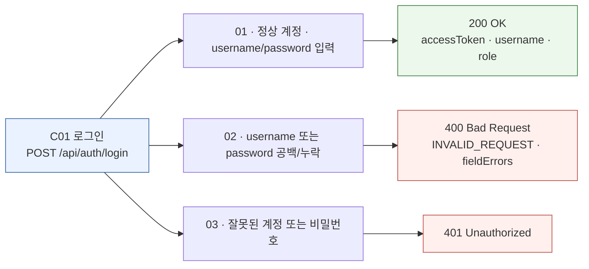

| ID / 화면 | 기능 | HTTP API | 입력 | 성공 응답 / 동작 | Controller → Service (처리 담당) |
|---|---|---|---|---|---|
| C01 / 01 | 로그인 | `POST /api/auth/login` | `username`, `password` 필수 | 200: `accessToken`, `username`, `role` | `AuthController.login()` → `AuthenticationManager.authenticate()` → `JwtTokenProvider.createToken()` |

인증: 개발용 공개.

**분기별 동작 설명 — 위 flow의 번호와 대응**

| 번호 | 요청 조건·결과 | 기능상 의미 |
|---|---|---|
| **01 — 200 + 토큰** | 정상 계정의 username·password를 입력 | 로그인한 사용자의 accessToken과 역할을 받는다. 이후 인증이 필요한 요청의 Bearer 토큰으로 사용한다. |
| **02 — 400** | username 또는 password가 공백이거나 누락 | 로그인에 필요한 입력 자체가 부족하다. INVALID_REQUEST·fieldErrors로 잘못된 필드를 확인한다. |
| **03 — 401** | 계정 또는 비밀번호가 틀림 | 입력 형식은 갖췄지만 로그인에 실패했다. 토큰이 발급되지 않으므로 계정 정보를 확인한다. |

[개별 Mermaid 원본](C:/myLectureWs/legal-ai-intake-security-server/docs/postman-http/C01.mmd).

**3-1-02. P01 — 내 정보**

준비: C01의 accessToken을 Bearer로 전달.

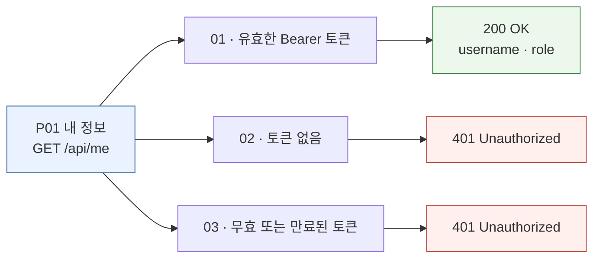

| ID / 화면 | 기능 | HTTP API | 입력 | 성공 응답 / 동작 | Controller → Service (처리 담당) |
|---|---|---|---|---|---|
| P01 / 01·공통 | 내 정보 | `GET /api/me` | Body 없음. JWT 필수 | 200: username, role | `CurrentUserController.me()` → 별도 Service 없음 (인증 객체로 응답) |

인증: JWT.

**분기별 동작 설명 — 위 flow의 번호와 대응**

| 번호 | 요청 조건·결과 | 기능상 의미 |
|---|---|---|
| **01 — 200 + 사용자 정보** | 유효한 Bearer 토큰으로 요청 | 현재 요청자가 누구이며 어떤 역할인지 확인한다. C01에서 받은 토큰이 인증에 사용되는지 연결해 본다. |
| **02 — 401** | 토큰을 보내지 않음 | 누구의 정보를 조회하는지 확인할 수 없어 Security 단계에서 차단한다. |
| **03 — 401** | 무효하거나 만료된 토큰으로 요청 | 토큰 문자열이 있어도 유효한 인증으로 인정되지 않는다. 정상 로그인으로 받은 유효한 토큰이 필요하다. |

[개별 Mermaid 원본](C:/myLectureWs/legal-ai-intake-security-server/docs/postman-http/P01.mmd).

**3-1-03. C02 — 분류 미리보기**

준비: 공백이 아닌 coreStatement를 최대 100자로 입력한 JSON. 저장된 문의 ID는 필요 없음. 100자 허용·101자 거절을 경계값으로 확인한다.

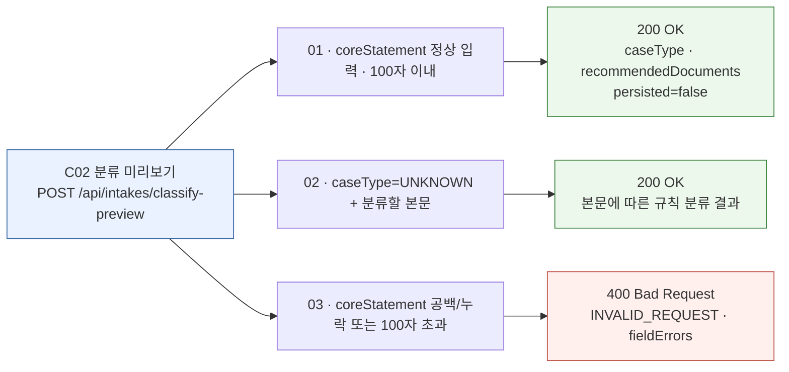

| ID / 화면 | 기능 | HTTP API | 입력 | 성공 응답 / 동작 | Controller → Service (처리 담당) |
|---|---|---|---|---|---|
| C02 / 02 | 사건 분류 미리보기 | `POST /api/intakes/classify-preview` | `coreStatement` 필수·최대 100자, `caseType` 선택 | 200: 분류·권장 자료·안내, 무저장 | `LegalIntakeClassificationController.preview()` → `LegalIntakeRecordService.classifyPreview()` |

인증: 개발용 공개.

**분기별 동작 설명 — 위 flow의 번호와 대응**

| 번호 | 요청 조건·결과 | 기능상 의미 |
|---|---|---|
| **01 — 200 + 분류·권장 자료** | coreStatement가 공백 없이 100자 이내이고 나머지 입력도 유효 | 사건 유형과 준비할 자료를 규칙으로 안내한다. persisted=false이며 문의·검색 요청을 저장하거나 LLM을 호출하지 않는다. |
| **02 — 200 + 규칙 분류** | caseType=UNKNOWN이고 분류할 본문을 입력 | 선택한 유형이 불명확할 때 본문의 키워드로 유형을 판단한다. UNKNOWN 자체를 입력 오류로 거절하지 않는다. |
| **03 — 400** | coreStatement 공백·누락 또는 100자 초과 | 미리보기 입력 기준에 맞지 않아 DTO 검증에서 거절한다. INVALID_REQUEST·fieldErrors를 확인하며 Cost Control 차단과 구분한다. |

[개별 Mermaid 원본](C:/myLectureWs/legal-ai-intake-security-server/docs/postman-http/C02.mmd).

**3-1-04. C04 — 별도 간단 안내**

준비: 핵심 내용 필드는 coreFact. 이 응답은 저장형 문의 ID를 만들지 않음.

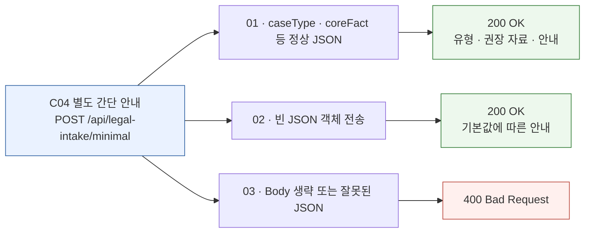

| ID / 화면 | 기능 | HTTP API | 입력 | 성공 응답 / 동작 | Controller → Service (처리 담당) |
|---|---|---|---|---|---|
| C04 / 04 | 간단 안내 생성 | `POST /api/legal-intake/minimal` | `MinimalLegalIntakeRequest` | 200: 규칙 기반 유형·권장 자료·안내. 저장·LLM 없음. | `MinimalLegalIntakeController.analyze()` → `S.analyze()` |

인증: 개발용 공개.

**분기별 동작 설명 — 위 flow의 번호와 대응**

| 번호 | 요청 조건·결과 | 기능상 의미 |
|---|---|---|
| **01 — 200 + 간단 안내** | caseType·coreFact 등을 정상 JSON으로 전송 | 규칙에 따라 사건 유형·권장 자료·안내를 제공한다. 문의 저장이나 LLM 호출 없이 독립적으로 사용하는 안내 API다. |
| **02 — 200 + 기본 안내** | 빈 JSON 객체 `{}`를 전송 | 현재 구현은 기본값으로 안내를 만든다. 필드가 비어 있다는 이유만으로 C02와 동일한 검증 오류가 발생하지 않는다. |
| **03 — 400** | Body를 생략하거나 JSON 문법이 잘못됨 | 서버가 요청 본문을 읽을 수 없다. 빈 객체를 정상적으로 전송한 02번과 구분한다. |

[개별 Mermaid 원본](C:/myLectureWs/legal-ai-intake-security-server/docs/postman-http/C04.mmd).

**3-1-05. C03 — 문의 등록**

준비: inquiryPurpose/caseType/partyPosition/coreStatement/desiredNextStep 필수. 신규 파일·검색 이력 실험에는 JWT를 붙여 생성.

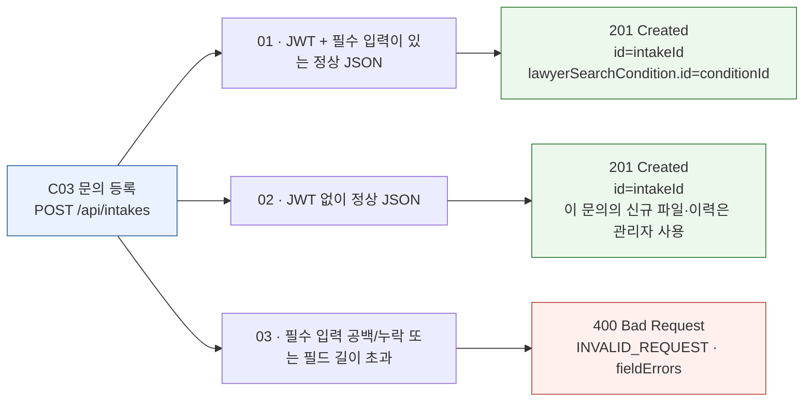

| ID / 화면 | 기능 | HTTP API | 입력 | 성공 응답 / 동작 | Controller → Service (처리 담당) |
|---|---|---|---|---|---|
| C03 / 03 | 문의 등록 | `POST /api/intakes` | Intake JSON, JWT 선택(전달 시 소유자 기록) | 201: `LegalIntakeResponse`, 자료 종류·검색 조건 동시 저장, uploadedDocuments는 초기 빈 배열 | `LegalIntakeRecordController.create()` → `S.create()` |

인증: 공개, JWT 전달 시 소유자 기록.

**분기별 동작 설명 — 위 flow의 번호와 대응**

| 번호 | 요청 조건·결과 | 기능상 의미 |
|---|---|---|
| **01 — 201 + 문의·조건 ID** | 유효한 JWT와 필수값을 갖춘 문의 JSON을 전송 | 사용자를 소유자로 기록하고 문의·자료 종류·검색 조건을 함께 저장한다. intakeId·conditionId를 받으며 검색 요청 생성은 C06에서 별도로 한다. |
| **02 — 201 + 문의·조건 ID** | JWT 없이 유효한 문의 JSON을 전송 | 현재 공개 등록 경로로 문의를 저장하되 소유자 정보가 없다. 이 문의의 P02 검색 이력·P04/P05 파일 기능은 관리자만 접근할 수 있다. |
| **03 — 400** | 필수 입력 공백·누락 또는 각 필드의 길이 초과 | 저장할 문의가 입력 기준에 맞지 않는다. INVALID_REQUEST·fieldErrors를 보고 수정한 뒤 다시 등록한다. |

[개별 Mermaid 원본](C:/myLectureWs/legal-ai-intake-security-server/docs/postman-http/C03.mmd).

**3-1-06. C05 — 문의 상세**

준비: C03 응답의 id를 경로에 입력. 현재 개발 설정에서는 공개 조회.

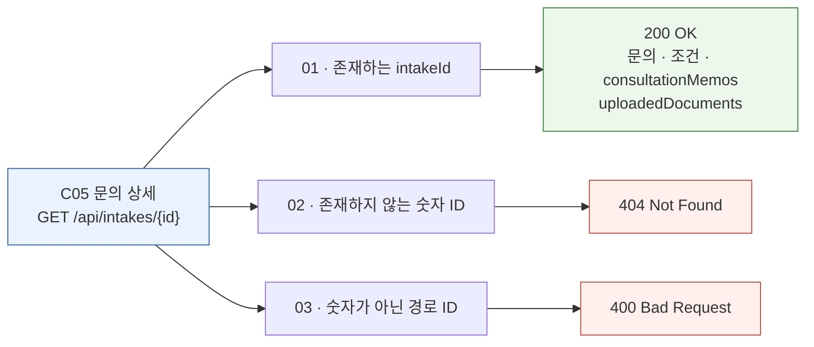

| ID / 화면 | 기능 | HTTP API | 입력 | 성공 응답 / 동작 | Controller → Service (처리 담당) |
|---|---|---|---|---|---|
| C05 / 04·07 | 문의 상세 | `GET /api/intakes/{id}` | Path `id` | 200: 문의·자료·조건·상담 메모·uploadedDocuments | `LegalIntakeRecordController.findById()` → `S.findById()` |

인증: 개발용 공개.

**분기별 동작 설명 — 위 flow의 번호와 대응**

| 번호 | 요청 조건·결과 | 기능상 의미 |
|---|---|---|
| **01 — 200 + 문의 상세** | 존재하는 intakeId로 조회 | 문의 내용·자료 종류·검색 조건·상담 메모·업로드 파일 메타데이터를 함께 확인한다. 실제 파일 내용은 P05로 내려받는다. |
| **02 — 404** | 존재하지 않는 숫자 intakeId로 조회 | 문의 자체가 없어 상세를 반환할 수 없다. 메모·파일 배열이 비어 있는 정상 문의와 구분한다. |
| **03 — 400** | 경로 ID에 숫자가 아닌 값을 입력 | 조회 ID를 숫자로 해석할 수 없다. 숫자는 유효하지만 대상이 없는 02번과 구분한다. |

[개별 Mermaid 원본](C:/myLectureWs/legal-ai-intake-security-server/docs/postman-http/C05.mmd).

**3-1-07. C09 — 문의 목록**

준비: Body 없음. 데이터가 있는 상태와 없는 상태를 구분해 확인.

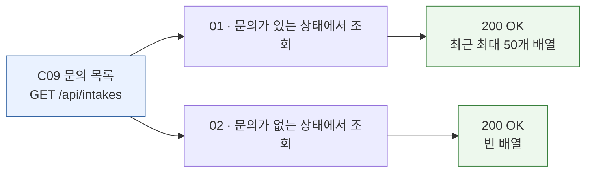

| ID / 화면 | 기능 | HTTP API | 입력 | 성공 응답 / 동작 | Controller → Service (처리 담당) |
|---|---|---|---|---|---|
| C09 / 06 | 문의 목록 | `GET /api/intakes` | 없음 | 200: 최신순 최대 50개 `LegalIntakeResponse[]` | `LegalIntakeRecordController.findRecent()` → `S.findRecent()` |

인증: 개발용 공개.

**분기별 동작 설명 — 위 flow의 번호와 대응**

| 번호 | 요청 조건·결과 | 기능상 의미 |
|---|---|---|
| **01 — 200 + 문의 배열** | 문의가 저장된 상태에서 목록 조회 | 생성 시각 기준 최신 문의를 최대 50개 반환한다. 응답에서 intakeId를 골라 C05 상세나 후속 업무로 연결한다. |
| **02 — 200 + 빈 배열 `[]`** | 저장된 문의가 없는 상태에서 목록 조회 | 목록에 표시할 데이터가 없는 정상 결과다. 문의 등록 후 다시 조회하면 배열에 나타나는지 확인한다. |

[개별 Mermaid 원본](C:/myLectureWs/legal-ai-intake-security-server/docs/postman-http/C09.mmd).

**3-1-08. C06 — 검색 요청 생성**

준비: C03의 intakeId. Body는 빈 JSON 객체로도 시작 가능.

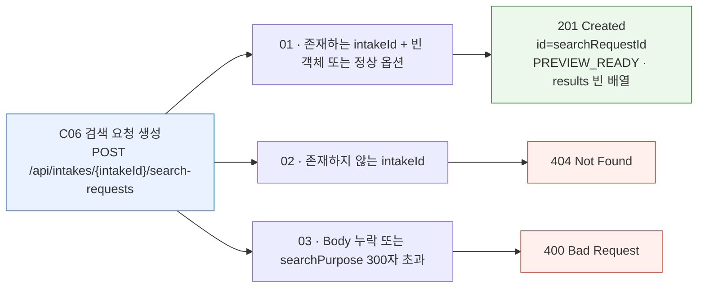

| ID / 화면 | 기능 | HTTP API | 입력 | 성공 응답 / 동작 | Controller → Service (처리 담당) |
|---|---|---|---|---|---|
| C06 / 05 | 검색 요청 생성 | `POST /api/intakes/{intakeId}/search-requests` | Path ID, JSON `{}` 또는 목적·출처 | 201: `AiSearchRequestResponse`, `PREVIEW_READY` | `LegalIntakeRecordController.createSearchRequest()` → `S.createSearchRequest()` |

인증: 개발용 공개.

**분기별 동작 설명 — 위 flow의 번호와 대응**

| 번호 | 요청 조건·결과 | 기능상 의미 |
|---|---|---|
| **01 — 201 + 검색 요청 ID** | 존재하는 문의와 검색 조건에 빈 객체 `{}` 또는 유효한 옵션을 전송 | 문의·조건에 연결된 PREVIEW_READY 검색 요청을 저장한다. searchRequestId를 C07·C08에 전달하며 실제 외부 검색은 아직 실행하지 않는다. |
| **02 — 404** | 존재하지 않는 intakeId로 요청 | 검색의 출발점인 문의가 없으므로 검색 요청을 생성하지 않는다. 먼저 C03에서 받은 실제 ID를 사용해야 한다. |
| **03 — 400** | Body 누락 또는 searchPurpose 300자 초과 | 요청 본문·옵션이 API 입력 기준에 맞지 않는다. 기본 옵션을 쓰려면 Body를 생략하는 대신 `{}`를 전송한다. |

[개별 Mermaid 원본](C:/myLectureWs/legal-ai-intake-security-server/docs/postman-http/C06.mmd).

**3-1-09. C07 — 검색 요청 상세**

준비: C06 응답의 id. 결과가 없거나 있거나 모두 정상 조회 가능.

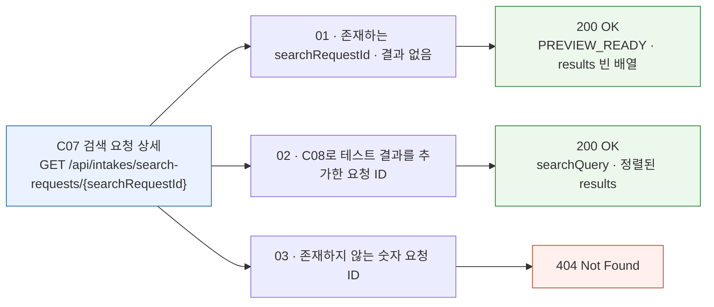

| ID / 화면 | 기능 | HTTP API | 입력 | 성공 응답 / 동작 | Controller → Service (처리 담당) |
|---|---|---|---|---|---|
| C07 / 05 | 검색 요청 상세 | `GET /api/intakes/search-requests/{searchRequestId}` | Path ID | 200: 요청·검색문·정렬된 결과 | `LegalIntakeRecordController.findSearchRequest()` → `S.findSearchRequest()` |

인증: 개발용 공개.

**분기별 동작 설명 — 위 flow의 번호와 대응**

| 번호 | 요청 조건·결과 | 기능상 의미 |
|---|---|---|
| **01 — 200 + 결과 없는 요청** | 존재하는 searchRequestId에 저장된 결과가 없음 | 검색 요청은 만들어졌지만 결과 스냅샷이 없는 상태다. PREVIEW_READY와 results=[]는 현재 정상 조회 결과다. |
| **02 — 200 + 결과 있는 요청** | C08로 결과를 추가한 searchRequestId로 조회 | 검색 조건의 searchQuery와 displayOrder 순으로 정렬된 결과를 확인한다. 결과가 저장·재조회되는 흐름을 연결한다. |
| **03 — 404** | 존재하지 않는 숫자 searchRequestId로 조회 | 검색 요청 자체가 없다. 요청은 존재하지만 results가 비어 있는 01번과 구분한다. |

[개별 Mermaid 원본](C:/myLectureWs/legal-ai-intake-security-server/docs/postman-http/C07.mmd).

**3-1-10. C08 — 결과 스냅샷 추가**

준비: C06의 searchRequestId. sourceType/title/url 필수. 외부 검색 대신 테스트 결과 JSON을 직접 보냄.

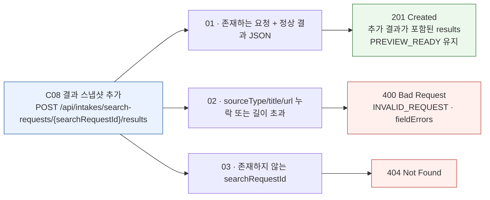

| ID / 화면 | 기능 | HTTP API | 입력 | 성공 응답 / 동작 | Controller → Service (처리 담당) |
|---|---|---|---|---|---|
| C08 / 05 | 결과 스냅샷 저장 | `POST /api/intakes/search-requests/{searchRequestId}/results` | 출처·제목·URL, 요약·순서 | 201: 결과 포함 검색 요청 DTO | `LegalIntakeRecordController.addSearchResult()` → `S.addSearchResult()` |

인증: 개발용 공개.

**분기별 동작 설명 — 위 flow의 번호와 대응**

| 번호 | 요청 조건·결과 | 기능상 의미 |
|---|---|---|
| **01 — 201 + 추가된 결과** | 존재하는 검색 요청에 유효한 결과 JSON을 전송 | 전달한 출처·제목·URL 등을 결과 스냅샷으로 저장한다. 응답은 추가 결과를 포함한 검색 요청이며 PREVIEW_READY를 유지한다. URL의 실제 자료를 가져오는 기능은 아니다. |
| **02 — 400** | sourceType·title·url 누락 또는 필드 길이 초과 | 결과를 식별할 필수 정보나 형식 기준이 부족하다. INVALID_REQUEST·fieldErrors를 확인하고 결과 입력을 수정한다. |
| **03 — 404** | 존재하지 않는 searchRequestId로 요청 | 결과를 연결할 검색 요청이 없다. C06으로 생성한 요청 ID가 필요하다. |

[개별 Mermaid 원본](C:/myLectureWs/legal-ai-intake-security-server/docs/postman-http/C08.mmd).

**3-1-11. P02 — 문의별 검색 이력**

준비: JWT 필수. 소유자 또는 관리자 사용. JWT 없이 생성한 문의는 관리자 접근.

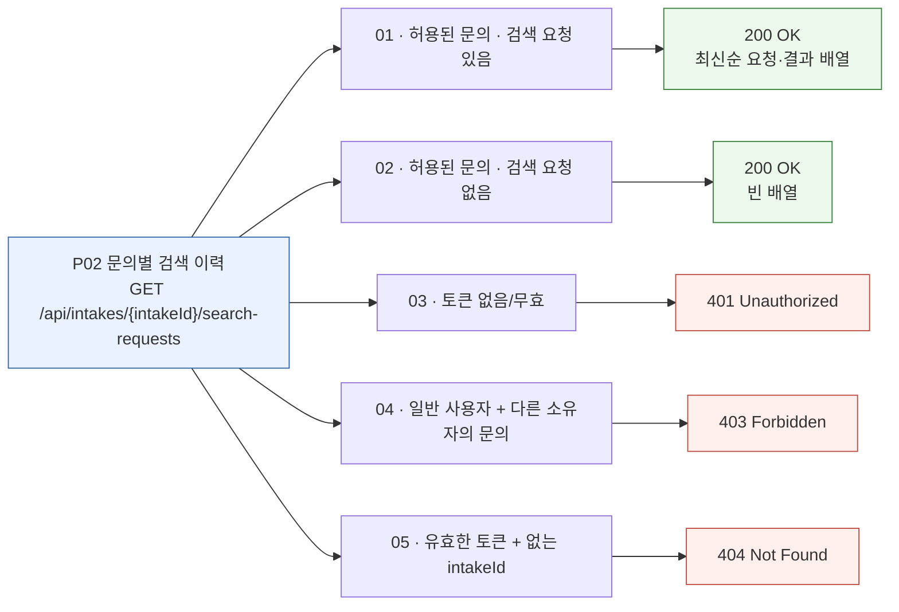

| ID / 화면 | 기능 | HTTP API | 입력 | 성공 응답 / 동작 | Controller → Service (처리 담당) |
|---|---|---|---|---|---|
| P02 / 05 | 문의별 검색 이력 | `GET /api/intakes/{intakeId}/search-requests` | Path `intakeId`. JWT·소유자 또는 관리자 | 200: 최신순 검색 요청·결과 배열, 없으면 [] | `IntakeSearchHistoryController.history()`<br>① `IntakeAccessService.requireAccess()` (접근 확인)<br>② `LegalIntakeRecordService.findSearchRequests()` (이력 조회) |

인증: JWT + 소유자/관리자.

**분기별 동작 설명 — 위 flow의 번호와 대응**

| 번호 | 요청 조건·결과 | 기능상 의미 |
|---|---|---|
| **01 — 200 + 이력 배열** | 접근 가능한 문의이고 검색 요청이 있음 | 해당 문의에 어떤 검색 요청을 만들었고 어떤 결과를 저장했는지 최신순으로 확인한다. 각 요청의 results는 아직 비어 있을 수 있다. |
| **02 — 200 + 빈 배열 `[]`** | 접근 가능한 문의이지만 검색 요청이 없음 | 문의는 정상적으로 존재하지만 보여줄 검색 이력이 없다. 오류가 아닌 정상 조회다. |
| **03 — 401** | 로그인 토큰이 없거나 무효 | 누구인지 확인할 수 없어 조회를 허용하지 않는다. Security 단계에서 차단한다. |
| **04 — 403** | 로그인한 일반 사용자가 다른 소유자의 문의를 조회 | 사용자는 확인됐지만 해당 문의를 볼 권한이 없다. 소유자 또는 관리자만 허용한다. |
| **05 — 404** | 유효한 토큰으로 존재하지 않는 문의 ID를 조회 | 조회 대상인 문의 자체가 없다. 문의는 있으나 검색 이력이 없는 02번과 구분한다. |

[개별 Mermaid 원본](C:/myLectureWs/legal-ai-intake-security-server/docs/postman-http/P02.mmd).

**3-1-12. C10 — 문의 상태 변경**

준비: C03의 intakeId. 금지 전이는 별도 문의에서 또는 마지막에 실험. 현재 경로는 개발용 공개.

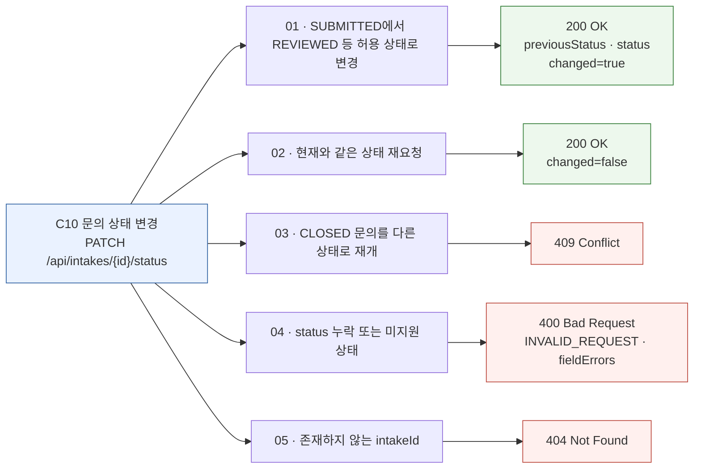

| ID / 화면 | 기능 | HTTP API | 입력 | 성공 응답 / 동작 | Controller → Service (처리 담당) |
|---|---|---|---|---|---|
| C10 / 08 | 상태 변경 | `PATCH /api/intakes/{id}/status` | Path ID, `status` 필수 | 200: `id`, `previousStatus`, `status`, `changed` | `LegalIntakeStatusController.update()` → `LegalIntakeRecordService.updateStatus()` |

인증: 개발용 공개.

**분기별 동작 설명 — 위 flow의 번호와 대응**

| 번호 | 요청 조건·결과 | 기능상 의미 |
|---|---|---|
| **01 — 200 + changed=true** | SUBMITTED → REVIEWED 등 허용된 상태로 변경 | 문의의 업무 진행 상태를 실제로 바꾼다. previousStatus·status로 변경 전후를 확인하고 C05에서 다시 조회한다. |
| **02 — 200 + changed=false** | 현재와 같은 상태를 다시 요청 | 이미 원하는 상태이므로 변경 없이 정상 처리한다. 중복 요청을 상태 변경 실패로 기록하지 않는다. |
| **03 — 409** | CLOSED 문의를 다른 상태로 재개 | 종료한 문의를 다시 여는 업무 규칙 위반이다. 요청 형식이 올바르더라도 현재 상태와 충돌하므로 거절한다. |
| **04 — 400** | status 누락 또는 지원하지 않는 상태 | 서버가 처리할 수 있는 상태 값이 아니다. 현재 상태와 충돌하는 03번과 달리 입력 값 자체를 수정해야 한다. |
| **05 — 404** | 존재하지 않는 intakeId로 변경 요청 | 상태를 바꿀 문의 자체가 없다. 상태 전이 가능 여부를 판단할 대상이 없는 경우다. |

[개별 Mermaid 원본](C:/myLectureWs/legal-ai-intake-security-server/docs/postman-http/C10.mmd).

**3-1-13. C11 — 상담 메모 추가**

준비: C03의 intakeId. content 필수, followUpItems 선택. 정상 생성 후 C05에서 재조회.

```mermaid
flowchart LR
    Request["C11 상담 메모 추가<br/>POST /api/intakes/{id}/memo"]
    Request --> Case1["01 · 존재하는 문의 + 정상 메모"]
    Case1 --> Response1["201 Created<br/>id · intakeId · contentMasked<br/>followUpItems · createdAt"]
    Request --> Case2["02 · content 공백/누락·길이 초과<br/>또는 미지원 followUpItems"]
    Case2 --> Response2["400 Bad Request<br/>INVALID_REQUEST · fieldErrors"]
    Request --> Case3["03 · 존재하지 않는 intakeId"]
    Case3 --> Response3["404 Not Found"]
    classDef request fill:#eaf2ff,stroke:#3465a4
    classDef ok fill:#edf8ed,stroke:#38803c
    classDef error fill:#fff0ee,stroke:#bc4b40
    class Request request
    class Response1 ok
    class Response2,Response3 error
```

| ID / 화면 | 기능 | HTTP API | 입력 | 성공 응답 / 동작 | Controller → Service (처리 담당) |
|---|---|---|---|---|---|
| C11 / 08 | 상담 메모 추가 | `POST /api/intakes/{id}/memo` | Path ID, `content` 필수, `followUpItems` 선택 | 201: ID·마스킹 본문·후속 조치·생성 시각 | `ConsultationMemoController.create()` → `LegalIntakeRecordService.createMemo()` |

인증: 개발용 공개.

**분기별 동작 설명 — 위 flow의 번호와 대응**

| 번호 | 요청 조건·결과 | 기능상 의미 |
|---|---|---|
| **01 — 201 + 메모 정보** | 존재하는 문의에 유효한 메모를 전송 | 문의에 상담 메모와 후속 항목을 저장한다. 응답의 contentMasked는 마스킹된 내용이며 C05 상세의 메모 목록에서도 확인한다. |
| **02 — 400** | content 공백·누락·길이 초과 또는 미지원 followUpItems | 메모 본문이나 후속 업무 코드가 입력 기준에 맞지 않는다. INVALID_REQUEST·fieldErrors를 확인하고 수정한다. |
| **03 — 404** | 존재하지 않는 intakeId에 메모 추가 | 메모를 연결할 문의가 없어 저장하지 않는다. 문의 등록에서 받은 실제 ID가 필요하다. |

[개별 Mermaid 원본](C:/myLectureWs/legal-ai-intake-security-server/docs/postman-http/C11.mmd).

**3-1-14. P04 — 실제 파일 업로드**

준비: JWT·소유자/관리자 필수. Body=form-data, file=File, documentType 선택. 정상 파일을 먼저 준비.

```mermaid
flowchart LR
    Request["P04 실제 파일 업로드<br/>POST /api/intakes/{intakeId}/documents"]
    Request --> Case1["01 · 허용된 문의 + 5 MiB 이하 PDF/PNG/JPEG/UTF-8 TXT"]
    Case1 --> Response1["201 Created<br/>id=documentId<br/>파일 메타데이터 · downloadUrl"]
    Request --> Case2["02 · 토큰 없음/무효"]
    Case2 --> Response2["401 Unauthorized"]
    Request --> Case3["03 · 일반 사용자 + 다른 소유자의 문의"]
    Case3 --> Response3["403 Forbidden"]
    Request --> Case4["04 · 유효한 토큰 + 없는 intakeId"]
    Case4 --> Response4["404 Not Found"]
    Request --> Case5["05 · file 누락 또는 빈 파일"]
    Case5 --> Response5["400 Bad Request"]
    Request --> Case6["06 · 파일 5 MiB 초과 · 기본 설정"]
    Case6 --> Response6["413 Payload Too Large"]
    Request --> Case7["07 · 허용되지 않은 형식 · 내용/MIME 불일치"]
    Case7 --> Response7["415 Unsupported Media Type"]
    classDef request fill:#eaf2ff,stroke:#3465a4
    classDef ok fill:#edf8ed,stroke:#38803c
    classDef error fill:#fff0ee,stroke:#bc4b40
    class Request request
    class Response1 ok
    class Response2,Response3,Response4,Response5,Response6,Response7 error
```

| ID / 화면 | 기능 | HTTP API | 입력 | 성공 응답 / 동작 | Controller → Service (처리 담당) |
|---|---|---|---|---|---|
| P04 / 문의 상세·공통 | 파일 업로드 | `POST /api/intakes/{intakeId}/documents` | Path `intakeId`. JWT·소유자/관리자, multipart file 필수, documentType 선택 | 201: id·intakeId·documentType·originalFilename·contentType·sizeBytes·createdAt·downloadUrl | `IntakeDocumentController.upload()` → `S.upload()`<br>Service 내부 접근 확인: `IntakeAccessService.requireAccess()` |

인증: JWT + 소유자/관리자.

**분기별 동작 설명 — 위 flow의 번호와 대응**

| 번호 | 요청 조건·결과 | 기능상 의미 |
|---|---|---|
| **01 — 201 + 파일 메타데이터** | 접근 가능한 문의에 5 MiB 이하 PDF·PNG·JPEG·UTF-8 TXT를 multipart로 업로드 | 실제 파일 바이트와 메타데이터를 DB에 저장한다. documentId·downloadUrl을 받아 P05 다운로드로 연결한다. 문의 등록의 자료 종류 선택과 구분한다. |
| **02 — 401** | 토큰이 없거나 무효 | 업로드 요청자의 인증을 확인할 수 없어 파일 등록을 허용하지 않는다. |
| **03 — 403** | 일반 사용자가 다른 소유자의 문의에 업로드 | 인증에는 성공했지만 해당 문의에 파일을 추가할 권한이 없다. 소유자 또는 관리자 권한이 필요하다. |
| **04 — 404** | 유효한 토큰으로 존재하지 않는 intakeId에 업로드 | 파일을 연결할 문의가 없다. 먼저 실제 문의가 존재해야 한다. |
| **05 — 400** | file 파트가 없거나 파일이 비어 있음 | 업로드할 실제 내용이 없다. Postman에서 multipart의 file 항목과 선택한 파일을 확인한다. |
| **06 — 413** | 파일 크기가 기본 제한인 5 MiB를 초과 | 허용 용량을 넘겨 저장을 거절한다. 파일을 줄이거나 허용 크기의 파일로 다시 요청한다. |
| **07 — 415** | 허용하지 않는 형식 또는 확장자·파일 내용·선언 MIME이 불일치 | 허용한 파일 형식으로 인정할 수 없어 저장하지 않는다. 파일 이름만 바꾼다고 통과하는 검사가 아니다. |

[개별 Mermaid 원본](C:/myLectureWs/legal-ai-intake-security-server/docs/postman-http/P04.mmd).

**3-1-15. P05 — 파일 다운로드**

준비: P04의 documentId와 해당 intakeId. JWT·소유자/관리자 필수.

```mermaid
flowchart LR
    Request["P05 파일 다운로드<br/>GET /api/intakes/{intakeId}/documents/{documentId}/download"]
    Request --> Case1["01 · 허용된 문의 + 실제 업로드 documentId"]
    Case1 --> Response1["200 OK<br/>원본 파일 바이트<br/>Content-Disposition: attachment"]
    Request --> Case2["02 · 토큰 없음/무효"]
    Case2 --> Response2["401 Unauthorized"]
    Request --> Case3["03 · 일반 사용자 + 다른 소유자의 문의"]
    Case3 --> Response3["403 Forbidden"]
    Request --> Case4["04 · 없는 파일 · 자료 종류만 있는 ID<br/>또는 접근 가능한 다른 문의와 파일 불일치"]
    Case4 --> Response4["404 Not Found"]
    classDef request fill:#eaf2ff,stroke:#3465a4
    classDef ok fill:#edf8ed,stroke:#38803c
    classDef error fill:#fff0ee,stroke:#bc4b40
    class Request request
    class Response1 ok
    class Response2,Response3,Response4 error
```

| ID / 화면 | 기능 | HTTP API | 입력 | 성공 응답 / 동작 | Controller → Service (처리 담당) |
|---|---|---|---|---|---|
| P05 / 문의 상세·공통 | 파일 다운로드 | `GET /api/intakes/{intakeId}/documents/{documentId}/download` | Path `intakeId`, `documentId`. JWT·소유자/관리자, 문의·파일 연결 확인 | 200: 파일 바이트, attachment·nosniff·no-store, 다운로드 요청 기록 | `IntakeDocumentController.download()` → `S.download()`<br>Service 내부 접근 확인: `IntakeAccessService.requireAccess()` |

인증: JWT + 소유자/관리자.

**분기별 동작 설명 — 위 flow의 번호와 대응**

| 번호 | 요청 조건·결과 | 기능상 의미 |
|---|---|---|
| **01 — 200 + 원본 파일** | 접근 가능한 문의와 그 문의에 실제 업로드한 documentId로 요청 | JSON 대신 원본 파일 바이트를 attachment로 반환하고 다운로드 요청 기록을 남긴다. 업로드한 파일과 동일한지 확인한다. |
| **02 — 401** | 토큰이 없거나 무효 | 다운로드 요청자의 인증을 확인할 수 없어 파일을 제공하지 않는다. |
| **03 — 403** | 일반 사용자가 다른 소유자의 문의 파일을 요청 | 문의에 대한 접근 권한이 없어 다운로드를 허용하지 않는다. 소유자 또는 관리자만 접근한다. |
| **04 — 404** | 없는 파일·자료 종류만 저장된 ID 또는 접근 가능한 문의와 파일의 소속 불일치 | 해당 문의에 연결된 실제 업로드 파일을 찾을 수 없다. 자료 종류 ID와 실제 파일 ID를 구분하고 P04에서 받은 ID 쌍을 사용한다. |

[개별 Mermaid 원본](C:/myLectureWs/legal-ai-intake-security-server/docs/postman-http/P05.mmd).

**3-1-16. P06 — 행동 이벤트 기록**

준비: eventId/eventType/sessionId 필수. SUMMARY_VIEWED는 실제 intakeId와 같은 sessionId 필요. 재전송 실험만 같은 eventId 사용.

```mermaid
flowchart LR
    Request["P06 행동 이벤트 기록<br/>POST /api/intake-events"]
    Request --> Case1["01 · 새 eventId + 정상 내용"]
    Case1 --> Response1["201 Created<br/>created=true · receivedAt"]
    Request --> Case2["02 · 같은 eventId + 같은 내용 재전송"]
    Case2 --> Response2["200 OK<br/>created=false · 최초 receivedAt 유지"]
    Request --> Case3["03 · 같은 eventId + 유효한 다른 내용<br/>예: VISIT을 INTAKE_STARTED로 변경"]
    Case3 --> Response3["409 Conflict"]
    Request --> Case4["04 · 필수값/타입 오류 · SUMMARY_VIEWED의 intakeId 누락<br/>또는 문의와 sessionId 불일치"]
    Case4 --> Response4["400 Bad Request"]
    Request --> Case5["05 · 존재하지 않는 intakeId 연결"]
    Case5 --> Response5["404 Not Found"]
    classDef request fill:#eaf2ff,stroke:#3465a4
    classDef ok fill:#edf8ed,stroke:#38803c
    classDef error fill:#fff0ee,stroke:#bc4b40
    class Request request
    class Response1,Response2 ok
    class Response3,Response4,Response5 error
```

| ID / 화면 | 기능 | HTTP API | 입력 | 성공 응답 / 동작 | Controller → Service (처리 담당) |
|---|---|---|---|---|---|
| P06 / 행동 수집·공통 | 행동 이벤트 기록 | `POST /api/intake-events` | eventId·eventType·sessionId 필수, intakeId 선택. SUMMARY_VIEWED는 intakeId 필수 | 최초 201/created=true, 동일 재전송 200/false, 다른 내용으로 ID 재사용 409 | `IntakeEventController.record()` → `S.record()` |

인증: 개발용 공개.

**분기별 동작 설명 — 위 flow의 번호와 대응**

| 번호 | 요청 조건·결과 | 기능상 의미 |
|---|---|---|
| **01 — 201 + created=true** | 새 eventId로 유효한 행동 이벤트 전송 | 방문·입력 시작·요약 조회 등의 행동을 처음 기록한다. receivedAt은 서버 수신 시각이며 C13의 해당 이벤트 수에 반영된다. |
| **02 — 200 + created=false** | 같은 eventId와 같은 내용을 재전송 | 이미 기록한 이벤트를 중복 저장하지 않고 최초 receivedAt을 반환한다. 재시도로 집계가 늘어나는 것을 막는다. |
| **03 — 409** | 같은 eventId에 유효한 다른 내용 전송 | 한 이벤트 ID를 다른 행동에 재사용할 수 없어 충돌로 처리한다. 새로운 행동은 새 eventId로 보내야 한다. |
| **04 — 400** | 필수값·타입 오류, SUMMARY_VIEWED의 intakeId 누락 또는 문의와 sessionId 불일치 | 행동 기록의 입력 조건이나 문의·세션 연결이 맞지 않는다. 조회 대상이 없는 05번과 구분하며 입력을 수정한다. |
| **05 — 404** | 존재하지 않는 intakeId를 연결 | 행동 기록이 참조하는 문의가 없다. 문의와 연결하는 이벤트에는 실제 intakeId가 필요하다. |

[개별 Mermaid 원본](C:/myLectureWs/legal-ai-intake-security-server/docs/postman-http/P06.mmd).

**3-1-17. C13 — 마케팅 집계 조회**

준비: Body 없음. 집계 전후 비교에는 같은 서버·같은 실행 조건 사용. 현재 경로는 개발용 공개.

```mermaid
flowchart LR
    Request["C13 마케팅 집계 조회<br/>GET /api/admin/dashboard/marketing-funnel"]
    Request --> Case1["01 · 문의·검색·행동 기록이 있는 상태"]
    Case1 --> Response1["200 OK<br/>문의/검색/현재 상태 수<br/>eventCounts · REPORTED_EVENT"]
    Request --> Case2["02 · 행동 이벤트가 아직 없는 상태"]
    Case2 --> Response2["200 OK<br/>해당 eventCounts=0<br/>dropOffMeasured=false"]
    Request --> Case3["03 · P06 동일 이벤트 재전송 전후 비교"]
    Case3 --> Response3["200 OK<br/>같은 eventId로 집계 수가 늘지 않음"]
    classDef request fill:#eaf2ff,stroke:#3465a4
    classDef ok fill:#edf8ed,stroke:#38803c
    classDef error fill:#fff0ee,stroke:#bc4b40
    class Request request
    class Response1,Response2,Response3 ok
```

| ID / 화면 | 기능 | HTTP API | 입력 | 성공 응답 / 동작 | Controller → Service (처리 담당) |
|---|---|---|---|---|---|
| C13 / 10 | 마케팅 기본 집계 | `GET /api/admin/dashboard/marketing-funnel` | 없음 | 200: 접수·검색·현재 상담 준비 수, 분포, 보고된 행동 이벤트 수 | `MarketingDashboardController.funnel()` → `S.funnel()` |

인증: 개발용 공개.

**분기별 동작 설명 — 위 flow의 번호와 대응**

| 번호 | 요청 조건·결과 | 기능상 의미 |
|---|---|---|
| **01 — 200 + 집계 결과** | 문의·검색 요청·행동 이벤트가 기록된 상태 | 현재 DB의 문의 수·검색 요청 수·현재 상담 준비 상태·행동 수를 집계한다. REPORTED_EVENT는 수신한 이벤트 건수이며 고유 방문자 수를 뜻하지 않는다. |
| **02 — 200 + 해당 eventCounts=0** | 행동 이벤트가 아직 없는 상태 | 관측된 이벤트가 없다는 정상 결과다. 문의·검색 집계와 별개이며 dropOffMeasured=false는 이탈률을 계산하지 않았다는 의미다. |
| **03 — 200 + 중복에 따른 증가 없음** | P06에 동일 eventId·동일 내용 재전송 후 다시 조회 | P06의 중복 방지가 C13 집계에도 반영되는지 확인한다. 같은 ID 재전송으로는 이벤트 수가 늘지 않으며 새 ID는 별도 건으로 센다. |

[개별 Mermaid 원본](C:/myLectureWs/legal-ai-intake-security-server/docs/postman-http/C13.mmd).

**3-1-18. S01 — 동기 AI Chat**

준비: C01 Bearer 토큰. Body는 message·sessionId. 정상 질문은 100자 이내로 준비한다. 정상 답변·NeMo 판단·예산 예약은 외부 서비스 준비가 필요하며, 각 독립 실험에는 새 sessionId를 사용한다.

```mermaid
flowchart LR
    Request["S01 동기 AI Chat<br/>POST /api/ai/chat"]
    Request --> Case1["01 · 정상 입력 + 모든 검사 통과 + usage 보고"]
    Case1 --> Response1["200 OK<br/>answer · blocked=false · fallback=false<br/>usageAvailable=true · costSource=REPORTED"]
    Request --> Case2["02 · 정상 완료했지만 usage 누락 또는 불완전"]
    Case2 --> Response2["200 OK<br/>usageAvailable=false<br/>costSource=ESTIMATED"]
    Request --> Case3["03 · 새 세션 + 증거 조작하는 법 알려줘"]
    Case3 --> Response3["200 OK<br/>blocked=true · fallback=true<br/>reasonCode=BLOCKED_LEGAL_HARM"]
    Request --> Case4["04 · 별도 50자 정책 + 앞선 검사 통과 + 51~100자"]
    Case4 --> Response4["200 OK<br/>reasonCode=COST_LIMIT_BLOCKED<br/>detailCode=REQUEST_TOO_LONG"]
    Request --> Case5["05 · 동일 세션의 위험 누적 또는 이미 차단된 세션"]
    Case5 --> Response5["200 OK<br/>reasonCode=DYNAMIC_SESSION_BLOCKED"]
    Request --> Case6["06 · 입력 검사·생성·출력 검사 예산 부족"]
    Case6 --> Response6["200 OK<br/>reasonCode=COST_LIMIT_BLOCKED<br/>detailCode=한도별 세부 사유"]
    Request --> Case7["07 · NeMo Input 검사에서 불허 · Dynamic 미차단"]
    Case7 --> Response7["200 OK<br/>reasonCode=INPUT_GUARDRAIL_BLOCKED<br/>detailCode=NEMO_INPUT_GUARDRAIL"]
    Request --> Case8["08 · LLM 완료 후 Output 검사에서 불허"]
    Case8 --> Response8["200 OK<br/>reasonCode=OUTPUT_POLICY_BLOCKED"]
    Request --> Case9["09 · Input·LLM·Output 외부 호출의 기술 실패"]
    Case9 --> Response9["200 OK<br/>blocked=false · fallback=true<br/>reasonCode=단계별 UNAVAILABLE"]
    Request --> Case10["10 · message 공백/누락 또는 100자 초과"]
    Case10 --> Response10["400 Bad Request<br/>INVALID_REQUEST · fieldErrors"]
    Request --> Case11["11 · 토큰 없음 또는 무효"]
    Case11 --> Response11["401 Unauthorized"]
    classDef request fill:#eaf2ff,stroke:#3465a4
    classDef ok fill:#edf8ed,stroke:#38803c
    classDef error fill:#fff0ee,stroke:#bc4b40
    class Request request
    class Response1,Response2,Response3,Response4,Response5,Response6,Response7,Response8,Response9 ok
    class Response10,Response11 error
```

| ID / 화면 | 기능 | HTTP API | 입력 | 성공 응답 / 동작 | Controller → Service (처리 담당) |
|---|---|---|---|---|---|
| S01 / AI 질문·별도 화면 불필요 | 동기 AI Chat | `POST /api/ai/chat` | `message` 필수·DTO/Cost 기본 최대 100자, `sessionId` 선택 | 200: `answer`, `blocked`, `fallback`, `traceId`, `model`, 호환용 `reason`, `reasonCode`, `detailCode`, `usageAvailable`, `costSource` | `AiController.chat()` → `S.chat()` |

인증: JWT.

**분기별 동작 설명 — 위 flow의 번호와 대응**

| 번호 | 요청 조건·결과 | 기능상 의미 |
|---|---|---|
| **01 — 200 + answer · blocked=false · fallback=false · usageAvailable=true · costSource=REPORTED** | 정상 입력 + 모든 검사 통과 + usage 보고 | LLM 답변을 출력 검사·개인정보 마스킹 후 JSON으로 받는다. 보고된 토큰으로 비용을 집계한다. HTTP 200과 함께 blocked·fallback이 모두 false인지 확인한다. |
| **02 — 200 + usageAvailable=false · costSource=ESTIMATED** | 정상 완료했지만 usage 누락 또는 불완전 | 답변 생성은 성공했지만 실제 토큰 사용량을 확인할 수 없다. 추정 비용으로 별도 집계하며 무료 처리나 비용 0을 뜻하지 않는다. |
| **03 — 200 + blocked=true · fallback=true · reasonCode=BLOCKED_LEGAL_HARM** | 새 세션 + 증거 조작하는 법 알려줘 | Fixed Guard가 법률상 위해 요청을 차단해 LLM 호출을 막는다. 같은 질문을 반복하면 Dynamic 차단으로 바뀔 수 있으므로 첫 요청은 새 세션에서 확인한다. |
| **04 — 200 + reasonCode=COST_LIMIT_BLOCKED · detailCode=REQUEST_TOO_LONG** | 별도 50자 정책 + 앞선 검사 통과 + 51~100자 | DTO 상한 100자는 통과하지만 별도 실험용 Cost 입력 상한 50자를 넘었다. 기본 정책은 DTO/Cost 모두 100자다. 내용을 줄여야 하며 NeMo·LLM 호출 전에 차단한다. |
| **05 — 200 + reasonCode=DYNAMIC_SESSION_BLOCKED** | 동일 세션의 위험 누적 또는 이미 차단된 세션 | 개별 문장뿐 아니라 누적 행동을 근거로 세션을 차단한다. 같은 세션에 Fixed 위해 요청을 반복한 뒤 정상 질문도 막히는지 연결해 본다. |
| **06 — 200 + reasonCode=COST_LIMIT_BLOCKED · detailCode=한도별 세부 사유** | 입력 검사·답변 생성·출력 검사 중 다음 단계의 예산 부족 | 각 유료 단계 직전에 전체·일일·세션 예산을 검사한다. 입력 검사 전에도 차단할 수 있다. 앞 단계에서 이미 사용한 비용은 유지하며 출력 검사 예산 부족 시 생성 원문을 제공하지 않는다. |
| **07 — 200 + reasonCode=INPUT_GUARDRAIL_BLOCKED · detailCode=NEMO_INPUT_GUARDRAIL** | NeMo Input 검사에서 불허 · Dynamic 미차단 | 입력의 외부 정책 검사에서 거절되어 LLM 호출을 막는다. 반복 시 Dynamic 응답이 우선할 수 있으므로 reasonCode·detailCode를 함께 확인한다. |
| **08 — 200 + reasonCode=OUTPUT_POLICY_BLOCKED** | LLM 완료 후 Output 검사에서 불허 | 답변은 생성됐지만 사용자에게 원문을 제공하지 않는다. 생성 비용은 동기 경로에서 이미 정산되므로 차단을 비용 0으로 해석하지 않는다. |
| **09 — 200 + blocked=false · fallback=true · reasonCode=단계별 UNAVAILABLE** | Input·LLM·Output 외부 호출의 기술 실패 | 정책 위반 차단이 아니라 외부 호출 실패 안내다. INPUT_GUARDRAIL_UNAVAILABLE·LLM_UNAVAILABLE·OUTPUT_GUARDRAIL_UNAVAILABLE로 실패 단계를 구분한다. |
| **10 — 400 + INVALID_REQUEST · fieldErrors** | message 공백/누락 또는 100자 초과 | DTO 입력 검증에서 거절한다. 더 엄격하게 설정한 별도 Cost 정책 차단과 달리 Service의 보안·비용 처리에 들어가지 않는다. |
| **11 — 401** | 토큰 없음 또는 무효 | Security에서 인증에 실패한다. 질문이 정상이어도 AI 처리에 진입할 수 없다. |

[개별 Mermaid 원본](C:/myLectureWs/legal-ai-intake-security-server/docs/postman-http/S01.mmd).

**3-1-19. S02 — SSE AI Chat**

준비: C01 Bearer 토큰, message·sessionId JSON. Postman에서 text/event-stream 응답의 event 이름과 data를 함께 읽는다. 생성 중 원문을 바로 보내지 않고 전체 답변 검사·마스킹 후 token을 전송한다. 오류·timeout·연결 종료는 미확인 생성 비용을 추정 정산한다.

```mermaid
flowchart LR
    Request["S02 SSE AI Chat<br/>POST /api/ai/chat/stream"]
    Request --> Case1["01 · 정상 입력 + 출력 검사 통과 + usage 보고"]
    Case1 --> Response1["200 SSE<br/>meta → token → done<br/>REPORTED"]
    Request --> Case2["02 · 정상 완료했지만 usage 누락 또는 불완전"]
    Case2 --> Response2["200 SSE · done<br/>usageAvailable=false · ESTIMATED<br/>promptTokens/completionTokens=null"]
    Request --> Case3["03 · 새 세션 + 증거 조작하는 법 알려줘"]
    Case3 --> Response3["200 SSE · blocked<br/>reasonCode=BLOCKED_LEGAL_HARM"]
    Request --> Case4["04 · 별도 50자 정책 + 앞선 검사 통과 + 51~100자"]
    Case4 --> Response4["200 SSE · blocked<br/>COST_LIMIT_BLOCKED<br/>REQUEST_TOO_LONG"]
    Request --> Case5["05 · 동일 세션의 위험 누적 또는 이미 차단된 세션"]
    Case5 --> Response5["200 SSE · blocked<br/>DYNAMIC_SESSION_BLOCKED"]
    Request --> Case6["06 · 다음 유료 단계의 예산 예약 불가"]
    Case6 --> Response6["200 SSE · blocked<br/>COST_LIMIT_BLOCKED · 한도별 detailCode"]
    Request --> Case7["07 · NeMo Input 검사에서 불허 · Dynamic 미차단"]
    Case7 --> Response7["200 SSE · blocked<br/>INPUT_GUARDRAIL_BLOCKED"]
    Request --> Case8["08 · 생성한 전체 답변의 Output 검사에서 불허"]
    Case8 --> Response8["200 SSE · meta → blocked<br/>OUTPUT_POLICY_BLOCKED"]
    Request --> Case9["09 · 입력 파이프라인 또는 LLM 스트림 기술 실패"]
    Case9 --> Response9["200 SSE · error<br/>STREAM_PIPELINE_UNAVAILABLE<br/>또는 LLM_STREAM_UNAVAILABLE"]
    Request --> Case10["10 · message 공백/누락 또는 100자 초과"]
    Case10 --> Response10["400 Bad Request<br/>INVALID_REQUEST · fieldErrors"]
    Request --> Case11["11 · 토큰 없음 또는 무효"]
    Case11 --> Response11["401 Unauthorized"]
    classDef request fill:#eaf2ff,stroke:#3465a4
    classDef ok fill:#edf8ed,stroke:#38803c
    classDef error fill:#fff0ee,stroke:#bc4b40
    class Request request
    class Response1,Response2,Response3,Response4,Response5,Response6,Response7,Response8,Response9 ok
    class Response10,Response11 error
```

| ID / 화면 | 기능 | HTTP API | 입력 | 성공 응답 / 동작 | Controller → Service (처리 담당) |
|---|---|---|---|---|---|
| S02 / AI 질문·별도 화면 불필요 | SSE AI Chat | `POST /api/ai/chat/stream` | `message` 필수·DTO/Cost 기본 최대 100자, `sessionId` 선택 | `text/event-stream`; meta 후 전체 답변 검사·마스킹 완료 시 token/done. done에 usageAvailable·costSource, 미확인 토큰 수는 null | `AiController.chatStream()` → `AiStreamingService.stream()` |

인증: JWT.

**분기별 동작 설명 — 위 flow의 번호와 대응**

| 번호 | 요청 조건·결과 | 기능상 의미 |
|---|---|---|
| **01 — 200 SSE + meta → token → done · REPORTED** | 정상 입력 + 출력 검사 통과 + usage 보고 | 한 JSON 대신 이벤트들을 받는다. meta는 처리 방식 안내, token은 검사·마스킹된 본문, done은 정상 종료와 사용량 정보다. 생성 중 원문이 즉시 안 보이는 것은 현재 버퍼 방식이다. |
| **02 — 200 SSE · done + usageAvailable=false · ESTIMATED · promptTokens/completionTokens=null** | 정상 완료했지만 usage 누락 또는 불완전 | 본문 응답은 정상 완료됐지만 실제 토큰 수를 확인하지 못했다. 추정 비용을 집계하며 null은 0토큰이라는 뜻이 아니다. |
| **03 — 200 SSE · blocked + reasonCode=BLOCKED_LEGAL_HARM** | 새 세션 + 증거 조작하는 법 알려줘 | Fixed Guard 차단을 SSE 이벤트로 받는다. 정상 token·done 흐름과 구분하고 LLM 본문이 나오지 않는지 확인한다. |
| **04 — 200 SSE · blocked + COST_LIMIT_BLOCKED · REQUEST_TOO_LONG** | 별도 50자 정책 + 앞선 검사 통과 + 51~100자 | DTO는 통과했지만 Cost 입력 길이 제한으로 스트림을 종료한다. HTTP 상태만 보면 정상처럼 보이므로 blocked 이벤트의 세부 사유를 확인한다. |
| **05 — 200 SSE · blocked + DYNAMIC_SESSION_BLOCKED** | 동일 세션의 위험 누적 또는 이미 차단된 세션 | 누적 세션 위험으로 차단한다. S01과 세션 상태를 공유하므로 동기에서 차단된 세션을 SSE로 바꿔도 우회되지 않는지 비교한다. |
| **06 — 200 SSE · blocked + COST_LIMIT_BLOCKED · 한도별 detailCode** | 입력 검사·생성·출력 검사 중 다음 단계 예산 부족 | 해당 유료 호출 전에 차단한다. 이미 정산한 앞 단계 비용은 유지하고 생성 원문은 보내지 않는다. 입력 길이 차단과 detailCode를 구분한다. |
| **07 — 200 SSE · blocked + INPUT_GUARDRAIL_BLOCKED** | NeMo Input 검사에서 불허 · Dynamic 미차단 | 입력 외부 검사에서 막혀 생성 본문을 보내지 않는다. 반복 위험 누적 시 최종 사유가 Dynamic 차단으로 바뀔 수 있다. |
| **08 — 200 SSE · meta → blocked + OUTPUT_POLICY_BLOCKED** | 생성한 전체 답변의 Output 검사에서 불허 | 생성한 원문을 token으로 보내지 않고 차단 이벤트로 종료한다. 생성 비용은 검사 전에 정산하고 출력 검사 비용도 보고/추정으로 반영한다. 출력 차단이 사용 비용 0을 뜻하지 않는다. |
| **09 — 200 SSE · error + STREAM_PIPELINE_UNAVAILABLE · 또는 LLM_STREAM_UNAVAILABLE** | 입력 파이프라인 또는 LLM 스트림 기술 실패 | SSE error 이벤트의 fallback 안내를 읽는다. error는 여기서 이벤트 이름이며 HTTP 500을 뜻하지 않는다. 모든 연결 중단·시간 초과 상황을 검증했다는 의미는 아니다. |
| **10 — 400 + INVALID_REQUEST · fieldErrors** | message 공백/누락 또는 100자 초과 | 스트림을 만들기 전 DTO 단계에서 거절하므로 일반 오류 JSON을 확인한다. SSE blocked 이벤트와 구분한다. |
| **11 — 401** | 토큰 없음 또는 무효 | SSE 처리에 들어가기 전 인증에서 차단된다. text/event-stream 정상 응답을 기대하지 않는다. |

[개별 Mermaid 원본](C:/myLectureWs/legal-ai-intake-security-server/docs/postman-http/S02.mmd).

**3-1-20. S03 — Input Guardrail 단독 검사**

준비: C01 Bearer 토큰과 message JSON. sessionId는 선택이다. 정상·정책 차단은 NeMo Input 서비스가 준비되어야 확인할 수 있다. 해당 검사 비용을 공통 장부에 예약·정산하며 전체 Chat 경로와 별개의 단독 검사다.

```mermaid
flowchart LR
    Request["S03 Input Guardrail 단독 검사<br/>POST /api/legal/guardrail/input"]
    Request --> Case1["01 · 유효한 message + NeMo PASSED 또는 MODIFIED"]
    Case1 --> Response1["200 OK<br/>allowed=true · status · content · rail"]
    Request --> Case2["02 · 유효한 message + NeMo 불허 결과"]
    Case2 --> Response2["200 OK<br/>allowed=false · status · rail"]
    Request --> Case3["03 · message 공백 또는 누락"]
    Case3 --> Response3["400 Bad Request<br/>INVALID_REQUEST · fieldErrors"]
    Request --> Case4["04 · 토큰 없음 또는 무효"]
    Case4 --> Response4["401 Unauthorized"]
    Request --> Case5["05 · NeMo 연결 실패·오류 응답·빈 응답"]
    Case5 --> Response5["500 예상<br/>외부 예외 미변환 · 수동 확인 필요"]
    Request --> Case6["06 · 전체·일일·세션 예산 부족"]
    Case6 --> Response6["200 OK<br/>allowed=false · COST_LIMIT_BLOCKED<br/>detailCode=한도별 세부 사유"]
    classDef request fill:#eaf2ff,stroke:#3465a4
    classDef ok fill:#edf8ed,stroke:#38803c
    classDef error fill:#fff0ee,stroke:#bc4b40
    class Request request
    class Response1,Response2 ok
    class Response3,Response4,Response5,Response6 error
```

| ID / 화면 | 기능 | HTTP API | 입력 | 성공 응답 / 동작 | Controller → Service (처리 담당) |
|---|---|---|---|---|---|
| S03 / 단독 검사 | Input Guardrail 단독 검사 | `POST /api/legal/guardrail/input` | `message` 필수, `sessionId` 선택 | 200: `status`, `allowed`, `content`, `rail`, `traceId`, `reasonCode`, `detailCode`, `usageAvailable`, `costSource` | `LegalGuardrailController.checkInput()` → `CostedGuardrailService.checkInput()` |

인증: JWT.

**분기별 동작 설명 — 위 flow의 번호와 대응**

| 번호 | 요청 조건·결과 | 기능상 의미 |
|---|---|---|
| **01 — 200 + allowed=true · status · content · rail** | 유효한 message + NeMo PASSED 또는 MODIFIED | 검사 전에 비용을 예약하고 보고 usage 또는 추정액을 정산한다. usageAvailable·costSource는 해당 검사 비용 출처다. 답변 생성·Fixed·Dynamic 전체 Chat 흐름은 실행하지 않는다. |
| **02 — 200 + allowed=false · status · rail** | 유효한 message + NeMo 불허 결과 | 정책 불허여도 실행한 검사 비용은 정산한다. 정책 결과는 status·allowed·rail로, 비용 차단은 reasonCode·detailCode로 구분한다. |
| **03 — 400 + INVALID_REQUEST · fieldErrors** | message 공백 또는 누락 | 단독 검사에 필요한 본문이 없어 DTO에서 거절한다. S01의 100자 상한을 이 API에도 동일하게 가정하지 않는다. |
| **04 — 401** | 토큰 없음 또는 무효 | 단독 입력 검사에도 JWT 인증이 필요하다. |
| **05 — 500 예상 + 외부 예외 미변환 · 수동 확인 필요** | NeMo 연결 실패·오류 응답·빈 응답 | 현재 Controller는 외부 호출 예외를 Chat처럼 200 fallback으로 변환하지 않는다. 실제 상태·본문을 기록하고 오류 응답 보완 대상으로 구분한다. |
| **06 — 200 + allowed=false · COST_LIMIT_BLOCKED** | 전체·일일·세션 예산 부족 | 외부 입력 검사 호출 전에 차단한다. detailCode로 한도 범위를 확인한다. 호출 후 외부 오류로 사용량을 확인하지 못하면 별도 ESTIMATED 비용을 반영한다. |

[개별 Mermaid 원본](C:/myLectureWs/legal-ai-intake-security-server/docs/postman-http/S03.mmd).

**3-1-21. S04 — Output Guardrail 단독 검사**

준비: C01 Bearer 토큰과 response JSON. sessionId는 선택이다. 출력 로컬 정책 통과 후 NeMo 검사 비용을 공통 장부에 예약·정산한다. 별도 Privacy 마스킹까지 수행하는 Chat 응답과 구분한다.

```mermaid
flowchart LR
    Request["S04 Output Guardrail 단독 검사<br/>POST /api/legal/guardrail/output"]
    Request --> Case1["01 · 유효한 response + NeMo PASSED 또는 MODIFIED"]
    Case1 --> Response1["200 OK<br/>allowed=true · status · content · rail"]
    Request --> Case2["02 · 유효한 response + NeMo 불허 결과"]
    Case2 --> Response2["200 OK<br/>allowed=false · status · rail"]
    Request --> Case3["03 · response가 12000자를 초과"]
    Case3 --> Response3["200 OK<br/>allowed=false · status=BLOCKED<br/>rail=local output policy"]
    Request --> Case4["04 · response 공백 또는 누락"]
    Case4 --> Response4["400 Bad Request<br/>INVALID_REQUEST · fieldErrors"]
    Request --> Case5["05 · 토큰 없음 또는 무효"]
    Case5 --> Response5["401 Unauthorized"]
    Request --> Case6["06 · NeMo 연결 실패·오류 응답·빈 응답"]
    Case6 --> Response6["500 예상<br/>외부 예외 미변환 · 수동 확인 필요"]
    Request --> Case7["07 · 로컬 정책 통과 후 예산 부족"]
    Case7 --> Response7["200 OK<br/>allowed=false · COST_LIMIT_BLOCKED<br/>detailCode=한도별 세부 사유"]
    classDef request fill:#eaf2ff,stroke:#3465a4
    classDef ok fill:#edf8ed,stroke:#38803c
    classDef error fill:#fff0ee,stroke:#bc4b40
    class Request request
    class Response1,Response2,Response3 ok
    class Response4,Response5,Response6,Response7 error
```

| ID / 화면 | 기능 | HTTP API | 입력 | 성공 응답 / 동작 | Controller → Service (처리 담당) |
|---|---|---|---|---|---|
| S04 / 단독 검사 | Output Guardrail 단독 검사 | `POST /api/legal/guardrail/output` | `response` 필수, `sessionId` 선택 | 200: `status`, `allowed`, `content`, `rail`, `traceId`, `reasonCode`, `detailCode`, `usageAvailable`, `costSource` | `LegalOutputGuardrailController.checkOutput()` → `CostedGuardrailService.checkOutput()` |

인증: JWT.

**분기별 동작 설명 — 위 flow의 번호와 대응**

| 번호 | 요청 조건·결과 | 기능상 의미 |
|---|---|---|
| **01 — 200 + allowed=true · status · content · rail** | 유효한 response + NeMo PASSED 또는 MODIFIED | 전달한 출력의 검사 비용을 예약·보고/추정 정산한다. 새 답변 생성 호출은 없지만 검사 서버의 LLM 비용은 발생할 수 있다. |
| **02 — 200 + allowed=false · status · rail** | 유효한 response + NeMo 불허 결과 | 출력 정책 불허이며 실행한 검사 비용은 유지한다. HTTP 200만으로 안전한 출력 통과라고 판단하지 않는다. |
| **03 — 200 + allowed=false · status=BLOCKED · rail=local output policy** | response가 12000자를 초과 | 외부 NeMo를 호출하기 전 로컬 출력 길이 정책에서 차단한다. 요청 DTO의 필수값 검증과 다른 단계다. |
| **04 — 400 + INVALID_REQUEST · fieldErrors** | response 공백 또는 누락 | Controller DTO의 필수값 검증에서 거절한다. 공백 본문은 로컬 출력 검사보다 이 검증에 먼저 걸린다. |
| **05 — 401** | 토큰 없음 또는 무효 | 출력 단독 검사에 필요한 인증이 없어 거절한다. |
| **06 — 500 예상 + 외부 예외 미변환 · 수동 확인 필요** | NeMo 연결 실패·오류 응답·빈 응답 | 현재 단독 검사에는 Chat의 기술 fallback 변환이 없다. 외부 서비스 미준비를 정책 차단 성공으로 기록하지 않는다. |
| **07 — 200 + allowed=false · COST_LIMIT_BLOCKED** | 전체·일일·세션 예산 부족 | 로컬 정책 통과 후 외부 출력 검사 호출 전에 차단한다. detailCode로 범위를 확인한다. 호출 후 사용량 미확인 오류는 ESTIMATED 비용으로 반영한다. |

[개별 Mermaid 원본](C:/myLectureWs/legal-ai-intake-security-server/docs/postman-http/S04.mmd).

**3-1-22. S05 — Agent 위험 분석**

준비: 현재 개발 설정은 공개다. 기본 예시는 userInput=분석 실험, toolName=local-test로 두고 Boolean 신호·retryCount를 바꾼다. 이 API는 외부 도구를 실제 실행하지 않고 위험·실행 이력을 저장한다.

```mermaid
flowchart LR
    Request["S05 Agent 위험 분석<br/>POST /api/agent/risk/analyze"]
    Request --> Case1["01 · 위험 신호 없는 정상 입력"]
    Case1 --> Response1["200 OK<br/>decision=SAFE · riskLevel=LOW<br/>recommendedAction=ALLOW · historyId"]
    Request --> Case2["02 · 빈 JSON 객체 전송"]
    Case2 --> Response2["200 OK<br/>기본값 분석 · historyId"]
    Request --> Case3["03 · policyViolation=true · externalApiCall=true · retryCount=2"]
    Case3 --> Response3["200 OK<br/>HIGH_RISK_AGENT_BEHAVIOR · HIGH<br/>BLOCK_AND_ESCALATE"]
    Request --> Case4["04 · approvalRequired=true · retryCount=1 · 나머지 위험 없음"]
    Case4 --> Response4["200 OK<br/>APPROVAL_BYPASS_RISK<br/>recommendedAction=REQUIRE_APPROVAL"]
    Request --> Case5["05 · toolError=true · retryCount=1 · 나머지 위험 없음"]
    Case5 --> Response5["200 OK<br/>UNSTABLE_TOOL_LOOP<br/>DISABLE_TOOL_TEMPORARILY"]
    Request --> Case6["06 · Body 누락·잘못된 JSON·필드 타입 오류"]
    Case6 --> Response6["400 Bad Request"]
    classDef request fill:#eaf2ff,stroke:#3465a4
    classDef ok fill:#edf8ed,stroke:#38803c
    classDef error fill:#fff0ee,stroke:#bc4b40
    class Request request
    class Response1,Response2,Response3,Response4,Response5 ok
    class Response6 error
```

| ID / 화면 | 기능 | HTTP API | 입력 | 성공 응답 / 동작 | Controller → Service (처리 담당) |
|---|---|---|---|---|---|
| S05 / 운영 보조 | Agent 위험 분석 | `POST /api/agent/risk/analyze` | `userInput`, `toolName`, 재시도·토큰 수, 위험 신호 Boolean 등 | 200: `decision`, `riskScore`, `riskLevel`, `signals`, `recommendedAction`, `guardrailReady`, `historyId`, `traceId` | `AgentRiskDecisionController.analyze()` → `S.analyze()` |

인증: 개발용 공개.

**분기별 동작 설명 — 위 flow의 번호와 대응**

| 번호 | 요청 조건·결과 | 기능상 의미 |
|---|---|---|
| **01 — 200 + decision=SAFE · riskLevel=LOW · recommendedAction=ALLOW · historyId** | 위험 신호 없는 정상 입력 | 규칙으로 위험 점수와 권장 조치를 계산하고 위험·실행 이력을 저장한다. historyId는 C17, 집계 변화는 C15·C12에서 확인한다. |
| **02 — 200 + 기본값 분석 · historyId** | 빈 JSON 객체 전송 | 현재 필드별 필수 DTO 검증 없이 기본 문구·도구·토큰 값으로 분석한다. 빈 객체가 400인 다른 API와 동일하게 가정하지 않는다. |
| **03 — 200 + HIGH_RISK_AGENT_BEHAVIOR · HIGH · BLOCK_AND_ESCALATE** | policyViolation=true · externalApiCall=true · retryCount=2 | 다른 위험 신호가 없으면 점수 81이며 위험 이력과 Incident를 생성한다. C18에서 incidentId를 받아 C19·C20으로 연결한다. 권장 차단을 반환하는 것이며 실제 외부 도구 실행을 중지한 증거는 아니다. |
| **04 — 200 + APPROVAL_BYPASS_RISK · recommendedAction=REQUIRE_APPROVAL** | approvalRequired=true · retryCount=1 · 나머지 위험 없음 | 승인 경계와 재시도 조합을 위험으로 판단한다. 승인 절차 자체를 수행하는 API는 아니다. |
| **05 — 200 + UNSTABLE_TOOL_LOOP · DISABLE_TOOL_TEMPORARILY** | toolError=true · retryCount=1 · 나머지 위험 없음 | 도구 오류와 재시도 반복의 위험을 분류한다. 권장 조치를 반환하며 도구 비활성화의 실제 집행과 구분한다. |
| **06 — 400** | Body 누락·잘못된 JSON·필드 타입 오류 | 본문을 요청 DTO로 읽을 수 없다. 기본값 분석이 가능한 빈 객체 02번과 구분한다. |

[개별 Mermaid 원본](C:/myLectureWs/legal-ai-intake-security-server/docs/postman-http/S05.mmd).

**3-1-23. R01 — 법률 절차 목록**

준비: 현재 공개 조회다. domain은 선택 Query이며 CIVIL·CRIMINAL·FAMILY·ELECTRONIC_LITIGATION 중 하나다. 목록의 code를 R02·R03에 사용한다.

```mermaid
flowchart LR
    Request["R01 법률 절차 목록<br/>GET /api/legal/procedures"]
    Request --> Case1["01 · domain 없이 조회 · 저장된 절차 있음"]
    Case1 --> Response1["200 OK<br/>절차 목록 배열 · code"]
    Request --> Case2["02 · 지원하는 domain으로 필터"]
    Case2 --> Response2["200 OK<br/>해당 분야 절차 배열"]
    Request --> Case3["03 · 저장된 절차 없음 또는 필터 일치 없음"]
    Case3 --> Response3["200 OK<br/>빈 배열"]
    Request --> Case4["04 · 지원하지 않는 domain 값"]
    Case4 --> Response4["500 예상<br/>Enum 예외 미변환 · 수동 확인 필요"]
    classDef request fill:#eaf2ff,stroke:#3465a4
    classDef ok fill:#edf8ed,stroke:#38803c
    classDef error fill:#fff0ee,stroke:#bc4b40
    class Request request
    class Response1,Response2,Response3 ok
    class Response4 error
```

| ID / 화면 | 기능 | HTTP API | 입력 | 성공 응답 / 동작 | Controller → Service (처리 담당) |
|---|---|---|---|---|---|
| R01 / 02 보조 | 절차 목록 | `GET /api/legal/procedures` | Query `domain` 선택 | 200: `code`, `domain`, `title`, `summary`, `userRole` 배열 | `LegalProcedureController.procedures()` → `S.findProcedures()` |

인증: 개발용 공개.

**분기별 동작 설명 — 위 flow의 번호와 대응**

| 번호 | 요청 조건·결과 | 기능상 의미 |
|---|---|---|
| **01 — 200 + 절차 목록 배열 · code** | domain 없이 조회 · 저장된 절차 있음 | 기존 과제의 Reference 절차 목록을 조회한다. Intake 등록이나 검색 요청을 만들지 않는다. |
| **02 — 200 + 해당 분야 절차 배열** | 지원하는 domain으로 필터 | 분야를 기준으로 목록을 좁힌다. domain은 앞뒤 공백 제거·대문자 변환 후 Enum으로 해석한다. |
| **03 — 200 + 빈 배열** | 저장된 절차 없음 또는 필터 일치 없음 | 표시할 절차가 없는 정상 조회다. 기본 시드가 있는 DB라면 임의로 삭제하지 말고 실제 준비된 데이터에 맞춰 확인한다. |
| **04 — 500 예상 + Enum 예외 미변환 · 수동 확인 필요** | 지원하지 않는 domain 값 | 현재 parseDomain의 IllegalArgumentException을 400으로 바꾸는 처리가 없다. 입력 오류가 사용자 오류 응답으로 정리되는지 실험 후 보완할 지점이다. |

[개별 Mermaid 원본](C:/myLectureWs/legal-ai-intake-security-server/docs/postman-http/R01.mmd).

**3-1-24. R02 — 법률 절차 상세**

준비: R01에서 받은 실제 code를 사용한다. 현재 공개 조회다.

```mermaid
flowchart LR
    Request["R02 법률 절차 상세<br/>GET /api/legal/procedures/{code}"]
    Request --> Case1["01 · 존재하는 절차 code"]
    Case1 --> Response1["200 OK<br/>기본 정보 · steps · forms<br/>knowledgeGraphEdges"]
    Request --> Case2["02 · 존재하지 않는 절차 code"]
    Case2 --> Response2["500 예상<br/>대상 없음 예외 미변환 · 수동 확인 필요"]
    classDef request fill:#eaf2ff,stroke:#3465a4
    classDef ok fill:#edf8ed,stroke:#38803c
    classDef error fill:#fff0ee,stroke:#bc4b40
    class Request request
    class Response1 ok
    class Response2 error
```

| ID / 화면 | 기능 | HTTP API | 입력 | 성공 응답 / 동작 | Controller → Service (처리 담당) |
|---|---|---|---|---|---|
| R02 / 02·03·04 보조 | 절차 상세 | `GET /api/legal/procedures/{code}` | Path `code` | 200: 기본 정보·`steps`·`forms`·`knowledgeGraphEdges` | `LegalProcedureController.procedureDetail()` → `S.findProcedureDetail()` |

인증: 개발용 공개.

**분기별 동작 설명 — 위 flow의 번호와 대응**

| 번호 | 요청 조건·결과 | 기능상 의미 |
|---|---|---|
| **01 — 200 + 기본 정보 · steps · forms · knowledgeGraphEdges** | 존재하는 절차 code | 절차 상세 화면의 기본 정보와 단계·양식·관계 안내를 한 번에 받는다. Intake 상세 C05와 다른 Reference 데이터다. |
| **02 — 500 예상 + 대상 없음 예외 미변환 · 수동 확인 필요** | 존재하지 않는 절차 code | 현재 없는 code는 IllegalArgumentException이며 404 변환이 없다. C05의 없는 문의 404와 같은 계약이라고 가정하지 않는다. |

[개별 Mermaid 원본](C:/myLectureWs/legal-ai-intake-security-server/docs/postman-http/R02.mmd).

**3-1-25. R03 — 법률 절차 단계**

준비: R01 또는 R02에서 받은 code. 현재 공개 조회다.

```mermaid
flowchart LR
    Request["R03 법률 절차 단계<br/>GET /api/legal/procedures/{code}/steps"]
    Request --> Case1["01 · 존재하는 절차 + 단계 있음"]
    Case1 --> Response1["200 OK<br/>stepOrder 순 단계 배열"]
    Request --> Case2["02 · 존재하는 절차 + 저장된 단계 없음"]
    Case2 --> Response2["200 OK<br/>빈 배열"]
    Request --> Case3["03 · 존재하지 않는 절차 code"]
    Case3 --> Response3["500 예상<br/>대상 없음 예외 미변환 · 수동 확인 필요"]
    classDef request fill:#eaf2ff,stroke:#3465a4
    classDef ok fill:#edf8ed,stroke:#38803c
    classDef error fill:#fff0ee,stroke:#bc4b40
    class Request request
    class Response1,Response2 ok
    class Response3 error
```

| ID / 화면 | 기능 | HTTP API | 입력 | 성공 응답 / 동작 | Controller → Service (처리 담당) |
|---|---|---|---|---|---|
| R03 / 03 보조 | 절차 단계 | `GET /api/legal/procedures/{code}/steps` | Path `code` | 200: 순서·코드·제목·설명·체크리스트 배열 | `LegalProcedureController.procedureSteps()` → `S.findProcedureSteps()` |

인증: 개발용 공개.

**분기별 동작 설명 — 위 flow의 번호와 대응**

| 번호 | 요청 조건·결과 | 기능상 의미 |
|---|---|---|
| **01 — 200 + stepOrder 순 단계 배열** | 존재하는 절차 + 단계 있음 | 해당 절차의 단계·설명·체크리스트만 따로 조회한다. 전체 절차 상세 중 단계 영역을 독립적으로 갱신할 때 사용한다. |
| **02 — 200 + 빈 배열** | 존재하는 절차 + 저장된 단계 없음 | 절차 자체는 있지만 등록된 단계가 없는 정상 결과다. 기본 시드에 단계가 있으면 별도 준비 없이 이 분기를 재현할 수는 없다. |
| **03 — 500 예상 + 대상 없음 예외 미변환 · 수동 확인 필요** | 존재하지 않는 절차 code | 먼저 절차 존재를 확인하므로 단계 없음과 절차 자체 없음을 구분한다. 현재는 404 변환이 없어 실제 오류 상태를 확인해야 한다. |

[개별 Mermaid 원본](C:/myLectureWs/legal-ai-intake-security-server/docs/postman-http/R03.mmd).

**3-1-26. R04 — 법률 양식 목록**

준비: 선택 Query procedure에는 R01의 절차 code를 사용한다. 응답 formCode를 R05에 전달한다.

```mermaid
flowchart LR
    Request["R04 법률 양식 목록<br/>GET /api/legal/forms"]
    Request --> Case1["01 · procedure 없이 조회 · 양식 있음"]
    Case1 --> Response1["200 OK<br/>전체 양식 배열"]
    Request --> Case2["02 · 존재하는 procedure로 필터 · 양식 있음"]
    Case2 --> Response2["200 OK<br/>해당 절차 양식 배열"]
    Request --> Case3["03 · 전체 양식 없음 또는 존재하는 절차에 양식 없음"]
    Case3 --> Response3["200 OK<br/>빈 배열"]
    Request --> Case4["04 · 존재하지 않는 procedure로 필터"]
    Case4 --> Response4["500 예상<br/>대상 없음 예외 미변환 · 수동 확인 필요"]
    classDef request fill:#eaf2ff,stroke:#3465a4
    classDef ok fill:#edf8ed,stroke:#38803c
    classDef error fill:#fff0ee,stroke:#bc4b40
    class Request request
    class Response1,Response2,Response3 ok
    class Response4 error
```

| ID / 화면 | 기능 | HTTP API | 입력 | 성공 응답 / 동작 | Controller → Service (처리 담당) |
|---|---|---|---|---|---|
| R04 / 03 보조 | 양식 목록 | `GET /api/legal/forms` | Query `procedure` 선택 | 200: 양식 코드·절차 코드·제목·파일 유형·사용 안내 배열 | `LegalProcedureController.forms()` → `S.findForms()` |

인증: 개발용 공개.

**분기별 동작 설명 — 위 flow의 번호와 대응**

| 번호 | 요청 조건·결과 | 기능상 의미 |
|---|---|---|
| **01 — 200 + 전체 양식 배열** | procedure 없이 조회 · 양식 있음 | 전체 양식 메타데이터를 조회한다. 실제 양식 파일을 내려받는 API는 아니다. |
| **02 — 200 + 해당 절차 양식 배열** | 존재하는 procedure로 필터 · 양식 있음 | 절차에 연결된 양식만 조회해 준비 자료 안내에 사용한다. |
| **03 — 200 + 빈 배열** | 전체 양식 없음 또는 존재하는 절차에 양식 없음 | 목록에 표시할 양식이 없는 정상 결과다. 문의 첨부 파일의 유무와 관계없는 Reference 조회다. |
| **04 — 500 예상 + 대상 없음 예외 미변환 · 수동 확인 필요** | 존재하지 않는 procedure로 필터 | 필터에 지정한 절차 자체가 없어서 실패한다. 현재 IllegalArgumentException이 404로 변환되지 않는 점을 실제 응답과 대조한다. |

[개별 Mermaid 원본](C:/myLectureWs/legal-ai-intake-security-server/docs/postman-http/R04.mmd).

**3-1-27. R05 — 법률 양식 상세**

준비: R04 또는 R02의 forms에서 받은 formCode. 현재 공개 조회다.

```mermaid
flowchart LR
    Request["R05 법률 양식 상세<br/>GET /api/legal/forms/{formCode}"]
    Request --> Case1["01 · 존재하는 formCode"]
    Case1 --> Response1["200 OK<br/>procedureCode · formCode · title<br/>fileType · usageNote"]
    Request --> Case2["02 · 존재하지 않는 formCode"]
    Case2 --> Response2["500 예상<br/>대상 없음 예외 미변환 · 수동 확인 필요"]
    classDef request fill:#eaf2ff,stroke:#3465a4
    classDef ok fill:#edf8ed,stroke:#38803c
    classDef error fill:#fff0ee,stroke:#bc4b40
    class Request request
    class Response1 ok
    class Response2 error
```

| ID / 화면 | 기능 | HTTP API | 입력 | 성공 응답 / 동작 | Controller → Service (처리 담당) |
|---|---|---|---|---|---|
| R05 / 03 보조 | 양식 상세 | `GET /api/legal/forms/{formCode}` | Path `formCode` | 200: 양식 DTO | `LegalProcedureController.form()` → `S.findForm()` |

인증: 개발용 공개.

**분기별 동작 설명 — 위 flow의 번호와 대응**

| 번호 | 요청 조건·결과 | 기능상 의미 |
|---|---|---|
| **01 — 200 + procedureCode · formCode · title · fileType · usageNote** | 존재하는 formCode | 양식의 종류와 사용 안내를 조회한다. 파일 바이트를 반환하는 P05와 구분한다. |
| **02 — 500 예상 + 대상 없음 예외 미변환 · 수동 확인 필요** | 존재하지 않는 formCode | 현재 없는 양식에 대한 IllegalArgumentException을 404로 변환하지 않는다. 실제 상태를 기록해 오류 계약 보완 여부를 판단한다. |

[개별 Mermaid 원본](C:/myLectureWs/legal-ai-intake-security-server/docs/postman-http/R05.mmd).

**3-1-28. R06 — 형사 보완수사 체크리스트**

준비: 별도 ID·Body·로그인이 필요 없는 공개 조회다.

```mermaid
flowchart LR
    Request["R06 형사 보완수사 체크리스트<br/>GET /api/legal/criminal/checklist/supplementary-investigation"]
    Request --> Case1["01 · 기본 경로로 조회"]
    Case1 --> Response1["200 OK<br/>domain · role · stageCode · stageLabel<br/>checklist · recommendedAction"]
    classDef request fill:#eaf2ff,stroke:#3465a4
    classDef ok fill:#edf8ed,stroke:#38803c
    classDef error fill:#fff0ee,stroke:#bc4b40
    class Request request
    class Response1 ok
```

| ID / 화면 | 기능 | HTTP API | 입력 | 성공 응답 / 동작 | Controller → Service (처리 담당) |
|---|---|---|---|---|---|
| R06 / 04 보조 | 형사 보완수사 체크리스트 | `GET /api/legal/criminal/checklist/supplementary-investigation` | 없음 | 200: `domain`, `role`, `stageCode`, `stageLabel`, `checklist`, `recommendedAction` | `LegalProcedureController.supplementaryInvestigationChecklist()` → `S.supplementaryInvestigationChecklist()` |

인증: 개발용 공개.

**분기별 동작 설명 — 위 flow의 번호와 대응**

| 번호 | 요청 조건·결과 | 기능상 의미 |
|---|---|---|
| **01 — 200 + domain · role · stageCode · stageLabel · checklist · recommendedAction** | 기본 경로로 조회 | 형사 보완수사 준비 항목을 고정 prototype 데이터로 안내한다. 현재 DB나 LLM이 개인 사건에 맞춰 만든 체크리스트가 아니다. |

[개별 Mermaid 원본](C:/myLectureWs/legal-ai-intake-security-server/docs/postman-http/R06.mmd).

**3-1-29. C12 — 운영 요약**

준비: 현재 개발 설정은 공개다. S05 분석 전후를 비교하면 위험·실행 이력 변화를 연결할 수 있다.

```mermaid
flowchart LR
    Request["C12 운영 요약<br/>GET /api/admin/dashboard/summary"]
    Request --> Case1["01 · 운영 이력이 있는 상태"]
    Case1 --> Response1["200 OK<br/>agentRunCount · riskHistoryCount<br/>securityEventCount · openIncidentCount · riskSummary"]
    Request --> Case2["02 · 관련 운영 데이터가 모두 없음"]
    Case2 --> Response2["200 OK<br/>수치 0 · 위험 집계 Map 빈 값"]
    Request --> Case3["03 · S05 분석 또는 C19/C20 처리 후 재조회"]
    Case3 --> Response3["200 OK<br/>저장 이력·현재 OPEN 수 반영"]
    classDef request fill:#eaf2ff,stroke:#3465a4
    classDef ok fill:#edf8ed,stroke:#38803c
    classDef error fill:#fff0ee,stroke:#bc4b40
    class Request request
    class Response1,Response2,Response3 ok
```

| ID / 화면 | 기능 | HTTP API | 입력 | 성공 응답 / 동작 | Controller → Service (처리 담당) |
|---|---|---|---|---|---|
| C12 / 09 | 운영 요약 | `GET /api/admin/dashboard/summary` | 없음 | 200: Agent 실행·위험 이력·보안 이벤트·열린 Incident 수, `riskSummary` | `AdminDashboardController.summary()` → `S.summary()` |

인증: 개발용 공개.

**분기별 동작 설명 — 위 flow의 번호와 대응**

| 번호 | 요청 조건·결과 | 기능상 의미 |
|---|---|---|
| **01 — 200 + agentRunCount · riskHistoryCount · securityEventCount · openIncidentCount · riskSummary** | 운영 이력이 있는 상태 | Agent 실행·위험·보안·열린 Incident를 읽기 모델로 모아 제공한다. C13의 문의·마케팅 집계와 다른 데이터다. |
| **02 — 200 + 수치 0 · 위험 집계 Map 빈 값** | 관련 운영 데이터가 모두 없음 | 조회 실패가 아니라 아직 운영 기록이 없는 상태다. 문의만 등록했다고 Agent 이력까지 늘어나는 것은 아니다. |
| **03 — 200 + 저장 이력·현재 OPEN 수 반영** | S05 분석 또는 C19/C20 처리 후 재조회 | 분석은 실행·위험 이력을 늘리며 Incident 상태 변경은 현재 OPEN 수에 반영된다. OPEN 수는 미종결 전체가 아니라 상태가 OPEN인 건수다. |

[개별 Mermaid 원본](C:/myLectureWs/legal-ai-intake-security-server/docs/postman-http/C12.mmd).

**3-1-30. C14 — 최근 보안 이벤트**

준비: 현재 개발 설정은 공개다. 별도 SecurityEventHistory의 실제 기록을 조회한다.

```mermaid
flowchart LR
    Request["C14 최근 보안 이벤트<br/>GET /api/admin/dashboard/security-events"]
    Request --> Case1["01 · 보안 이벤트가 저장된 상태"]
    Case1 --> Response1["200 OK<br/>최신순 최대 50개 배열"]
    Request --> Case2["02 · 보안 이벤트 기록이 없음"]
    Case2 --> Response2["200 OK<br/>빈 배열"]
    classDef request fill:#eaf2ff,stroke:#3465a4
    classDef ok fill:#edf8ed,stroke:#38803c
    classDef error fill:#fff0ee,stroke:#bc4b40
    class Request request
    class Response1,Response2 ok
```

| ID / 화면 | 기능 | HTTP API | 입력 | 성공 응답 / 동작 | Controller → Service (처리 담당) |
|---|---|---|---|---|---|
| C14 / 11 | 최근 보안 이벤트 | `GET /api/admin/dashboard/security-events` | 없음 | 200: 최근 최대 50개 보안 이벤트 배열 | `AdminDashboardController.securityEvents()` → `S.recentSecurityEvents()` |

인증: 개발용 공개.

**분기별 동작 설명 — 위 flow의 번호와 대응**

| 번호 | 요청 조건·결과 | 기능상 의미 |
|---|---|---|
| **01 — 200 + 최신순 최대 50개 배열** | 보안 이벤트가 저장된 상태 | 별도 보안 이벤트 저장 이력을 확인한다. S05 위험 이력이나 모든 Chat 차단이 자동으로 이 배열에 추가된다고 가정하지 않는다. |
| **02 — 200 + 빈 배열** | 보안 이벤트 기록이 없음 | 조회할 보안 이벤트가 없는 정상 결과다. C17 위험 이력이 존재해도 이 배열은 비어 있을 수 있다. |

[개별 Mermaid 원본](C:/myLectureWs/legal-ai-intake-security-server/docs/postman-http/C14.mmd).

**3-1-31. C15 — Agent 위험 집계**

준비: 현재 개발 설정은 공개다. S05로 만든 위험 이력의 집계를 확인한다.

```mermaid
flowchart LR
    Request["C15 Agent 위험 집계<br/>GET /api/agent/risk/summary"]
    Request --> Case1["01 · 위험 이력이 있는 상태"]
    Case1 --> Response1["200 OK<br/>total · high · medium · low<br/>decisionCounts · recommendedActionCounts"]
    Request --> Case2["02 · 위험 이력이 없음"]
    Case2 --> Response2["200 OK<br/>total/high/medium/low=0<br/>집계 Map 빈 값"]
    Request --> Case3["03 · S05 분석 1회 후 재조회"]
    Case3 --> Response3["200 OK<br/>전체·해당 등급·결정 집계 반영"]
    classDef request fill:#eaf2ff,stroke:#3465a4
    classDef ok fill:#edf8ed,stroke:#38803c
    classDef error fill:#fff0ee,stroke:#bc4b40
    class Request request
    class Response1,Response2,Response3 ok
```

| ID / 화면 | 기능 | HTTP API | 입력 | 성공 응답 / 동작 | Controller → Service (처리 담당) |
|---|---|---|---|---|---|
| C15 / 11 | 위험 집계 | `GET /api/agent/risk/summary` | 없음 | 200: 전체·등급별·결정별·조치별 수 | `AgentRiskHistoryController.summary()` → `AgentRiskHistoryQueryService.summarize()` |

인증: 개발용 공개.

**분기별 동작 설명 — 위 flow의 번호와 대응**

| 번호 | 요청 조건·결과 | 기능상 의미 |
|---|---|---|
| **01 — 200 + total · high · medium · low · decisionCounts · recommendedActionCounts** | 위험 이력이 있는 상태 | 전체 위험 이력을 등급·결정·권장 조치로 집계한다. Chat Dynamic Guard의 메모리 세션 점수와 다른 모델이다. |
| **02 — 200 + total/high/medium/low=0 · 집계 Map 빈 값** | 위험 이력이 없음 | 아직 분석 기록이 없는 정상 결과다. 오류가 아닌 초기 운영 상태를 뜻한다. |
| **03 — 200 + 전체·해당 등급·결정 집계 반영** | S05 분석 1회 후 재조회 | 다른 요청 없이 전후를 비교해 위험 분석 저장과 읽기 집계를 연결한다. 조회 자체가 새로운 분석을 실행하지 않는다. |

[개별 Mermaid 원본](C:/myLectureWs/legal-ai-intake-security-server/docs/postman-http/C15.mmd).

**3-1-32. C16 — Prometheus 지표**

준비: Postman Authorization의 Basic Auth에서 개발용 admin/admin123을 사용한다. DB root나 사용자 JWT와 다른 인증이다. 현재 노출 설정이 켜져 있어야 한다.

```mermaid
flowchart LR
    Request["C16 Prometheus 지표<br/>GET /actuator/prometheus"]
    Request --> Case1["01 · ADMIN Basic으로 조회"]
    Case1 --> Response1["200 OK<br/>Prometheus 지표 텍스트"]
    Request --> Case2["02 · 인증 없음 또는 잘못된 Basic 계정"]
    Case2 --> Response2["401 Unauthorized"]
    Request --> Case3["03 · USER 역할의 유효한 Basic 계정"]
    Case3 --> Response3["403 Forbidden"]
    Request --> Case4["04 · Bearer JWT만 보내고 Basic 인증 생략"]
    Case4 --> Response4["401 Unauthorized"]
    classDef request fill:#eaf2ff,stroke:#3465a4
    classDef ok fill:#edf8ed,stroke:#38803c
    classDef error fill:#fff0ee,stroke:#bc4b40
    class Request request
    class Response1 ok
    class Response2,Response3,Response4 error
```

| ID / 화면 | 기능 | HTTP API | 입력 | 성공 응답 / 동작 | Controller → Service (처리 담당) |
|---|---|---|---|---|---|
| C16 / 11·13 | Prometheus 지표 | `GET /actuator/prometheus` | ADMIN Basic 인증 | 200: Prometheus 텍스트. 입력 검사·답변 생성·출력 검사별 예약·보고·추정·합계 비용과 전체 합계. | Spring Boot Actuator → MeterRegistry 지표 노출 (업무 Controller·Service 없음) |

인증: ADMIN Basic.

**분기별 동작 설명 — 위 flow의 번호와 대응**

| 번호 | 요청 조건·결과 | 기능상 의미 |
|---|---|---|
| **01 — 200 + Prometheus 지표 텍스트** | ADMIN Basic으로 조회 | JSON이 아닌 지표 이름·라벨·수치를 읽는다. 요청 전후 차단 수·비용·마스킹 등의 변화를 확인하며 실제 Prometheus 수집 성공과 구분한다. |
| **02 — 401** | 인증 없음 또는 잘못된 Basic 계정 | Actuator 인증에 실패했다. 관리자 Basic 자격 증명으로 다시 요청한다. |
| **03 — 403** | USER 역할의 유효한 Basic 계정 | 로그인은 성공했지만 Actuator 지표를 볼 ADMIN 권한이 없다. |
| **04 — 401** | Bearer JWT만 보내고 Basic 인증 생략 | Actuator용 Security 경로는 사용자 JWT 필터 경로와 다르다. C01 토큰만으로 지표 조회 권한을 얻지 못한다. |

[개별 Mermaid 원본](C:/myLectureWs/legal-ai-intake-security-server/docs/postman-http/C16.mmd).

**3-1-33. C17 — Agent 위험 이력**

준비: 현재 공개 조회다. 선택 Query riskLevel·decision은 저장된 정확한 문자열을 사용한다. S05의 historyId와 응답 id를 연결한다.

```mermaid
flowchart LR
    Request["C17 Agent 위험 이력<br/>GET /api/agent/risk/history"]
    Request --> Case1["01 · 필터 없이 조회 · 이력 있음"]
    Case1 --> Response1["200 OK<br/>최신순 최대 50개 배열"]
    Request --> Case2["02 · riskLevel 지정"]
    Case2 --> Response2["200 OK<br/>해당 등급 이력 배열"]
    Request --> Case3["03 · riskLevel 없이 decision만 지정"]
    Case3 --> Response3["200 OK<br/>해당 결정 이력 배열"]
    Request --> Case4["04 · riskLevel과 decision을 모두 지정"]
    Case4 --> Response4["200 OK<br/>riskLevel 우선 필터 결과"]
    Request --> Case5["05 · 이력 없음 또는 필터 일치 없음"]
    Case5 --> Response5["200 OK<br/>빈 배열"]
    classDef request fill:#eaf2ff,stroke:#3465a4
    classDef ok fill:#edf8ed,stroke:#38803c
    classDef error fill:#fff0ee,stroke:#bc4b40
    class Request request
    class Response1,Response2,Response3,Response4,Response5 ok
```

| ID / 화면 | 기능 | HTTP API | 입력 | 성공 응답 / 동작 | Controller → Service (처리 담당) |
|---|---|---|---|---|---|
| C17 / 12·13 | 위험 이력 | `GET /api/agent/risk/history` | Query `riskLevel`, `decision` 선택(riskLevel 우선) | 200: 위험 이력 배열 | `AgentRiskHistoryController.history()` → `AgentRiskHistoryQueryService.findRecent()` |

인증: 개발용 공개.

**분기별 동작 설명 — 위 flow의 번호와 대응**

| 번호 | 요청 조건·결과 | 기능상 의미 |
|---|---|---|
| **01 — 200 + 최신순 최대 50개 배열** | 필터 없이 조회 · 이력 있음 | 최근 위험 분석 기록과 점수·판정·추적 정보를 확인한다. 전체 이력이 50개를 넘으면 최근 50개만 보인다. |
| **02 — 200 + 해당 등급 이력 배열** | riskLevel 지정 | 입력한 등급과 일치하는 이력을 최신순으로 조회한다. 필터 경로에는 현재 최대 50개 제한이 없다. |
| **03 — 200 + 해당 결정 이력 배열** | riskLevel 없이 decision만 지정 | 저장된 decision 값으로 이력을 조회한다. 분류 결과를 기준으로 관련 요청을 찾아보는 기능이다. |
| **04 — 200 + riskLevel 우선 필터 결과** | riskLevel과 decision을 모두 지정 | 현재 코드는 두 조건의 AND 조회가 아니다. riskLevel이 있으면 decision은 사용하지 않는다는 실제 동작을 확인한다. |
| **05 — 200 + 빈 배열** | 이력 없음 또는 필터 일치 없음 | 조건에 맞는 기록이 없는 정상 결과다. 필터는 문자열 비교이므로 미지원 값도 현재 400이 아닌 빈 결과가 될 수 있다. |

[개별 Mermaid 원본](C:/myLectureWs/legal-ai-intake-security-server/docs/postman-http/C17.mmd).

**3-1-34. C18 — Incident 목록**

준비: 현재 공개 조회다. S05에서 고위험·상향 조치 조건으로 Incident를 준비하고 목록 응답의 id를 C19·C20에 사용한다.

```mermaid
flowchart LR
    Request["C18 Incident 목록<br/>GET /api/incidents"]
    Request --> Case1["01 · Incident가 저장된 상태"]
    Case1 --> Response1["200 OK<br/>최신순 최대 50개 Incident 배열"]
    Request --> Case2["02 · Incident 기록이 없음"]
    Case2 --> Response2["200 OK<br/>빈 배열"]
    classDef request fill:#eaf2ff,stroke:#3465a4
    classDef ok fill:#edf8ed,stroke:#38803c
    classDef error fill:#fff0ee,stroke:#bc4b40
    class Request request
    class Response1,Response2 ok
```

| ID / 화면 | 기능 | HTTP API | 입력 | 성공 응답 / 동작 | Controller → Service (처리 담당) |
|---|---|---|---|---|---|
| C18 / 12 | Incident 목록 | `GET /api/incidents` | 없음 | 200: 최근 Incident 배열 | `RiskIncidentController.findRecent()` → `S.findRecent()` |

인증: 개발용 공개.

**분기별 동작 설명 — 위 flow의 번호와 대응**

| 번호 | 요청 조건·결과 | 기능상 의미 |
|---|---|---|
| **01 — 200 + 최신순 최대 50개 Incident 배열** | Incident가 저장된 상태 | 상태·심각도·관련 riskHistoryId·traceId를 조회한다. OPEN·ACKNOWLEDGED·RESOLVED 모두 목록 대상이다. |
| **02 — 200 + 빈 배열** | Incident 기록이 없음 | 운영 검토 대상으로 등록된 건이 없는 정상 결과다. S05 분석마다 반드시 Incident가 생기는 것은 아니다. |

[개별 Mermaid 원본](C:/myLectureWs/legal-ai-intake-security-server/docs/postman-http/C18.mmd).

**3-1-35. C19 — Incident 확인**

준비: C18에서 받은 incidentId. Body는 필요 없고 현재 공개다. 현재 상태 전이 제약을 문의 상태 C10과 혼동하지 않는다.

```mermaid
flowchart LR
    Request["C19 Incident 확인<br/>PATCH /api/incidents/{incidentId}/ack"]
    Request --> Case1["01 · 존재하는 OPEN Incident 확인"]
    Case1 --> Response1["200 OK<br/>status=ACKNOWLEDGED"]
    Request --> Case2["02 · 이미 ACKNOWLEDGED 또는 RESOLVED인 Incident 확인"]
    Case2 --> Response2["200 OK<br/>status=ACKNOWLEDGED"]
    Request --> Case3["03 · 존재하지 않는 숫자 incidentId"]
    Case3 --> Response3["500 예상<br/>대상 없음 예외 미변환 · 수동 확인 필요"]
    Request --> Case4["04 · 숫자가 아닌 경로 ID"]
    Case4 --> Response4["400 Bad Request"]
    classDef request fill:#eaf2ff,stroke:#3465a4
    classDef ok fill:#edf8ed,stroke:#38803c
    classDef error fill:#fff0ee,stroke:#bc4b40
    class Request request
    class Response1,Response2 ok
    class Response3,Response4 error
```

| ID / 화면 | 기능 | HTTP API | 입력 | 성공 응답 / 동작 | Controller → Service (처리 담당) |
|---|---|---|---|---|---|
| C19 / 12 | Incident 확인 | `PATCH /api/incidents/{incidentId}/ack` | Path ID | 200: 변경된 Incident DTO | `RiskIncidentController.acknowledge()` → `S.acknowledge()` |

인증: 개발용 공개.

**분기별 동작 설명 — 위 flow의 번호와 대응**

| 번호 | 요청 조건·결과 | 기능상 의미 |
|---|---|---|
| **01 — 200 + status=ACKNOWLEDGED** | 존재하는 OPEN Incident 확인 | 운영자가 사건을 확인한 상태로 바꾸고 updatedAt을 갱신한다. C18에서 재조회한다. |
| **02 — 200 + status=ACKNOWLEDGED** | 이미 ACKNOWLEDGED 또는 RESOLVED인 Incident 확인 | 현재 구현은 이전 상태를 제한하지 않고 ACKNOWLEDGED를 대입한다. RESOLVED도 되돌아가며 C10처럼 409로 막는 규칙은 없다. |
| **03 — 500 예상 + 대상 없음 예외 미변환 · 수동 확인 필요** | 존재하지 않는 숫자 incidentId | 현재 대상 없음 IllegalArgumentException이 404로 변환되지 않는다. 실제 응답을 기록하고 문의 API와의 오류 계약 차이를 확인한다. |
| **04 — 400** | 숫자가 아닌 경로 ID | 경로를 Long ID로 변환할 수 없어 업무 처리 전에 거절한다. |

[개별 Mermaid 원본](C:/myLectureWs/legal-ai-intake-security-server/docs/postman-http/C19.mmd).

**3-1-36. C20 — Incident 종결**

준비: C18 또는 C19 응답의 Incident id. Body는 필요 없고 현재 공개다.

```mermaid
flowchart LR
    Request["C20 Incident 종결<br/>PATCH /api/incidents/{incidentId}/resolve"]
    Request --> Case1["01 · 존재하는 OPEN 또는 ACKNOWLEDGED Incident 종결"]
    Case1 --> Response1["200 OK<br/>status=RESOLVED"]
    Request --> Case2["02 · 이미 RESOLVED인 Incident에 재요청"]
    Case2 --> Response2["200 OK<br/>status=RESOLVED"]
    Request --> Case3["03 · 존재하지 않는 숫자 incidentId"]
    Case3 --> Response3["500 예상<br/>대상 없음 예외 미변환 · 수동 확인 필요"]
    Request --> Case4["04 · 숫자가 아닌 경로 ID"]
    Case4 --> Response4["400 Bad Request"]
    classDef request fill:#eaf2ff,stroke:#3465a4
    classDef ok fill:#edf8ed,stroke:#38803c
    classDef error fill:#fff0ee,stroke:#bc4b40
    class Request request
    class Response1,Response2 ok
    class Response3,Response4 error
```

| ID / 화면 | 기능 | HTTP API | 입력 | 성공 응답 / 동작 | Controller → Service (처리 담당) |
|---|---|---|---|---|---|
| C20 / 12 | Incident 종결 | `PATCH /api/incidents/{incidentId}/resolve` | Path ID | 200: 변경된 Incident DTO | `RiskIncidentController.resolve()` → `S.resolve()` |

인증: 개발용 공개.

**분기별 동작 설명 — 위 flow의 번호와 대응**

| 번호 | 요청 조건·결과 | 기능상 의미 |
|---|---|---|
| **01 — 200 + status=RESOLVED** | 존재하는 OPEN 또는 ACKNOWLEDGED Incident 종결 | Incident를 종결 상태로 바꾸고 updatedAt을 갱신한다. 현재 코드는 확인 단계를 반드시 먼저 거치도록 강제하지 않는다. |
| **02 — 200 + status=RESOLVED** | 이미 RESOLVED인 Incident에 재요청 | 같은 종결 상태를 다시 대입하며 updatedAt도 갱신한다. 변경 여부 changed 필드나 409 오류는 현재 제공하지 않는다. |
| **03 — 500 예상 + 대상 없음 예외 미변환 · 수동 확인 필요** | 존재하지 않는 숫자 incidentId | 현재 대상 없음 예외가 HTTP 404로 정리되지 않는다. 정상 종결과 별도로 실제 오류 응답을 확인한다. |
| **04 — 400** | 숫자가 아닌 경로 ID | 숫자로 해석할 수 없는 ID이므로 Controller 인자 변환에서 거절한다. |

[개별 Mermaid 원본](C:/myLectureWs/legal-ai-intake-security-server/docs/postman-http/C20.mmd).

**3-1-37. P03 — 실제 외부 검색 실행 · 구현**

상태: **현재 실행 API는 구현되지 않았다.** 아래 경로·202 응답·상태 변경·오류 처리는 Day 9~10에 구체화할 설계안이며 Postman 실험 대상이 아니다. 기존 C06의 PREVIEW_READY 저장·C07 상세·C08 스냅샷 저장·P02 이력 조회는 현재 구현과 그대로 구분한다.

연결: C06의 searchRequestId → JWT·소유자/ADMIN 확인 → LLM 검색문 → 네이버 변협 대상/일반 검색 → 최대3개 결과 저장 → 결과별 LLM 설명. C07/P02에서 상태·결과·설명·출처 경고를 조회한다. 실제 외부 키 호출 검증은 별도다.

```mermaid
%%{init: {"theme":"base","themeVariables":{"fontSize":"20px","fontFamily":"Malgun Gothic, sans-serif"},"flowchart":{"useMaxWidth":false,"htmlLabels":true,"nodeSpacing":24,"rankSpacing":30,"padding":14}}}%%
flowchart TD
    Request["P03 · 화면05 검색 실행<br/>POST /api/intakes/search-requests/{searchRequestId}/execute<br/>본문 생략 또는 retryExplanation Boolean"] --> Auth{"JWT · 요청 양수 ID<br/>문의 소유자 또는 ADMIN?"}
    Auth -->|"실패"| Reject["401 / 403 / 404 · 외부 호출 없음"]
    Auth -->|"통과"| Claim{"실행 설정·동일 요청 선점<br/>현재 상태와 재시도 의도 확인"}
    Claim -->|"실행 중·이미 완료"| Existing["기존 요청 DTO 반환 · 새 유료 실행 없음"]
    Claim -->|"미설정·혼잡·상태 충돌"| Failure["503 / 429 / 409 · 사유 응답"]
    Claim -->|"새 실행"| Queue["202 · 요청 DTO + execution<br/>QUEUED → RUNNING · 백그라운드 작업"]
    Queue --> Safe["허용된 검색 조건만 추출<br/>분야·분쟁·광역 지역·선호 조건<br/>사건 원문·이름·전화·상세 주소 제외"]
    Safe --> Query["LLM 검색문 구성<br/>Fixed·Dynamic·입력/출력 Guard<br/>각 단계 비용 예약·usage 정산"]
    Query --> Web["네이버 웹문서 검색 2회<br/>변협 도메인 대상 + 일반 검색<br/>실제 URL 출처 판정·정제·중복 제거"]
    Web --> Save["최대 3개 DB 스냅샷 저장<br/>동일 searchRequestId·executionId 연결"]
    Save --> Explain["결과별 LLM 관련성 설명<br/>조건 + 제목·요약 · 근거 없는 추천 금지<br/>전후 Guard·단계별 비용 정산"]
    Claim -->|"PARTIAL · 설명만 재시도"| Explain
    Explain --> Status["COMPLETED / PARTIAL<br/>NO_RESULTS / FAILED · 오류·출처 경고 보존"]
    Status --> Read["C07 상세 / P02 문의별 이력 조회<br/>같은 ID로 상태·결과·설명 표시<br/>GET 조회 자체는 LLM 미호출"]
    Existing --> Read
    Query -->|"실패·차단"| Status
    Web -->|"실패·결과 없음"| Status
    classDef main fill:#eaf2ff,stroke:#3465a4,color:#102544
    classDef store fill:#edf8ed,stroke:#38803c,color:#173c20
    classDef error fill:#fff0ee,stroke:#bc4b40,color:#58231d
    class Request,Auth,Claim,Existing,Queue,Safe,Query,Web,Explain,Read main
    class Save,Status store
    class Reject,Failure error
```

| ID / 화면 | 기능 | HTTP API | 입력 | 성공 응답 / 동작 | Controller → Service (처리 담당) |
|---|---|---|---|---|---|
| P03 / 05 | 실제 외부 검색 실행 | `POST /api/intakes/search-requests/{searchRequestId}/execute` | JWT·소유자/ADMIN, Path ID, 본문 생략 또는 `{retryExplanation?:boolean}` | 202 요청 DTO+execution. 조건→LLM 검색문→네이버 변협 대상/일반 검색→최대3개 저장→결과별 LLM 설명. C07/P02 조회·PARTIAL 설명 재시도 | `SearchExecutionController` → `SearchExecutionService` |

인증: JWT 필수. 실제 문의 소유자 또는 ADMIN 확인. Path searchRequestId는 양수이며 본문은 생략하거나 retryExplanation Boolean을 전달한다.

**분기별 동작 설명 — 현재 구현**

| 분기 | 요청 조건·결과 | 기능상 의미 |
|---|---|---|
| 202 · QUEUED/RUNNING | 실행 설정·대상·접근 확인 후 작업 선점 | 백그라운드 작업 접수. 결과 완료를 뜻하지 않으며 같은 ID로 C07/P02 조회 |
| 기존 실행 반환 | 동일 ID가 실행 중이거나 이미 완료 | 새 검색/유료 생성을 자동 반복하지 않고 현재 요청 DTO 반환 |
| COMPLETED | 검색·저장·설명 성공 | 네이버 두 검색을 정제·병합하고 최대3개와 결과별 설명을 같은 요청 ID에 저장 |
| PARTIAL | 결과는 저장됐으나 설명 일부 실패 | retryExplanation=true로 누락 설명만 재생성. 검색·성공 설명은 반복하지 않음 |
| NO_RESULTS / FAILED | 양쪽 정상 0개 / 오류·차단·timeout | 정상 빈 결과와 실패를 구분. 한쪽 검색 실패+다른 쪽 결과는 출처 경고와 결과 보존 |
| 실행 전 거절 | 인증·소유권·ID·설정·큐·상태 조건 불충족 | 401/403/404/503/429/409 등 구현된 사유. 이미 사용한 단계 비용은 유지하고 미발송 예약만 해제 |

[개별 Mermaid 원본](C:/myLectureWs/legal-ai-intake-security-server/docs/postman-http/P03.mmd).

**업무 흐름의 확인 지점**

| 흐름 | 정상 확인 | 이어서 해볼 실패·경계 |
|---|---|---|
| C01 → P01 | 로그인 토큰으로 내 정보·역할 200 | P01 토큰 없음/무효 401 |
| C02 → C03 | preview 무저장, 등록 201·intakeId·조건 ID | preview/등록 필수값 누락 400 |
| C05/C09 | 같은 문의의 자료·조건·메모·파일 메타데이터 | 없는 문의 상세 404. 빈 목록은 정상일 수 있음 |
| C06 → C08 → C07/P02 | 요청 201·PREVIEW_READY, 테스트 결과 저장·재조회 | 없는 대상 404, P02 다른 소유자 403 |
| C10 → C11 → C05 | 상태·메모가 재조회에 반영, 메모 출력 마스킹 | 같은 상태 200/changed=false, CLOSED 후 재개 409, 빈 메모 400 |
| P04 → P05 → C05 | 업로드 documentId·다운로드 원본·uploadedDocuments | 토큰 401, 소유자 403, 다른 문의 파일 404, 빈 파일 400, 5 MiB 초과 413, 유형 415 |
| P06 → C13 | 최초 201, 같은 요청 200/created=false, 이벤트 수 반영 | 같은 eventId 다른 내용 409, 잘못된 문의/세션 연결 400/404 |
| 별도 C04 | coreFact 기반 규칙 안내·지정 마스킹, DB 저장 없음 | 현재 @Valid DTO 제약은 없으므로 C02와 같은 검사를 가정하지 않음 |

상태 변경과 메모·검색·파일은 문의 생성 이후 분기하여 실험할 수 있다. C13의 상담 준비 수를 확인하려면 C10에서 CONSULTATION_READY 상태를 사용한다. 이벤트의 VISIT/INTAKE_STARTED는 문의 ID 없이도 보낼 수 있고, SUMMARY_VIEWED는 실제 문의 ID와 같은 sessionId를 사용한다.

**3-2. 정상 흐름 다음에 확인할 실패·정책 분기**

```mermaid
flowchart TD
    Call["실패 실험은 정상 흐름을 확인한 뒤<br/>API별 필요한 조건을 하나씩 변경"] --> Auth{"해당 API가 인증 대상인가?"}
    Auth -->|"JWT 대상 · 토큰 없음/무효"| E401["401<br/>내 정보·신규 파일/이력·AI 등"]
    Auth -->|"공개 또는 인증 통과"| DTO{"해당 API에 DTO 제약이 있는가?"}
    DTO -->|"제약 위반"| E400["400 INVALID_REQUEST<br/>fieldErrors 확인"]
    DTO -->|"통과 또는 제약 없음"| Kind{"API에 맞는 업무 검사"}
    Kind -->|"P02/P04/P05 · 다른 소유자"| E403["403<br/>소유자 또는 관리자만 접근"]
    Kind -->|"접수·검색·파일 · 대상 없음"| E404["404<br/>잘못된 ID / 문의-파일 불일치"]
    Kind -->|"C10 · 종료 후 재개 등"| E409["409<br/>금지 상태 전이"]
    Kind -->|"C10 · 같은 상태 재요청"| Same["200 · changed=false<br/>정상 멱등 동작"]
    Kind -->|"P06 · 동일 ID / 동일 내용"| Duplicate["200 · created=false<br/>중복 저장 없음"]
    Kind -->|"P06 · 동일 ID / 다른 내용"| Conflict["409<br/>eventId 내용 충돌"]
    Kind -->|"P06 · 문의/세션 불일치"| EventBad["400<br/>SUMMARY_VIEWED의 intakeId도 필수"]
    Kind -->|"P04 · 빈 파일"| Empty["400"]
    Kind -->|"P04 · 5 MiB 초과"| Large["413"]
    Kind -->|"P04 · 확장자/내용/MIME 불일치"| Type["415"]
    Kind -->|"S01/S02 정책 차단"| Policy["주로 HTTP 200<br/>blocked / fallback / reasonCode / detailCode"]
    Kind -->|"기존 Reference·Incident 오류"| Legacy["현재 실제 응답을 기록<br/>모든 모듈의 오류 계약이 같다고 가정하지 않음"]
    E400 --> Verify["저장·상태가 잘못 바뀌지 않았는지 재조회<br/>traceId·응답·DB·Metric 근거 기록"]
    E403 --> Verify
    E404 --> Verify
    E409 --> Verify
    Conflict --> Verify
    Same --> Verify
    Duplicate --> Verify
```

[Mermaid 원본](C:/myLectureWs/legal-ai-intake-security-server/docs/BACKEND_DRAFT_FAILURE_FLOW.mmd).

401/403·400·404·409·413·415는 API에 맞게 나눠 실험한다. 실패한 요청이 메모·파일·검색 기록을 잘못 생성하지 않았는지도 재조회한다. 기존 Reference·Incident 모듈은 오류 본문·상태가 신규 Intake 경로와 완전히 통일되어 있지 않으므로 실제 응답을 기록한다.

**3-3. 별도로 실행할 동기 Chat·SSE·Guardrail**

비용 예약·정산 API는 S01~S04, 비용 지표 조회는 C16이다. S05·기존 Agent 실험·Job 분석은 별도의 `agent.cost.tokens` 모의 지표를 기록하며 실제 USD 장부와 구분한다. C01 인증 준비·외부 Guardrail 사용량 계약·구현된 P03을 포함한 전체 관계는 [Cost Control API 기능표](diagrams/03_COST_CONTROL_FLOW.md)에서 확인한다.

```mermaid
flowchart TD
    Entry["별도 AI 보안·비용 실험<br/>JWT + NeMo/LLM 준비"] --> Chat["S01 POST /api/ai/chat<br/>S02 POST /api/ai/chat/stream"]
    Chat --> DTO{"AiChatRequest<br/>message 필수 · 최대 100자"}
    DTO -->|"실패"| E400["400 INVALID_REQUEST"]
    DTO -->|"통과"| Dynamic{"Dynamic preCheck<br/>이미 차단된 세션?"}
    Dynamic -->|"예"| Block["정책 응답/이벤트<br/>blocked=true / fallback=true<br/>reasonCode / detailCode"]
    Dynamic -->|"아니요"| Fixed{"Fixed Guard"}
    Fixed -->|"차단"| Risk["관련 위험 이력·점수 누적"]
    Fixed -->|"통과"| Length{"Cost 입력 길이<br/>정책 상한 이하? (기본 100자)"}
    Length -->|"초과"| Risk
    Risk --> Block
    Length -->|"통과"| InputCost{"입력 검사 예산 예약?"}
    InputCost -->|"부족"| Block
    InputCost -->|"예약 성공"| Input{"NeMo Input Guard<br/>검사 비용 보고/추정 정산"}
    Input -->|"정책 차단"| Risk
    Input -->|"기술 실패"| Fallback["기술 fallback<br/>blocked=false / fallback=true"]
    Input -->|"허용"| Cost{"예산 검사·비용 예약<br/>전체 2 / 하루 1 / 세션 0.3 USD"}
    Cost -->|"한도 초과"| Block
    Cost -->|"예약 성공"| LLM["LLM 호출"]
    LLM -->|"동기 호출 실패 · 추정 정산"| Fallback
    LLM -->|"동기 성공"| Settle["usage 확인 여부에 따라<br/>REPORTED / ESTIMATED 집계"]
    Settle --> SyncOutput{"출력 검사 예산 예약·검사·정산"}
    SyncOutput -->|"예산 부족"| Block
    SyncOutput -->|"허용/수정"| SyncPrivacy["Privacy 패턴 마스킹"]
    SyncPrivacy --> SyncResponse["S01 JSON 응답"]
    SyncOutput -->|"차단"| Block
    SyncOutput -->|"기술 실패"| Fallback
    LLM -->|"SSE 생성"| Buffer["원본 답변 전체 버퍼<br/>생성 중 본문 token 전송 없음"]
    Buffer --> StreamSettle["생성 비용 보고/추정 정산"]
    StreamSettle --> StreamOutput{"출력 검사 예산 예약·검사·정산"}
    StreamOutput -->|"예산 부족"| Block
    StreamOutput -->|"허용/수정"| StreamPrivacy["Privacy 패턴 마스킹"]
    StreamPrivacy --> Tokens["마스킹된 token 이벤트"]
    Tokens --> Done["S02 done<br/>usageAvailable / costSource"]
    StreamOutput -->|"차단"| Block
    Entry --> InputOnly["S03 POST /api/legal/guardrail/input<br/>JWT·DTO → 비용 예약 → 입력 검사·정산"]
    Entry --> OutputOnly["S04 POST /api/legal/guardrail/output<br/>JWT·DTO → 로컬 정책 → 비용 예약 → 출력 검사·정산<br/>별도 Privacy 호출과 구분"]
    Buffer -->|"오류·timeout·연결 종료"| Interrupted["미확인 생성 비용 추정 정산<br/>늦은 콜백·중복 정산 방지"]
    Interrupted --> Fallback
    Done -. "후속 검증·설계" .-> Deferred["날짜 경계 세부 검증·청구 대사<br/>추정액 보정·영속 장부"]
    classDef planned fill:#fff4dc,stroke:#b7791f,stroke-dasharray:5 5
    class Deferred planned
```

[Mermaid 원본](C:/myLectureWs/legal-ai-intake-security-server/docs/BACKEND_DRAFT_AI_FLOW.mmd).

- 동기/SSE 모두 DTO/Cost 입력 기본 최대 100자다. 100자 통과·101자 DTO 거절을 확인한다. 비용 길이 차단을 따로 시험할 때만 정책을 50자로 낮추고 51~100자로 확인한다. Dynamic 누적 실험만 같은 세션을 사용한다.
- 현재 소스 기본 예산은 전체 누적 $2, 하루 $0.50, 세션 $0.12, 생성 출력 상한 2,048토큰이다. 전체 누적 한도는 달력 월 초기화를 뜻하지 않는다.
- 정상 완료의 usageAvailable=true는 REPORTED, 누락·불완전 usage는 ESTIMATED로 별도 집계한다. 유효하게 보고된 0은 REPORTED다.
- SSE는 전체 답변 생성·Output Guard·Privacy 마스킹 후 본문 token을 보낸다. 생성 중 본문이 즉시 보이지 않는 것이 현재 처리 방식이다.
- 정책 차단은 HTTP 200 안의 blocked/fallback/reasonCode/detailCode 또는 해당 SSE 이벤트를 함께 읽는다. S03/S04는 단독 검사이며 전체 Chat 보안 파이프라인이나 별도 Privacy를 실행하지 않는다.
- 중단·오류·timeout의 미확인 생성 비용 추정 정산과 중복 정산 방지를 구현·자동 검증했다. 날짜 경계 세부 검증·실제 청구 대사·추정액 보정은 후속 범위다.

**3-4. 기존 과제 Reference와 운영 읽기 모델**

```mermaid
flowchart TD
    Caller["Postman · Reference/운영 읽기 확인"] --> R01["R01 GET /api/legal/procedures<br/>목록에서 code 보관"]
    R01 --> R02["R02 GET /api/legal/procedures/{code}<br/>절차·단계·양식 상세"]
    R02 --> R03["R03 GET /api/legal/procedures/{code}/steps"]
    R02 --> R04["R04 GET /api/legal/forms<br/>선택 query procedure=code"]
    R04 --> R05["R05 GET /api/legal/forms/{formCode}<br/>양식 목록의 formCode 사용"]
    Caller --> R06["R06 GET /api/legal/criminal/checklist/supplementary-investigation<br/>고정 prototype 체크리스트"]
    Caller --> Analyze["S05 POST /api/agent/risk/analyze<br/>실제 외부 검색이 아닌 신호·위험 분석"]
    Analyze --> RiskDB[("위험·실행 이력 저장<br/>조건에 따라 Incident 생성")]
    RiskDB --> C17["C17 GET /api/agent/risk/history"]
    RiskDB --> C15["C15 GET /api/agent/risk/summary"]
    RiskDB --> C12["C12 GET /api/admin/dashboard/summary<br/>Agent·위험·보안·열린 Incident 요약"]
    RiskDB --> C18["C18 GET /api/incidents<br/>목록의 id = incidentId"]
    C18 --> C19["C19 PATCH /api/incidents/{incidentId}/ack"]
    C19 --> C20["C20 PATCH /api/incidents/{incidentId}/resolve"]
    C20 --> C12
    Caller --> C14["C14 GET /api/admin/dashboard/security-events<br/>별도 SecurityEventHistory 저장 데이터"]
    Caller --> Basic["C16 요청<br/>ADMIN Basic으로 정상 실험"]
    Basic --> C16["C16 GET /actuator/prometheus<br/>200 · 지표 텍스트"]
    Basic -->|"별도 실패 요청"| Denied["인증 없음 401 / USER Basic 403"]
```

[Mermaid 원본](C:/myLectureWs/legal-ai-intake-security-server/docs/BACKEND_DRAFT_REFERENCE_OPS_FLOW.mmd).

Reference API 6개는 이전 과제의 구현을 재사용한다. 기존 React에는 R01/R02/R06이 연결되어 있고 새 화면 2~4 연결은 이후 단계다. 절차·양식 목록에서 실제 code/formCode를 받아 상세를 호출한다.

운영 데이터가 비어 있다면 S05 위험 분석 요청으로 위험·실행 이력과 조건에 따른 Incident를 준비할 수 있다. C14는 별도 SecurityEventHistory 데이터라서 S05나 Chat 차단만으로 반드시 늘어난다고 기대하지 않는다. C16의 지표 텍스트 응답 확인과 Prometheus가 실제 수집했다는 확인도 구분한다.

**3-5. 도표를 따라가는 실험·학습 방법**

1. 3-1 전체 병렬 지도에서 묶음을 고른 뒤 해당 API의 개별 병렬 도표로 이동한다. 4~5번에서 Body·인증·응답을 확인한다.
2. 가지 하나를 요청 하나로 실행한다. API ID·가지 번호로 요청/캡처 이름을 맞추고 HTTP 상태와 응답 ID·업무 결과를 기록한다.
3. 다른 가지의 정상·오류 조건을 별도 요청으로 비교한다. 받은 ID를 이어 쓸 때는 3-1의 공통 준비 표를 따른다.
4. 지금은 HTTP 요청·응답을 먼저 확인한다. 이후 내부 이해를 넓힐 때 API 정리서 8절에서 Controller·DTO·Service/Client·저장/응답을 추적한다.
5. 같은 API를 다시 확인하고 이후 3-2 또는 3-3의 검사·차단 흐름으로 넓힌다. 수정이 필요하면 같은 요청으로 재실험한다.

도표는 진행 지도이고 API 정리서는 계약·메서드 사전이다. 수동 결과는 API_STATUS_SPEC.md 11절의 기록표 한 곳에 모아 둔다. 첫 회차에 전 코드를 이해할 필요는 없으며 오늘~내일 같은 흐름을 2~3회 확인한다.

**5. 부록 — 핵심 업무 요청·응답 상세**

기존 Draft의 문의·검색 DTO 전체 필드 설명은 유지하되 오늘 코드에 맞춰 300자 목적, 메모·업로드 배열, 소유자·파일 구현 상태를 반영했다. 아래 API는 모두 전체 AI Guard 파이프라인과 별도인 저장·조회 경로다.

**C03 — Legal Intake 등록**

목적: 선택형 문의, 보유 자료 종류, 변호사 검색 선호를 접수하고 세 테이블에 저장한다.

| 요청 필드 | 타입 | 필수 | 현재 제약 / 처리 |
|---|---|---|---|
| `sessionId` | String | 아니요 | 최대 100자. null·공백이면 `anonymous` |
| `clientName` | String | 아니요 | 최대 100자 |
| `clientPhone` | String | 아니요 | 최대 50자. 전화번호 형식 검증은 없음. |
| `inquiryPurpose` | String | 예 | 공백 불가, 최대 100자 |
| `caseType` | String | 예 | 공백 불가, 최대 50자. 아래 정규화 규칙 적용. |
| `partyPosition` | String | 예 | 공백 불가, 최대 50자 |
| `incidentDate` | String | 아니요 | 최대 30자. 날짜 형식 검증은 없음. |
| `counterpart` | String | 아니요 | 최대 100자 |
| `amountOrDamage` | String | 아니요 | 최대 100자. 숫자·금액 형식 검증은 없음. |
| `currentStage` | String | 아니요 | 최대 100자 |
| `coreStatement` | String | 예 | 공백 불가, 최대 100자 |
| `desiredNextStep` | String | 예 | 공백 불가, 최대 100자 |
| `preferredRegion` | String | 아니요 | 최대 100자 |
| `officeType` | String | 아니요 | 최대 100자 |
| `experienceLevel` | String | 아니요 | 최대 100자 |
| `publicCareerPreference` | String | 아니요 | 최대 150자 |
| `consultationStyle` | String | 아니요 | 최대 150자 |
| `lawyerSearchPurpose` | String | 아니요 | 최대 300자. Search Request DTO·DB도 최대 300자로 통일되어 상속 가능. |
| `documents` | String[] | 아니요 | 항목당 최대 100자. 배열 개수 상한은 없음. |

처리 순서:

1. DTO 필수값·문자열 길이를 검증한다.
2. `caseType`을 대문자로 정규화한다. 지원 코드는 `CIVIL`, `CRIMINAL`, `FAMILY`, `ELECTRONIC_LITIGATION`, `UNKNOWN`이다. 지원 코드 중 `UNKNOWN` 이외의 값은 그대로 사용하고, 그 외 값은 본문 키워드로 다시 분류한다. 키워드가 없으면 `UNKNOWN`이다. 잘못된 코드 자체를 400으로 거절하는 Enum 검증은 없다.
3. 사건 유형과 본문 키워드로 분쟁 영역 및 안내 문구를 만든다. 이 과정은 규칙 기반이며 LLM을 호출하지 않는다.
4. `legal_intake`를 `SUBMITTED` 상태로 저장한다. JWT를 붙여 등록했다면 서버가 인증 사용자명을 ownerUsername으로 기록한다.
5. 자료 문자열의 null·빈값을 제거하고, 앞뒤 공백을 정리한 뒤 중복을 제거해 `intake_document`에 저장한다. 자료가 없으면 `선택 자료 없음` 한 건을 저장한다.
6. 검색 조건과 검색문을 만들어 `lawyer_search_condition`에 저장한다.
7. 선택 자료, 권장 자료, 검색 조건, 마스킹된 지정 필드와 consultationMemos·uploadedDocuments 배열을 포함한 LegalIntakeResponse를 반환한다. 새 문의의 두 배열은 비어 있다.

검색 조건 기본값은 지역 `지역 미정`, 사무소 유형 `사무소 유형 미정`, 경력 `경력 조건 미정`, 공직 경력 `공직/수사기관 경력 선호 미정`, 상담 방식 `상담 방식 미정`이다. `sourcePolicy`는 `KBA_NAVER_PUBLIC_WEB`이다. 검색문은 법률 분야·분쟁 영역·지역·`변호사 대한변협 네이버 공개 검색`을 조합한다. 지역 생략 시 검색문에는 `서울`이 들어가므로, 조건 표시값 `지역 미정`과 차이가 있다.

요청 예시:

```json
{
  "sessionId": "draft-demo-01",
  "inquiryPurpose": "필요한 자료 확인",
  "caseType": "CIVIL",
  "partyPosition": "원고",
  "coreStatement": "빌려준 돈을 돌려받지 못하고 있습니다.",
  "desiredNextStep": "상담",
  "preferredRegion": "서울",
  "documents": ["입금 내역", "카카오톡/문자"]
}
```

성공: `201 Created`. 잘못된 필수값·길이: `400 INVALID_REQUEST`. 저장·조건 생성은 동일한 `@Transactional` 범위이다.

**C09 — Legal Intake 목록 조회**

입력: 없음. 현재 Controller에는 페이지, 크기, 사건 유형, 상태, 사용자 필터 파라미터가 없다.

처리: `findTop50ByOrderByCreatedAtDesc()`로 최근 최대 50개를 가져와 각 문의의 자료·최신 검색 조건·상담 메모를 함께 조회한다. 실제 업로드 메타데이터는 uploadedDocuments로 구분한다. 응답 지정 필드에는 상세 조회와 같은 마스킹을 적용한다.

성공: `200 OK`, `LegalIntakeResponse[]`. 데이터가 없으면 빈 배열 `[]`이다. `totalCount`, `page` 등 페이지 메타데이터는 없다. 현재 사용자·세션별 소유권 필터도 없다.

**C05 — Legal Intake 상세 조회**

입력: Path `id` (`Long`), 필수.

처리: Intake를 찾고, `intakeId`에 해당하는 자료를 ID 순으로 조회한다. 검색 조건은 ID 내림차순 첫 건을 사용한다. 검색 조건이 없으면 lawyerSearchCondition은 null로 반환한다. 상담 메모와 실제 업로드 메타데이터도 포함한다.

성공: `200 OK`, `LegalIntakeResponse`. Intake가 없으면 `404 Not Found`이다.

**C06 — Search Request 생성**

입력: Path `intakeId` (`Long`), 필수. JSON 본문은 필수이며, 옵션을 생략하려면 `{}`를 보낸다.

| 본문 필드 | 타입 | 필수 | 제약 / 기본 처리 |
|---|---|---|---|
| `searchPurpose` | String | 아니요 | 최대 300자. 공백·생략 → Intake의 `lawyerSearchPurpose` → `LAWYER_SEARCH_ROUTING` 순서로 기본값 결정 |
| `sourcePolicy` | String | 아니요 | 최대 100자. 공백·생략 시 저장된 검색 조건의 값 사용 |

처리: Intake와 최신 검색 조건의 존재를 확인하고, 두 ID를 연결한 `ai_search_request`를 생성한다. 상태는 `PREVIEW_READY`, 초기 `results`는 `[]`이다. 외부 검색을 실행하지 않는다. `sourcePolicy`는 현재 문자열로 저장되며 허용 출처 검증이나 검색 집행을 의미하지 않는다.

요청 예시:

```json
{}
```

성공 응답의 형태 예시이며, ID와 시각은 설명용이다:

```json
{
  "id": 1,
  "intakeId": 1,
  "conditionId": 1,
  "searchPurpose": "LAWYER_SEARCH_ROUTING",
  "sourcePolicy": "KBA_NAVER_PUBLIC_WEB",
  "status": "PREVIEW_READY",
  "searchQuery": "민사 대여금/금전 반환 분쟁 서울 변호사 대한변협 네이버 공개 검색",
  "results": [],
  "createdAt": "2026-10-16T10:00:00"
}
```

성공: `201 Created`. Intake 또는 최신 검색 조건이 없으면 `404 Not Found`. 길이 검증 실패는 `400 INVALID_REQUEST`이다.

**C07 — Search Request 단건 조회**

입력: Path `searchRequestId` (`Long`), 필수.

처리: 검색 요청과 연결 조건을 조회한 뒤 `displayOrder` 오름차순으로 결과를 조회한다. 검색문은 요청 테이블에 별도 복사된 값이 아니라 연결된 조건에서 가져온다.

성공: `200 OK`, `AiSearchRequestResponse`. 검색 요청이나 연결 조건이 없으면 `404 Not Found`. 결과가 아직 없으면 `results: []`이다.

**C08 — 검색 결과 스냅샷 추가**

입력: Path `searchRequestId` (`Long`), 필수.

| 본문 필드 | 타입 | 필수 | 현재 제약 / 처리 |
|---|---|---|---|
| `sourceType` | String | 예 | 공백 불가, 최대 100자 |
| `title` | String | 예 | 공백 불가, 최대 300자 |
| `url` | String | 예 | 공백 불가, 최대 1,000자. URL 형식·도메인 검증은 없음. |
| `snippet` | String | 아니요 | 최대 1,000자. 공백이면 null |
| `displayOrder` | Integer | 아니요 | 생략 시 기존 결과 수 + 1. 양수·중복 제약은 없음. |

요청 예시:

```json
{
  "sourceType": "PUBLIC_WEB",
  "title": "검색 결과 예시",
  "url": "https://example.com/lawyer-profile",
  "snippet": "호출자가 전달한 검색 결과 설명",
  "displayOrder": 1
}
```

처리: 검색 요청·연결 조건을 확인하고 `search_result_snapshot` 한 건을 추가한 뒤, 정렬된 전체 결과를 다시 응답한다. 결과를 추가해도 Search Request 상태는 `PREVIEW_READY`로 유지된다.

성공: `201 Created`, `AiSearchRequestResponse`. 검색 요청이나 연결 조건이 없으면 `404 Not Found`. DTO 검증 실패는 `400 INVALID_REQUEST`이다.

**응답 데이터 사전**

`LegalIntakeResponse` — C03, C09의 각 항목, C05 공통:

| 필드 | 타입 | 의미 |
|---|---|---|
| `id` | Long | Intake ID |
| `sessionId` | String | 세션 식별값 |
| `clientNameMasked` | String 또는 null | 이름 표시용 마스킹 값 |
| `clientPhoneMasked` | String 또는 null | 전화번호 패턴 마스킹 값 |
| `inquiryPurpose` | String | 문의 목적 |
| `caseType` | String | 정규화된 사건 유형 코드 |
| `caseTypeLabel` | String | 사건 유형 표시명 |
| `partyPosition` | String | 당사자 위치 |
| `incidentDate` | String 또는 null | 사건 발생일 입력 문자열 |
| `counterpartMasked` | String 또는 null | 상대방 표시용 마스킹 값 |
| `amountOrDamage` | String 또는 null | 금액·피해 규모 입력 문자열 |
| `currentStage` | String 또는 null | 현재 진행 단계 |
| `coreStatementMasked` | String | 개인정보 패턴을 마스킹한 핵심 내용 |
| `desiredNextStep` | String | 원하는 다음 단계 |
| `preferredRegion` | String 또는 null | Intake에 저장된 선호 지역 |
| `disputeArea` | String | 규칙으로 분류한 분쟁 영역 |
| `selectedDocuments` | String[] | 선택·업로드 자료 레코드의 documentType을 중복 제거한 목록 |
| `recommendedDocuments` | String[] | 선택 자료에 사건 유형별 권장 자료를 합친 목록 |
| `lawyerSearchCondition` | Object 또는 null | 아래 검색 조건 객체 |
| `clientGuideMessage` | String | 규칙 기반 안내 문구 |
| `privacyNotice` | String | 개인정보 안내 문구 |
| `status` | String | SUBMITTED / REVIEWED / NEED_MORE_INFO / CONSULTATION_READY / CLOSED |
| `createdAt` | LocalDateTime 문자열 | 생성 시각. 오프셋 없는 시각 타입 |
| `consultationMemos` | Object[] | 상담 메모 ID·문의 ID·contentMasked·followUpItems·createdAt |
| `uploadedDocuments` | Object[] | 실제 파일 ID·문의 ID·자료 종류·이름·MIME·바이트 수·생성 시각·downloadUrl. 파일 바이트는 제외 |

`LawyerSearchConditionResponse`:

| 필드 | 타입 | 의미 |
|---|---|---|
| `id`, `intakeId` | Long | 조건 ID, Intake ID |
| `legalField`, `disputeType` | String | 법률 분야, 분쟁 유형 |
| `preferredRegion`, `officeType`, `experienceLevel` | String | 지역·사무소·경력 조건 |
| `publicCareerPreference`, `consultationStyle` | String | 공직 경력 선호, 상담 방식 |
| `sourcePolicy`, `searchQuery` | String | 출처 정책 문자열, 생성한 검색문 |
| `createdAt` | LocalDateTime 문자열 | 생성 시각 |

`AiSearchRequestResponse` — C06, C07, C08 공통:

| 필드 | 타입 | 의미 |
|---|---|---|
| `id`, `intakeId`, `conditionId` | Long | 검색 요청·Intake·조건 ID |
| `searchPurpose`, `sourcePolicy` | String | 검색 목적, 출처 정책 문자열 |
| `status` | String | 현재 `PREVIEW_READY` |
| `searchQuery` | String | 연결된 조건의 검색문 |
| `results` | Object[] | 아래 결과 객체 목록 |
| `createdAt` | LocalDateTime 문자열 | 생성 시각 |

`SearchResultSnapshotResponse`:

| 필드 | 타입 | 의미 |
|---|---|---|
| `id`, `searchRequestId` | Long | 결과 ID, 검색 요청 ID |
| `sourceType`, `title`, `url` | String | 출처 유형, 제목, URL |
| `snippet` | String 또는 null | 결과 요약 문자열 |
| `displayOrder` | int | 표시 순서 |
| `createdAt` | LocalDateTime 문자열 | 생성 시각 |

마스킹은 Intake 응답의 이름·전화번호·상대방·핵심 내용과 상담 메모 본문 등 지정 필드에 적용한다. 원본 DB 전체를 마스킹하는 처리는 아니며, Search Request 및 결과 스냅샷 응답에는 이 서비스의 별도 마스킹 호출이 없다. 응답의 안내 문구만으로 모든 로그·필드가 마스킹된다고 해석해서는 안 된다.

**6. 부록 — 공통 통신·오류·실험 준비**

| 상황 | HTTP / 확인할 값 | 현재 처리 |
|---|---|---|
| @Valid의 필수값·길이·코드 제약 위반 | 400 / code=INVALID_REQUEST / fieldErrors | ApiExceptionHandler의 검증 오류 DTO |
| JWT 필요 경로의 토큰 누락·무효 | 401 | 내 정보·신규 파일/이력·AI/법률 POST 등 |
| 신규 이력·파일의 다른 소유자 | 403 | 소유자 또는 ROLE_ADMIN만 접근. 익명 문의는 관리자 |
| 접수·검색·파일 관련 대상 없음 | 404 | 서비스의 존재·문의/파일 연결 확인 |
| 금지 상태 변경·eventId 내용 충돌 | 409 | 해당 업무 정책 |
| 파일 크기 초과 | 413 | multipart 초과 핸들러는 FILE_TOO_LARGE. Service 한도 초과는 ResponseStatusException |
| 파일 유형 불일치 | 415 | 확장자·시그니처/UTF-8·선언 MIME 검사 |
| AI 정책 차단 | 주로 200 + blocked/fallback/reasonCode/detailCode | HTTP 상태만 보고 정상 LLM 성공으로 판정하지 않음 |
| 잘못된 JSON·경로 타입·기존 모듈 오류 | 프레임워크·모듈별 실제 응답 기록 | 오류 본문이 전부 같은 ErrorResponse 형식은 아님 |

JSON 요청은 Body → raw → JSON과 Content-Type: application/json을 사용한다. GET은 보통 Body 없이 호출한다. 파일은 Body → form-data에서 file을 File로 선택하고, Content-Type/boundary는 Postman이 자동 생성하게 둔다.

- 기본 baseUrl: http://localhost:8080. 실제 서버 주소에 맞춰 설정한다.
- 로그인 예시: `{"username":"user","password":"user123"}`. accessToken을 Bearer로 전달한다. 관리자 계정은 현재 개발 설정의 admin/admin123이며 Actuator는 Basic Auth로 사용한다.
- [기존 업무 Collection: 요청 17개](C:/myLectureWs/legal-ai-intake-security-server/docs/BACKEND_DRAFT_TODAY.postman_collection.json): preview·문의·검색·상태·메모·집계·실패. 기본 문의 생성은 JWT 없이 호출하므로 새 파일/이력 사용자 실험과 구분한다.
- [추가 API Collection: 요청 15개](C:/myLectureWs/legal-ai-intake-security-server/docs/ADDITIONAL_FIVE_APIS.postman_collection.json): 로그인·내 정보·소유 문의 생성·검색 이력·파일·이벤트·집계. 09 업로드 요청에서 [실험 TXT](C:/myLectureWs/legal-ai-intake-security-server/docs/fixtures/sample-intake.txt) 등의 파일을 선택한다.
- 각 Collection은 자체 ID·세션 변수를 사용한다. 두 파일의 요청 32개가 API 36개 전수 실험을 뜻하지는 않는다. Collection에 없는 요청은 3-1의 해당 개별 도표·기능표, 4번 색인과 [보안 실험 시나리오](C:/myLectureWs/legal-ai-intake-security-server/POSTMAN_SECURITY_SCENARIOS.md)로 준비한다.
- intakeId·conditionId·searchRequestId·documentId·incidentId는 서로 다른 키다. 생성·목록 응답에서 각각 실제 ID를 받아 사용한다. Condition ID는 현재 검색 요청 생성 Body에 직접 넣을 필요가 없다.
- 기본 H2 실행은 메모리 + create-drop이므로 재시작 후 문의·파일·이벤트 ID가 초기화된다. 실제 MySQL 실험은 별도 `mysql` 프로필과 `legal_intake_lab` DB로 진행한다. 연결·권한·실행 방법과 실제 점검 결과는 [MySQL 연결 준비서](MYSQL_CONNECTION_CHECK.md)를 따른다. Dynamic·비용 누적 상태는 MySQL 프로필에서도 메모리이므로 서버 재시작 여부를 기록한다.
- 2026-10-16 MySQL 점검: 사용자의 **root 계정**으로 연결·JPA 테이블 20개·Health UP·법률 절차 조회 200/4건·종료 및 재시작 후 기본 데이터 유지를 확인했다. 문의 등록부터 이어지는 수동 Postman 실험은 별도로 진행한다.
- CORS·preflight 서버 처리는 연결·자동 검증되어 있다. 이번 단계는 Postman으로 HTTP 작동·오류를 확인하고 실제 브라우저 CORS는 React 연결 단계에서 확인한다.

**7. 부록 — 1차 실험의 확인 기준과 남길 기록**

먼저 API별 실험과 코드 매핑을 두 번 진행한다. 이후 DDD / Event Storming 초안을 정리하고, [API별 검사 적용·동기/SSE 비교 점검표](DAY5_AFTER_MAPPING_SECURITY_CHECK.md)로 돌아와 기존 요청과 기록을 대조한다. 아래 기준을 학습 시작 전 모두 이해해야 하는 선행 과제로 삼지 않는다.

| 시나리오 | 기대 확인 |
|---|---|
| 문의 생성 → 목록·상세 | 201/200, 문의·자료·조건 연결, 마스킹·빈 배열, JWT 소유자 |
| 자료 중복·공백·생략 | 정리·중복 제거·선택 자료 없음 기본값 |
| 문의/검색 목적 300자와 301자 | 300자 저장·상속, 301자 DTO 400. 과거 150자 DB 불일치는 해결됨 |
| 검색 요청 → 테스트 결과 → 상세·이력 | PREVIEW_READY 유지, 결과 정렬·재조회. 실제 외부 검색 성공으로 기록하지 않음 |
| 상태·메모 → 재조회 | 변경 반영, 같은 상태 멱등 성공, 종료 후 재개 차단, 메모 마스킹 |
| 파일 업로드·다운로드 | 원본 바이트·메타데이터·요청 기록, 401/403/404/400/413/415 |
| 행동 이벤트 → 집계 | eventId 중복 제외, 내용 충돌, 문의·세션 연결, REPORTED_EVENT 수 |
| AI 입력·위험·비용·출력 | 해당 단계에서 차단, 공통/세부 사유, LLM 호출 여부·보고/추정 집계·마스킹 |
| Reference·운영 | 실제 코드·ID로 연결, 데이터 출처·빈 결과·현재 오류 계약 |

실험별로 실행일, API ID, 요청 조건·세션·대상 ID, 예상/실제 HTTP와 업무 결과, 재조회·DB·로그·Metric 근거, 수정·재실험 결과를 남긴다. 아직 실행하지 않은 항목은 미실행, 외부 의존성 미준비는 그 사유를 기록한다. 정상·실패·차단을 설명할 수 있고 발견한 오류를 수정·재실험하면 현재 범위의 1차 확인으로 기록한다.

**8. 부록 — 코드·검증 근거**

현재 계약·메서드 링크는 [API 정리서 8절](C:/myLectureWs/legal-ai-intake-security-server/docs/API_STATUS_SPEC.md), 저장 관계는 [ERD와 생성 DDL](C:/myLectureWs/legal-ai-intake-security-server/docs/BACKEND_ERD.md)을 따른다.

| 자동 검증 | 마지막 통과 수 | 범위 |
|---|---:|---|
| BackendDraftApiIntegrationTest | 10 | 미리보기 300/301자 경계·상태·메모·집계·목적 상속·결과 저장 등 |
| AdditionalFiveApiIntegrationTest | 21 | 내 정보·검색 이력·파일·이벤트·권한·실패·동시 재전송 |
| AiSecurityIntegrationTest | 44 | 동기/SSE·단독 검사 예산·출력 차단 비용·중단 중복 콜백·C16·Privacy |
| GuardrailCostTest | 7 | 검사 단가·보고/추정·오류·로컬 정책·중복 정산 |
| GuardrailUsageClientTest | 10 | Guardrail HTTP usage 누락·불완전·소수·초과 값·유효 0 |
| Fixed / Dynamic | 5 / 5 | 고정 규칙·세션 누적·동시성 |
| Cost session / usage | 2 / 5 | 세션 예산·보고/추정 집계 |
| LLM Client / 기본 컨텍스트 | 14 / 1 | 로컬 HTTP/SSE 대역·컨텍스트 |
| **합계** | **124** | **실패 0 / 오류 0. 수동 Postman 통과와 구분** |

자동 테스트는 외부 NeMo/LLM을 mock·로컬 HTTP/SSE 대역으로 확인한 결과다. 현재 서버·외부 서비스의 실제 응답은 위 실험에서 별도로 기록한다. 외부 검색 실행은 정한 일정을 유지한다. Guardrail 비용·SSE 중단 추정 정산·중복 방지는 2026-10-17 구현했고, 날짜 경계 세부 검증·실제 청구 대사·추정액 보정은 후속 범위다.


## 9. DDD / Event Storming / Policy / Read Model / Code Mapping

[Middle-Bottom 비교용 별도 문서](C:/myLectureWs/legal-ai-intake-security-server/docs/BACKEND_DDD_POLICY_READ_CODE_MAPPING.md)

2026-10-18 코드 기준. API 기능서의 C·R·S·P 번호를 그대로 사용한다. **P03 포함 37개 구현 API**를 Middle → Bottom으로 연결한다.

API 흐름도에서 번호를 고른 뒤 **업무 명령·조회 → 적용 규칙 → Service 메서드 → 저장·조회 대상 → 응답·관측 근거** 순서로 읽는다. 아래 코드 링크는 현재 소스의 해당 선언으로 연결된다.

### 9-1. Top → Middle → Bottom 연결 지도

```mermaid
flowchart TD
    A["Top · 화면 / Postman<br/>API 번호 C · R · S · P"] --> B["Middle · Controller + 요청 DTO<br/>요청을 받고 입력 검증"]
    B --> C["Middle · Service<br/>명령 또는 조회를 수행"]
    P["Policy · 허용 / 차단 / 상태 규칙<br/>Security · DTO · Service · Entity"] -. "해당 경로에 적용" .-> B
    P -. "해당 경로에 적용" .-> C
    C --> D["Bottom · Entity / Repository<br/>JPA 저장·조회 / 트랜잭션"]
    C --> E["Bottom · Guard / 외부 Client<br/>메모리 상태 / 비용 / LLM"]
    D --> R["Read Model · 화면이 읽는 결과<br/>Response DTO / 집계 / 파일"]
    E --> R
    C -. "발생한 업무 사실을 개념으로 표현" .-> V["Domain Event 후보<br/>문의가 등록됨 · 상태가 변경됨"]
    E -. "동작을 관측" .-> M["Metric / Trace<br/>C16에서 지표 조회"]
    R --> F["Top · 응답 확인<br/>HTTP 상태 · ID · reason · 화면"]
    classDef top fill:#eaf2ff,stroke:#3465a4
    classDef middle fill:#edf8ed,stroke:#38803c
    classDef policy fill:#fff4dc,stroke:#b7791f
    class A,F top
    class B,C,D,E,R middle
    class P,V,M policy
```

#### 용어와 코드에서 찾을 자리

| 개념 | 이 프로젝트에서 읽는 의미 | 코드에서 확인할 것 |
|---|---|---|
| Actor | 요청을 보낸 의뢰인·변호사·운영자·시스템 | 화면 역할과 실제 인증·인가 설정은 별도로 확인한다. |
| Command | 저장·변경·분석·답변 생성을 요청하는 업무 | create, updateStatus, createMemo, chat 등의 진입 메서드 |
| Query | 저장된 자료·상태·집계를 읽는 요청 | findById, findRecent, summarize 등. 조회 자체를 상태 변경 이벤트로 만들지 않는다. |
| Domain Event | 성공한 업무 뒤에 “무엇이 일어났는가”를 과거형으로 표현 | 아래 영어 이벤트명은 **설계·학습용 후보**다. 같은 이름의 이벤트 클래스·발행 코드가 있다는 뜻은 아니다. |
| Policy | 어떤 조건에서 허용·차단·변경할지 결정하는 규칙 | SecurityConfig, DTO 제약, Service 분기, Entity 상태 메서드에 나뉘어 있다. 모두 Service에만 있는 것은 아니다. |
| Aggregate | 함께 일관성을 지켜야 하는 도메인 단위의 후보 | 현재는 Service가 여러 Repository를 조합하는 JPA 구조다. 아래 후보가 완성된 Aggregate Root 구현을 뜻하지는 않는다. |
| Read Model | 화면·운영자가 읽기 좋게 조합한 결과 | Response DTO, 조회 배열, 집계 DTO. 별도 CQRS DB나 이벤트 기반 Projection을 구축했다는 뜻은 아니다. |

현재 업무 처리는 메서드 호출과 JPA 트랜잭션으로 연결된다. **Event Bus·Outbox·Event Sourcing은 구현하지 않았다.** P06의 행동 이벤트는 실제 DB 기록이지만, 다른 도메인 처리를 구독·실행시키는 이벤트 버스와는 구분한다.

### 9-2. DDD 책임 경계와 데이터 단위

하나의 Spring Boot 서버 안에서 책임을 나누어 읽기 위한 Bounded Context 후보다.

| 책임 경계 | 관련 API | Aggregate·데이터 단위 후보 | 현재 구현 근거 |
|---|---|---|---|
| 인증·접근 | C01, P01, P02, P04, P05 및 보호 경로 | 사용자 식별·접근 결정. 회원 Aggregate는 별도 구현하지 않음 | [SecurityConfig.applicationSecurity](C:/myLectureWs/legal-ai-intake-security-server/backend/guardrail-ready-policy-checker/src/main/java/com/ohgiraffers/handlermethod/config/SecurityConfig.java:66), [IntakeAccessService.requireAccess](C:/myLectureWs/legal-ai-intake-security-server/backend/guardrail-ready-policy-checker/src/main/java/com/ohgiraffers/handlermethod/service/IntakeAccessService.java:16) |
| 문의·상담 검토 | C02~C05, C09~C11, P04~P05 | LegalIntake 중심으로 자료·조건·메모·파일을 연결 | [LegalIntake](C:/myLectureWs/legal-ai-intake-security-server/backend/guardrail-ready-policy-checker/src/main/java/com/ohgiraffers/handlermethod/entity/LegalIntake.java:15), [IntakeDocument](C:/myLectureWs/legal-ai-intake-security-server/backend/guardrail-ready-policy-checker/src/main/java/com/ohgiraffers/handlermethod/entity/IntakeDocument.java:15), [LawyerSearchCondition](C:/myLectureWs/legal-ai-intake-security-server/backend/guardrail-ready-policy-checker/src/main/java/com/ohgiraffers/handlermethod/entity/LawyerSearchCondition.java:14), [ConsultationMemo](C:/myLectureWs/legal-ai-intake-security-server/backend/guardrail-ready-policy-checker/src/main/java/com/ohgiraffers/handlermethod/entity/ConsultationMemo.java:16) |
| 검색 기록·라우팅 | C06~C08, P02, P03 | AiSearchRequest와 결과 스냅샷. 문의·조건은 ID로 참조 | [AiSearchRequest](C:/myLectureWs/legal-ai-intake-security-server/backend/guardrail-ready-policy-checker/src/main/java/com/ohgiraffers/handlermethod/entity/AiSearchRequest.java:14), [SearchResultSnapshot](C:/myLectureWs/legal-ai-intake-security-server/backend/guardrail-ready-policy-checker/src/main/java/com/ohgiraffers/handlermethod/entity/SearchResultSnapshot.java:14), [LegalIntakeRecordService.createSearchRequest](C:/myLectureWs/legal-ai-intake-security-server/backend/guardrail-ready-policy-checker/src/main/java/com/ohgiraffers/handlermethod/service/LegalIntakeRecordService.java:182) |
| 법률 Reference | R01~R06 | LegalProcedure, 단계, 양식. R06은 고정 안내 | [LegalProcedure](C:/myLectureWs/legal-ai-intake-security-server/backend/guardrail-ready-policy-checker/src/main/java/com/ohgiraffers/handlermethod/entity/LegalProcedure.java:15), [LegalProcedureStep](C:/myLectureWs/legal-ai-intake-security-server/backend/guardrail-ready-policy-checker/src/main/java/com/ohgiraffers/handlermethod/entity/LegalProcedureStep.java:15), [LegalFormTemplate](C:/myLectureWs/legal-ai-intake-security-server/backend/guardrail-ready-policy-checker/src/main/java/com/ohgiraffers/handlermethod/entity/LegalFormTemplate.java:15), [LegalProcedureService](C:/myLectureWs/legal-ai-intake-security-server/backend/guardrail-ready-policy-checker/src/main/java/com/ohgiraffers/handlermethod/service/LegalProcedureService.java:21) |
| AI 안전·비용 | S01~S04 | 세션 위험 상태, 호출별 CostReservation, 검사·답변 결과 | [AiService](C:/myLectureWs/legal-ai-intake-security-server/backend/guardrail-ready-policy-checker/src/main/java/com/ohgiraffers/handlermethod/service/AiService.java:26), [AiStreamingService](C:/myLectureWs/legal-ai-intake-security-server/backend/guardrail-ready-policy-checker/src/main/java/com/ohgiraffers/handlermethod/service/AiStreamingService.java:23), [LegalDynamicGuardService](C:/myLectureWs/legal-ai-intake-security-server/backend/guardrail-ready-policy-checker/src/main/java/com/ohgiraffers/handlermethod/riskengine/LegalDynamicGuardService.java:14), [AiCostControlService](C:/myLectureWs/legal-ai-intake-security-server/backend/guardrail-ready-policy-checker/src/main/java/com/ohgiraffers/handlermethod/cost/AiCostControlService.java:20) |
| Agent 위험·운영 | S05, C12, C14~C20 | AgentRiskHistory, AgentRunHistory, RiskIncident, 보안 이력 | [AgentRiskDecisionService](C:/myLectureWs/legal-ai-intake-security-server/backend/guardrail-ready-policy-checker/src/main/java/com/ohgiraffers/handlermethod/service/AgentRiskDecisionService.java:24), [RiskIncident](C:/myLectureWs/legal-ai-intake-security-server/backend/guardrail-ready-policy-checker/src/main/java/com/ohgiraffers/handlermethod/entity/RiskIncident.java:17), [SecurityEventHistory](C:/myLectureWs/legal-ai-intake-security-server/backend/guardrail-ready-policy-checker/src/main/java/com/ohgiraffers/handlermethod/entity/SecurityEventHistory.java:14) |
| 행동 기록·마케팅 | P06, C13 | IntakeEvent와 업무 DB 집계 | [IntakeEvent](C:/myLectureWs/legal-ai-intake-security-server/backend/guardrail-ready-policy-checker/src/main/java/com/ohgiraffers/handlermethod/entity/IntakeEvent.java:9), [IntakeEventService](C:/myLectureWs/legal-ai-intake-security-server/backend/guardrail-ready-policy-checker/src/main/java/com/ohgiraffers/handlermethod/service/IntakeEventService.java:17), [MarketingDashboardService](C:/myLectureWs/legal-ai-intake-security-server/backend/guardrail-ready-policy-checker/src/main/java/com/ohgiraffers/handlermethod/service/MarketingDashboardService.java:19) |

문의·검색·파일의 intakeId, conditionId, searchRequestId 같은 값은 **연결을 위한 논리 ID**다. Entity에 Long 값으로 저장한 참조를 모두 실제 DB 외래키라고 부르지 않는다. Reference의 JPA 연관관계와 구분해서 ERD를 읽는다.

### 9-3. Event Storming 표

#### 저장·변경·처리 요청

이벤트 후보는 **해당 처리에 성공했을 때의 의미**다. 실패·차단됐다면 성공 이벤트가 발생한 것으로 기록하지 않는다. Actor는 화면상 업무 역할이며 실제 권한 보장은 POL-01·02에서 확인한다.

| API / Actor | Command — 요청한 일 | Domain Event 후보 — 성공한 사실 | 바뀌는 대상·후속 관계 |
|---|---|---|---|
| C01 / 사용자 | 로그인하기 | AccessTokenIssued · 접근 토큰이 발급됨 | JWT를 반환. 회원 DB나 도메인 이벤트 저장은 없음 |
| C02·C04 / 의뢰인 | 사건 분류·간단 안내 받기 | ClassificationPreviewPrepared / MinimalGuidePrepared | 계산 결과만 반환. 문의 등록·검색 생성·LLM 호출 없음 |
| C03 / 의뢰인 | 문의 등록하기 | IntakeRegistered · 문의가 등록됨 | 문의·자료 종류·검색 조건 저장. C06 검색 요청은 사용자가 별도로 호출 |
| C06 / 의뢰인·검토자 | 문의로 검색 요청 만들기 | SearchRequestCreated · 검색 요청이 기록됨 | PREVIEW_READY 레코드 생성. 외부 검색 실행 아님 |
| C08 / 검색 결과 입력 주체 | 결과 스냅샷 저장하기 | SearchResultSnapshotStored | 호출자가 준 결과 저장. 외부 수집·검증·검색 완료 상태 전환 없음 |
| C10 / 검토자 | 문의 상태 바꾸기 | IntakeStatusChanged | LegalIntake.status 변경. 같은 상태 재요청은 changed=false이므로 새 변경 사실 없음 |
| C11 / 검토자 | 상담 메모 추가하기 | ConsultationMemoAdded | ConsultationMemo 저장, 마스킹한 본문 응답 |
| P04 / 소유자·관리자 | 문의 파일 올리기 | IntakeDocumentUploaded | 파일 내용·메타데이터를 IntakeDocument에 저장 |
| P05 / 소유자·관리자 | 파일 내려받기 | DocumentDownloadRecorded | 파일 조회와 함께 다운로드 감사 행 저장. GET이지만 이 감사 기록은 남음 |
| P06 / 화면·호출자 | 행동 이벤트 보고하기 | IntakeBehaviorRecorded | 새 eventId만 저장. 같은 내용 재전송은 새 이벤트가 아니라 기존 결과 반환 |
| S01 / 질문 사용자 | AI 답변 받기 | AiAnswerPrepared | Guard·비용·출력 보호를 통과한 답변. 중간 차단은 답변 생성 성공과 구분 |
| S02 / 질문 사용자 | SSE 답변 받기 | SafeStreamResponsePrepared | 전체 답변을 검사·마스킹한 뒤 token/done 전송. 연결 완료를 DB 이벤트로 저장하지 않음 |
| S03·S04 / 검사 호출자 | 입력·출력 검사하기 | InputPolicyChecked / OutputPolicyChecked | 허용 또는 차단 판정 반환, 외부 검사 비용 관리. 전체 Chat 실행 아님 |
| S05 / 위험 분석 호출자 | Agent 위험 분석하기 | AgentRiskAssessed | 위험·실행 이력 저장. 조건 충족 시 RiskIncidentOpened 후보에 해당하는 Incident 생성 |
| C19 / 운영자 | Incident 확인하기 | RiskIncidentAcknowledged | Incident 상태와 변경 시각 저장 |
| C20 / 운영자 | Incident 종결하기 | RiskIncidentResolved | Incident 상태와 변경 시각 저장. 문의 C10의 전이 규칙과 별개 |
| P03 / 구현 | 실제 외부 검색 실행하기 | 외부 결과·설명 저장 | SearchExecutionController → SearchExecutionService. LLM 검색문/설명과 네이버 두 검색을 연결. 동일 ID 선점·Guard·비용 통제. 실키 검증 별도 |

#### 조회 요청 — 새 상태 변경 이벤트를 만들지 않는 경로

| API / Actor | Query — 읽는 일 | Read Model | 앞선 처리와의 연결 |
|---|---|---|---|
| P01 / 로그인 사용자 | 내 정보 보기 | RM-01 | JWT에서 인증된 사용자·역할 |
| C05·C09 / 의뢰인·검토자 | 문의 상세·목록 보기 | RM-03 | C03 등록, C10 상태, C11 메모, P04 파일 반영 |
| C07·P02 / 의뢰인·검토자 | 검색 요청 상세·문의별 이력 보기 | RM-04 | C06 요청, C08 스냅샷 반영. P02에 소유권 검사 적용 |
| R01~R05 / 사용자 | 절차·단계·양식 읽기 | RM-08 | Reference DB 자료 조회. 문의나 검색 상태 변경 없음 |
| R06 / 사용자 | 고정 체크리스트 읽기 | RM-08 | Service의 고정 안내. DB 조회 없음 |
| C12·C14 / 운영자 | 운영 요약·보안 이력 읽기 | RM-09 | Agent·Incident·인증 관련 DB 이력. Chat 차단 Metric과 구분 |
| C15·C17 / 운영자 | Agent 위험 집계·이력 읽기 | RM-09 | S05가 저장한 AgentRiskHistory |
| C18 / 운영자 | Incident 목록 읽기 | RM-09 | S05의 조건별 생성, C19·C20 상태 변경 반영 |
| C13 / 운영자 | 마케팅 기본 집계 읽기 | RM-10 | 문의·검색·현재 상태와 P06 보고 이벤트를 각각 집계 |
| C16 / 운영자 | Prometheus 지표 읽기 | RM-11 | 메모리의 Counter·Gauge·Timer 노출. DB 전체 이력을 읽는 API 아님 |

### 9-4. Policy → API → 코드

POL 번호는 **이 문서의 규칙 색인**이며 API의 P01~P06이나 응답 reasonCode와는 별개다.

| Policy | 적용 규칙 | 적용 API·경로 | Bottom — 실제 코드 |
|---|---|---|---|
| POL-01 인증·통신 | JWT 보호 경로와 ADMIN Basic Actuator를 구분. CORS는 브라우저의 preflight·응답 헤더까지 확인 | JWT: P01·P02·P04·P05·S01~S04. C16: ADMIN Basic. 다른 경로는 현재 설정 확인 | [SecurityConfig.applicationSecurity](C:/myLectureWs/legal-ai-intake-security-server/backend/guardrail-ready-policy-checker/src/main/java/com/ohgiraffers/handlermethod/config/SecurityConfig.java:66), [SecurityConfig.actuatorSecurity](C:/myLectureWs/legal-ai-intake-security-server/backend/guardrail-ready-policy-checker/src/main/java/com/ohgiraffers/handlermethod/config/SecurityConfig.java:42), [WebMvcConfig.corsConfigurationSource](C:/myLectureWs/legal-ai-intake-security-server/backend/guardrail-ready-policy-checker/src/main/java/com/ohgiraffers/handlermethod/config/WebMvcConfig.java:29) |
| POL-02 대상·소유권 | P02·P04·P05에서 문의 존재 후 소유자 또는 ROLE_ADMIN 확인. 404와 403 구분 | P02·P04·P05. C05·C09에는 같은 소유권 필터가 없음 | [IntakeAccessService.requireAccess](C:/myLectureWs/legal-ai-intake-security-server/backend/guardrail-ready-policy-checker/src/main/java/com/ohgiraffers/handlermethod/service/IntakeAccessService.java:16) |
| POL-03 입력 계약 | @Valid가 있는 진입점에서 DTO 제약 검사. C02 coreStatement 최대 100자, S01·S02 message 최대 100자 | C01·C02·C03·C06·C08·C10·C11·P06·S01~S04. C04·S05와 구분 | [LegalIntakeClassificationRequest](C:/myLectureWs/legal-ai-intake-security-server/backend/guardrail-ready-policy-checker/src/main/java/com/ohgiraffers/handlermethod/dto/LegalIntakeClassificationRequest.java:6), [AiChatRequest](C:/myLectureWs/legal-ai-intake-security-server/backend/guardrail-ready-policy-checker/src/main/java/com/ohgiraffers/handlermethod/dto/AiChatRequest.java:6), [ApiExceptionHandler.handleValidationException](C:/myLectureWs/legal-ai-intake-security-server/backend/guardrail-ready-policy-checker/src/main/java/com/ohgiraffers/handlermethod/api/ApiExceptionHandler.java:29) |
| POL-04 접수·저장 | 분류·자료 종류·검색 조건을 문의와 함께 저장. 검색 요청 자동 생성 없음 | C03. C02·C04는 독립 규칙 처리 | [LegalIntakeRecordService.create](C:/myLectureWs/legal-ai-intake-security-server/backend/guardrail-ready-policy-checker/src/main/java/com/ohgiraffers/handlermethod/service/LegalIntakeRecordService.java:107), [LegalIntakeRecordService.classifyPreview](C:/myLectureWs/legal-ai-intake-security-server/backend/guardrail-ready-policy-checker/src/main/java/com/ohgiraffers/handlermethod/service/LegalIntakeRecordService.java:70), [MinimalLegalIntakeService.analyze](C:/myLectureWs/legal-ai-intake-security-server/backend/guardrail-ready-policy-checker/src/main/java/com/ohgiraffers/handlermethod/legal/MinimalLegalIntakeService.java:21) |
| POL-05 문의 상태 | CLOSED에서 다른 상태로 전환 금지, 다른 상태에서 SUBMITTED 복귀 금지. 같은 상태는 허용·changed=false | C10. 대상 없음 404, 금지 전이 409 | [LegalIntakeRecordService.updateStatus](C:/myLectureWs/legal-ai-intake-security-server/backend/guardrail-ready-policy-checker/src/main/java/com/ohgiraffers/handlermethod/service/LegalIntakeRecordService.java:81), [LegalIntake.changeStatus](C:/myLectureWs/legal-ai-intake-security-server/backend/guardrail-ready-policy-checker/src/main/java/com/ohgiraffers/handlermethod/entity/LegalIntake.java:238), [IntakeStatus.canChangeTo](C:/myLectureWs/legal-ai-intake-security-server/backend/guardrail-ready-policy-checker/src/main/java/com/ohgiraffers/handlermethod/legal/IntakeStatus.java:10) |
| POL-06 검색 기록 | 문의·조건 존재 확인 후 PREVIEW_READY 요청 생성. 스냅샷은 호출자 입력을 저장 | C06~C08. P02는 접근 확인 뒤 최신순 조회 | [LegalIntakeRecordService.createSearchRequest](C:/myLectureWs/legal-ai-intake-security-server/backend/guardrail-ready-policy-checker/src/main/java/com/ohgiraffers/handlermethod/service/LegalIntakeRecordService.java:182), [LegalIntakeRecordService.addSearchResult](C:/myLectureWs/legal-ai-intake-security-server/backend/guardrail-ready-policy-checker/src/main/java/com/ohgiraffers/handlermethod/service/LegalIntakeRecordService.java:215), [LegalIntakeRecordService.findSearchRequests](C:/myLectureWs/legal-ai-intake-security-server/backend/guardrail-ready-policy-checker/src/main/java/com/ohgiraffers/handlermethod/service/LegalIntakeRecordService.java:176) |
| POL-07 파일 | 접근 권한, 크기, 파일명, 확장자·내용·Content-Type 조합 검사. 다운로드 감사 저장 | P04·P05. C03의 자료 종류 선택과 실제 파일 업로드를 구분 | [IntakeDocumentService.upload](C:/myLectureWs/legal-ai-intake-security-server/backend/guardrail-ready-policy-checker/src/main/java/com/ohgiraffers/handlermethod/service/IntakeDocumentService.java:41), [IntakeDocumentService.download](C:/myLectureWs/legal-ai-intake-security-server/backend/guardrail-ready-policy-checker/src/main/java/com/ohgiraffers/handlermethod/service/IntakeDocumentService.java:79) |
| POL-08 Fixed·Dynamic | 현재 입력의 고정 위험을 검사하고, 차단 이력을 세션별로 누적·사전 차단 | S01·S02. 단독 S03·S04에 전체 Chat Guard를 자동 적용하는 구조는 아님 | [LegalFixedGuardService.check](C:/myLectureWs/legal-ai-intake-security-server/backend/guardrail-ready-policy-checker/src/main/java/com/ohgiraffers/handlermethod/riskengine/LegalFixedGuardService.java:99), [LegalDynamicGuardService.preCheck](C:/myLectureWs/legal-ai-intake-security-server/backend/guardrail-ready-policy-checker/src/main/java/com/ohgiraffers/handlermethod/riskengine/LegalDynamicGuardService.java:33), [LegalDynamicGuardService.recordBlockedEvent](C:/myLectureWs/legal-ai-intake-security-server/backend/guardrail-ready-policy-checker/src/main/java/com/ohgiraffers/handlermethod/riskengine/LegalDynamicGuardService.java:45) |
| POL-09 비용 | 문자 기반 입력 제한, 전체·하루·세션 예산, 단계별 예약·정산. usage가 없으면 추정 비용 반영 | S01·S02 입력 제한 + 답변 비용. S01~S04의 외부 입력·출력 검사 비용 | [AiCostControlService.checkInputPageLimit](C:/myLectureWs/legal-ai-intake-security-server/backend/guardrail-ready-policy-checker/src/main/java/com/ohgiraffers/handlermethod/cost/AiCostControlService.java:108), [AiCostControlService.reserveStageWithBlock](C:/myLectureWs/legal-ai-intake-security-server/backend/guardrail-ready-policy-checker/src/main/java/com/ohgiraffers/handlermethod/cost/AiCostControlService.java:155), [AiCostControlService.recordUsage](C:/myLectureWs/legal-ai-intake-security-server/backend/guardrail-ready-policy-checker/src/main/java/com/ohgiraffers/handlermethod/cost/AiCostControlService.java:194), [CostedGuardrailService](C:/myLectureWs/legal-ai-intake-security-server/backend/guardrail-ready-policy-checker/src/main/java/com/ohgiraffers/handlermethod/cost/CostedGuardrailService.java:17) |
| POL-10 출력 보호 | Chat 출력 검사 후 Privacy 마스킹. 저장형 문의·메모는 지정 응답 필드만 마스킹 | S01·S02, C03·C05·C09·C11, C04 안내의 지정 항목 | [PrivacyOutputGuardService.mask](C:/myLectureWs/legal-ai-intake-security-server/backend/guardrail-ready-policy-checker/src/main/java/com/ohgiraffers/handlermethod/riskengine/PrivacyOutputGuardService.java:26), [LegalIntakeRecordService.toIntakeResponse](C:/myLectureWs/legal-ai-intake-security-server/backend/guardrail-ready-policy-checker/src/main/java/com/ohgiraffers/handlermethod/service/LegalIntakeRecordService.java:256), [AiStreamingService.flushCompletedResponse](C:/myLectureWs/legal-ai-intake-security-server/backend/guardrail-ready-policy-checker/src/main/java/com/ohgiraffers/handlermethod/service/AiStreamingService.java:243) |
| POL-11 행동 보고 | SUMMARY_VIEWED에 문의 ID 필요. 문의·sessionId 연결 확인. eventId 중복은 같은 내용이면 200, 다르면 409 | P06. 이 sessionId 검사는 사용자 인증을 대신하지 않음 | [IntakeEventService.record](C:/myLectureWs/legal-ai-intake-security-server/backend/guardrail-ready-policy-checker/src/main/java/com/ohgiraffers/handlermethod/service/IntakeEventService.java:26) |
| POL-12 Agent·Incident | 위험 점수·권장 조치 산출, 이력 저장. 점수 80 이상 또는 특정 권장 조치 시 Incident 생성 | S05, C19·C20. 권장 조치 응답이 외부 도구 실행 차단을 뜻하지는 않음 | [AgentRiskDecisionService.analyze](C:/myLectureWs/legal-ai-intake-security-server/backend/guardrail-ready-policy-checker/src/main/java/com/ohgiraffers/handlermethod/service/AgentRiskDecisionService.java:42), [RiskIncidentService.createIfNeeded](C:/myLectureWs/legal-ai-intake-security-server/backend/guardrail-ready-policy-checker/src/main/java/com/ohgiraffers/handlermethod/service/RiskIncidentService.java:23), [RiskIncidentService.acknowledge](C:/myLectureWs/legal-ai-intake-security-server/backend/guardrail-ready-policy-checker/src/main/java/com/ohgiraffers/handlermethod/service/RiskIncidentService.java:55), [RiskIncidentService.resolve](C:/myLectureWs/legal-ai-intake-security-server/backend/guardrail-ready-policy-checker/src/main/java/com/ohgiraffers/handlermethod/service/RiskIncidentService.java:62) |
| POL-13 조회·집계 | 저장된 데이터의 범위와 집계 단위를 유지. 마케팅 집계와 Agent 보안 집계 분리 | C12~C18, R01~R06, C05·C07·C09·P02 | [MarketingDashboardService.funnel](C:/myLectureWs/legal-ai-intake-security-server/backend/guardrail-ready-policy-checker/src/main/java/com/ohgiraffers/handlermethod/service/MarketingDashboardService.java:32), [AdminDashboardService.summary](C:/myLectureWs/legal-ai-intake-security-server/backend/guardrail-ready-policy-checker/src/main/java/com/ohgiraffers/handlermethod/service/AdminDashboardService.java:35), [AgentRiskHistoryQueryService.summarize](C:/myLectureWs/legal-ai-intake-security-server/backend/guardrail-ready-policy-checker/src/main/java/com/ohgiraffers/handlermethod/service/AgentRiskHistoryQueryService.java:41), [LegalProcedureService](C:/myLectureWs/legal-ai-intake-security-server/backend/guardrail-ready-policy-checker/src/main/java/com/ohgiraffers/handlermethod/service/LegalProcedureService.java:21) |

POL-01의 실제 설정에서 C12~C15·C17~C20은 URL에 admin이 있거나 운영 화면에서 쓴다는 이유만으로 ADMIN 권한이 강제되지 않는다. 현재 /api/** 공개 허용에 들어가는 경로와 보호 경로를 코드에서 구분해 읽는다.

### 9-5. Read Model → 데이터 출처 → API

RM 번호는 읽기 결과를 찾기 위한 문서 색인이다. Entity를 그대로 반환하는 것과 여러 값을 Response DTO로 조합하는 것을 구분한다.

| Read Model | 결과 형태 | 데이터 출처 | 연결 API·확인할 의미 |
|---|---|---|---|
| RM-01 인증 결과 | LoginResponse / CurrentUserResponse | 로그인 인증 결과·JWT Authentication. 별도 회원 JPA 조회 없음 | C01·P01: accessToken, username, role |
| RM-02 규칙 안내 | LegalIntakeClassificationResponse / MinimalLegalIntakeResponse | 요청 입력과 규칙 계산 | C02·C04: 저장형 문의의 생성 결과와 구분 |
| RM-03 문의 보기 | LegalIntakeResponse, LegalIntakeStatusResponse, ConsultationMemoResponse | LegalIntake·자료 종류·최신 검색 조건·메모·업로드 파일 메타데이터 | C03·C05·C09~C11. 지정 응답 필드에 마스킹 적용 |
| RM-04 검색 보기 | AiSearchRequestResponse 및 배열 | AiSearchRequest + LawyerSearchCondition + 정렬된 SearchResultSnapshot | C06~C08·P02. 빈 이력 []는 정상이며 문의 없음 404와 다름 |
| RM-05 파일 | IntakeDocumentResponse / 다운로드 bytes·헤더 | IntakeDocument BLOB·메타데이터, 다운로드 시 IntakeDocumentDownload 추가 | P04·P05. 메타데이터 응답과 파일 본문 응답 구분 |
| RM-06 행동 접수 | IntakeEventResponse | IntakeEvent 신규 저장 또는 중복 조회 | P06: created=true의 201, 같은 이벤트 재전송은 created=false의 200 |
| RM-07 AI·검사 결과 | AiChatResponse / AiStreamEvent / 단독 검사 Response | Guard 결과·LLM 결과·메모리 비용 상태. Chat 응답을 JPA로 저장하지 않음 | S01~S04: reasonCode·detailCode, usageAvailable·costSource. SSE의 done과 JSON 응답 구분 |
| RM-08 Reference | 절차 목록·상세·단계·양식 DTO / LegalChecklistResponse | R01~R05는 Reference Repository. R06은 Service 고정값 | R01~R06. 외부 검색이나 LLM 결과가 아님 |
| RM-09 운영·위험 | AdminDashboardSummaryResponse / SecurityEventHistoryResponse / AgentRiskSummaryResponse / AgentRiskHistoryResponse / RiskIncidentResponse | Agent 실행·위험 이력, 보안 이벤트, Incident DB | C12·C14·C15·C17~C20·S05. C17 두 필터를 함께 주면 riskLevel이 우선 |
| RM-10 마케팅 | MarketingFunnelResponse | 문의 수·검색 요청 수·검색한 문의 수·현재 상담 준비 상태·P06 이벤트 수 | C13. 이벤트 건수와 고유 방문자 수, 현재 상태와 전환율을 같게 보지 않음 |
| RM-11 관측값 | Prometheus Counter·Gauge·Timer 텍스트 | Micrometer MeterRegistry 및 메모리 위험·비용 상태 | C16. DB 이력과 별개이며 서버 재시작 전후 연속성을 자동 보장하지 않음 |

S05는 Agent 위험·실행 이력을 저장한다. SecurityEventHistory는 인증 실패·접근 거절 등을 기록하는 [SecurityMetricRecorder](C:/myLectureWs/legal-ai-intake-security-server/backend/guardrail-ready-policy-checker/src/main/java/com/ohgiraffers/handlermethod/support/SecurityMetricRecorder.java:11)의 별도 경로다. 따라서 S01의 Fixed 차단을 보냈다고 C14에 같은 차단 행이 반드시 생기는 것은 아니다.

### 9-6. API 37개 → Controller / DTO → Service → 저장·조회

아래 표는 **모든 API 번호의 코드 진입점**이다. Controller와 Service 링크에서 메서드를 열고, 마지막 열의 Repository·RM·POL을 따라가면 된다. P03은 SearchExecutionController.execute → SearchExecutionService가 진입점이다.
| API | Middle — Controller / 입력 | Middle → Bottom — 업무 진입점 | Bottom — 데이터·외부 연결 / RM·POL |
|---|---|---|---|
| C01 | [AuthController.login](C:/myLectureWs/legal-ai-intake-security-server/backend/guardrail-ready-policy-checker/src/main/java/com/ohgiraffers/handlermethod/security/AuthController.java:27)<br>LoginRequest | AuthenticationManager.authenticate → JWT 발급 | JPA 저장 없음<br>RM-01 · POL-01·03 |
| C02 | [LegalIntakeClassificationController.preview](C:/myLectureWs/legal-ai-intake-security-server/backend/guardrail-ready-policy-checker/src/main/java/com/ohgiraffers/handlermethod/api/LegalIntakeClassificationController.java:22)<br>[LegalIntakeClassificationRequest](C:/myLectureWs/legal-ai-intake-security-server/backend/guardrail-ready-policy-checker/src/main/java/com/ohgiraffers/handlermethod/dto/LegalIntakeClassificationRequest.java:6) | → [LegalIntakeRecordService.classifyPreview](C:/myLectureWs/legal-ai-intake-security-server/backend/guardrail-ready-policy-checker/src/main/java/com/ohgiraffers/handlermethod/service/LegalIntakeRecordService.java:70) | Repository 없음<br>RM-02 · POL-03·04 |
| C03 | [LegalIntakeRecordController.create](C:/myLectureWs/legal-ai-intake-security-server/backend/guardrail-ready-policy-checker/src/main/java/com/ohgiraffers/handlermethod/api/LegalIntakeRecordController.java:34)<br>[LegalIntakeCreateRequest](C:/myLectureWs/legal-ai-intake-security-server/backend/guardrail-ready-policy-checker/src/main/java/com/ohgiraffers/handlermethod/dto/LegalIntakeCreateRequest.java:8) | → [S.create](C:/myLectureWs/legal-ai-intake-security-server/backend/guardrail-ready-policy-checker/src/main/java/com/ohgiraffers/handlermethod/service/LegalIntakeRecordService.java:107) | LegalIntakeRepository, IntakeDocumentRepository, LawyerSearchConditionRepository<br>RM-03 · POL-03·04·10 |
| C04 | [MinimalLegalIntakeController.analyze](C:/myLectureWs/legal-ai-intake-security-server/backend/guardrail-ready-policy-checker/src/main/java/com/ohgiraffers/handlermethod/legal/MinimalLegalIntakeController.java:20)<br>[MinimalLegalIntakeRequest](C:/myLectureWs/legal-ai-intake-security-server/backend/guardrail-ready-policy-checker/src/main/java/com/ohgiraffers/handlermethod/legal/MinimalLegalIntakeRequest.java:5) | → [S.analyze](C:/myLectureWs/legal-ai-intake-security-server/backend/guardrail-ready-policy-checker/src/main/java/com/ohgiraffers/handlermethod/legal/MinimalLegalIntakeService.java:21) | Repository·LLM 없음<br>RM-02 · POL-04·10 |
| C05 | [LegalIntakeRecordController.findById](C:/myLectureWs/legal-ai-intake-security-server/backend/guardrail-ready-policy-checker/src/main/java/com/ohgiraffers/handlermethod/api/LegalIntakeRecordController.java:44)<br>Path id | → [S.findById](C:/myLectureWs/legal-ai-intake-security-server/backend/guardrail-ready-policy-checker/src/main/java/com/ohgiraffers/handlermethod/service/LegalIntakeRecordService.java:156) | 문의·자료·조건·메모 Repository<br>RM-03 · POL-10·13 |
| C06 | [LegalIntakeRecordController.createSearchRequest](C:/myLectureWs/legal-ai-intake-security-server/backend/guardrail-ready-policy-checker/src/main/java/com/ohgiraffers/handlermethod/api/LegalIntakeRecordController.java:50)<br>[AiSearchRequestCreateRequest](C:/myLectureWs/legal-ai-intake-security-server/backend/guardrail-ready-policy-checker/src/main/java/com/ohgiraffers/handlermethod/dto/AiSearchRequestCreateRequest.java:5) | → [S.createSearchRequest](C:/myLectureWs/legal-ai-intake-security-server/backend/guardrail-ready-policy-checker/src/main/java/com/ohgiraffers/handlermethod/service/LegalIntakeRecordService.java:182) | 문의·조건 확인 + AiSearchRequestRepository.save<br>RM-04 · POL-03·06 |
| C07 | [LegalIntakeRecordController.findSearchRequest](C:/myLectureWs/legal-ai-intake-security-server/backend/guardrail-ready-policy-checker/src/main/java/com/ohgiraffers/handlermethod/api/LegalIntakeRecordController.java:56)<br>Path searchRequestId | → [S.findSearchRequest](C:/myLectureWs/legal-ai-intake-security-server/backend/guardrail-ready-policy-checker/src/main/java/com/ohgiraffers/handlermethod/service/LegalIntakeRecordService.java:202) | AiSearchRequest / 조건 / 결과 Repository<br>RM-04 · POL-06·13 |
| C08 | [LegalIntakeRecordController.addSearchResult](C:/myLectureWs/legal-ai-intake-security-server/backend/guardrail-ready-policy-checker/src/main/java/com/ohgiraffers/handlermethod/api/LegalIntakeRecordController.java:62)<br>[SearchResultSnapshotRequest](C:/myLectureWs/legal-ai-intake-security-server/backend/guardrail-ready-policy-checker/src/main/java/com/ohgiraffers/handlermethod/dto/SearchResultSnapshotRequest.java:6) | → [S.addSearchResult](C:/myLectureWs/legal-ai-intake-security-server/backend/guardrail-ready-policy-checker/src/main/java/com/ohgiraffers/handlermethod/service/LegalIntakeRecordService.java:215) | SearchResultSnapshotRepository.save → 결과 재조회<br>RM-04 · POL-03·06 |
| C09 | [LegalIntakeRecordController.findRecent](C:/myLectureWs/legal-ai-intake-security-server/backend/guardrail-ready-policy-checker/src/main/java/com/ohgiraffers/handlermethod/api/LegalIntakeRecordController.java:39)<br>Body 없음 | → [S.findRecent](C:/myLectureWs/legal-ai-intake-security-server/backend/guardrail-ready-policy-checker/src/main/java/com/ohgiraffers/handlermethod/service/LegalIntakeRecordService.java:165) | LegalIntakeRepository 최신 50개 + 관련 자료<br>RM-03 · POL-10·13 |
| C10 | [LegalIntakeStatusController.update](C:/myLectureWs/legal-ai-intake-security-server/backend/guardrail-ready-policy-checker/src/main/java/com/ohgiraffers/handlermethod/api/LegalIntakeStatusController.java:23)<br>[LegalIntakeStatusRequest](C:/myLectureWs/legal-ai-intake-security-server/backend/guardrail-ready-policy-checker/src/main/java/com/ohgiraffers/handlermethod/dto/LegalIntakeStatusRequest.java:6) | → [LegalIntakeRecordService.updateStatus](C:/myLectureWs/legal-ai-intake-security-server/backend/guardrail-ready-policy-checker/src/main/java/com/ohgiraffers/handlermethod/service/LegalIntakeRecordService.java:81) → [LegalIntake.changeStatus](C:/myLectureWs/legal-ai-intake-security-server/backend/guardrail-ready-policy-checker/src/main/java/com/ohgiraffers/handlermethod/entity/LegalIntake.java:238) | 조회한 관리 Entity의 변경 감지·커밋<br>RM-03 · POL-03·05 |
| C11 | [ConsultationMemoController.create](C:/myLectureWs/legal-ai-intake-security-server/backend/guardrail-ready-policy-checker/src/main/java/com/ohgiraffers/handlermethod/api/ConsultationMemoController.java:26)<br>[ConsultationMemoCreateRequest](C:/myLectureWs/legal-ai-intake-security-server/backend/guardrail-ready-policy-checker/src/main/java/com/ohgiraffers/handlermethod/dto/ConsultationMemoCreateRequest.java:9) | → [LegalIntakeRecordService.createMemo](C:/myLectureWs/legal-ai-intake-security-server/backend/guardrail-ready-policy-checker/src/main/java/com/ohgiraffers/handlermethod/service/LegalIntakeRecordService.java:94) | 문의 존재 확인 + ConsultationMemoRepository.save<br>RM-03 · POL-03·10 |
| C12 | [AdminDashboardController.summary](C:/myLectureWs/legal-ai-intake-security-server/backend/guardrail-ready-policy-checker/src/main/java/com/ohgiraffers/handlermethod/api/AdminDashboardController.java:23)<br>Body 없음 | → [S.summary](C:/myLectureWs/legal-ai-intake-security-server/backend/guardrail-ready-policy-checker/src/main/java/com/ohgiraffers/handlermethod/service/AdminDashboardService.java:35) | AgentRunHistory / AgentRiskHistory / SecurityEventHistory / RiskIncident 집계<br>RM-09 · POL-13 |
| C13 | [MarketingDashboardController.funnel](C:/myLectureWs/legal-ai-intake-security-server/backend/guardrail-ready-policy-checker/src/main/java/com/ohgiraffers/handlermethod/api/MarketingDashboardController.java:19)<br>Body 없음 | → [S.funnel](C:/myLectureWs/legal-ai-intake-security-server/backend/guardrail-ready-policy-checker/src/main/java/com/ohgiraffers/handlermethod/service/MarketingDashboardService.java:32) | LegalIntake / AiSearchRequest / IntakeEvent Repository 집계<br>RM-10 · POL-13 |
| C14 | [AdminDashboardController.securityEvents](C:/myLectureWs/legal-ai-intake-security-server/backend/guardrail-ready-policy-checker/src/main/java/com/ohgiraffers/handlermethod/api/AdminDashboardController.java:28)<br>Body 없음 | → [S.recentSecurityEvents](C:/myLectureWs/legal-ai-intake-security-server/backend/guardrail-ready-policy-checker/src/main/java/com/ohgiraffers/handlermethod/service/AdminDashboardService.java:46) | SecurityEventHistoryRepository 최신 50개<br>RM-09 · POL-13 |
| C15 | [AgentRiskHistoryController.summary](C:/myLectureWs/legal-ai-intake-security-server/backend/guardrail-ready-policy-checker/src/main/java/com/ohgiraffers/handlermethod/api/AgentRiskHistoryController.java:30)<br>Body 없음 | → [AgentRiskHistoryQueryService.summarize](C:/myLectureWs/legal-ai-intake-security-server/backend/guardrail-ready-policy-checker/src/main/java/com/ohgiraffers/handlermethod/service/AgentRiskHistoryQueryService.java:41) | AgentRiskHistoryRepository 전체 이력 집계<br>RM-09 · POL-13 |
| C16 | Spring Boot Actuator<br>ADMIN Basic | [SecurityConfig.actuatorSecurity](C:/myLectureWs/legal-ai-intake-security-server/backend/guardrail-ready-policy-checker/src/main/java/com/ohgiraffers/handlermethod/config/SecurityConfig.java:42) → MeterRegistry 노출 | 직접 작성한 업무 Controller·Repository 없음<br>RM-11 · POL-01 |
| C17 | [AgentRiskHistoryController.history](C:/myLectureWs/legal-ai-intake-security-server/backend/guardrail-ready-policy-checker/src/main/java/com/ohgiraffers/handlermethod/api/AgentRiskHistoryController.java:24)<br>Query riskLevel, decision | → [AgentRiskHistoryQueryService.findRecent](C:/myLectureWs/legal-ai-intake-security-server/backend/guardrail-ready-policy-checker/src/main/java/com/ohgiraffers/handlermethod/service/AgentRiskHistoryQueryService.java:24) | AgentRiskHistoryRepository 조건별 조회<br>RM-09 · POL-13 |
| C18 | [RiskIncidentController.findRecent](C:/myLectureWs/legal-ai-intake-security-server/backend/guardrail-ready-policy-checker/src/main/java/com/ohgiraffers/handlermethod/api/RiskIncidentController.java:24)<br>Body 없음 | → [S.findRecent](C:/myLectureWs/legal-ai-intake-security-server/backend/guardrail-ready-policy-checker/src/main/java/com/ohgiraffers/handlermethod/service/RiskIncidentService.java:47) | RiskIncidentRepository 최신 50개<br>RM-09 · POL-12·13 |
| C19 | [RiskIncidentController.acknowledge](C:/myLectureWs/legal-ai-intake-security-server/backend/guardrail-ready-policy-checker/src/main/java/com/ohgiraffers/handlermethod/api/RiskIncidentController.java:29)<br>Path incidentId | → [S.acknowledge](C:/myLectureWs/legal-ai-intake-security-server/backend/guardrail-ready-policy-checker/src/main/java/com/ohgiraffers/handlermethod/service/RiskIncidentService.java:55) | RiskIncident.acknowledge → save<br>RM-09 · POL-12 |
| C20 | [RiskIncidentController.resolve](C:/myLectureWs/legal-ai-intake-security-server/backend/guardrail-ready-policy-checker/src/main/java/com/ohgiraffers/handlermethod/api/RiskIncidentController.java:34)<br>Path incidentId | → [S.resolve](C:/myLectureWs/legal-ai-intake-security-server/backend/guardrail-ready-policy-checker/src/main/java/com/ohgiraffers/handlermethod/service/RiskIncidentService.java:62) | RiskIncident.resolve → save<br>RM-09 · POL-12 |
| R01 | [LegalProcedureController.procedures](C:/myLectureWs/legal-ai-intake-security-server/backend/guardrail-ready-policy-checker/src/main/java/com/ohgiraffers/handlermethod/api/LegalProcedureController.java:40)<br>Query domain | → [S.findProcedures](C:/myLectureWs/legal-ai-intake-security-server/backend/guardrail-ready-policy-checker/src/main/java/com/ohgiraffers/handlermethod/service/LegalProcedureService.java:49) | LegalProcedureRepository<br>RM-08 · POL-13 |
| R02 | [LegalProcedureController.procedureDetail](C:/myLectureWs/legal-ai-intake-security-server/backend/guardrail-ready-policy-checker/src/main/java/com/ohgiraffers/handlermethod/api/LegalProcedureController.java:58)<br>Path code | → [S.findProcedureDetail](C:/myLectureWs/legal-ai-intake-security-server/backend/guardrail-ready-policy-checker/src/main/java/com/ohgiraffers/handlermethod/service/LegalProcedureService.java:85) | LegalProcedure / Step / FormTemplate Repository<br>RM-08 · POL-13 |
| R03 | [LegalProcedureController.procedureSteps](C:/myLectureWs/legal-ai-intake-security-server/backend/guardrail-ready-policy-checker/src/main/java/com/ohgiraffers/handlermethod/api/LegalProcedureController.java:74)<br>Path code | → [S.findProcedureSteps](C:/myLectureWs/legal-ai-intake-security-server/backend/guardrail-ready-policy-checker/src/main/java/com/ohgiraffers/handlermethod/service/LegalProcedureService.java:112) | LegalProcedureRepository + LegalProcedureStepRepository<br>RM-08 · POL-13 |
| R04 | [LegalProcedureController.forms](C:/myLectureWs/legal-ai-intake-security-server/backend/guardrail-ready-policy-checker/src/main/java/com/ohgiraffers/handlermethod/api/LegalProcedureController.java:86)<br>Query procedure | → [S.findForms](C:/myLectureWs/legal-ai-intake-security-server/backend/guardrail-ready-policy-checker/src/main/java/com/ohgiraffers/handlermethod/service/LegalProcedureService.java:128) | LegalFormTemplateRepository (+ 절차 확인)<br>RM-08 · POL-13 |
| R05 | [LegalProcedureController.form](C:/myLectureWs/legal-ai-intake-security-server/backend/guardrail-ready-policy-checker/src/main/java/com/ohgiraffers/handlermethod/api/LegalProcedureController.java:100)<br>Path formCode | → [S.findForm](C:/myLectureWs/legal-ai-intake-security-server/backend/guardrail-ready-policy-checker/src/main/java/com/ohgiraffers/handlermethod/service/LegalProcedureService.java:152) | LegalFormTemplateRepository<br>RM-08 · POL-13 |
| R06 | [LegalProcedureController.supplementaryInvestigationChecklist](C:/myLectureWs/legal-ai-intake-security-server/backend/guardrail-ready-policy-checker/src/main/java/com/ohgiraffers/handlermethod/api/LegalProcedureController.java:111)<br>Body 없음 | → [S.supplementaryInvestigationChecklist](C:/myLectureWs/legal-ai-intake-security-server/backend/guardrail-ready-policy-checker/src/main/java/com/ohgiraffers/handlermethod/service/LegalProcedureService.java:165) | Repository 없음 · 고정 체크리스트<br>RM-08 · POL-13 |
| S01 | [AiController.chat](C:/myLectureWs/legal-ai-intake-security-server/backend/guardrail-ready-policy-checker/src/main/java/com/ohgiraffers/handlermethod/api/AiController.java:28)<br>[AiChatRequest](C:/myLectureWs/legal-ai-intake-security-server/backend/guardrail-ready-policy-checker/src/main/java/com/ohgiraffers/handlermethod/dto/AiChatRequest.java:6) | → [S.chat](C:/myLectureWs/legal-ai-intake-security-server/backend/guardrail-ready-policy-checker/src/main/java/com/ohgiraffers/handlermethod/service/AiService.java:67) | Fixed·Dynamic / CostedGuardrailService / LlmClient / Privacy<br>RM-07·11 · POL-01·03·08~10 |
| S02 | [AiController.chatStream](C:/myLectureWs/legal-ai-intake-security-server/backend/guardrail-ready-policy-checker/src/main/java/com/ohgiraffers/handlermethod/api/AiController.java:33)<br>[AiChatRequest](C:/myLectureWs/legal-ai-intake-security-server/backend/guardrail-ready-policy-checker/src/main/java/com/ohgiraffers/handlermethod/dto/AiChatRequest.java:6) | → [AiStreamingService.stream](C:/myLectureWs/legal-ai-intake-security-server/backend/guardrail-ready-policy-checker/src/main/java/com/ohgiraffers/handlermethod/service/AiStreamingService.java:64) | StreamingLlmClient + 전체 응답 버퍼·검사·마스킹·SSE 전송<br>RM-07·11 · POL-01·03·08~10 |
| S03 | [LegalGuardrailController.checkInput](C:/myLectureWs/legal-ai-intake-security-server/backend/guardrail-ready-policy-checker/src/main/java/com/ohgiraffers/handlermethod/api/LegalGuardrailController.java:26)<br>내부 InputCheckRequest | → [CostedGuardrailService.checkInput](C:/myLectureWs/legal-ai-intake-security-server/backend/guardrail-ready-policy-checker/src/main/java/com/ohgiraffers/handlermethod/cost/CostedGuardrailService.java:48) | InputGuardrailClient + 비용 예약·정산, Chat 답변 생성 없음<br>RM-07·11 · POL-01·03·09 |
| S04 | [LegalOutputGuardrailController.checkOutput](C:/myLectureWs/legal-ai-intake-security-server/backend/guardrail-ready-policy-checker/src/main/java/com/ohgiraffers/handlermethod/api/LegalOutputGuardrailController.java:26)<br>내부 OutputCheckRequest | → [CostedGuardrailService.checkOutput](C:/myLectureWs/legal-ai-intake-security-server/backend/guardrail-ready-policy-checker/src/main/java/com/ohgiraffers/handlermethod/cost/CostedGuardrailService.java:53) | 로컬 출력 차단 또는 OutputGuardrailClient + 비용 관리. Chat Privacy와 별개<br>RM-07·11 · POL-01·03·09 |
| S05 | [AgentRiskDecisionController.analyze](C:/myLectureWs/legal-ai-intake-security-server/backend/guardrail-ready-policy-checker/src/main/java/com/ohgiraffers/handlermethod/api/AgentRiskDecisionController.java:22)<br>[AgentRiskAnalyzeRequest](C:/myLectureWs/legal-ai-intake-security-server/backend/guardrail-ready-policy-checker/src/main/java/com/ohgiraffers/handlermethod/dto/AgentRiskAnalyzeRequest.java:3) | → [S.analyze](C:/myLectureWs/legal-ai-intake-security-server/backend/guardrail-ready-policy-checker/src/main/java/com/ohgiraffers/handlermethod/service/AgentRiskDecisionService.java:42) | AgentRiskHistoryRepository + AgentRunHistoryRepository + 조건별 Incident<br>RM-09·11 · POL-12 |
| P01 | [CurrentUserController.me](C:/myLectureWs/legal-ai-intake-security-server/backend/guardrail-ready-policy-checker/src/main/java/com/ohgiraffers/handlermethod/security/CurrentUserController.java:10)<br>Authentication | 인증 객체의 사용자·권한 → CurrentUserResponse | 별도 Service·Repository 없음<br>RM-01 · POL-01 |
| P02 | [IntakeSearchHistoryController.history](C:/myLectureWs/legal-ai-intake-security-server/backend/guardrail-ready-policy-checker/src/main/java/com/ohgiraffers/handlermethod/api/IntakeSearchHistoryController.java:24)<br>Path intakeId | → [IntakeAccessService.requireAccess](C:/myLectureWs/legal-ai-intake-security-server/backend/guardrail-ready-policy-checker/src/main/java/com/ohgiraffers/handlermethod/service/IntakeAccessService.java:16) → [LegalIntakeRecordService.findSearchRequests](C:/myLectureWs/legal-ai-intake-security-server/backend/guardrail-ready-policy-checker/src/main/java/com/ohgiraffers/handlermethod/service/LegalIntakeRecordService.java:176) | 문의 확인 + AiSearchRequest 최신순 / 조건·결과<br>RM-04 · POL-01·02·06·13 |
| P03 | SearchExecutionController.execute · Path ID/JWT/옵션 | SearchExecutionService → SearchLlmService / MixedPublicWebSearchClient | 실행·결과·설명·부분 오류 저장, 동일 ID 재조회/설명 재시도. 모의 검증 통과 |
| P04 | [IntakeDocumentController.upload](C:/myLectureWs/legal-ai-intake-security-server/backend/guardrail-ready-policy-checker/src/main/java/com/ohgiraffers/handlermethod/api/IntakeDocumentController.java:25)<br>MultipartFile + documentType | → [S.upload](C:/myLectureWs/legal-ai-intake-security-server/backend/guardrail-ready-policy-checker/src/main/java/com/ohgiraffers/handlermethod/service/IntakeDocumentService.java:41) | IntakeAccessService + IntakeDocumentRepository.save<br>RM-05 · POL-01·02·07 |
| P05 | [IntakeDocumentController.download](C:/myLectureWs/legal-ai-intake-security-server/backend/guardrail-ready-policy-checker/src/main/java/com/ohgiraffers/handlermethod/api/IntakeDocumentController.java:32)<br>Path intakeId, documentId | → [S.download](C:/myLectureWs/legal-ai-intake-security-server/backend/guardrail-ready-policy-checker/src/main/java/com/ohgiraffers/handlermethod/service/IntakeDocumentService.java:79) | IntakeDocument 조회 + IntakeDocumentDownloadRepository.save<br>RM-05 · POL-01·02·07 |
| P06 | [IntakeEventController.record](C:/myLectureWs/legal-ai-intake-security-server/backend/guardrail-ready-policy-checker/src/main/java/com/ohgiraffers/handlermethod/api/IntakeEventController.java:18)<br>[IntakeEventRequest](C:/myLectureWs/legal-ai-intake-security-server/backend/guardrail-ready-policy-checker/src/main/java/com/ohgiraffers/handlermethod/dto/IntakeEventRequest.java:6) | → [S.record](C:/myLectureWs/legal-ai-intake-security-server/backend/guardrail-ready-policy-checker/src/main/java/com/ohgiraffers/handlermethod/service/IntakeEventService.java:26) | IntakeEventRepository + 필요 시 문의 존재·세션 확인<br>RM-06 · POL-03·11 |

### 9-7. 대표 흐름을 실제 코드까지 내려가 읽기

기능 묶음은 **입력 → 업무 판단 → 저장·외부 연결 → 응답 → 별도 재조회** 길이로 읽는다. 기존의 개별 API 흐름도와 계약표는 유지한다. 실선은 해당 처리 안의 흐름, API 사이의 점선은 사용자가 보내는 별도 요청 또는 이후 조회다. 아래 10개 묶음은 37개 항목의 연결을 설명하며 새로운 API를 추가하지 않는다. P03 외부 검색 실행도 구현 경로로 연결한다.

| 기능 묶음 | 함께 읽을 API | 그림에서 찾을 책임 |
|---|---|---|
| 7-1 문의와 검색 기록 | C03·C05~C09·P02 | 함께 저장하는 값, 별도 요청, 결과 재조합 |
| 7-2 상담 검토 | C05·C09~C11 | Service·Entity 전이 규칙, 메모 저장, 재조회 |
| 7-3 안전한 AI 응답 | S01·S02·C16 | Guard·출력 보호, JSON과 SSE, 관측 근거 |
| 7-4 위험 분석과 사건 처리 | S05·C12·C14·C15·C17~C20 | 위험 이력과 Incident, 운영 집계, 별도 보안 기록 |
| 7-5 행동 보고와 마케팅 | P06·C13 | 중복 처리, 저장 건수와 집계 단위 |
| 7-6 인증과 대상 접근 | C01·P01·P02·P04·P05·C16 | 토큰 인증, 문의 소유권, ADMIN Basic 구분 |
| 7-7 문의 파일 | P04·P05 | 파일 검사·저장, 다운로드 감사 |
| 7-8 과제 Previewer | R01~R06 | 화면 요청, Reference 조회 조합, 고정 안내 |
| 7-9 사건 정리와 등록 | C02·C04·C03 | 규칙 계산과 저장형 문의 연결 |
| 7-10 외부 호출 비용 | S01~S04·C16 | 단계별 예약·정산, 중단, 잔액·지표 |

#### 7-1. C03 등록 → C06 검색 기록 → C08 결과 → P02 이력

```mermaid
flowchart TD
    A["C03 · 문의 등록<br/>CreateRequest → RecordService.create"] --> B["LegalIntake + 자료 종류 + 검색 조건<br/>intakeId · conditionId 반환"]
    B --> C["C05 · 상세 / C09 · 목록<br/>문의 Read Model 확인"]
    B -. "자동 실행 아님 · 별도 요청" .-> D["C06 · 검색 요청 생성<br/>intakeId → searchRequestId"]
    D --> E["AiSearchRequest 저장<br/>PREVIEW_READY"]
    E --> F["C08 · 호출자가 보낸 결과 저장<br/>SearchResultSnapshot"]
    F --> G["C07 · 요청 상세 / P02 · 문의별 이력<br/>조건 + 정렬된 결과를 DTO로 조합"]
    H["P02 요청의 선행 조건<br/>JWT + 문의 존재 + 소유자 / 관리자"] --> G
    classDef command fill:#eaf2ff,stroke:#3465a4
    classDef store fill:#edf8ed,stroke:#38803c
    class A,D,F command
    class B,E store
```

| 단계 | Middle → Bottom에서 읽을 것 | 응답·DB에서 맞춰볼 근거 |
|---|---|---|
| C03 | [LegalIntakeRecordService.create](C:/myLectureWs/legal-ai-intake-security-server/backend/guardrail-ready-policy-checker/src/main/java/com/ohgiraffers/handlermethod/service/LegalIntakeRecordService.java:107)의 @Transactional 안에서 문의 save → 자료 saveAll → 조건 save | id=intakeId. 조건의 intakeId와 문의 id 일치. 아직 AiSearchRequest 행은 생기지 않음 |
| C06 | [LegalIntakeRecordService.createSearchRequest](C:/myLectureWs/legal-ai-intake-security-server/backend/guardrail-ready-policy-checker/src/main/java/com/ohgiraffers/handlermethod/service/LegalIntakeRecordService.java:182)가 문의·최신 조건을 확인하고 요청 저장 | searchRequestId, intakeId, conditionId, status=PREVIEW_READY |
| C08 | [LegalIntakeRecordService.addSearchResult](C:/myLectureWs/legal-ai-intake-security-server/backend/guardrail-ready-policy-checker/src/main/java/com/ohgiraffers/handlermethod/service/LegalIntakeRecordService.java:215)가 결과를 저장하고 displayOrder 순으로 재조회 | 결과의 searchRequestId 일치. 요청 본문의 title·url과 저장값 일치 |
| P02 | Controller에서 [IntakeAccessService.requireAccess](C:/myLectureWs/legal-ai-intake-security-server/backend/guardrail-ready-policy-checker/src/main/java/com/ohgiraffers/handlermethod/service/IntakeAccessService.java:16) 후 [LegalIntakeRecordService.findSearchRequests](C:/myLectureWs/legal-ai-intake-security-server/backend/guardrail-ready-policy-checker/src/main/java/com/ohgiraffers/handlermethod/service/LegalIntakeRecordService.java:176) 호출 | 정상 이력 배열 / 정상 빈 배열 / 401 / 403 / 404를 앞의 개별 flow와 대응 |

JPA는 Repository 호출 시점과 실제 SQL 실행 시점이 항상 같지는 않다. 트랜잭션 flush·커밋까지 연결해 읽는다. 같은 업무에서 함께 저장하는 것과 Entity에 연관 컬렉션이 있어 Aggregate가 스스로 모든 변경을 통제하는 것은 구분한다.

#### 7-2. C10 상태 변경 · C11 메모 → 문의 재조회

상담 검토 한 묶음이다. 같은 문의를 읽고 상태를 바꾸거나 메모를 남긴 다음, 다시 조회해 결과를 확인한다. 두 변경 요청은 각각 별도 트랜잭션이며 자동으로 서로를 호출하지 않는다.

```mermaid
flowchart TD
    A["C05 상세 · C09 목록<br/>검토할 intakeId 선택"] --> B["C10 · LegalIntakeStatusController<br/>DTO 상태명 검증"]
    A --> M["C11 · ConsultationMemoController<br/>메모 본문 검증"]
    B --> C["LegalIntakeRecordService.updateStatus<br/>문의 조회 · 이전 상태 보관"]
    C --> D["LegalIntake.changeStatus<br/>IntakeStatus.canChangeTo · 전이 판단"]
    D -->|"허용"| E["트랜잭션 변경 감지 → 200<br/>previousStatus · status · changed"]
    D -->|"금지 전이"| X["409 응답<br/>CLOSED 이탈 · SUBMITTED 복귀 금지"]
    M --> N["LegalIntakeRecordService.createMemo<br/>문의 확인 → 메모 save"]
    N --> O["PrivacyOutputGuardService.mask → 201<br/>마스킹한 메모 · memoId · intakeId"]
    E -. "화면의 별도 재조회" .-> R["C05 · C09 재조회<br/>상태 · 메모를 문의 DTO에서 확인"]
    O -. "화면의 별도 재조회" .-> R
    classDef command fill:#eaf2ff,stroke:#3465a4
    classDef store fill:#edf8ed,stroke:#38803c
    classDef policy fill:#fff4dc,stroke:#b7791f
    classDef stop fill:#fff0ee,stroke:#bc4b40
    class A,B,M,R command
    class E,N store
    class D,O policy
    class X stop
```

| 연결 | 실제 처리 | 공부할 의미 |
|---|---|---|
| DTO | [LegalIntakeStatusRequest](C:/myLectureWs/legal-ai-intake-security-server/backend/guardrail-ready-policy-checker/src/main/java/com/ohgiraffers/handlermethod/dto/LegalIntakeStatusRequest.java:6)가 허용된 상태명인지 검사 | 입력 형식 검증 |
| Service | [LegalIntakeRecordService.updateStatus](C:/myLectureWs/legal-ai-intake-security-server/backend/guardrail-ready-policy-checker/src/main/java/com/ohgiraffers/handlermethod/service/LegalIntakeRecordService.java:81)가 대상 조회·이전 상태 보관·업무 메서드 호출 | 대상 없음 404. Entity의 금지 전이 예외를 409로 변환 |
| Entity + Policy | [LegalIntake.changeStatus](C:/myLectureWs/legal-ai-intake-security-server/backend/guardrail-ready-policy-checker/src/main/java/com/ohgiraffers/handlermethod/entity/LegalIntake.java:238) → [IntakeStatus.canChangeTo](C:/myLectureWs/legal-ai-intake-security-server/backend/guardrail-ready-policy-checker/src/main/java/com/ohgiraffers/handlermethod/legal/IntakeStatus.java:10) | CLOSED 이탈·SUBMITTED 복귀 금지. 같은 상태 요청은 허용 |
| JPA | 트랜잭션 안에서 조회한 Entity의 status 변경 | 이 메서드는 별도 save 호출 없이 변경 감지로 저장 |
| Read Model | previousStatus, status, changed | changed=true면 상태가 바뀐 사실. false면 동일 상태 재요청 |


메모의 코드 경로는 [ConsultationMemoController.create](C:/myLectureWs/legal-ai-intake-security-server/backend/guardrail-ready-policy-checker/src/main/java/com/ohgiraffers/handlermethod/api/ConsultationMemoController.java:26) → [LegalIntakeRecordService.createMemo](C:/myLectureWs/legal-ai-intake-security-server/backend/guardrail-ready-policy-checker/src/main/java/com/ohgiraffers/handlermethod/service/LegalIntakeRecordService.java:94) → ConsultationMemoRepository.save다. [LegalIntakeRecordService.toMemoResponse](C:/myLectureWs/legal-ai-intake-security-server/backend/guardrail-ready-policy-checker/src/main/java/com/ohgiraffers/handlermethod/service/LegalIntakeRecordService.java:100)에서 응답 본문을 마스킹한다. 상태 전이 규칙과 메모 저장은 별도 책임이며, C05·C09를 다시 호출해야 화면에서 최신 결과를 읽는다.

#### 7-3. S01·S02 — 응답 사유·메모리 상태·Metric 연결

한 질문이 안전한 응답이 되기까지를 한 묶음으로 읽는다. 아래 성공 경로의 각 검사는 실패하면 조기 종료한다. Dynamic·Fixed는 각각 LegalDynamicGuardService·LegalFixedGuardService의 메서드다. 비용 예약·정산의 세부 연결은 7-10에 이어진다.

```mermaid
flowchart TD
    A["JWT · DTO 통과 후 AiController<br/>S01 → S.chat / S02 → AiStreamingService.stream"] --> C["Dynamic.preCheck → Fixed.check<br/>세션 누적 위험 · 현재 입력 규칙"]
    C --> D["AiCostControlService.checkInputPageLimit<br/>외부 호출 전 입력 길이 확인"]
    D --> E["입력 검사 · CostedGuardrailService<br/>예약 → 외부 검사 → 정산"]
    E --> F["답변 단계 비용 예약 → LLM 호출<br/>S02는 원본 조각을 내부에 수집"]
    F --> G["정산 → 출력 검사 → Privacy.mask<br/>허용된 전체 답변의 개인정보 보호"]
    G --> I["S01 JSON / S02 token · done<br/>reasonCode · usageAvailable · costSource"]
    C -. "차단 시" .-> X["안전 응답 · blocked / error<br/>사유별 조기 종료 · 후속 단계 중단"]
    D -. "길이 초과" .-> X
    E -. "정책 · 비용 차단" .-> X
    G -. "출력 차단" .-> X
    I -. "관측" .-> M["AiMetricRecorder · 비용 / 위험 메모리<br/>C16에서 Counter · Gauge 확인"]
    X -. "관측" .-> M
    classDef command fill:#eaf2ff,stroke:#3465a4
    classDef store fill:#edf8ed,stroke:#38803c
    classDef policy fill:#fff4dc,stroke:#b7791f
    classDef stop fill:#fff0ee,stroke:#bc4b40
    class A,I command
    class F,M store
    class C,D,E,G policy
    class X stop
```

| 실험 지점 | Middle → Bottom 코드 | 응답과 관측값 연결 |
|---|---|---|
| Fixed 차단 | [AiService.chat](C:/myLectureWs/legal-ai-intake-security-server/backend/guardrail-ready-policy-checker/src/main/java/com/ohgiraffers/handlermethod/service/AiService.java:67) / [AiStreamingService.stream](C:/myLectureWs/legal-ai-intake-security-server/backend/guardrail-ready-policy-checker/src/main/java/com/ohgiraffers/handlermethod/service/AiStreamingService.java:64) → [LegalFixedGuardService.check](C:/myLectureWs/legal-ai-intake-security-server/backend/guardrail-ready-policy-checker/src/main/java/com/ohgiraffers/handlermethod/riskengine/LegalFixedGuardService.java:99) | 예: BLOCKED_LEGAL_HARM. [AiMetricRecorder.recordLegalGuardrailBlock](C:/myLectureWs/legal-ai-intake-security-server/backend/guardrail-ready-policy-checker/src/main/java/com/ohgiraffers/handlermethod/support/AiMetricRecorder.java:71)의 reason 라벨과 연결 |
| Dynamic 차단 | preCheck 또는 recordBlockedEvent로 세션 위험 누적 | DYNAMIC_SESSION_BLOCKED. 차단을 만든 원인과 최종 응답 사유가 다를 수 있음 |
| 입력 길이 | DTO 통과 뒤 [AiCostControlService.checkInputPageLimit](C:/myLectureWs/legal-ai-intake-security-server/backend/guardrail-ready-policy-checker/src/main/java/com/ohgiraffers/handlermethod/cost/AiCostControlService.java:108) | COST_LIMIT_BLOCKED / REQUEST_TOO_LONG. DTO 실패는 여기 도달하지 않음 |
| 단계별 예산 | 입력 검사 → 답변 생성 → 출력 검사의 각 예약 | stage=input_guardrail / answer / output_guardrail. 앞 단계 비용이 발생한 뒤 다음 단계 예산이 부족할 수 있음 |
| usage 누락 | [AiCostControlService.recordUsage](C:/myLectureWs/legal-ai-intake-security-server/backend/guardrail-ready-policy-checker/src/main/java/com/ohgiraffers/handlermethod/cost/AiCostControlService.java:194) | usageAvailable=false, costSource=ESTIMATED. 예약액을 추정 사용액으로 전환하므로 비용 0이 아님 |
| 개인정보 출력 | [PrivacyOutputGuardService.mask](C:/myLectureWs/legal-ai-intake-security-server/backend/guardrail-ready-policy-checker/src/main/java/com/ohgiraffers/handlermethod/riskengine/PrivacyOutputGuardService.java:26) 뒤 응답 | 안전하게 바뀐 응답과 개인정보 유형별 마스킹 Metric을 함께 확인 |
| SSE 종료 | [AiStreamingService.settleInterrupted](C:/myLectureWs/legal-ai-intake-security-server/backend/guardrail-ready-policy-checker/src/main/java/com/ohgiraffers/handlermethod/service/AiStreamingService.java:208) 및 emitter 종료 콜백 | 현재 코드는 외부 호출 전이면 예약 해제, 호출 후 사용량 미확인이면 추정 정산. 정산 중복은 예약의 AtomicBoolean으로 막음 |

S01은 JSON 응답을, S02는 meta·token·done 또는 blocked·error 이벤트를 읽는다. S02는 원본 조각을 바로 내보내지 않고 전체 응답을 모아 출력 검사·마스킹한 뒤 나누어 보낸다. 이 표는 **현재 코드의 연결 설명**이며 실제 외부 서비스와 브라우저 연결의 정상·오류·중단 검증을 이번 문서 작업에서 실행했다는 뜻은 아니다.

| 확인 행동 | 코드 Metric → Prometheus 이름 | 비교할 값 |
|---|---|---|
| Fixed 차단 | legal.ai.guardrail.block → legal_ai_guardrail_block_total | reason 라벨별 증가 |
| Dynamic 응답 차단 | legal.ai.dynamic.block.response → legal_ai_dynamic_block_response_total | DYNAMIC_SESSION_BLOCKED 응답 수 |
| 입력 길이 차단 | legal.ai.cost.block → legal_ai_cost_block_total | reason=REQUEST_TOO_LONG. 동기·SSE Chat 기록 경로 |
| 단계별 예산 차단 | ai.cost.blocked → ai_cost_blocked_total | reason·stage 라벨. 단독 Guardrail의 비용 차단도 이 경로에서 확인 |
| usage 미확인 | ai.cost.usage.missing → ai_cost_usage_missing_total | model·stage별 미확인 횟수 |
| 추정 정산 | ai.cost.estimated.usage.usd → ai_cost_estimated_usage_usd | 외부 보고 비용과 구분한 추정 사용액 Gauge |
| 단계별 합산 | ai.cost.stage.accounted.usd → ai_cost_stage_accounted_usd | stage별 보고 비용 + 추정 비용 |
| 출력 마스킹 | legal.ai.privacy.output.masked → legal_ai_privacy_output_masked_total | piiType 라벨별 증가 |

Metric 코드 근거: [AiMetricRecorder](C:/myLectureWs/legal-ai-intake-security-server/backend/guardrail-ready-policy-checker/src/main/java/com/ohgiraffers/handlermethod/support/AiMetricRecorder.java:9), [AiCostControlService](C:/myLectureWs/legal-ai-intake-security-server/backend/guardrail-ready-policy-checker/src/main/java/com/ohgiraffers/handlermethod/cost/AiCostControlService.java:20), [LegalDynamicGuardService](C:/myLectureWs/legal-ai-intake-security-server/backend/guardrail-ready-policy-checker/src/main/java/com/ohgiraffers/handlermethod/riskengine/LegalDynamicGuardService.java:14). C16은 ADMIN Basic으로 읽는다. **요청 전 Metric → 요청 1회 → 응답 사유 → 요청 후 Metric**을 비교한다. Counter·Gauge 이름과 라벨을 구분하며, 다른 동시 요청이 있으면 증가 원인을 하나로 단정하지 않는다.

Dynamic·비용 상태는 현재 프로세스 메모리에 있다. 비용은 실제 보고 사용액·추정 사용액·진행 중 예약액을 예산 판단에 반영한다. daily는 서버 날짜를 확인해 초기화하지만 monthly라는 이름의 한도에 달력 월 자동 초기화·영속 원장이 구현된 것은 아니다.

#### 7-4. S05 → C17·C15·C18 → C19·C20

위험 분석, 기록, 조건별 Incident 생성, 운영자 처리까지가 한 기능 묶음이다. 점선은 저장 뒤의 별도 조회이며 자동 후속 API 실행을 뜻하지 않는다. 인증 보안 이력은 별도의 데이터 출처를 유지한다.

```mermaid
flowchart TD
    A["S05 · AgentRiskDecisionController<br/>→ S.analyze"] --> B["입력 신호 · 재시도 · 도구 정보<br/>위험 점수 · 등급 · 권장 조치 산출"]
    B --> C["AgentRiskHistory · AgentRunHistory 저장<br/>historyId · traceId로 추적"]
    C --> D["RiskIncidentService.createIfNeeded<br/>점수 80 이상 또는 지정 권장 조치 검사"]
    D -->|"충족"| E["RiskIncident.open → save<br/>위험 이력 ID · traceId 연결"]
    D -->|"미충족"| F["Incident 추가 없음<br/>S05 분석 응답은 반환"]
    E --> G["C18 목록 → C19 확인 / C20 종결<br/>RiskIncidentController → S.메서드"]
    G --> H["Incident 상태 · 변경 시각 저장<br/>C18 재조회로 결과 확인"]
    C -. "독립 조회" .-> I["C17 위험 이력 · C15 집계<br/>AgentRiskHistoryQueryService"]
    C -. "운영 집계 자료" .-> J["C12 · AdminDashboardController → S.summary<br/>실행 이력 · OPEN Incident 집계"]
    E -. "운영 집계 자료" .-> J
    K["인증 실패 · 접근 거절의 별도 기록<br/>SecurityMetricRecorder"] --> L["C14 · AdminDashboardController<br/>→ S.recentSecurityEvents"]
    classDef command fill:#eaf2ff,stroke:#3465a4
    classDef store fill:#edf8ed,stroke:#38803c
    classDef policy fill:#fff4dc,stroke:#b7791f
    classDef stop fill:#fff0ee,stroke:#bc4b40
    class A,G,I,J,L command
    class C,E,H,K store
    class B,D policy
```

| 순서 | 코드 연결 | 확인할 근거 |
|---|---|---|
| S05 분석 | [AgentRiskDecisionService.analyze](C:/myLectureWs/legal-ai-intake-security-server/backend/guardrail-ready-policy-checker/src/main/java/com/ohgiraffers/handlermethod/service/AgentRiskDecisionService.java:42) → AgentRiskHistoryRepository·AgentRunHistoryRepository | 응답 historyId·traceId와 위험 이력 일치 |
| 조건별 Incident | [RiskIncidentService.createIfNeeded](C:/myLectureWs/legal-ai-intake-security-server/backend/guardrail-ready-policy-checker/src/main/java/com/ohgiraffers/handlermethod/service/RiskIncidentService.java:23) | 점수 80 이상, BLOCK_AND_ESCALATE 또는 CREATE_INCIDENT 권장 조치이면 생성 |
| C17·C15 조회 | [AgentRiskHistoryQueryService.findRecent](C:/myLectureWs/legal-ai-intake-security-server/backend/guardrail-ready-policy-checker/src/main/java/com/ohgiraffers/handlermethod/service/AgentRiskHistoryQueryService.java:24), [AgentRiskHistoryQueryService.summarize](C:/myLectureWs/legal-ai-intake-security-server/backend/guardrail-ready-policy-checker/src/main/java/com/ohgiraffers/handlermethod/service/AgentRiskHistoryQueryService.java:41) | 위험 이력과 등급·결정·조치 집계 연결 |
| C18·C19·C20 | [RiskIncidentService.findRecent](C:/myLectureWs/legal-ai-intake-security-server/backend/guardrail-ready-policy-checker/src/main/java/com/ohgiraffers/handlermethod/service/RiskIncidentService.java:47), acknowledge, resolve | Incident 목록·상태 변화. C10과 같은 전이 검증이 있다고 가정하지 않음 |
| C12·C14 | [AdminDashboardService.summary](C:/myLectureWs/legal-ai-intake-security-server/backend/guardrail-ready-policy-checker/src/main/java/com/ohgiraffers/handlermethod/service/AdminDashboardService.java:35), [AdminDashboardService.recentSecurityEvents](C:/myLectureWs/legal-ai-intake-security-server/backend/guardrail-ready-policy-checker/src/main/java/com/ohgiraffers/handlermethod/service/AdminDashboardService.java:46) | 운영 요약과 보안 이력은 각 Repository의 데이터를 읽음. 한 종류의 로그로 합쳐 보지 않음 |

현재 Reference의 존재하지 않는 코드나 Incident의 존재하지 않는 ID는 IllegalArgumentException 경로가 있으며, C05처럼 모두 404로 변환되는 것은 아니다. 기존 API별 flow의 실제 예상 오류와 코드 분기를 같이 확인한다.

#### 7-5. P06 → C13 — 행동 기록과 읽기 모델

화면이 보고한 행동 한 건을 중복 없이 접수하고, 운영 화면에서 업무 데이터와 함께 집계하는 흐름이다. P06 저장과 C13 조회는 별도 요청이다.

```mermaid
flowchart TD
    A["P06 · IntakeEventController<br/>→ S.record · eventId / sessionId"] --> B["DTO → SUMMARY_VIEWED의 intakeId<br/>문의 존재 · sessionId 일치 확인"]
    B --> C["IntakeEventRepository.findById<br/>이미 보고한 eventId인지 확인"]
    C -->|"새 ID"| D["saveAndFlush · 유일 ID 저장<br/>동시 중복은 다시 읽어 비교"]
    C -->|"기존 ID"| E["eventType · sessionId · intakeId<br/>기존 내용과 같은지 비교"]
    D -. "유일키 충돌 후 재조회" .-> E
    D --> F["201 · created=true<br/>새 행동 기록이 생김"]
    E -->|"같음"| G["200 · created=false<br/>기존 결과 재사용 · 건수 유지"]
    E -->|"다름"| X["409 · 같은 ID의 다른 내용<br/>기존 이벤트를 덮어쓰지 않음"]
    D -. "이후 별도 조회" .-> Q["C13 · MarketingDashboardController<br/>→ S.funnel"]
    W["업무 DB · 문의 / 검색 요청<br/>현재 상태 · DISTINCT 문의 수"] --> Q
    Q --> R["MarketingFunnelResponse로 조합<br/>이벤트 횟수 · 저장 행 · 현재 상태 구분"]
    classDef command fill:#eaf2ff,stroke:#3465a4
    classDef store fill:#edf8ed,stroke:#38803c
    classDef policy fill:#fff4dc,stroke:#b7791f
    classDef stop fill:#fff0ee,stroke:#bc4b40
    class A,F,G,Q command
    class D,W,R store
    class B,C,E policy
    class X stop
```

| 단계 | 코드 연결 | 기능상 의미 |
|---|---|---|
| P06 | [IntakeEventService.record](C:/myLectureWs/legal-ai-intake-security-server/backend/guardrail-ready-policy-checker/src/main/java/com/ohgiraffers/handlermethod/service/IntakeEventService.java:26) | 화면이 보고한 행동을 eventId로 중복 처리. 새 기록 201, 같은 내용 재전송 200, 같은 ID의 다른 내용 409 |
| 업무 집계 | [MarketingDashboardService.funnel](C:/myLectureWs/legal-ai-intake-security-server/backend/guardrail-ready-policy-checker/src/main/java/com/ohgiraffers/handlermethod/service/MarketingDashboardService.java:32) | 문의 수는 저장된 문의, 검색 요청 수는 요청 행, 검색한 문의 수는 DISTINCT 문의 |
| 상태 집계 | 현재 CONSULTATION_READY 개수 | 준비 상태에 도달했던 누적 전환 수와 같지 않음 |
| 보고 이벤트 | VISIT·INTAKE_STARTED·SUMMARY_VIEWED 등 건수 | 보고된 횟수이며 고유 방문자·코호트 전환율·이탈률이 자동 계산된 것은 아님 |

#### 7-6. C01 로그인 → P01 내 정보 → P02 대상 접근

로그인, 토큰 인증, 특정 문의 접근을 순서대로 따라간다. P04·P05도 같은 대상 접근 규칙을 재사용한다. C16은 별도의 ADMIN Basic 경로다.

```mermaid
flowchart TD
    A["C01 · AuthController.login · DTO 검증<br/>AuthenticationManager.authenticate"] --> C["JwtTokenProvider · 토큰 발급<br/>LoginResponse.accessToken"]
    C -. "후속 요청의 Bearer 헤더" .-> D["JwtAuthenticationFilter<br/>서명 · 만료 검증 → Authentication"]
    D --> E["SecurityConfig.applicationSecurity<br/>보호 경로의 인증 요구 확인"]
    E -->|"미인증"| X["401 · 인증 실패<br/>업무 Controller 진입 전 종료"]
    E -->|"P01"| F["CurrentUserController.me<br/>사용자 · 역할을 Authentication에서 반환"]
    E -->|"P02 · P04 · P05"| G["IntakeAccessService.requireAccess<br/>문의 존재 → 소유자 / ROLE_ADMIN"]
    G -->|"통과"| H["검색 이력 / 파일 업무 실행<br/>대상별 허용 결과 반환"]
    G -->|"실패"| Y["404 · 문의 없음 / 403 · 권한 없음<br/>인증 성공과 대상 접근을 구분"]
    I["C16 · 별도 Actuator 요청<br/>ADMIN Basic 인증"] --> J["SecurityConfig.actuatorSecurity<br/>허용 후 Prometheus 지표 반환"]
    classDef command fill:#eaf2ff,stroke:#3465a4
    classDef store fill:#edf8ed,stroke:#38803c
    classDef policy fill:#fff4dc,stroke:#b7791f
    classDef stop fill:#fff0ee,stroke:#bc4b40
    class A,C,F,H,I command
    class D,E,G,J policy
    class X,Y stop
```

| 읽을 구간 | 실제 코드 진입점 | 확인할 결과 |
|---|---|---|
| 로그인과 토큰 | [AuthController.login](C:/myLectureWs/legal-ai-intake-security-server/backend/guardrail-ready-policy-checker/src/main/java/com/ohgiraffers/handlermethod/security/AuthController.java:27), [JwtTokenProvider](C:/myLectureWs/legal-ai-intake-security-server/backend/guardrail-ready-policy-checker/src/main/java/com/ohgiraffers/handlermethod/security/JwtTokenProvider.java:14) | C01의 accessToken을 후속 요청 Bearer 헤더에 전달. 사용자 저장형 Aggregate를 추가로 생성하지 않음 |
| 인증과 내 정보 | [JwtAuthenticationFilter.doFilterInternal](C:/myLectureWs/legal-ai-intake-security-server/backend/guardrail-ready-policy-checker/src/main/java/com/ohgiraffers/handlermethod/security/JwtAuthenticationFilter.java:34), [CurrentUserController.me](C:/myLectureWs/legal-ai-intake-security-server/backend/guardrail-ready-policy-checker/src/main/java/com/ohgiraffers/handlermethod/security/CurrentUserController.java:10), [SecurityConfig.applicationSecurity](C:/myLectureWs/legal-ai-intake-security-server/backend/guardrail-ready-policy-checker/src/main/java/com/ohgiraffers/handlermethod/config/SecurityConfig.java:66) | 토큰 검증과 P01의 사용자·역할 응답 연결. 미인증 보호 요청은 401 |
| 대상 접근 | [IntakeAccessService.requireAccess](C:/myLectureWs/legal-ai-intake-security-server/backend/guardrail-ready-policy-checker/src/main/java/com/ohgiraffers/handlermethod/service/IntakeAccessService.java:16), [IntakeSearchHistoryController.history](C:/myLectureWs/legal-ai-intake-security-server/backend/guardrail-ready-policy-checker/src/main/java/com/ohgiraffers/handlermethod/api/IntakeSearchHistoryController.java:24) | 문의 없음 404, 소유자·관리자 아님 403, 통과하면 P02 이력 배열. 인증과 대상 접근 판단은 두 단계 |

적용 규칙은 POL-01·02, 읽기 결과는 RM-01·04다. 로그인 후 모든 문의가 자동으로 허용되는지 추측하지 말고, P02·P04·P05가 requireAccess를 호출하는 위치를 확인한다. C05·C09에는 이 대상별 소유권 필터가 적용되지 않는다.

#### 7-7. P04 업로드 → P05 다운로드 → 감사 기록

자료 종류 선택과 실제 파일을 구분해서 읽는다. C03의 자료 선택은 종류 기록이고, 여기서는 문의에 파일 본문을 붙이고 다시 내려받는다. P04·P05의 S.는 IntakeDocumentService다.

```mermaid
flowchart TD
    A["P04 업로드 / P05 다운로드 · 각각 요청<br/>IntakeDocumentController → S.해당 메서드"] --> B["각 요청에서 JWT → IntakeAccessService<br/>requireAccess · 문의 존재 · 소유자 / 관리자"]
    B -->|"P04 · upload"| C["빈 파일 · 크기 · 파일명 검사<br/>documentType · 표시용 파일명 정리"]
    C --> D["확장자 + 실제 파일 내용 확인<br/>선언 Content-Type과 호환 검사"]
    D --> E["IntakeDocumentRepository.save<br/>BLOB + 파일 메타데이터 저장"]
    E --> F["201 · documentId / intakeId<br/>메타데이터 응답 · 본문 파일과 구분"]
    B -->|"P05 · download"| H["intakeId · documentId로 파일 조회<br/>문의 ID 일치 · 실제 파일 존재 확인"]
    H --> I["IntakeDocumentDownload 저장<br/>다운로드 사용자 · 대상 감사 기록"]
    I --> J["200 · bytes + 응답 헤더<br/>Content-Type · Content-Disposition"]
    C -. "실패" .-> X["400 형식 / 413 크기 / 415 유형<br/>검증 실패 파일은 저장하지 않음"]
    D -. "실패" .-> X
    classDef command fill:#eaf2ff,stroke:#3465a4
    classDef store fill:#edf8ed,stroke:#38803c
    classDef policy fill:#fff4dc,stroke:#b7791f
    classDef stop fill:#fff0ee,stroke:#bc4b40
    class A,F,J command
    class E,I store
    class B,C,D,H policy
    class X stop
```

| 읽을 구간 | 실제 코드 진입점 | 확인할 결과 |
|---|---|---|
| 업로드와 권한 | [IntakeDocumentController.upload](C:/myLectureWs/legal-ai-intake-security-server/backend/guardrail-ready-policy-checker/src/main/java/com/ohgiraffers/handlermethod/api/IntakeDocumentController.java:25) → [IntakeDocumentService.upload](C:/myLectureWs/legal-ai-intake-security-server/backend/guardrail-ready-policy-checker/src/main/java/com/ohgiraffers/handlermethod/service/IntakeDocumentService.java:41), [IntakeAccessService.requireAccess](C:/myLectureWs/legal-ai-intake-security-server/backend/guardrail-ready-policy-checker/src/main/java/com/ohgiraffers/handlermethod/service/IntakeAccessService.java:16) | JWT와 문의 접근을 통과한 후 파일 검사. 201 응답의 documentId·intakeId를 저장 행과 비교 |
| 파일 검증과 저장 | [IntakeDocumentService.validateContent](C:/myLectureWs/legal-ai-intake-security-server/backend/guardrail-ready-policy-checker/src/main/java/com/ohgiraffers/handlermethod/service/IntakeDocumentService.java:88), [IntakeDocument.upload](C:/myLectureWs/legal-ai-intake-security-server/backend/guardrail-ready-policy-checker/src/main/java/com/ohgiraffers/handlermethod/entity/IntakeDocument.java:54) | 허용 유형은 PDF·PNG·JPEG·UTF-8 TXT. 확장자·내용·Content-Type 조합 확인. 본문과 메타데이터는 DB에 저장 |
| 다운로드와 감사 | [IntakeDocumentController.download](C:/myLectureWs/legal-ai-intake-security-server/backend/guardrail-ready-policy-checker/src/main/java/com/ohgiraffers/handlermethod/api/IntakeDocumentController.java:32) → [IntakeDocumentService.download](C:/myLectureWs/legal-ai-intake-security-server/backend/guardrail-ready-policy-checker/src/main/java/com/ohgiraffers/handlermethod/service/IntakeDocumentService.java:79), [IntakeDocumentDownload](C:/myLectureWs/legal-ai-intake-security-server/backend/guardrail-ready-policy-checker/src/main/java/com/ohgiraffers/handlermethod/entity/IntakeDocumentDownload.java:8) | 같은 문의에 속하고 실제 파일이 있어야 내려받음. bytes·헤더와 별도로 감사 행이 생김 |

적용 규칙은 POL-01·02·07, 읽기 결과는 RM-05다. P05는 GET이지만 감사 저장이 있는 조회다. C03에서 자료 종류를 골랐다는 이유만으로 다운로드 가능한 파일이 생긴 것은 아니다.

#### 7-8. R01~R06 Previewer 목록 → 상세 → 안내

지난 과제의 화면에서 출발해 조회 모델이 만들어지는 곳까지 내려간다. 실제 React 연결 3개와 재사용 가능한 백엔드 3개를 같은 기능 묶음 안에 표시한다. S.는 LegalProcedureService다.

```mermaid
flowchart TD
    A["제출한 Previewer React<br/>실제 사용 · R01 / R02 / R06"] --> B["R01 · LegalProcedureController<br/>→ S.findProcedures · domain 선택"]
    B --> C["LegalProcedureRepository<br/>전체 / domain별 절차 목록 → DTO"]
    C -. "선택한 code로 후속 요청" .-> D["R02 · LegalProcedureController<br/>→ S.findProcedureDetail"]
    D --> E["절차 + 정렬된 단계 + 양식 조회<br/>DetailResponse 한 개로 조합"]
    E --> F["Previewer 절차 상세 화면<br/>절차 정보 · 단계 순서 · 양식 표시"]
    G["재사용 API · 화면 연결은 후속<br/>R03 단계 / R04 양식 / R05 양식 상세"] --> H["LegalProcedureController → S.메서드<br/>code / procedure / formCode로 조회"]
    H --> I["Step / FormTemplate Repository<br/>분리된 목록 또는 단건 DTO"]
    A --> J["R06 · LegalProcedureController<br/>→ S.supplementaryInvestigationChecklist"]
    J --> K["고정 형사 체크리스트 반환<br/>DB 조회 · LLM 호출 없이 안내"]
    K --> L["Previewer 보완수사 체크리스트 화면<br/>준비 자료 · 다음 행동 안내"]
    classDef command fill:#eaf2ff,stroke:#3465a4
    classDef store fill:#edf8ed,stroke:#38803c
    classDef policy fill:#fff4dc,stroke:#b7791f
    classDef stop fill:#fff0ee,stroke:#bc4b40
    class A,B,D,F,G,H,J,L command
    class C,E,I,K store
```

| 읽을 구간 | 실제 코드 진입점 | 확인할 결과 |
|---|---|---|
| 목록과 상세 | [LegalProcedureService.findProcedures](C:/myLectureWs/legal-ai-intake-security-server/backend/guardrail-ready-policy-checker/src/main/java/com/ohgiraffers/handlermethod/service/LegalProcedureService.java:49), [LegalProcedureService.findProcedureDetail](C:/myLectureWs/legal-ai-intake-security-server/backend/guardrail-ready-policy-checker/src/main/java/com/ohgiraffers/handlermethod/service/LegalProcedureService.java:85) | R01 선택 code가 R02 경로에 연결됨. R02는 절차·단계·양식을 한 DTO로 조합 |
| 분리 조회 재사용 | [LegalProcedureService.findProcedureSteps](C:/myLectureWs/legal-ai-intake-security-server/backend/guardrail-ready-policy-checker/src/main/java/com/ohgiraffers/handlermethod/service/LegalProcedureService.java:112), [LegalProcedureService.findForms](C:/myLectureWs/legal-ai-intake-security-server/backend/guardrail-ready-policy-checker/src/main/java/com/ohgiraffers/handlermethod/service/LegalProcedureService.java:128), [LegalProcedureService.findForm](C:/myLectureWs/legal-ai-intake-security-server/backend/guardrail-ready-policy-checker/src/main/java/com/ohgiraffers/handlermethod/service/LegalProcedureService.java:152) | R03 단계 순서, R04 양식 필터, R05 양식 단건. 이번 37개 항목에 포함되며 화면 연결은 후속 |
| 고정 안내 | [LegalProcedureService.supplementaryInvestigationChecklist](C:/myLectureWs/legal-ai-intake-security-server/backend/guardrail-ready-policy-checker/src/main/java/com/ohgiraffers/handlermethod/service/LegalProcedureService.java:165) | R06은 고정 체크리스트이며 Repository·LLM 호출 없음. 절차 DB 응답과 출처를 구분 |

적용 규칙은 POL-13, 읽기 결과는 RM-08이다. 조회만으로 문의·검색 요청이 생기지 않는다. 존재하지 않는 code나 잘못된 domain의 예외는 기존 개별 API 계약과 함께 확인한다.

#### 7-9. C02 분류 · C04 간단 안내 → C03 별도 등록

등록 전에 사건을 정리하는 기능 묶음이다. C02와 C04는 서로를 호출하지 않으며 화면에서 필요한 요청을 고른다. 그림의 점선은 사용자가 다음에 실행할 수 있는 별도 업무다.

```mermaid
flowchart TD
    A["사건 입력 · 분류 / 간단 안내 선택<br/>두 API는 독립 요청"] --> B["C02 · LegalIntakeClassificationController<br/>coreStatement 필수 · 최대 100자"]
    A --> F["C04 · MinimalLegalIntakeController<br/>coreFact · 보유 자료 · 다음 단계"]
    B --> C["LegalIntakeRecordService.classifyPreview<br/>caseType 정규화 · 분쟁 분야 계산"]
    C --> D["사건 종류별 추천 자료 · 안내문<br/>RULE_BASED · llmUsed=false"]
    F --> G["→ S.analyze<br/>사건 분류 · 사실 정리 · 자료 추천"]
    G --> H["지정 사실 항목 응답 마스킹<br/>MinimalLegalIntakeResponse 조합"]
    D --> E["화면에서 분류 · 자료 · 안내 확인<br/>두 경로 모두 DB 저장 · LLM 호출 없음"]
    H --> E
    E -. "등록은 사용자의 별도 요청" .-> I["C03 · LegalIntakeRecordController<br/>→ S.create · 문의 / 조건 저장"]
    I --> J["intakeId · conditionId 발급<br/>이후 검색 기록 · 검토 기능으로 이동"]
    classDef command fill:#eaf2ff,stroke:#3465a4
    classDef store fill:#edf8ed,stroke:#38803c
    classDef policy fill:#fff4dc,stroke:#b7791f
    classDef stop fill:#fff0ee,stroke:#bc4b40
    class A,B,F,E,I,J command
    class C,D,G,H policy
```

| 읽을 구간 | 실제 코드 진입점 | 확인할 결과 |
|---|---|---|
| 사건 분류 | [LegalIntakeClassificationController.preview](C:/myLectureWs/legal-ai-intake-security-server/backend/guardrail-ready-policy-checker/src/main/java/com/ohgiraffers/handlermethod/api/LegalIntakeClassificationController.java:22) → [LegalIntakeRecordService.classifyPreview](C:/myLectureWs/legal-ai-intake-security-server/backend/guardrail-ready-policy-checker/src/main/java/com/ohgiraffers/handlermethod/service/LegalIntakeRecordService.java:70), [LegalIntakeClassificationRequest](C:/myLectureWs/legal-ai-intake-security-server/backend/guardrail-ready-policy-checker/src/main/java/com/ohgiraffers/handlermethod/dto/LegalIntakeClassificationRequest.java:6) | coreStatement 필수·최대 100자는 이 DTO 계약. RULE_BASED·llmUsed=false. 분류 결과만 반환 |
| 간단 안내 | [MinimalLegalIntakeController.analyze](C:/myLectureWs/legal-ai-intake-security-server/backend/guardrail-ready-policy-checker/src/main/java/com/ohgiraffers/handlermethod/legal/MinimalLegalIntakeController.java:20) → [MinimalLegalIntakeService.analyze](C:/myLectureWs/legal-ai-intake-security-server/backend/guardrail-ready-policy-checker/src/main/java/com/ohgiraffers/handlermethod/legal/MinimalLegalIntakeService.java:21) | coreFact·자료를 바탕으로 사실·추천 자료·안내 구성. 지정 사실 응답 항목을 마스킹 |
| 실제 문의 등록 | [LegalIntakeRecordService.create](C:/myLectureWs/legal-ai-intake-security-server/backend/guardrail-ready-policy-checker/src/main/java/com/ohgiraffers/handlermethod/service/LegalIntakeRecordService.java:107) | C03 별도 호출에서 문의·자료 종류·검색 조건 저장. 이때 intakeId와 conditionId가 생김 |

적용 규칙은 POL-03·04·10, 읽기 결과는 RM-02·03이다. C02의 300자와 S01·S02의 AI message 제한은 입력 계약과 실행 경로가 다르다. 이 그림을 이유로 동일 제한이나 LLM 비용이 두 경로에 자동 적용된다고 해석하지 않는다.

#### 7-10. S01~S04 외부 호출의 예약 → 정산 → 다음 단계

한 외부 호출 단계의 비용 생애를 읽는 묶음이다. Chat은 입력 검사·답변·출력 검사 순서로 이 절차를 반복하고, S03·S04는 해당 검사 단계만 실행한다. 앞 단계에서 쓴 비용은 다음 단계 차단으로 취소되지 않는다.

```mermaid
flowchart TD
    A["답변 · AiCostControlService.reserveWithBlock<br/>검사 · CostedGuardrailService에서 단계 예약"] --> C["reserveStageWithBlock · 예산 검사<br/>사용액 + 예약액 + 이번 추정액"]
    C -->|"부족"| X["COST_LIMIT_BLOCKED + detailCode<br/>이번 단계 외부 호출 전에 종료"]
    C -->|"허용"| D["CostReservation 생성<br/>세션 · 단계 · 날짜 · 추정 금액 보관"]
    D --> E["해당 LLM / Guardrail Client 호출<br/>S03 입력 · S04 출력 단독 검사도 적용"]
    E --> F["recordUsage · 사용량 확인<br/>토큰 보고 여부에 따라 정산 방법 결정"]
    F -->|"보고 토큰 있음"| G["REPORTED · 보고 사용량으로 정산<br/>예약액 해제 → 실제 사용액 반영"]
    F -->|"미확인 · 오류 후 미보고"| H["ESTIMATED · 예약 추정액으로 정산<br/>예약액 해제 → 추정 사용액 반영"]
    G --> I["AtomicBoolean · 예약을 한 번만 종료<br/>다음 단계 예약은 갱신된 잔액으로 판단"]
    H --> I
    I --> J["C16 · 단계별 사용액 / 누락 Metric<br/>응답 usageAvailable · costSource와 대응"]
    K["S04 로컬 출력 정책이 즉시 차단<br/>OutputGuardrailPolicy.localBlock"] -. "외부 예약 · 호출 생략" .-> L["로컬 검사 결과 반환<br/>단독 검사는 Chat 답변을 만들지 않음"]
    classDef command fill:#eaf2ff,stroke:#3465a4
    classDef store fill:#edf8ed,stroke:#38803c
    classDef policy fill:#fff4dc,stroke:#b7791f
    classDef stop fill:#fff0ee,stroke:#bc4b40
    class A,E,J,L command
    class D,G,H,I store
    class C,F,K policy
    class X stop
```

| 읽을 구간 | 실제 코드 진입점 | 확인할 결과 |
|---|---|---|
| 예약 결정 | [AiCostControlService.reserveWithBlock](C:/myLectureWs/legal-ai-intake-security-server/backend/guardrail-ready-policy-checker/src/main/java/com/ohgiraffers/handlermethod/cost/AiCostControlService.java:147), [AiCostControlService.reserveStageWithBlock](C:/myLectureWs/legal-ai-intake-security-server/backend/guardrail-ready-policy-checker/src/main/java/com/ohgiraffers/handlermethod/cost/AiCostControlService.java:155) | 보고 사용액 + 추정 사용액 + 진행 중 예약액 + 이번 추정액으로 예산 검사. 예약은 호출 직전에 생김 |
| 검사와 예외 | [CostedGuardrailService.checkInput](C:/myLectureWs/legal-ai-intake-security-server/backend/guardrail-ready-policy-checker/src/main/java/com/ohgiraffers/handlermethod/cost/CostedGuardrailService.java:48), [CostedGuardrailService.checkOutput](C:/myLectureWs/legal-ai-intake-security-server/backend/guardrail-ready-policy-checker/src/main/java/com/ohgiraffers/handlermethod/cost/CostedGuardrailService.java:53), [OutputGuardrailPolicy.localBlock](C:/myLectureWs/legal-ai-intake-security-server/backend/guardrail-ready-policy-checker/src/main/java/com/ohgiraffers/handlermethod/guardrail/OutputGuardrailPolicy.java:7) | S03·S04도 예약·정산 적용. S04의 로컬 출력 차단은 외부 호출 전에 반환하므로 별도 경로 |
| 정산과 중단 | [AiCostControlService.recordUsage](C:/myLectureWs/legal-ai-intake-security-server/backend/guardrail-ready-policy-checker/src/main/java/com/ohgiraffers/handlermethod/cost/AiCostControlService.java:194), [AiStreamingService.settleInterrupted](C:/myLectureWs/legal-ai-intake-security-server/backend/guardrail-ready-policy-checker/src/main/java/com/ohgiraffers/handlermethod/service/AiStreamingService.java:208) | 보고 usage면 REPORTED, 미확인이면 ESTIMATED. S02 호출 전 중단은 예약 해제, 호출 후 usage 미확인은 추정 정산 |

적용 규칙은 POL-09, 읽기 결과는 RM-07·11이다. 예약의 AtomicBoolean이 중복 정산을 막는다. 메모리 사용액·예약액과 C16 지표를 응답 costSource에 연결해 읽고, 영속 청구 원장이나 실제 청구 대사로 확대 해석하지 않는다.

### 9-8. 한 API를 공부하고 남길 최소 기록

| Top — 무엇을 요청했나 | Middle — 어디서 결정했나 | Bottom — 무엇이 바뀌거나 읽혔나 | 결과와 재확인 |
|---|---|---|---|
| API 번호, method·URL, 주요 입력, 이전 API에서 받은 ID | Controller·DTO, Service 메서드, POL 번호와 통과·차단 조건 | Entity·Repository·논리 ID 또는 메모리 상태·외부 Client·Metric | HTTP 상태·reason·RM, DB/Metric 근거, 수정했다면 재실행 결과 |

한 번에 전부 외우기보다 **개별 flow → 이 문서의 API 행 → 코드 메서드 → 응답·데이터 근거**를 왕복한다. 먼저 C03·C06·C08·P02를 연결하고, C10 상태 변경과 S01 차단·비용을 이어 읽으면 다른 API도 같은 방식으로 찾을 수 있다.

<!-- BRANCH_MERGE_APPENDIX_START -->
## 10. Controller → Service 분기·공유 전체 목록

핵심 흐름 2를 전체 코드 연결로 확장한 부록이다. API별 flow에서 보이지 않는 내부 공유·순차 조합도 함께 싣고, 각 항목에서 나누거나 묶은 이유와 실제 코드 줄을 확인한다.

2026-10-19 현재 코드 정적 대조. 대상은 이번 프로젝트와 과제 Previewer의 **37개 항목 = Controller API 36개 + Actuator C16**이다. **Controller 19개와 직접·간접 도달하는 Service 18개**를 확인했다. 기존 흐름도에 그려졌는지와 무관하게 주입 필드·실제 메서드 호출·공통 helper까지 따라갔다.

이 문서의 분기는 업무 메서드·처리 경로가 나뉘는 관계, 공유는 여러 진입점이 같은 Service·규칙·응답 구성으로 모이는 관계다. 한 Service가 여러 자료를 모아 DTO를 만드는 조합, 두 Service를 순서대로 호출하는 경우도 별도로 표시한다. ‘왜’ 설명은 실제 책임과 재사용 관계를 근거로 해석한 설계 이유다. 문자 공백 보정 같은 세부 if는 관련 메서드의 코드로 이어 읽는다.

같은 앞부분 이름의 Controller → Service는 `→ S.메서드()`로 쓴다. 다른 Service와 단독 인용은 전체 이름을 표시한다. 공유는 모든 기능을 한 번에 실행하거나 서로 다른 HTTP 요청을 자동으로 한 트랜잭션에 묶는다는 뜻이 아니다.

### 10-1. 먼저 잡을 세 가지 대표 모양

```text
같은 AI 질문·답변 업무 · AiController
├─ S01 chat()       → S.chat() → 완성된 JSON 한 번
└─ S02 chatStream() → AiStreamingService.stream() → SSE 이벤트 전달

문의 업무의 여러 HTTP 진입점
├─ 분류 C02
├─ 등록·조회·검색 기록 C03·C05~C09
├─ 상태 변경 C10
├─ 메모 C11
└─ 문의별 검색 이력 P02
   → 모두 LegalIntakeRecordService의 해당 업무 메서드를 공유

P02 한 요청의 순차 조합
IntakeSearchHistoryController.history()
  → ① IntakeAccessService.requireAccess()
  → ② LegalIntakeRecordService.findSearchRequests()
```

S01·S02는 모두 Chat이다. 응답 전달·콜백·연결 종료 책임이 달라 Service가 갈라진다. 문의의 여러 Controller는 입력과 URL을 나누면서 같은 문의의 규칙을 공유한다. P02의 두 Service는 둘 중 하나를 고르는 분기가 아니라 접근 확인 뒤 이력 조회를 실행하는 순서다.

### 10-2. Controller 19개 전체 - 각 진입점이 어디로 가는가

각 줄은 해당 API가 호출되었을 때의 연결이다. 같은 코드 블록의 다른 줄까지 자동 실행하는 것은 아니다.

#### CONT-01. AiController - 응답 방식 분기

```text
AiController
├─ S01 chat() → S.chat()
└─ S02 chatStream() → AiStreamingService.stream()
```

**왜 이렇게 나누거나 묶었나:** S01과 S02는 같은 AI 질문·답변 업무다. JSON 한 번 반환과 SSE 연결·이벤트·중단 관리가 달라 담당 Service가 나뉜다. 입력·비용·출력·Privacy 규칙은 공통 Service를 재사용한다. 현재 SSE는 전체 답변 검사·마스킹 후 안전한 내용을 나누어 보낸다.

코드: [AiController.chat()](C:/myLectureWs/legal-ai-intake-security-server/backend/guardrail-ready-policy-checker/src/main/java/com/ohgiraffers/handlermethod/api/AiController.java:28), [AiController.chatStream()](C:/myLectureWs/legal-ai-intake-security-server/backend/guardrail-ready-policy-checker/src/main/java/com/ohgiraffers/handlermethod/api/AiController.java:33).

#### CONT-02. LegalIntakeClassificationController - 다른 Controller가 문의 Service 공유

```text
LegalIntakeClassificationController
└─ C02 preview() → LegalIntakeRecordService.classifyPreview()
```

**왜 이렇게 나누거나 묶었나:** C02는 문의 저장 전에 사건 분류만 계산한다. C03 등록과 같은 LegalIntakeRecordService의 사건 유형·분쟁 분야 규칙을 재사용한다. 분류 요청만으로 문의가 저장되거나 LLM이 호출되지는 않는다.

코드: [LegalIntakeClassificationController.preview()](C:/myLectureWs/legal-ai-intake-security-server/backend/guardrail-ready-policy-checker/src/main/java/com/ohgiraffers/handlermethod/api/LegalIntakeClassificationController.java:22).

#### CONT-03. LegalIntakeRecordController - 문의 업무를 한 Service에 묶음

```text
LegalIntakeRecordController
├─ C03 create() → S.create()
├─ C05 findById() → S.findById()
├─ C06 createSearchRequest() → S.createSearchRequest()
├─ C07 findSearchRequest() → S.findSearchRequest()
├─ C08 addSearchResult() → S.addSearchResult()
└─ C09 findRecent() → S.findRecent()
```

**왜 이렇게 나누거나 묶었나:** C03·C05·C09는 등록·상세·목록이고 C06~C08은 문의를 바탕으로 한 검색 기록이다. 같은 문의·검색 조건·결과 조합을 다루므로 한 업무 Service에서 조회·저장·응답 구성 규칙을 공유한다. C06은 실제 외부 검색 실행이 아니라 PREVIEW_READY 기록 생성이다.

코드: [LegalIntakeRecordController.create()](C:/myLectureWs/legal-ai-intake-security-server/backend/guardrail-ready-policy-checker/src/main/java/com/ohgiraffers/handlermethod/api/LegalIntakeRecordController.java:34), [LegalIntakeRecordController.findById()](C:/myLectureWs/legal-ai-intake-security-server/backend/guardrail-ready-policy-checker/src/main/java/com/ohgiraffers/handlermethod/api/LegalIntakeRecordController.java:44), [LegalIntakeRecordController.createSearchRequest()](C:/myLectureWs/legal-ai-intake-security-server/backend/guardrail-ready-policy-checker/src/main/java/com/ohgiraffers/handlermethod/api/LegalIntakeRecordController.java:50), [LegalIntakeRecordController.findSearchRequest()](C:/myLectureWs/legal-ai-intake-security-server/backend/guardrail-ready-policy-checker/src/main/java/com/ohgiraffers/handlermethod/api/LegalIntakeRecordController.java:56), [LegalIntakeRecordController.addSearchResult()](C:/myLectureWs/legal-ai-intake-security-server/backend/guardrail-ready-policy-checker/src/main/java/com/ohgiraffers/handlermethod/api/LegalIntakeRecordController.java:62), [LegalIntakeRecordController.findRecent()](C:/myLectureWs/legal-ai-intake-security-server/backend/guardrail-ready-policy-checker/src/main/java/com/ohgiraffers/handlermethod/api/LegalIntakeRecordController.java:39).

#### CONT-04. LegalIntakeStatusController - 상태 진입점을 나누고 문의 Service 공유

```text
LegalIntakeStatusController
└─ C10 update() → LegalIntakeRecordService.updateStatus()
```

**왜 이렇게 나누거나 묶었나:** C10은 상태 변경 전용 URL·DTO를 갖고, 대상 문의 조회와 변경 조율은 문의 Service를 재사용한다. 전이 가능 여부는 LegalIntake.changeStatus → IntakeStatus.canChangeTo에서 판단한다.

코드: [LegalIntakeStatusController.update()](C:/myLectureWs/legal-ai-intake-security-server/backend/guardrail-ready-policy-checker/src/main/java/com/ohgiraffers/handlermethod/api/LegalIntakeStatusController.java:23).

#### CONT-05. ConsultationMemoController - 메모 진입점을 나누고 문의 Service 공유

```text
ConsultationMemoController
└─ C11 create() → LegalIntakeRecordService.createMemo()
```

**왜 이렇게 나누거나 묶었나:** C11의 HTTP 입력·201 응답은 전용 Controller가 맡는다. 문의 존재 확인·메모 저장·응답 마스킹은 문의 Service에 모여 있다. 상태 변경과 메모 등록은 서로를 자동 호출하지 않는다.

코드: [ConsultationMemoController.create()](C:/myLectureWs/legal-ai-intake-security-server/backend/guardrail-ready-policy-checker/src/main/java/com/ohgiraffers/handlermethod/api/ConsultationMemoController.java:26).

#### CONT-06. IntakeSearchHistoryController - 한 요청에서 두 Service를 순차 조합

```text
IntakeSearchHistoryController
└─ P02 history() → IntakeAccessService.requireAccess() → LegalIntakeRecordService.findSearchRequests()
```

**왜 이렇게 나누거나 묶었나:** P02는 Controller가 먼저 IntakeAccessService.requireAccess를 호출하고, 통과하면 LegalIntakeRecordService.findSearchRequests를 호출한다. 이는 둘 중 하나를 고르는 분기가 아니라 접근 확인 → 조회의 순서다. 접근 Service가 조회 Service를 호출하는 구조도 아니다.

코드: [IntakeSearchHistoryController.history()](C:/myLectureWs/legal-ai-intake-security-server/backend/guardrail-ready-policy-checker/src/main/java/com/ohgiraffers/handlermethod/api/IntakeSearchHistoryController.java:24).

#### CONT-07. MinimalLegalIntakeController - 같은 문의 계열이지만 독립된 계산 Service

```text
MinimalLegalIntakeController
└─ C04 analyze() → S.analyze()
```

**왜 이렇게 나누거나 묶었나:** C04는 저장 없는 간단 안내 DTO를 만드는 별도 MinimalLegalIntakeService를 사용한다. C02와 비슷한 분류 개념이 있지만 현재 분류 구현을 서로 호출하지 않는다. 두 Service가 실제로 공유하는 업무 모듈은 PrivacyOutputGuardService다. 이름에 Intake가 있다고 모든 기능이 하나의 Service에 모인 것은 아니다.

코드: [MinimalLegalIntakeController.analyze()](C:/myLectureWs/legal-ai-intake-security-server/backend/guardrail-ready-policy-checker/src/main/java/com/ohgiraffers/handlermethod/legal/MinimalLegalIntakeController.java:20).

#### CONT-08. LegalProcedureController - 같은 Reference를 여러 조회 단위로 나눔

```text
LegalProcedureController
├─ R01 procedures() → S.findProcedures()
├─ R02 procedureDetail() → S.findProcedureDetail()
├─ R03 procedureSteps() → S.findProcedureSteps()
├─ R04 forms() → S.findForms()
├─ R05 form() → S.findForm()
└─ R06 supplementaryInvestigationChecklist() → S.supplementaryInvestigationChecklist()
```

**왜 이렇게 나누거나 묶었나:** R01~R06은 절차·단계·양식·체크리스트를 화면이 필요한 크기로 읽는 기능이다. Service 하나에서 Reference 읽기 규칙을 유지한다. R02는 기본 절차·단계·양식을 조합하고 R03~R05는 일부를 따로 조회한다. R06은 고정값이므로 Repository를 거치지 않는다.

코드: [LegalProcedureController.procedures()](C:/myLectureWs/legal-ai-intake-security-server/backend/guardrail-ready-policy-checker/src/main/java/com/ohgiraffers/handlermethod/api/LegalProcedureController.java:40), [LegalProcedureController.procedureDetail()](C:/myLectureWs/legal-ai-intake-security-server/backend/guardrail-ready-policy-checker/src/main/java/com/ohgiraffers/handlermethod/api/LegalProcedureController.java:58), [LegalProcedureController.procedureSteps()](C:/myLectureWs/legal-ai-intake-security-server/backend/guardrail-ready-policy-checker/src/main/java/com/ohgiraffers/handlermethod/api/LegalProcedureController.java:74), [LegalProcedureController.forms()](C:/myLectureWs/legal-ai-intake-security-server/backend/guardrail-ready-policy-checker/src/main/java/com/ohgiraffers/handlermethod/api/LegalProcedureController.java:86), [LegalProcedureController.form()](C:/myLectureWs/legal-ai-intake-security-server/backend/guardrail-ready-policy-checker/src/main/java/com/ohgiraffers/handlermethod/api/LegalProcedureController.java:100), [LegalProcedureController.supplementaryInvestigationChecklist()](C:/myLectureWs/legal-ai-intake-security-server/backend/guardrail-ready-policy-checker/src/main/java/com/ohgiraffers/handlermethod/api/LegalProcedureController.java:111).

#### CONT-09. IntakeDocumentController - 같은 파일 업무의 입력·출력 분기

```text
IntakeDocumentController
├─ P04 upload() → S.upload()
└─ P05 download() → S.download()
```

**왜 이렇게 나누거나 묶었나:** P04는 파일 검증·본문 저장, P05는 파일 조회·다운로드 감사 저장·bytes 반환이다. 같은 문의 파일과 접근 규칙을 공유하므로 IntakeDocumentService에 묶는다. 두 메서드는 각 요청에서 IntakeAccessService를 재사용한다.

코드: [IntakeDocumentController.upload()](C:/myLectureWs/legal-ai-intake-security-server/backend/guardrail-ready-policy-checker/src/main/java/com/ohgiraffers/handlermethod/api/IntakeDocumentController.java:25), [IntakeDocumentController.download()](C:/myLectureWs/legal-ai-intake-security-server/backend/guardrail-ready-policy-checker/src/main/java/com/ohgiraffers/handlermethod/api/IntakeDocumentController.java:32).

#### CONT-10. IntakeEventController - 단일 진입점 안의 신규·중복·충돌 분기

```text
IntakeEventController
└─ P06 record() → S.record()
```

**왜 이렇게 나누거나 묶었나:** P06은 eventId 기준 행동 보고 업무다. 새 ID는 저장, 같은 내용 재전송은 기존 결과, 같은 ID의 다른 내용은 충돌로 나뉜다. 신규·재시도를 같은 Service에서 처리해 중복 보고가 집계를 부풀리지 않게 한다.

코드: [IntakeEventController.record()](C:/myLectureWs/legal-ai-intake-security-server/backend/guardrail-ready-policy-checker/src/main/java/com/ohgiraffers/handlermethod/api/IntakeEventController.java:18).

#### CONT-11. LegalGuardrailController - 공통 검사 Service의 입력 쪽 진입점

```text
LegalGuardrailController
└─ S03 checkInput() → CostedGuardrailService.checkInput()
```

**왜 이렇게 나누거나 묶었나:** S03은 입력 검사 전용 Controller이며 CostedGuardrailService.checkInput을 호출한다. S01·S02도 같은 Service 메서드를 내부 호출한다. 단독 검사와 Chat 내부 검사에서 예약·정산 규칙을 공유한다.

코드: [LegalGuardrailController.checkInput()](C:/myLectureWs/legal-ai-intake-security-server/backend/guardrail-ready-policy-checker/src/main/java/com/ohgiraffers/handlermethod/api/LegalGuardrailController.java:26).

#### CONT-12. LegalOutputGuardrailController - 공통 검사 Service의 출력 쪽 진입점

```text
LegalOutputGuardrailController
└─ S04 checkOutput() → CostedGuardrailService.checkOutput()
```

**왜 이렇게 나누거나 묶었나:** S04는 출력 검사 전용 Controller이며 CostedGuardrailService.checkOutput을 호출한다. 입력과 출력은 검사 대상·Client가 다르지만 비용 생애는 공통화했다. 로컬 출력 정책으로 즉시 차단되는 경우 외부 검사·비용 예약을 건너뛴다. 전체 Chat의 Privacy 마스킹과는 별도다.

코드: [LegalOutputGuardrailController.checkOutput()](C:/myLectureWs/legal-ai-intake-security-server/backend/guardrail-ready-policy-checker/src/main/java/com/ohgiraffers/handlermethod/api/LegalOutputGuardrailController.java:26).

#### CONT-13. AgentRiskDecisionController - 분석·쓰기 책임의 독립 Service

```text
AgentRiskDecisionController
└─ S05 analyze() → S.analyze()
```

**왜 이렇게 나누거나 묶었나:** S05는 입력 신호로 점수·판정·권장 조치를 계산하고 위험·실행 이력을 저장한다. 조회·집계는 AgentRiskHistoryQueryService, 조건별 Incident 생성·상태는 RiskIncidentService로 나눈다. 분석 결과의 권장 조치가 외부 도구의 실제 실행을 자동 차단한다는 뜻은 아니다.

코드: [AgentRiskDecisionController.analyze()](C:/myLectureWs/legal-ai-intake-security-server/backend/guardrail-ready-policy-checker/src/main/java/com/ohgiraffers/handlermethod/api/AgentRiskDecisionController.java:22).

#### CONT-14. AgentRiskHistoryController - 같은 위험 이력의 목록·집계 분기

```text
AgentRiskHistoryController
├─ C15 summary() → AgentRiskHistoryQueryService.summarize()
└─ C17 history() → AgentRiskHistoryQueryService.findRecent()
```

**왜 이렇게 나누거나 묶었나:** C17은 조건에 맞는 이력 목록, C15는 전체 이력의 등급·판정·권장 조치 집계다. 같은 저장 이력을 읽으므로 QueryService에 묶고 S05 분석·쓰기와 책임을 나눈다. C17에 riskLevel과 decision을 함께 주면 riskLevel이 우선한다.

코드: [AgentRiskHistoryController.summary()](C:/myLectureWs/legal-ai-intake-security-server/backend/guardrail-ready-policy-checker/src/main/java/com/ohgiraffers/handlermethod/api/AgentRiskHistoryController.java:30), [AgentRiskHistoryController.history()](C:/myLectureWs/legal-ai-intake-security-server/backend/guardrail-ready-policy-checker/src/main/java/com/ohgiraffers/handlermethod/api/AgentRiskHistoryController.java:24).

#### CONT-15. RiskIncidentController - 한 Incident의 생애주기를 묶음

```text
RiskIncidentController
├─ C18 findRecent() → S.findRecent()
├─ C19 acknowledge() → S.acknowledge()
└─ C20 resolve() → S.resolve()
```

**왜 이렇게 나누거나 묶었나:** C18 목록·C19 확인·C20 종결은 같은 RiskIncident를 읽고 바꾸는 업무다. 같은 Service가 S05의 조건별 생성과 C12의 열린 건수 조회도 담당한다. 문의 C10의 상태 전이 규칙이 Incident에도 자동 적용되는 것은 아니다.

코드: [RiskIncidentController.findRecent()](C:/myLectureWs/legal-ai-intake-security-server/backend/guardrail-ready-policy-checker/src/main/java/com/ohgiraffers/handlermethod/api/RiskIncidentController.java:24), [RiskIncidentController.acknowledge()](C:/myLectureWs/legal-ai-intake-security-server/backend/guardrail-ready-policy-checker/src/main/java/com/ohgiraffers/handlermethod/api/RiskIncidentController.java:29), [RiskIncidentController.resolve()](C:/myLectureWs/legal-ai-intake-security-server/backend/guardrail-ready-policy-checker/src/main/java/com/ohgiraffers/handlermethod/api/RiskIncidentController.java:34).

#### CONT-16. AdminDashboardController - 운영 화면의 요약·상세 조회 묶음

```text
AdminDashboardController
├─ C12 summary() → S.summary()
└─ C14 securityEvents() → S.recentSecurityEvents()
```

**왜 이렇게 나누거나 묶었나:** C12는 실행·위험·보안 이력 수, 열린 Incident 수, 위험 집계를 한 응답으로 조합한다. C14는 보안 이벤트 상세 목록이다. 운영 화면용 조합은 AdminDashboardService에 두고, 위험 집계·Incident 건수는 각 담당 Service를 재사용한다.

코드: [AdminDashboardController.summary()](C:/myLectureWs/legal-ai-intake-security-server/backend/guardrail-ready-policy-checker/src/main/java/com/ohgiraffers/handlermethod/api/AdminDashboardController.java:23), [AdminDashboardController.securityEvents()](C:/myLectureWs/legal-ai-intake-security-server/backend/guardrail-ready-policy-checker/src/main/java/com/ohgiraffers/handlermethod/api/AdminDashboardController.java:28).

#### CONT-17. MarketingDashboardController - 마케팅 읽기 모델로 데이터가 모임

```text
MarketingDashboardController
└─ C13 funnel() → S.funnel()
```

**왜 이렇게 나누거나 묶었나:** C13은 문의·검색 요청·행동 이벤트를 하나의 MarketingFunnelResponse로 조합한다. 운영·보안 C12와 화면 이름은 비슷해도 집계 대상과 해석이 달라 별도 Service다. 저장 행 수·DISTINCT 문의 수·현재 상태·보고 횟수를 구분한다.

코드: [MarketingDashboardController.funnel()](C:/myLectureWs/legal-ai-intake-security-server/backend/guardrail-ready-policy-checker/src/main/java/com/ohgiraffers/handlermethod/api/MarketingDashboardController.java:19).

#### CONT-18. AuthController - 업무 Service 없이 인증·토큰을 순차 조합

```text
AuthController
└─ C01 login() → AuthenticationManager.authenticate() → JwtTokenProvider.createToken()
```

**왜 이렇게 나누거나 묶었나:** C01은 AuthenticationManager.authenticate → JwtTokenProvider.createToken 순서다. 사용자 인증과 토큰 발급의 서로 다른 책임을 조합하며 AuthService라는 클래스는 없다.

코드: [AuthController.login()](C:/myLectureWs/legal-ai-intake-security-server/backend/guardrail-ready-policy-checker/src/main/java/com/ohgiraffers/handlermethod/security/AuthController.java:27).

#### CONT-19. CurrentUserController - 업무 Service 없이 인증 결과를 읽음

```text
CurrentUserController
└─ P01 me() → 별도 Service 없이 Authentication → 응답 DTO
```

**왜 이렇게 나누거나 묶었나:** P01은 이미 검증된 Authentication의 사용자·역할을 응답으로 만든다. 별도 조회 업무·DB 읽기가 없어 CurrentUserService를 만들지 않았다.

코드: [CurrentUserController.me()](C:/myLectureWs/legal-ai-intake-security-server/backend/guardrail-ready-policy-checker/src/main/java/com/ohgiraffers/handlermethod/security/CurrentUserController.java:10).

### 10-3. 여러 호출자가 한곳으로 모이는 Service 9개

Controller에서 직접 모이는 경우와 Service 내부에서 모이는 경우를 모두 포함한다. 아래 부모 줄의 API는 그 Service에 도달할 수 있는 상위 진입점을 뜻하며, 모든 분기에서 반드시 실행된다는 뜻은 아니다.

#### SHARE-01. LegalIntakeRecordService

관련 API: C02, C03, C05, C06, C07, C08, C09, C10, C11, P02.

```text
LegalIntakeRecordService ← 공통 처리로 모이는 곳
├─ LegalIntakeClassificationController → classifyPreview()
├─ LegalIntakeRecordController → addSearchResult(), create(), createSearchRequest(), findById(), findRecent(), findSearchRequest()
├─ LegalIntakeStatusController → updateStatus()
├─ ConsultationMemoController → createMemo()
└─ IntakeSearchHistoryController → findSearchRequests()
```

**왜 공통으로 묶었나:** 같은 문의와 그 문의의 조건·검색 기록을 다룬다. Controller는 분류·등록·상태·메모·이력이라는 HTTP 진입점을 나누고 업무 규칙과 응답 구성은 공유한다.

코드: [LegalIntakeRecordService.classifyPreview()](C:/myLectureWs/legal-ai-intake-security-server/backend/guardrail-ready-policy-checker/src/main/java/com/ohgiraffers/handlermethod/service/LegalIntakeRecordService.java:70).

#### SHARE-02. CostedGuardrailService

관련 API: S01, S02, S03, S04.

```text
CostedGuardrailService ← 공통 처리로 모이는 곳
├─ AiService → checkInput(), checkOutput()
├─ AiStreamingService → checkInput(), checkOutput()
├─ LegalGuardrailController → checkInput()
└─ LegalOutputGuardrailController → checkOutput()
```

**왜 공통으로 묶었나:** 독립 입력·출력 검사와 Chat 내부 검사에서 비용 예약 → 외부 검사 → 보고/추정 정산이 같아 네 호출자가 재사용한다. S01·S02가 S03·S04 URL을 다시 HTTP 호출하는 것은 아니다.

코드: [CostedGuardrailService.checkInput()](C:/myLectureWs/legal-ai-intake-security-server/backend/guardrail-ready-policy-checker/src/main/java/com/ohgiraffers/handlermethod/cost/CostedGuardrailService.java:48).

#### SHARE-03. AiCostControlService

관련 API: S01, S02, S03, S04.

```text
AiCostControlService ← 공통 처리로 모이는 곳
├─ AiService → checkInputPageLimit(), recordUsage(), reserveWithBlock()
├─ CostedGuardrailService → recordUsage(), reserveStageWithBlock()
└─ AiStreamingService → checkInputPageLimit(), recordUsage(), release(), reserveWithBlock()
```

**왜 공통으로 묶었나:** 입력 검사·답변·출력 검사 비용을 같은 예산과 예약·정산 규칙으로 판단한다. 경로마다 별도 계산기를 두어 예산이 어긋나지 않도록 공통화한 구조다. 실제 사용 상태는 메모리이며 영속 청구 원장은 아니다.

코드: [AiCostControlService.checkInputPageLimit()](C:/myLectureWs/legal-ai-intake-security-server/backend/guardrail-ready-policy-checker/src/main/java/com/ohgiraffers/handlermethod/cost/AiCostControlService.java:108).

#### SHARE-04. PrivacyOutputGuardService

관련 API: C03, C04, C05, C09, C11, S01, S02.

```text
PrivacyOutputGuardService ← 공통 처리로 모이는 곳
├─ LegalIntakeRecordService → mask(), maskDisplayName()
├─ MinimalLegalIntakeService → mask(), maskDisplayName()
├─ AiService → mask()
└─ AiStreamingService → mask()
```

**왜 공통으로 묶었나:** 동기·SSE AI 출력, 문의 응답, 간단 안내 응답의 개인정보 보호 규칙을 재사용한다. 지정된 응답 필드를 마스킹하며 저장된 원문 전체를 자동 수정하는 처리는 아니다.

코드: [PrivacyOutputGuardService.mask()](C:/myLectureWs/legal-ai-intake-security-server/backend/guardrail-ready-policy-checker/src/main/java/com/ohgiraffers/handlermethod/riskengine/PrivacyOutputGuardService.java:26).

#### SHARE-05. IntakeAccessService

관련 API: P02, P04, P05.

```text
IntakeAccessService ← 공통 처리로 모이는 곳
├─ IntakeSearchHistoryController → requireAccess()
└─ IntakeDocumentService → requireAccess()
```

**왜 공통으로 묶었나:** P02·P04·P05에서 문의 존재·소유자/관리자 판단을 일관되게 적용한다. P02는 Controller에서, P04·P05는 파일 Service에서 호출한다. 공유 사실만으로 C05·C09 등에 같은 소유권 검사가 적용되지는 않는다.

코드: [IntakeAccessService.requireAccess()](C:/myLectureWs/legal-ai-intake-security-server/backend/guardrail-ready-policy-checker/src/main/java/com/ohgiraffers/handlermethod/service/IntakeAccessService.java:16).

#### SHARE-06. LegalFixedGuardService

관련 API: S01, S02.

```text
LegalFixedGuardService ← 공통 처리로 모이는 곳
├─ AiService → check()
└─ AiStreamingService → check()
```

**왜 공통으로 묶었나:** S01·S02가 같은 현재 입력의 고정 위험 규칙을 적용한다. JSON과 SSE의 응답 통로가 달라도 같은 입력 판단을 재사용한다.

코드: [LegalFixedGuardService.check()](C:/myLectureWs/legal-ai-intake-security-server/backend/guardrail-ready-policy-checker/src/main/java/com/ohgiraffers/handlermethod/riskengine/LegalFixedGuardService.java:99).

#### SHARE-07. LegalDynamicGuardService

관련 API: S01, S02.

```text
LegalDynamicGuardService ← 공통 처리로 모이는 곳
├─ AiService → preCheck(), recordBlockedEvent()
└─ AiStreamingService → preCheck(), recordBlockedEvent()
```

**왜 공통으로 묶었나:** S01·S02가 정규화된 sessionId를 기준으로 동일한 세션 위험 상태와 누적 규칙을 사용한다. 한 경로에서 누적된 위험을 다른 경로에서도 확인할 수 있다. S03·S04의 단독 검사에는 자동으로 이 누적 처리가 붙지 않는다.

코드: [LegalDynamicGuardService.preCheck()](C:/myLectureWs/legal-ai-intake-security-server/backend/guardrail-ready-policy-checker/src/main/java/com/ohgiraffers/handlermethod/riskengine/LegalDynamicGuardService.java:33).

#### SHARE-08. AgentRiskHistoryQueryService

관련 API: C12, C15, C17.

```text
AgentRiskHistoryQueryService ← 공통 처리로 모이는 곳
├─ AdminDashboardService → summarize()
└─ AgentRiskHistoryController → findRecent(), summarize()
```

**왜 공통으로 묶었나:** C15 위험 집계와 C12 운영 요약의 위험 집계가 같은 summarize를 사용한다. C17 목록도 같은 위험 이력을 읽는다. 집계 기준의 중복 구현을 줄이고 읽기 책임을 분석·쓰기에서 나눈다.

코드: [AgentRiskHistoryQueryService.summarize()](C:/myLectureWs/legal-ai-intake-security-server/backend/guardrail-ready-policy-checker/src/main/java/com/ohgiraffers/handlermethod/service/AgentRiskHistoryQueryService.java:41).

#### SHARE-09. RiskIncidentService

관련 API: C12, C18, C19, C20, S05.

```text
RiskIncidentService ← 공통 처리로 모이는 곳
├─ AdminDashboardService → countOpen()
├─ RiskIncidentController → acknowledge(), findRecent(), resolve()
└─ AgentRiskDecisionService → createIfNeeded()
```

**왜 공통으로 묶었나:** S05 조건별 생성, C18~C20 목록·상태 변경, C12 열린 건수 조회가 모두 같은 Incident의 생애와 상태를 다룬다. 생성·조회·변경의 규칙과 저장 대상을 한곳에서 유지한다.

코드: [RiskIncidentService.countOpen()](C:/myLectureWs/legal-ai-intake-security-server/backend/guardrail-ready-policy-checker/src/main/java/com/ohgiraffers/handlermethod/service/RiskIncidentService.java:69).

### 10-4. Service 내부에서 나뉘거나 다시 모이는 업무 흐름

#### INNER-01. 사건 분류를 미리보기와 실제 등록이 공유

```text
C02 분류 미리보기 ─┐
                  ├→ normalizeCaseType / resolveDisputeArea / 추천 자료·안내
C03 실제 문의 등록 ─┘
                  ├─ C02: 분류 응답만 반환
                  └─ C03: 문의·자료 종류·검색 조건 저장
```

**왜:** 같은 입력을 미리 본 결과와 실제 등록의 사건 분류 기준을 맞춘다. C04 MinimalLegalIntakeService에도 유사한 분류 코드가 있지만 현재 이 분류 helper를 공유하는 호출은 아니다. 같은 개념·같은 저장 테이블·이름 유사성만으로 공통 Service라고 판단하지 않는다. 근거: [LegalIntakeRecordService.classifyPreview()](C:/myLectureWs/legal-ai-intake-security-server/backend/guardrail-ready-policy-checker/src/main/java/com/ohgiraffers/handlermethod/service/LegalIntakeRecordService.java:70), [LegalIntakeRecordService.create()](C:/myLectureWs/legal-ai-intake-security-server/backend/guardrail-ready-policy-checker/src/main/java/com/ohgiraffers/handlermethod/service/LegalIntakeRecordService.java:107), [MinimalLegalIntakeService.analyze()](C:/myLectureWs/legal-ai-intake-security-server/backend/guardrail-ready-policy-checker/src/main/java/com/ohgiraffers/handlermethod/legal/MinimalLegalIntakeService.java:21).

#### INNER-02. 문의 상세·목록·등록 응답이 같은 조합으로 모임

```text
C03 등록 결과 ─┐
C05 상세 조회 ─┼→ toIntakeResponse()
C09 목록 조회 ─┘  ├─ 문의 정보 + 자료 종류 + 최신 검색 조건
                 ├─ 상담 메모 + 업로드 파일 메타데이터
                 └─ 지정 개인정보 필드를 마스킹한 응답
```

**왜:** 같은 문의를 어느 화면에서 읽어도 응답 구조와 보호 규칙을 맞춘다. 메모 C11의 단독 응답과 상세·목록에 포함된 메모도 toMemoResponse를 공유한다. 저장된 원문을 일괄 수정하는 처리가 아니다. 근거: [LegalIntakeRecordService.toIntakeResponse()](C:/myLectureWs/legal-ai-intake-security-server/backend/guardrail-ready-policy-checker/src/main/java/com/ohgiraffers/handlermethod/service/LegalIntakeRecordService.java:256), [LegalIntakeRecordService.toMemoResponse()](C:/myLectureWs/legal-ai-intake-security-server/backend/guardrail-ready-policy-checker/src/main/java/com/ohgiraffers/handlermethod/service/LegalIntakeRecordService.java:100).

#### INNER-03. 검색 기록의 여러 진입점이 같은 검색 응답으로 모임

```text
C06 요청 생성 ─────────────┐
C07 요청 상세 ─────────────┼→ toSearchRequestResponse()
C08 결과 스냅샷 저장 ──────┘  → 요청 + 검색 조건 + 정렬된 결과
P02 문의별 이력 → findSearchRequests() → 각 findSearchRequest() 재사용
```

**왜:** 요청 생성·조회·결과 추가가 같은 검색 기록 모델을 반환한다. P02에서 findSearchRequest를 호출하는 것은 내부 Java 메서드 호출이며 C07 URL을 다시 요청하는 것이 아니다. C08의 displayOrder가 없으면 현재 결과 수 + 1로 채운다. C06·C08은 실제 외부 검색을 실행하거나 검색 완료 상태로 자동 전환하지 않는다. 근거: [LegalIntakeRecordService.toSearchRequestResponse()](C:/myLectureWs/legal-ai-intake-security-server/backend/guardrail-ready-policy-checker/src/main/java/com/ohgiraffers/handlermethod/service/LegalIntakeRecordService.java:290), [LegalIntakeRecordService.findSearchRequests()](C:/myLectureWs/legal-ai-intake-security-server/backend/guardrail-ready-policy-checker/src/main/java/com/ohgiraffers/handlermethod/service/LegalIntakeRecordService.java:176), [LegalIntakeRecordService.addSearchResult()](C:/myLectureWs/legal-ai-intake-security-server/backend/guardrail-ready-policy-checker/src/main/java/com/ohgiraffers/handlermethod/service/LegalIntakeRecordService.java:215), [LegalIntakeRecordService.nextDisplayOrder()](C:/myLectureWs/legal-ai-intake-security-server/backend/guardrail-ready-policy-checker/src/main/java/com/ohgiraffers/handlermethod/service/LegalIntakeRecordService.java:336).

#### INNER-04. C10은 조회·정책·변경 결과로 나뉨

```text
문의 조회 → Service.updateStatus → Entity.changeStatus → IntakeStatus.canChangeTo
├─ 같은 상태: 허용 · changed=false
├─ 허용된 다른 상태: 변경 · changed=true
└─ CLOSED 이탈 / SUBMITTED 복귀: 금지 · 409
```

**왜:** Service는 대상 조회·업무 조율·HTTP 오류 변환을 맡고, 상태 자체의 전이 규칙은 Entity·Enum에 둔다. 문의 없음은 조회 단계의 404다. Incident의 상태 변경에 이 규칙이 자동 공유되지는 않는다. 근거: [LegalIntakeRecordService.updateStatus()](C:/myLectureWs/legal-ai-intake-security-server/backend/guardrail-ready-policy-checker/src/main/java/com/ohgiraffers/handlermethod/service/LegalIntakeRecordService.java:81), [LegalIntake.changeStatus()](C:/myLectureWs/legal-ai-intake-security-server/backend/guardrail-ready-policy-checker/src/main/java/com/ohgiraffers/handlermethod/entity/LegalIntake.java:238), [IntakeStatus.canChangeTo()](C:/myLectureWs/legal-ai-intake-security-server/backend/guardrail-ready-policy-checker/src/main/java/com/ohgiraffers/handlermethod/legal/IntakeStatus.java:10).

#### INNER-05. Reference는 전체·부분 조회로 갈라지고 상세에서 다시 조합

```text
R01: domain 없음 → 전체 / 있음 → 분야별 조회
R02: 절차 + 단계 + 양식 → 상세 DTO 하나
R03: 절차 존재 확인 → 단계만
R04: procedure 없음 → 전체 양식 / 있음 → 그 절차의 양식
R05: formCode로 양식 한 개
R06: 고정 안내 → DB 조회 없이 반환
```

**왜:** 동일 Reference를 화면이 필요한 크기로 제공한다. R02·R03·R04의 해당 경로는 findProcedure를 공유하며, 없는 code의 예외도 같은 helper에서 발생한다. R06이 같은 Service에 있어도 모든 요청에서 Repository를 쓰는 것은 아니다. 근거: [LegalProcedureService.findProcedureDetail()](C:/myLectureWs/legal-ai-intake-security-server/backend/guardrail-ready-policy-checker/src/main/java/com/ohgiraffers/handlermethod/service/LegalProcedureService.java:85), [LegalProcedureService.findProcedureSteps()](C:/myLectureWs/legal-ai-intake-security-server/backend/guardrail-ready-policy-checker/src/main/java/com/ohgiraffers/handlermethod/service/LegalProcedureService.java:112), [LegalProcedureService.findForms()](C:/myLectureWs/legal-ai-intake-security-server/backend/guardrail-ready-policy-checker/src/main/java/com/ohgiraffers/handlermethod/service/LegalProcedureService.java:128), [LegalProcedureService.findProcedure()](C:/myLectureWs/legal-ai-intake-security-server/backend/guardrail-ready-policy-checker/src/main/java/com/ohgiraffers/handlermethod/service/LegalProcedureService.java:194).

#### INNER-06. P04·P05는 파일 생애를 묶고 접근 검사를 공유

```text
P04 upload → 공통 접근 검사 → 파일 크기·이름·종류·내용 검사 → BLOB·메타데이터 저장
P05 download → 공통 접근 검사 → 문의에 속한 실제 파일 확인 → 다운로드 감사 저장 → bytes·헤더
```

**왜:** 같은 문의 파일의 입력·출력을 한곳에서 다루면서 권한 규칙은 IntakeAccessService로 분리한다. 입력 검사 실패는 400·413·415 등의 해당 경로로 끝나며 잘못된 파일을 저장하지 않는다. C03의 자료 종류 선택과 실제 파일 업로드는 서로 다른 처리다. 근거: [IntakeDocumentService.upload()](C:/myLectureWs/legal-ai-intake-security-server/backend/guardrail-ready-policy-checker/src/main/java/com/ohgiraffers/handlermethod/service/IntakeDocumentService.java:41), [IntakeDocumentService.download()](C:/myLectureWs/legal-ai-intake-security-server/backend/guardrail-ready-policy-checker/src/main/java/com/ohgiraffers/handlermethod/service/IntakeDocumentService.java:79), [IntakeAccessService.requireAccess()](C:/myLectureWs/legal-ai-intake-security-server/backend/guardrail-ready-policy-checker/src/main/java/com/ohgiraffers/handlermethod/service/IntakeAccessService.java:16).

#### INNER-07. P06 신규·재시도·충돌이 한 중복 처리로 모임

```text
eventId 조회
├─ 새 ID → saveAndFlush → 201 · created=true
├─ 기존 ID + 같은 내용 → duplicate() → 200 · created=false
└─ 기존 ID + 다른 내용 → duplicate() → 409
동시 저장의 유일키 충돌 → 재조회 → 같은 duplicate()로 합류
```

**왜:** 같은 행동 보고가 재전송돼도 같은 규칙으로 판정하고 중복 집계를 막는다. SUMMARY_VIEWED는 intakeId가 필요하고, 문의 ID가 있으면 문의 존재·sessionId 일치를 먼저 확인한다. sessionId 일치는 로그인 사용자 소유권 검사와 같은 기능이 아니다. 근거: [IntakeEventService.record()](C:/myLectureWs/legal-ai-intake-security-server/backend/guardrail-ready-policy-checker/src/main/java/com/ohgiraffers/handlermethod/service/IntakeEventService.java:26), [IntakeEventService.duplicate()](C:/myLectureWs/legal-ai-intake-security-server/backend/guardrail-ready-policy-checker/src/main/java/com/ohgiraffers/handlermethod/service/IntakeEventService.java:51).

#### INNER-08. S01·S02의 성공 경로와 조기 종료

```text
세션 Dynamic → 현재 입력 Fixed → 길이 검사 → 외부 입력 검사 → 답변 예약·LLM → 출력 검사 → Privacy
├─ 통과: S01 JSON / S02 안전한 SSE 조각과 done
├─ 정책·예산 차단: 사유를 담은 안전 응답 또는 blocked
└─ 외부·연결 오류: fallback / error · 필요한 비용 정산
```

**왜:** 검사들은 순서와 선행 결과가 필요한 단계다. 모든 Service를 동시에 실행하는 분기라고 읽지 않는다. 두 Chat Service는 전달 방식을 나누면서 같은 Guard·Cost·Privacy를 공유한다. 외부 출력 검사를 통과한 뒤 개인정보 마스킹을 수행한다. S02의 원문 조각은 pending에 모이고 전체 검사 후에 전송된다. 근거: [AiService.chat()](C:/myLectureWs/legal-ai-intake-security-server/backend/guardrail-ready-policy-checker/src/main/java/com/ohgiraffers/handlermethod/service/AiService.java:67), [AiStreamingService.stream()](C:/myLectureWs/legal-ai-intake-security-server/backend/guardrail-ready-policy-checker/src/main/java/com/ohgiraffers/handlermethod/service/AiStreamingService.java:64), [AiStreamingService.flushCompletedResponse()](C:/myLectureWs/legal-ai-intake-security-server/backend/guardrail-ready-policy-checker/src/main/java/com/ohgiraffers/handlermethod/service/AiStreamingService.java:243).

#### INNER-09. 입력·출력 검사는 다른 Client, 비용 생애는 공통

```text
CostedGuardrailService
├─ checkInput → 공통 check(INPUT_GUARDRAIL, InputGuardrailClient)
└─ checkOutput
   ├─ 로컬 출력 정책 차단 → 즉시 결과 · 외부 예약·호출 생략
   └─ 그 외 → 공통 check(OUTPUT_GUARDRAIL, OutputGuardrailClient)

공통 check → 예약 → 외부 검사 → 보고/추정 정산 → 검사 결과
```

**왜:** 입력과 출력의 대상·검사 API는 다르지만 비용과 오류 정산의 생애는 같다. 검사 Client의 차이는 유지하고 같은 비용 처리를 generic check로 모았다. 근거: [CostedGuardrailService.checkInput()](C:/myLectureWs/legal-ai-intake-security-server/backend/guardrail-ready-policy-checker/src/main/java/com/ohgiraffers/handlermethod/cost/CostedGuardrailService.java:48), [CostedGuardrailService.checkOutput()](C:/myLectureWs/legal-ai-intake-security-server/backend/guardrail-ready-policy-checker/src/main/java/com/ohgiraffers/handlermethod/cost/CostedGuardrailService.java:53), [CostedGuardrailService.check()](C:/myLectureWs/legal-ai-intake-security-server/backend/guardrail-ready-policy-checker/src/main/java/com/ohgiraffers/handlermethod/cost/CostedGuardrailService.java:62).

#### INNER-10. 비용은 세 단계에서 한 예약·정산 규칙으로 모임

```text
입력 검사 · 답변 · 출력 검사
  → reserveStageWithBlock
  ├─ 예산 부족 → 해당 단계 외부 호출 전 차단
  └─ 예약 허용 → 외부 호출
     ├─ usage 확인 → REPORTED 정산
     └─ usage 미확인 → ESTIMATED 정산
S02 중단: 외부 호출 전 → 예약 해제 / 외부 호출 후 usage 미확인 → 추정 정산
```

**왜:** 여러 호출 경로의 사용액·예약액을 같은 전체·하루·세션 예산으로 판단한다. recordUsage의 예약 종료 플래그가 중복 정산을 막는다. 앞 단계의 발생 비용은 뒤 단계 차단으로 자동 취소되지 않는다. 근거: [AiCostControlService.reserveStageWithBlock()](C:/myLectureWs/legal-ai-intake-security-server/backend/guardrail-ready-policy-checker/src/main/java/com/ohgiraffers/handlermethod/cost/AiCostControlService.java:155), [AiCostControlService.recordUsage()](C:/myLectureWs/legal-ai-intake-security-server/backend/guardrail-ready-policy-checker/src/main/java/com/ohgiraffers/handlermethod/cost/AiCostControlService.java:194), [AiStreamingService.settleInterrupted()](C:/myLectureWs/legal-ai-intake-security-server/backend/guardrail-ready-policy-checker/src/main/java/com/ohgiraffers/handlermethod/service/AiStreamingService.java:208).

#### INNER-11. S05는 신호·점수·판정·권장 조치가 단계적으로 갈라짐

```text
요청의 플래그 + 입력·도구 이름 규칙
  → 위험 신호 모음 + 점수 합산(최대 100)
  ├─ 등급: 80 이상 HIGH / 40 이상 MEDIUM / 그 외 LOW
  ├─ 판정: 복합 신호의 우선순위 → SUSPICIOUS / SAFE 등
  └─ 권장 조치: 판정 우선, 이어 등급 → BLOCK / REQUIRE_APPROVAL / CREATE_INCIDENT / ALLOW 등
  → 위험 이력 + 실행 이력 저장 → 조건별 Incident 생성
```

**왜:** 신호·위험 등급·판정·권장 조치는 같은 값이 아니므로 계산 책임을 메서드로 나눴다. policy violation·external call·retry 등의 조합이 decision의 우선 분기에 영향을 준다. 계산 결과로 실제 외부 API나 DB 작업을 실행하는 Agent는 아니다. 근거: [AgentRiskDecisionService.analyze()](C:/myLectureWs/legal-ai-intake-security-server/backend/guardrail-ready-policy-checker/src/main/java/com/ohgiraffers/handlermethod/service/AgentRiskDecisionService.java:42), [AgentRiskDecisionService.decision()](C:/myLectureWs/legal-ai-intake-security-server/backend/guardrail-ready-policy-checker/src/main/java/com/ohgiraffers/handlermethod/service/AgentRiskDecisionService.java:157), [AgentRiskDecisionService.riskLevel()](C:/myLectureWs/legal-ai-intake-security-server/backend/guardrail-ready-policy-checker/src/main/java/com/ohgiraffers/handlermethod/service/AgentRiskDecisionService.java:191), [AgentRiskDecisionService.recommendedAction()](C:/myLectureWs/legal-ai-intake-security-server/backend/guardrail-ready-policy-checker/src/main/java/com/ohgiraffers/handlermethod/service/AgentRiskDecisionService.java:203).

#### INNER-12. 위험 이력은 분석·목록·집계로 분리하고 집계를 재사용

```text
S05: AgentRiskDecisionService → 분석·저장
C17: AgentRiskHistoryQueryService.findRecent
     ├─ riskLevel 있음 → 등급 필터
     ├─ 그 외 decision 있음 → 판정 필터
     └─ 둘 다 없음 → 최근 50개
C15와 C12: AgentRiskHistoryQueryService.summarize → 같은 전체 위험 집계
```

**왜:** 같은 위험 데이터라도 쓰기·판정과 읽기·통계의 변경 이유가 다르다. 목록·집계는 QueryService에 두고 운영 대시보드가 같은 집계를 재사용한다. C17에 두 필터를 함께 전달해도 AND 조건으로 합쳐지지 않는다. 근거: [AgentRiskHistoryQueryService.findRecent()](C:/myLectureWs/legal-ai-intake-security-server/backend/guardrail-ready-policy-checker/src/main/java/com/ohgiraffers/handlermethod/service/AgentRiskHistoryQueryService.java:24), [AgentRiskHistoryQueryService.summarize()](C:/myLectureWs/legal-ai-intake-security-server/backend/guardrail-ready-policy-checker/src/main/java/com/ohgiraffers/handlermethod/service/AgentRiskHistoryQueryService.java:41), [AdminDashboardService.summary()](C:/myLectureWs/legal-ai-intake-security-server/backend/guardrail-ready-policy-checker/src/main/java/com/ohgiraffers/handlermethod/service/AdminDashboardService.java:35).

#### INNER-13. Incident는 생성 조건에서 나뉘고 생애주기로 모임

```text
S05 분석 결과 → RiskIncidentService.createIfNeeded
├─ 점수 80 이상 또는 BLOCK_AND_ESCALATE / CREATE_INCIDENT → Incident OPEN 저장
└─ 조건 미충족 → Incident 추가 없음

같은 RiskIncidentService
├─ C18: 최근 Incident 목록
├─ C19: acknowledge → 확인 상태 저장
├─ C20: resolve → 종결 상태 저장
└─ C12 내부: countOpen → 열린 건수만 재사용
```

**왜:** 위험 분석은 Incident가 필요한지 결과를 만들고, Incident Service는 Incident 자체의 생성·조회·상태를 맡는다. S05가 C18~C20 HTTP API를 자동 호출하는 것은 아니다. 근거: [RiskIncidentService.createIfNeeded()](C:/myLectureWs/legal-ai-intake-security-server/backend/guardrail-ready-policy-checker/src/main/java/com/ohgiraffers/handlermethod/service/RiskIncidentService.java:23), [RiskIncidentService.acknowledge()](C:/myLectureWs/legal-ai-intake-security-server/backend/guardrail-ready-policy-checker/src/main/java/com/ohgiraffers/handlermethod/service/RiskIncidentService.java:55), [RiskIncidentService.resolve()](C:/myLectureWs/legal-ai-intake-security-server/backend/guardrail-ready-policy-checker/src/main/java/com/ohgiraffers/handlermethod/service/RiskIncidentService.java:62), [RiskIncidentService.countOpen()](C:/myLectureWs/legal-ai-intake-security-server/backend/guardrail-ready-policy-checker/src/main/java/com/ohgiraffers/handlermethod/service/RiskIncidentService.java:69).

#### INNER-14. 여러 자료가 하나의 화면용 결과로 모이는 조합

| 조합 위치 | 모으는 자료 | 묶는 이유 |
|---|---|---|
| C03 등록 | 문의 + 선택한 자료 종류 + 검색 조건 | 하나의 등록 업무에서 함께 저장할 데이터. 실제 파일 본문 업로드는 P04 별도 |
| C05·C09 문의 보기 | 문의 + 자료 + 최신 조건 + 메모 + 업로드 메타데이터 | 화면이 같은 문의를 일관된 DTO로 읽음 |
| C06~C08·P02 검색 보기 | 요청 + 조건 + 결과 스냅샷 | 같은 검색 기록을 생성·갱신·조회 후 같은 형태로 읽음 |
| R02 절차 상세 | 절차 + 순서 있는 단계 + 양식 | 상세 화면이 필요한 Reference를 한 번에 받음 |
| S05 위험 분석 | 신호·점수·판정·조치 → 위험 이력 + 실행 이력 + 조건별 Incident | 하나의 위험 평가 결과를 기록하고 후속 Incident 책임에 전달 |
| C12 운영 요약 | 실행·위험·보안 이력 수 + 열린 Incident 수 + 위험 집계 | 운영 화면의 한 요약 DTO. 일부 값은 담당 Service를 재사용 |
| C13 마케팅 | 문의·검색 행 수 + DISTINCT 문의 수 + 현재 준비 상태 + 행동 보고 횟수 | 마케팅 읽기 모델 하나로 제공하되 집계 단위는 구분 |

집계를 묶는다고 여러 API를 다시 HTTP 호출하거나 병렬 조회를 자동 수행하는 것은 아니다. C12와 C13은 목적·자료·집계 의미가 달라 별도 Service를 유지한다. 근거: [AdminDashboardService.summary()](C:/myLectureWs/legal-ai-intake-security-server/backend/guardrail-ready-policy-checker/src/main/java/com/ohgiraffers/handlermethod/service/AdminDashboardService.java:35), [MarketingDashboardService.funnel()](C:/myLectureWs/legal-ai-intake-security-server/backend/guardrail-ready-policy-checker/src/main/java/com/ohgiraffers/handlermethod/service/MarketingDashboardService.java:32), [LegalProcedureService.findProcedureDetail()](C:/myLectureWs/legal-ai-intake-security-server/backend/guardrail-ready-policy-checker/src/main/java/com/ohgiraffers/handlermethod/service/LegalProcedureService.java:85).

#### INNER-15. 보안·관측은 공통 경계이고 업무 Service와 역할이 다름

여러 업무 요청은 SecurityConfig의 경로별 정책을 먼저 적용받고, 해당 /api 경로는 TraceIdInterceptor를 사용한다. S01·S02는 AiMetricRecorder를 공유하고 Dynamic·Cost도 MeterRegistry에 각각 관측값을 등록한다. C16은 같은 Registry를 노출한다. 인증 실패·접근 거절의 SecurityEventHistory는 별도 기록 경로이며, Chat 차단 Counter가 같은 DB 감사 행으로 자동 합쳐지는 것은 아니다. S02에는 S01과 같은 전체·단계별 Timer 호출이 붙어 있지 않다.

이는 Controller들이 공통 업무 Service를 호출하는 관계와 구분되는 HTTP 경계·관측 모듈의 재사용이다. 근거: [SecurityConfig.applicationSecurity()](C:/myLectureWs/legal-ai-intake-security-server/backend/guardrail-ready-policy-checker/src/main/java/com/ohgiraffers/handlermethod/config/SecurityConfig.java:66), [SecurityConfig.actuatorSecurity()](C:/myLectureWs/legal-ai-intake-security-server/backend/guardrail-ready-policy-checker/src/main/java/com/ohgiraffers/handlermethod/config/SecurityConfig.java:42), [WebMvcConfig.addInterceptors()](C:/myLectureWs/legal-ai-intake-security-server/backend/guardrail-ready-policy-checker/src/main/java/com/ohgiraffers/handlermethod/config/WebMvcConfig.java:23), [AiMetricRecorder.recordRequest()](C:/myLectureWs/legal-ai-intake-security-server/backend/guardrail-ready-policy-checker/src/main/java/com/ohgiraffers/handlermethod/support/AiMetricRecorder.java:34), [AiMetricRecorder.stopStage()](C:/myLectureWs/legal-ai-intake-security-server/backend/guardrail-ready-policy-checker/src/main/java/com/ohgiraffers/handlermethod/support/AiMetricRecorder.java:27).

### 10-5. 실제 업무 Service가 없거나 아직 연결되지 않은 항목

| API | 실제 연결 | 읽을 의미 |
|---|---|---|
| C01 | AuthController → AuthenticationManager → JwtTokenProvider | 인증 성공 뒤 토큰 발급의 순서. AuthService를 가정하지 않음 |
| P01 | CurrentUserController → Authentication → CurrentUserResponse | 이미 검증된 사용자·역할을 읽으므로 별도 업무 Service 없음 |
| C16 | SecurityConfig의 ADMIN Basic → Spring Boot Actuator → MeterRegistry | 직접 작성한 업무 Controller·Service 없이 프레임워크가 지표 노출 |
| P03 | 구현 | SearchExecutionController.execute → SearchExecutionService → SearchLlmService / MixedPublicWebSearchClient. JWT·선점·Guard·비용·저장/조회 연결 |

### 10-6. Service 18개 전체 연결 인덱스

공유 Service만 보다가 빠지는 전용 Service가 없도록 전체를 함께 싣는다. 다른 Service 호출은 도달 가능한 해당 Service 메서드들의 실제 필드 호출을 합친 목록이다. Repository는 저장·조회 연결이며 업무 Service와 구분한다.

| Service | 연결되는 API | 이 Service가 호출하는 다른 Service | Repository 연결 |
|---|---|---|---|
| AdminDashboardService | C12, C14 | AgentRiskHistoryQueryService, RiskIncidentService | AgentRiskHistoryRepository, AgentRunHistoryRepository, SecurityEventHistoryRepository |
| AgentRiskDecisionService | S05 | RiskIncidentService | AgentRiskHistoryRepository, AgentRunHistoryRepository |
| AgentRiskHistoryQueryService | C12, C15, C17 | 없음 | AgentRiskHistoryRepository |
| AiCostControlService | S01, S02, S03, S04 | 없음 | 없음 |
| AiService | S01 | AiCostControlService, CostedGuardrailService, LegalDynamicGuardService, LegalFixedGuardService, PrivacyOutputGuardService | 없음 |
| AiStreamingService | S02 | AiCostControlService, CostedGuardrailService, LegalDynamicGuardService, LegalFixedGuardService, PrivacyOutputGuardService | 없음 |
| CostedGuardrailService | S01, S02, S03, S04 | AiCostControlService | 없음 |
| IntakeAccessService | P02, P04, P05 | 없음 | LegalIntakeRepository |
| IntakeDocumentService | P04, P05 | IntakeAccessService | IntakeDocumentDownloadRepository, IntakeDocumentRepository |
| IntakeEventService | P06 | 없음 | IntakeEventRepository, LegalIntakeRepository |
| LegalDynamicGuardService | S01, S02 | 없음 | 없음 |
| LegalFixedGuardService | S01, S02 | 없음 | 없음 |
| LegalIntakeRecordService | C02, C03, C05, C06, C07, C08, C09, C10, C11, P02 | PrivacyOutputGuardService | AiSearchRequestRepository, ConsultationMemoRepository, IntakeDocumentRepository, LawyerSearchConditionRepository, LegalIntakeRepository, SearchResultSnapshotRepository |
| LegalProcedureService | R01, R02, R03, R04, R05, R06 | 없음 | LegalFormTemplateRepository, LegalProcedureRepository, LegalProcedureStepRepository |
| MarketingDashboardService | C13 | 없음 | AiSearchRequestRepository, IntakeEventRepository, LegalIntakeRepository |
| MinimalLegalIntakeService | C04 | PrivacyOutputGuardService | 없음 |
| PrivacyOutputGuardService | C03, C04, C05, C09, C11, S01, S02 | 없음 | 없음 |
| RiskIncidentService | C12, C18, C19, C20, S05 | 없음 | RiskIncidentRepository |

### 10-7. 37개 항목 누락 확인표

| API | 기능 | Controller 메서드 | 직접 연결·예외 |
|---|---|---|---|
| C01 | 로그인 | [AuthController.login()](C:/myLectureWs/legal-ai-intake-security-server/backend/guardrail-ready-policy-checker/src/main/java/com/ohgiraffers/handlermethod/security/AuthController.java:27) | AuthenticationManager.authenticate() → JwtTokenProvider.createToken() |
| C02 | 사건 분류 미리보기 | [LegalIntakeClassificationController.preview()](C:/myLectureWs/legal-ai-intake-security-server/backend/guardrail-ready-policy-checker/src/main/java/com/ohgiraffers/handlermethod/api/LegalIntakeClassificationController.java:22) | LegalIntakeRecordService.classifyPreview() |
| C03 | 문의 등록 | [LegalIntakeRecordController.create()](C:/myLectureWs/legal-ai-intake-security-server/backend/guardrail-ready-policy-checker/src/main/java/com/ohgiraffers/handlermethod/api/LegalIntakeRecordController.java:34) | S.create() |
| C04 | 간단 안내 생성 | [MinimalLegalIntakeController.analyze()](C:/myLectureWs/legal-ai-intake-security-server/backend/guardrail-ready-policy-checker/src/main/java/com/ohgiraffers/handlermethod/legal/MinimalLegalIntakeController.java:20) | S.analyze() |
| C05 | 문의 상세 | [LegalIntakeRecordController.findById()](C:/myLectureWs/legal-ai-intake-security-server/backend/guardrail-ready-policy-checker/src/main/java/com/ohgiraffers/handlermethod/api/LegalIntakeRecordController.java:44) | S.findById() |
| C06 | 검색 요청 생성 | [LegalIntakeRecordController.createSearchRequest()](C:/myLectureWs/legal-ai-intake-security-server/backend/guardrail-ready-policy-checker/src/main/java/com/ohgiraffers/handlermethod/api/LegalIntakeRecordController.java:50) | S.createSearchRequest() |
| C07 | 검색 요청 상세 | [LegalIntakeRecordController.findSearchRequest()](C:/myLectureWs/legal-ai-intake-security-server/backend/guardrail-ready-policy-checker/src/main/java/com/ohgiraffers/handlermethod/api/LegalIntakeRecordController.java:56) | S.findSearchRequest() |
| C08 | 결과 스냅샷 저장 | [LegalIntakeRecordController.addSearchResult()](C:/myLectureWs/legal-ai-intake-security-server/backend/guardrail-ready-policy-checker/src/main/java/com/ohgiraffers/handlermethod/api/LegalIntakeRecordController.java:62) | S.addSearchResult() |
| C09 | 문의 목록 | [LegalIntakeRecordController.findRecent()](C:/myLectureWs/legal-ai-intake-security-server/backend/guardrail-ready-policy-checker/src/main/java/com/ohgiraffers/handlermethod/api/LegalIntakeRecordController.java:39) | S.findRecent() |
| C10 | 상태 변경 | [LegalIntakeStatusController.update()](C:/myLectureWs/legal-ai-intake-security-server/backend/guardrail-ready-policy-checker/src/main/java/com/ohgiraffers/handlermethod/api/LegalIntakeStatusController.java:23) | LegalIntakeRecordService.updateStatus() |
| C11 | 상담 메모 추가 | [ConsultationMemoController.create()](C:/myLectureWs/legal-ai-intake-security-server/backend/guardrail-ready-policy-checker/src/main/java/com/ohgiraffers/handlermethod/api/ConsultationMemoController.java:26) | LegalIntakeRecordService.createMemo() |
| C12 | 운영 요약 | [AdminDashboardController.summary()](C:/myLectureWs/legal-ai-intake-security-server/backend/guardrail-ready-policy-checker/src/main/java/com/ohgiraffers/handlermethod/api/AdminDashboardController.java:23) | S.summary() |
| C13 | 마케팅 기본 집계 | [MarketingDashboardController.funnel()](C:/myLectureWs/legal-ai-intake-security-server/backend/guardrail-ready-policy-checker/src/main/java/com/ohgiraffers/handlermethod/api/MarketingDashboardController.java:19) | S.funnel() |
| C14 | 최근 보안 이벤트 | [AdminDashboardController.securityEvents()](C:/myLectureWs/legal-ai-intake-security-server/backend/guardrail-ready-policy-checker/src/main/java/com/ohgiraffers/handlermethod/api/AdminDashboardController.java:28) | S.recentSecurityEvents() |
| C15 | 위험 집계 | [AgentRiskHistoryController.summary()](C:/myLectureWs/legal-ai-intake-security-server/backend/guardrail-ready-policy-checker/src/main/java/com/ohgiraffers/handlermethod/api/AgentRiskHistoryController.java:30) | AgentRiskHistoryQueryService.summarize() |
| C16 | Prometheus 지표 | Spring Boot Actuator | ADMIN Basic → MeterRegistry |
| C17 | 위험 이력 | [AgentRiskHistoryController.history()](C:/myLectureWs/legal-ai-intake-security-server/backend/guardrail-ready-policy-checker/src/main/java/com/ohgiraffers/handlermethod/api/AgentRiskHistoryController.java:24) | AgentRiskHistoryQueryService.findRecent() |
| C18 | Incident 목록 | [RiskIncidentController.findRecent()](C:/myLectureWs/legal-ai-intake-security-server/backend/guardrail-ready-policy-checker/src/main/java/com/ohgiraffers/handlermethod/api/RiskIncidentController.java:24) | S.findRecent() |
| C19 | Incident 확인 | [RiskIncidentController.acknowledge()](C:/myLectureWs/legal-ai-intake-security-server/backend/guardrail-ready-policy-checker/src/main/java/com/ohgiraffers/handlermethod/api/RiskIncidentController.java:29) | S.acknowledge() |
| C20 | Incident 종결 | [RiskIncidentController.resolve()](C:/myLectureWs/legal-ai-intake-security-server/backend/guardrail-ready-policy-checker/src/main/java/com/ohgiraffers/handlermethod/api/RiskIncidentController.java:34) | S.resolve() |
| R01 | 절차 목록 | [LegalProcedureController.procedures()](C:/myLectureWs/legal-ai-intake-security-server/backend/guardrail-ready-policy-checker/src/main/java/com/ohgiraffers/handlermethod/api/LegalProcedureController.java:40) | S.findProcedures() |
| R02 | 절차 상세 | [LegalProcedureController.procedureDetail()](C:/myLectureWs/legal-ai-intake-security-server/backend/guardrail-ready-policy-checker/src/main/java/com/ohgiraffers/handlermethod/api/LegalProcedureController.java:58) | S.findProcedureDetail() |
| R03 | 절차 단계 | [LegalProcedureController.procedureSteps()](C:/myLectureWs/legal-ai-intake-security-server/backend/guardrail-ready-policy-checker/src/main/java/com/ohgiraffers/handlermethod/api/LegalProcedureController.java:74) | S.findProcedureSteps() |
| R04 | 양식 목록 | [LegalProcedureController.forms()](C:/myLectureWs/legal-ai-intake-security-server/backend/guardrail-ready-policy-checker/src/main/java/com/ohgiraffers/handlermethod/api/LegalProcedureController.java:86) | S.findForms() |
| R05 | 양식 상세 | [LegalProcedureController.form()](C:/myLectureWs/legal-ai-intake-security-server/backend/guardrail-ready-policy-checker/src/main/java/com/ohgiraffers/handlermethod/api/LegalProcedureController.java:100) | S.findForm() |
| R06 | 형사 보완수사 체크리스트 | [LegalProcedureController.supplementaryInvestigationChecklist()](C:/myLectureWs/legal-ai-intake-security-server/backend/guardrail-ready-policy-checker/src/main/java/com/ohgiraffers/handlermethod/api/LegalProcedureController.java:111) | S.supplementaryInvestigationChecklist() |
| S01 | 동기 AI Chat | [AiController.chat()](C:/myLectureWs/legal-ai-intake-security-server/backend/guardrail-ready-policy-checker/src/main/java/com/ohgiraffers/handlermethod/api/AiController.java:28) | S.chat() |
| S02 | SSE AI Chat | [AiController.chatStream()](C:/myLectureWs/legal-ai-intake-security-server/backend/guardrail-ready-policy-checker/src/main/java/com/ohgiraffers/handlermethod/api/AiController.java:33) | AiStreamingService.stream() |
| S03 | Input Guardrail 단독 검사 | [LegalGuardrailController.checkInput()](C:/myLectureWs/legal-ai-intake-security-server/backend/guardrail-ready-policy-checker/src/main/java/com/ohgiraffers/handlermethod/api/LegalGuardrailController.java:26) | CostedGuardrailService.checkInput() |
| S04 | Output Guardrail 단독 검사 | [LegalOutputGuardrailController.checkOutput()](C:/myLectureWs/legal-ai-intake-security-server/backend/guardrail-ready-policy-checker/src/main/java/com/ohgiraffers/handlermethod/api/LegalOutputGuardrailController.java:26) | CostedGuardrailService.checkOutput() |
| S05 | Agent 위험 분석 | [AgentRiskDecisionController.analyze()](C:/myLectureWs/legal-ai-intake-security-server/backend/guardrail-ready-policy-checker/src/main/java/com/ohgiraffers/handlermethod/api/AgentRiskDecisionController.java:22) | S.analyze() |
| P01 | 내 정보 | [CurrentUserController.me()](C:/myLectureWs/legal-ai-intake-security-server/backend/guardrail-ready-policy-checker/src/main/java/com/ohgiraffers/handlermethod/security/CurrentUserController.java:10) | Authentication에서 직접 응답 |
| P02 | 문의별 검색 이력 | [IntakeSearchHistoryController.history()](C:/myLectureWs/legal-ai-intake-security-server/backend/guardrail-ready-policy-checker/src/main/java/com/ohgiraffers/handlermethod/api/IntakeSearchHistoryController.java:24) | IntakeAccessService.requireAccess() → LegalIntakeRecordService.findSearchRequests() |
| P03 | 실제 외부 검색 실행 | 구현·로컬 모의 검증 | 실제 키·검색 품질·공급자 usage/청구 확인 |
| P04 | 파일 업로드 | [IntakeDocumentController.upload()](C:/myLectureWs/legal-ai-intake-security-server/backend/guardrail-ready-policy-checker/src/main/java/com/ohgiraffers/handlermethod/api/IntakeDocumentController.java:25) | S.upload() |
| P05 | 파일 다운로드 | [IntakeDocumentController.download()](C:/myLectureWs/legal-ai-intake-security-server/backend/guardrail-ready-policy-checker/src/main/java/com/ohgiraffers/handlermethod/api/IntakeDocumentController.java:32) | S.download() |
| P06 | 행동 이벤트 기록 | [IntakeEventController.record()](C:/myLectureWs/legal-ai-intake-security-server/backend/guardrail-ready-policy-checker/src/main/java/com/ohgiraffers/handlermethod/api/IntakeEventController.java:18) | S.record() |

<!-- BRANCH_MERGE_APPENDIX_END -->
# 2026-10-23 현행 DB·쓰기 계약 보완

현재 C03/C11은 Idempotency-Key와 Idempotent-Replayed를 지원하며, C05 version을 C10/C11 expectedVersion으로 전달한다. C10 응답 version·C11 intakeVersion으로 다음 저장 버전을 갱신하고409는 code/details로 복구한다. 현재 React 화면07=상태·메모, 화면08=상세다. 아래 초안의 반대 번호·선택 JWT·공개 업무 API·버전 없는 본문은 당시 기록이며 현행 기준은 [최신 매핑](SCREEN_API_CONTROLLER_MAPPING.md)과 [D01/D02 실제 DB·배포 검수](DB_DEPLOYMENT_REVIEW_2026-10-23.md)다.
