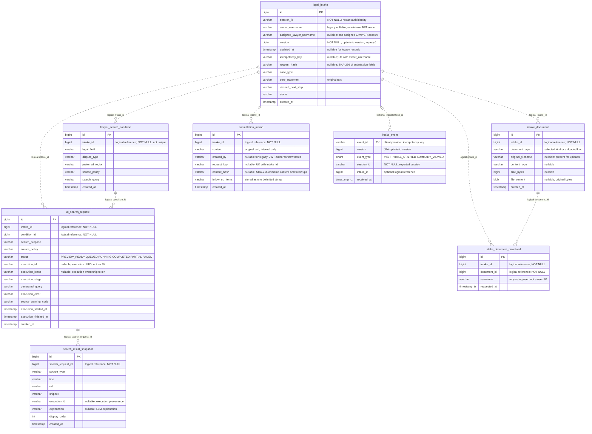
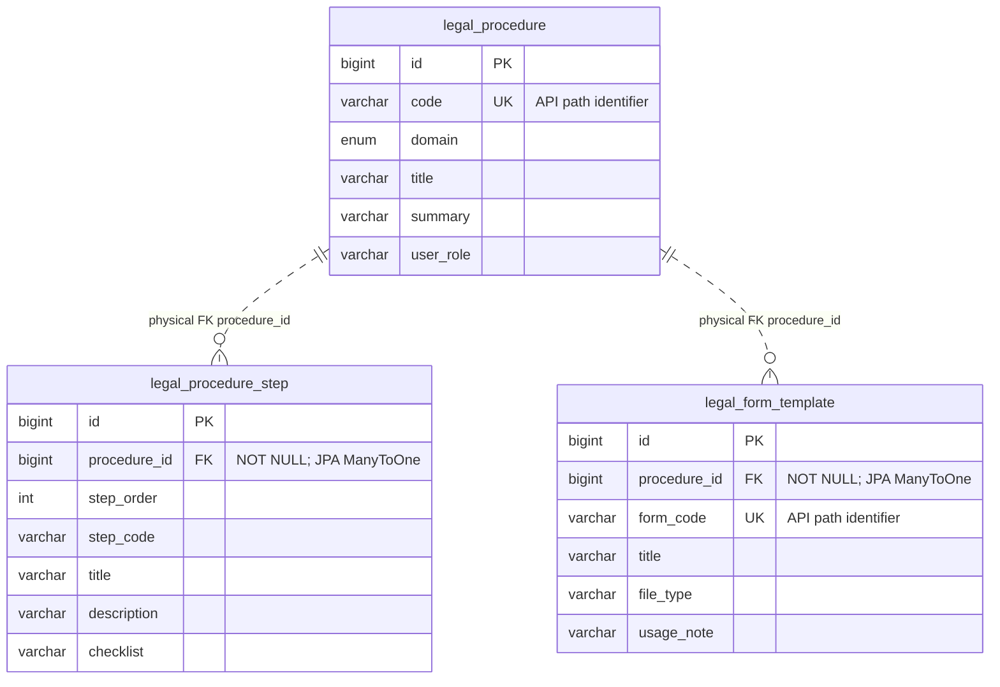

# 백엔드 ERD · 데이터 관계도 — 2026-10-23

> 2026-10-23 D01/D02: 문의 version·updated_at·idempotency_key·request_hash, 메모 request_key·content_hash와 복합 UNIQUE 두 개를 반영했다. 기존 권한 컬럼까지 로컬 MySQL에 추가 적용했으며, H2 실제 자료의 백업·복원·행 해시 대조와 파일 DB 전환을 검증했다. 화면13 지표 때문에 추가된 컬럼은 아니다. [DB 이행·실행본 검수](DB_DEPLOYMENT_REVIEW_2026-10-23.md).

> 2026-10-22 권한 적용: `legal_intake.assigned_lawyer_username`, `consultation_memo.created_by` 두 nullable 컬럼을 추가했다. 새 문의는 JWT 소유자 필수, 기존 소유자 없는 문의는 관리자 전용이다. 기존 메모 작성자는 추정해 채우지 않는다. 관계·테이블 수는 유지한다. [권한 통합 검수](SCREEN04_08_ACCESS_CONTROL_REVIEW.md) · [MySQL 수동 이전 SQL](../backend/guardrail-ready-policy-checker/src/main/resources/db/manual/2026-10-22-intake-permissions-mysql.sql).

기준: 현재 Entity·Repository·Service 및 2026-10-23 최신 스키마로 초기화·복원한 H2의 데이터 제외 DDL. 현재 번호 API38개(기존37+C21)의 데이터 연결을 이해하는 자료다. API 처리 순서는 [백엔드 흐름도](C:/myLectureWs/legal-ai-intake-security-server/docs/diagrams/02A_BACKEND_FLOW.md), 요청·메서드 연결은 [최신 화면/API 매핑](SCREEN_API_CONTROLLER_MAPPING.md)과 함께 본다.

핵심 접수·검색·파일·행동 데이터 **8개 테이블**을 본문에, 실제 외래키가 있는 법률 Reference **3개 테이블**을 별도 도표에 정리했다. 기존 Agent·감사·수업용 테이블을 전부 펼친 전체 DB 도표는 아니다.

**1. 표기와 현재 구현의 차이**

| 표기 / 구분 | 이 문서에서 읽는 방법 |
|---|---|
| `PK` | 실제 DB 기본키. 숫자 ID는 IDENTITY 자동 생성, intake_event는 클라이언트가 보낸 event_id 사용 |
| `FK` | 실제 JPA 연관관계와 생성된 DB 외래키가 확인된 컬럼에만 표시 |
| logical reference | 숫자 ID를 일반 컬럼에 저장하고 Service·Repository에서 연결. DB FK 제약 없음 |
| 관계선의 수량 | 정상적인 API·서비스 흐름에서의 관계. 핵심 8개는 관계선만으로 DB의 존재 확인이 강제되지 않음 |
| 점선 관계선 | Mermaid ER의 비식별 관계 표기. 점선 자체가 ‘FK 없음’을 뜻하지 않으며 아래 관계표와 FK 표시로 구분 |
| `timestamp_tz` | 도표에서 H2의 timestamp with time zone을 줄여 쓴 타입 |

도표는 주요 컬럼을 표시한다. 전체 컬럼·길이·NULL·PK·UK·FK는 [현재 H2 DDL](C:/myLectureWs/legal-ai-intake-security-server/docs/BACKEND_ERD_SCHEMA_EVIDENCE.sql)에서 확인한다. 이 파일은 데이터·사용자 자격 증명을 제외한 현재 전체20개 테이블의 스키마 기록이며 MySQL 이행 SQL과 구분한다.

**2. 핵심 업무 ERD — 8개 테이블, 관계는 모두 논리 ID 참조**



순수 Mermaid 원본: [BACKEND_ERD.mmd](C:/myLectureWs/legal-ai-intake-security-server/docs/BACKEND_ERD.mmd).

**3. ID 관계와 실제 무결성 보장 위치**

아래 9개 연결 컬럼에는 모두 DB FK가 없다. NOT NULL은 값의 유무를 검사하지만 그 값이 다른 테이블에 존재하는지는 검사하지 않는다. 서비스에서 검사하는 관계와 DB가 강제하는 관계를 구분한다.

| 부모 PK → 자식 참조 컬럼 | 정상 업무 관계 | NULL / DB FK | 실제 연결·검사 |
|---|---|---|---|
| legal_intake.id → intake_document.intake_id | 문의 1 : 자료 0..N | NOT NULL / FK 없음 | 문의 생성 트랜잭션에서 자료 종류 저장. 파일 업로드는 IntakeAccessService에서 문의·접근 확인 |
| legal_intake.id → lawyer_search_condition.intake_id | 데이터 구조상 문의 1 : 조건 0..N | NOT NULL / FK·UNIQUE 없음 | 현재 문의 생성 시 조건 1개를 함께 저장. 조회·검색 요청 생성 시 id 내림차순 첫 조건 선택 |
| legal_intake.id → ai_search_request.intake_id | 문의 1 : 요청 0..N | NOT NULL / FK 없음 | createSearchRequest가 문의 존재 확인. 문의 등록만으로 검색 요청이 생성되지는 않음 |
| lawyer_search_condition.id → ai_search_request.condition_id | 조건 1 : 요청 0..N | NOT NULL / FK 없음 | 같은 문의에서 찾은 최신 조건 ID를 사용. 요청 조회 시 기록된 conditionId로 조건 조회 |
| ai_search_request.id → search_result_snapshot.search_request_id | 요청 1 : 결과 0..N | NOT NULL / FK 없음 | addSearchResult가 검색 요청·조건 존재 확인. displayOrder로 정렬 |
| legal_intake.id → consultation_memo.intake_id | 문의 1 : 메모 0..N | NOT NULL / FK 없음 | createMemo가 문의 존재 확인 후 저장 |
| legal_intake.id → intake_document_download.intake_id | 문의 1 : 다운로드 요청 0..N | NOT NULL / FK 없음 | 소유자/관리자 확인 후 document.intakeId와 경로 intakeId 일치 검사 |
| intake_document.id → intake_document_download.document_id | 업로드 파일 1 : 다운로드 요청 0..N | NOT NULL / FK 없음 | 실제 파일이 있는 자료 레코드만 허용. 원본을 반환하는 요청 기록 저장 |
| legal_intake.id → intake_event.intake_id | 이벤트별 문의 0..1, 문의별 이벤트 0..N | NULL 허용 / FK 없음 | ID가 있으면 문의 존재·sessionId 일치 확인. SUMMARY_VIEWED는 ID 필수, VISIT/INTAKE_STARTED는 생략 가능 |

0..N은 관계를 읽기 위한 범위다. 정상 문의 등록 API는 자료 종류와 조건을 같은 트랜잭션에 저장하며, 자료 미선택 시에도 `선택 자료 없음` 자료 종류 레코드를 만든다. 이를 DB의 1:1 또는 최소 1개 제약으로 표현하지 않는다.

현재 모델에는 핵심 테이블 사이의 @ManyToOne·@OneToMany·@JoinColumn이 없다. JPA가 자동으로 조인하거나 부모 삭제 시 자식을 자동 삭제하는 구조도 아니다. 메모·검색 요청 등 관련 데이터를 생성할 때의 존재 확인과 트랜잭션은 Service가 담당한다. 직접 SQL로 데이터를 바꾸면 같은 서비스 검사가 실행되지 않는다.

**4. 테이블별 저장 의미와 API 연결**

| 테이블 / Entity | 저장하는 내용 | 관련 API ID | 학습할 코드 |
|---|---|---|---|
| legal_intake / LegalIntake | 문의 원문·선택값·현재 상태·세션·JWT 소유자·담당 변호사 | C03/C05/C09/C10 | LegalIntakeRecordService.create/findById/findRecent/updateStatus, LegalIntake.changeStatus |
| intake_document / IntakeDocument | 선택 자료 종류와 업로드 원본·메타데이터를 같은 테이블에 구분 저장 | C03/C05/C09/P04/P05 | IntakeDocument.create/upload/hasFile, IntakeDocumentService |
| lawyer_search_condition / LawyerSearchCondition | 분야·분쟁·지역·선호 조건·검색문 | C03/C05/C06/C07 | RecordService.create/createSearchRequest/toSearchRequestResponse |
| ai_search_request / AiSearchRequest | 문의·조건 ID, 검색 목적·출처·PREVIEW_READY 상태 | C06/C07/C08/P02 | RecordService.createSearchRequest/findSearchRequest/findSearchRequests |
| search_result_snapshot / SearchResultSnapshot | 호출자가 전달한 결과의 제목·URL·요약·순서 | C08/C07/P02 | RecordService.addSearchResult, SearchResultSnapshotRepository |
| consultation_memo / ConsultationMemo | 내부 상담 메모 원문·후속 조치·생성 시각·JWT 작성자 | C11/C05/C09 | ConsultationMemo.create, RecordService.createMemo/toMemoResponse |
| intake_document_download / IntakeDocumentDownload | 요청 사용자·문의·파일 ID·서버 요청 시각 | P05 | IntakeDocumentService.download |
| intake_event / IntakeEvent | 명시적으로 전송된 행동 종류·세션·선택 문의·수신 시각 | P06/C13 | IntakeEventService.record, MarketingDashboardService.funnel |

API ID의 URL·DTO·실제 메서드 링크는 [API_STATUS_SPEC.md](C:/myLectureWs/legal-ai-intake-security-server/docs/API_STATUS_SPEC.md) 1~6절과 8절을 사용한다.

**5. 저장 구조를 읽을 때 구분할 점**

- **자료 종류와 파일:** 최초 문의 등록의 documents는 자료 종류 문자열이다. 업로드한 행에는 original_filename·content_type·size_bytes·file_content가 추가된다. 자료 종류만 있는 행은 다운로드할 수 없으며, 실제 업로드 메타데이터는 uploadedDocuments 배열로 응답한다. 파일 저장소를 따로 구축한 모델이 아니라 현재 DB BLOB 저장이다.
- **재전송과 동시 수정:** legal_intake는 `(owner_username,idempotency_key)`, consultation_memo는 `(intake_id,request_key)`의 복합 UNIQUE를 가진다. 각 컬럼이 단독 UNIQUE인 것은 아니다. NULL 키는 기존 행/키 없는 호출을 허용한다. version은 문의 상태·메모·담당자 변경의 동시 수정 기준이며 created_at과 별도다. 기존 updated_at·해시·키는 NULL로 보존하고 작성 시각이나 요청을 추정해 채우지 않는다.
- **조건과 요청:** 현재 생성 API가 조건을 1개 만든다는 사실과 DB가 문의당 1개로 강제한다는 것은 다르다. intake_id에는 UNIQUE가 없고 Repository는 최신 조건을 고른다. 같은 조건으로 여러 검색 요청을 생성할 수 있다.
- **검색문과 결과:** search_query는 조건 테이블, generated_query·실행 단계/소유권/오류는 검색 요청, 수집 결과·explanation은 결과 스냅샷에 저장한다. 수동 C08과 구현된 P03 자동 수집을 구분한다. 실행 UUID는 출처 추적 정보이며 별도 DB FK가 아니다.
- **메모의 후속 조치:** API에서는 배열이지만 DB에서는 중복 제거 후 구분자로 합친 varchar(200) 하나에 저장한다. 후속 조치용 별도 자식 테이블은 없다.
- **개인정보:** 문의·메모·업로드 원본은 현재 원문을 저장한다. 기존 지정 필드의 응답 마스킹은 Service에서 DTO로 바꾸는 단계다. 원문 저장과 출력 마스킹은 서로 다른 처리다.
- **행동과 도메인 이벤트:** intake_event는 클라이언트가 명시적으로 보내는 VISIT/INTAKE_STARTED/SUMMARY_VIEWED 기록이다. Event Bus나 Outbox가 아니다. event_id PK가 동일 요청의 중복 저장을 막고, 같은 ID의 다른 내용은 Service에서 409로 거절한다.
- **세션과 사용자:** session_id는 PK·로그인 사용자 FK가 아니다. 여러 문의·이벤트가 같은 문자열을 가질 수 있다. owner_username과 다운로드 username도 현재 개발용 인증 사용자명을 기록한 문자열이며 사용자 테이블 FK가 아니다.
- **마케팅 읽기 모델:** MarketingFunnelResponse 전용 테이블은 없다. 문의·검색 요청·이벤트의 서로 다른 수를 조회 시 집계한다. 보고된 행동 이벤트 수와 문의 수를 같은 모수의 전환율로 해석하지 않는다.
- **저장하지 않는 상태:** Chat Fixed/Dynamic/Cost 처리 전체를 이 ERD에 연결하지 않는다. 현재 Dynamic 세션·예산·예약은 서버 메모리, 관측값은 Metric이며 별도 영속 비용 장부는 없다.
- **DB 수명:** 기본 프로필의 H2 메모리/create-drop은 유지한다. 현재8080은 명시적인 `local-persistent` 프로필의 파일 H2/validate로 전환해 기존 데이터를 보존했다. MySQL은 별도 `legal_intake_lab`이며 이번 추가 컬럼·제약 이행/복원 검증과 실제8080 DB 선택은 다르다. [실행·복구 절차](DB_DEPLOYMENT_REVIEW_2026-10-23.md)를 확인한다.

**6. 실제 DB FK가 있는 Reference ERD — 별도 경계**

아래 3개는 기존 법률 절차 안내용 데이터다. 핵심 legal_intake에 직접 FK로 연결되어 있지 않다. URL의 procedure code와 내부 procedure_id도 구분한다.



순수 Mermaid 원본: [BACKEND_REFERENCE_ERD.mmd](C:/myLectureWs/legal-ai-intake-security-server/docs/BACKEND_REFERENCE_ERD.mmd).

| 실제 DB FK | JPA 선언 | 현재 확인 근거 |
|---|---|---|
| legal_procedure_step.procedure_id → legal_procedure.id | LegalProcedureStep의 @ManyToOne + @JoinColumn(nullable=false) | 테스트 DDL의 ALTER TABLE / FOREIGN KEY |
| legal_form_template.procedure_id → legal_procedure.id | LegalFormTemplate의 @ManyToOne + @JoinColumn(nullable=false) | 테스트 DDL의 ALTER TABLE / FOREIGN KEY |

법률 Reference API R01~R05가 이 데이터를 읽으며 R06 보완수사 체크리스트는 현재 고정 prototype이다. 기존 수업용 practice_chat_log → practice_user에도 실제 FK가 있지만 이번 업무 ERD 범위에서 제외했다. 따라서 ‘프로젝트 전체에 FK가 없다’거나 ‘전체 FK가 두 개뿐’이라고 설명하지 않는다.

**7. Postman 결과를 ID 관계와 연결하는 순서**

| 순서 | 호출·확인 | ERD에서 확인할 관계 |
|---|---|---|
| 1 | 로그인 JWT를 붙여 C03 문의 생성 | legal_intake.id와 조건 id, 자료 종류의 intake_id. 새 문의의 owner_username |
| 2 | C05 상세·C09 목록 | 동일 intakeId의 자료·최신 조건·메모를 모아 DTO 구성 |
| 3 | C06 검색 요청 생성 | ai_search_request.intake_id와 condition_id. 생성 응답의 id는 searchRequestId |
| 4 | C08 테스트 결과 저장 → C07/P02 조회 | search_result_snapshot.search_request_id, 결과 배열·순서 |
| 5 | C11 메모 저장 → C05 재조회 | consultation_memo.intake_id와 마스킹된 응답 본문 |
| 6 | P04 파일 업로드 → P05 다운로드 | 업로드한 documentId와 경로 intakeId 일치, BLOB 원본, 다운로드 요청 기록 |
| 7 | P06 이벤트 → C13 집계 | 실제 문의 sessionId/intakeId 연결, eventId 동일 재전송 시 한 행 유지 |

ID 숫자가 우연히 같아도 서로 다른 테이블의 키다. 예를 들어 intakeId=1, conditionId=1, searchRequestId=1은 같은 객체를 뜻하지 않는다. 각 생성 응답에서 받은 이름별 변수를 구분한다.

DB 클라이언트에서 사용할 읽기 전용 예시다. 현재 파일 H2 프로필은 웹 H2 Console을 열지 않는다. 숫자1은 실제 생성 ID로 바꾼다. 파일 원본 대신 메타데이터를 조회한다.

```sql
select id, intake_id, document_type, original_filename, size_bytes
from intake_document where intake_id = 1;

select id, intake_id, search_query
from lawyer_search_condition where intake_id = 1 order by id desc;

select r.id as search_request_id, r.intake_id, r.condition_id,
       c.search_query, r.status
from ai_search_request r
join lawyer_search_condition c on c.id = r.condition_id
where r.intake_id = 1;

select id, search_request_id, title, display_order
from search_result_snapshot where search_request_id = 1 order by display_order;

select event_id, event_type, session_id, intake_id, received_at
from intake_event where session_id = 'study-20261016-01';
```

SQL JOIN이 가능하다는 사실도 FK 제약이 있다는 뜻은 아니다. DB가 선언한 실제 제약은 다음 조회로 확인할 수 있다. 이 문서 범위에서는 Reference 두 FK가 나오고 핵심 8개 FK는 없다.

```sql
select table_name, constraint_name, constraint_type
from information_schema.table_constraints
where table_schema = 'public'
  and table_name in (
    'legal_intake', 'intake_document', 'lawyer_search_condition',
    'ai_search_request', 'search_result_snapshot', 'consultation_memo',
    'intake_document_download', 'intake_event',
    'legal_procedure', 'legal_procedure_step', 'legal_form_template'
  )
order by table_name, constraint_type;
```

**8. 코드 근거와 검증 범위**

- Entity: [LegalIntake](C:/myLectureWs/legal-ai-intake-security-server/backend/guardrail-ready-policy-checker/src/main/java/com/ohgiraffers/handlermethod/entity/LegalIntake.java), [IntakeDocument](C:/myLectureWs/legal-ai-intake-security-server/backend/guardrail-ready-policy-checker/src/main/java/com/ohgiraffers/handlermethod/entity/IntakeDocument.java), [LawyerSearchCondition](C:/myLectureWs/legal-ai-intake-security-server/backend/guardrail-ready-policy-checker/src/main/java/com/ohgiraffers/handlermethod/entity/LawyerSearchCondition.java), [AiSearchRequest](C:/myLectureWs/legal-ai-intake-security-server/backend/guardrail-ready-policy-checker/src/main/java/com/ohgiraffers/handlermethod/entity/AiSearchRequest.java), [SearchResultSnapshot](C:/myLectureWs/legal-ai-intake-security-server/backend/guardrail-ready-policy-checker/src/main/java/com/ohgiraffers/handlermethod/entity/SearchResultSnapshot.java), [ConsultationMemo](C:/myLectureWs/legal-ai-intake-security-server/backend/guardrail-ready-policy-checker/src/main/java/com/ohgiraffers/handlermethod/entity/ConsultationMemo.java), [IntakeDocumentDownload](C:/myLectureWs/legal-ai-intake-security-server/backend/guardrail-ready-policy-checker/src/main/java/com/ohgiraffers/handlermethod/entity/IntakeDocumentDownload.java), [IntakeEvent](C:/myLectureWs/legal-ai-intake-security-server/backend/guardrail-ready-policy-checker/src/main/java/com/ohgiraffers/handlermethod/entity/IntakeEvent.java).
- 연결·존재 확인: [LegalIntakeRecordService](C:/myLectureWs/legal-ai-intake-security-server/backend/guardrail-ready-policy-checker/src/main/java/com/ohgiraffers/handlermethod/service/LegalIntakeRecordService.java), [IntakeAccessService](C:/myLectureWs/legal-ai-intake-security-server/backend/guardrail-ready-policy-checker/src/main/java/com/ohgiraffers/handlermethod/service/IntakeAccessService.java), [IntakeDocumentService](C:/myLectureWs/legal-ai-intake-security-server/backend/guardrail-ready-policy-checker/src/main/java/com/ohgiraffers/handlermethod/service/IntakeDocumentService.java), [IntakeEventService](C:/myLectureWs/legal-ai-intake-security-server/backend/guardrail-ready-policy-checker/src/main/java/com/ohgiraffers/handlermethod/service/IntakeEventService.java).
- 조회 기준: 각 Repository의 intakeId·conditionId·searchRequestId 조회와 최신순 정렬.
- Reference FK: [LegalProcedureStep](C:/myLectureWs/legal-ai-intake-security-server/backend/guardrail-ready-policy-checker/src/main/java/com/ohgiraffers/handlermethod/entity/LegalProcedureStep.java), [LegalFormTemplate](C:/myLectureWs/legal-ai-intake-security-server/backend/guardrail-ready-policy-checker/src/main/java/com/ohgiraffers/handlermethod/entity/LegalFormTemplate.java).
- 물리 스키마: 2026-10-23 D01/D02 실행에서 최신 전체20개 테이블의 데이터 제외 H2 스키마를 다시 추출했다. MySQL 이행과 H2 백업·복원·실행 검수는 별도 보고서에 기록한다.
- Postman 수동 결과는 [API 정리서의 기록표](C:/myLectureWs/legal-ai-intake-security-server/docs/API_STATUS_SPEC.md)에 실제 실행 후 남긴다. ERD의 관계 확인과 36개 API의 수동 통과는 별도다.

P03·SSE 비용 정산 구현은 완료된 기존 기능이며 실제 공급자 검증은 별도다. 이 부분 ERD에 비용 원장이나 사용자 테이블을 새 영속 기능처럼 추가하지 않았다.
