# 전체 백엔드 Mermaid flowchart

제출 관점별 분리본: [전체 / 백엔드·보안 / Cost Control / API 호출 도표 안내](C:/myLectureWs/legal-ai-intake-security-server/docs/DIAGRAM_GUIDE.md). 이 파일은 백엔드 세부 모듈 부록으로 유지한다.

기준: 2026-10-17 현재 로컬 코드. 제출 대상은 `SCREEN_API_CONTROLLER_MAPPING.md`의 제품 흐름이며, 이전 실험·학습 모듈도 별도 경로로 표시한다. 실선은 코드가 있는 연결, 점선은 설계중인 연결이다. 외부 NeMo/LLM 연결 코드는 있어도 실제 서비스 응답을 이번 작업에서 검증한 것은 아니다.

```mermaid
flowchart TD
    Client["Client / React / Postman"] --> Security{"Spring Security<br/>경로별 인증 규칙"}
    Security -->|"인증 필요한 경로에서 실패"| AuthError["401 / 403"]
    Security --> Trace["TraceIdInterceptor<br/>/api 요청 traceId·시간·로그"]
    Trace --> Routes["Controller / DTO<br/>해당 요청의 Validation"]

    subgraph Login["인증"]
        Routes --> Auth["AuthController<br/>POST /api/auth/login"]
        Auth --> LoginCheck["AuthenticationManager"]
        LoginCheck --> JWT["JWT 발급 응답"]
    end

    subgraph Intake["접수·변호사 검토"]
        Routes --> Preview["분류 preview<br/>규칙 실행 / DB 저장 없음"]
        Routes --> IntakeRecord["LegalIntakeRecordController<br/>생성·목록·상세"]
        IntakeRecord --> RecordService["LegalIntakeRecordService"]
        RecordService --> IntakeDB[("legal_intake<br/>intake_document<br/>lawyer_search_condition")]
        Routes --> Status["LegalIntakeStatusController<br/>상태 변경"]
        Status --> Transition["IntakeStatus 정책<br/>종료 후 재개 금지"]
        Transition --> IntakeDB
        Routes --> Memo["ConsultationMemoController<br/>상담 메모 저장"]
        Memo --> MemoDB[("consultation_memo")]
        IntakeDB --> IntakeRead["Intake DTO / 지정 필드 마스킹"]
        MemoDB --> IntakeRead
        Routes --> Minimal["MinimalLegalIntakeController<br/>규칙 기반 안내·마스킹<br/>DB 저장·LLM 호출 없음"]
    end

    subgraph Search["검색 요청·결과 기록"]
        Routes --> SearchController["LegalIntakeRecordController<br/>Search Request 생성·조회·결과 추가"]
        SearchController --> ConditionCheck["Intake·검색 조건 존재 확인"]
        ConditionCheck --> SearchDB[("ai_search_request<br/>search_result_snapshot")]
        SearchDB --> SearchDTO["검색 요청·검색문·결과 응답"]
        SearchDB -. "설계중" .-> SearchExecution["실제 변호사 검색 실행<br/>실행 상태·출처 검증·자동 저장"]
    end

    subgraph AI["동기 AI Chat — 실제 코드 순서"]
        Routes --> Chat["AiController / AiService<br/>POST /api/ai/chat"]
        Chat --> Dynamic["Dynamic Guard preCheck<br/>기존 세션 차단 여부 확인"]
        Dynamic --> Fixed["Fixed Guard"]
        Fixed --> PageCost["입력 페이지·길이 제한"]
        PageCost --> InputReserve["입력 검사 예산 확인·예약"]
        InputReserve -->|"예약 성공"| NemoInput["NeMo Input Guardrail<br/>검사 결과·usage에 따라 비용 정산"]
        InputReserve -->|"예산 부족"| Block
        NemoInput -->|"허용"| Reserve["답변 생성 비용 예약<br/>전체·일일·세션 예산 확인"]
        Reserve --> LLM["OpenAI-compatible LlmClient"]
        LLM --> Usage["보고 usage 정산<br/>미확인은 예약 추정액 별도 집계"]
        Usage --> OutputReserve["출력 로컬 정책·예산 확인·예약"]
        OutputReserve -->|"통과·예약 성공"| NemoOutput["NeMo Output Guardrail<br/>검사 결과·usage에 따라 비용 정산"]
        OutputReserve -->|"로컬 정책 차단"| Block
        OutputReserve -->|"예산 부족"| Block
        NemoOutput --> Privacy["Privacy Output Guard"]
        Dynamic -->|"이미 차단된 세션"| Block["Fallback / 차단 응답<br/>reason·metric"]
        Fixed -->|"차단"| RiskUpdate["세션 위험 점수 누적"]
        PageCost -->|"차단"| RiskUpdate
        NemoInput -->|"차단"| RiskUpdate
        RiskUpdate --> Block
        Reserve -->|"예약 불가"| Block
        LLM -->|"기술 오류 / 미확인 비용 추정 정산"| Block
        NemoInput -->|"기술 오류"| Block
        NemoOutput -->|"정책 위반·기술 오류"| Block
    end

    subgraph Stream["SSE — 별도 구현 경로"]
        Routes --> SSE["AiStreamingService"]
        SSE --> StreamChecks["Dynamic preCheck → Fixed → 입력 길이 제한"]
        StreamChecks --> StreamInput["입력 검사 예산 예약 → NeMo Input·정산<br/>허용 시 답변 생성 비용 예약"]
        StreamChecks -->|"차단·위험 누적"| Block
        StreamInput -->|"정책 차단·예산 초과"| Block
        StreamInput --> StreamLLM["StreamingLlmClient"]
        StreamLLM --> StreamBuffer["답변 전체를 서버에 버퍼링"]
        StreamBuffer --> StreamUsage["답변 생성 비용 보고/추정 정산"]
        StreamUsage --> StreamOutputReserve["출력 로컬 정책·예산 확인·예약"]
        StreamOutputReserve -->|"통과·예약 성공"| ChunkGuard["전체 답변 Output Guard·검사 비용 정산"]
        StreamOutputReserve -->|"로컬 정책 차단"| Block
        StreamOutputReserve -->|"예산 부족"| Block
        StreamLLM -->|"오류·timeout·연결 종료"| StreamUnknown["미확인 생성 비용 추정 정산<br/>늦은 콜백·중복 정산 방지"]
        StreamUnknown --> Block
        ChunkGuard --> StreamPrivacy["Privacy 패턴 마스킹<br/>완료 후 token 전송"]
        StreamPrivacy --> Events["정상 완료 done<br/>meta는 먼저 전송 / 차단·오류는 별도"]
        ChunkGuard -->|"정책 차단"| Block
    end

    Routes --> Standalone["S03 입력 단독 검사 · S04 출력 단독 검사<br/>JWT·필수 입력 → 비용 예약 → 검사·정산<br/>S04 로컬 출력 정책은 예약 전 적용"]
    Standalone --> GuardResult["검사 결과·비용 차단·usage 출처<br/>S01·S02와 같은 USD 예산·장부 공유"]

    subgraph Reference["법률 절차·기존 준비도 분석"]
        Routes --> LegalRef["LegalProcedureController"]
        LegalRef --> RefDB[("legal_procedure<br/>legal_procedure_step<br/>legal_form_template")]
        Routes --> Legacy["LegalIntakeController<br/>기존 readiness 분석"]
        Legacy --> HistoryDB[("legal_intake_history")]
    end

    subgraph RiskOps["Agent 위험·운영"]
        Routes --> Risk["AgentRiskDecisionController<br/>위험 점수·권장 조치"]
        Risk --> RiskDB[("agent_risk_history<br/>agent_run_history<br/>risk_incident")]
        Routes --> Jobs["AgentJobController<br/>비동기 위험 분석·폴링"]
        Jobs --> Risk
        Jobs --> JobDB[("agent_job_history")]
        Routes --> Audit["Risk History / Incident API<br/>조회·확인·종결"]
        Audit --> RiskDB
        Routes --> Admin["AdminDashboardController<br/>Agent·보안 현황"]
        Admin --> RiskDB
        Admin --> SecDB[("security_event_history")]
        Routes --> Marketing["MarketingDashboardController<br/>제출·검색·현재 상담 준비 집계"]
        Marketing --> IntakeDB
        Marketing --> SearchDB
        Routes --> Behavior["POST /api/intake-events<br/>중복 방지·문의/세션 연결"]
        Behavior --> EventDB[("intake_event")]
        EventDB --> Marketing
        Marketing -. "후속" .-> Cohort["기간·코호트·이탈 분석"]
    end

    Routes --> Lab["기존 정책 검사·위험 패턴 실험<br/>메뉴·채팅·트랜잭션·N+1 학습 API"]
    Security --> Actuator["Actuator 별도 체인<br/>health / info 공개<br/>metrics / prometheus ADMIN Basic"]
    Privacy --> Metrics["Micrometer metric / trace 로그"]
    Block --> Metrics
    Events --> Metrics
    Risk --> Metrics
    Metrics --> Actuator
    Routes --> Files["첨부파일 업로드·다운로드<br/>JWT·소유자/관리자·크기·유형"]
    Files --> IntakeDB
    JWT --> Me["GET /api/me"]
    SearchController --> History["GET 문의별 검색 이력<br/>JWT·소유자/관리자"]
    IntakeDB -. "설계중" .-> Persistent["운영 DB 영속화"]

    classDef planned fill:#fff4dc,stroke:#c48918,stroke-dasharray:5 5
    class SearchExecution,Cohort,Persistent planned
```

**API별로 통과하는 경로가 다르다.** 모든 요청이 AI 보안 파이프라인을 순서대로 통과하는 구조가 아니다. Intake 저장은 Validation·JPA·지정 필드 마스킹, minimal/preview는 규칙 기반 안내, AI Chat은 동기 AI 보안 파이프라인이다.

| 구간 | 현재 구현에서 확인할 점 |
|---|---|
| Security | `/api/ai/**`, GET 이외의 `/api/legal/**`는 인증 필요. `/api/intakes/**`, `/api/admin/**`, `/api/agent/**`, `/api/incidents/**`는 현재 포괄 `/api/** permitAll`에 해당. 역할·소유권 제한은 후속 설계. |
| Validation | `@Valid` 및 DTO 제약이 선언된 API에 적용. 기존 모든 API에 동일한 검증이 있는 것은 아님. |
| Intake 생성 | 문의·자료 종류·검색 조건을 동일 트랜잭션으로 저장. LLM 호출 없음. |
| 자료 저장 | 자료 종류 문자열과 실제 업로드 메타데이터·BLOB을 구분. uploadedDocuments로 실제 파일을 조회하며 다운로드는 JWT·소유자/관리자 확인. |
| minimal | 출력에 보안 안내 문구가 있어도 현재 코드가 Fixed/Dynamic/Cost Guard를 호출하는 것은 아님. |
| 검색 요청 | 상태 `PREVIEW_READY`; 결과 추가는 호출자가 전달한 스냅샷 저장. 자동 외부 검색과 실행 상태 전이는 설계중. |
| 동기 Chat | 실제 순서는 세션 사전 점검 → Fixed → 길이 → 입력 검사 예약·정산 → 답변 생성 예약·정산 → 출력 검사 예약·정산 → 개인정보 마스킹. |
| SSE | 로컬 입력 보안 후 입력 검사·답변 생성·출력 검사의 비용을 각각 예약·정산. 생성 완료 즉시 정산 후 Output Guard·Privacy를 거쳐 본문 전송. 오류·timeout·연결 종료는 미확인 생성 비용 추정 정산·중복 정산 방지. |
| Guardrail 단독 S03/S04 | 해당 검사 비용만 S01·S02와 같은 전체·일일·세션 예산에 예약·정산. S04 로컬 정책 거절은 유료 호출·예약 없이 확인된 0토큰 결과. |
| usage | 유효한 0을 포함한 보고 사용량과 미확인을 구분. 미확인은 예약 추정액을 별도 사용액으로 집계하고 예산 검사에 포함. |
| AI 응답 계약 | 동기·SSE에 reasonCode·detailCode 추가, 기존 reason 유지. 비용 공통 코드와 상세 원인을 구분. |
| CORS·세션 | 두 Security 체인에서 CORS 처리, 실제 인증 유지. Dynamic·Cost 세션 키 정규화 및 anonymous 기준 통일. |
| Audit | Agent 위험 분석의 DB 이력·Incident와 AI Chat의 metric·trace 로그는 서로 다른 기록 경로. 모든 Chat 호출이 위험 이력 DB에 저장된다고 가정하지 않음. |
| Admin summary | 현재 Agent 실행·위험·보안 이벤트·열린 Incident 중심. 화면 설계의 모든 Intake KPI를 이미 제공한다고 표시하지 않음. |
| Marketing | 현재 DB 전체 집계. 방문·시작·요약조회는 보고된 이벤트 수/REPORTED_EVENT. 중복 eventId 제외. 이탈률 미측정. |
| DB | 기본 H2 메모리 DB 및 `create-drop`. 서버 재시작 후 유지되는 운영 저장소는 후속 구축. |

**실패가 다음 단계를 멈추는 지점**

| 실패 | 멈추는 단계 / 응답 |
|---|---|
| 인증 필요 경로에서 인증 실패 | Controller 이전 401/403 |
| 신규·Intake DTO 검증 실패 | 업무 처리 이전 400, `INVALID_REQUEST` |
| 없는 Intake·Search Request·검색 조건 | 관련 저장/조회 중단, 404 |
| 금지된 Intake 상태 전이 | 상태 변경 중단, 409 |
| AI 정책·비용 차단 | 해당 유료 단계 호출 전 중단, 이미 실행한 앞 단계 비용은 유지. 응답의 reasonCode·detailCode 및 metric 확인 |
| LLM 실패 | 호출 후 사용량 미확인은 예약 추정액으로 정산하고 기술 fallback. 호출 시작 전 취소만 예약 해제 |

현재 신규 상태 변경의 409와 기존 404는 `ResponseStatusException`이며 Validation의 `ErrorResponse`와 동일한 본문 형식으로 통일되어 있지는 않다. 외부 호출 성공·실패와 SSE 전체 흐름의 실서비스 검증은 이번 자동 테스트 범위 밖이다.

전체 Controller 경로는 [경로 부록](C:/myLectureWs/legal-ai-intake-security-server/docs/BACKEND_ROUTE_INVENTORY.md), 입출력과 개발 상태는 [API 정리서](C:/myLectureWs/legal-ai-intake-security-server/docs/API_STATUS_SPEC.md)를 참조한다.
