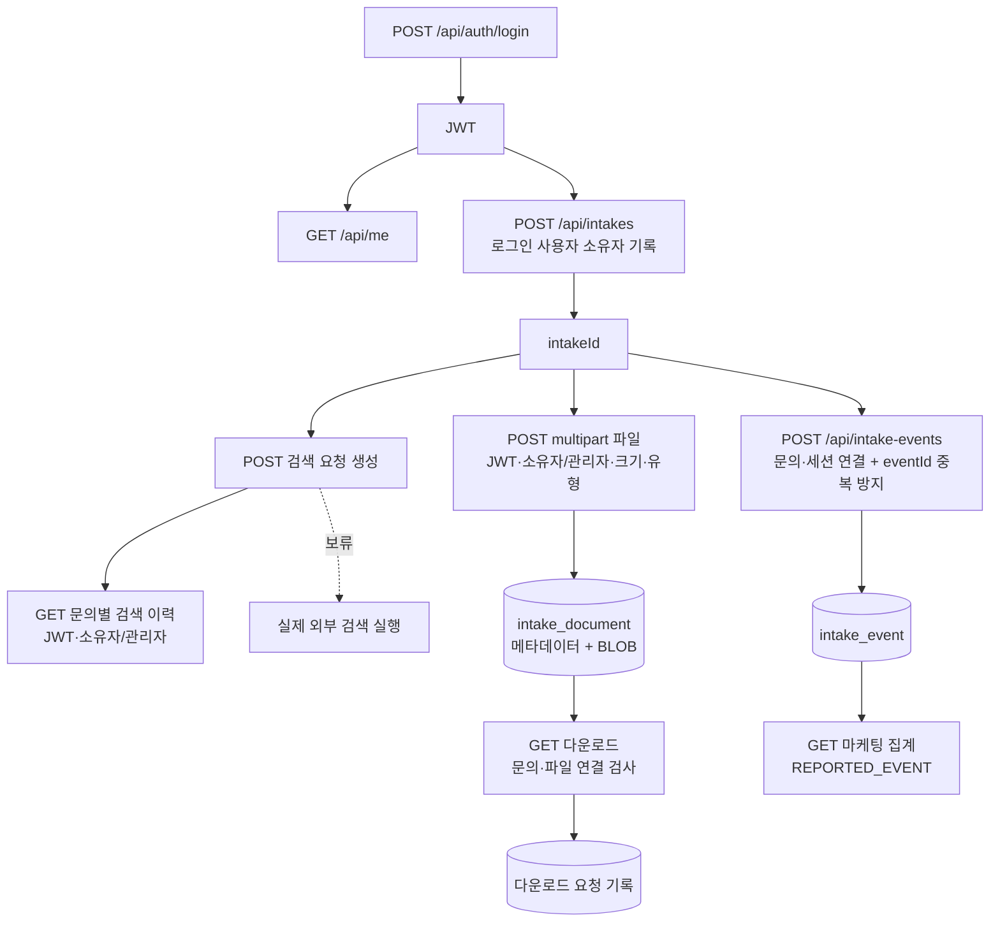

# Day 4 — 후속 제안 API 5개 구현

기준: 2026-10-16 로컬 코드. 기존 제출 대상 31개에 5개를 추가해 **현재 구현 API는 36개**다. 문서의 제출 상태명 `개발중`은 유지하며, React 연결과 수동 Postman 실행 상태는 별도로 기록한다.

실제 외부 검색 실행(`P03`)과 SSE 중단·오류·날짜 변경 정산 보완은 사용자 요청대로 보류한다.

## 구현한 계약

| 기존 제안 ID | API | 요청 | 응답 |
|---|---|---|---|
| P01 | `GET /api/me` | JWT Bearer | 200: `username`, `role` (`ROLE_USER` / `ROLE_ADMIN`) |
| P02 | `GET /api/intakes/{intakeId}/search-requests` | JWT, 문의 ID | 200: 검색 요청·결과 배열, 생성 시각·ID 내림차순. 없으면 `[]` |
| P04 | `POST /api/intakes/{intakeId}/documents` | JWT, multipart `file` 필수, `documentType` 선택 | 201: 파일 ID·문의 ID·자료 종류·원래 이름·MIME·바이트 수·생성 시각·downloadUrl |
| P05 | `GET /api/intakes/{intakeId}/documents/{documentId}/download` | JWT, 문의·파일 ID | 200: 저장된 바이트, attachment·Content-Length·nosniff·no-store 헤더 |
| P06 | `POST /api/intake-events` | JSON `eventId`, `eventType`, `sessionId`, 선택 `intakeId` | 최초 201/created=true, 동일 재전송 200/created=false, 다른 내용으로 ID 재사용 409 |

## 인증과 문의 소유자

- 로그인한 상태로 `POST /api/intakes`를 호출하면 JWT 사용자를 `ownerUsername`에 저장한다. 클라이언트 JSON에서 소유자를 지정하지 않는다.
- 신규 검색 이력·파일 업로드·다운로드는 JWT 필수이며 소유자 또는 `ROLE_ADMIN`만 접근한다. 기존 익명 문의는 신규 API에서 관리자만 접근한다. `sessionId`를 소유자 인증으로 사용하지 않는다.
- 없는 문의·파일은 404, 다른 소유자의 신규 API 접근은 403, 인증 누락·잘못된 토큰은 401이다.
- 기존 문의 목록·상세·상태·메모·검색 요청 생성/상세 등의 개발용 공개 정책은 유지한다. 신규 소유자 검사가 기존 모든 API에 확장된 것은 아니다.
- 현재 사용자 계정은 기존 개발용 user/admin이다. 계정 DB·회원가입을 추가한 것은 아니다.

## 파일 처리

파일 내용과 메타데이터를 `intake_document`의 JPA BLOB으로 함께 저장한다. 업로드 기본 한도는 **5 MiB (5,242,880바이트)**, multipart 전체 요청 기본 한도는 6 MiB다. PDF·PNG·JPEG의 확장자/헤더 시그니처와 TXT의 UTF-8·제어문자를 검사하며, 선언한 MIME이 있으면 내용 유형과 대조한다. 전체 문서 파싱이나 악성코드 검사는 포함하지 않는다.

자료 종류만 선택한 기존 레코드는 계속 유지한다. 문의 목록·상세에 `uploadedDocuments` 배열을 추가해 실제 파일 메타데이터와 다운로드 경로를 구분한다. 파일 바이트·BLOB은 JSON으로 반환하지 않는다. 다운로드 시 문의 ID와 문서의 intakeId를 함께 검사하고, 자료 종류만 있는 레코드의 다운로드는 404다.

클라이언트 파일명은 표시용 basename으로만 사용한다. 파일시스템 경로로 사용하지 않는다. 성공한 다운로드 요청은 `intake_document_download`에 사용자·문의·파일·서버 시각을 기록한다. 이는 클라이언트가 전송을 끝까지 수신했다는 증명은 아니다.

현재 DB는 H2 메모리 + create-drop이므로 **서버 재시작 시 원본·메타데이터·이벤트·다운로드 기록이 함께 초기화**된다. 파일 원본을 응답 Privacy Guard로 변환하거나 LLM에 전달하는 기능은 추가하지 않았다. 파일명은 현재 원래 표시명을 반환한다.

## 행동 이벤트와 집계

```json
{"eventId":"client-generated-unique-id","eventType":"SUMMARY_VIEWED","sessionId":"postman-session","intakeId":1}
```

- 지원 유형은 VISIT / INTAKE_STARTED / SUMMARY_VIEWED. eventId·sessionId는 필수, 공백 불가, 최대 100자이며 앞뒤 공백을 제거한다.
- SUMMARY_VIEWED는 intakeId가 필수다. intakeId가 있으면 문의 존재와 sessionId 일치를 확인한다. 이벤트 API는 로그인 전 행동도 받는 개발용 공개 수집 경로이며, 클라이언트가 보고한 행동이다.
- eventId의 DB 기본키로 중복을 방지한다. 동일 요청은 최초 receivedAt을 유지하며 재집계하지 않는다. 동시 재전송도 한 행만 생성한다. 다른 ID로 같은 행동을 보내면 별도 이벤트로 센다.
- 수신 시각 `receivedAt`은 서버 UTC 시각이다. 클라이언트 시각은 받지 않는다.
- 기존 마케팅 응답의 VISIT·INTAKE_STARTED·SUMMARY_VIEWED는 이제 `count=이벤트 수`, `measurement=REPORTED_EVENT`다. 수집 API가 있으므로 기록이 없을 때는 0이다. `eventCounts`에도 유형별 수를 제공한다.
- 문의 수(STORED_INTAKE)·검색한 문의 수(DISTINCT_INTAKE)·현재 상담 준비 수(CURRENT_STATUS)는 기존 기준이다. 방문 이벤트 수는 순방문자 수가 아니며 서로 다른 기준으로 이탈률을 계산하지 않는다. dropOffMeasured=false, 기간·코호트 분석은 후속이다.
- React가 이벤트를 보내는 연결은 아직 별도 작업이다. 조회 API 호출만으로 방문 이벤트가 자동 생성되지 않는다.

## Postman 실행

[추가 API Collection](C:/myLectureWs/legal-ai-intake-security-server/docs/ADDITIONAL_FIVE_APIS.postman_collection.json)을 Import한다. 기본 baseUrl은 http://localhost:8080. 순서대로 실행하면 로그인 → 내 정보 → 문의 생성 → 검색 요청 → 이력 → 이벤트·재전송·집계까지 이어진다. 파일 요청에는 form-data의 `file`에 로컬 파일을 선택해야 한다. Content-Type은 Postman이 boundary와 함께 자동 지정하게 둔다.

실험용 파일: [sample-intake.txt](C:/myLectureWs/legal-ai-intake-security-server/docs/fixtures/sample-intake.txt). 업로드 후 documentId를 저장해 다운로드한다. Collection의 JWT와 세션·이벤트 변수는 실행 중 생성되며 저장소에 실제 토큰을 넣지 않는다.

## 검증

`gradlew.bat test --offline --no-daemon` 성공: **전체 92개 / 실패 0 / 오류 0**. 기존 71개 + 추가 API 통합 21개다. 검증 대상: 실제 로그인 토큰/401, 소유자·관리자/403, 검색 이력 정렬·문의 분리, 파일 업로드·동일 바이트 다운로드·기록, 404·413·415, 이벤트 저장·동일/충돌 재전송·동시 재전송·마케팅 집계.

수동 Postman 실행과 외부 검색·실서비스 호출은 이 자동 검증에 포함하지 않는다.


