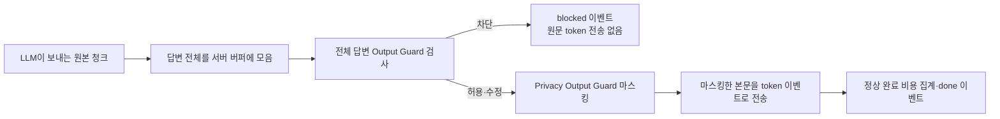

# Day 4 — SSE 개인정보 마스킹·usage 누락 처리 구현 결과

기준: 2026-10-16 로컬 코드. 기존 체크리스트 **5번 SSE Privacy, 8번 usage 누락 처리**를 추가 구현했다. 기존 완료 6개와 합쳐 9개 중 **8개 구현**, **9번 중단·오류·날짜 변경 정산 보완은 사용자 요청으로 보류**한다.

## 1. SSE 개인정보 마스킹



- meta 이벤트는 먼저 전송할 수 있지만, **본문 token은 답변 생성·출력 검사·마스킹 완료 후 전송**한다.
- `010-` / `1234-` / `5678`처럼 나뉜 원본도 전체 문자열에서 검사하므로 청크 경계 때문에 패턴을 놓치지 않는다.
- 휴대전화·주민번호·카드·이메일·계좌번호 패턴에 기존 PrivacyOutputGuardService를 적용한다. 자유 문장의 이름·주소 등을 모두 인식하는 기능을 추가한 것은 아니다.
- Output Guard가 수정한 content를 마스킹하며, 차단되면 token 이벤트를 보내지 않는다.
- 본문을 내보내는 시점은 LLM 생성 완료 후다. 전송 이벤트 이름 meta/token/done/blocked/error와 기존 reason은 유지한다.
- `llm.streaming.chunk-size`는 마스킹 완료 본문을 나누는 크기다. 이전의 sliding context 설정은 전체 답변 검사로 대체했다.

## 2. usage 누락 처리

LLM Client 결과에 `usageAvailable`을 추가했다. prompt_tokens·completion_tokens가 모두 유효한 비음수 정수로 보고되어야 true다. usage 부재·null·빈 객체·일부 필드 누락·음수는 미확인으로 취급한다. **유효하게 보고된 0 / 0은 확인된 사용량**이다.

| 정상 완료 상태 | 처리 | costSource |
|---|---|---|
| usage 확인 | 예약 해제, 보고된 토큰 수 × 설정 단가로 실제 사용량 기반 집계 | REPORTED |
| usage 미확인 | 예약 해제, 해당 예약 추정액을 추정 사용액으로 집계 | ESTIMATED |

전체 누적·하루·세션 예산 검사와 remainingBudgetUsd에 **보고 기반 사용액 + 미확인 추정 사용액 + 진행 중 예약액**을 반영한다. 추정 사용액을 기존 actual 지표에 섞지 않는다. 기존 정상 token Metric도 usage가 확인된 경우에만 기록한다.

동기 성공 응답과 SSE done 이벤트에는 `usageAvailable`, `costSource`가 추가된다. SSE에서 미확인 토큰 수는 null이다.

```json
{
  "promptTokens": null,
  "completionTokens": null,
  "usageAvailable": false,
  "costSource": "ESTIMATED"
}
```

위 토큰 필드는 SSE done 기준이다. 동기 Chat은 기존 응답 필드에 usageAvailable·costSource를 추가한다. 정책 차단·기술 fallback 등 다른 응답의 해당 신규 필드는 null일 수 있으며, null로 비용 0을 추론하지 않는다.

## 3. Metric

| 지표 | 의미 |
|---|---|
| ai.cost.actual.usd / ai.cost.daily.actual.usd / ai.cost.actual | 보고된 토큰으로 계산한 비용 |
| ai.cost.estimated.usage.usd | usage 미확인으로 추정 집계한 누적 비용 |
| ai.cost.daily.estimated.usage.usd | 해당 일자의 추정 집계 비용 |
| ai.cost.accounted.usd | 보고 기반 사용액 + 추정 사용액. 진행 중 예약액 제외 |
| ai.cost.usage.missing | usage 미확인 정상 완료 횟수 |
| ai.cost.usage.estimated | usage 미확인 추정 집계액 Counter |
| legal.ai.privacy.output.masked | 마스킹된 패턴 종류별 횟수. 기존 piiType 태그 유지 |

실제 외부 청구 대사·나중에 받은 usage로 추정액을 재조정하는 기능은 포함하지 않는다.

## 4. 검증

`gradlew.bat test --offline --no-daemon` 성공: **71개 / 실패 0 / 오류 0**.

- 기존 45개 유지.
- AI Security 통합 7개 추가: 생성 완료 전 token 미전송, 5종 PII 청크 경계 마스킹, 수정된 Output Guard content 처리, 출력 차단 시 원문 미전송, 동기·SSE usage 미확인/실제 0 구분.
- Cost usage 5개: 미확인 비용의 전체·하루·세션 한도 반영, 보고된 0과 일반 보고 사용량 정산 구분.
- LLM Client 14개: 로컬 HTTP/SSE 제공자 대역으로 usage 부재·null·빈 객체·일부 필드·음수·0·정상 사용량과 공백 청크 보존 확인.

외부 NeMo·LLM 실서비스 및 실제 Postman·브라우저 실행 검증과는 구분한다. 설정 예산 $2 / $1 / $0.3, 입력 10자·DTO 30자, 출력 상한 256은 유지한다.

## 5. 보류한 9번

정상 완료 경로의 Privacy와 usage 처리를 추가했다. 다음 정산 예외는 이번 구현에 포함하지 않았다.

- SSE 출력 차단 시 기존 예약 해제 정책과 이미 생성된 비용의 정합성.
- 연결 종료·timeout·외부 오류의 LLM 중단·비용 귀속.
- 완료·오류 콜백의 중복 정산·해제 방지.
- 날짜를 넘겨 완료한 요청의 일일 비용 귀속.

전체 정산 생명주기를 완성한 것으로 표시하지 않는다. 사용자의 다음 요청 범위에 따라 진행한다.
