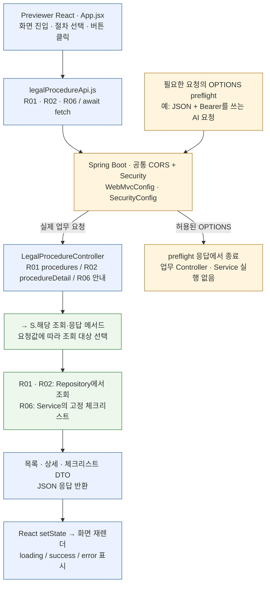
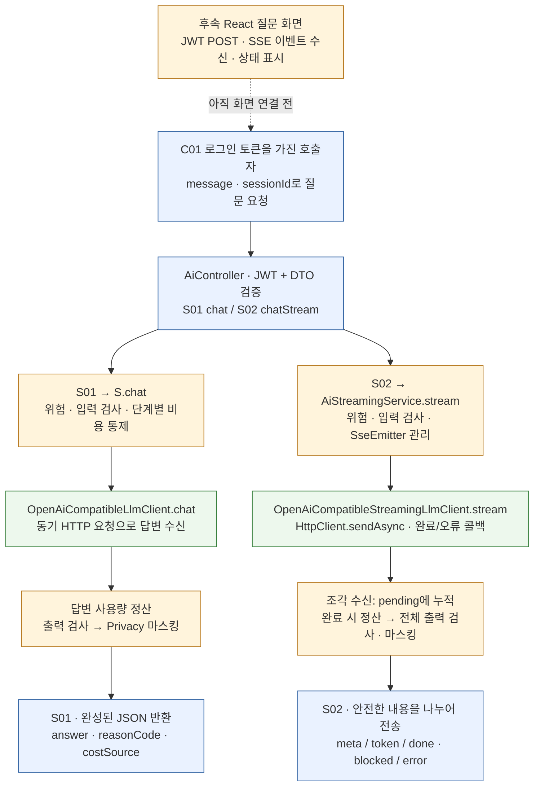
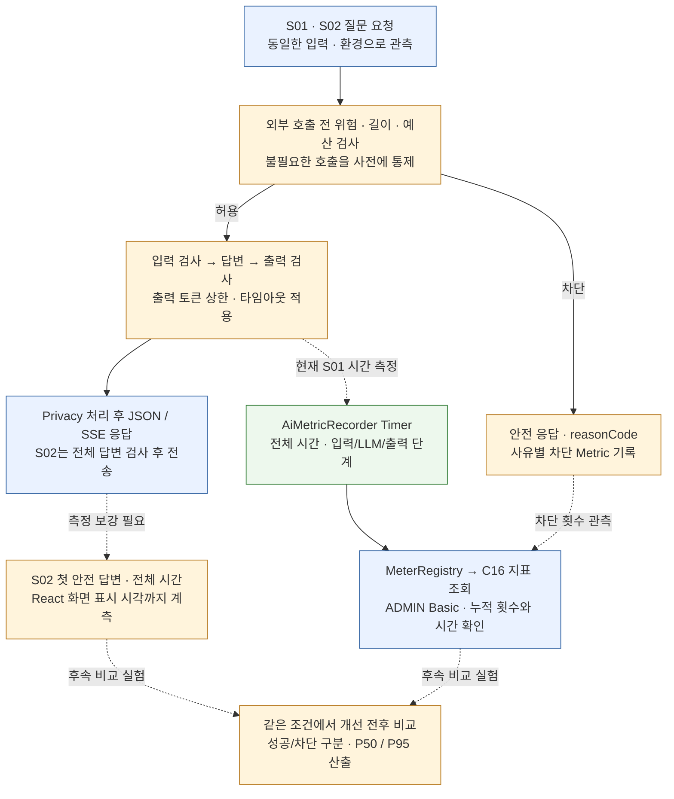

# 개발 필수 요구사항 - Check / Flow / 기능 / Code Mapping

## 개발 필수 요구사항 체크

**2026-10-19 코드 대조 기준.** 과제의 두 필수 요소를 확인하기 위해 REQ-01~05로 나누었다. REQ 번호는 문서 체크 항목이며 API 번호가 아니다. 기존 프로젝트 37개 항목과 과제 Previewer 범위를 유지한다.

필수 요소 원문은 **① Spring Boot(API Server)와 React(Client Server) 연동 및 CORS 처리 ② LLM API 활용 질문 시스템 개발 + 응답 지연 시간 최적화·비동기 데이터 처리**다. 아래 상태는 현재 코드의 구현 위치이며, 이번 문서 갱신에서 서버·외부 LLM·브라우저 성능 실험을 새로 실행한 결과는 아니다.

| 요구사항 | 현재 구현·확인 상태 | API와 위치 | 남은 완료 근거 |
|---|---|---|---|
| REQ-01 Spring Boot–React 연동 | Previewer 화면과 호출 코드 구현 | R01 목록·R02 상세·R06 체크리스트. App.jsx → legalProcedureApi.js → LegalProcedureController | 실행 환경에서 브라우저 Network·화면 결과를 함께 기록. 새 AI 질문 화면 연결은 후속 |
| REQ-02 CORS 처리 | 공통 설정과 preflight 자동 테스트 코드 구현 | `/api/**`, `/actuator/**`. WebMvcConfig + SecurityConfig. 자체 업무 API 번호 없음 | 실제 브라우저 Origin·OPTIONS·응답 헤더 확인 |
| REQ-03 LLM 질문 시스템 | S01 동기 JSON·S02 SSE 백엔드 구현 | AiController → S.chat / AiStreamingService.stream → 각 LLM Client | 실제 외부 서비스 연동 결과와 React 질문 입력·응답 화면 연결 확인 |
| REQ-04 비동기 데이터 처리 | React 조회의 async/await·S02 sendAsync/콜백·SseEmitter 구현 | React: R01·R02·R06. 서버 LLM 비동기: S02 | React의 JWT POST·SSE 이벤트 수신 UI 연결. 입력·출력 검사 전체를 병렬 처리했다는 의미는 아님 |
| REQ-05 응답 지연 시간 최적화 | Java 21 웹 요청 가상 스레드 설정, 사전 차단·입출력 상한·타임아웃·S01 시간 측정 구현. 개선 효과는 미검증 | S01 동기 외부 I/O·S02·C16. application.properties:2·AiMetricRecorder | 실행 스레드 확인, S02 시간 계측, 동일 조건의 동시 처리량·P50·P95·오류율 비교 |

**상태 읽는 법:** 코드 구현, React 화면 연결, 실제 외부 서비스 실행, 성능 개선 검증을 각각 구분한다. S02는 비동기 호출을 구현했지만 전체 답변을 검사·마스킹한 뒤 전송한다. 현재 첫 답변 표시가 몇 초 빨라졌다고 단정하지 않는다.

**Service 표기:** Controller와 Service의 앞부분 이름이 같으면 `→ S.메서드()`로 줄이고, 다르면 전체 Service 이름을 쓴다. Controller 없이 단독으로 인용하는 업무 메서드는 전체 이름을 유지한다.

## 필수 흐름 1. Spring Boot–React 연동 · CORS

REQ-01·02를 한 묶음으로 읽는다. React 개발 서버가 제공한 화면은 브라우저에서 실행되며 Spring Boot에 HTTP 요청을 보낸다. 현재 실제 React 호출 코드는 R01·R02·R06이다.

| API·진입점 | Controller의 기능 | Service의 기능 | 응답·화면에서 확인 |
|---|---|---|---|
| R01 목록 | [LegalProcedureController.procedures](C:/myLectureWs/legal-ai-intake-security-server/backend/guardrail-ready-policy-checker/src/main/java/com/ohgiraffers/handlermethod/api/LegalProcedureController.java:40)가 Query domain을 받음 | → [S.findProcedures](C:/myLectureWs/legal-ai-intake-security-server/backend/guardrail-ready-policy-checker/src/main/java/com/ohgiraffers/handlermethod/service/LegalProcedureService.java:49)가 전체·분야별 Repository 조회 후 목록 DTO 구성 | 절차 배열·분야 필터. React fetchProcedures 호출 |
| R02 상세 | [LegalProcedureController.procedureDetail](C:/myLectureWs/legal-ai-intake-security-server/backend/guardrail-ready-policy-checker/src/main/java/com/ohgiraffers/handlermethod/api/LegalProcedureController.java:58)이 Path code를 받음 | → [S.findProcedureDetail](C:/myLectureWs/legal-ai-intake-security-server/backend/guardrail-ready-policy-checker/src/main/java/com/ohgiraffers/handlermethod/service/LegalProcedureService.java:85)이 절차·정렬된 단계·양식을 한 DTO로 조합 | 선택 code의 상세·단계·양식. React fetchProcedureDetail 호출 |
| R06 안내 | [LegalProcedureController.supplementaryInvestigationChecklist](C:/myLectureWs/legal-ai-intake-security-server/backend/guardrail-ready-policy-checker/src/main/java/com/ohgiraffers/handlermethod/api/LegalProcedureController.java:111)가 안내 요청을 받음 | → [S.supplementaryInvestigationChecklist](C:/myLectureWs/legal-ai-intake-security-server/backend/guardrail-ready-policy-checker/src/main/java/com/ohgiraffers/handlermethod/service/LegalProcedureService.java:165)가 고정 체크리스트 구성 | 체크리스트·권장 행동. Repository·LLM 호출 없음 |
| 공통 React 호출 | HTTP 요청을 발생시키는 클라이언트 위치이며 Spring Controller는 아님 | [fetchJson](C:/myLectureWs/legal-ai-intake-security-server/frontend/legal-procedure-viewer/src/api/legalProcedureApi.js:15)의 await fetch·HTTP 오류 확인 | [App.loadProcedures](C:/myLectureWs/legal-ai-intake-security-server/frontend/legal-procedure-viewer/src/App.jsx:63), 상세·체크리스트 상태 갱신. await는 브라우저 전체를 멈추지 않음 |

R01·R02·R06의 S.는 LegalProcedureService다. 현재 API 기본 주소는 http://localhost:8080이며 화면에서 apiBase를 바꿀 수 있다. R03·R04·R05는 기존 37개 항목에 포함된 Reference 백엔드 API이며 현재 React 화면 연결은 후속이다.

| 공통 계층 | 실제 위치 | CORS·인증 책임 |
|---|---|---|
| CORS 허용 설정 | [WebMvcConfig.corsConfigurationSource](C:/myLectureWs/legal-ai-intake-security-server/backend/guardrail-ready-policy-checker/src/main/java/com/ohgiraffers/handlermethod/config/WebMvcConfig.java:29) | `/api/**`: Origin 패턴 `*`, GET·POST·PATCH·OPTIONS, 요청 헤더 `*`. 노출 응답 헤더 Content-Disposition·X-Trace-Id |
| Security 연결 | [SecurityConfig.applicationSecurity](C:/myLectureWs/legal-ai-intake-security-server/backend/guardrail-ready-policy-checker/src/main/java/com/ohgiraffers/handlermethod/config/SecurityConfig.java:66), [SecurityConfig.actuatorSecurity](C:/myLectureWs/legal-ai-intake-security-server/backend/guardrail-ready-policy-checker/src/main/java/com/ohgiraffers/handlermethod/config/SecurityConfig.java:42) | 같은 CORS 설정을 애플리케이션·Actuator 체인에 연결. CORS 허용과 실제 요청의 JWT·ADMIN Basic 인증은 별도 판단 |
| preflight 확인 코드 | [AiSecurityIntegrationTest.preflightIsHandledBeforeJwtOrBasicAuthentication](C:/myLectureWs/legal-ai-intake-security-server/backend/guardrail-ready-policy-checker/src/test/java/com/ohgiraffers/handlermethod/api/AiSecurityIntegrationTest.java:191) | S01·S02·S03·C16 OPTIONS에 허용 Origin·Method 응답 확인. preflight에서 업무 외부 Client가 호출되지 않는지 검사 |

일반 GET에 항상 OPTIONS가 생기는 것은 아니다. 브라우저가 preflight를 요구하는 요청에서 먼저 허용 여부를 확인하고, 이후 실제 요청을 보낸다. S01·S02 실제 POST는 C01에서 받은 JWT가 필요하며 C16은 ADMIN Basic 경로다.

## 필수 흐름 2. LLM 질문 · 비동기 데이터 처리

REQ-03·04의 중심은 S01·S02다. Controller는 요청 검증과 응답 통로를 담당하고, 각 Service가 안전 처리·비용·외부 호출을 조율한다. 아래 호출자는 현재 Postman 등이며 React 질문·SSE 화면은 연결할 부분이다.

| API·연결 | Controller의 기능 | Service의 기능 | 응답과 구현 위치 |
|---|---|---|---|
| S01 동기 질문 | [AiController.chat](C:/myLectureWs/legal-ai-intake-security-server/backend/guardrail-ready-policy-checker/src/main/java/com/ohgiraffers/handlermethod/api/AiController.java:28): @Valid 요청 DTO를 받고 AiChatResponse 반환 | → [S.chat](C:/myLectureWs/legal-ai-intake-security-server/backend/guardrail-ready-policy-checker/src/main/java/com/ohgiraffers/handlermethod/service/AiService.java:67): Dynamic·Fixed·길이·입력 검사, 비용 예약·정산, LLM 호출, 출력 검사·Privacy 조율 | POST /api/ai/chat. 완성된 JSON 한 번 반환. 실제 LLM HTTP 요청은 [OpenAiCompatibleLlmClient.chat](C:/myLectureWs/legal-ai-intake-security-server/backend/guardrail-ready-policy-checker/src/main/java/com/ohgiraffers/handlermethod/llm/OpenAiCompatibleLlmClient.java:45) |
| S02 SSE 질문 | [AiController.chatStream](C:/myLectureWs/legal-ai-intake-security-server/backend/guardrail-ready-policy-checker/src/main/java/com/ohgiraffers/handlermethod/api/AiController.java:33): @Valid 요청 DTO, 60초 SseEmitter 생성 | → [AiStreamingService.stream](C:/myLectureWs/legal-ai-intake-security-server/backend/guardrail-ready-policy-checker/src/main/java/com/ohgiraffers/handlermethod/service/AiStreamingService.java:64): 안전 검사·예약, 비동기 LLM 콜백, 중단 시 정산, 최종 SSE 이벤트 관리 | POST /api/ai/chat/stream. 외부 비동기 호출은 [OpenAiCompatibleStreamingLlmClient.stream](C:/myLectureWs/legal-ai-intake-security-server/backend/guardrail-ready-policy-checker/src/main/java/com/ohgiraffers/handlermethod/llm/OpenAiCompatibleStreamingLlmClient.java:46)의 sendAsync |
| S03 입력 단독 검사 | [LegalGuardrailController.checkInput](C:/myLectureWs/legal-ai-intake-security-server/backend/guardrail-ready-policy-checker/src/main/java/com/ohgiraffers/handlermethod/api/LegalGuardrailController.java:26)이 message를 받음 | → [CostedGuardrailService.checkInput](C:/myLectureWs/legal-ai-intake-security-server/backend/guardrail-ready-policy-checker/src/main/java/com/ohgiraffers/handlermethod/cost/CostedGuardrailService.java:48): 검사 단계 비용 예약·외부 입력 검사·정산 | 전체 Chat 실행·답변 생성 없음. S01·S02가 S03 URL을 다시 HTTP 호출하는 구조는 아님 |
| S04 출력 단독 검사 | [LegalOutputGuardrailController.checkOutput](C:/myLectureWs/legal-ai-intake-security-server/backend/guardrail-ready-policy-checker/src/main/java/com/ohgiraffers/handlermethod/api/LegalOutputGuardrailController.java:26)이 response를 받음 | → [CostedGuardrailService.checkOutput](C:/myLectureWs/legal-ai-intake-security-server/backend/guardrail-ready-policy-checker/src/main/java/com/ohgiraffers/handlermethod/cost/CostedGuardrailService.java:53): 로컬 차단 또는 예약·외부 출력 검사·정산 | 전체 Chat의 Privacy 마스킹과 구분. S01·S02는 같은 Service를 내부 호출 |

**Controller와 Service가 나뉘는 이유:** Controller는 URL·입력 검증·JSON/SSE 통로를 알고, Service는 업무 순서·차단·비용·외부 Client를 안다. S01의 S.는 AiService이며 이름이 다른 AiStreamingService·CostedGuardrailService는 그대로 표시한다.

| 처리 구간 | 실제 메서드·설정 | 기능·실패 처리 |
|---|---|---|
| 입력 계약·위험 | [AiChatRequest](C:/myLectureWs/legal-ai-intake-security-server/backend/guardrail-ready-policy-checker/src/main/java/com/ohgiraffers/handlermethod/dto/AiChatRequest.java:6), [LegalDynamicGuardService.preCheck](C:/myLectureWs/legal-ai-intake-security-server/backend/guardrail-ready-policy-checker/src/main/java/com/ohgiraffers/handlermethod/riskengine/LegalDynamicGuardService.java:33), [LegalFixedGuardService.check](C:/myLectureWs/legal-ai-intake-security-server/backend/guardrail-ready-policy-checker/src/main/java/com/ohgiraffers/handlermethod/riskengine/LegalFixedGuardService.java:99) | DTO message 필수·최대 30자. 세션 누적 위험·현재 입력 규칙으로 조기 차단 |
| 길이·단계 비용 | [AiCostControlService.checkInputPageLimit](C:/myLectureWs/legal-ai-intake-security-server/backend/guardrail-ready-policy-checker/src/main/java/com/ohgiraffers/handlermethod/cost/AiCostControlService.java:108), [AiCostControlService.reserveStageWithBlock](C:/myLectureWs/legal-ai-intake-security-server/backend/guardrail-ready-policy-checker/src/main/java/com/ohgiraffers/handlermethod/cost/AiCostControlService.java:155), [AiCostControlService.recordUsage](C:/myLectureWs/legal-ai-intake-security-server/backend/guardrail-ready-policy-checker/src/main/java/com/ohgiraffers/handlermethod/cost/AiCostControlService.java:194) | 실험용 길이 기본 최대 10자. 입력 검사·답변·출력 검사별 예약과 보고/추정 정산. 0.3달러는 기본 세션 예산이며 요청마다 새로 주는 예산이 아님 |
| S02 완료·개인정보 보호 | [AiStreamingService.flushCompletedResponse](C:/myLectureWs/legal-ai-intake-security-server/backend/guardrail-ready-policy-checker/src/main/java/com/ohgiraffers/handlermethod/service/AiStreamingService.java:243), [PrivacyOutputGuardService.mask](C:/myLectureWs/legal-ai-intake-security-server/backend/guardrail-ready-policy-checker/src/main/java/com/ohgiraffers/handlermethod/riskengine/PrivacyOutputGuardService.java:26) | 전체 답변을 모아 출력 검사·마스킹한 뒤 안전한 조각 전송. 원문 토큰을 생성 즉시 사용자에게 보내지 않음 |
| S02 중단·중복 정산 방지 | [AiStreamingService.settleInterrupted](C:/myLectureWs/legal-ai-intake-security-server/backend/guardrail-ready-policy-checker/src/main/java/com/ohgiraffers/handlermethod/service/AiStreamingService.java:208), [AiCostControlService.recordUsage](C:/myLectureWs/legal-ai-intake-security-server/backend/guardrail-ready-policy-checker/src/main/java/com/ohgiraffers/handlermethod/cost/AiCostControlService.java:194) | 외부 호출 전 중단은 예약 해제, 호출 후 usage 미확인은 추정 정산. AtomicBoolean으로 예약 중복 정산 방지 |

React의 async/await는 클라이언트 비동기이고, S02의 sendAsync·콜백은 서버의 LLM 비동기다. 입력·출력 검사는 필요한 순서대로 실행된다. SSE와 비동기를 이유로 모든 단계가 병렬 실행되거나 LLM 생성 시간이 자동으로 줄어든다고 설명하지 않는다.

## 필수 흐름 3. 응답 지연 시간 통제 · 측정

REQ-05는 지연·동시 요청 대기를 통제하는 구현과 실제 개선 효과를 함께 확인한다. 사전 차단·상한·타임아웃·S01 시간 측정과 웹 요청 가상 스레드 설정은 구현되어 있고, 실행 스레드 확인과 비교 실험은 남아 있다.

**가상 스레드 적용 목적:** 이번 프로젝트는 Java 21과 Spring Boot를 사용하고, 기본 설정에서 웹 요청을 가상 스레드로 처리하도록 구성했다. 특히 S01 AI 질문은 입력 검사 → 외부 LLM 호출 → 출력 검사처럼 네트워크 응답을 기다리는 구간이 많다. 기존 동기식 Controller–Service 구조를 유지하면서 여러 요청의 I/O 대기를 처리하기 위한 적용이며, 한 답변의 생성 속도보다 동시 요청 처리에 목적이 있다.

**실행 경계와 검증:** 가상 스레드는 요청 실행 방식이고, S02의 sendAsync·콜백은 비동기 호출 방식이며, SSE는 응답 전달 방식이다. 웹 요청 설정만으로 S02의 응답 줄 읽기·완료 콜백까지 가상 스레드에서 실행된다고 단정하지 않는다. 실행 시 Thread.currentThread().isVirtual()·스레드 이름 또는 JFR로 경계를 확인하고, 동시 요청 처리량·P50/P95·오류율·메모리·플랫폼 스레드 수를 같은 조건에서 비교해야 한다. 이번 문서 갱신에서 실행 스레드 확인이나 성능 개선 실험을 수행한 것은 아니다.

| 구현·관측 항목 | 현재 코드·API | 설명할 효과와 확인할 한계 |
|---|---|---|
| 웹 요청 가상 스레드 · S01 외부 I/O | [Java 21 설정](C:/myLectureWs/legal-ai-intake-security-server/backend/guardrail-ready-policy-checker/build.gradle:15), [application.properties:2](C:/myLectureWs/legal-ai-intake-security-server/backend/guardrail-ready-policy-checker/src/main/resources/application.properties:2)의 spring.threads.virtual.enabled=true → AiController.chat → S.chat → NeMo / [OpenAiCompatibleLlmClient.chat](C:/myLectureWs/legal-ai-intake-security-server/backend/guardrail-ready-policy-checker/src/main/java/com/ohgiraffers/handlermethod/llm/OpenAiCompatibleLlmClient.java:45) | 동기 Controller–Service 구조를 유지하며 여러 요청의 I/O 대기를 처리하는 목적. 단일 LLM 생성 시간 개선 수치는 미검증. S02 콜백의 실행 스레드는 별도 확인 |
| S02 비동기 LLM 호출 | [OpenAiCompatibleStreamingLlmClient.stream](C:/myLectureWs/legal-ai-intake-security-server/backend/guardrail-ready-policy-checker/src/main/java/com/ohgiraffers/handlermethod/llm/OpenAiCompatibleStreamingLlmClient.java:46): sendAsync·thenAccept | LLM 응답 대기 동안 서블릿 요청 스레드를 계속 점유하는 부담을 줄이는 구조. 모델 생성 시간 단축 수치는 별도 실험 필요 |
| 사전 차단·출력 상한 | [AiService.chat](C:/myLectureWs/legal-ai-intake-security-server/backend/guardrail-ready-policy-checker/src/main/java/com/ohgiraffers/handlermethod/service/AiService.java:67), [AiStreamingService.stream](C:/myLectureWs/legal-ai-intake-security-server/backend/guardrail-ready-policy-checker/src/main/java/com/ohgiraffers/handlermethod/service/AiStreamingService.java:64), [LLM 상한·타임아웃 설정](C:/myLectureWs/legal-ai-intake-security-server/backend/guardrail-ready-policy-checker/src/main/resources/application.properties:53) | 차단할 요청의 후속 외부 호출 방지. 출력 토큰 기본 상한 256. 입력 검사·출력 검사 비용·시간도 구분해서 확인 |
| 대기 시간 제한 | 같은 properties의 요청 제한 기본 30초, AiController의 SseEmitter 60초 | 오래 기다리는 요청의 상한. 타임아웃을 짧게 했다는 이유만으로 정상 응답 생성이 빨라진 것은 아님 |
| S01 전체·단계별 시간 | [AiMetricRecorder.start](C:/myLectureWs/legal-ai-intake-security-server/backend/guardrail-ready-policy-checker/src/main/java/com/ohgiraffers/handlermethod/support/AiMetricRecorder.java:17), [AiMetricRecorder.stop](C:/myLectureWs/legal-ai-intake-security-server/backend/guardrail-ready-policy-checker/src/main/java/com/ohgiraffers/handlermethod/support/AiMetricRecorder.java:21), [AiMetricRecorder.stopStage](C:/myLectureWs/legal-ai-intake-security-server/backend/guardrail-ready-policy-checker/src/main/java/com/ohgiraffers/handlermethod/support/AiMetricRecorder.java:27) | ai.chat.duration, ai.chat.stage.duration. 현재 S01은 입력 검사·LLM·출력 검사 구간 Timer를 호출 |
| C16 지표 조회 | [SecurityConfig.actuatorSecurity](C:/myLectureWs/legal-ai-intake-security-server/backend/guardrail-ready-policy-checker/src/main/java/com/ohgiraffers/handlermethod/config/SecurityConfig.java:42) → Spring Boot Actuator → MeterRegistry | GET /actuator/prometheus. 직접 작성한 업무 Controller·Service는 없음. Timer의 횟수·합계로 집계 의미 확인 |
| S02 계측·성능 결과 | AiStreamingService의 단계·결과 Counter와 별개로 확인 | S01과 같은 전체·단계 Timer가 S02에 연결돼 있지는 않음. 첫 안전 답변·완료 시간, P50·P95와 실제 개선율은 이번 구현·문서만으로 검증되지 않음 |

P50·P95는 후속 비교 실험에서 산출할 목표다. 현재 코드에 해당 분위수를 자동 제공하는 histogram 설정까지 갖췄다고 표시하지 않는다. 사용량 추정·세션 예산은 비용 통제이며 지연 개선 수치와 구분한다.

## 필수 요구사항 확인 절차

아래는 실행할 확인 절차다. 이번 문서 갱신에서 이 체크를 새로 실행한 결과로 읽지 않는다. 자동 테스트 코드는 CORS·보안·안전 응답의 근거이며 실제 외부 서비스·브라우저·성능 실험을 대신하지 않는다.

| 확인 단계 | 요청·조작 | 통과 근거와 기록 |
|---|---|---|
| CHECK-01 React 연동 | React와 Spring Boot 실행 → R01 분야 선택 → R02 상세 선택 → R06 체크리스트 버튼 | Network의 요청 URL·HTTP 상태·JSON과 화면 목록·상세·안내 일치. 로딩·오류 상태도 확인 |
| CHECK-02 CORS | 실제 Origin으로 필요한 OPTIONS 요청. S01·S02는 POST 및 authorization·content-type 요청 헤더 지정 | Access-Control-Allow-Origin·Allow-Methods 확인. 허용된 preflight는 인증 정보 없이 끝나며 실제 POST는 JWT 별도 검사 |
| CHECK-03 LLM 질문 | C01 로그인 → JWT로 S01 짧은 정상 질문. 정책·길이·예산 차단도 각각 요청 | 성공 answer·traceId·usageAvailable·costSource, 차단 reasonCode·detailCode 확인. 외부 LLM 설정과 응답 근거 보관 |
| CHECK-04 SSE 비동기 | 같은 조건으로 S02 요청 → meta·token·done, blocked·error·연결 중단 경우 확인 | 전체 검사·마스킹 전 원문 미노출, 이벤트 종료·예약 정산 확인. React POST·SSE 수신 UI 연결은 별도 후속 |
| CHECK-05 지연 비교 | 성공/차단을 구분한 동일 질문·환경·반복 조건으로 계측. C16과 클라이언트 시각 비교 | S01 단계별 시간, S02 첫 안전 답변·전체 시간. 표본 수·P50·P95·오류율과 개선 전후 조건 기록 |
| CHECK-06 가상 스레드 적용·동시 요청 | Controller 진입·동기 외부 호출 전후·S02 콜백에서 isVirtual()·스레드 이름을 확인. 모의 외부 서버와 동일한 동시 요청 조건으로 설정 ON/OFF 비교 | 요청 진입과 콜백 경계를 구분한 실행 근거. 처리량·P50/P95·오류율·메모리·플랫폼 스레드 수 기록. 현재 적용된 S02 콜백 구현을 비교 조건에 명시 |

관련 자동 테스트 코드: [AiSecurityIntegrationTest.preflightIsHandledBeforeJwtOrBasicAuthentication](C:/myLectureWs/legal-ai-intake-security-server/backend/guardrail-ready-policy-checker/src/test/java/com/ohgiraffers/handlermethod/api/AiSecurityIntegrationTest.java:191), [LlmUsageClientTest](C:/myLectureWs/legal-ai-intake-security-server/backend/guardrail-ready-policy-checker/src/test/java/com/ohgiraffers/handlermethod/llm/LlmUsageClientTest.java:17). 테스트 코드 존재, 과거 실행 기록, 이번 실행 결과를 구분한다. 이 문서 추가로 새 API·새 React 화면·성능 최적화 코드를 구현한 것은 아니다.

## 필수 요구사항과 DDD · Policy · Read Model 연결

DDD 비교본에 이미 있던 규칙·읽기 모델을 필수 요구사항 번호로 다시 찾을 수 있게 연결한다. 기존 37개 API 매핑·10개 대표 기능 묶음·개별 API 흐름은 그대로 유지한다.

| 체크 항목·API | DDD·Policy·Read Model 연결 | 기존 문서에서 함께 읽을 기능 |
|---|---|---|
| REQ-01 · R01·R02·R06 | Reference 조회 책임. POL-13·RM-08. React는 읽기 결과를 화면 상태로 반영 | DDD 7-8 Previewer 재사용 흐름, API 기능서의 R01·R02·R06 개별 flow |
| REQ-02 · 공통 설정 | POL-01 인증·통신. CORS는 공통 HTTP 경계이며 새 Command·Domain Event가 아님 | DDD 4의 POL-01, 7-6 인증·접근 흐름. C16은 ADMIN Basic 구분 |
| REQ-03 · S01·S02·S03·S04 | AI 안전·비용 책임. POL-03·08·09·10, RM-07. S03·S04는 단독 검사 | DDD 7-3 안전 응답, 7-10 비용 예약·정산, API 기능서 S01~S04 |
| REQ-04 · React 조회·S02 | 비동기는 실행·전달 방식. SSE 이벤트와 업무 Domain Event를 구분. Chat JPA 저장 없음 | DDD 3의 이벤트 후보, 7-3의 SSE 완료·중단·메모리 상태 |
| REQ-05 · S01·S02·C16 | RM-11 관측값과 비용·안전 Policy. 시간 Metric은 DB 감사 행과 다른 근거 | DDD 7-3 Metric 연결, 7-10 비용·중단, C16 개별 flow |

SSE의 meta·token·done은 응답 전달 이벤트다. Event Storming의 AiAnswerPrepared 같은 이름은 업무 사실의 설계·학습용 후보이며 현재 같은 이름의 이벤트 발행 코드가 있다는 뜻은 아니다. Event Bus·Outbox·Event Sourcing 구현 여부도 그대로 구분한다.

발표·제출 설명: **React–Spring Boot 연동과 CORS 처리를 구현했고, LLM 질문 API를 동기 JSON과 비동기 SSE로 제공한다. Java 21·Spring Boot의 웹 요청 가상 스레드를 설정하여 S01의 입력 검사 → LLM → 출력 검사와 같은 외부 I/O 대기를 여러 요청에서 처리하도록 구성했다. 목적은 동시 요청 처리이며 단일 답변의 생성 속도 개선 실적과 구분한다. 위험·비용 사전 검사, 출력량·대기 상한, S01 시간 관측도 갖췄다. 실행 스레드 확인, React 질문·SSE 화면 연결, S02 계측·실제 성능 개선 효과 검증은 후속이다.**
