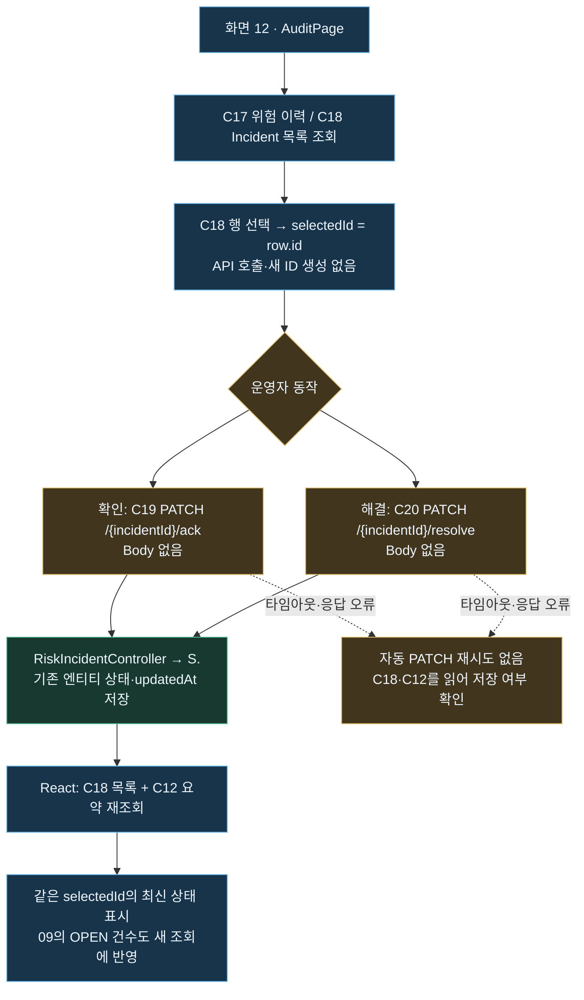
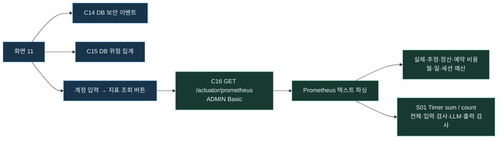

# 운영자 09~12 · API·코드 대조와 React 구현

최신 통합 검수는 [SCREEN09_12_ADMIN_INTEGRATION_REVIEW.md](SCREEN09_12_ADMIN_INTEGRATION_REVIEW.md)에 정리했다. 2026-10-21 빌드 성공·자동 테스트 20개·브라우저 57개, API·ID·인증, 입력·로딩·빈 결과·오류 복구, 프런트 수정 2건과 서버 미해결 사항을 포함한다. 아래 내용은 이전 회차 기록으로 보존한다.

2026-10-21 최신 API 재검수는 [SCREEN09_12_INTEGRATION_REVIEW.md](SCREEN09_12_INTEGRATION_REVIEW.md)에 통합했다. C12~C20의9개 API·필드·ID·인증을 실제 격리 서버에서10개그룹/52회 호출로 확인했고, 운영자 자동 검사18개·빌드가 통과했다. 공개 업무API8개·C17 원문 반환·해결된Incident의확인됨 역행을 재현했으며, 없는Incident ID가404 대신500인 점을 추가 기록했다. 아래2026-10-20 디자인·브라우저 수치와 구분한다.

2026-10-20 디자인 재대조: 다시 전달받은 네 초안의 사진 구도·타이포그래피·아이콘·카드/표 높이·여백·색상·테두리에 맞춰 공통 셸과 09~12 CSS를 수정했다. 데스크톱 헤더는 승인 이미지의 사진 부분을 CSS로 크롭하고, 로고·버튼·메뉴·본문은 실제 React/SVG로 렌더링한다. 1672×941 기준으로 09의 4·3·3, 10의 4 KPI·6단계·3분포, 11의 3열, 12의 좌우 목록·상세를 비교했다. 긴 표·감지 신호·상세 지표는 내부 스크롤하며 숫자·상태는 실제 API 응답을 사용한다. API 호출·ID·인증·Incident 처리 로직은 변경하지 않았다. 빌드와 기존 테스트 18개가 통과했고 실제 창에서도 가로 넘침 없이 선택·연관 이력 이동을 확인했다.

[디자인 검수 기록](../output/verification/OPERATOR_09_12_DESIGN_CHECK.json) · [09 최신 디자인](../output/verification/OPERATOR_DESIGN_09_DESKTOP.png) · [10 최신 디자인](../output/verification/OPERATOR_DESIGN_10_DESKTOP.png) · [11 최신 디자인](../output/verification/OPERATOR_DESIGN_11_DESKTOP.png) · [12 최신 디자인](../output/verification/OPERATOR_DESIGN_12_DESKTOP.png).

2026-10-20 · 첨부된 화면별 API 표와 운영자 흐름도를 실제 Java 코드·React와 대조했다. 화면 09~12에 연결하는 고유 API는 **C12~C20, 총 9개**다. S01~S05는 기록이 생성되는 상위 업무이며 운영자 화면 진입 시 자동 실행하지 않는다.

## 09~12 통합 검수 결과

2026-10-20 재검수: **네 화면 모두 실제 React 구현**이다. `operator.html`은 진입 파일이고 `main.jsx`의 `createRoot`가 `OperatorApp`을 렌더링한다. 사진은 공통 배경 이미지이며 카드·표·필터·상세·버튼은 JSX·React 상태·실제 API 응답으로 동작한다.

| 화면 | React 컴포넌트 | 라우팅·API | 결과 |
|---|---|---|---|
| 09 운영 요약 | [OverviewPage.jsx](../frontend/legal-procedure-viewer/src/operator/OverviewPage.jsx) | `#/overview` · C12 | 네 KPI·세 분포·이동 카드, 0건 항목 유지 |
| 10 마케팅 집계 | [MarketingPage.jsx](../frontend/legal-procedure-viewer/src/operator/MarketingPage.jsx) | `#/marketing` · C13 | 네 KPI·여정 6단계·분포 3개, 집계 단위 구분 |
| 11 보안·위험·비용 | [SecurityPage.jsx](../frontend/legal-procedure-viewer/src/operator/SecurityPage.jsx) | `#/security` · C14·C15·인증 후 C16 | DB 보안·위험 기록과 메모리 비용 지표를 별도 조회 |
| 12 위험 이력·Incident | [AuditPage.jsx](../frontend/legal-procedure-viewer/src/operator/AuditPage.jsx) | `#/audit` · C17~C20 | 표·필터·선택 상세·확인·해결, C18·C12 재조회 |

공통 디자인·아이콘·헤더·사이드바·서버 주소 설정은 `OperatorApp`과 공통 CSS/컴포넌트에서 공유한다. `operatorApi.js`가 요청·오류·인증 헤더를, `useResource.js`가 조회 상태·취소·이전 응답 무효화를 담당한다. 해시 라우팅과 별도 `operator.html` 빌드 진입점을 모두 확인했다.

### 첨부 구조도 전체 경로 검증

| 구조도 경로 | 이번에 확인한 실제 동작 |
|---|---|
| C03·C06·C10 → JPA/DB → C13 → 화면 10 | 가상 문의 1개·그 문의의 검색 요청 2개·상담 준비 상태를 저장. 문의 **+1**, 검색 요청 **+2**, 고유 검색 문의 **+1**, 현재 상담 준비 **+1** |
| P06 → JPA/DB → C13 | 방문·작성 시작·안내 확인 이벤트 각 +1. 같은 eventId 재전송은 `created=false`, 중복 집계 없음. 운영자 화면 진입만으로 P06을 자동 생성하지 않음 |
| S05 → 실행·위험 이력·조건부 Incident → C12·C15·C17·C18 | 가상 고위험 분석 1개 → 실행·위험 건수 +1, HIGH +1, OPEN +1. 응답의 `historyId=5`가 Incident의 `riskHistoryId=5`로 연결됨 |
| 인증 실패·접근 거절 → 보안 DB·MeterRegistry → C14·C16·C12 | C16 무인증 **401**, USER **403**, ADMIN **200**. C14 두 기록·C12 보안 건수 +2·해당 Metric Counter 각각 +1 |
| 화면 12 선택 → C19 → C18·C12 | 브라우저에서 `incidentId=3` 확인 → ACKNOWLEDGED. 위험 이력 ID 5 유지, C12 미확인 **1→0** |
| 같은 Incident → C20 → C18·C12 → 화면 09 | 브라우저에서 `id=3` 해결 → RESOLVED. 같은 ID·연관 위험 이력 유지, 09번 미확인 **0건**, 처리 버튼 비활성화 |
| S01~S04 → MeterRegistry → C16 → 화면 11 | Java 기록 코드와 Prometheus 필드·라벨 매핑 대조. 비용·예산은 실제 조회. 이번 재검수에서 유료 LLM·NeMo 호출로 새 토큰·시간을 만들지는 않음 |

검수 전후 React 값도 대조했다. 09번은 **실행 5 / 위험 5 / 보안 5 / 미확인 1→0**, 10번은 **문의 3 / 검색 요청 4 / 고유 문의 2 / 상담 준비 2**였다. 11번은 실제 예산 **월 $2·일 $1·세션 $0.30**, 비용 0·관측 없는 토큰/시간 `—`를 표시했다. 이 숫자는 가상 검증 기록이 있는 **로컬 H2 메모리 DB**의 당시 값이며 제품 기본값이나 운영 실적이 아니다.

**빌드 성공·테스트 18개 통과.** API·쓰기/재조회·응답 유실·필터·ID·401/403·지표 해석을 검증했고 백엔드·React 코드를 각각 독립 검토했다. [통합 API·브라우저 검증 JSON](../output/verification/OPERATOR_09_12_FULL_FLOW_CHECK.json), [09 화면](../output/verification/OPERATOR_FLOW_09_OVERVIEW.png), [10 화면](../output/verification/OPERATOR_FLOW_10_MARKETING.png), [11 화면](../output/verification/OPERATOR_FLOW_11_SECURITY.png), [12 화면](../output/verification/OPERATOR_FLOW_12_AUDIT.png).

### 구현 범위와 남은 서버 보강

- **화면·API 데이터 흐름은 연결 완료**다. 현재 **C12~C15·C17~C20은 공개 접근**, C16만 ADMIN Basic이다. 운영자용 화면 구현이 업무 API의 관리자 권한 강제를 의미하지 않는다.
- React는 해결된 Incident의 재확인 버튼을 막지만 서버 `RiskIncident.acknowledge()`는 상태를 무조건 변경한다. 다른 브라우저의 오래된 상태·직접 API 요청까지 막는 **서버 상태 전이·동시성 검증은 별도 보강** 대상이다.
- C17 응답에는 `userInput` 원문이 포함된다. React가 이를 렌더링하지 않는 것과 서버가 원문을 내려주지 않는 것은 다르다.
- S05는 **별도 분석 API**다. S01·S02 질문마다 S05·Incident가 자동 생성되는 구조는 아니다. C14는 현재 AUTH_FAILURE·ACCESS_DENIED를 저장하며 모든 AI 차단·정상 요청을 DB 사건으로 저장하지 않는다.
- C16 평균 처리 시간은 **S01 동기 Chat Timer** 기준이며 S02 SSE 전체 지연과 같지 않다. S03·S04는 가드레일 단계 비용에 연결된다. H2 기록은 서버 재시작 시 사라지며 영속 저장은 MySQL 프로필을 사용한다.

## ② API·코드 대조

같은 이름의 Controller·Service는 `S.`로 줄인다. 예: `RiskIncidentController → S.`는 `RiskIncidentService`다. 다른 이름의 Service는 전체 이름을 쓴다. 모든 API가 Java 코드에 구현돼 있으며, 아래 표의 성공 응답은 200이다.

| 화면 | API·동작 | 요청·ID·인증 | Controller → Service | 응답 → React 표시 |
|---|---|---|---|---|
| 09 | **C12** `GET /api/admin/dashboard/summary` | Body·Path·Query 없음. 현재 공개 접근 | `AdminDashboardController.summary()` → `S.summary()` | `agentRunCount`, `riskHistoryCount`, `securityEventCount`, `openIncidentCount` → 네 KPI. `riskSummary` → 위험 분포 |
| 10 | **C13** `GET /api/admin/dashboard/marketing-funnel` | 입력 없음. 현재 공개 접근 | `MarketingDashboardController.funnel()` → `S.funnel()` | 접수·검색·상담 준비 건수, `stages`, 사건 유형·다음 단계·지역 분포 → 집계 카드·단계 목록·막대 |
| 11 | **C14** `GET /api/admin/dashboard/security-events` | 입력 없음. 현재 공개 접근 | `AdminDashboardController.securityEvents()` → `S.recentSecurityEvents()` | 최신 최대 50건. `id`, `createdAt`, `eventType`, `method`, `uri`, `status`, `username` → 보안 이벤트 표 |
| 11 | **C15** `GET /api/agent/risk/summary` | 입력 없음. 현재 공개 접근 | `AgentRiskHistoryController.summary()` → **`AgentRiskHistoryQueryService.summarize()`** | `total`, `high`, `medium`, `low`, `decisionCounts`, `recommendedActionCounts` → 위험 수준·판정·조치별 분포 |
| 11 | **C16** `GET /actuator/prometheus` | **ADMIN Basic**. JSON Body 없음. 계정은 이 화면 메모리에만 유지 | Spring Boot Actuator → `MeterRegistry`. 직접 작성한 업무 Controller·Service 없음 | **Prometheus 텍스트** → 파싱 → 실제 반환된 비용·예산·Timer 표시. JWT로 대체하지 않음 |
| 12 | **C17** `GET /api/agent/risk/history` | 선택 Query `riskLevel` 또는 `decision`. 서버는 riskLevel 우선. 현재 공개 접근 | `AgentRiskHistoryController.history()` → **`AgentRiskHistoryQueryService.findRecent()`** | 왼쪽 표·선택 상세. 무조건 최신 50건이 아니라 **필터 없을 때만 최신 최대 50건** |
| 12 | **C18** `GET /api/incidents` | 입력 없음. 현재 공개 접근 | `RiskIncidentController.findRecent()` → `S.findRecent()` | 최신 최대 50개 `RiskIncidentResponse` → Incident 표·선택 상세 |
| 12 | **C19** `PATCH /api/incidents/{incidentId}/ack` | C18 행의 **`id`**를 Path로 전달. JSON Body 없음. 현재 공개 접근 | `RiskIncidentController.acknowledge()` → `S.acknowledge()` | 같은 ID의 Incident, `status=ACKNOWLEDGED`, 변경된 `updatedAt` → 확인됨 |
| 12 | **C20** `PATCH /api/incidents/{incidentId}/resolve` | C18 행의 **동일한 `id`**를 Path로 전달. JSON Body 없음. 현재 공개 접근 | `RiskIncidentController.resolve()` → `S.resolve()` | 같은 ID의 Incident, `status=RESOLVED`, 변경된 `updatedAt` → 해결됨 |

### 실제 응답 필드와 표시 범위

- **C12**: `riskSummary`는 C15와 같은 `AgentRiskHistoryQueryService.summarize()`를 Service 내부에서 재사용한 결과다. 화면 09에서 C15를 다시 HTTP 호출하지 않는다. OPEN 건수도 `RiskIncidentService.countOpen()`을 내부 호출한다.
- **C13**: `submittedIntakeCount`, `searchRequestCount`, `searchRequestedIntakeCount`, `consultationReadyIntakeCount`, `stages[{stage,count,measurement}]`, `caseTypeDistribution`, `desiredNextStepDistribution`, `regionDistribution`, `measurementBasis`, `dropOffMeasured`, `eventCounts`. 현재 기준은 `ALL_RECORDS_IN_CURRENT_DATABASE`, `dropOffMeasured=false`다. 서버의 집계 단위가 다른 값으로 전환율·이탈률을 만들지 않는다.
- **C17**: `id`, `userInput`, `toolName`, `decision`, `riskScore`, `riskLevel`, `signals`, `recommendedAction`, `guardrailReady`, `traceId`, `createdAt`. 요청 원문 `userInput`은 서버 응답에는 있으나 화면에는 표시하지 않는다. 이것이 서버 가명화 구현을 뜻하지는 않는다.
- **C18·C19·C20**: `id`, `incidentType`, `severity`, `status`, `decision`, `riskScore`, `recommendedAction`, `riskHistoryId`, `traceId`, `message`, `createdAt`, `updatedAt`. 화면의 `selectedId`는 C18의 `id`다. `riskHistoryId`는 별도의 위험 이력 연결 키이며 PATCH의 Path ID로 바꿔 넣지 않는다.
- Incident 선택은 **React 상태 처리**다. 별도 API 번호나 Incident 상세 GET을 만들지 않는다. C18에서 이미 받은 상세 필드를 사용하고, 현재 C17 결과에 같은 `riskHistoryId`가 있을 때만 감지 신호를 연결한다. 없으면 조회 범위 밖일 수 있다고 표시한다.
- C17 판정 필터는 실제 `AgentRiskDecision` 값 `SAFE`, `UNSTABLE_TOOL_LOOP`, `SUSPICIOUS_RETRY`, `RISKY_EXTERNAL_ACCESS`, `APPROVAL_BYPASS_RISK`, `HIGH_RISK_AGENT_BEHAVIOR`, `SUSPICIOUS`를 사용한다. 권고 조치 값인 ALLOW/BLOCK과 혼동하지 않는다.

### 인증·CORS 대조

[SecurityConfig](../backend/guardrail-ready-policy-checker/src/main/java/com/ohgiraffers/handlermethod/config/SecurityConfig.java)는 C16을 ADMIN Basic으로 보호한다. 반면 **현재 C12~C15·C17~C20은 `/api/** permitAll`에 들어간다.** 운영자 사이드바와 URL 분리는 서버 권한 검증이 아니다. 이번 구현에서는 기존 서버 인증 정책을 바꾸지 않았으며 관리자 보호 완료로 표시하지 않는다.

[WebMvcConfig](../backend/guardrail-ready-policy-checker/src/main/java/com/ohgiraffers/handlermethod/config/WebMvcConfig.java)는 API의 GET·POST·PATCH·OPTIONS, Actuator의 GET·OPTIONS와 Authorization 헤더를 허용한다. 현재 Origin 정책은 와일드카드다. 프런트는 `credentials: include`나 프록시로 권한을 우회하지 않고 Spring Boot에 직접 요청한다. C16 Basic만 해당 요청에 넣으며 다른 API로 전달하지 않는다.

## ③ React 구현

기존 법률 절차 Previewer와 같은 Vite 프로젝트의 별도 `operator.html` 진입점이다. 추가 라우터 패키지 없이 해시 경로를 사용하므로 새로고침·직접 URL·브라우저 뒤로/앞으로 이동이 가능하다.

| 화면 | 주소 | 컴포넌트 | 진입 시 조회 | 쓰기·후속 조회 |
|---|---|---|---|---|
| 09 운영 요약 | `/operator.html#/overview` | `OverviewPage` | C12만 | 새로고침 시 C12 |
| 10 마케팅 집계 | `/operator.html#/marketing` | `MarketingPage` | C13 | 새로고침 시 C13 |
| 11 보안·위험·비용 | `/operator.html#/security` | `SecurityPage` | C14 + C15 병렬 | 계정 입력·조회 버튼 → C16. 기록 새로고침은 C14 + C15 |
| 12 위험 이력·Incident | `/operator.html#/audit` | `AuditPage` | C17 + C18 병렬 | 선택 → C19 또는 C20 → **C18 + C12 별도 재조회** |

### 공통 디자인·컴포넌트

2026-10-20 초안 대조 수정: 화면 09의 기준은 사용자가 다시 첨부한 [승인 초안](prompts/LEGAL_INTAKE_SCREENS_02_12/references/09_OPERATOR_OVERVIEW_APPROVED.png)이다. 상단 사무실 사진·흰 브랜드 박스·오른쪽 운영자 메뉴, KPI 4개, **위험 등급/판단 결과/권장 조치의 독립 패널 3개**, 하단 가로 이동 카드 3개를 복원했다. 카드별 파랑·주황·빨강 강조와 아이콘·건수·비율도 반영했다. 초안에 있는 예시 숫자 대신 C12 실제 응답을 표시한다. 판단 4개·조치 5개 행은 초안 순서로 고정하고, **0건도 이름·0건·막대 배경을 표시**한다. 정상 조회된 빈 맵은 0건(0%)으로 표시하되 집계값 자체가 미제공·오류이면 0으로 꾸미지 않는다. 기본 API는 진입 시 자동 조회하고 서버 주소 변경은 운영자 메뉴의 고급 설정으로 옮겼다.

화면 표시용 묶음은 [overviewDistribution.js](../frontend/legal-procedure-viewer/src/operator/overviewDistribution.js)에서 관리한다. 서버 판단·정책을 변경하는 기능이 아니다. 표시명에 마우스를 올리면 실제 코드별 건수를 볼 수 있다.

| 패널·표시 항목 | 합산하는 서버 코드 |
|---|---|
| 판단 · 위험 감지 | HIGH_RISK_AGENT_BEHAVIOR, RISKY_EXTERNAL_ACCESS, APPROVAL_BYPASS_RISK |
| 판단 · 주의 필요 | UNSTABLE_TOOL_LOOP, SUSPICIOUS_RETRY |
| 판단 · 정상 | SAFE |
| 판단 · 추가 검토 | SUSPICIOUS 및 미등록 판단 코드 |
| 조치 · 추가 검토 | REQUIRE_APPROVAL |
| 조치 · 모니터링 | 초안의 고정 행. 현재 RecommendedAction에 대응 코드가 없어 0건. 서버 모니터링 권고 구현을 의미하지 않으며 툴팁에도 표시 |
| 조치 · 차단 검토 | BLOCK, BLOCK_AND_ESCALATE |
| 조치 · 정상 처리 | ALLOW |
| 조치 · 기타 | DISABLE_TOOL_TEMPORARILY, CREATE_INCIDENT 및 미등록 조치 코드 |

모든 실제 코드의 건수는 각 패널에서 한 번만 합산한다. C12의 원래 코드별 응답과 C17 상세 위험 이력은 그대로 유지한다. 빈 맵의 고정 행, 모든 코드·미등록 코드의 건수 보존, 미수집과 0의 구분에 대한 테스트 4개를 추가해 `npm run test:operator` 총 10개가 통과했다.

- 밝은 사무실 분위기, 네이비 사이드바, 로열블루 강조, 흰 카드·표를 공통 적용했다. 최신 선택인 **엄지척 원본**을 CSS로 가로 헤더에 크롭한다. 모니터·표정·엄지척을 살리고 상단 큰 제목·아이콘 줄을 제외했다. 화면 제목은 사진 아래에 둔다.
- `OperatorApp`이 공통 헤더·메뉴·서버 주소 설정·경로·운영 요약 리소스를 관리한다. `OverviewPage.jsx`는 화면 09의 승인된 배치를 별도로 구현한다.
- `Panel`, `Resource`, `Stat`, `Badge`, `RiskBars`, `Distribution`, `Metrics`를 재사용한다. 데이터 로딩·빈 목록·오류·재시도는 각각 표시한다. 실제 0과 미수집 값 `—`를 구분한다.
- `useResource`는 화면·서버 주소·필터가 바뀔 때 이전 조회를 취소한다. 늦게 도착한 이전 응답이 새 결과를 덮어쓰지 않게 한다. API 요청의 대기 상한은 15초다.
- API 번호·DTO·URL은 문서와 연결 코드에 두고, 제품 데이터 영역에는 사용자 업무명과 실제 데이터만 표시한다. C16 인증 방식은 계정 입력에 필요한 정보라 화면에 안내한다.
- 좁은 화면에서는 사이드바를 상단 메뉴로 바꾸고, 카드와 상세 영역을 쌓고, 표는 내부 가로 스크롤을 사용한다. 네 화면은 동일한 헤더 이미지를 공유한다.

### Incident 쓰기 흐름

2026-10-20 화면 12 갱신: [승인 초안](prompts/LEGAL_INTAKE_SCREENS_02_12/references/12_RISK_HISTORY_AND_INCIDENT_APPROVED.png)처럼 **왼쪽 위험 이력 표·상세 / 오른쪽 Incident 표·상세**로 재구현했다. [AuditPage.jsx](../frontend/legal-procedure-viewer/src/operator/AuditPage.jsx), [audit.css](../frontend/legal-procedure-viewer/src/operator/audit.css), [auditModel.js](../frontend/legal-procedure-viewer/src/operator/auditModel.js)에서 화면·표시 규칙·쓰기 후 재조회 흐름을 분리한다. 공통 사진 헤더·네이비 메뉴·흰 카드와 보안·비용으로 돌아가기·새로고침을 유지한다. 첫 반환 행을 상세에 표시하고 번호 버튼으로 선택·닫기를 지원한다. 좁은 화면에서는 두 패널을 위아래로 쌓으며 표 안에서 스크롤한다.

| 화면 12 동작 | 실제 연결 | 검수 결과 |
|---|---|---|
| 위험 이력 조회 | **C17** `GET /api/agent/risk/history` → `AgentRiskHistoryController.history()` → `AgentRiskHistoryQueryService.findRecent()` | 위험 수준/판정 라디오·값 선택 후 조회. 실제 enum 하나만 Query에 전송. 필터 없을 때 최근 최대 50개, 조건 조회는 50개 제한으로 표시하지 않음 |
| 위험 이력 선택·상세 | C17의 `id`, `createdAt`, `toolName`, `riskLevel`, `riskScore`, `decision`, `recommendedAction`, `signals`, `guardrailReady`, `traceId` | 이미 받은 행을 선택해 상세 표시. `userInput` 원문은 렌더링하지 않음. 모르는 코드는 원래 값으로 표시 |
| Incident 조회·선택 | **C18** `GET /api/incidents` → `RiskIncidentController.findRecent()` → `S.findRecent()` | 상태·심각도는 C18 재조회 후 **최근 최대 50개 안에서 React가 필터**. 지원하지 않는 서버 Query나 상세 GET을 만들지 않음 |
| 위험 이력 연결 | C18 `riskHistoryId` ↔ C17 `id` | 현재 C17 결과에 있으면 왼쪽 상세 선택 가능. 범위 밖이면 명시. 같은 Trace ID를 임의로 매칭하지 않음 |
| 확인 처리 | **C19** `PATCH /api/incidents/{incidentId}/ack` → `RiskIncidentController.acknowledge()` → `S.acknowledge()` | **C18 `id`**를 Path로 전달, Body 없음. 응답 ID·ACKNOWLEDGED 확인 후 C18·C12 각각 재조회 |
| 해결 처리 | **C20** `PATCH /api/incidents/{incidentId}/resolve` → `RiskIncidentController.resolve()` → `S.resolve()` | 같은 C18 `id`, Body 없음. 응답 ID·RESOLVED 확인 후 C18·C12 각각 재조회 |
| 필터 중 상태 변경 | 선택한 Incident ID 유지 | OPEN 필터에서 확인 후 행이 사라져도 상세는 새 상태를 보여주며 현재 필터 밖임을 안내 |

초안과 실제 계약의 차이는 값의 의미에 맞춰 반영했다. **점수는 0~100 정수**이며 0.92 같은 예시 값으로 바꾸지 않는다. `guardrailReady`는 **가드레일 준비 상태**이며 실제 NeMo 검사 적용 완료로 해석하지 않는다. 현재 Incident 생성 유형은 `AI_AGENT_RISK`이고 메시지도 반환된 값을 그대로 보여준다. 초안의 PII 감지·금지 요청 등 예시 유형을 임의 생성하지 않는다. `RH-00004`·`INC-00002`는 가독성을 위한 표시명이며 실제 요청에는 숫자 `2`를 사용한다.

검증에서는 로컬 H2에 가상 LOW·MEDIUM·HIGH 이력 3개를 만들었다. **Incident 2 ↔ 위험 이력 4**처럼 ID가 다른 사례를 사용해 브라우저에서 `OPEN → ACKNOWLEDGED → RESOLVED`를 확인했다. 확인 시 C12 `openIncidentCount`는 **1→0**, 두 처리 모두 `id=2`, `riskHistoryId=4`가 유지됐다. 위험 수준·판정 서버 필터, 상태·심각도 복합 필터·빈 결과·범위 밖 연관 이력·해결 후 버튼 비활성화를 확인했다. 외부 LLM 호출은 없다. 테스트 **18개**는 정상 쓰기 후 C18·C12 재조회, 응답 유실 시 자동 PATCH 재전송 방지, 저장 성공과 재조회 실패의 구분을 포함한다. [API·브라우저 검증 기록](../output/verification/OPERATOR_12_AUDIT_API_CHECK.json) · [화면](../output/verification/OPERATOR_12_RISK_INCIDENT.png).

확인은 OPEN에서만, 해결은 RESOLVED가 아닐 때만 활성화한다. 이것은 UI의 중복 동작 제한이며 서버가 엄격한 상태 전이·동시 수정 방지를 제공한다는 뜻은 아니다. 저장 중에는 쓰기 중복과 일반 메뉴·서버 변경을 막는다. 재조회에 일부 실패하면 저장 성공과 재조회 실패를 구분해서 표시한다. 브라우저 강제 이동 시 취소되더라도 PATCH가 서버에서 이미 처리됐을 수 있으므로 다음 진입에서는 최신 목록을 읽는다.

### 화면 10 · 승인 초안 → C13 필드 연결

2026-10-20: [10번 승인 초안](prompts/LEGAL_INTAKE_SCREENS_02_12/references/10_MARKETING_AGGREGATES_APPROVED.png)을 기준으로 `MarketingPage.jsx`와 `marketing.css`를 적용했다. 상단 공통 사진·브랜드와 활성 메뉴를 유지하고, KPI 4개·가로 여정 카드 6개·분포 패널 3개·하단 집계 기준 안내를 연결했다. 진입과 새로고침은 C13 GET만 호출하며, 운영 요약으로 버튼은 `#/overview`로 이동한다.

| 화면 영역 | C13 응답 필드 | 기준 |
|---|---|---|
| 접수된 문의 | `submittedIntakeCount` | 저장된 문의 수 |
| 검색 요청 건수 | `searchRequestCount` | 동일 문의의 여러 요청을 포함한 행 수 |
| 검색을 요청한 문의 수 | `searchRequestedIntakeCount` | 검색 요청이 있는 서로 다른 문의 수 |
| 현재 상담 준비 상태 | `consultationReadyIntakeCount` | 현재 CONSULTATION_READY 상태 수 |
| 여정 6개 카드 | `stages[].stage/count/measurement` | API 배열 순서·건수·집계 단위를 그대로 사용 |
| 사건 유형 분포 | `caseTypeDistribution` | 코드별 건수, 한국어 표시명 |
| 원하는 다음 단계 분포 | `desiredNextStepDistribution` | 서버가 반환한 실제 입력값별 건수 |
| 선호 지역 분포 | `regionDistribution` | 서버가 반환한 지역별 건수 |
| 분포 비율 | 분포 건수 ÷ `submittedIntakeCount` | 반올림한 문의 내 구성비. 단계 전환율이 아님 |
| 하단 집계 기준 | `measurementBasis`, `dropOffMeasured` | 현재 DB 전체·전환율/이탈률 미측정 안내 |

초안의 여정에서 검색 요청 행 수와 고유 문의 수가 혼동될 수 있다. 실제 `LAWYER_SEARCH_REQUESTED` 단계는 C13 계약의 **DISTINCT_INTAKE**이므로 `searchRequestCount`로 바꿔 넣지 않는다. `SUMMARY_VIEWED`는 초안의 "안내 확인"으로 표시하고 카드 아래에 원래 이벤트 코드를 함께 표시한다. 화면을 연 것만으로 P06 방문 이벤트를 기록하지 않는다.

연동 검증: 비어 있던 로컬 H2 DB에 가상 문의 2건과 동일 문의의 검색 요청 2건, P06 이벤트, 상담 준비 상태 1건을 만들었다. C13이 KPI **2 / 2 / 1 / 1**, 여정 6개, 사건·다음 단계·지역 분포 각각 **1건(50%) + 1건(50%)**을 반환하며 브라우저에도 반영되는 것을 확인했다. 외부 LLM 호출은 없다. 운영 데이터와 구분되는 로컬 검증 기록이다. [API 확인 기록](../output/verification/OPERATOR_10_MARKETING_API_CHECK.json).

### 비용·지연 조회 흐름

2026-10-20 화면 11 갱신: [승인 초안](prompts/LEGAL_INTAKE_SCREENS_02_12/references/11_SECURITY_RISK_AND_COST_APPROVED.png)과 같이 **왼쪽 C15 위험 요약 / 가운데 C14 보안 이벤트 / 오른쪽 C16 비용·성능**의 3열로 연결했다. 상단 운영 요약 이동·전체 새로고침, 각 패널의 조회 시각, 하단 DB 기록과 메모리 지표 구분 안내를 제공한다. 좁은 화면에서는 2열·1열로 쌓고 보안 표는 내부 스크롤한다.

| 화면 11 영역 | 실제 요청·코드 | 데이터·동작 |
|---|---|---|
| 위험 판단 요약 | C15 `GET /api/agent/risk/summary` → `AgentRiskHistoryController.summary()` → `AgentRiskHistoryQueryService.summarize()` | total·high·medium·low와 판단/권고 맵. 화면 09와 같은 표시 그룹으로 0건 항목도 표시 |
| 보안 이벤트 | C14 `GET /api/admin/dashboard/security-events` → `AdminDashboardController.securityEvents()` → `S.recentSecurityEvents()` | createdAt·eventType·method·uri·status·username. 최신 최대 50개를 그대로 표시. 현재 기록 코드는 AUTH_FAILURE·ACCESS_DENIED이며 정상 요청·PII 차단·속도 제한 기록을 임의로 만들지 않음 |
| AI 사용 비용·성능 | C16 `GET /actuator/prometheus` → Actuator·MeterRegistry | ADMIN Basic. 연결 설정 대화상자에 직접 입력하고 읽는다. 401·403을 구분하며, 미인증/실패에서도 항목은 남겨 두고 값은 — |
| 비용 요약 4개 | `ai_cost_actual_usd`, `ai_cost_estimated_usage_usd`, `ai_cost_accounted_usd`, `ai_cost_reserved_usd` | 실사용·추정 사용 정산·정산 합계·진행 중 예약 금액 |
| 예산 3개 | `ai_cost_budget_usd`, `ai_cost_daily_budget_usd`, `ai_cost_session_budget_usd` | 현재 서버의 월·일·세션 예산. 초안 예시 값을 하드코딩하지 않음 |
| 단계별 사용 비용 | `ai_cost_stage_accounted_usd{stage=...}` | 입력 `input_guardrail`, **LLM 비용 `answer`**, 출력 `output_guardrail`. 실제+추정 정산 합계 기준 |
| 토큰 사용량 | `ai_llm_tokens_total{type=prompt/completion}` | 모델별 반환 샘플을 각 type별 합산. 없는 Counter는 0으로 꾸미지 않음 |
| 처리 시간 | Timer `_sum / _count` | 전체 `ai_chat_duration_seconds`; **LLM 시간은 `stage=llm`**인 `ai_chat_stage_duration_seconds`. 입력·출력 시간은 펼침 영역. 평균 초 단위이며 0회 관측은 — |
| 새로고침·이동 | C14·C15 독립 재조회 + 인증된 동안 C16 재조회 | 개별 실패가 다른 패널을 지우지 않음. 운영 요약은 `#/overview`, 위험 이력·Incident 링크는 `#/audit` |

인증값은 현재 SecurityPage의 React 메모리에만 보관하며 Local/Session Storage에 저장하지 않는다. 연결 해제·화면 이동 때 지운다. C16 Authorization을 C14·C15에 전달하지 않는다. 이번 작업은 기존 서버 권한 정책을 바꾸지 않았다.

검증: 빌드와 `npm run test:operator` **13개 통과**. 브라우저에서 잘못된 비밀번호 401·USER 403·ADMIN 정상 조회를 확인했다. 실제 서버 값은 월 $2 / 일 $1 / 세션 $0.30, 비용·단계별 정산 0이다. 아직 AI Chat 관측이 없어 토큰·Timer는 —이며 유료 LLM 호출로 값을 생성하지 않았다. 보안 표·위험 분포·지표는 서로 다른 조회 시각을 가진다.

비용은 `ai_cost_accounted_usd`, `ai_cost_actual_usd`, `ai_cost_estimated_usage_usd`, `ai_cost_reserved_usd`와 예산 Gauge를 읽는다. 지연은 `ai_chat_duration_seconds_{sum,count}`, `ai_chat_stage_duration_seconds_{sum,count}`에 `stage=input_guardrail|llm|output_guardrail`을 적용한다. 호출 0회·결측은 `—`다. 세션 예산은 요청 1회 예산이 아니며, 누적 동기 Chat 평균을 SSE 지연·P95로 해석하지 않는다.

## 코드 위치

| 범위 | 파일 |
|---|---|
| 화면 진입점·공통 레이아웃·해시 경로 | [OperatorApp.jsx](../frontend/legal-procedure-viewer/src/operator/OperatorApp.jsx) · [operator.html](../frontend/legal-procedure-viewer/operator.html) |
| 화면별 데이터·선택·상태 변경 | [pages.jsx](../frontend/legal-procedure-viewer/src/operator/pages.jsx) |
| 화면 09의 4·3·3 배치·분포 | [OverviewPage.jsx](../frontend/legal-procedure-viewer/src/operator/OverviewPage.jsx) |
| 화면 10의 KPI·여정·분포·집계 기준 | [MarketingPage.jsx](../frontend/legal-procedure-viewer/src/operator/MarketingPage.jsx) · [marketing.css](../frontend/legal-procedure-viewer/src/operator/marketing.css) |
| 화면 11의 3열·관리자 지표 인증·비용/토큰/시간 | [SecurityPage.jsx](../frontend/legal-procedure-viewer/src/operator/SecurityPage.jsx) · [securityMetrics.js](../frontend/legal-procedure-viewer/src/operator/securityMetrics.js) · [security.css](../frontend/legal-procedure-viewer/src/operator/security.css) |
| 공통 카드·상태·차트·지표 | [components.jsx](../frontend/legal-procedure-viewer/src/operator/components.jsx) |
| 9개 API·Basic·오류·지표 파서 | [operatorApi.js](../frontend/legal-procedure-viewer/src/operator/operatorApi.js) |
| 취소·조회 상태 관리 | [useResource.js](../frontend/legal-procedure-viewer/src/operator/useResource.js) |
| 반응형·헤더 크롭 | [operator.css](../frontend/legal-procedure-viewer/src/operator/operator.css) |
| 승인 초안의 공통 레이아웃·차트·카드 색상 | [operator-draft.css](../frontend/legal-procedure-viewer/src/operator/operator-draft.css) · [Icon.jsx](../frontend/legal-procedure-viewer/src/operator/Icon.jsx) |
| C12·C14 | [AdminDashboardController](../backend/guardrail-ready-policy-checker/src/main/java/com/ohgiraffers/handlermethod/api/AdminDashboardController.java) → [AdminDashboardService](../backend/guardrail-ready-policy-checker/src/main/java/com/ohgiraffers/handlermethod/service/AdminDashboardService.java) |
| C13 | [MarketingDashboardController](../backend/guardrail-ready-policy-checker/src/main/java/com/ohgiraffers/handlermethod/api/MarketingDashboardController.java) → [MarketingDashboardService](../backend/guardrail-ready-policy-checker/src/main/java/com/ohgiraffers/handlermethod/service/MarketingDashboardService.java) |
| C15·C17 | [AgentRiskHistoryController](../backend/guardrail-ready-policy-checker/src/main/java/com/ohgiraffers/handlermethod/api/AgentRiskHistoryController.java) → [AgentRiskHistoryQueryService](../backend/guardrail-ready-policy-checker/src/main/java/com/ohgiraffers/handlermethod/service/AgentRiskHistoryQueryService.java) |
| C18~C20 | [RiskIncidentController](../backend/guardrail-ready-policy-checker/src/main/java/com/ohgiraffers/handlermethod/api/RiskIncidentController.java) → [RiskIncidentService](../backend/guardrail-ready-policy-checker/src/main/java/com/ohgiraffers/handlermethod/service/RiskIncidentService.java) |

## 실행·검증

프런트 프로젝트에서 `npm run dev -- --host 127.0.0.1` 후 [운영자 화면](http://127.0.0.1:5173/operator.html#/overview)을 연다. 기본 API 주소는 `http://localhost:8080`이며 연결 설정 또는 `VITE_API_BASE_URL`로 바꾼다. 백엔드는 기존 Gradle `bootRun`으로 별도 실행한다.

2026-10-20 검증 결과:

- Vite 프로덕션 빌드 성공. Previewer와 운영자 진입점을 함께 빌드했다.
- `npm run test:operator`: 6개 통과. 실제 HTTP 테스트 서버로 PATCH의 ID·Body, Basic 분리, 배열 계약, 401/403·Trace, 취소, 지표의 0·결측·태그를 확인했다.
- 새로 시작한 로컬 H2 메모리 DB에서 C12·C13·C14·C15·C17·C18 조회, C17 HIGH 필터, C16 무인증 401·USER 403·ADMIN 200, PATCH CORS 프리플라이트를 확인했다.
- 로컬 검증용 S05 입력으로 Incident 한 건을 생성했다. 외부 LLM 호출 없이 위험 기록·Incident를 만들고, 브라우저에서 **선택 → C19 확인됨 → C20 해결됨 → C18·C12 재조회**를 확인했다. 이 데이터는 임시 H2 DB의 검증 기록이며 운영 데이터가 아니다.
- 브라우저 C16 조회에서 서버 설정의 세션 예산 $0.3과 실제 AI 비용 0을 확인했다. LLM 응답 지연은 측정값이 없으므로 `—`로 표시됐다. 이는 실제 유료 LLM 호출 검증을 대신하지 않는다.
- [실제 API 검증 기록](../output/verification/OPERATOR_09_12_LIVE_CHECK.json) · [운영 요약 화면](../output/verification/OPERATOR_09_OVERVIEW.png) · [Incident 대응 화면](../output/verification/OPERATOR_12_INCIDENT_RESPONSE.png).

금요일 Postman은 필수 시연 흐름 중심으로 진행한다: 운영 요약 조회, 서로 다른 마케팅 집계 단위 확인, C16 인증 경계 확인, Incident 선택·확인·해결·재조회, 실제 LLM 호출·비용 통제 시연은 해당 AI 흐름에서 별도로 확인한다.

기존 193페이지 API Flow PDF는 갱신하지 않았다.
