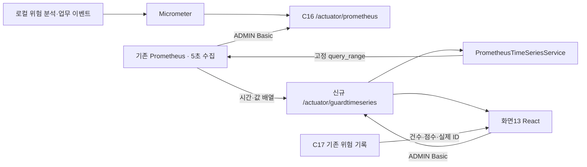

# 화면13 · React·실제 Prometheus 시계열·모의 검수

> 2026-10-23 운영자 권한 완료: C12~C15·C17~C20 업무8개 API는 ADMIN Bearer JWT 필수다. React 관리자 로그인·P01 확인·로그아웃·인증 실패 시 자료 제거를 연결했다. C16·guardtimeseries는 ADMIN Basic 유지. 아래 공개 접근 판정은 당시 검수 기록으로 읽는다. [최신 인증 계약·225/46 및 실제 브라우저 검증](OPERATOR_ADMIN_AUTH_REVIEW_2026-10-23.md).

2026-10-22 최종 갱신. 화면12 배너·남색 메뉴·흰 패널과 두 트랙 구성을 유지했다. 상태 배지는 이름 옆, 이력 링크는 제목 줄, 건수·요청 점수는 그래프 왼쪽에 모았다. 그래프는82px 높이의 선 그래프로 넓혔다. 화면14는 폐지하고 운영 설명은 화면13에서 펼친다.

## 실제 자료와 모의 자료

- 실제 화면: `http://127.0.0.1:5175/operator.html#/observability` → **지표 연결**에 기존 ADMIN Basic 계정 입력. C17은 자동 조회하고 C16·시계열은 인증 후 조회한다.
- 모의 화면: 위 화면의 **모의 자료 보기** 또는 `operator.html?mock=1#/observability`. 모든 그래프·건수·점수는 예시이며 노란 안내를 표시한다. API 요청·DB 저장·LLM 호출·과금 없음. 가상 이력 링크는 비활성화한다.
- 모의 자료 종료 시 실제 기록을 다시 조회한다. 실제 지표는 계정을 새로 입력해야 하며 모의값으로 채우지 않는다.
- 설치된 `C:/monitoring/prometheus/prometheus.exe`를 재사용했다. 원본 설정·9월 과거 TSDB는 수정하지 않고 프로젝트의 `monitoring/.runtime`에 새 수집 설정·데이터를 저장한다. 과거 기록을 새 그래프에 가져온 것은 아니다.

## 집계·점수·그래프의 구분

| 표시 | 근거·의미 |
|---|---|
| 카드별 반복 패턴 기록 하나 | C17 최근 최대50건의 **같은 ID 안에 위험 신호+RETRY가 있는 기록 수**. 중복 ID 제거. 독립 카운터를 더한 값이 아니다. |
| 요청 점수 | 최근 관련 요청1건의 서버 `scoreBreakdown`. 행동+재시도, 최대100. **80점 이상 차단·상위 검토 권고**. 그래프에서 점수를 새로 계산하지 않는다. |
| 선 그래프 | 실제 Prometheus `query_range` 결과. 최근1시간,15초 간격, 각 시점의 직전5분 `increase`. 도구·결과 등 원래 라벨 시리즈를 유지한다. |
| 파랑 | 정책 위반 / 재시도 |
| 초록 | 도구 호출 / 도구 오류 / 재시도 |
| 빨강 | 외부 접근 / 정책 위반 / 도구 호출 / 재시도 |
| 오른쪽 Dynamic Guard2 | C16의 대화별 최대 누적 점수·위험 이벤트·차단 전환. 기존100점·반복 기준과 사유 점수표 유지. |

여러 선의 동반 증가는 점검 신호이며 동일 요청·인과·실제 유출을 확정하지 않는다. `or`는 선을 함께 보여주는 연산이다. `increase`는 외삽으로 소수가 나올 수 있으므로 정수로 강제 반올림하지 않는다. 기록 건수와 그래프의 기간·측정 단위는 다르다. 관측 없음은 빈 안내, 실제0은0선, 누락 구간·NaN은 선을 끊어 표시한다. 기존 C17 발생 시각6칸 막대 분포는 화면에서 제거했다.

## API·요청·응답·ID·인증

| 동작 | API·입력·인증 | 응답·사용 |
|---|---|---|
| 패턴 건수·요청 점수 | **C17** `GET /api/agent/risk/history` · Body/Params 없음 · 현재 공개 정책 | `id, signals, riskScore, recommendedAction, scoreBreakdown`. 2026-10-23부터 userInput 원문은 서버 응답 DTO/JSON에서도 제외한다. |
| 현재 누적 지표 | **C16** `GET /actuator/prometheus` · ADMIN Basic · Body/Params 없음 | 현재 Micrometer 텍스트. 시간 이력 조회 API가 아니다. |
| 실제 시계열 | **보조 Actuator API 신규** `GET /actuator/guardtimeseries` · ADMIN Basic · Body/Params 없음 | `start,end,stepSeconds=15,windowSeconds=300,query,series[{metric,values}],warnings`. `metric.signal`로 각 카드에 배치. values는 Unix초·문자열 값 쌍. |
| 서버→Prometheus | `GET /api/v1/query_range` · 서버 설정 주소·job으로 고정 | query/start/end/step/timeout/limit. 클라이언트가 URL·PromQL·기간을 주입할 수 없다. ADMIN Basic은 Prometheus 조회로 전달하지 않는다. |
| 실제 이력 링크 | `#/audit?riskId={C17.id}` | 같은 실제 위험 이력 선택. 모의 ID는 전달하지 않는다. |

추가 연결은 `GuardTimeSeriesEndpoint.read()` → `PrometheusTimeSeriesService.read()`다. 기존 Actuator ADMIN 체인·CORS를 재사용한다. **번호가 붙은 기존 API37개는 유지하되 보조 Actuator 읽기 API1개를 실제로 추가했다. 전체 API가 여전히37개뿐이라는 뜻은 아니다.** 신규 DB 테이블·컬럼·ERD·위험 점수 정책 변경은 없다.

조회는 최근1시간·15초 간격·최대128시리즈·241샘플/시리즈·응답2MB로 제한했다. upstream timeout5초·클라이언트7초, redirect 미허용. job·서버 주소는 서버 설정이며 임의 Query를 프록시하지 않는다. 실제 모드에서만30초 자동 갱신하며 해제할 수 있다. 이동·해제·인증 실패 시 계정·관측값을 지운다. 저장소에 계정을 보관하지 않는다.

## 검증 결과

- 프런트 자동 검사 **35개 통과**, 프로덕션 빌드 성공.
- 백엔드 전체 검사 **202개 통과**, `bootJar` 성공. 신규 HTTP 범위 조회·오류·입력 설정 검사3개와 ADMIN/USER/익명/Bearer/preflight/read-only 통합 검사1개 포함.
- 모의 브라우저 **17항목 통과**: 단일 패턴 건수,3개 선 그래프(2/3/4종 신호),배지 위치,지표0/미관측,수집 대상 DOWN,503·403·잘못된 응답·재조회·로딩,인증 헤더 격리·스토리지·모바일390px 및1366px 가로 넘침·JS 오류0.
- 실제 서버 연동 **10항목 통과**. 가상 위험 입력은 S05 로컬 규칙 분석만 사용했다. Micrometer의 실제 카운터를 기존 Prometheus가 수집하고,6시리즈·0초과 샘플을 반환했다. 서버 응답을 같은 query/start/end/step의 Prometheus 직접 조회와 대조해 일치했다.
- 별도 모의 화면은 가상 이력 링크 비활성·새로고침 API0회·실제 화면 복귀 시 계정 초기화·직접 모의 URL을 검증했다.
- 검수 서버8080은 별도 메모리 H2·빈 공급자 키·닫힌 공급자 주소·검색 비활성으로 실행했다. **실제 외부 도구·LLM 유료 호출0회**. 실제 지표 수집 성공은 실제 위험 고객 데이터·LLM 호출 성공을 의미하지 않는다.

현재 개발 미리보기용 Spring8080·Prometheus9090은 화면 확인용으로 실행 중이다. 실제 LLM 실험 전에는 기존 키 설정·실험용 실행 설정을 별도로 복원해야 한다. 기존 운영 보안 과제(C17 공개 조회 등)는 이번 읽기 API 추가와 별개다.

## 설정·소스·증거

- [기존 Prometheus 재사용·실행 방법](../monitoring/README.md), [확정 디자인 방향](prompts/13_OBSERVABILITY_DRAFT_DIRECTION.md)
- [React](../frontend/legal-procedure-viewer/src/operator/ObservabilityApproved.jsx), [차트](../frontend/legal-procedure-viewer/src/operator/PatternTimeSeries.jsx), [모의 자료](../frontend/legal-procedure-viewer/src/operator/observabilityMock.js)
- [신규 Actuator 읽기 API](../backend/guardrail-ready-policy-checker/src/main/java/com/ohgiraffers/handlermethod/observability/GuardTimeSeriesEndpoint.java), [범위 조회 서비스](../backend/guardrail-ready-policy-checker/src/main/java/com/ohgiraffers/handlermethod/observability/PrometheusTimeSeriesService.java)
- [모의 브라우저 결과](../output/obs13-prometheus/browser-mock-verification.json), [실제 Prometheus 통합 결과](../output/obs13-prometheus/live-verification.json), [실제 수집 화면](../output/obs13-prometheus/screen13-real-prometheus.png), [모의 모바일](../output/obs13-prometheus/screen13-preview-390.png)

공식 계약: [Prometheus range query](https://prometheus.io/docs/prometheus/latest/querying/api/#range-queries). 이전 승인 시안·C17 막대 검수 자료는 output에 보존하며 최신 실제 시계열 증거와 구분한다.
