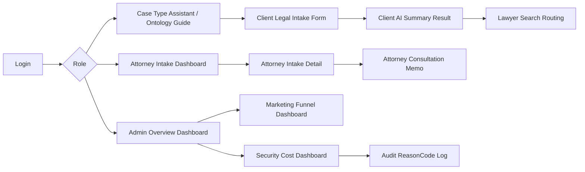

# Screen Design Draft

Project: Security-Aware Legal AI Intake System  
Version: Draft v0.1  
Date: 2026-10-14  
Purpose: 화면 정의서 초안 / 발표 산출물 / 구현 범위 조정 기준

## 1. Screen Design Goal

이 프로젝트의 화면은 단순한 챗봇 UI가 아니라, 법률 문의가 고객 입력에서 변호사 검토, 보안/비용 통제, 운영 dashboard까지 이어지는 흐름을 보여주는 것을 목표로 한다.

핵심 화면 구조는 다음 3가지 사용자 관점으로 나눈다.

```text
Client Version
-> 고객이 선택형 Legal Intake Form을 통해 자신의 사건을 정리한다.

Attorney Version
-> 변호사가 상담 전 사건 요약, 보유 자료, 원하는 도움을 확인한다.

Admin / Marketing / Security Dashboard
-> 변호사 또는 운영자가 문의 흐름, 전환 손실, 보안 차단, 비용 차단을 확인한다.
```

## 2. Recommended Screen Count

제출용 화면 정의서는 총 12장으로 구성한다.

| Layer | Screen Count | Purpose |
| --- | ---: | --- |
| Common / Auth | 1 | 로그인 및 역할 진입 |
| Client | 4 | 고객 intake 입력, 챗봇형 안내, 변호사 탐색 |
| Attorney | 3 | 변호사 상담 전 사건 검토 |
| Admin / Dashboard | 4 | 마케팅, 보안, 비용, audit 관측 |
| Total | 12 | 제출용 화면 설계 초안 |

### MVP Priority

| Priority | Screens |
| --- | --- |
| Must | Login, Client Intake Form, Client Result, Attorney Intake Detail, Security/Cost Dashboard |
| Should | Client Search Routing, Attorney Intake List, Marketing Dashboard, Audit Log |
| Could | Client History, Attorney Memo, Advanced Search Result Explanation |

## 3. Overall Screen Flow



## 4. Role Definition

| Role | Main Goal | Main Screens |
| --- | --- | --- |
| Client | 법률 용어를 몰라도 문의를 구조화하고 안내를 받는다 | Intake Start, Intake Form, AI Summary, Search Routing |
| Attorney | 상담 전 사건 유형, 자료, 고객 의도를 빠르게 파악한다 | Intake Dashboard, Intake Detail, Memo |
| Admin / Owner Attorney | 문의 흐름, 전환율, 보안 차단, 비용 차단을 관측한다 | Marketing Dashboard, Security/Cost Dashboard, Audit Log |

## 5. Screen List Summary

| No | Screen Name | Role | Main Function |
| ---: | --- | --- | --- |
| 1 | Login | Common | JWT 로그인, 역할 기반 진입 |
| 2 | Case Type Assistant / Ontology Guide | Client | 사건 유형과 소분류를 온톨로지 기반으로 1차 분류 |
| 3 | Client Legal Intake Form | Client | 선택형 intake 입력 |
| 4 | Client AI Summary Result | Client | 챗봇형 사건 요약 및 준비자료 안내 |
| 5 | Lawyer Search Routing | Client | 변호사 탐색 조건 및 검색 결과 설명 |
| 6 | Attorney Intake Dashboard | Attorney | 접수된 문의 목록 확인 |
| 7 | Attorney Intake Detail | Attorney | 사건 상세, 자료, AI 요약 확인 |
| 8 | Attorney Consultation Memo | Attorney | 상담 전 메모, 상태 변경 |
| 9 | Admin Overview Dashboard | Admin | 전체 운영 현황 요약 |
| 10 | Marketing Funnel Dashboard | Admin | 문의 전환 흐름과 이탈 지점 관측 |
| 11 | Security Cost Dashboard | Admin | 보안 차단, 비용 차단, 토큰 사용 관측 |
| 12 | Audit ReasonCode Log | Admin | reasonCode, 차단 사유, 로그 추적 |

## 6. Detailed Screen Draft

## Screen 1. Login

### Purpose

로그인 사용자가 어떤 역할로 서비스에 들어가는지 결정한다.

### User

Client, Attorney, Admin

### Main UI Elements

- Email / ID input
- Password input
- Login button
- Demo role shortcut
  - Client demo
  - Attorney demo
  - Admin demo
- Login error message

### Main Action

```text
사용자 로그인
-> JWT 발급
-> role 확인
-> role별 main screen으로 이동
```

### API

```text
POST /api/auth/login
GET /api/me
```

### Security Point

```text
JWT 없음
-> 401

권한 부족
-> 403
```

## Screen 2. Case Type Assistant / Ontology Guide

### Purpose

고객이 자기 사건이 민사/형사/가사/전자소송 중 어디에 속하는지 몰라도, 선택형 온톨로지 가이드와 짧은 설명 입력을 통해 사건 유형과 소분류를 1차 분류한다.

### User

Client

### Main UI Elements

- Inquiry purpose select
  - 절차 안내
  - 필요한 자료 확인
  - 작성 문서 검토
  - 변호사 선임/계약 검토
  - 전자소송 제출 안내
- Legal ontology guide cards
  - 민사
    - 대여금 / 계약 / 임대차 / 손해배상 / 지급명령 / 사기 피해 금전반환
  - 형사
    - 사기 고소 / 폭행·상해 / 명예훼손·모욕 / 피고소인 조사 / 경찰 조사
  - 가사
    - 이혼 / 양육비 / 상속 / 친권·양육권 / 재산분할
  - 전자소송
    - 혼자 소송을 준비하고 있어요 / 소장 제출 / 답변서 제출 / 보정명령 대응 / 송달·사건조회
  - 잘 모르겠음
    - 챗봇 도우미에게 사건을 한두 문장으로 적어 자동 분류 요청
- Short description assistant
  - "무슨 일인지 한두 문장으로 적어주세요."
  - example: "사기를 당한 것 같아요. 돈을 보냈는데 연락이 안 됩니다."
  - example: "돈을 빌려줬는데 못 받고 있습니다."
  - example: "이혼과 양육비 문제가 같이 있습니다."
- AI classify button
  - 사건 유형 자동 분류
- Classification result preview
  - 추천 사건 유형
  - 추천 소분류
  - 준비하면 좋은 자료
- Next button to detailed intake form

### Main Action

```text
고객이 사건 유형/소분류 선택 또는 짧은 설명 입력
-> AI 또는 rule 기반 미니 법률 온톨로지 분류
-> 추천 사건 유형과 소분류 preview
-> Legal Intake Form으로 이동
```

### PM Value

```text
고객은 민사/형사/가사/전자소송을 몰라도 시작할 수 있다.
시스템은 고객 표현을 온톨로지 구조로 바꾼다.
이 화면은 Legal Intake Form으로 들어가기 전의 1차 분류 assistant다.
```

## Screen 3. Client Legal Intake Form

### Purpose

고객이 사건 정보를 선택형/짧은 서술형으로 입력한다.

### User

Client

### Main UI Elements

- Case type / dispute area confirmation
  - Screen 2에서 선택 또는 자동 분류된 사건 유형
  - Screen 2에서 선택 또는 자동 분류된 소분류/분쟁 영역
  - 필요 시 수정 가능
- Party position
  - 피해자
  - 피고소인
  - 원고
  - 피고
  - 신청인
  - 상대방
  - 잘 모르겠음
- Core facts
  - 사건 발생일
  - 상대방
  - 문제가 된 금액 또는 피해 규모
  - 현재 진행 단계
  - 핵심 내용 한 문장
- Available documents checkbox
  - 계약서
  - 입금 내역
  - 카카오톡/문자
  - 사진/영상
  - 소장/고소장/통지서
  - 없음
- Desired next step
  - 상담
  - 서면 검토
  - 소송 준비
  - 전자소송 제출
  - 변호사 선임
- Submit button

### Main Action

```text
Legal Intake 제출
-> DTO Validation
-> Fixed Guard
-> Cost Control
-> Legal Intake DB 저장
-> AI Summary 생성 또는 템플릿 응답 생성
```

### API

```text
POST /api/intakes
```

### Validation

```text
필수 입력 누락
-> 400 Bad Request

입력 길이 초과
-> REQUEST_TOO_LONG 또는 COST_LIMIT_BLOCKED
```

## Screen 4. Client AI Summary Result

### Purpose

고객이 입력한 선택값을 챗봇형 자연어 안내문으로 정리해 보여준다.

### User

Client

### Main UI Elements

- Current case type summary
- Dispute area summary
- Reason text
- Recommended documents
- Next organization direction
- Privacy masking notice
- Search lawyer button
- Save / copy summary button

### Example Output

```text
현재 문의는 민사 사건에 가까워 보입니다.

금전 반환 또는 대여금 분쟁 가능성이 있습니다.
상담 전에는 입금 내역, 카카오톡/문자 대화,
상대방에게 반환을 요청한 기록을 날짜순으로 정리해 주세요.

입력하신 개인정보는 답변에 그대로 표시하지 않고 마스킹 처리됩니다.
```

### Security Point

```text
Privacy Output Guard
-> 주민번호, 계좌번호, 전화번호 등 출력 마스킹
```

### API

```text
GET /api/intakes/{id}
POST /api/ai/intake-summary
```

## Screen 5. Lawyer Search Routing

### Purpose

고객 입력을 변호사 탐색 조건으로 바꾸고, 검색 결과를 설명한다.

### User

Client

### Main UI Elements

- Search condition preview
  - 법률 분야
  - 분쟁 유형
  - 지역
  - 전문분야
  - 공직/수사기관 경력 선호 여부
- Search source policy
  - 대한변협 공식 검색
  - 네이버 공개 검색
  - OpenAI web search summary
- Search result explanation
- Official source URL
- Important notice
  - 특정 변호사 추천이 아니라 공개 정보 탐색 기준 제공

### Main Action

```text
Intake 입력
-> Lawyer Search Condition 생성
-> AI Search Request 저장
-> 공개 검색 결과 요약
-> 출처 URL 표시
```

### API

```text
POST /api/intakes/{intakeId}/search-requests
GET /api/intakes/search-requests/{searchRequestId}
POST /api/intakes/search-requests/{searchRequestId}/results
```

### Risk Control

```text
실제 수임 알선처럼 보이지 않게 설계
-> 추천이 아니라 검색 조건과 공개 정보 비교 기준 제공
```

## Screen 6. Attorney Intake Dashboard

### Purpose

변호사가 접수된 문의를 목록으로 확인한다.

### User

Attorney

### Main UI Elements

- Intake list table
  - 접수 시간
  - 사건 유형
  - 분쟁 영역
  - 고객 위치
  - 원하는 다음 단계
  - 보유 자료 수
  - 상태
- Filter
  - caseType
  - desiredNextStep
  - status
  - createdAt
- Sort
  - 최신순
  - 상담 준비 완료순
  - 위험 차단 제외

### Main Action

```text
접수 목록 조회
-> 사건 상세 화면으로 이동
```

### API

```text
GET /api/intakes
```

## Screen 7. Attorney Intake Detail

### Purpose

변호사가 상담 전 사건 구조를 빠르게 파악한다.

### User

Attorney

### Main UI Elements

- Client intake summary
- Case type
- Party position
- Core facts
- Available documents
- Desired next step
- AI-generated summary
- Privacy-masked output
- Search condition preview
- Audit / security status badge

### Main Action

```text
Intake detail 확인
-> 상담 전 검토
-> 메모 작성 또는 상태 변경
```

### PM Value

```text
변호사는 기본 사실관계 질문 시간을 줄이고,
쟁점 파악과 전략 검토에 시간을 쓸 수 있다.
```

## Screen 8. Attorney Consultation Memo

### Purpose

변호사가 상담 전 메모와 처리 상태를 관리한다.

### User

Attorney

### Main UI Elements

- Attorney memo textarea
- Status select
  - SUBMITTED (접수 / 기존 화면 초안의 NEW)
  - REVIEWED
  - NEED_MORE_INFO
  - CONSULTATION_READY
  - CLOSED
- Follow-up checklist
  - 자료 보완 요청
  - 상담 예약 필요
  - 서면 검토 필요
  - 전자소송 안내 필요
- Save button

### API

```text
PATCH /api/intakes/{id}/status
POST /api/intakes/{id}/memo
```

### MVP Note

이 화면은 실제 구현이 늦어지면 `Attorney Intake Detail` 안의 section으로 합칠 수 있다.

## Screen 9. Admin Overview Dashboard

### Purpose

운영자가 전체 서비스 상태를 한눈에 본다.

### User

Admin / Owner Attorney

### Main UI Elements

- Total inquiries
- Today inquiries
- Consultation-ready count
- Blocked request count
- Cost-blocked count
- Average intake completion rate
- Recent risk alerts

### Main Action

```text
운영 현황 확인
-> marketing / security / audit detail로 이동
```

### Data Source

```text
legal_intake
ai_search_request
security metric
cost metric
audit log
```

## Screen 10. Marketing Funnel Dashboard

### Purpose

변호사 또는 사무소 운영자가 문의가 어디서 끊기는지 확인한다.

### User

Admin / Owner Attorney

### Main UI Elements

- Funnel
  - 방문
  - Intake 시작
  - Intake 제출
  - AI Summary 확인
  - Lawyer Search Routing 클릭
  - 상담 준비 완료
- Case type distribution
- Desired next step distribution
- Drop-off point chart
- Region / case type heatmap draft

### PM Value

```text
이 시스템은 단순 챗봇이 아니라,
초기 문의가 어디서 끊기는지 관찰하는 intake system이다.
```

### Metrics

```text
intake_started_total
intake_submitted_total
intake_summary_viewed_total
lawyer_search_requested_total
consultation_ready_total
```

## Screen 11. Security Cost Dashboard

### Purpose

AI 보안 차단과 비용 차단을 운영자가 확인한다.

### User

Admin / Owner Attorney

### Main UI Elements

- Fixed Guard blocked count
- Dynamic Guard blocked count
- Cost Control blocked count
- Privacy Output masked count
- Token estimated / actual usage
- Session budget usage
- Daily budget usage
- Top reasonCode chart

### ReasonCode Examples

```text
BLOCKED_JAILBREAK
BLOCKED_PROMPT_INJECTION
BLOCKED_LEGAL_HARM
BLOCKED_PRIVACY_RISK
BLOCKED_AUTH_BYPASS
COST_LIMIT_BLOCKED
REQUEST_TOO_LONG
DYNAMIC_SESSION_BLOCKED
```

### Metrics

```text
ai_fixed_guard_block_total
ai_dynamic_guard_block_total
ai_cost_block_total
ai_privacy_mask_total
ai_estimated_token_total
ai_actual_token_total
```

## Screen 12. Audit ReasonCode Log

### Purpose

어떤 요청이 왜 차단되었는지 추적한다.

### User

Admin / Owner Attorney

### Main UI Elements

- Log table
  - timestamp
  - sessionId
  - userId
  - requestType
  - allowed
  - reasonCode
  - estimatedTokens
  - actualTokens
- Filter
  - reasonCode
  - date
  - user/session
  - blocked only
- Detail drawer
  - sanitized input
  - policy decision
  - fallback response

### Main Action

```text
차단 사유 확인
-> metric과 실제 요청 mapping
-> Postman 실험 evidence로 활용
```

### Security Note

Audit 화면에서도 원본 개인정보를 그대로 노출하지 않는다.

## 7. Screen-to-Backend Mapping

| Screen | Main Backend Module |
| --- | --- |
| Login | Spring Security / JWT |
| Case Type Assistant / Ontology Guide | React state / DTO / mini ontology classification |
| Client Legal Intake Form | LegalIntakeRecordController |
| Client AI Summary Result | MinimalLegalIntakeService / AiService |
| Lawyer Search Routing | LawyerSearchCondition / AiSearchRequest |
| Attorney Intake Dashboard | LegalIntakeRepository |
| Attorney Intake Detail | LegalIntakeRecordService |
| Attorney Consultation Memo | Future memo/status module |
| Admin Overview Dashboard | Metric / aggregate query |
| Marketing Funnel Dashboard | Intake event metric |
| Security Cost Dashboard | AiMetricRecorder / CostControl |
| Audit ReasonCode Log | Audit log / reasonCode event |

## 8. Screen-to-ERD Mapping

2026-10-16 현재 코드 기준. 상세 데이터 관계와 실제 FK 여부는 [BACKEND_ERD.md](C:/myLectureWs/legal-ai-intake-security-server/docs/BACKEND_ERD.md)를 사용한다. 아래는 화면 설계와 저장 대상의 매핑이며 프런트 연결 완료를 의미하지 않는다.

| Entity / Table | Used Screens | 현재 저장 의미 |
| --- | --- | --- |
| legal_intake | Client Form, Attorney Dashboard, Attorney Detail | 문의·현재 상태·세션·선택 소유자 |
| intake_document | Client Form, Attorney Detail | 선택 자료 종류 또는 업로드 메타데이터·BLOB 원본 |
| lawyer_search_condition | Lawyer Search Routing, Attorney Detail | 분야·분쟁·지역·선호 조건·검색문 |
| ai_search_request | Lawyer Search Routing, Admin Dashboard | 문의·조건 ID로 준비한 검색 요청 기록 |
| search_result_snapshot | Lawyer Search Routing, Audit/Review | 전달받아 저장한 검색 결과 제목·URL·요약 |
| consultation_memo | Attorney Consultation Memo, Attorney Detail | 메모 원문·후속 조치 |
| intake_document_download | Intake Detail의 파일 다운로드 동작 | 사용자·문의·파일·다운로드 요청 시각 |
| intake_event | Client 행동, Marketing Funnel Dashboard | 명시적으로 보고한 방문·문의 시작·요약 조회 |
| legal_procedure / legal_procedure_step / legal_form_template | Ontology Guide, Legal Reference | 기존 절차·단계·양식 조회 데이터, 실제 procedure_id FK |

핵심 접수·검색 테이블 사이는 일반 ID 참조이며 Service에서 존재·연결을 확인한다. 새 파일·검색 이력의 소유자 검사는 전체 문의 API의 인가와 구분한다. 미래 audit_log 전용 테이블은 현재 구현 목록에 포함하지 않는다.

## 9. Implementation Priority

일정은 [12일 개발 계획](PROJECT_12_DAY_PLAN.md)을 따른다. 기존 화면 정의를 다음 단계에 맞춰 구현·연결한다.

| Day | 화면·API 관점의 작업 |
|---|---|
| 1~2 | 제품 범위·화면·API·데이터 설계와 Screen–API–Controller 매핑 초안 |
| 2~4 | 문의·자료·검색 조건·검색 요청 기록의 백엔드 저장·조회 API |
| 5 | 확정 경로의 보안·비용 연결, DB 점검과 Postman 준비 |
| 6~7 | API별 Postman·코드 매핑, DDD·Event Storming·Policy 매핑, 발견 오류 수정 |
| 8 | 핵심 React 화면·Metric Dashboard 구현, 기존 API·state·DTO 연결, 브라우저 확인 |
| 9~10 | LLM Search Routing·실제 외부 검색·결과 설명의 API 및 화면 연결 |
| 11~12 | 통합 검증·최종 수정, 누적 산출물·캡처·시연·발표 정리 |

## 10. Final Screen Scope Recommendation

이번 프로젝트의 화면은 많아 보이지만, 실제 구현에서는 다음 방식으로 줄일 수 있다.

```text
Client side
-> 4 screens

Attorney side
-> 2 screens + memo section

Admin side
-> 3 dashboards + audit table

Login
-> 1 screen
```

따라서 발표용 화면 정의서는 12장으로 제시하되, 실제 구현은 8~10개의 React view로 압축할 수 있다.

핵심은 화면 수가 아니라 다음 흐름이 보이는 것이다.

```text
고객은 선택한다.
챗봇은 정리한다.
변호사는 구조화된 사건 정보를 본다.
운영자는 문의 흐름, 보안 차단, 비용 차단을 dashboard로 본다.
```
