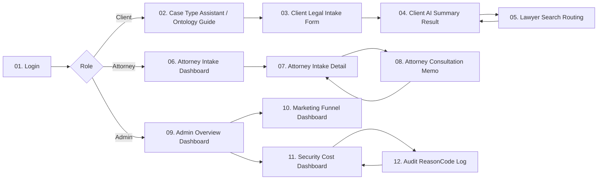

# Screen Wireframe Prompt Set

Project: Security-Aware Legal AI Intake System  
Purpose: 화면 정의서 기반 와이어프레임 생성용 프롬프트  
Version: Draft v0.1  
Date: 2026-10-14

## 1. How To Use

이 문서는 화면 정의서가 아니라, ChatGPT / Claude / Figma AI / 디자인 도구에 넣어 화면 스케치를 만들기 위한 프롬프트 세트다.

각 화면은 다음 형식으로 정리한다.

```text
번호 + 화면 제목
-> 화면 목적
-> 반드시 들어갈 UI 요소
-> 사용자가 누를 수 있는 주요 action
-> 다음 화면 연결
-> 디자인 생성 프롬프트
```

## 2. Common Design Direction

모든 화면에 공통으로 적용할 디자인 방향은 다음과 같다.

```text
Product:
Security-Aware Legal AI Intake System

Style:
Professional, trustworthy, practical, clean legal-tech SaaS dashboard.
Not a marketing landing page.
Not decorative.
This is a working tool for clients, attorneys, and law-office operators.

Layout:
Desktop-first web application, 1440px wide.
Use a clear top navigation or left sidebar depending on the role.
Use cards only for repeated items, summaries, and dashboards.
Keep forms clean and easy to scan.

Tone:
Korean UI text.
Calm, structured, low-friction.
The user should feel: "I know what to do next."

Visual Priority:
1. User flow clarity
2. Case information structure
3. Security and cost status visibility
4. Attorney and operator decision support

Color:
Light neutral background.
Use restrained accent colors for status:
- blue: normal / guidance
- green: complete / safe
- amber: warning / needs review
- red: blocked / risk

Do not make a hero landing page.
Design the actual working screen.
```

## 3. Numbered Screen Flow Chart



## 4. Screen Prompt Summary

| No | Screen Title | Role | Main Purpose |
| ---: | --- | --- | --- |
| 01 | Login | Common | JWT 로그인과 역할 기반 진입 |
| 02 | Case Type Assistant / Ontology Guide | Client | 사건 유형과 소분류를 온톨로지 기반으로 1차 분류 |
| 03 | Client Legal Intake Form | Client | 선택형 intake 입력 |
| 04 | Client AI Summary Result | Client | 챗봇형 사건 요약과 준비자료 안내 |
| 05 | Lawyer Search Routing | Client | 변호사 탐색 조건과 검색 결과 설명 |
| 06 | Attorney Intake Dashboard | Attorney | 접수된 문의 목록 확인 |
| 07 | Attorney Intake Detail | Attorney | 상담 전 사건 상세 검토 |
| 08 | Attorney Consultation Memo | Attorney | 상담 메모와 상태 관리 |
| 09 | Admin Overview Dashboard | Admin | 전체 운영 현황 요약 |
| 10 | Marketing Funnel Dashboard | Admin | 문의 전환 흐름과 이탈 지점 관측 |
| 11 | Security Cost Dashboard | Admin | 보안 차단과 비용 통제 관측 |
| 12 | Audit ReasonCode Log | Admin | 차단 사유와 로그 추적 |

## 5. Screen-Specific Prompts

## 01. Login

### Purpose

사용자가 로그인하고 Client / Attorney / Admin 역할에 따라 다른 화면으로 진입한다.

### Required UI

- Product name: Security-Aware Legal AI Intake System
- Email / ID input
- Password input
- Login button
- Demo role buttons
  - Client Demo
  - Attorney Demo
  - Admin Demo
- Small security message
  - JWT authentication
  - role-based access
- Login error area

### Next Screen

```text
Client Demo -> 02. Case Type Assistant / Ontology Guide
Attorney Demo -> 06. Attorney Intake Dashboard
Admin Demo -> 09. Admin Overview Dashboard
```

### Design Prompt

```text
Create a desktop web app login wireframe for "Security-Aware Legal AI Intake System".

This is not a marketing landing page. It is a professional legal-tech SaaS login screen.

Include:
- centered login panel
- product name and short subtitle
- email / ID input
- password input
- login button
- three demo role buttons: Client Demo, Attorney Demo, Admin Demo
- small security note: "JWT authentication and role-based access"
- login error message area

Use Korean UI labels.
Make the design clean, trustworthy, and practical.
The screen should immediately show that this system has client, attorney, and admin roles.
```

## 02. Case Type Assistant / Ontology Guide

### Purpose

고객이 자기 사건이 민사/형사/가사/전자소송 중 어디에 속하는지 몰라도, 선택형 온톨로지 가이드와 짧은 설명 입력을 통해 사건 유형과 소분류를 1차 분류한다.

### Required UI

- Progress indicator: Step 1 of 4
- Inquiry purpose cards
  - 절차 안내
  - 필요한 자료 확인
  - 작성한 문서 검토
  - 변호사 선임/계약 검토
  - 전자소송 제출 안내
- Legal ontology guide cards
  - 민사
    - 대여금 / 계약 / 임대차 / 손해배상 / 지급명령 / 사기 피해 금전반환
  - 형사
    - 사기 고소 / 폭행·상해 / 명예훼손·모욕 / 피고소인 조사 / 경찰 조사
  - 가사
    - 이혼 / 양육비 / 상속 / 친권·양육권 / 재산분할
  - 전자소송
    - 혼자 소송을 준비하고 있어요 / 소장 제출 / 답변서 제출 / 보정명령 대응 / 송달·사건조회
  - 잘 모르겠음
    - 챗봇 도우미에게 사건을 한두 문장으로 적어 자동 분류 요청
- Large chatbot helper input
  - "무슨 일인지 한두 문장으로 적어주세요."
  - examples:
    - "사기를 당한 것 같아요. 돈을 보냈는데 연락이 안 됩니다."
    - "돈을 빌려줬는데 못 받고 있습니다."
    - "이혼과 양육비 문제가 같이 있습니다."
- AI classification button
- Classification result preview
  - 추천 사건 유형
  - 추천 소분류
  - 준비하면 좋은 자료
- Next button
- Help text

### Next Screen

```text
Next -> 03. Client Legal Intake Form
```

### Design Prompt

```text
Create a desktop wireframe for screen 02, "Case Type Assistant / Ontology Guide".

This is the first client-facing screen after login.
The goal is to help clients who do not know whether their issue is civil, criminal, family-related, or electronic-litigation-related.
The screen should combine selectable legal ontology cards with a large chatbot helper input for users who are not sure.

Include:
- top progress indicator: "Step 1 of 4"
- page title: "사건 유형을 잘 모르셔도 괜찮습니다"
- subtitle: "가까운 항목을 선택하거나, 아래에 사건을 한두 문장으로 적어 주세요."
- inquiry purpose selection cards:
  1. 절차 안내
  2. 필요한 자료 확인
  3. 작성한 문서 검토
  4. 변호사 선임/계약 검토
  5. 전자소송 제출 안내
- legal ontology guide cards:
  1. 민사
     - 대여금 / 계약 / 임대차 / 손해배상 / 지급명령 / 사기 피해 금전반환
  2. 형사
     - 사기 고소 / 폭행·상해 / 명예훼손·모욕 / 피고소인 조사 / 경찰 조사
  3. 가사
     - 이혼 / 양육비 / 상속 / 친권·양육권 / 재산분할
  4. 전자소송
     - 혼자 소송을 준비하고 있어요 / 소장 제출 / 답변서 제출 / 보정명령 대응 / 송달·사건조회
  5. 잘 모르겠음
     - 챗봇 도우미 요청: 사건을 한두 문장으로 적으면 자동 분류
- large chatbot helper input:
  placeholder: "예: 사기를 당한 것 같아요. 돈을 보냈는데 연락이 안 됩니다."
- button: "AI가 사건 유형 분류하기"
- classification preview card:
  추천 사건 유형, 추천 소분류, 준비하면 좋은 자료
- Next button fixed at the bottom right

Use Korean UI labels.
Make it feel like a guided legal ontology assistant, not a free-form chatbot and not a legal advice screen.
The key product idea: the client does not need to know the legal category; the system converts the client's expression into an ontology structure.
```

## 03. Client Legal Intake Form

### Purpose

고객이 사건 정보를 선택형, 체크박스, 짧은 서술형으로 입력한다.

### Required UI

- Progress indicator: Step 2 of 4
- Case type / dispute area confirmation
  - Screen 2에서 선택 또는 자동 분류된 사건 유형
  - Screen 2에서 선택 또는 자동 분류된 소분류/분쟁 영역
  - 필요 시 수정 가능
- Party position selection
- Core facts form
  - 사건 발생일
  - 상대방
  - 문제가 된 금액 또는 피해 규모
  - 현재 진행 단계
  - 핵심 내용 한 문장
- Available documents checkbox group
- Desired next step selection
- Privacy notice
- Submit button

### Next Screen

```text
Submit -> 04. Client AI Summary Result
```

### Design Prompt

```text
Create a desktop wireframe for screen 03, "Client Legal Intake Form".

This screen collects structured legal intake information from a client.
The design should avoid a long open-ended text area.
Use selectable inputs, checkboxes, and short text fields.

Include:
- top progress indicator: "Step 2 of 4"
- top confirmation strip:
  사건 유형, 소분류/분쟁 영역, 수정 버튼
- left section: party position selection
  피해자 / 피고소인 / 원고 / 피고 / 신청인 / 상대방 / 잘 모르겠음
- middle section: core facts form
  사건 발생일, 상대방, 문제가 된 금액 또는 피해 규모, 현재 진행 단계, 핵심 내용 한 문장
- right section or lower section: available document checkboxes
  계약서, 입금 내역, 카카오톡/문자, 사진/영상, 소장/고소장/통지서, 없음
- desired next step buttons
  상담, 서면 검토, 소송 준비, 전자소송 제출, 변호사 선임
- privacy notice: "입력한 개인정보는 답변에 그대로 표시하지 않고 마스킹 처리됩니다."
- Submit button: "사건 요약 만들기"

Use Korean UI labels.
Make the form structured, calm, and easy for a non-lawyer to complete.
```

## 04. Client AI Summary Result

### Purpose

고객 입력을 챗봇형 안내문으로 정리해서 보여준다.

### Required UI

- Progress indicator: Step 3 of 4
- Chatbot-style summary panel
- Current case type
- Dispute area
- Reason
- Recommended documents
- Next organization direction
- Privacy masking notice
- Buttons
  - 변호사 탐색 조건 보기
  - 입력 수정
  - 요약 저장

### Next Screen

```text
변호사 탐색 조건 보기 -> 05. Lawyer Search Routing
입력 수정 -> 03. Client Legal Intake Form
```

### Design Prompt

```text
Create a desktop wireframe for screen 04, "Client AI Summary Result".

This screen shows a chatbot-style organized result after the client submits a structured legal intake form.
The output should feel helpful, calm, and concrete.

Include:
- top progress indicator: "Step 3 of 4"
- main chatbot-style result panel
- case summary card:
  "현재 문의는 민사 사건에 가까워 보입니다."
- reason section:
  "금전 반환 또는 대여금 분쟁 가능성이 있습니다."
- recommended documents section:
  계약서, 입금 내역, 카카오톡/문자, 반환 요청 기록
- next organization direction:
  "자료를 날짜순으로 정리하고, 청구 금액과 원하는 해결 방향을 확인해 주세요."
- privacy masking badge:
  "개인정보는 출력에서 마스킹 처리됩니다."
- action buttons:
  변호사 탐색 조건 보기 / 입력 수정 / 요약 저장

Use Korean UI labels.
Design it as an informational chatbot result, not as legal advice.
```

## 05. Lawyer Search Routing

### Purpose

고객 입력을 변호사 탐색 조건으로 바꾸고, 공개 검색 결과를 설명한다.

### Required UI

- Progress indicator: Step 4 of 4
- Search condition preview
  - 분야
  - 분쟁 유형
  - 선호 지역
  - 검색 키워드
- Source policy
  - 대한변협 공식 검색
  - 네이버 공개 검색
  - OpenAI web search summary
- Search result cards
- Official source URLs
- Legal notice

### Next Screen

```text
Back -> 04. Client AI Summary Result
Search result detail -> external official source / result explanation
```

### Design Prompt

```text
Create a desktop wireframe for screen 05, "Lawyer Search Routing".

This screen converts the client's legal intake summary into lawyer search conditions.
It should not look like illegal lawyer referral or paid matching.
It should look like public-information search guidance.

Include:
- top progress indicator: "Step 4 of 4"
- search condition preview card:
  법률 분야, 분쟁 유형, 선호 지역, 검색 키워드
- source policy section:
  대한변협 공식 검색 / 네이버 공개 검색 / OpenAI web search summary
- search result explanation area with multiple result cards
- each result card should include:
  title, source, short explanation, official URL button
- legal notice:
  "특정 변호사 추천이 아니라 공개 정보를 비교할 때 참고할 탐색 기준입니다."
- cost control badge:
  "검색 요약은 제한된 횟수로만 실행됩니다."

Use Korean UI labels.
Make the screen useful but careful: search guidance, not direct lawyer referral.
```

## 06. Attorney Intake Dashboard

### Purpose

변호사가 접수된 문의 목록을 빠르게 확인한다.

### Required UI

- Left sidebar or top navigation
- KPI cards
  - 오늘 접수
  - 상담 준비 완료
  - 자료 부족
  - 보안 차단 제외
- Intake table
- Filters
  - 사건 유형
  - 원하는 다음 단계
  - 상태
  - 날짜
- Status badges

### Next Screen

```text
Table row click -> 07. Attorney Intake Detail
```

### Design Prompt

```text
Create a desktop dashboard wireframe for screen 06, "Attorney Intake Dashboard".

This screen is for an attorney reviewing incoming legal intake requests.
The attorney should quickly see which inquiries are ready for consultation.

Include:
- professional law-office dashboard layout
- left sidebar with menu:
  Intake List, Consultation Ready, Search Requests, Dashboard, Security
- top KPI cards:
  오늘 접수, 상담 준비 완료, 자료 부족, 검토 필요
- filter bar:
  사건 유형, 원하는 다음 단계, 상태, 날짜
- intake table columns:
  접수 시간, 사건 유형, 분쟁 영역, 당사자 위치, 보유 자료, 원하는 다음 단계, 상태
- status badges:
  NEW, REVIEWED, NEED_MORE_INFO, CONSULTATION_READY
- row click interaction to open detail

Use Korean UI labels.
Make it feel like a practical attorney work queue, not a generic admin table.
```

## 07. Attorney Intake Detail

### Purpose

변호사가 상담 전 사건 상세와 AI 요약을 확인한다.

### Required UI

- Case summary
- Client selected values
- Core facts
- Available documents
- AI summary
- Search condition
- Security status badge
- Privacy masked data
- Action buttons

### Next Screen

```text
메모 작성 -> 08. Attorney Consultation Memo
목록으로 -> 06. Attorney Intake Dashboard
```

### Design Prompt

```text
Create a desktop detail-page wireframe for screen 07, "Attorney Intake Detail".

This screen is for an attorney preparing for consultation.
The goal is to reduce basic fact-finding time before the actual consultation.

Include:
- top case header:
  사건 유형, 분쟁 영역, 상태, 접수 시간
- left column:
  client-selected values, party position, desired next step
- middle column:
  core facts, available documents, chronological notes
- right column:
  AI summary, recommended preparation, lawyer search condition
- security and privacy badges:
  개인정보 마스킹 완료, 보안 차단 없음, 비용 정책 통과
- action buttons:
  상담 메모 작성, 자료 보완 요청, 상담 준비 완료, 목록으로

Use Korean UI labels.
Make the layout dense but readable, like a professional case review screen.
```

## 08. Attorney Consultation Memo

### Purpose

변호사가 상담 전 메모, 체크리스트, 상태 변경을 관리한다.

### Required UI

- Memo textarea
- Status select
- Follow-up checklist
- Save button
- Back to detail

### Next Screen

```text
Save -> 07. Attorney Intake Detail
Back -> 07. Attorney Intake Detail
```

### Design Prompt

```text
Create a desktop wireframe for screen 08, "Attorney Consultation Memo".

This screen lets an attorney write preparation notes before a consultation.
It can be designed as a modal or a separate page connected to the intake detail screen.

Include:
- case mini-summary at the top
- large memo textarea
- status dropdown:
  NEW, REVIEWED, NEED_MORE_INFO, CONSULTATION_READY, CLOSED
- follow-up checklist:
  자료 보완 요청, 상담 예약 필요, 서면 검토 필요, 전자소송 안내 필요
- save button
- cancel / back button

Use Korean UI labels.
Make it simple and focused, like a working memo tool for attorneys.
```

## 09. Admin Overview Dashboard

### Purpose

운영자가 전체 서비스 상태를 한눈에 본다.

### Required UI

- Total inquiries
- Today inquiries
- Consultation-ready count
- Blocked request count
- Cost-blocked count
- Recent alerts
- Navigation to marketing/security/audit

### Next Screen

```text
Marketing card -> 10. Marketing Funnel Dashboard
Security card -> 11. Security Cost Dashboard
Audit link -> 12. Audit ReasonCode Log
```

### Design Prompt

```text
Create a desktop admin dashboard wireframe for screen 09, "Admin Overview Dashboard".

This screen is for the law-office owner or admin attorney.
It should show both business flow and AI operation status at a glance.

Include:
- top navigation or left sidebar
- KPI cards:
  전체 문의 수, 오늘 문의 수, 상담 준비 완료, 보안 차단, 비용 차단
- chart area:
  daily intake trend, case type distribution
- recent alerts:
  repeated risky request, cost limit block, external API failure
- quick links:
  Marketing Funnel, Security Cost Dashboard, Audit ReasonCode Log

Use Korean UI labels.
Make it look like an operator dashboard for a small law office.
```

## 10. Marketing Funnel Dashboard

### Purpose

문의가 어디서 끊기는지, 어떤 사건 유형이 많은지 확인한다.

### Required UI

- Funnel chart
- Case type distribution
- Desired next step distribution
- Drop-off point chart
- Marketing insight box

### Next Screen

```text
Back -> 09. Admin Overview Dashboard
Security issue link -> 11. Security Cost Dashboard
```

### Design Prompt

```text
Create a desktop dashboard wireframe for screen 10, "Marketing Funnel Dashboard".

This screen shows where client inquiries drop off in the legal intake flow.
The goal is to help a small law office understand consultation conversion loss.

Include:
- page title: "문의 전환 흐름"
- funnel chart:
  방문 -> Intake 시작 -> Intake 제출 -> AI 요약 확인 -> 변호사 탐색 -> 상담 준비 완료
- case type distribution chart:
  민사 / 형사 / 가사 / 전자소송 / 잘 모르겠음
- desired next step distribution:
  상담 / 서면 검토 / 소송 준비 / 전자소송 / 변호사 선임
- drop-off insight card:
  "고객 이탈이 가장 많은 단계"
- recommended action box:
  "자료 안내 문구 개선", "검색 조건 안내 강화"

Use Korean UI labels.
Make the screen business-oriented and useful for a lawyer who runs a small office.
```

## 11. Security Cost Dashboard

### Purpose

보안 차단과 비용 통제를 운영자가 확인한다.

### Required UI

- Fixed Guard blocked count
- Dynamic Guard blocked count
- Cost Control blocked count
- Privacy Output masked count
- Token usage chart
- Session/daily budget
- Top reasonCode chart

### Next Screen

```text
ReasonCode row click -> 12. Audit ReasonCode Log
Back -> 09. Admin Overview Dashboard
```

### Design Prompt

```text
Create a desktop dashboard wireframe for screen 11, "Security Cost Dashboard".

This screen shows AI security and token cost control status.
It is the technical core of the project.

Include:
- KPI cards:
  Fixed Guard 차단, Dynamic Guard 차단, Cost Control 차단, Privacy Masking
- token usage panel:
  estimated token, actual token, session budget, daily budget
- reasonCode chart:
  BLOCKED_JAILBREAK, BLOCKED_PROMPT_INJECTION, BLOCKED_LEGAL_HARM,
  BLOCKED_PRIVACY_RISK, COST_LIMIT_BLOCKED, DYNAMIC_SESSION_BLOCKED
- recent security events table
- link to Audit ReasonCode Log

Use Korean UI labels.
Make it look like a Prometheus/Grafana-inspired but product-friendly dashboard.
```

## 12. Audit ReasonCode Log

### Purpose

어떤 요청이 왜 차단되었는지 reasonCode 기준으로 추적한다.

### Required UI

- Filter bar
  - date
  - reasonCode
  - sessionId
  - blocked only
- Log table
- Detail drawer
- Sanitized input
- Policy decision
- Fallback response

### Next Screen

```text
Back -> 11. Security Cost Dashboard
Log detail -> same screen detail drawer
```

### Design Prompt

```text
Create a desktop audit log wireframe for screen 12, "Audit ReasonCode Log".

This screen is for tracing why a request was blocked or allowed.
It should help the operator debug AI security and cost control decisions.

Include:
- filter bar:
  date range, reasonCode, sessionId, blocked only toggle
- log table columns:
  timestamp, sessionId, userId, requestType, allowed, reasonCode, estimatedTokens, actualTokens
- row detail drawer:
  sanitized input, policy decision, fallback response, related metric
- warning:
  "원본 개인정보는 audit 화면에서도 노출하지 않습니다."
- back button to Security Cost Dashboard

Use Korean UI labels.
Make it clear that this is an operational debugging and audit screen.
```

## 6. One-Shot Prompt For Full Wireframe Set

아래 프롬프트는 12개 화면 전체를 한 번에 요청할 때 사용한다.

```text
Create a low-fidelity desktop wireframe set for a product called "Security-Aware Legal AI Intake System".

The product has 3 user groups:
1. Client
2. Attorney
3. Admin / owner attorney

The system is not a general chatbot.
It is a legal intake and AI security architecture product.

Create 12 numbered screens:

01. Login
02. Case Type Assistant / Ontology Guide
03. Client Legal Intake Form
04. Client AI Summary Result
05. Lawyer Search Routing
06. Attorney Intake Dashboard
07. Attorney Intake Detail
08. Attorney Consultation Memo
09. Admin Overview Dashboard
10. Marketing Funnel Dashboard
11. Security Cost Dashboard
12. Audit ReasonCode Log

Design requirements:
- Korean UI labels
- professional legal-tech SaaS style
- desktop-first, 1440px wide
- light neutral background
- clear cards, tables, forms, dashboards
- no marketing landing page
- no decorative hero section
- focus on usable product screens

Important product concept:
The client selects inside a legal ontology structure.
The chatbot organizes the selected values into a case summary.
The attorney receives structured intake information before consultation.
The admin monitors marketing funnel, security blocks, token cost, and reasonCode logs.

Show the screen connection:
Login -> role selection
Client flow: 02 -> 03 -> 04 -> 05
Attorney flow: 06 -> 07 -> 08
Admin flow: 09 -> 10 / 11 -> 12
```
