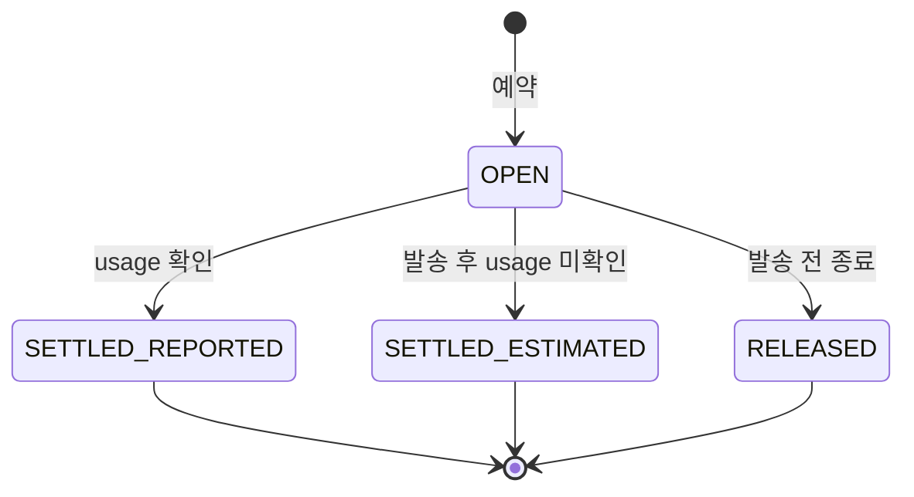

# SSE 예외 정산·예약 해제·마스킹 구현

2026-10-21. 대상은 `POST /api/ai/chat/stream`이다. usage 구분 → 예약 종료 → SSE 출력 Guard·마스킹 순서로 연결했다. 실제 유료 LLM 호출 대신 로컬 HTTP 모의 LLM, Spring MockMvc, 동시 실행 테스트로 검증했다.

## 처리 기준

| 상황 | 비용·예약 처리 | 스트림 처리 |
|---|---|---|
| 정상 완료, usage 있음 | 제공된 토큰 수로 `SETTLED_REPORTED` | 전체 응답 Guard → 개인정보 마스킹 → token → done |
| 정상 완료, usage 없음 | 예약 추정액으로 `SETTLED_ESTIMATED` | usageAvailable=false, 토큰 수 null, costSource=ESTIMATED |
| 출력 Guard 차단·Guard 예산 거절·Guard 오류 | 생성 LLM 비용을 먼저 정산하므로 이미 생성한 비용 유지 | 원문 token 전송 없이 blocked/error. 확인된 비용 출처도 제공 |
| 브라우저 연결 종료·SSE timeout | 확인된 usage가 있으면 실제 사용량, 없고 발송을 시도했다면 추정액 정산 | HTTP 원본 future·본문 subscription·deadline 취소, 늦은 콜백 출력 차단 |
| 외부 오류·LLM 전체 deadline·잘린 응답 | 오류 직전까지 받은 유효 usage 보존. 있으면 실제 사용량, 없으면 추정액 | error 이벤트. `[DONE]` 없이 끝난 응답을 정상 성공으로 표시하지 않음 |
| 설정 누락·요청 구성 실패·발송 전 종료 | 발송하지 않은 예약만 `RELEASED` | 비용을 발생한 것으로 꾸미지 않음. 연결이 열려 있으면 안전한 error |
| 완료·오류·timeout·completion 중복 | OPEN에서 최초 종료 상태로 한 번만 전환 | 중복 정산·해제·완료 출력 방지 |
| 한국 시간 자정을 넘겨 완료 | 해당 **예약일** 장부에 실제/추정 비용 귀속 | 다음 날 예약·일일 사용량을 이전 날 정산으로 차감하지 않음 |

usage의 prompt_tokens와 completion_tokens가 모두 0 이상 정수이면 확인된 값이다. **보고된 0은 유효한 실제 사용량 0**이며 누락과 다르다. 누락·일부 필드·음수는 실제 0으로 바꾸지 않는다. 발송 후 timeout/취소만으로 외부 과금이 없었다고 판단할 수 없어 예약 추정액을 정산한다. 예상 금액은 기존 입력 토큰 추정·최대 출력 토큰·설정 단가를 사용한다.

## 상태와 경합

`AiCostControlService`가 원자적 상태 전환과 금액 변경을 관리한다. 정산·해제 중 첫 처리만 예약액을 제거하고 비용을 반영한다. 이후 같은 예약을 재처리해도 금액은 바뀌지 않으며 `recordUsage`는 최초 확정된 출처(REPORTED/ESTIMATED/RELEASED)를 반환한다. 추정 정산 이후 도착한 usage로 추가 정산하지 않는다.

SSE 전송 종료와 외부 작업 종료를 별도 상태로 관리한다. `LlmStreamControl`은 발송 여부·마지막 유효 usage·취소 자원을 요청별로 보유하며 취소 시 스냅샷을 고정한다. 예약 생성 직전/직후 연결이 끊겨도 미발송 예약을 해제하고 외부 요청이 뒤늦게 시작되지 않게 한다. 취소와 HTTP 자원 등록 순서가 바뀌어도 등록된 자원을 닫는다.

HTTP 취소는 외부 공급자의 처리·청구가 즉시 종료됐다는 확인은 아니다. 원본 `sendAsync` future와 본문 subscription을 취소해 로컬 수신과 전송을 중단하도록 연결했으며, 공급자 usage가 없는 경우 추정 정산 정책을 유지한다. 이 구분은 [JDK 21 HttpClient의 취소 설명](https://docs.oracle.com/en/java/javase/21/docs/api/java.net.http/java/net/http/HttpClient.html#sendAsync(java.net.http.HttpRequest,java.net.http.HttpResponse.BodyHandler))에 따른다.

## HTTP·SSE 변경

- `llm.request-timeout-ms`를 연결·요청·**응답 본문을 포함한 전체 LLM 작업 deadline**에 사용한다. 기존 스트리밍 요청의 하드코딩된 30초와 헤더 수신 이후 무한 대기 경로를 보완했다.
- line subscriber로 SSE data frame을 읽고 `[DONE]`, provider error, EOF를 구분한다. usage frame을 DONE까지 기다리지 않고 보존하므로 usage 이후 오류·연결 종료도 실제 사용량으로 정산할 수 있다.
- 전송 자원은 단일 원본 HTTP future, Flow subscription, 취소 가능한 deadline이다. 완료·오류 시 정리하며 취소된 deadline 작업은 큐에서 제거한다. 새 의존성은 추가하지 않았다.
- 기존 `StreamingLlmClient.stream` 5개 인자 호출을 유지하고, 취소 제어를 받는 6개 인자 오버로드를 추가했다. 실제 OpenAI 호환 구현은 취소를 지원한다. 별도 사용자 어댑터는 해당 제어 계약을 구현해야 실제 transport 취소가 가능하다.
- 생성한 원문은 완료 전까지 보류한다. 출력 Guard가 허용한 결과를 다시 마스킹한 뒤 나누어 전송한다. provider chunk 사이에 나뉜 개인정보도 원문으로 전송하지 않는다. 연결 종료 시 보류 버퍼를 비우고, Guard가 진행 중인 동안 종료됐다면 이후 결과를 전송하지 않는다.
- done뿐 아니라 생성 이후 blocked/error에도 `promptTokens`, `completionTokens`, `usageAvailable`, `costSource`를 제공한다. usage 미확인은 null 토큰이며 false zero가 아니다. 이 필드들은 **생성 LLM 예약** 기준이다. 입력/출력 Guard의 별도 비용은 기존 단계별 비용 지표로 확인한다.
- 생성 토큰 지표는 출력 Guard·SSE 전달 결과와 관계없이 확인된 usage를 기준으로 기록한다.

## 날짜·지표

일일 기준은 `Asia/Seoul` 예약일이다. Clock을 주입할 수 있게 하여 자정 경계를 고정 시각으로 검증했다. 일별 예약/실제/추정 장부를 유지하며 `dailyCost(date)`로 해당 일의 금액을 읽을 수 있다. 오늘의 일일 지표도 새 요청이 없어도 날짜 변경을 반영한다.

기존 `ai.cost.reserved.usd`, `ai.cost.actual.usd`, `ai.cost.estimated.usage.usd`, `ai.cost.accounted.usd`, 단계별 비용·일일 비용·usage 누락·예약 해제 지표를 재사용한다. 예약 해제 사유는 `STREAM_NOT_STARTED`다. 출력 차단은 과금 취소를 의미하지 않는다.

## 검증 결과

| 검증 | 결과 |
|---|---|
| 전체 백엔드 `gradlew --offline test` | **148개 통과, 실패·오류·skip 0** |
| 비용 종료 동시성 | 같은 예약에 정산·추정·해제 60개 작업 경합, 예약 잔액 0·최초 결과 유지 |
| 자정 | 한국 자정 전 예약/후 정산, 실제·추정 각각 이전 날짜 귀속, 다음 날 예약 보존 |
| 실제 로컬 HTTP | provider error·본문 정지 deadline·브라우저 취소·발송 전 취소·설정 누락·DONE 없는 EOF·usage 보존 |
| 실제 HTTP→SSE 서비스 | 정상/출력 차단/외부 오류/본문 timeout 4개 경로의 정산·Guard·마스킹·terminal 이벤트 연결 |
| Spring MockMvc | 생성 후 Guard 차단·예산 거절·분할 개인정보 마스킹·오류 비용 메타데이터·중복 콜백 |
| 기존 회귀 | 일반 chat, Guard 비용, 법률 정책, 인증, 접수·파일 등 전체 백엔드 테스트 포함 |

주요 파일은 `AiCostControlService`, `LlmStreamControl`, `StreamingLlmClient`, `OpenAiCompatibleStreamingLlmClient`, `AiStreamingService`, `AiStreamEvent`다. 테스트는 `AiCostLifecycleTest`, `StreamingCancellationTest`, 기존 `AiSecurityIntegrationTest`·비용/usage 테스트를 사용했다. 실행 결과 사본과 집계는 `output/sse-cost-lifecycle/`에 보관한다.

## 실제 범위

예약 상태와 일별 장부는 기존 비용 제어와 동일하게 **현재 서버 프로세스 메모리** 기준이다. 서버 재시작·여러 인스턴스를 아우르는 영속 예약 원장이나 외부 청구서 대사는 이번 구현에 포함하지 않는다. 이미 진행 중인 동기 Guard 호출은 자체 timeout/단계별 정산을 따르며, 연결 종료 뒤 새 생성 LLM 호출과 SSE 출력이 이어지지 않도록 차단한다.

실제 외부 공급자의 유료 청구·취소 반영은 호출하지 않았다. 로컬 HTTP 모의 공급자와 자동 테스트의 결과를 실제 공급자 과금 확인으로 설명하지 않는다. P03 외부 검색은 이 SSE 작업의 API가 아니다.
