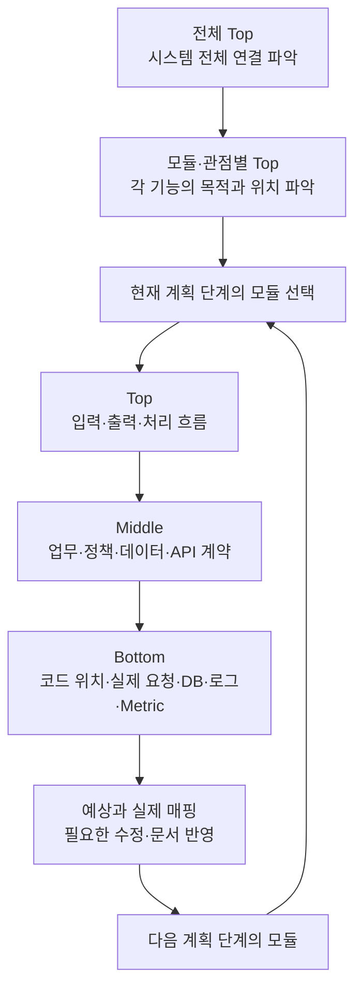

# 전체 흐름과 모듈별 Top · Middle · Bottom 학습 연결

이 문서는 현재 설계·개발 계획을 이해하는 학습 순서를 정리한다. 모듈 범위나 일정을 추가하는 문서가 아니다. 전체 위치를 파악한 뒤 현재 단계의 모듈을 깊게 이해하고, 실행 결과를 반영해 다음 모듈로 진행한다.

**1. 먼저 잡을 기본 요청·응답 흐름**

```text
사용자 입력을 React 상태로 관리
→ API 호출 함수에서 요청 데이터를 JSON으로 전송
→ 해당 Controller가 요청을 받고 Request DTO로 변환
→ 선언된 Validation으로 입력값 검사
→ Service가 업무 규칙에 따라 처리
→ 저장 시 Entity를 생성하고 Repository에 전달
  조회 시 Repository에서 필요한 데이터를 조회
→ JPA를 통해 Hibernate가 SQL을 실행해 DB 작업
→ 처리 결과를 Response DTO로 구성
→ 서버가 JSON 응답을 반환
→ React가 응답을 상태에 반영하고 화면 갱신
```

이는 DB를 사용하는 기본 저장·조회 흐름이다. 규칙형 preview/minimal은 DB 단계를 거치지 않고, AI 질문은 외부 LLM 호출, 비동기 Job은 작업 ID 반환과 백그라운드 실행으로 분기한다. 보안은 요청 경계와 필요한 처리 지점에 적용되며 상세 흐름은 Security 도표에서 읽는다.

React는 API의 JSON 계약을 사용한다. DB Entity를 프런트가 직접 다루는 구조로 이해하지 않는다. 또한 이 흐름은 학습용 기본 구조이며 모든 제품 화면의 React 연동이 이미 완료되었다는 뜻은 아니다.

**2. 전체 Top → 모듈·관점별 Top**

전체도는 서비스의 위치 관계를, 각 상세 도표는 같은 시스템에서 관심 있는 부분을 확대해 설명한다. 기존에 분리한 백엔드와 Security를 유지해 네 가지로 읽는다.

| 구분 | 설명할 핵심 | 학습 질문 | 자료 |
|---|---|---|---|
| 전체 Top | 사용자·화면·백엔드·DB·외부 서비스의 연결 | 시스템이 무엇을 하고 현재 모듈은 어디에 있는가? | [01 전체 서비스](C:/myLectureWs/legal-ai-intake-security-server/docs/diagrams/01_SYSTEM_OVERVIEW.md) |
| 백엔드 Top | Controller·DTO·Service·Repository·DB·응답과 비동기 분기 | 요청을 받아 어떤 업무·데이터 처리를 하는가? | [02-A 백엔드](C:/myLectureWs/legal-ai-intake-security-server/docs/diagrams/02A_BACKEND_FLOW.md) |
| Security Top | 인증·입력 검증·AI Guard·출력 보호·중단 지점 | 어떤 조건에서 허용·차단하는가? | [02-B Security](C:/myLectureWs/legal-ai-intake-security-server/docs/diagrams/02B_SECURITY_FLOW.md) |
| Cost Control Top | 입력 제한·예산 검사·예약·정산·해제 | 호출 비용을 언제 허용하고 어떻게 기록하는가? | [03 Cost Control](C:/myLectureWs/legal-ai-intake-security-server/docs/diagrams/03_COST_CONTROL_FLOW.md) |

API별 요청·응답·ID 전달은 [전체 기능표](BACKEND_DRAFT_STATUS_AND_API_SPEC.md#api-기능표)와 [개별 API 흐름](postman-http/README.md)에서 확인한다. 별도의 전체 호출순서도는 두지 않는다.

Mermaid는 Top의 핵심 도구다. 먼저 화살표와 분기, 입력·출력, 외부 연결 위치를 읽고 필요할 때 현재 모듈을 확대한다. 전체도 한 장에 모든 검사와 메서드를 넣을 필요는 없다.

**3. 현재 모듈에서 Top → Middle → Bottom으로 내려가기**

Top·Middle·Bottom은 이해의 깊이다. 백엔드, Security, Cost, 검색 요청 등 각 모듈에 같은 순서로 적용한다.

| 깊이 | 파악할 내용 | 대표 질문 | 산출물 |
|---|---|---|---|
| Top | 모듈의 목적·입력·출력·처리 순서·분기·다른 모듈 연결 | 이 모듈은 무엇을 하고 앞뒤로 어디에 연결되는가? | 모듈 Mermaid 흐름도·짧은 설명 |
| Middle | Actor·Command·Domain Event·Policy·Aggregate·Read Model·Bounded Context, 필요한 데이터·상태·API 계약 | 왜 이 규칙이 있고 어떤 사실·데이터를 다루는가? | DDD/Event Storming, Policy·Read Model·Code Mapping 초안, API 검사 목록 |
| Bottom | 실제 클래스·메서드·DTO 필드·검사 호출·Repository·DB 및 실행 증거 | 어느 코드가 처리하며 요청을 보냈을 때 실제로 무엇이 일어나는가? | 코드 위치·Postman 요청/응답·DB 변화·reason·로그·Metric·예상/실제 비교 |

Middle의 이벤트·Aggregate는 업무와 책임을 설명하는 설계다. 이 용어를 사용한다고 Event Bus나 Event Sourcing까지 구현되어 있다는 뜻은 아니다. 모듈에 해당하지 않는 검사는 '해당 없음'으로 표시한다.

**4. 반복 학습 순서**



먼저 각 모듈의 Top을 가볍게 훑어 전체 위치를 잡는다. 상세 분석과 실험은 현재 모듈에서 진행하고, 다음 모듈의 세부 과제는 그 모듈을 다루는 시점에 연결한다.

**5. 예시 — Legal Intake 등록 모듈**

| 깊이 | 우리 프로젝트에서 설명할 내용 |
|---|---|
| Top | React 문의 제출 → 등록 API → 입력 검증 → 분류 → 문의·자료 종류·검색 조건 저장 → 응답 → 화면 반영 |
| Middle | Actor=의뢰인, Command=문의 제출, Event=문의 접수·검색 조건 준비, Policy=필수값·자료 중복 제거·검색 조건 기본값, Aggregate 후보=LegalIntake, Read Model=문의 목록·상세 |
| Bottom | `POST /api/intakes` → `LegalIntakeRecordController.create()` → `LegalIntakeCreateRequest` → `LegalIntakeRecordService.create()` → Repository → DB. 정상 201, 필수값 누락 400, 실제 저장 데이터와 응답 필드를 대조. |

현재 React 문의 등록 연결은 계획 단계에 맞춰 진행한다. 위 Top 예시는 목표 연결을 설명하며, 이미 연결된 법률 Reference 화면과 구분한다.

**6. 개정 12일 계획과의 연결**

- Day 5: 보안·비용 통제를 필요한 API에 연결하고 매핑 초안·예상 결과·DB 연결을 준비한다.
- Day 6: Postman 요청·응답·DB 확인과 코드 매핑을 반복하고 정상·실패·차단 분기의 실제 결과를 기록한다.
- Day 7: DDD·Event Storming으로 업무·정책·Read Model을 정리하고 코드·실험에 연결한다. API별 검사 적용과 동기/SSE 비교 결과를 반영한다.
- Day 8: React 핵심 화면·Metric Dashboard를 기존 API에 연결하며 state·DTO·Read Model과 실제 브라우저 동작을 대조한다.
- Day 9~10: LLM Search Routing과 실제 외부 검색을 구현하고 같은 방식으로 매핑·실험한다. Day 11에는 전체 모듈 연결을 검증한다.

전체 일정과 산출물은 [12일 개발 계획](PROJECT_12_DAY_PLAN.md)을 따른다.

권장 검사 매핑 열:

```text
모듈 / API / 업무 목적 / 확정 정책 / 적용·해당 없음
→ 클래스·메서드 / 필요한 데이터 / 예상 결과
→ Postman 요청 / 실제 응답 / DB·LLM 호출 여부 / reason·로그·Metric
→ 일치 여부 / 수정사항
```

관련 자료: [도표 구성 안내](C:/myLectureWs/legal-ai-intake-security-server/docs/DIAGRAM_GUIDE.md), [DDD·Event Storming 초안](C:/myLectureWs/legal-ai-intake-security-server/docs/BACKEND_DDD_EVENT_STORMING.md), [API 정리서](C:/myLectureWs/legal-ai-intake-security-server/docs/API_STATUS_SPEC.md).
