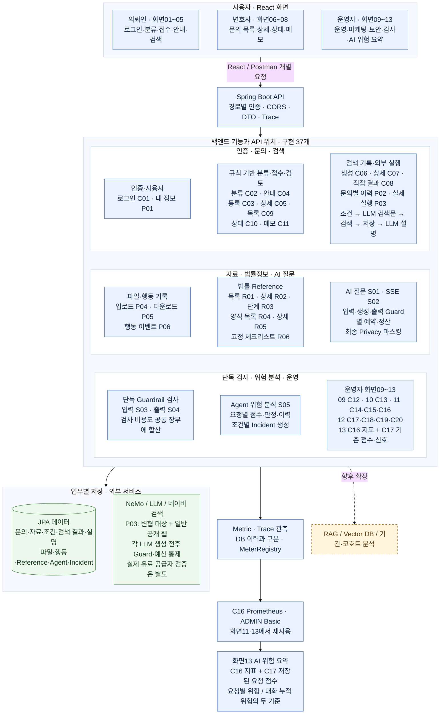

# 01. 전체 서비스 구성 및 사용자 흐름

**2026-10-22 현행 반영:** P03 실행·화면05 연결 구현, 운영자 React 화면09~13 구현. 화면13은 기존 C16/C17 재사용이며 새 API 번호·DB 테이블을 추가하지 않았다. 구현 API는 37개다. 외부 LLM·네이버 실제 키 호출·청구 검증은 아직 별도다.

기준: **2026-10-17(Asia/Seoul)**. 번호는 제출 대상 구현 API 37개의 C/R/S/P ID이며, 노드 옆 번호로 README·API 기능표·개별 Postman flow를 연결한다. 번호가 함께 적힌 노드는 업무 묶음이며 API가 자동으로 연속 호출된다는 뜻은 아니다.

읽는 질문: **누가 어떤 기능을 사용하고, 각 API가 백엔드·DB·외부 서비스의 어디에 위치하는가?** 파란 노드는 구현된 화면·API 경로, 주황 점선은 RAG 등 향후 확장이다. 화면 API 연결 완료나 외부 NeMo/LLM 실서비스 검증을 뜻하지 않는다.

백엔드 기능은 **3열 × 3단**으로 묶었다. DB·외부 서비스는 아래 연결 영역, **C16은 맨 아래 Metric 조회 영역**에서 확인한다. 박스의 배치는 기능 분류용이며 API 자동 호출 순서가 아니다.

[갱신된 기본 보안 흐름·운영자 화면09~13](02B_SECURITY_FLOW_API_MAP.md)

[갱신된 기본 보안 흐름·운영자 화면09~13](02B_SECURITY_FLOW_API_MAP.md)

**API 위치 대조표**

| 그림의 기능 항목 | 표시한 API ID |
|---|---|
| 인증·사용자 | C01, P01 |
| 분류·문의·상담 검토 | C02, C03, C04, C05, C09, C10, C11 |
| 검색 기록·실행 | C06, C07, C08, P02, P03 |
| 실제 파일 | P04, P05 |
| 법률 Reference | R01, R02, R03, R04, R05, R06 |
| AI 질문·단독 검사·위험 분석 | S01, S02, S03, S04, S05 |
| 운영·감사·Incident | C12, C14, C15, C17, C18, C19, C20 |
| 마케팅·행동 | C13, P06 |
| Metric 조회 | C16 |

**빠진 API 번호**: 구현 37개 중 **없음(37/37 표시)**. P03도 검색 실행 구현 수에 포함한다. 화면13은 C16/C17 재사용이므로 새 API 번호를 추가하지 않는다. RAG·코호트는 확장 개념이라 새 API 번호를 만들지 않았다.

**사용자 흐름을 읽는 순서**

1. C01으로 로그인하고 P01로 사용자·역할을 확인한다. 현재 공개 문의 등록은 로그인 없이도 가능하다.
2. C02/C04로 규칙 안내를 확인하거나 C03으로 문의·자료 종류·검색 조건을 저장한다. 안내 호출은 등록의 필수 선행 단계가 아니다.
3. C06으로 검색 요청을 만들고 P03을 명시적으로 실행한다. LLM 검색문→네이버 두 검색→결과 저장→LLM 설명 후 C07/P02로 조회한다. C08 직접 기록도 유지한다.
4. C09/C05 조회에서 C10/C11 검토·메모로 이어지고, 실제 파일은 P04/P05를 사용한다.
5. 운영자는 화면09~13에서 C12~C20의 집계·이력·지표·Incident를 확인한다. 화면13은 C16 지표와 C17 기존 점수·신호를 재사용한다. 문의·마케팅 집계와 Agent·보안 읽기 모델은 다르다.

DB 그림은 물리 DB 여러 개가 아니라 논리 데이터 묶음이다. 기본 H2 메모리와 별도 mysql 프로필의 MySQL을 구분한다. R01~R05는 JPA 조회이고 R06은 고정 prototype이다. Chat Metric이 모든 DB 보안 이벤트에 자동 저장되는 것은 아니다.

근거: [API 기능서 flow·기능mapping표](C:/myLectureWs/legal-ai-intake-security-server/docs/BACKEND_DRAFT_STATUS_AND_API_SPEC.md), [화면·API·Controller 매핑](C:/myLectureWs/legal-ai-intake-security-server/docs/SCREEN_API_CONTROLLER_MAPPING.md), [MySQL 연결 준비서](C:/myLectureWs/legal-ai-intake-security-server/docs/MYSQL_CONNECTION_CHECK.md).
