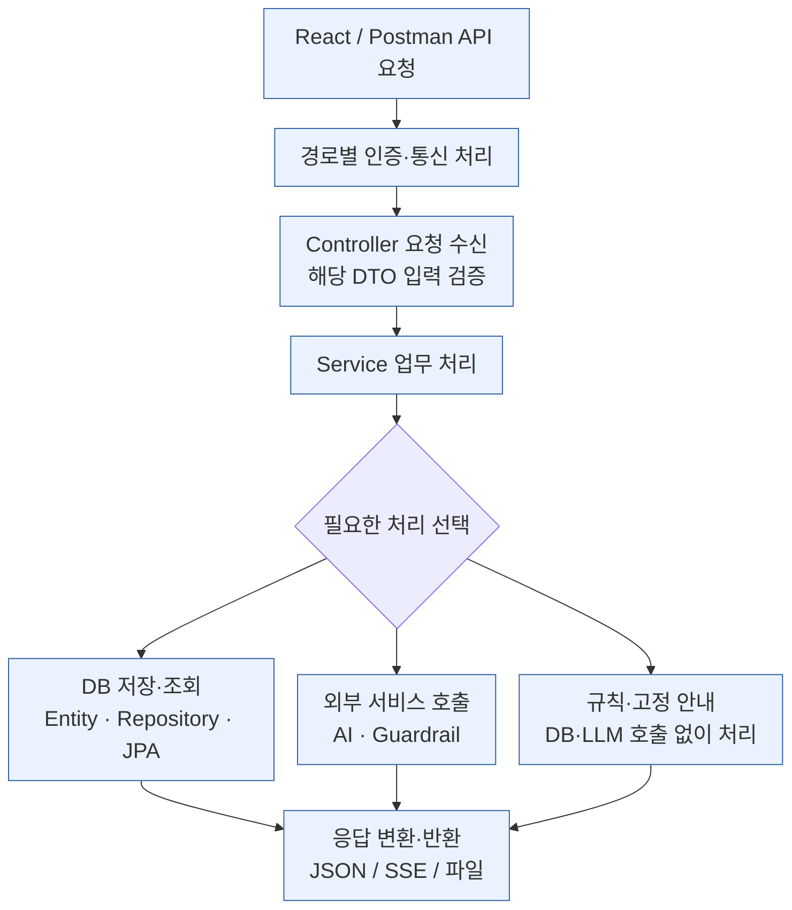
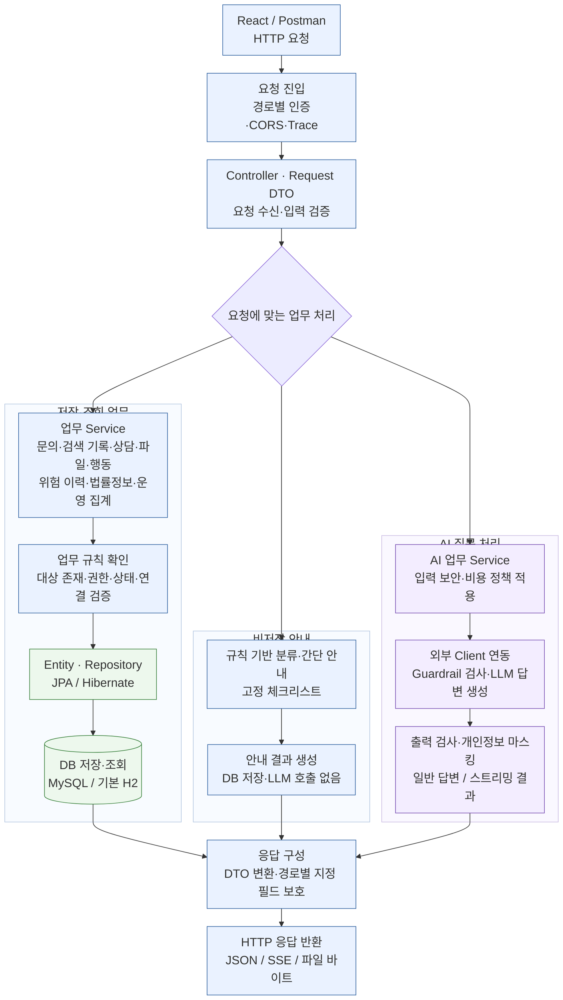

# 02-A. 백엔드 업무·데이터 처리 flowchart

기준: **2026-10-17(Asia/Seoul)**. **단순 흐름 → 제출용 백엔드 처리도 → 필요한 세부 처리** 순서로 읽는다.

읽는 질문: **요청이 어떤 업무를 처리하고, DB·외부 서비스·응답으로 어떻게 이어지는가?**

## 1. 단순 버전 — 큰 흐름

일반 application 요청의 기본 골격이다. 모든 요청이 DB나 LLM을 호출하는 것은 아니며, Actuator의 별도 지표 조회 경로는 참고 API 번호 지도에서 확인한다.

## 2. 제출용 버전 — 백엔드 업무·데이터 처리

요청이 들어온 뒤 **입력 검증 → 업무 처리 → 저장·조회 또는 외부 호출 → 응답**으로 이어지는 구조를 보여준다. API ID·Controller 목록은 기능서에서 확인하고, 이 도표는 실제 처리 흐름에 집중한다.

**도표를 설명할 핵심**

- Controller·DTO에서 요청을 받고 해당 입력 기준을 검증한 뒤 기능에 맞는 업무 처리를 선택한다.
- 저장·조회 경로는 필요한 업무 규칙을 확인하고 Entity·Repository·JPA를 통해 DB에 접근한다. 읽기 요청이 모두 새 데이터를 저장하는 것은 아니다.
- 분류 미리보기·간단 안내·고정 체크리스트는 비저장 안내로, DB 저장이나 LLM 호출을 거치지 않는다.
- AI 질문은 보안·비용 정책과 외부 Client를 거쳐 출력 보호 후 응답한다. 정산 순서·차단·예외의 세부 처리는 보안·비용 도표에서 설명한다.
- 세 갈래는 요청에 따른 선택 경로다. 하나의 요청이 모든 업무를 순서대로 실행한다는 뜻은 아니다.

이 제출도는 핵심 처리 구조를 설명한다. 로그인·내 정보·단독 Guardrail·Actuator와 같은 보조 경로의 개별 위치는 [API 번호 지도](02A_BACKEND_FLOW_API_MAP.md)에서 확인한다. 검색 요청·결과 **기록**은 구현되어 있지만 실제 외부 검색 실행은 후속 모듈이다.

[단순 버전 Mermaid](02A_BACKEND_FLOW_SIMPLE.mmd) · [제출용 Mermaid](02A_BACKEND_FLOW.mmd) · [API 번호 지도](02A_BACKEND_FLOW_API_MAP.md) · [기존 세부 처리도](02A_BACKEND_FLOW_EXPANDED.md)

**별도 보조 Job API는 어디에서 보나?**

| 기존 보조 경로 | 역할 | 37개 ID가 없는 이유 |
|---|---|---|
| `POST /api/agent/jobs` | Job 접수·PENDING 저장·ID 반환·Executor 제출 | 제출 대상 37개 밖의 기존 보조 API |
| `GET /api/agent/jobs/{jobId}` | Job 상태·결과 조회 | 같은 보조 API 범위 |
| `GET /api/agent/jobs` | 최근 Job 목록 | 같은 보조 API 범위 |

Job의 접수·ID 반환·백그라운드 처리 흐름은 [기존 세부 처리도](02A_BACKEND_FLOW_EXPANDED.md)에서 확인한다.

S05는 `POST /api/agent/risk/analyze`의 **동기** 위험 분석 API다. Job 내부에서 같은 분석 Service를 사용해도 Job 접수·조회 경로를 S05로 바꿔 적지 않는다.

## 3. Service 업무와 적용 규칙

Service는 요청한 기능에 맞춰 업무 규칙을 확인하고 저장·조회·외부 호출·응답 구성을 수행한다. 기능별 업무와 API 적용 범위를 함께 정리하면 다음과 같다.

- **문의 접수·검토 — C03·C05·C09·C10·C11:** 사건을 분류하고 문의·자료 종류·검색 조건을 **같은 트랜잭션에 저장**한다(C03). 목록·상세 조회, 상태 변경, 상담 메모를 관리하며 상태 변경·메모 저장 전에는 문의 존재와 해당 업무 규칙을 확인한다. 종료 후 재개 등 금지된 문의 상태 변경은 **HTTP 409**로 처리한다. 분류 미리보기 C02와 간단 안내 C04(`classify-preview`·`minimal`)는 **문의 저장·LLM 호출이 없는 별도의 규칙형 안내**다.
- **검색 요청·결과 관리 — C06·C07·C08·P02:** 저장된 문의와 검색 조건을 확인한 뒤 검색 요청을 별도로 생성하고, 요청 상세·결과·문의별 이력을 저장·조회한다. **C03 문의 등록 시 C06 검색 요청이 자동 생성되지는 않는다.** C06은 `PREVIEW_READY` 상태의 준비 기록이며 C08은 전달받은 결과 스냅샷을 저장한다. 실제 외부 검색·수집 실행 P03은 후속 구현 대상이다. 문의별 검색 이력 P02에는 JWT 인증과 소유자/관리자 접근 정책을 적용한다.
- **자료 파일 관리 — P04·P05:** 실제 파일의 업로드·다운로드를 처리하며 JWT 인증, 문의 소유자 또는 관리자 권한, 대상 문의와 파일 연결 등 해당 업무 규칙을 확인한다. **C03의 자료 종류 선택·저장과 P04의 실제 파일 업로드는 별도 처리**다.
- **법률 정보·고정 안내 — R01~R06:** R01~R05는 JPA를 통해 법률 절차·단계·양식 Reference를 조회해 제공한다. R06은 DB 조회·LLM 호출 없이 제공하는 고정 체크리스트 안내다.
- **AI 질문·단독 검사 — S01~S04:** S01 일반 Chat과 S02 SSE는 입력 보안·비용 정책을 확인한 뒤 LLM을 호출하고, 출력 검사·개인정보 마스킹을 거쳐 응답한다. S03·S04는 입력·출력 Guardrail의 단독 검사이며 해당 검사 비용에 같은 예산 정책을 적용한다. 구체적인 Guard 판단, 단계별 예약·정산, 차단·오류 처리는 [보안 흐름도](02B_SECURITY_FLOW.md)와 [비용 흐름도](03_COST_CONTROL_FLOW.md)에서 설명한다.
- **위험 분석·비동기 작업 — S05·번호 없는 Job API:** S05는 동기 위험 분석을 수행한다. 별도 Job API는 분석 완료를 기다리지 않고 작업 ID를 반환하고, 백그라운드에서 같은 분석 Service를 실행해 상태·결과를 저장한다. 현재는 **서버 내부 비동기 실행과 일반 JPA 저장** 방식이며 메시지 큐·서버 재시작 후 작업 복구는 구현 범위에 포함하지 않는다.
- **운영 현황·Incident 관리 — C12~C15·C17~C20:** 문의·검색·상담 상태와 위험·보안 이력을 목적에 맞게 조회·집계한다. **마케팅 기본 집계와 Agent 보안 요약은 데이터 출처와 조회 목적이 다른 별도의 읽기 모델**이다. Incident 확인 C19·종결 C20은 대상 조회 후 상태를 갱신하며, 문의 C10의 금지 상태 전이 규칙을 그대로 사용하지 않는다.
- **운영 지표 조회 — C16 · 화면11/13:** Prometheus 지표는 일반 Controller·업무 Service 경로가 아닌 **별도 Actuator 보안 체인**에서 제공한다. 업무 응답과 구분해 ADMIN Basic 인증으로 조회한다. 화면13은 C16 지표와 C17 기존 요청별 점수·신호를 재사용한다.

기본 요청·응답은 JSON이며 S02는 SSE, P05는 파일 바이트, C16은 지표 텍스트다. DB는 기본 H2 또는 별도 mysql 프로필이다. 성공 응답의 실제 원문·마스킹·오류는 API별 계약으로 확인한다.

연결: [API 기능서 flow·기능mapping표](C:/myLectureWs/legal-ai-intake-security-server/docs/BACKEND_DRAFT_STATUS_AND_API_SPEC.md), [MySQL 연결 준비서](C:/myLectureWs/legal-ai-intake-security-server/docs/MYSQL_CONNECTION_CHECK.md), [전체 Controller 부록](C:/myLectureWs/legal-ai-intake-security-server/docs/BACKEND_ROUTE_INVENTORY.md).
