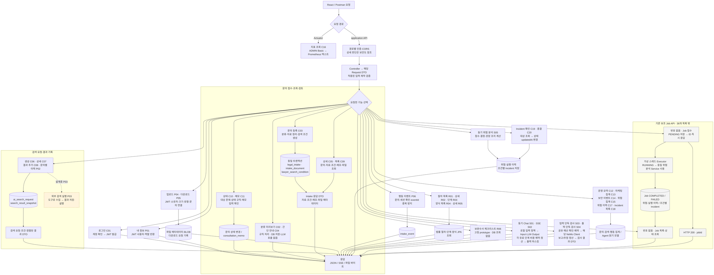

# 02-A 부록. 백엔드 세부 처리 흐름

원래의 세부 처리선을 보존한 확대 부록이다. 먼저 [단순 버전·API 번호 지도](02A_BACKEND_FLOW.md)를 읽고 필요한 처리 순서를 이 그림에서 확인한다.

기준: **2026-10-17(Asia/Seoul)**. 번호는 제출 대상 구현 API 36개의 C/R/S/P ID이며, 노드 옆 번호로 README·API 기능표·개별 Postman flow를 연결한다. 번호가 함께 적힌 노드는 업무 묶음이며 API가 자동으로 연속 호출된다는 뜻은 아니다.

읽는 질문: **요청한 API가 어떤 업무를 실행하고, 무엇을 저장·조회해 어떤 응답을 만드는가?** 보안 판단은 02 통합도·02-B 확대도에서, 입력·응답 계약은 개별 API 기능표에서 확인한다.

**빠진 API 번호**: 구현 36개 중 **없음(36/36 표시)**. 로그인 C01·내 정보 P01·지표 C16·단독 검사 S03/S04도 각각 별도 분기에 표시했다. P03은 설계 위치만 표시한다.

**번호 없는 Job 구간은 무엇인가?**

| 기존 보조 경로 | 역할 | 36개 ID가 없는 이유 |
|---|---|---|
| `POST /api/agent/jobs` | Job 접수·PENDING 저장·ID 반환·Executor 제출 | 제출 대상 36개 밖의 기존 보조 API |
| `GET /api/agent/jobs/{jobId}` | Job 상태·결과 조회 | 같은 보조 API 범위 |
| `GET /api/agent/jobs` | 최근 Job 목록 | 같은 보조 API 범위 |

S05는 `POST /api/agent/risk/analyze`의 **동기** 위험 분석 API다. Job 내부에서 같은 분석 Service를 사용해도 Job 접수·조회 경로를 S05로 바꿔 적지 않는다.

**Service 업무와 적용 규칙**

기능 설명과 API별 업무 규칙은 [본문의 Service 통합 정리](02A_BACKEND_FLOW.md#3-service-업무와-적용-규칙)에서 함께 읽는다. 문의·검색·파일·법률정보·AI·Job·운영·지표의 책임과 현재 구현 범위를 그곳에서 관리하고, 이 확대도에서는 실제 저장·조회·외부 호출 순서를 확인한다.

기본 요청·응답은 JSON이며 S02는 SSE, P05는 파일 바이트, C16은 지표 텍스트다. DB는 기본 H2 또는 별도 mysql 프로필이다. 성공 응답의 실제 원문·마스킹·오류는 API별 계약으로 확인한다.

연결: [API 기능서 flow·기능mapping표](C:/myLectureWs/legal-ai-intake-security-server/docs/BACKEND_DRAFT_STATUS_AND_API_SPEC.md), [MySQL 연결 준비서](C:/myLectureWs/legal-ai-intake-security-server/docs/MYSQL_CONNECTION_CHECK.md), [전체 Controller 부록](C:/myLectureWs/legal-ai-intake-security-server/docs/BACKEND_ROUTE_INVENTORY.md).
