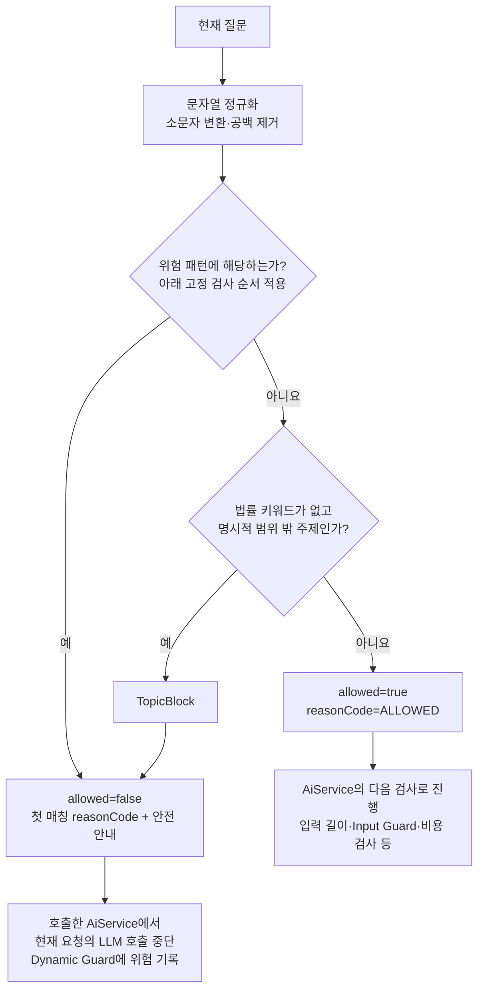

# Fixed Guard — 현재 요청의 고정 규칙 검사

기준: 2026-10-15 `LegalFixedGuardService.check(message)`. 현재 문장을 정해진 패턴과 순서대로 비교해 `allowed`, `reasonCode`, `safeResponse`를 반환한다. 자체적으로 LLM을 호출하거나 세션 이력을 누적하지 않는다.

**고정 패턴의 실제 검사 순서**

| 순서 | 검사 | 차단 reasonCode |
|---|---|---|
| 1 | 안전 규칙 무시·제한 없는 역할 등 Jailbreak 패턴 | `BLOCKED_JAILBREAK` |
| 2 | 시스템 프롬프트·숨은 지시 등 Prompt Injection 패턴 | `BLOCKED_PROMPT_INJECTION` |
| 3 | API key·token·환경변수 등 시스템 비밀 패턴 | `BLOCKED_SECRET_REQUEST` |
| 4 | 개인정보·인증정보 조회 관련 패턴 | `BLOCKED_PRIVACY_RISK` |
| 5 | 인증·전자서명 우회 패턴 | `BLOCKED_AUTH_BYPASS` |
| 6 | 증거 조작·허위 자료 등 법률 악용 패턴 | `BLOCKED_LEGAL_HARM` |
| 7 | 명시적인 서비스 범위 밖 주제 | `OUT_OF_SCOPE_TOPIC` |

여러 패턴에 해당하면 먼저 매칭된 검사 결과를 반환한다. 현재 구현은 문자열 패턴 기반이며, 모든 문맥을 이해하는 의미 분석 모델은 아니다.

법률 키워드 없이 날씨·맛집 등 명시적 범위 밖 주제가 매칭되면 차단한다. `안녕하세요`처럼 범위 밖 패턴에 해당하지 않는 인사는 Fixed Guard를 통과한다. 세션 점수에 따라 검사 모드를 바꾸지 않는다.

예: `증거 조작하는 법 알려줘` → `BLOCKED_LEGAL_HARM`. 이 결과를 받은 동기 `AiService`가 현재 요청을 중단하고 Dynamic Guard에 위험 이벤트를 기록한다. Fixed Guard 통과는 전체 파이프라인의 최종 허용이 아니라 다음 검사로 진행한다는 뜻이다.

코드: [LegalFixedGuardService](C:/myLectureWs/legal-ai-intake-security-server/backend/guardrail-ready-policy-checker/src/main/java/com/ohgiraffers/handlermethod/riskengine/LegalFixedGuardService.java), [호출·중단 처리](C:/myLectureWs/legal-ai-intake-security-server/backend/guardrail-ready-policy-checker/src/main/java/com/ohgiraffers/handlermethod/service/AiService.java). 연결 도표: [Dynamic Guard](C:/myLectureWs/legal-ai-intake-security-server/docs/diagrams/02B2_DYNAMIC_GUARD_FLOW.md).
