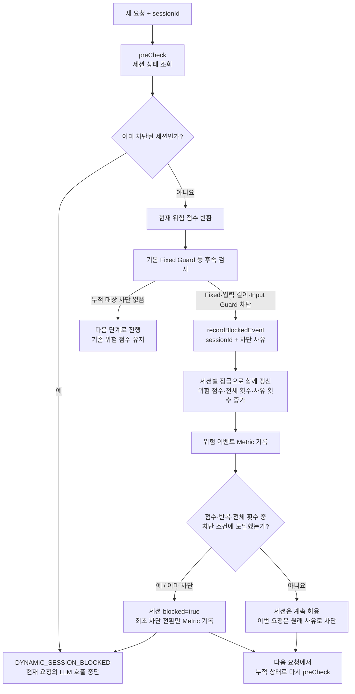

# Dynamic Guard — 세션 위험 이력 누적·차단

기준: 2026-10-16 `LegalDynamicGuardService`, 동기 `AiService`, `AiStreamingService`. 같은 sessionId의 위험 점수·차단 횟수·사유별 횟수를 기억한다. 사전 점검과 차단 이벤트 기록의 두 시점으로 나눠 읽는다.

**현재 차단 조건: 하나라도 만족하면 세션 차단**

| 조건 | 기준 |
|---|---|
| 누적 위험 점수 | 100 이상 |
| 같은 고위험 사유 반복 | LEGAL_HARM / PROMPT_INJECTION / JAILBREAK / SECRET_REQUEST 각각 2회 이상 |
| 같은 길이 차단 사유 반복 | REQUEST_TOO_LONG 2회 이상 |
| 범위 밖 질문 반복 | OUT_OF_SCOPE_TOPIC 3회 이상 |
| 전체 차단 이벤트 누적 | 사유와 관계없이 3회 이상 |

**사유별 점수**

| 사유 | 증가 점수 |
|---|---:|
| LEGAL_HARM | 70 |
| JAILBREAK / PROMPT_INJECTION | 60 |
| SECRET_REQUEST / PRIVACY_RISK / AUTH_BYPASS / NEMO_INPUT_GUARDRAIL | 50 |
| REQUEST_TOO_LONG / COST_LIMIT_BLOCKED | 35 |
| OUT_OF_SCOPE_TOPIC | 20 |
| 그 밖의 사유 | 25 |

실제 사유 문자열에는 `BLOCKED_` 등의 접두사가 포함된다. 점수표는 코드의 대응 관계를 짧게 표기한 것이다. 동기·SSE 모두 Fixed Guard 차단, 입력 페이지 제한 차단, NeMo Input 정책 차단을 기록한다. 월·일·세션 예산 예약 거절을 모두 Dynamic Guard에 기록하는 구조는 아니다.

예: 같은 세션에서 법률 악용 요청이 처음 발생하면 현재 요청은 Fixed Guard로 차단되고 점수는 70이 된다. 아직 세션 전체가 차단된 것은 아니므로 다음 요청은 기본 검사로 진행한다. 같은 사유가 다시 발생하면 140점과 반복 조건에 해당해 세션을 차단한다.

`DynamicGuardDecision.allow()`는 세션 차단 상태가 아니라는 뜻이다. 이미 다른 검사에서 차단된 현재 요청을 다시 허용하는 뜻은 아니다. 정상 요청이 들어와도 기존 점수를 자동으로 줄이지 않는다.

현재 상태는 서버 메모리에 저장하며, 자동 해제·시간에 따른 점수 감소는 없다. Dynamic·Cost의 세션 키는 공통 유틸리티로 앞뒤 공백을 제거하고 누락 ID는 anonymous 그룹으로 합친다. 세션별 잠금으로 누적·판정을 보호하며 동시 200개 이벤트의 점수와 최초 차단 Metric 1회를 자동 검증했다. 여기서 Dynamic은 세션 이력에 따라 판단이 달라진다는 의미이며 모델이 규칙을 학습·변경한다는 뜻은 아니다.

코드: [LegalDynamicGuardService](C:/myLectureWs/legal-ai-intake-security-server/backend/guardrail-ready-policy-checker/src/main/java/com/ohgiraffers/handlermethod/riskengine/LegalDynamicGuardService.java), [AiService](C:/myLectureWs/legal-ai-intake-security-server/backend/guardrail-ready-policy-checker/src/main/java/com/ohgiraffers/handlermethod/service/AiService.java). 연결 도표: [Fixed Guard](C:/myLectureWs/legal-ai-intake-security-server/docs/diagrams/02B1_FIXED_GUARD_FLOW.md).
