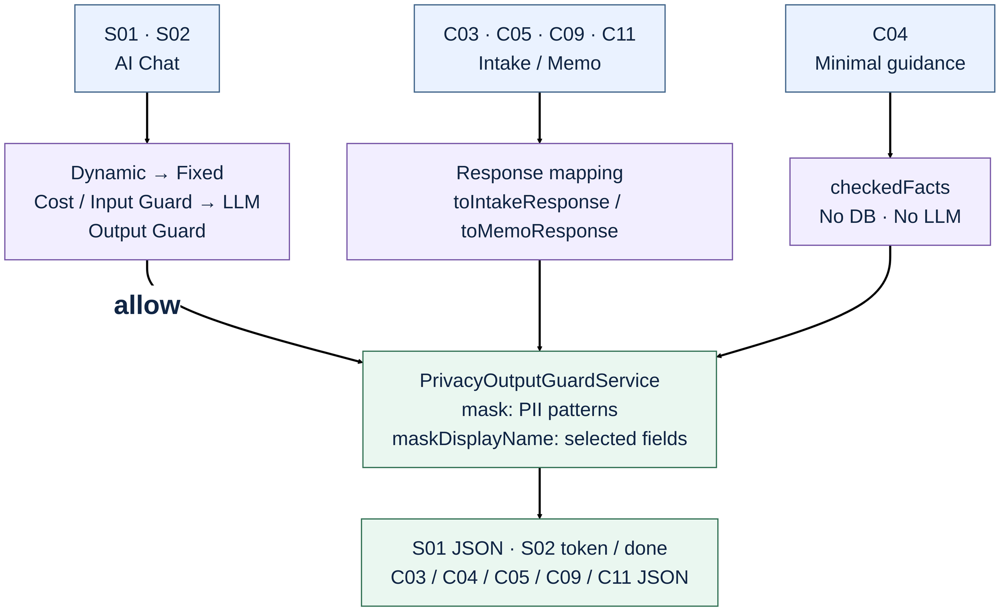
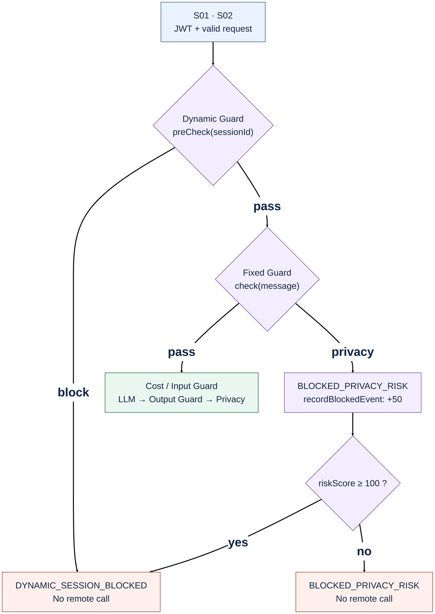
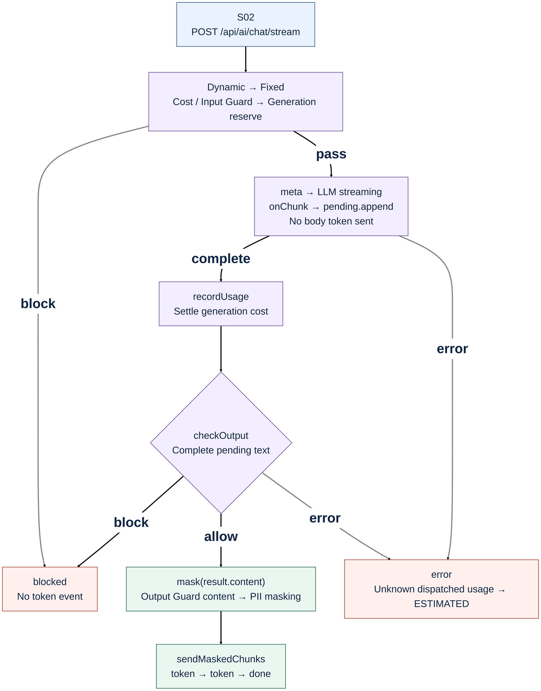

# Privacy Protection — API Flow and Code Mapping

기준: **2026-10-17, current source code**. API 번호는 기존 API 정리서와 동일하다.

개인정보 보호는 **Fixed Guard의 요청 차단**, **Dynamic Guard의 세션 위험 누적**, **PrivacyOutputGuardService의 지정 응답 마스킹**으로 나뉜다. 같은 마스킹 서비스를 S01 JSON·S02 SSE·문의/메모 응답에서 재사용한다. “Privacy Output Guard 1 / 2”라는 별도 엔진 두 개가 있는 구조는 아니다.

이 문서는 **구현된 적용 위치**를 설명한다. 모든 요청·DTO·DB·로그를 자동으로 마스킹한다는 의미는 아니다.

## 1. API-numbered overview

API 번호는 시작 상자에, 조건은 화살표에 짧게 표시했다. 흰 배경·검은 화살표·32px 본문·44px 조건 라벨을 사용한다. 확대 원본: [Overview SVG](assets/02B3_PRIVACY_FLOW.svg). 전체 보안 통합도의 기존 글꼴 설정은 변경하지 않는다.

Privacy 상자는 공통 서비스의 적용 위치다. **Chat은 `mask()`만 사용**하며, `maskDisplayName()`은 문의·규칙 안내의 지정 이름 필드에 사용한다. 차단·오류로 종료한 Chat은 정상 답변 마스킹 단계까지 진행하지 않는다. 입력·출력 검사와 비용의 전체 순서는 [Security](02B_SECURITY_FLOW.md) · [Cost Control](03_COST_CONTROL_FLOW.md)을 함께 본다.

## 2. Direct API mapping — 7 APIs

| API | HTTP API | Entry → Middle → Bottom | Protected response |
|---|---|---|---|
| **S01** | `POST /api/ai/chat` | `AiController.chat → AiService.chat → mask` | 허용된 Output Guard의 `content`를 마스킹해 `answer` 반환. 입력은 Fixed/Dynamic 적용 |
| **S02** | `POST /api/ai/chat/stream` | `AiController.chatStream → AiStreamingService.stream → flushCompletedResponse → mask → sendMaskedChunks` | 전체 답변 검사·마스킹 후 `token`; 입력은 Fixed/Dynamic 적용 |
| **C03** | `POST /api/intakes` | `LegalIntakeRecordController.create → create → toIntakeResponse` | 등록 응답의 지정 필드. 입력 원문을 저장한 뒤 응답 매핑 |
| **C05** | `GET /api/intakes/{id}` | `LegalIntakeRecordController.findById → findById → toIntakeResponse` | 문의 지정 필드 + `consultationMemos[].contentMasked` |
| **C09** | `GET /api/intakes` | `LegalIntakeRecordController.findRecent → findRecent → toIntakeResponse` | 목록의 각 문의에 C05와 같은 매핑 |
| **C11** | `POST /api/intakes/{id}/memo` | `ConsultationMemoController.create → createMemo → toMemoResponse` | 원문 저장 후 `contentMasked` 반환. C05/C09 재조회에도 적용 |
| **C04** | `POST /api/legal-intake/minimal` | `MinimalLegalIntakeController.analyze → analyze → checkedFacts` | `counterpart`·`coreFact`를 처리해 `checkedFacts`에 포함. DB 저장·LLM 호출 없음 |

- S01/S02는 JWT가 필요하다. C03/C04/C05/C09/C11은 현재 개발용 공개 경로다. **응답 마스킹과 접근 권한 검사는 서로 다른 기능**이다.
- C03/C04/C05/C09/C11에는 Chat용 Fixed/Dynamic Guard가 자동 적용되지 않는다. 업무상 개인정보 입력을 받고 지정 응답 필드에서 마스킹한다.
- `mask()` / `maskDisplayName()`은 로컬 문자열 처리다. 마스킹 자체가 외부 LLM 호출이나 토큰 비용을 발생시키지는 않는다. S01/S02의 Guardrail·답변 생성 비용은 별도 비용 흐름을 따른다.

### 2-1. Exact DTO fields

| Mapping method | Source → Response | Operation |
|---|---|---|
| `toIntakeResponse` | `clientName → clientNameMasked` | `maskDisplayName` |
| `toIntakeResponse` | `clientPhone → clientPhoneMasked` | `mask` |
| `toIntakeResponse` | `counterpart → counterpartMasked` | `maskDisplayName` |
| `toIntakeResponse` | `coreStatement → coreStatementMasked` | `mask` |
| `toMemoResponse` | `content → contentMasked` | `mask`; C11 응답 및 C03/C05/C09의 메모 컬렉션 매핑 |
| `checkedFacts` | `counterpart → checkedFacts` | `maskDisplayName` 후 “상대방: …” |
| `checkedFacts` | `coreFact → checkedFacts` | `mask` 후 “핵심 내용: …” |

C04의 `incidentDate`·`amountOrDamage`, 문의의 `desiredNextStep`·`preferredRegion`·검색 조건, 메모의 `followUpItems`, 파일 메타데이터 등은 위 마스킹 호출 대상이 아니다. DTO 전체를 재귀적으로 검사하는 공통 필터는 없다.

## 3. Input privacy risk — Fixed / Dynamic Guard

[Input flow SVG](assets/02B3_PRIVACY_INPUT_FLOW.svg) · [Fixed 상세](02B1_FIXED_GUARD_FLOW.md) · [Dynamic 상세](02B2_DYNAMIC_GUARD_FLOW.md)

이 그림은 **privacy 분기**를 확대했다. 다른 Fixed 사유·입력 길이·NeMo Input 차단의 세부 분기는 연결된 전체 보안도에서 본다.

| Component | Code behavior | Result |
|---|---|---|
| `LegalFixedGuardService.check` | lower-case + 공백 제거 후 키워드 포함 검사. `주민번호`, `주민등록번호`, `상대방주민`, `개인정보 알아내`, `주소 알아내`, `계정정보`, `비밀번호`, `인증번호`, `otp` 등 | privacy 분기와 일치하면 `BLOCKED_PRIVACY_RISK` |
| Fixed rule precedence | Jailbreak → Prompt injection → Secret request → Privacy → Auth bypass → Legal harm → Out of scope | 앞선 규칙이 먼저 일치하면 그 사유를 반환. privacy 키워드가 있다고 항상 privacy code인 것은 아님 |
| `LegalDynamicGuardService.recordBlockedEvent` | privacy 사유 1회당 `riskScore += 50` | 새 세션에서 1회 50점, 2회 100점 |
| `LegalDynamicGuardService.preCheck` | 이미 차단된 세션은 Fixed/외부 호출 전에 중단 | `DYNAMIC_SESSION_BLOCKED` |
| Second privacy block | 두 번째 privacy 이벤트로 임계값에 도달하면 **그 요청부터** 세션 차단 결과 | `reasonCode=DYNAMIC_SESSION_BLOCKED`, `detailCode=BLOCKED_PRIVACY_RISK` |

예: 새 `sessionId`에서 `주민등록번호`를 두 번 전송한다. 의미·의도를 정밀하게 판별하는 모델이 아니므로 정상적인 질문의 키워드도 차단될 수 있다. 반대로 모든 개인정보 유출 의도를 탐지한다고 보장하지 않는다.

세션 상태는 서버 메모리에 있으며 자동 만료·점수 감쇠·영속 저장을 구현한 구조가 아니다. 다른 위험 이벤트가 섞이면 누적 점수·횟수 규칙 때문에 차단 시점이 달라질 수 있다. `sessionId`가 비어 있으면 공통 anonymous 상태를 사용한다.

## 4. Output masking — supported patterns

| Target / code | Example input → output | Actual rule |
|---|---|---|
| Selected name / `maskDisplayName` | `홍길동 → 홍**` | trim 후 첫 글자 유지, 나머지 별표. 한 글자는 그대로. **지정 필드만** |
| Resident number / `RRN` | `900101-1234567 → 900101-*******` | 6자리-7자리 형식 |
| Mobile / `PHONE` | `010-1234-5678 → 010-1***-****` | `01[016789]` 시작, 하이픈 선택, 가운데 첫 숫자 유지 |
| Card / `CARD` | `1234-5678-9012-3456 → 1234-****-****-****` | 4자리 4묶음, 하이픈 필요 |
| Email / `EMAIL` | `hong@example.com → h***@example.com` | 로컬 첫 문자·도메인 유지 |
| Account-like / `ACCOUNT` | `123-456-789012 → 123-***-******` | 2~6자리-2~6자리-3~12자리 형식. 은행·실계좌 유효성 확인 없음 |

`mask(content)`의 적용 순서는 **RRN → PHONE → CARD → EMAIL → ACCOUNT**다. 반환값은 `PrivacyOutputGuardResult(content, masked, piiTypes)`이며, `piiTypes`는 해당 content에서 발견한 종류의 중복 없는 목록이다.

번호·이메일은 정규식의 형식·단어 경계에 맞는 경우에만 처리한다. 자유 문장 속 이름·주소 자동 탐지, 모든 카드·계좌 표기 지원, 실제 개인정보 여부 판정은 구현되어 있지 않다. `maskDisplayName`은 사람 이름을 인식하는 기능이 아니라 전달받은 지정 필드 문자열을 가리는 기능이다.

## 5. S02 — buffered SSE privacy flow

[확대 SSE SVG](assets/02B3_PRIVACY_SSE_FLOW.svg)

1. 입력 검사·생성 예산 예약을 통과하면 `meta`를 보내고 LLM streaming을 시작한다. 입력 차단이면 `blocked`로 종료하며 생성 단계에 진입하지 않는다.
2. Provider의 원문 chunk는 `StringBuilder pending`에 누적한다. `010-` / `1234-` / `5678`로 나뉘어도 합친 문자열에서 검사한다.
3. 생성 완료 시 생성 사용량을 정산하고, 전체 답변에 `checkOutput`을 적용한다. 출력 차단 또는 출력 검사 예산 부족이면 본문 `token`을 보내지 않는다. 앞서 발생한 비용은 유지한다.
4. 허용 결과의 **`result.content()`**에 `mask()`를 적용한다. Output Guard가 content를 변경했다면 그 변경된 내용을 마스킹한다.
5. `sendMaskedChunks`가 마스킹된 문자열만 `token` 이벤트로 나누고 완료 시 `done`을 보낸다. 전체 답변이 생성될 때까지 본문 표시가 지연된다.

`llm.streaming.chunk-size`는 마스킹 완료 문자열을 나누는 기준이며, 실제 최대 길이는 **`Math.max(1, chunkSize) * CHARS_PER_TOKEN` Java 문자**, 현재 `CHARS_PER_TOKEN=4`다. Provider 원문을 그 크기만큼 즉시 내보내는 설정이 아니다. 이전 sliding context 방식 대신 전체 답변을 검사한다.

이벤트 이름은 `meta/token/done/blocked/error`를 유지한다. 그림의 error 분기는 요약이며, 비용 차단은 `blocked`, 기술 오류는 `error`로 구분한다. 생성 시작 후 실패·timeout·연결 종료로 사용량이 미확인이면 추정 정산하고, 이미 닫힌 예약은 중복 정산하지 않는다. 생성 예약 후 호출 전 종료는 예약 해제 경로다. 세부 비용·reason은 [Cost Control](03_COST_CONTROL_FLOW.md)을 기준으로 한다.

## 6. Related APIs and implementation boundaries

| Related API / area | Current relationship |
|---|---|
| **S03 / S04** standalone Input/Output Guardrail | NeMo 검사·비용 처리는 수행하지만 Chat용 Fixed/Dynamic 및 로컬 `PrivacyOutputGuardService.mask` 전체 파이프라인을 실행하지 않는다. S04를 범용 개인정보 마스킹 API로 사용하면 안 된다 |
| **C16** Actuator metrics | S01/S02에서 마스킹 발생 시 `legal.ai.privacy.output.masked` 기록. `piiType`별 content당 1회이며 PII 출현 횟수가 아님. C03/C04/C05/C09/C11은 같은 마스킹 서비스를 써도 현재 이 Metric을 기록하지 않음 |
| **P02 / P04 / P05** history / files | JWT + 소유자/관리자 인가. 파일 본문 OCR·PII 마스킹은 없음. 다운로드가 마스킹된 문서를 생성하는 기능은 아님 |
| **C02 / C10** preview / status | 규칙 안내·상태 변경. 위 마스킹 메서드를 호출하는 경로가 아님 |
| **C06 / C07 / C08** search records | 검색 목적·조건·전달받은 snapshot의 모든 문자열을 위 서비스로 마스킹하는 경로가 아님 |
| DB persistence | C03 문의 원문, C11 메모 원문을 저장하고 응답에서 지정 필드를 마스킹. 이 코드에는 DB 원문 필드 암호화 없음 |
| External LLM boundary | 개인정보 선제 마스킹 후 전송하는 공통 입력 필터 없음. Fixed 키워드 검사 통과와 원문 비전송은 다른 조건 |
| Logs / dashboards | 현재 응답 매핑을 근거로 모든 로그·대시보드의 개인정보 보호가 완료되었다고 판단할 수 없음 |

Metric tag의 실제 이름은 [`AiMetricRecorder`](C:/myLectureWs/legal-ai-intake-security-server/backend/guardrail-ready-policy-checker/src/main/java/com/ohgiraffers/handlermethod/support/AiMetricRecorder.java)에서 확인한다. Micrometer endpoint와 Prometheus의 표기 변환은 C16 체크리스트를 따른다.

## 7. Verification checklist — API + code

아래 항목은 **확인할 기준**이다. 이번 문서 작성에서 새로운 Postman 실행 결과를 기록한 것은 아니다. 전체 Setup·인증·HTTP 분기는 [번호별 Postman 체크리스트](../POSTMAN_NUMBERED_API_CHECKLIST.md)를 사용한다.

| API / test layer | Check |
|---|---|
| S01 / S02 input | 새 세션에서 `주민등록번호` 1회 → privacy block, 2회 → dynamic block + privacy detail. 이후 정상 문구도 preCheck 차단. 외부 호출 수 증가 없음 |
| S01 output — controlled stub | Output Guard 허용 content에 테스트용 5종 PII 포함 → 마스킹된 answer. 이름은 자유 문장 자동 탐지를 기대하지 않음 |
| S02 output — controlled stub | 전화번호를 provider chunk 경계에서 분리. 생성/Output Guard 완료 전 token 없음; 최종 token을 이어 붙인 본문에 원번호 없음 |
| S02 Output Guard — controlled stub | 원문과 다른 `result.content` 반환 → 변경 content 기준 마스킹. 불허 → token 없음. 비용 차단 → blocked의 reason/detail 확인 |
| C03 → C05 → C09 | 지정 이름·전화·본문이 동일하게 마스킹되는지 비교. 응답 마스킹과 DB 원문 저장을 구분해 확인 |
| C11 → C05 / C09 | `contentMasked` 일관성·대상 문의 연결 확인. `followUpItems`와 혼동하지 않음 |
| C04 | `checkedFacts`의 상대방·핵심 내용 마스킹. DB/LLM 호출 없음 |
| C16 | S01/S02의 PII 종류별 Metric delta 확인. 같은 종류 2개가 한 content에 있어도 해당 종류는 1회 |
| Unit / integration | 정규식 5종·이름 helper·청크 경계·출력 차단은 고정 stub으로 재현. 실제 LLM이 특정 PII를 생성할 것이라고 가정하지 않음 |

## 8. Source mapping

| Responsibility | Code |
|---|---|
| Fixed keywords / precedence | [LegalFixedGuardService](C:/myLectureWs/legal-ai-intake-security-server/backend/guardrail-ready-policy-checker/src/main/java/com/ohgiraffers/handlermethod/riskengine/LegalFixedGuardService.java) |
| Session risk score | [LegalDynamicGuardService](C:/myLectureWs/legal-ai-intake-security-server/backend/guardrail-ready-policy-checker/src/main/java/com/ohgiraffers/handlermethod/riskengine/LegalDynamicGuardService.java) |
| Regex / name helper | [PrivacyOutputGuardService](C:/myLectureWs/legal-ai-intake-security-server/backend/guardrail-ready-policy-checker/src/main/java/com/ohgiraffers/handlermethod/riskengine/PrivacyOutputGuardService.java) |
| S01 orchestration | [AiService](C:/myLectureWs/legal-ai-intake-security-server/backend/guardrail-ready-policy-checker/src/main/java/com/ohgiraffers/handlermethod/service/AiService.java) |
| S02 buffer / mask / delivery | [AiStreamingService](C:/myLectureWs/legal-ai-intake-security-server/backend/guardrail-ready-policy-checker/src/main/java/com/ohgiraffers/handlermethod/service/AiStreamingService.java) |
| C03/C05/C09/C11 DTO mapping | [LegalIntakeRecordService](C:/myLectureWs/legal-ai-intake-security-server/backend/guardrail-ready-policy-checker/src/main/java/com/ohgiraffers/handlermethod/service/LegalIntakeRecordService.java) · [LegalIntakeResponse](C:/myLectureWs/legal-ai-intake-security-server/backend/guardrail-ready-policy-checker/src/main/java/com/ohgiraffers/handlermethod/dto/LegalIntakeResponse.java) · [ConsultationMemoResponse](C:/myLectureWs/legal-ai-intake-security-server/backend/guardrail-ready-policy-checker/src/main/java/com/ohgiraffers/handlermethod/dto/ConsultationMemoResponse.java) |
| C04 checkedFacts | [MinimalLegalIntakeService](C:/myLectureWs/legal-ai-intake-security-server/backend/guardrail-ready-policy-checker/src/main/java/com/ohgiraffers/handlermethod/legal/MinimalLegalIntakeService.java) |

Mermaid source: [Overview](02B3_PRIVACY_FLOW.mmd) · [Input](02B3_PRIVACY_INPUT_FLOW.mmd) · [SSE](02B3_PRIVACY_SSE_FLOW.mmd). [2026-10-16 기록](../DAY4_PRIVACY_USAGE_2026-10-16.md)은 당시 작업 기록이며, 현행 비용 정산 경계는 이 문서와 03 Cost Control을 기준으로 읽는다.
