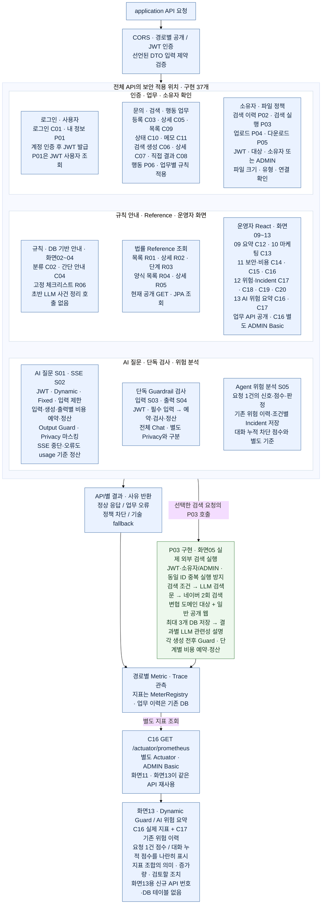
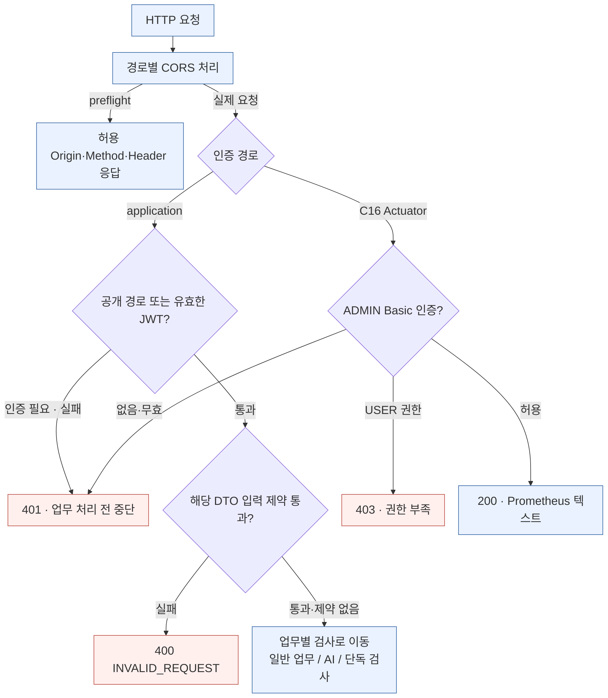
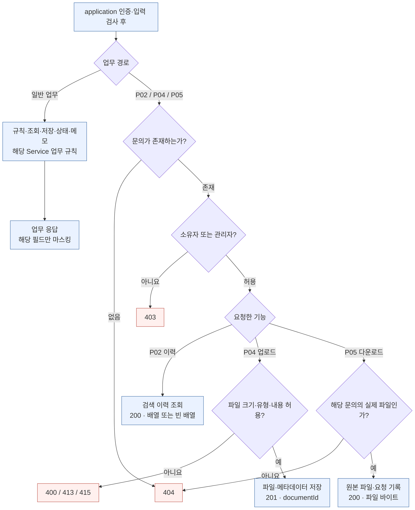
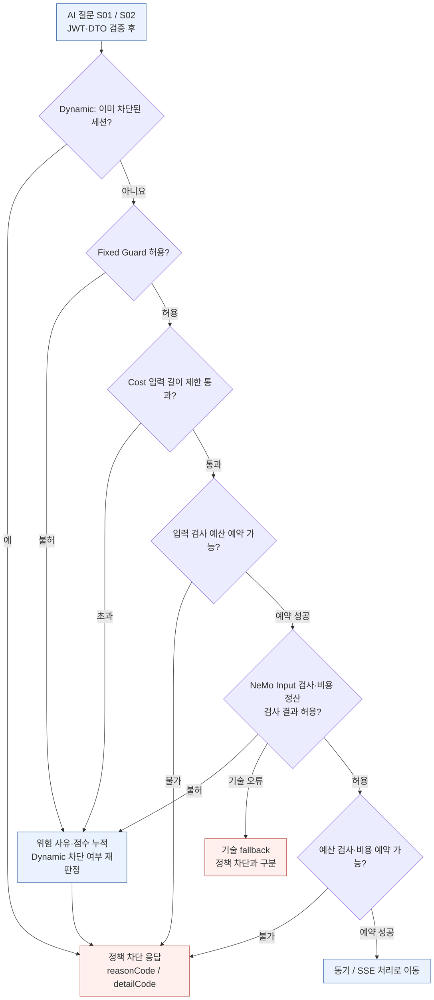
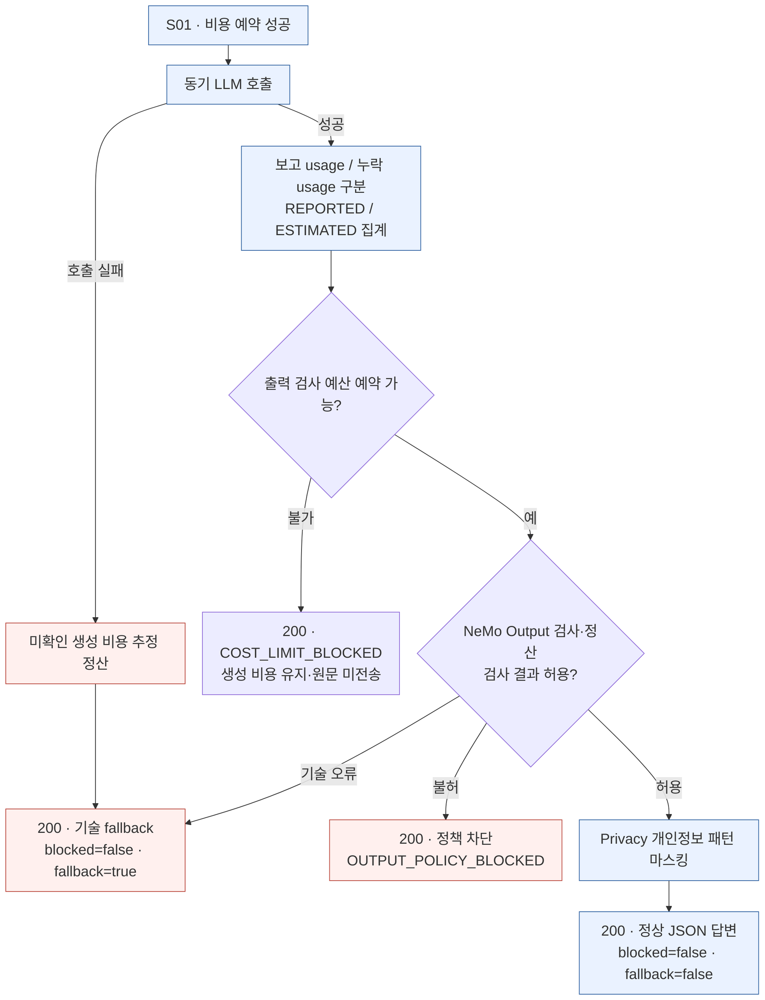
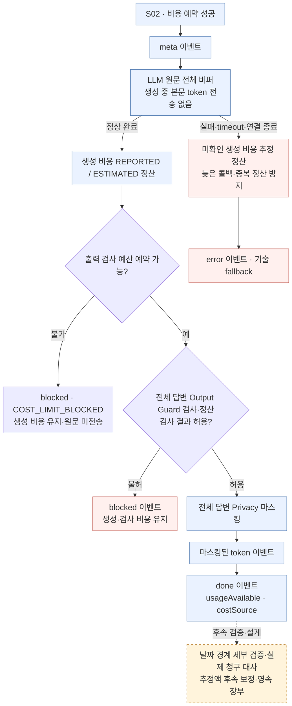
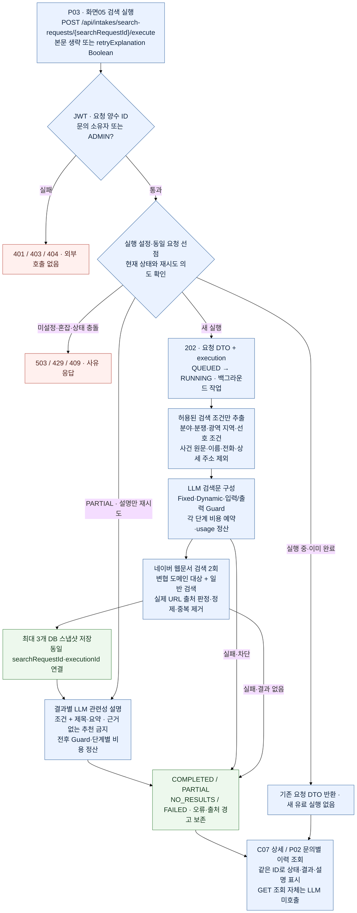

# 02-B. Security 판단·차단 flowchart

**2026-10-22 현행 반영:** P03 실행·화면05 연결 구현, 운영자 React 화면09~13 구현. 화면13은 기존 C16/C17 재사용이며 새 API 번호·DB 테이블을 추가하지 않았다. 구현 API는 37개다. 외부 LLM·네이버 실제 키 호출·청구 검증은 아직 별도다.

기준: **2026-10-22(Asia/Seoul)**. **API 번호가 붙은 간단 흐름도 → API 기능표 → 단계별 상세 보안 흐름 → 전체 통합 상세도** 순서로 읽는다. 추적 번호 기준 API는 구현 37개다.

## 1. API 번호를 붙인 간단 흐름도

기능별로 어떤 검사를 적용하는지 위치를 먼저 확인한다. 한 박스의 번호는 별도 API를 묶은 것이며 자동 호출 순서가 아니다. C16은 별도 Actuator 인증이며 화면11·13에서 재사용한다. P03은 구현된 검색 실행·Guard·비용 경로로 표시한다.



**표시하지 않은 API 번호는 없다.** 일반 업무·법률 Reference·운영·행동 기록도 포함하지만 모든 API에 전체 Chat Guard를 적용한다는 뜻은 아니다.

[최신 기본 흐름 PNG·SVG·독립 문서](02B_SECURITY_FLOW_API_MAP.md)

## 2. API 기능표

아래 행은 [API 기능서 flow·기능mapping표](../BACKEND_DRAFT_STATUS_AND_API_SPEC.md)의 계약과 동일하다. 화면 번호는 연결 설계이며, 성공 응답 표는 실제 Postman 실행 기록과 구분한다. S는 AI·Guardrail 보조 기능, P는 추가 API의 추적 번호다.

### 2-1. 접수·검색·상담 검토

| ID / 화면 | 기능 | HTTP API | 입력 | 성공 응답 / 동작 | Controller |
|---|---|---|---|---|---|
| C01 / 01 | 로그인 | `POST /api/auth/login` | `username`, `password` 필수 | 200: `accessToken`, `username`, `role` | `AuthController` |
| C02 / 02 | 사건 분류 미리보기 | `POST /api/intakes/classify-preview` | `coreStatement` 필수·최대 100자, `caseType` 선택 | 200: 분류·권장 자료·안내, 무저장 | `LegalIntakeClassificationController` |
| C03 / 03 | 문의 등록 | `POST /api/intakes` | Intake JSON, JWT 선택(전달 시 소유자 기록) | 201: `LegalIntakeResponse`, 자료 종류·검색 조건 동시 저장, uploadedDocuments는 초기 빈 배열 | `LegalIntakeRecordController` |
| C04 / 04 | 간단 안내 생성 | `POST /api/legal-intake/minimal` | `MinimalLegalIntakeRequest` | 200: 규칙 기반 유형·권장 자료·안내. 저장·LLM 없음. | `MinimalLegalIntakeController` |
| C05 / 04·07 | 문의 상세 | `GET /api/intakes/{id}` | Path `id` | 200: 문의·자료·조건·상담 메모·uploadedDocuments | `LegalIntakeRecordController` |
| C06 / 05 | 검색 요청 생성 | `POST /api/intakes/{intakeId}/search-requests` | Path ID, JSON `{}` 또는 목적·출처 | 201: `AiSearchRequestResponse`, `PREVIEW_READY` | `LegalIntakeRecordController` |
| C07 / 05 | 검색 요청 상세 | `GET /api/intakes/search-requests/{searchRequestId}` | Path ID | 200: 요청·검색문·정렬된 결과 | `LegalIntakeRecordController` |
| C08 / 05 | 결과 스냅샷 저장 | `POST /api/intakes/search-requests/{searchRequestId}/results` | 출처·제목·URL, 요약·순서 | 201: 결과 포함 검색 요청 DTO | `LegalIntakeRecordController` |
| C09 / 06 | 문의 목록 | `GET /api/intakes` | 없음 | 200: 최신순 최대 50개 `LegalIntakeResponse[]` | `LegalIntakeRecordController` |
| C10 / 08 | 상태 변경 | `PATCH /api/intakes/{id}/status` | Path ID, `status` 필수 | 200: `id`, `previousStatus`, `status`, `changed` | `LegalIntakeStatusController` |
| C11 / 08 | 상담 메모 추가 | `POST /api/intakes/{id}/memo` | Path ID, `content` 필수, `followUpItems` 선택 | 201: ID·마스킹 본문·후속 조치·생성 시각 | `ConsultationMemoController` |

### 2-2. 운영·마케팅·감사

| ID / 화면 | 기능 | HTTP API | 입력 | 성공 응답 / 동작 | Controller |
|---|---|---|---|---|---|
| C12 / 09 | 운영 요약 | `GET /api/admin/dashboard/summary` | 없음 | 200: Agent 실행·위험 이력·보안 이벤트·열린 Incident 수, `riskSummary` | `AdminDashboardController` |
| C13 / 10 | 마케팅 기본 집계 | `GET /api/admin/dashboard/marketing-funnel` | 없음 | 200: 접수·검색·현재 상담 준비 수, 분포, 보고된 행동 이벤트 수 | `MarketingDashboardController` |
| C14 / 11 | 최근 보안 이벤트 | `GET /api/admin/dashboard/security-events` | 없음 | 200: 최근 최대 50개 보안 이벤트 배열 | `AdminDashboardController` |
| C15 / 11 | 위험 집계 | `GET /api/agent/risk/summary` | 없음 | 200: 전체·등급별·결정별·조치별 수 | `AgentRiskHistoryController` |
| C16 / 11·13 | Prometheus 지표 | `GET /actuator/prometheus` | ADMIN Basic 인증 | 200: Prometheus 텍스트. 입력 검사·답변 생성·출력 검사별 예약·보고·추정·합계 비용과 전체 합계. | Spring Boot Actuator |
| C17 / 12·13 | 위험 이력 | `GET /api/agent/risk/history` | Query `riskLevel`, `decision` 선택(riskLevel 우선) | 200: 위험 이력 배열 | `AgentRiskHistoryController` |
| C18 / 12 | Incident 목록 | `GET /api/incidents` | 없음 | 200: 최근 Incident 배열 | `RiskIncidentController` |
| C19 / 12 | Incident 확인 | `PATCH /api/incidents/{incidentId}/ack` | Path ID | 200: 변경된 Incident DTO | `RiskIncidentController` |
| C20 / 12 | Incident 종결 | `PATCH /api/incidents/{incidentId}/resolve` | Path ID | 200: 변경된 Incident DTO | `RiskIncidentController` |

### 2-3. 법률 Reference

| ID / 화면 | 기능 | HTTP API | 입력 | 성공 응답 / 동작 | Controller |
|---|---|---|---|---|---|
| R01 / 02 보조 | 절차 목록 | `GET /api/legal/procedures` | Query `domain` 선택 | 200: `code`, `domain`, `title`, `summary`, `userRole` 배열 | `LegalProcedureController` |
| R02 / 02·03·04 보조 | 절차 상세 | `GET /api/legal/procedures/{code}` | Path `code` | 200: 기본 정보·`steps`·`forms`·`knowledgeGraphEdges` | `LegalProcedureController` |
| R03 / 03 보조 | 절차 단계 | `GET /api/legal/procedures/{code}/steps` | Path `code` | 200: 순서·코드·제목·설명·체크리스트 배열 | `LegalProcedureController` |
| R04 / 03 보조 | 양식 목록 | `GET /api/legal/forms` | Query `procedure` 선택 | 200: 양식 코드·절차 코드·제목·파일 유형·사용 안내 배열 | `LegalProcedureController` |
| R05 / 03 보조 | 양식 상세 | `GET /api/legal/forms/{formCode}` | Path `formCode` | 200: 양식 DTO | `LegalProcedureController` |
| R06 / 04 보조 | 형사 보완수사 체크리스트 | `GET /api/legal/criminal/checklist/supplementary-investigation` | 없음 | 200: `domain`, `role`, `stageCode`, `stageLabel`, `checklist`, `recommendedAction` | `LegalProcedureController` |

### 2-4. AI·Guardrail 보조

S01~S05는 AI 처리·보안 검사·검증을 위한 백엔드 API로, 현재 서비스 범위에서는 **별도 전용 화면이 불필요**하다. 화면 지정을 보류했거나 향후 화면 개발이 남았다는 의미가 아니다.

| ID / 화면 | 기능 | HTTP API | 입력 | 성공 응답 / 동작 | Controller |
|---|---|---|---|---|---|
| S01 / AI 질문·별도 화면 불필요 | 동기 AI Chat | `POST /api/ai/chat` | `message` 필수·DTO/비용 길이 게이트 최대 100자, `sessionId` 선택 | 200: `answer`, `blocked`, `fallback`, `traceId`, `model`, 호환용 `reason`, `reasonCode`, `detailCode`, `usageAvailable`, `costSource` | `AiController` |
| S02 / AI 질문·별도 화면 불필요 | SSE AI Chat | `POST /api/ai/chat/stream` | `message` 필수·DTO/비용 길이 게이트 최대 100자, `sessionId` 선택 | `text/event-stream`; meta 후 전체 답변 검사·마스킹 완료 시 token/done. done에 usageAvailable·costSource, 미확인 토큰 수는 null | `AiController` |
| S03 / 단독 검사 | Input Guardrail 단독 검사 | `POST /api/legal/guardrail/input` | `message` 필수, `sessionId` 선택 | 200: 기존 검사 필드 + `reasonCode`, `detailCode`, `usageAvailable`, `costSource` | `LegalGuardrailController` |
| S04 / 단독 검사 | Output Guardrail 단독 검사 | `POST /api/legal/guardrail/output` | `response` 필수, `sessionId` 선택 | 200: 기존 검사 필드 + `reasonCode`, `detailCode`, `usageAvailable`, `costSource` | `LegalOutputGuardrailController` |
| S05 / 운영 보조 | Agent 위험 분석 | `POST /api/agent/risk/analyze` | `userInput`, `toolName`, 재시도·토큰 수, 위험 신호 Boolean 등 | 200: `decision`, `riskScore`, `riskLevel`, `signals`, `recommendedAction`, `guardrailReady`, `historyId`, `traceId` | `AgentRiskDecisionController` |

### 2-5. 추가 공통·검색·파일·행동

| ID / 화면 | 기능 | HTTP API | 입력 | 성공 응답 / 동작 | Controller |
|---|---|---|---|---|---|
| P01 / 01·공통 | 내 정보 | `GET /api/me` | Body 없음. JWT 필수 | 200: username, role | `CurrentUserController` |
| P02 / 05 | 문의별 검색 이력 | `GET /api/intakes/{intakeId}/search-requests` | Path `intakeId`. JWT·소유자 또는 관리자 | 200: 최신순 검색 요청·결과 배열, 없으면 [] | `IntakeSearchHistoryController` |
| P04 / 문의 상세·공통 | 파일 업로드 | `POST /api/intakes/{intakeId}/documents` | Path `intakeId`. JWT·소유자/관리자, multipart file 필수, documentType 선택 | 201: id·intakeId·documentType·originalFilename·contentType·sizeBytes·createdAt·downloadUrl | `IntakeDocumentController` |
| P05 / 문의 상세·공통 | 파일 다운로드 | `GET /api/intakes/{intakeId}/documents/{documentId}/download` | Path `intakeId`, `documentId`. JWT·소유자/관리자, 문의·파일 연결 확인 | 200: 파일 바이트, attachment·nosniff·no-store, 다운로드 요청 기록 | `IntakeDocumentController` |
| P06 / 행동 수집·공통 | 행동 이벤트 기록 | `POST /api/intake-events` | eventId·eventType·sessionId 필수, intakeId 선택. SUMMARY_VIEWED는 intakeId 필수 | 최초 201/created=true, 동일 재전송 200/false, 다른 내용으로 ID 재사용 409 | `IntakeEventController` |

### 2-6. 실제 외부 검색 실행 — 구현·로컬 모의 검증

| ID / 화면 | 기능 | HTTP API | 입력 | 성공 응답 / 동작 | Controller |
|---|---|---|---|---|---|
| P03 / 05 | 실제 외부 검색 실행 | `POST /api/intakes/search-requests/{searchRequestId}/execute` | JWT·소유자/ADMIN, Path ID, 본문 생략 또는 `{retryExplanation?:boolean}` | 202 요청 DTO+execution. 조건→LLM 검색문→네이버 변협 대상/일반 검색→최대3개 저장→결과별 LLM 설명. C07/P02 조회·PARTIAL 설명 재시도 | `SearchExecutionController` → `SearchExecutionService` |

## 3. 단계별 상세 보안 흐름

기존 통합도는 가로로 뻗는 처리선을 줄이기 위해 아래 다섯 부분으로 나눴다. **3-1의 진입 검사 → 업무에 따라 3-2 또는 3-3 → AI는 응답 방식에 따라 3-4 또는 3-5**로 연결한다.

### 3-1. 공통 진입 — CORS·인증·입력 검증



공개 API는 JWT를 필수로 요구하지 않는다. C01은 공개로 진입한 뒤 계정을 인증하며, P01·S01~S04·P02/P04/P05에는 해당 JWT 인증을 적용한다. C16은 application JWT가 아닌 ADMIN Basic 인증이다.

[Mermaid 원본](02B_SECURITY_FLOW_ENTRY.mmd).

### 3-2. 일반 업무 — 대상·소유자·파일 정책



그림은 나머지 입력 조건이 정상인 대표 업무 경로다. 문의별 이력·파일은 문의 존재를 먼저 확인한 뒤 소유자/관리자를 확인한다. 일반 문의의 대상 없음·금지 상태 변경은 해당 경로에서 404/409다. Reference·Incident·단독 Guardrail의 모든 오류가 같은 계약으로 통일되어 있는 것은 아니다.

[Mermaid 원본](02B_SECURITY_FLOW_BUSINESS.mmd).

### 3-3. AI 공통 입력 — Dynamic·Fixed·Cost·Input Guard



처음 차단된 사유와 최종 응답 사유는 Dynamic 누적에 따라 달라질 수 있다. DTO 상한 30자와 실험용 Cost 입력 상한 10자를 구분한다. 입력 Guardrail 호출 전에도 비용을 예약하고 검사 결과와 무관하게 정산한다. 답변 생성·출력 검사도 각 호출 전에 예약한다. S03/S04 단독 검사는 해당 검사 비용만 같은 장부에 반영하며 전체 Chat 순서는 실행하지 않는다.

[Mermaid 원본](02B_SECURITY_FLOW_AI_INPUT.mmd).

### 3-4. 동기 Chat S01 — 정산·출력 보호·JSON 응답



정상 LLM 응답의 비용은 Output Guard 전에 보고/추정 집계한다. 출력 Guardrail 비용도 별도로 예약·정산한다. 따라서 출력 정책 차단이 실제 사용 비용 0을 뜻하지 않는다. usage 누락은 ESTIMATED이며, 기술 fallback과 정책 차단은 blocked·fallback·reasonCode로 구분한다.

[Mermaid 원본](02B_SECURITY_FLOW_AI_SYNC.mmd).

### 3-5. SSE Chat S02 — 전체 답변 검사·마스킹·이벤트



본문은 전체 생성·출력 검사·마스킹 후 전송한다. 정상 done에서 usage가 미확인이면 토큰 수는 null이고 비용 출처는 ESTIMATED다. 생성 비용은 출력 검사 전에 정산한다. 오류·timeout·연결 종료 시 미확인 생성 비용을 추정 정산하며 이미 닫힌 예약은 중복 정산하지 않는다. 실서비스 청구 대사·추정액 보정·날짜 경계의 세부 검증은 별도 범위다.

[Mermaid 원본](02B_SECURITY_FLOW_AI_SSE.mmd).

### 3-6. P03 실제 외부 검색 실행

원문 대신 허용된 검색 조건으로 검색문을 만들고, 네이버에서 변협 도메인 대상·일반 검색을 병합해 저장한 뒤 결과별 관련성을 설명한다. 각 생성 전후 Guard와 공통 예산을 적용한다. 조회 폴링은 새 LLM 호출이 아니며 PARTIAL에서 누락 설명만 명시적으로 재시도한다.



[순수 Mermaid](../postman-http/P03.mmd) · [현재 P03 검수](../P03_EXTERNAL_SEARCH_REVIEW.md).

## 4. 전체 보안 상세 흐름도 — 통합 Mermaid

공통 진입부터 업무·AI 정책, 비용 정산, 응답·관측까지 한 장으로 연결했다. **① → ② → 요청한 ③·④·⑤ 중 한 경로 → ⑥** 순서로 읽는다. 같은 상자에 적힌 API 번호는 기능 묶음이며 API를 차례로 호출한다는 뜻이 아니다. 인증·DTO 검증에 실패한 요청, preflight와 Actuator 조회는 ①에서 종료한다.

일반 처리는 파랑, 보안 정책은 보라, 비용이 걸린 단계는 초록, 중단·오류는 빨강으로 구분했다. 주황색 점선 상자는 후속 범위다. 긴 분기는 육각형 검사 상자로 묶고, AI 경로의 차단·오류 분기는 점선으로 표시했다.

박스 사이 라벨은 **API 번호와 짧은 조건·상태만** 표시한다. 예: `S01·S02`, `S03·S04`, `C16`, `통과`, `불허`, `예산 부족`, `오류·중단`. 자세한 이유는 기능 박스와 3절의 단계별 설명에서 확인한다. 라벨은 **180px(기존 72px의 2.5배)** 굵은 남색 글씨·흰색 배경, 연결선·화살촉은 검은색으로 유지하고 연결 간격을 줄였다. 상자 본문은 28px, 구역 제목은 30px다.

[확대 가능한 SVG](assets/02B_SECURITY_FLOW.svg) · [통합 Mermaid 원본](02B_SECURITY_FLOW.mmd). 세부 분기·HTTP 응답은 위 3절의 단계별 도표와 API 기능표를 함께 읽는다.

```mermaid
%%{init: {"theme":"base","themeVariables":{"fontFamily":"Malgun Gothic, Arial, sans-serif","fontSize":"28px","darkMode":false,"background":"#ffffff","primaryTextColor":"#102544","secondaryTextColor":"#102544","tertiaryTextColor":"#102544","textColor":"#102544","lineColor":"#000000","arrowheadColor":"#000000","edgeLabelBackground":"#ffffff","clusterBkg":"#ffffff","clusterBorder":"#64748b"},"themeCSS":"& { background-color:#ffffff !important; } .edgeLabel div, .cluster-label div { width:max-content !important; max-width:none !important; white-space:nowrap !important; } .flowchart-link { stroke:#000000 !important; stroke-width:3.2px !important; opacity:1 !important; } .marker, marker path { fill:#000000 !important; stroke:#000000 !important; opacity:1 !important; } .edgeLabel, .edgeLabel p, .edgeLabel span { color:#102544 !important; fill:#102544 !important; font-size:180px !important; font-weight:800 !important; background-color:#ffffff !important; } .edgeLabel .labelBkg, .edgeLabel rect { fill:#ffffff !important; background-color:#ffffff !important; } .nodeLabel, .nodeLabel p { color:#102544 !important; font-size:28px !important; font-weight:600 !important; } .cluster-label text, .cluster-label span, .cluster-label p { fill:#102544 !important; color:#102544 !important; font-size:30px !important; font-weight:700 !important; }","flowchart":{"defaultRenderer":"dagre-wrapper","useMaxWidth":false,"htmlLabels":true,"subGraphTitleMargin":{"top":16,"bottom":36},"wrappingWidth":620,"nodeSpacing":360,"rankSpacing":64,"padding":22,"curve":"linear"}}}%%
flowchart TB
    accTitle: 전체 보안 상세 흐름도
    accDescr: 공통 진입 뒤 요청한 일반 업무, AI Chat, 단독 Guardrail 경로만 실행한다. 유료 검사는 답변 생성과 함께 단계별로 비용을 예약하고 정산한다.

    subgraph ENTRY["① 공통 진입"]
        direction LR
        ERequest["HTTP 요청"] --> ECors{{"CORS 처리"}}
        ECors -->|"사전 요청"| EPreflight["허용 Origin·Method·Header 응답<br/>여기서 종료"]
        ECors -->|"실제 요청"| EAuth{{"application: 공개 / 필요한 JWT<br/>Actuator: health/info 외 ADMIN Basic"}}
        EAuth -->|"실패"| EAuthError["401 / 403<br/>업무 처리 전 중단"]
        EAuth -->|"앱 통과"| EInput["Trace ID · 선언된 DTO 검증"]
        EInput -->|"입력 오류"| EInvalid["400 INVALID_REQUEST"]
        EAuth -->|"C16"| EActuator["C16 Prometheus · metrics<br/>지표 조회 응답"]
    end

    ROUTE{"② API 경로"}

    subgraph BUSINESS["③ 일반 업무·권한"]
        direction TB
        BStart["C01·P01 · C02~C15·C17~C20<br/>R01~R06 · S05 · P02·P04~P06"]
        BStart --> BCheck{{"해당 업무 검사<br/>C01 계정 · P02/P04/P05 소유자·파일<br/>대상·상태·연결·중복 규칙"}}
        BCheck -->|"실패"| BError["경로별 업무·권한 오류<br/>400 / 401 / 403 / 404 / 409<br/>파일 크기·유형 413 / 415 등"]
        BCheck -->|"통과"| BResponse["업무 처리·필요한 지정 필드 보호<br/>JSON / 파일 / 규칙 안내<br/>S05 모의 토큰은 USD 장부와 별도"]
    end

    subgraph CHAT["④ AI Chat · S01 / S02"]
        direction TB
        APre{{"로컬 입력 보안<br/>Dynamic 사전 점검 → Fixed → 길이<br/>실험 10자 · DTO 상한 30자"}}
        APre -. "차단" .-> APolicy["보안·길이 차단 · 사유 반환<br/>Fixed·길이·Input 불허는 위험 누적<br/>필요 시 Dynamic 세션 차단"]
        APre -->|"통과"| AInput["입력 검사 예산 예약 → NeMo Input<br/>보고 usage / 미확인 추정액 정산"]
        AInput -. "예산 부족" .-> ACost["COST_LIMIT_BLOCKED<br/>한도별 detailCode 반환<br/>이미 정산한 앞 단계 비용 유지"]
        AInput -. "불허" .-> APolicy
        AInput -. "오류" .-> ATechnical["S01 기술 fallback / S02 error<br/>미확인 호출 비용은 추정 반영<br/>연결 종료는 전송 종료"]
        AInput -->|"허용"| AGeneration["생성 예산 예약 → LLM 답변 생성<br/>S01 동기 · S02 전체 답변 버퍼<br/>완료 즉시 보고/추정 생성 비용 정산"]
        AGeneration -. "예산 부족" .-> ACost
        AGeneration -. "오류·중단" .-> AInterrupted["미확인 생성 비용 추정 정산<br/>늦은 완료·중복 콜백 재정산 방지"]
        AInterrupted --> ATechnical
        AGeneration -->|"완료"| AOutput["로컬 출력 정책 → 출력 검사 예산 예약<br/>NeMo Output 검사·보고/추정 정산"]
        AOutput -. "예산 부족" .-> ACost
        AOutput -. "불허" .-> AOutputBlock["OUTPUT_POLICY_BLOCKED<br/>원문 미전송 · 사용한 비용 유지"]
        AOutput -. "오류" .-> ATechnical
        AOutput -->|"허용"| APrivacy["Privacy 개인정보 패턴 마스킹"]
        APrivacy --> AResponse["S01 정상 JSON / S02 token → done<br/>usageAvailable·costSource는 생성 단계"]
    end

    subgraph STANDALONE["⑤ S03·S04 단독 검사"]
        direction TB
        SStart{{"S03: 입력 검사 예산 확인·예약<br/>S04: 로컬 출력 정책 후 예산 확인·예약"}}
        SStart -->|"로컬 불허"| SZero["외부 호출·예약 없음<br/>확인된 0토큰 결과"]
        SStart -. "예산 부족" .-> SCost["200 · BLOCKED · allowed=false<br/>COST_LIMIT_BLOCKED · detailCode"]
        SStart -->|"예약"| SCheck["해당 Input / Output Client 검사<br/>허용·불허 모두 보고/추정 정산"]
        SCheck -->|"결과"| SResponse["200 · status·allowed·rail<br/>usageAvailable · costSource<br/>검사 허용 여부는 allowed로 확인"]
        SCheck -. "오류" .-> SError["미확인 검사 비용 추정 반영<br/>기존 외부 예외 응답<br/>Chat의 200 fallback과 구분"]
        SZero --> SResponse
    end

    OBSERVE["⑥ 결과·관측<br/>Trace · reasonCode · detailCode · 단계별 Metric<br/>C16: 입력 검사 / 생성 / 출력 검사 USD 비용<br/>agent.cost.tokens: 별도 모의 토큰 지표"]
    FUTURE["후속 설계·검증<br/>일반 업무 인가 확대 · 실제 공급자 검증<br/>날짜 경계·청구 대사·추정액 보정·영속 장부"]

    ENTRY -->|"통과"| ROUTE
    ROUTE -->|"업무"| BUSINESS
    ROUTE -->|"S01·S02"| CHAT
    ROUTE -->|"S03·S04"| STANDALONE
    BUSINESS -. "결과" .-> OBSERVE
    CHAT -. "관측" .-> OBSERVE
    STANDALONE -. "관측" .-> OBSERVE
    OBSERVE -. "후속" .-> FUTURE

    linkStyle default stroke:#000000,stroke-width:3.2px,color:#102544,font-size:180px,font-weight:800

    classDef main fill:#edf4ff,stroke:#42658b,stroke-width:2px,color:#102544,font-size:28px,font-weight:600
    classDef policy fill:#f4f0ff,stroke:#7858a8,stroke-width:2px,color:#102544,font-size:28px,font-weight:600
    classDef cost fill:#eaf7f0,stroke:#347356,stroke-width:2px,color:#102544,font-size:28px,font-weight:600
    classDef stop fill:#fff0ed,stroke:#ab503e,stroke-width:2px,color:#102544,font-size:28px,font-weight:600
    classDef output fill:#eef7fb,stroke:#44798d,stroke-width:2px,color:#102544,font-size:28px,font-weight:600
    classDef planned fill:#fff7e5,stroke:#946d24,stroke-width:2px,stroke-dasharray:7 5,color:#102544,font-size:28px,font-weight:600
    class ERequest,EPreflight,EInput,EActuator,BStart,BResponse,ROUTE main
    class ECors,EAuth,BCheck,APre,APrivacy policy
    class AInput,AGeneration,AOutput,SStart,SCheck cost
    class EAuthError,EInvalid,BError,APolicy,ACost,ATechnical,AInterrupted,AOutputBlock,SCost,SError stop
    class AResponse,SResponse,SZero,OBSERVE output
    class FUTURE planned
    style ENTRY fill:#ffffff,stroke:#64748b,stroke-width:2px
    style BUSINESS fill:#ffffff,stroke:#64748b,stroke-width:2px
    style CHAT fill:#ffffff,stroke:#64748b,stroke-width:2px
    style STANDALONE fill:#ffffff,stroke:#64748b,stroke-width:2px
```

통합도에서 확인할 비용·응답 경계:

- **S01·S02:** 로컬 입력 검사 뒤 Input → 생성 → Output 순서로 각각 예약·정산한다. 생성 비용은 출력 검사 전에 정산하므로 출력 불허·예산 부족이 앞 단계 비용을 없애지 않는다.
- **S02:** 생성 중에는 원문 token을 보내지 않는다. 전체 출력 검사·Privacy 마스킹 후 전송하며, 호출 후 오류·timeout·연결 종료는 미확인 생성 비용을 추정 정산한다. 닫힌 예약은 중복 정산하지 않는다.
- **S03·S04:** 해당 검사 비용을 Chat과 같은 예산 장부에 반영한다. S04 로컬 불허는 외부 호출 전이라 확인된 0토큰이다. 정상 검사 결과와 비용 차단은 HTTP 200의 `allowed`·사유로 구분하며, 외부 기술 오류는 기존 예외 응답을 따른다.
- **C16·S05:** C16에서 입력 검사·생성·출력 검사별 비용을 관측한다. S05의 `agent.cost.tokens`는 모의 토큰 지표로 USD 비용 장부와 구분한다.

상세 비용 한도·정산식·관련 보조 API는 [03 Cost Control](03_COST_CONTROL_FLOW.md)을 기준으로 한다.

## 5. 원본·적용 범위·확대 자료

[API 번호 지도 Mermaid](02B_SECURITY_FLOW_API_MAP.mmd) · [이전 최소 흐름 Mermaid](02B_SECURITY_FLOW_SIMPLE.mmd) · [현행 통합 상세도 Mermaid](02B_SECURITY_FLOW.mmd) · [현행 통합 상세도 SVG](assets/02B_SECURITY_FLOW.svg) · [과거 통합 상세도 — 변경 전 기록](02B_SECURITY_FLOW_ORIGINAL.md)

Guard별 확대: [Fixed Guard](02B1_FIXED_GUARD_FLOW.md) · [Dynamic Guard](02B2_DYNAMIC_GUARD_FLOW.md) · [Privacy Protection — API mapping / Input / SSE](02B3_PRIVACY_FLOW.md). Privacy 자료에는 S01/S02/C03/C04/C05/C09/C11의 실제 적용 필드·메서드, 마스킹 종류, DB·외부 LLM 경계를 정리했다. 업무·저장은 [02-A 백엔드 흐름도](02A_BACKEND_FLOW.md), 비용 예약·정산은 별도 Cost Control 도표로 연결한다.

**현재 코드의 적용 범위**

| 경계 | 현재 적용 |
|---|---|
| JWT | `/api/me`, `/api/ai/**`, GET 이외 `/api/legal/**`, 신규 파일 업로드/다운로드·문의별 검색 이력 |
| 신규 소유자 인가 | 검색 이력·파일 API는 문의 소유자 또는 ROLE_ADMIN. 익명 문의는 관리자만 접근 |
| 공개 API | 로그인, 법률 GET, 신규 파일·이력 경로를 제외한 개발용 `/api/intakes/**`, `/api/admin/**`, `/api/agent/**`, `/api/incidents/**`, 행동 수집 `/api/intake-events` |
| Actuator | 별도 체인. health/info 공개, 그 밖의 Endpoint는 ADMIN Basic |
| DTO 검증 | `@Valid`와 제약이 선언된 API에 적용 |
| Fixed·Dynamic·입력 길이·NeMo Input | 동기·SSE 공통 순서 적용. 차단 이력·Metric·세션 상태 공유 |
| Intake 출력 | 이름·전화·상대방·본문, 메모 본문 등 지정 필드 처리. 모든 DTO·DB·로그에 일괄 적용되는 것은 아님. |
| SSE | 로컬 입력 검사 → 입력 검사 예약·정산 → 생성 예약·버퍼·정산 → 출력 검사 예약·정산 → Privacy → token/done. 오류·중단 시 미확인 생성 비용 추정 정산. |
| CORS | application·Actuator 체인에서 공통 source 적용. preflight와 실제 요청의 JWT·ADMIN Basic 유지 자동 검증. |

일반 업무·SSE·동기 AI Chat을 각각의 현재 경로로 구분했다. SSE의 출력 정책 적용 차이는 표를 함께 읽는다. AI 정책·기술 대체 응답은 HTTP 200 안의 플래그·reasonCode·detailCode로 구분하며 기존 reason도 유지한다. 400·404·409 등 업무/입력 오류와 혼동하지 않는다.

‘요청이 어떤 테이블에 저장되는가’는 02-A의 질문이고, ‘이 요청을 허용해야 하는가’는 이 도표의 질문이다. 같은 Service 안에서 연속 실행되어도 설명 목적과 책임은 구분할 수 있다.

코드 근거: [SecurityConfig](C:/myLectureWs/legal-ai-intake-security-server/backend/guardrail-ready-policy-checker/src/main/java/com/ohgiraffers/handlermethod/config/SecurityConfig.java), [동기 AI 정책 흐름](C:/myLectureWs/legal-ai-intake-security-server/backend/guardrail-ready-policy-checker/src/main/java/com/ohgiraffers/handlermethod/service/AiService.java), [SSE의 별도 구현](C:/myLectureWs/legal-ai-intake-security-server/backend/guardrail-ready-policy-checker/src/main/java/com/ohgiraffers/handlermethod/service/AiStreamingService.java).
