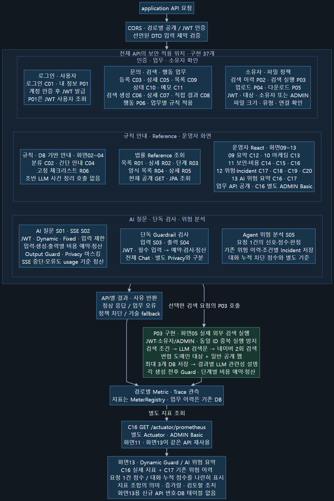
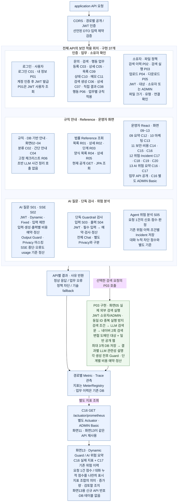

# 기본 API·보안·운영 흐름 — 2026-10-22

**2026-10-22 현행 반영:** P03 실행·화면05 연결 구현, 운영자 React 화면09~13 구현. 화면13은 기존 C16/C17 재사용이며 새 API 번호·DB 테이블을 추가하지 않았다. 구현 API는 37개다. 외부 LLM·네이버 실제 키 호출·청구 검증은 아직 별도다.

P03은 명시적으로 실행한 검색 요청에서만 동작한다. 화면02~04는 기존 규칙·DB·템플릿 방식이며 초반 LLM 사건 정리를 추가하지 않는다. C16은 application JWT와 다른 ADMIN Basic 인증이다. 업무 운영 API의 기존 공개 정책은 남아 있다.

[확대용 SVG](assets/02B_SECURITY_FLOW_API_MAP.svg) · [Mermaid 원본](02B_SECURITY_FLOW_API_MAP.mmd) · [보안 상세 설명](02B_SECURITY_FLOW.md)

수정 가능한 Mermaid 보기

## 운영자 화면09~13 연결

| 화면 | React 경로 | API | 표시 내용 |
|---|---|---|---|
| 09 | `operator.html#/overview` | C12 | 운영 요약 |
| 10 | `operator.html#/marketing` | C13 | 문의·검색·행동 집계 |
| 11 | `operator.html#/security` | C14·C15·C16 | 보안 이력·위험 집계·비용/지표 |
| 12 | `operator.html#/audit` | C17·C18·C19·C20 | 위험 이력·Incident 조회/확인/종결 |
| 13 | `operator.html#/observability` | C16·C17 | 지표 조합의 의미·변화량·요청 점수/대화 누적 점수 |

화면13의 요청 점수는 기존 DB 이력, 세션 누적 점수는 서버 메모리 관측값이다. 서로 다른 기준이므로 합산하지 않는다. 네이버를 통한 변협 공개 페이지 검색은 변협 직접 API나 자격·경력 보증이 아니다.

## 함께 갱신한 문서

- README 한글·영문, 전체 서비스도, 백엔드·보안 지도, 통합 API 기능서의 중복 그림.
- 전체 기능표·화면별 API 연결표, 개별 P03 flow, 비용 적용 위치, 운영자 화면09~13 흐름과 매핑표.
- 전체 파일 목록은 아래 갱신 기록에서 확인한다. 과거 PDF/DOCX는 별도 판본으로 유지한다.

## 구현 근거·검증 범위

- [P03 구현·검수](../P03_EXTERNAL_SEARCH_REVIEW.md), [화면13 구현·DB 영향](../SCREEN13_OBSERVABILITY_REVIEW.md).
- [첫 호출 전 준비](../LLM_PAID_CALL_PRECHECK_2026-10-22.md), [현재 시연 비용·실험 목록](../DB_RULE_P03_COST_AND_EXPERIMENTS_2026-10-22.md).
- [이번 문서·도표 갱신 기록](../../output/basic-flow-update/verification.json). 기존 PDF/DOCX는 이번 Markdown·Mermaid 갱신에 포함하지 않았다.
