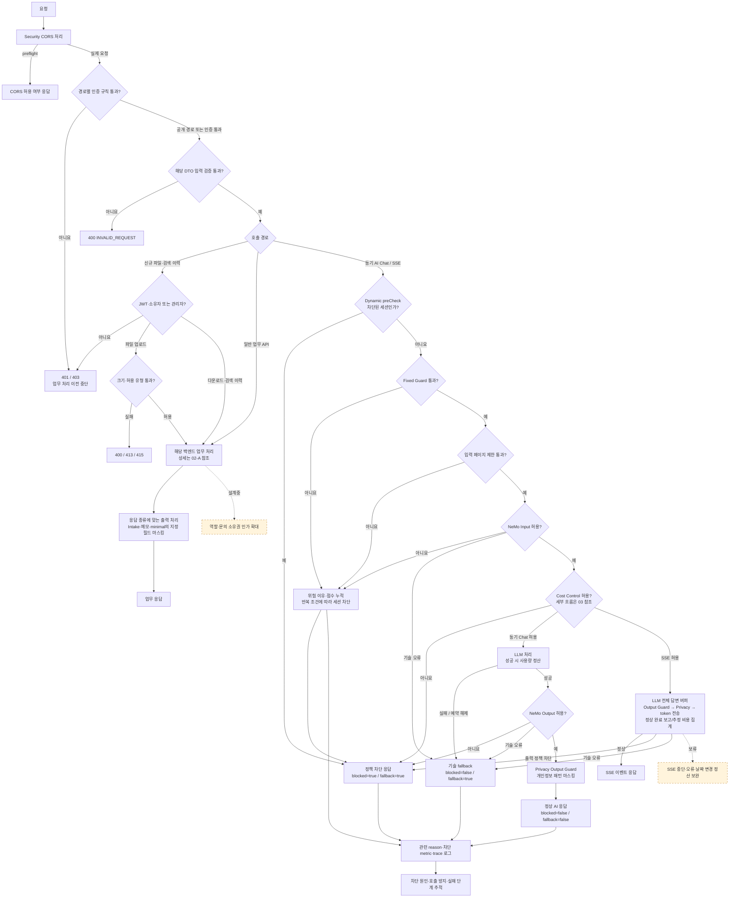

# 02-B 참고. 기존 통합 보안 상세도

복잡한 처리선을 한 그림에 모은 원본이다. 먼저 [간단 지도·API 기능표·분리 상세도](02B_SECURITY_FLOW.md)를 읽고 필요한 경우 이 원본을 확인한다.

**현재 코드의 적용 범위**

| 경계 | 현재 적용 |
|---|---|
| JWT | `/api/me`, `/api/ai/**`, GET 이외 `/api/legal/**`, 신규 파일 업로드/다운로드·문의별 검색 이력 |
| 신규 소유자 인가 | 검색 이력·파일 API는 문의 소유자 또는 ROLE_ADMIN. 익명 문의는 관리자만 접근 |
| 공개 API | 로그인, 법률 GET, 신규 파일·이력 경로를 제외한 개발용 `/api/intakes/**`, `/api/admin/**`, `/api/agent/**`, `/api/incidents/**`, 행동 수집 `/api/intake-events` |
| Actuator | 별도 체인. health/info 공개, 그 밖의 Endpoint는 ADMIN Basic |
| DTO 검증 | `@Valid`와 제약이 선언된 API에 적용 |
| Fixed·Dynamic·입력 길이·NeMo Input | 동기·SSE 공통 순서 적용. 차단 이력·Metric·세션 상태 공유 |
| Intake 출력 | 이름·전화·상대방·본문, 메모 본문 등 지정 필드 처리. 모든 DTO·DB·로그에 일괄 적용되는 것은 아님. |
| SSE | 공통 입력 검사 → 비용 예약 → LLM 전체 답변 버퍼 → Output Guard → Privacy → token 전송·정상 완료 집계. 중단 정산은 보류. |
| CORS | application·Actuator 체인에서 공통 source 적용. preflight와 실제 요청의 JWT·ADMIN Basic 유지 자동 검증. |

일반 업무·SSE·동기 AI Chat을 각각의 현재 경로로 구분했다. SSE의 출력 정책 적용 차이는 표를 함께 읽는다. AI 정책·기술 대체 응답은 HTTP 200 안의 플래그·reasonCode·detailCode로 구분하며 기존 reason도 유지한다. 400·404·409 등 업무/입력 오류와 혼동하지 않는다.

‘요청이 어떤 테이블에 저장되는가’는 02-A의 질문이고, ‘이 요청을 허용해야 하는가’는 이 도표의 질문이다. 같은 Service 안에서 연속 실행되어도 설명 목적과 책임은 구분할 수 있다.

코드 근거: [SecurityConfig](C:/myLectureWs/legal-ai-intake-security-server/backend/guardrail-ready-policy-checker/src/main/java/com/ohgiraffers/handlermethod/config/SecurityConfig.java), [동기 AI 정책 흐름](C:/myLectureWs/legal-ai-intake-security-server/backend/guardrail-ready-policy-checker/src/main/java/com/ohgiraffers/handlermethod/service/AiService.java), [SSE의 별도 구현](C:/myLectureWs/legal-ai-intake-security-server/backend/guardrail-ready-policy-checker/src/main/java/com/ohgiraffers/handlermethod/service/AiStreamingService.java).
