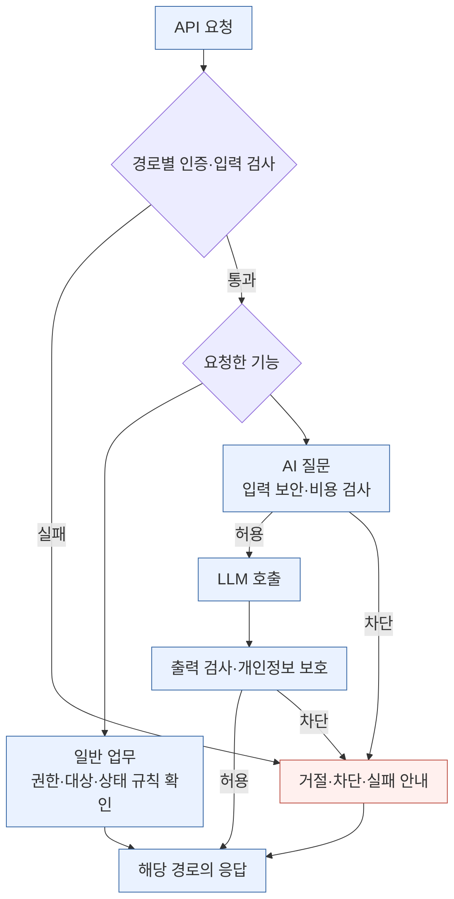
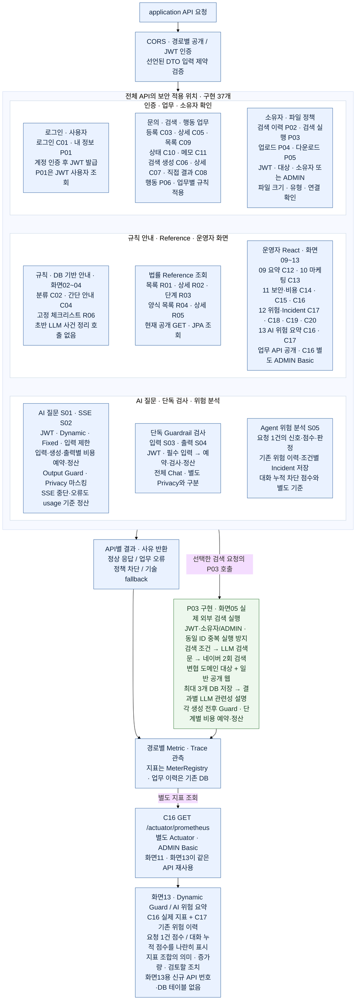

# 02. 백엔드·보안 중심 flowchart

**2026-10-22 현행 반영:** P03 실행·화면05 연결 구현, 운영자 React 화면09~13 구현. 화면13은 기존 C16/C17 재사용이며 새 API 번호·DB 테이블을 추가하지 않았다. 구현 API는 37개다. 외부 LLM·네이버 실제 키 호출·청구 검증은 아직 별도다.

기준: **2026-10-17(Asia/Seoul)**. **단순 흐름 → API 번호 지도 → 필요한 세부 처리** 순서로 읽는다.

읽는 질문: **어느 요청에 어떤 검사를 적용하고, 허용·차단·실패 결과를 어떻게 구분하는가?**

## 1. 단순 버전 — 큰 흐름

보안의 큰 갈래만 표시한다. AI 질문과 P03의 검색문·설명 생성에는 각각 LLM 전후 검사가 이어진다. 단독 Guardrail 검사는 전체 Chat 파이프라인과 다르며 다음 번호 지도에서 분리한다. 비용 정책은 입력 검사·답변 생성·출력 검사 각각에 적용하며, 단계별 예약·정산은 [Cost Control 도표](03_COST_CONTROL_FLOW.md)에서 확인한다.

## 2. API 번호를 붙인 버전 — 기능 위치

아래는 단순 흐름의 **기능별 검사**를 API 위치로 펼친 지도다. 구현 API 37개와 운영자 화면09~13을 표시한다. C16은 별도 Actuator Basic 인증 경로다.

[단순 버전 Mermaid](02_BACKEND_SECURITY_FLOW_SIMPLE.mmd) · [API 번호 지도 Mermaid](02_BACKEND_SECURITY_FLOW.mmd) · [기존 세부 처리도](02_BACKEND_SECURITY_FLOW_EXPANDED.md)

**그림에서 빠진 API 번호:** 없음. C/R/S/P 37개를 표시하며, 번호 묶음은 자동 호출 순서가 아니다. P03은 명시적인 검색 실행 요청이다. [기본 흐름 PNG·SVG](02B_SECURITY_FLOW_API_MAP.md).

**API별 검사 범위를 구분한다**

| 경로·API | 현재 처리 | 읽을 때 주의할 점 |
|---|---|---|
| 로그인 C01 / 내 정보 P01 | C01 공개 진입 후 계정 인증·JWT 발급, P01 JWT 사용자 조회 | 모든 API가 먼저 로그인 API를 자동 호출하는 것은 아님 |
| C03/C05/C09/C10/C11 및 C06/C07/C08 | DTO·대상 확인·상태/메모/저장 규칙, 지정 응답 필드 마스킹 | 전체 Chat Guard를 공통 적용하지 않음. 현재 개발 설정 공개 |
| C02/C04 | 규칙 분류·안내, 무저장 | LLM 미호출. C04에는 C02와 같은 필수 DTO 제약이 없음 |
| P02/P04/P05 | JWT·대상 존재·소유자/관리자, 파일별 크기·유형·연결 확인 | JWT 실패 401과 대상 없음 404, 소유자 불일치 403을 구분 |
| S01 | Dynamic → Fixed → 길이 → 입력 검사 예약·정산 → 생성 예약·정산 → 출력 검사 예약·정산 → Privacy | 각 유료 호출 전에 예산 확인. 차단도 HTTP 200이므로 blocked·fallback·reasonCode·detailCode 확인 |
| S02 | 로컬 입력 보안 → 입력 검사 예약·정산 → 생성 예약·전체 버퍼·정산 → 출력 검사 예약·정산 → Privacy → token/done | 출력 차단에도 생성 비용 유지. 오류·timeout·연결 종료는 미확인 생성 비용 추정 정산·중복 정산 방지 |
| S03/S04 | JWT·필수 입력 → 해당 검사 비용 예약 → Input/Output Client → 보고/추정 정산 | 같은 전체·일일·세션 예산 공유. 전체 Chat의 Fixed·Dynamic·답변 생성·별도 Privacy는 실행하지 않음. S04 로컬 출력 정책은 예약 전에 적용 |
| S05 및 C12/C14/C15/C17/C18/C19/C20 | 별도 Agent 위험·실행·Incident 모델의 분석·조회·상태 변경 | Chat Dynamic 메모리 세션 점수와 다름. S05의 권장 조치와 실제 도구 집행을 구분 |
| C16 | 별도 Actuator ADMIN Basic 인증 | 사용자 JWT·DB root와 다른 인증 |

CORS preflight 성공과 실제 요청 인증을 구분하며 Postman 성공만으로 브라우저 연결 성공을 판정하지 않는다. 기존 Reference·Incident의 대상 없음과 단독 Guard 외부 실패는 모든 오류가 신규 Intake와 같은 404/200 fallback으로 통일되어 있지 않다.

근거: [API 기능서 flow·기능mapping표](C:/myLectureWs/legal-ai-intake-security-server/docs/BACKEND_DRAFT_STATUS_AND_API_SPEC.md), [SecurityConfig](C:/myLectureWs/legal-ai-intake-security-server/backend/guardrail-ready-policy-checker/src/main/java/com/ohgiraffers/handlermethod/config/SecurityConfig.java), [02-B 보안 확대도](C:/myLectureWs/legal-ai-intake-security-server/docs/diagrams/02B_SECURITY_FLOW.md).
