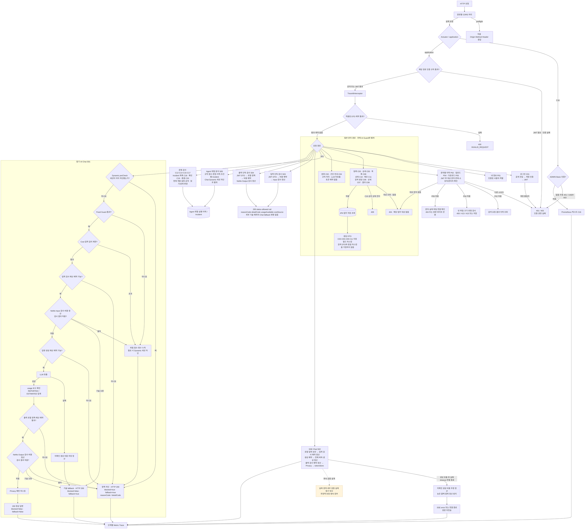

# 02 부록. 백엔드·보안 세부 처리 흐름

단순 버전의 검사를 단계별로 펼친 확대 부록이다. 비용 관련 호출 순서는 현재 구현과 연결해 표시한다. 먼저 [단순 버전·API 번호 지도](02_BACKEND_SECURITY_FLOW.md)를 읽고 필요한 처리 순서를 이 그림에서 확인한다.

기준: **2026-10-17(Asia/Seoul)**. 번호는 제출 대상 구현 API 36개의 C/R/S/P ID이며, 노드 옆 번호로 README·API 기능표·개별 Postman flow를 연결한다. 번호가 함께 적힌 노드는 업무 묶음이며 API가 자동으로 연속 호출된다는 뜻은 아니다.

읽는 질문: **API가 어떤 인증·입력·업무·AI 검사를 거치고, 어디서 차단·저장·외부 호출로 이어지는가?** 업무 데이터 처리는 02-A, 보안만 확대해 보는 자료는 02-B로 연결한다. 이 그림은 현재 구현 API 중 보안 경로를 설명하는 28개를 표시한다.

**그림에서 빠진 API 번호와 이유 — 구현 8개**

| 그림에서 생략한 구현 API | 이유 | 위치를 확인할 그림 |
|---|---|---|
| C13 | 마케팅 집계는 문의·검색·행동 데이터의 읽기 모델이므로 보안 판단 확대도에서는 생략 | 01의 마케팅 집계, 02-A의 운영 조회 |
| R01, R02, R03, R04, R05 | 공개 법률 절차·단계·양식 조회이며 AI Guard 경로와 별개 | 01의 법률 Reference, 02-A의 JPA Reference 조회 |
| R06 | 공개 고정 체크리스트 제공이며 DB·LLM 보안 판단 경로와 별개 | 01·02-A의 고정 체크리스트 |
| P06 | 행동 이벤트의 DTO·문의/세션 연결·중복 방지 업무를 보안 확대도에서는 생략 | 01의 행동 이벤트, 02-A의 이벤트 저장 |

생략은 API가 미구현이거나 Security를 우회한다는 뜻이 아니다. 위 8개도 application Security·CORS와 해당 입력/업무 규칙을 따르며, 여기서는 보안 경로의 가독성을 위해 개별 업무 노드를 확대하지 않았다. **P03은 미구현 설계안**이므로 이 보안도에는 확정된 검사 경로를 붙이지 않는다. 01·02-A에서 후속 위치를 확인한다.

**API별 검사 범위를 구분한다**

| 경로·API | 현재 처리 | 읽을 때 주의할 점 |
|---|---|---|
| 로그인 C01 / 내 정보 P01 | C01 공개 진입 후 계정 인증·JWT 발급, P01 JWT 사용자 조회 | 모든 API가 먼저 로그인 API를 자동 호출하는 것은 아님 |
| C03/C05/C09/C10/C11 및 C06/C07/C08 | DTO·대상 확인·상태/메모/저장 규칙, 지정 응답 필드 마스킹 | 전체 Chat Guard를 공통 적용하지 않음. 현재 개발 설정 공개 |
| C02/C04 | 규칙 분류·안내, 무저장 | LLM 미호출. C04에는 C02와 같은 필수 DTO 제약이 없음 |
| P02/P04/P05 | JWT·대상 존재·소유자/관리자, 파일별 크기·유형·연결 확인 | JWT 실패 401과 대상 없음 404, 소유자 불일치 403을 구분 |
| S01 | Dynamic → Fixed → 길이 → 입력 검사 예약·정산 → 생성 예약·정산 → 출력 검사 예약·정산 → Privacy | 각 유료 호출 전에 예산 확인. 차단도 HTTP 200이므로 blocked·fallback·reasonCode·detailCode 확인 |
| S02 | 로컬 입력 보안 → 입력 검사 예약·정산 → 생성 예약·전체 버퍼·정산 → 출력 검사 예약·정산 → Privacy → token/done | 출력 차단에도 생성 비용 유지. 오류·timeout·연결 종료는 미확인 생성 비용 추정 정산·중복 정산 방지 |
| S03/S04 | JWT·필수 입력 → 해당 검사 비용 예약 → Input/Output Client → 보고/추정 정산 | 같은 전체·일일·세션 예산 공유. 전체 Chat의 Fixed·Dynamic·답변 생성·별도 Privacy는 실행하지 않음. S04 로컬 출력 정책은 예약 전에 적용 |
| S05 및 C12/C14/C15/C17/C18/C19/C20 | 별도 Agent 위험·실행·Incident 모델의 분석·조회·상태 변경 | Chat Dynamic 메모리 세션 점수와 다름. S05의 권장 조치와 실제 도구 집행을 구분 |
| C16 | 별도 Actuator ADMIN Basic 인증 | 사용자 JWT·DB root와 다른 인증 |

CORS preflight 성공과 실제 요청 인증을 구분하며 Postman 성공만으로 브라우저 연결 성공을 판정하지 않는다. 기존 Reference·Incident의 대상 없음과 단독 Guard 외부 실패는 모든 오류가 신규 Intake와 같은 404/200 fallback으로 통일되어 있지 않다.

이 확대도는 보안 판단과 유료 호출 전후의 연결을 설명한다. 단계별 단가·계산식·보고/추정 장부와 관련 보조 API는 [Cost Control 도표](03_COST_CONTROL_FLOW.md)에서 확인한다. 출력 차단·기술 오류·중단이 앞 단계에서 사용한 비용을 취소하지는 않는다.

근거: [API 기능서 flow·기능mapping표](C:/myLectureWs/legal-ai-intake-security-server/docs/BACKEND_DRAFT_STATUS_AND_API_SPEC.md), [SecurityConfig](C:/myLectureWs/legal-ai-intake-security-server/backend/guardrail-ready-policy-checker/src/main/java/com/ohgiraffers/handlermethod/config/SecurityConfig.java), [02-B 보안 확대도](C:/myLectureWs/legal-ai-intake-security-server/docs/diagrams/02B_SECURITY_FLOW.md).
