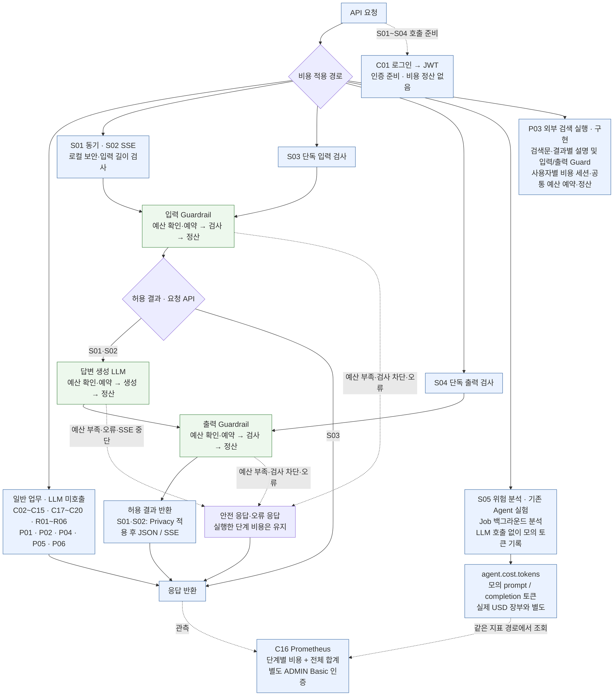
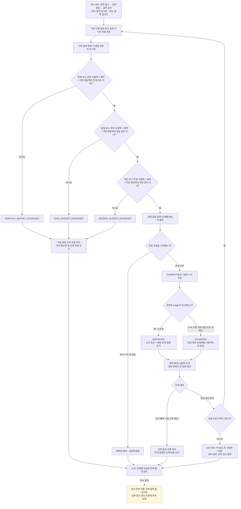

# 03. Cost Control 중심 flowchart

정리 기준: **2026-10-17(Asia/Seoul)**. **API 번호가 붙은 간단 흐름도 → Cost Control 관련 API 기능표·적용 범위 → 상세 정산 흐름·설정** 순서로 읽는다. API 기능서의 P03 포함 구현 37개 번호는 유지한다. 이 번호 목록 밖의 기존 Agent 실험·Job·Actuator 보조 경로와 외부 Guardrail API도 비용 관련 역할을 함께 기록했다.

**현재 비용 예약·정산은 S01·S02·S03·S04·P03, 비용 지표 조회는 C16이다.** 여기에 **S05의 모의 토큰 지표, C01의 인증 준비, P03의 구현된 검색문·설명 생성**가 연결된다. 따라서 이 문서의 관련 API 범위를 S01·S02·C16 세 개로 제한하지 않는다. 실제 USD 예산 장부와 모의 토큰 지표의 차이는 아래 표에서 확인한다.

## 1. API 번호를 붙인 간단 흐름도

읽는 질문: **입력 검사·답변 생성·출력 검사의 비용을 각각 어떻게 예약·정산하고, 어느 API가 이 기능을 사용하는가?** 번호 묶음은 API 분류이며 자동 호출 순서가 아니다.



**S01·S02는 입력 검사·답변 생성·출력 검사 3단계, S03·S04는 해당 검사 1단계의 비용을 공통 장부에 반영한다.** 각 유료 호출 직전에 전체·일일·세션 예산을 확인한다. 검사 결과가 불허여도 이미 실행한 검사 비용은 정산하며, 출력 검사 예산이 부족하면 생성 원문을 보내지 않고 비용 차단을 반환한다.

**Guardrail 검사도 비용 집계 대상이다.** NeMo 응답에 유효한 `usage.prompt_tokens`와 `usage.completion_tokens`가 있으면 설정 단가로 REPORTED 비용을 계산한다. 기존 서버처럼 usage가 없거나 불완전하면 설정된 검사 예상액을 ESTIMATED 사용액으로 반영한다. 미확인 비용을 무료나 0토큰으로 처리하지 않는다.

S01·S02의 응답 `usageAvailable`·`costSource`는 기존 계약대로 **답변 생성 단계**를 설명한다. Guardrail을 포함한 합계와 단계별 보고·추정 비용은 C16에서 확인한다. DB·파일·네트워크·NeMo 서버 운영비와 실제 제공자 청구액의 대사는 별도 범위다.

S01·S02는 내부 Service에서 Guardrail Client를 호출한다. S03·S04 HTTP API를 자동으로 다시 호출하는 구조는 아니며, 같은 `CostedGuardrailService`와 비용 장부를 공유한다. C01은 S01~S04의 JWT 준비 경로다. C16은 별도 ADMIN Basic 인증을 사용한다.

## 2. Cost Control 관련 API 기능표

포함 기준은 **예산·예약·정산**, **비용·토큰 지표 기록/조회**, **검사 사용량 전달**, **인증 준비**, **후속 유료 실행 설계**다. API 번호는 [API 기능서](../BACKEND_DRAFT_STATUS_AND_API_SPEC.md), 기존 보조 경로는 [Controller 경로 부록](../BACKEND_ROUTE_INVENTORY.md)과 대조했다. 기존 보조 API와 외부 API에 새 S/C/P 번호를 임의로 붙이지 않는다.

### 2-1. 현재 USD 비용 제어·관측 API — 5개

아래 4개 실행 API는 `AiCostControlService`의 전체·일일·세션 예산을 공유한다. C16은 이 장부를 지표로 조회한다.

| ID | 기능 | HTTP API | 입력·응답 핵심 | Cost Control 기능 | 처리 담당 |
|---|---|---|---|---|---|
| S01 | 동기 AI Chat 비용 제어 | `POST /api/ai/chat` | JWT. message 필수·DTO 최대 30자, sessionId 선택 → answer·blocked·fallback·reasonCode·detailCode·usageAvailable·costSource | 입력 기본 10자 제한 후, 입력 검사 → 답변 생성 → 출력 검사를 각각 예약·정산. 차단·오류에도 실행한 단계 비용 유지 | `AiController.chat` → `AiService.chat` → `CostedGuardrailService`·`AiCostControlService` |
| S02 | SSE AI Chat 비용 제어 | `POST /api/ai/chat/stream` | JWT. S01과 같은 요청 → meta/token/done/blocked/error | 같은 3단계 장부·예산 공유. 답변 완료 즉시 생성 비용 정산 후 출력 검사. 오류·timeout·연결 종료 시 미확인 생성 비용 추정 정산, 중복 콜백은 재정산하지 않음 | `AiController.chatStream` → `AiStreamingService.stream` → 공통 비용 서비스 |
| S03 | Input Guardrail 비용 제어 | `POST /api/legal/guardrail/input` | JWT. message 필수, sessionId 선택 → 기존 검사 필드 + reasonCode·detailCode·usageAvailable·costSource | 외부 입력 검사 전에 예약, 허용/불허 결과 모두 보고·추정 정산. 예산 부족이면 Client 호출 없이 status=BLOCKED·allowed=false | `LegalGuardrailController` → `CostedGuardrailService` |
| S04 | Output Guardrail 비용 제어 | `POST /api/legal/guardrail/output` | JWT. response 필수, sessionId 선택 → S03과 같은 비용 필드 | 외부 출력 검사 전에 예약, 허용/불허 결과 모두 보고·추정 정산. 로컬 출력 정책에서 거절하면 외부 검사·비용 예약 없이 확인된 0토큰 결과 반환 | `LegalOutputGuardrailController` → `CostedGuardrailService`·`OutputGuardrailPolicy` |
| C16 | 비용 지표 조회 | `GET /actuator/prometheus` | ADMIN Basic → Prometheus 텍스트 | input_guardrail / answer / output_guardrail별 예약·보고·추정·합계와 전체 합계 관측 | Spring Boot Actuator · Micrometer |

S01~S04의 예산 차단은 `reasonCode=COST_LIMIT_BLOCKED`, `detailCode=MONTHLY_BUDGET_EXCEEDED / DAILY_BUDGET_EXCEEDED / SESSION_BUDGET_EXCEEDED`다. S01·S02에만 문자 기반 입력 제한과 DTO 30자 제한을 적용하며, 길이 차단 상세 사유는 `REQUEST_TOO_LONG`이다. S03·S04에 10자·30자 기준을 그대로 적용하지 않는다.

S01~S04의 sessionId는 앞뒤 공백을 제거하며 null/빈 값은 `anonymous` 그룹을 공유한다. S03·S04의 비용 차단도 HTTP 200 안의 status·allowed·reasonCode·detailCode를 확인한다. 외부 기술 오류는 추정 비용을 반영한 뒤 기존 오류 계약으로 전달한다.

### 2-2. API별 정산 단계 매핑

| API | 입력 검사 비용 | 답변 생성 비용 | 출력 검사 비용 | 공유 예산·장부 | 응답의 usageAvailable·costSource 범위 |
|---|---|---|---|---|---|
| S01 | 예약·정산 | 예약·정산 | 예약·정산 | 전체·일일·세션 | 답변 생성 단계 |
| S02 | 예약·정산 | 예약·정산·중단 시 추정 처리 | 예약·정산 | S01·S03·S04와 공유 | 답변 생성 단계; 정상 done에 표시 |
| S03 | 예약·정산 | 해당 없음 | 해당 없음 | S01·S02·S04와 공유 | 입력 검사 1회 |
| S04 | 해당 없음 | 해당 없음 | 로컬 정책 통과 후 예약·정산 | S01·S02·S03과 공유 | 출력 검사 1회; 로컬 거절은 확인된 0토큰 |
| C16 | 단계별 지표 조회 | 단계별 지표 조회 | 단계별 지표 조회 | 합계·예약·한도 조회 | 지표의 reported / estimated 구분 |

각 단계는 앞 단계가 허용되고 그 단계의 예산이 남아 있을 때 실행한다. 앞 단계에서 차단되면 뒷 단계를 실행하지 않는다. C16에는 조회 기능만 있으며 예산 변경·예약 생성·정산 명령을 수행하는 별도 HTTP API는 없다.

### 2-3. 번호가 있는 연관 API — 인증·모의 토큰·검색 실행

| ID | 기능 | HTTP API | 입력·결과 | 비용 흐름과의 관계 | 처리 담당 |
|---|---|---|---|---|---|
| C01 | 로그인·JWT 발급 | `POST /api/auth/login` | username·password → accessToken·username·role | S01~S04 호출의 인증 준비. LLM 호출·USD 예약·정산은 수행하지 않음. C16의 ADMIN Basic과 구분 | `AuthController`·`JwtTokenProvider` |
| S05 | Agent 위험 분석·모의 토큰 기록 | `POST /api/agent/risk/analyze` | userInput·toolName·retryCount·promptTokens·completionTokens·위험 신호 → 결정·위험도·이력 ID | `AgentMetricRecorder.recordTokenCost`가 `agent.cost.tokens`를 누적. 요청 토큰 또는 기본 120/80을 사용하며 실제 LLM usage가 아님. USD 단가·예약·공통 예산에는 연결되지 않음 | `AgentRiskDecisionController` → `AgentRiskDecisionService` → `AgentMetricRecorder` |
| P03 | 외부 검색 실행 · 구현 | `POST /api/intakes/search-requests/{searchRequestId}/execute` | JWT·소유자/ADMIN, 선택 retryExplanation | 검색문/설명/전후 Guard의 단계별 예약·정산. 네이버 API와 LLM 요금 구분 | 구현·모의 검증 |

**`agent.cost.tokens`의 cost는 모의 토큰 지표 이름이다.** `ai.cost.*.usd`의 보고·추정 사용액과 단위·출처가 다르며 두 값을 USD 비용으로 합산하지 않는다. S05는 비용 관련 관측 API로 표에 포함하지만 실제 과금 비용 제어가 구현된 것으로 표시하지 않는다.

### 2-4. 기존 Agent 실험·Job 보조 API — 번호 목록 밖의 연관 경로

Postman 준비·검증 항목: [전체 체크리스트 색인](C:/myLectureWs/legal-ai-intake-security-server/docs/POSTMAN_API_CHECKLIST_INDEX.md) · [번호가 있는 API별 체크](C:/myLectureWs/legal-ai-intake-security-server/docs/POSTMAN_NUMBERED_API_CHECKLIST.md) · [번호 없는 보조 API별 체크](C:/myLectureWs/legal-ai-intake-security-server/docs/POSTMAN_AUXILIARY_API_CHECKLIST.md). 이 절의 Agent 실험·Job 14개는 전체 번호 없는 Controller 경로 30개 중 비용·모의 토큰에 직접 연결된 부분이다.

아래는 이미 존재하는 보조 경로다. 현재 API 기능서의 37개 번호에 포함되지 않으며 신규 API 추가나 S05의 다른 이름으로 계산하지 않는다. `AgentPracticeRequest`의 promptTokens·completionTokens 또는 실험별 기본값을 모의 토큰으로 기록한다. 실제 LLM·외부 도구 호출이나 USD 예산 차감은 수행하지 않는다.

| 번호 | 기능 | HTTP API | 비용·토큰 연결 | 처리 담당 |
|---|---|---|---|---|
| 기존 보조 · 번호 없음 | 정상 실행 실험 | `POST /api/agent/practice/run` | 정상 실행·계획·재시도와 모의 토큰 기록 | `AgentPracticeController` → `AgentPracticeService` |
| 기존 보조 · 번호 없음 | 도구 오류 실험 | `POST /api/agent/practice/tool-error` | 오류와 모의 토큰 기록 | 같은 Controller·Service |
| 기존 보조 · 번호 없음 | 재시도 실험 | `POST /api/agent/practice/retry` | 재시도 횟수와 모의 토큰 기록 | 같은 Controller·Service |
| 기존 보조 · 번호 없음 | 승인 필요 실험 | `POST /api/agent/practice/approval` | 승인 필요와 모의 토큰 기록 | 같은 Controller·Service |
| 기존 보조 · 번호 없음 | 정책 위반 실험 | `POST /api/agent/practice/policy-violation` | 정책 위반과 모의 토큰 기록 | 같은 Controller·Service |
| 기존 보조 · 번호 없음 | 외부 API 호출 실험 | `POST /api/agent/practice/external-api` | 외부 호출 모의 지표와 모의 토큰 기록. 실제 외부 호출 없음 | 같은 Controller·Service |
| 기존 보조 · 번호 없음 | DB 쓰기 실험 | `POST /api/agent/practice/db-write` | DB 쓰기 모의 지표와 모의 토큰 기록 | 같은 Controller·Service |
| 기존 보조 · 번호 없음 | 정책 위반+재시도 실험 | `POST /api/agent/risk-patterns/policy-violation-retry` | 복합 위험·재시도와 모의 토큰 기록 | `AgentRiskPatternController` → `AgentRiskPatternService` |
| 기존 보조 · 번호 없음 | 도구 오류+재시도 실험 | `POST /api/agent/risk-patterns/tool-error-retry` | 복합 위험·재시도와 모의 토큰 기록 | 같은 Controller·Service |
| 기존 보조 · 번호 없음 | 외부 호출+정책 위반 실험 | `POST /api/agent/risk-patterns/external-api-policy-violation` | 외부 호출 모의 지표·정책 위반·모의 토큰 기록 | 같은 Controller·Service |
| 기존 보조 · 번호 없음 | 승인 필요+재시도 실험 | `POST /api/agent/risk-patterns/approval-required-retry` | 승인 경계·재시도와 모의 토큰 기록 | 같은 Controller·Service |
| 기존 보조 · 번호 없음 | 비동기 위험 분석 Job 접수 | `POST /api/agent/jobs` | AgentRiskAnalyzeRequest → Job ID. 백그라운드에서 S05와 같은 분석 Service가 실행될 때 모의 토큰 기록 | `AgentJobController` → `AgentJobService` → `AgentRiskDecisionService` |
| 기존 보조 · 번호 없음 | Job 상태·결과 조회 | `GET /api/agent/jobs/{jobId}` | 위 실행 결과 조회. 조회 자체는 토큰 지표·USD 사용액을 추가하지 않음 | `AgentJobController` → `AgentJobService.findById` |
| 기존 보조 · 번호 없음 | 최근 Job 목록 | `GET /api/agent/jobs` | 최근 Job 조회. 조회 자체는 토큰 지표·USD 사용액을 추가하지 않음 | `AgentJobController` → `AgentJobService.findRecent` |

**Actuator 보조 조회:** 현재 노출 설정에는 Prometheus 외에 metrics도 포함한다. 아래 경로는 C16과 같은 별도 ADMIN Basic 인증을 사용한다.

| 번호 | 기능 | HTTP API | 비용 흐름과의 관계 |
|---|---|---|---|
| 프레임워크 보조 · 번호 없음 | 지표 이름 목록 | `GET /actuator/metrics` | 등록된 ai.cost.*·agent.cost.tokens 이름 확인 |
| 프레임워크 보조 · 번호 없음 | 특정 지표 상세 | `GET /actuator/metrics/{metricName}` | 측정값·사용 가능한 태그 확인. 예: ai.cost.accounted.usd. 비용 예약·정산 명령 없음 |

### 2-5. 외부 Guardrail API — 검사 사용량 전달 계약

아래 두 경로는 `guardrails.base-url`의 별도 검사 서버 API다. Spring application의 S03·S04와 URL·호출 주체가 다르며, 기존 37개 application API 번호를 추가로 부여하지 않는다.

| 구분 | 외부 HTTP API | 호출하는 application 경로 | 요청·응답 핵심 | 비용 매핑 |
|---|---|---|---|---|
| 외부 입력 검사 | `POST /v1/input-rails/check` | S01·S02의 입력 검사, S03 | messages → status·content·rail, 선택 usage.prompt_tokens·completion_tokens | `NemoInputGuardrailClient` → input_guardrail 보고/추정 정산 |
| 외부 출력 검사 | `POST /v1/output-rails/check` | S01·S02의 출력 검사, S04 | messages → status·content·rail, 선택 usage.prompt_tokens·completion_tokens | `NemoOutputGuardrailClient` → output_guardrail 보고/추정 정산 |

유효한 usage는 검사 서버가 내부에서 수행한 LLM 호출의 합계를 보고해야 한다. usage가 없으면 앱은 설정 추정액을 사용한다. 실제 청구액 확인과 서버 내부 여러 모델·다른 단가의 정밀 대사는 후속 범위다.

### 2-6. 나머지 번호 API와 비용 범위

| API 번호 | 현재 기능 | 현재 비용 제어 연결 |
|---|---|---|
| C02·C04·R06 | 규칙형 분류·간단 안내·고정 체크리스트 | LLM 호출 없이 안내한다. USD 예약·정산 없음. S01·S02가 이 HTTP API를 자동 fallback으로 호출하는 구조는 아님 |
| C03·C05~C11·P01·P02·P04~P06·R01~R05 | 문의·검색 기록·메모·사용자·파일·행동·Reference 조회/저장 | 현재 LLM·Guardrail 유료 호출과 공통 USD 장부에 연결되지 않음. 파일 업로드도 자동 LLM 분석을 시작하지 않음 |
| C12~C15·C17~C20 | 운영·마케팅·위험·Incident 조회/상태 변경 | 비용 USD 장부 조회는 C16에서 제공. 이 경로의 업무·위험 집계는 비용 정산과 별개 |

위 표는 기능서의 37개 번호 전체에서 비용 연결 여부를 확인한 범위다. 번호 목록 밖의 기존 보조 API는 2-4, 외부 검사 API는 2-5에 별도로 기록했다. DB·파일·서버 자원을 사용한다는 사실만으로 토큰 과금 API로 분류하지 않는다.

## 3. 상세 비용 제어 흐름

이 도표는 S01~S04의 각 유료 단계에 반복 적용하는 USD 장부의 공통 예약·정산 규칙이다. S05·기존 Agent 실험의 모의 토큰 기록은 이 예약 흐름을 실행하지 않는다. 사전 로컬 보안·DTO 검사는 호출보다 먼저 수행한다. S01·S02 모두 생성 비용을 출력 검사 전에 정산하고, 허용된 답변만 Privacy 처리 후 전송한다.



호출 시작 전 취소는 예약만 해제한다. 호출을 시도한 뒤 오류·timeout·연결 종료로 사용량을 확인하지 못하면 예약 추정액을 정산한다. 이 방식은 보수적인 앱 예산 처리이며 실제 청구액을 확정하지 않는다. SSE가 추정 정산으로 닫힌 뒤 도착한 완료 콜백은 중복 정산·전송하지 않으며 추정액의 후속 보정은 별도 설계다.

## 4. Cost Control — Code Mapping and Implementation Boundaries

### 4-1. Implemented Cost Control Features

S01/S02 apply the shared cost service to `INPUT_GUARDRAIL → ANSWER → OUTPUT_GUARDRAIL`. S03/S04 apply it to their standalone check. Each stage checks the budgets before reserving cost and calling its client.

| Feature | Code mapping | Current behavior |
|---|---|---|
| **Token estimation** | `AiCostControlService.estimateTokens()` | Returns 0 for null/blank text; otherwise estimates one token per four Java string characters, rounded up. ANSWER adds the estimates for `systemPrompt` and the user content returned by the input Guardrail. No tokenizer is called. |
| **Completion token limit** | `maxOutputTokens` → `max_completion_tokens` | Both answer clients send this limit and use it for reservation. Default: **256**, overridden by `LLM_MAX_OUTPUT_TOKENS`. It does not cap the remote Guardrail's output. |
| **Cost estimation** | `calculateCost(inputTokens, outputTokens, inputRate, outputRate)` | Uses configured USD rates per 1,000 tokens. ANSWER reserves estimated input plus the maximum completion allowance. Guardrail checks use estimated text tokens plus configured overhead and estimated output tokens. |
| **Budget check and reservation** | `reserveWithBlock()` → `reserveStageWithBlock()` | Checks cumulative, daily and session budgets using reported cost + estimated cost + in-flight reservations + the new estimate. If all checks pass, increments the total/daily/session/stage reserved amounts before the call. |
| **Reported-usage settlement** | `recordUsage(..., true)` → `settleReportedUsage()` → `CostSource.REPORTED` | For valid nonnegative token counts, removes the reservation and adds cost calculated from those counts to `actualUsd` and the applicable daily/session/stage amounts. Reported zero is valid. **`actualUsd` means reported-usage cost at configured rates, not an invoiced provider charge.** |
| **Missing usage / post-call failure** | `recordUsage(reservation, 0, 0, false)` → `CostSource.ESTIMATED` | Removes the reservation and adds `reservation.estimatedUsd()` to `estimatedUsageUsd` and the applicable daily/session/stage amounts. This also applies to successful calls without usage and to post-call errors/timeouts/disconnects when usage is unknown. **The amount still counts against the budgets.** |
| **Cancellation before dispatch** | `settleInterrupted(..., false)` → `release(reservation, "STREAM_NOT_STARTED")` | The current SSE path releases an unstarted ANSWER reservation without adding usage cost for that reservation. Costs already settled for an earlier stage remain recorded. |
| **Shared Guardrail accounting** | `CostedGuardrailService.check()` → `reserveStageWithBlock()` / `recordUsage()` | Input/output Guardrails use the same budgets as ANSWER. Default estimate: text tokens + **256** overhead tokens, with **32** estimated output tokens. Allowed and blocked remote results both settle cost. `OutputGuardrailPolicy.localBlock()` can return a known-zero local result without reservation or a remote call. |
| **Concurrency and idempotency** | `synchronized`; `reservation.closed().compareAndSet(false, true)` | Protects state changes within one JVM. A reservation can be settled or released only once; repeated completion/error/timeout callbacks cannot charge it twice. |
| **Metrics** | `ai.cost.*`; `CostStage`; C16 | Exposes reserved, reported, estimated and accounted cost, budgets, budget blocks and reservation releases. `legal.ai.llm.call.prevented` is recorded in the corresponding Chat pre-call block branches. `ai.cost.accounted.usd` excludes in-flight reservations. |

**Ledger fields and budget impact**

```text
Reported usage:
    recordUsage(reservation, promptTokens, completionTokens, true)
    reservedUsd decreases by reservation.estimatedUsd()
    actualUsd increases by calculateCost(...) using the reported tokens

Missing usage or post-call failure:
    recordUsage(reservation, 0, 0, false)
    reservedUsd decreases by reservation.estimatedUsd()
    estimatedUsageUsd increases by the same reservation.estimatedUsd()

Cancellation before dispatch:
    release(reservation, "STREAM_NOT_STARTED")
    reservedUsd decreases; actualUsd and estimatedUsageUsd do not increase

ai.cost.accounted.usd = actualUsd + estimatedUsageUsd
Budget usage          = actualUsd + estimatedUsageUsd + reservedUsd
remainingBudgetUsd()  = max(monthlyBudgetUsd - Budget usage, 0)
```

These are state-change expressions, not additional Java methods. Example: an unknown-usage settlement changes `reservedUsd: $0.01 → $0` and `estimatedUsageUsd: $0 → $0.01`. The reservation disappears, but the same $0.01 still consumes budget. Calling `releaseReservedAmounts()` inside settlement is not equivalent to calling `release()`.

Current storage is in-memory fields and maps. `monthlyBudgetUsd` is a cumulative limit for this application run; only the daily counters have date-based rollover. Persistent accounting, cross-instance budget coordination, provider billing reconciliation and later estimate correction are not implemented.

Code: [AiCostControlService](C:/myLectureWs/legal-ai-intake-security-server/backend/guardrail-ready-policy-checker/src/main/java/com/ohgiraffers/handlermethod/cost/AiCostControlService.java:147) · [CostedGuardrailService](C:/myLectureWs/legal-ai-intake-security-server/backend/guardrail-ready-policy-checker/src/main/java/com/ohgiraffers/handlermethod/cost/CostedGuardrailService.java:64) · [AiStreamingService.settleInterrupted](C:/myLectureWs/legal-ai-intake-security-server/backend/guardrail-ready-policy-checker/src/main/java/com/ohgiraffers/handlermethod/service/AiStreamingService.java:208) · [application.properties](C:/myLectureWs/legal-ai-intake-security-server/backend/guardrail-ready-policy-checker/src/main/resources/application.properties:41).

### 4-2. Configuration, Formulas, and Implementation Boundaries

**입력 길이 초과 — 실험용 기본 설정**

10자를 넘는 법률 질문을 입력하면 LLM 호출 전에 `COST_LIMIT_BLOCKED` / 세부 사유 `REQUEST_TOO_LONG`으로 차단한다. 실제 문서 페이지를 읽는 기능이 아니라 문자 수로 분량을 추정하며, 내용을 나누어 입력하라는 안내를 반환한다.

현재 기본 설정은 `max-input-pages=1`, `estimated-chars-per-page=10`이다. 환경변수가 설정돼 있으면 해당 값이 우선한다.

비용 한도의 실험용 기본값은 전체 누적(`monthly-budget-usd`) **$2**, 하루 **$1**, 세션 **$0.3**이다. 전체 누적 한도는 달력 월 변경 자동 초기화 없이 서버 실행 기간의 보고·추정 사용액과 예약액에 적용된다.

| 입력 길이 | 동기 Chat 처리 |
|---|---|
| 1~10자 | 길이 검사 통과 후 다음 검사 진행. 최종 응답 허용을 뜻하지 않음 |
| 11~30자 | DTO·Dynamic·Fixed Guard 통과 시 Cost Control에서 차단 |
| 31자 이상 | DTO Validation에서 HTTP 400으로 거절. Cost Control까지 도달하지 않음 |

동기·SSE 모두 길이 차단의 `reasonCode`는 `COST_LIMIT_BLOCKED`, `detailCode`는 `REQUEST_TOO_LONG`이며 호환용 `reason`도 유지한다. 같은 세션에서 길이 초과를 반복하면 Dynamic Guard에 의해 `DYNAMIC_SESSION_BLOCKED`가 반환될 수 있으므로 경계값 실험에는 서로 다른 `sessionId`를 사용한다. 두 경로 모두 DTO 30자·비용 검사 10자 제한을 연결했다.

답변 생성 출력 상한은 기본 256토큰이다. 현재 설정 출력 단가 기준 최대 출력 예약액은 $0.1536이며 입력 추정 비용이 추가된다. 예산은 전체 누적 $2·하루 $1·세션 $0.3을 유지하며 이제 Guardrail 비용도 함께 사용한다.

**Current Formulas — Code Field Names**

```text
estimateTokens(text):
    null / blank -> 0
    otherwise    -> max(1, ceil(text.length() / 4))

ANSWER reservation:
    inputTokens  = estimateTokens(systemPrompt) + estimateTokens(userMessage)
    outputTokens = maxOutputTokens

Guardrail reservation:
    inputTokens  = estimateTokens(text) + promptOverheadTokens
    outputTokens = estimatedOutputTokens

calculateCost(inputTokens, outputTokens, inputRate, outputRate):
    inputCost  = inputTokens  * inputRate  / 1000
    outputCost = outputTokens * outputRate / 1000
    each component is rounded to scale 8 with RoundingMode.HALF_UP
    return inputCost + outputCost

Reported settlement:
    actualUsd += calculateCost(reported promptTokens, reported completionTokens,
                               reservation.inputRate(), reservation.outputRate())

Unknown-usage settlement:
    estimatedUsageUsd += reservation.estimatedUsd()

Reservation check:
    reported cost + estimated cost + reserved cost + new estimate <= budget
    check order: monthlyBudgetUsd -> dailyBudgetUsd -> sessionBudgetUsd

agent.cost.tokens:
    simulated prompt/completion counters from request values or defaults
    no USD conversion, no shared-budget deduction, no ai.cost.accounted.usd inclusion
```

The formulas describe the current implementation. Rates are application configuration, not a statement of current official model prices. ANSWER estimates use the content returned by the input Guardrail. Guardrail estimates use the inspected text plus `promptOverheadTokens` and `estimatedOutputTokens`; those estimates do not enforce remote token limits.

**Implemented Behavior — Code Mapping**

| Area | Current implementation |
|---|---|
| Non-LLM business APIs | Rule-based Intake/preview/minimal and DB/file operations do not use the token-cost ledger. They still use infrastructure resources. |
| Input length limit | `checkInputPageLimit()` applies to sync/SSE Chat. Default: `maxInputPages=1` × `estimatedCharsPerPage=10`. |
| Completion limit | `maxOutputTokens` is used in ANSWER reservations and `max_completion_tokens` requests. |
| Reservation concurrency | `synchronized` protects reserve/settle/release operations within one JVM. |
| Cumulative budget | `monthlyBudgetUsd` checks in-memory `actualUsd + estimatedUsageUsd + reservedUsd`. There is no calendar-month rollover. |
| Daily rollover | `resetDailyBudgetIfNeeded()` compares `LocalDate.now()` with `currentBudgetDate`. Daily settlement updates depend on `reservation.reservedDate()`. |
| Session budget | In-memory maps keyed by `AiSessionIds.normalize(sessionId)`. Blank/null IDs share `anonymous`; leading/trailing whitespace is removed. |
| Post-call failure | Sync/Guardrail exception paths and dispatched SSE interruptions call `recordUsage(..., false)`. Only the pre-dispatch SSE path uses `release(..., "STREAM_NOT_STARTED")`. |
| Missing usage | **Implemented:** valid reported counts, including zero, use `REPORTED`; unavailable usage uses `ESTIMATED` and still consumes budget. This is separate from provider billing reconciliation. |
| Accounting scope | `INPUT_GUARDRAIL`, `ANSWER` and `OUTPUT_GUARDRAIL` share USD budgets. Infrastructure costs, external search charges and simulated `agent.cost.tokens` are outside this ledger. |
| SSE lifecycle | ANSWER settles before `flushCompletedResponse()` performs output checks and Privacy masking. Output blocking retains generation cost. `settled` and `reservation.closed()` prevent duplicate settlement and ignore late completion callbacks. |

**Not Implemented — Remaining Design and Implementation**

The feature names below describe remaining work; they are not existing Java classes, methods or enum values.

| Remaining feature | What is missing | Current code boundary |
|---|---|---|
| Provider billing reconciliation | Compare local cost entries with authoritative provider usage/billing records. | `actualUsd` is calculated from reported tokens and configured rates; no provider billing import/matching process exists. |
| Estimated-cost correction | Revise an `ESTIMATED` settlement after authoritative usage becomes available. | `recordUsage()` closes a reservation once. No correction path updates an already closed estimate; late SSE completion is ignored. |
| Persistent cost ledger / restart recovery | Store and restore reservations and settlements across application restarts. | Cost state is held in memory; no persistent cost ledger is implemented. |
| Distributed budget coordination | Apply one atomic budget across multiple server instances. | `synchronized` and the maps protect only the current JVM. |
| Calendar-month rollover | Reset or partition cumulative amounts at a calendar-month boundary. | `resetDailyBudgetIfNeeded()` handles days only; `monthlyBudgetUsd` remains a run-cumulative limit. |

동기·SSE의 공통 비용 차단 필드는 `reasonCode=COST_LIMIT_BLOCKED`, `detailCode=REQUEST_TOO_LONG / MONTHLY_BUDGET_EXCEEDED / DAILY_BUDGET_EXCEEDED / SESSION_BUDGET_EXCEEDED`다. 기존 `reason`은 호환용으로 유지해 길이는 공통 코드, 예산은 상세 코드를 담는다. 신규 소비자는 reasonCode·detailCode를 사용한다.

주요 지표: `ai.cost.budget.usd`, `ai.cost.daily.budget.usd`, `ai.cost.session.budget.usd`, `ai.cost.reserved.usd`, `ai.cost.actual.usd`, `ai.cost.daily.actual.usd`, `ai.cost.blocked`, `ai.cost.estimated`, `ai.cost.actual`, `ai.cost.reservation.released`. 이는 코드의 Micrometer 이름이며 Prometheus 노출 시 이름 표현은 달라질 수 있다.

usage 미확인용 지표: `ai.cost.usage.missing`, `ai.cost.usage.estimated`, `ai.cost.estimated.usage.usd`, `ai.cost.daily.estimated.usage.usd`. `ai.cost.accounted.usd`는 보고·추정 사용액의 합계이며 진행 중 예약액은 제외한다. S01·S02의 usageAvailable·costSource는 답변 생성 단계, S03·S04의 같은 필드는 해당 검사 단계를 나타낸다.

코드 근거: [AiCostControlService](C:/myLectureWs/legal-ai-intake-security-server/backend/guardrail-ready-policy-checker/src/main/java/com/ohgiraffers/handlermethod/cost/AiCostControlService.java), [동기 호출·정산 순서](C:/myLectureWs/legal-ai-intake-security-server/backend/guardrail-ready-policy-checker/src/main/java/com/ohgiraffers/handlermethod/service/AiService.java), [출력 상한·usage 처리](C:/myLectureWs/legal-ai-intake-security-server/backend/guardrail-ready-policy-checker/src/main/java/com/ohgiraffers/handlermethod/llm/OpenAiCompatibleLlmClient.java).

**Guardrail 추정·보고 계약**

- `guardrails.cost.model`: 기본 gpt-4o-mini. 검사 서버에 실제 연결한 모델과 설정 단가를 맞춘다.
- `guardrails.cost.input-usd-per-1k-tokens` / `output-usd-per-1k-tokens`: 기본 0.15 / 0.60. 기존 실험용 단가와 같은 설정값이며 최신 공식 가격을 뜻하지 않는다.
- `guardrails.cost.prompt-overhead-tokens=256`, `estimated-output-tokens=32`: 검사 1회의 예상 프롬프트 부가량·출력량. 원격 NeMo의 호출 수나 출력 토큰을 강제 제한하지 않는다. 여러 LLM 호출을 하는 검사 서버는 전체 사용량을 합산해서 보고하고 이 추정값도 그 구성에 맞춘다.
- `guardrails.request-timeout-ms=30000`: 검사 Client 연결·읽기 timeout.
- 기존 `/v1/input-rails/check`, `/v1/output-rails/check` 응답에 선택적으로 `"usage":{"prompt_tokens":123,"completion_tokens":4}`를 포함한다. 두 값이 모두 0 이상의 정수일 때만 REPORTED로 처리한다. 누락·부분 보고·음수는 ESTIMATED다. 외부 Python 서버의 실제 usage 제공 여부는 실행 환경에서 확인한다.

**C16 비용·모의 토큰 지표**

| Micrometer 이름 | 태그 | 의미 |
|---|---|---|
| `ai.cost.stage.reserved.usd` | input_guardrail / answer / output_guardrail | 진행 중 단계별 예약액 |
| `ai.cost.stage.actual.usd` | 같은 세 단계 | 보고 토큰 × 설정 단가의 누적 비용 |
| `ai.cost.stage.estimated.usage.usd` | 같은 세 단계 | 사용량 미확인 정산 비용 |
| `ai.cost.stage.accounted.usd` | 같은 세 단계 | 보고 + 추정 사용액; 예약 제외 |
| `agent.cost.tokens` | type=prompt / completion | S05·기존 Agent 실험·Job 분석의 모의 토큰 수. USD 장부에 미합산 |

기존 `ai.cost.actual.usd`, `ai.cost.estimated.usage.usd`, `ai.cost.accounted.usd`, `ai.cost.reserved.usd`는 이제 세 단계 전체 합계다. 예약·정산·usage 누락·예산 차단 Counter에도 stage 태그를 사용한다. 세션 ID는 지표 태그로 넣지 않는다.

추가 코드 근거: [공통 검사 비용 서비스](../../backend/guardrail-ready-policy-checker/src/main/java/com/ohgiraffers/handlermethod/cost/CostedGuardrailService.java), [Guardrail 비용 테스트](../../backend/guardrail-ready-policy-checker/src/test/java/com/ohgiraffers/handlermethod/cost/GuardrailCostTest.java), [API·SSE·C16 회귀 테스트](../../backend/guardrail-ready-policy-checker/src/test/java/com/ohgiraffers/handlermethod/api/AiSecurityIntegrationTest.java).

연관 경로 코드 근거: [모의 토큰 지표](../../backend/guardrail-ready-policy-checker/src/main/java/com/ohgiraffers/handlermethod/support/AgentMetricRecorder.java), [S05 위험 분석](../../backend/guardrail-ready-policy-checker/src/main/java/com/ohgiraffers/handlermethod/service/AgentRiskDecisionService.java), [Agent 실험 Controller](../../backend/guardrail-ready-policy-checker/src/main/java/com/ohgiraffers/handlermethod/api/AgentPracticeController.java), [위험 패턴 Controller](../../backend/guardrail-ready-policy-checker/src/main/java/com/ohgiraffers/handlermethod/api/AgentRiskPatternController.java), [Job 접수·조회](../../backend/guardrail-ready-policy-checker/src/main/java/com/ohgiraffers/handlermethod/api/AgentJobController.java), [Actuator 노출·비용 설정](../../backend/guardrail-ready-policy-checker/src/main/resources/application.properties).
