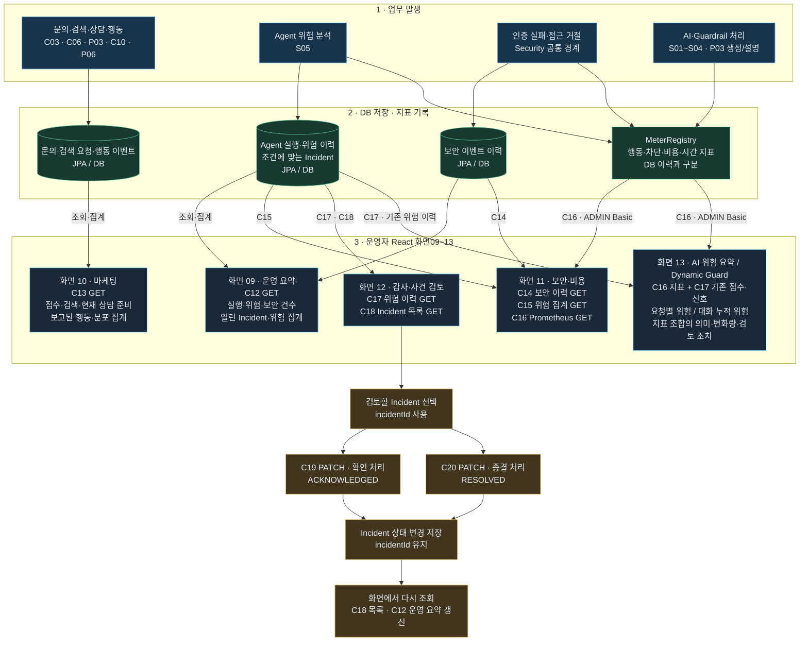

# 운영·마케팅·감사 - 운영자 화면 큰 흐름

**2026-10-22 현행 반영:** P03 실행·화면05 연결 구현, 운영자 React 화면09~13 구현. 화면13은 기존 C16/C17 재사용이며 새 API 번호·DB 테이블을 추가하지 않았다. 구현 API는 37개다. 외부 LLM·네이버 실제 키 호출·청구 검증은 아직 별도다.

**2026-10-22 현행 반영:** P03 실행·화면05 연결 구현, 운영자 React 화면09~13 구현. 화면13은 기존 C16/C17 재사용이며 새 API 번호·DB 테이블을 추가하지 않았다. 구현 API는 37개다. 외부 LLM·네이버 실제 키 호출·청구 검증은 아직 별도다.

2026-10-20 실제 코드·React 대조. 화면 09~13를 `operator.html`에 연결했고 화면 12는 C17·C18 조회, 행 선택, C19·C20 처리 후 C18·C12 재조회를 구현했다. [화면·필드별 연결과 검증 기록](../OPERATOR_09_12_API_REACT_MAPPING.md)을 함께 읽는다. API C12~C20은 각각 별도 요청이다. 화살표의 데이터 공급·화면 선택 관계와 실제 Service 호출을 구분한다.

## 흐름도 원본

## 화면 → API → Controller → Service

같은 앞부분 이름의 Service는 S.로 줄인다. 다른 이름은 전체 표시한다.

| 화면·API | Controller → Service | 실제 자료·결과 |
|---|---|---|
| 09 · C12 운영 요약 | AdminDashboardController.summary → S.summary | AgentRunHistory·AgentRiskHistory·SecurityEventHistory 건수 + RiskIncidentService.countOpen + AgentRiskHistoryQueryService.summarize |
| 10 · C13 마케팅 | MarketingDashboardController.funnel → S.funnel | 문의 수·검색 요청 수·검색한 DISTINCT 문의 수·현재 CONSULTATION_READY 수·P06 보고 이벤트 수·사건 유형/다음 행동/지역 분포 |
| 11 · C14 보안 이력 | AdminDashboardController.securityEvents → S.recentSecurityEvents | SecurityEventHistory 최근 최대 50개 |
| 11 · C15 위험 집계 | AgentRiskHistoryController.summary → AgentRiskHistoryQueryService.summarize | 위험 이력의 등급별·판정별·권장 조치별 집계. C12도 같은 메서드 재사용 |
| 11 · C16 지표 | Spring Boot Actuator → MeterRegistry | ADMIN Basic 인증으로 Prometheus 텍스트 조회. 별도 업무 Controller·Service 없음 |
| 12 · C17 위험 이력 | AgentRiskHistoryController.history → AgentRiskHistoryQueryService.findRecent | riskLevel 우선, 없으면 decision 필터, 둘 다 없으면 최근 50개 |
| 12 · C18 Incident 목록 | RiskIncidentController.findRecent → S.findRecent | 최근 Incident 최대 50개 |
| 12 · C19 확인 | RiskIncidentController.acknowledge → S.acknowledge | incidentId로 기존 사건을 찾아 ACKNOWLEDGED 저장 |
| 12 · C20 종결 | RiskIncidentController.resolve → S.resolve | incidentId로 기존 사건을 찾아 RESOLVED 저장 |

| 13 · C16 지표 조합 | Spring Boot Actuator → MeterRegistry → React 조합·증가량 해석 | 화면11과 같은 C16 재사용, ADMIN Basic. 서버 메모리의 세션 누적 점수 포함 |
| 13 · C17 기존 점수 | AgentRiskHistoryController.history → AgentRiskHistoryQueryService.findRecent | 기존 agent_risk_history의 요청별 점수·신호. 세션 누적 점수와 합산하지 않음 |

## 읽을 때 구분할 점

- GET 화면을 열면 저장된 데이터를 조회·집계한다. C12·C15를 조회한다고 S05 분석이 새로 실행되지는 않는다.
- S05는 위험·실행 이력을 기록하고 점수 80 이상 또는 지정 권장 조치일 때 Incident를 생성한다. C18은 이 사건들을 조회하며 C19·C20은 기존 사건의 상태를 바꾼다. 이 전이는 C10 문의 상태 정책과 별개다.
- C13은 현재 DB 전체 집계다. 문의·검색 요청 행 수, DISTINCT 문의 수, 현재 상태 수, 보고된 행동 이벤트 수의 집계 단위가 다르다. 동일 사용자의 기간별 전환율·이탈 분석 완료를 의미하지 않는다.
- P06 행동은 클라이언트가 명시적으로 보고한 기록이다. 페이지를 열었다는 사실만으로 자동 수집된다고 가정하지 않는다.
- C14의 DB 보안 이력과 C16의 메모리 Metric은 서로 다른 근거다. AI 처리 Counter가 같은 DB 감사 행으로 자동 저장되는 것은 아니다.
- 그림의 화면 이동·갱신은 React가 별도 API를 호출하도록 구현했다. C19·C20이 C12·C18 HTTP API를 자동 호출하지 않는다. C18 행의 `id`를 PATCH에 사용하며, `riskHistoryId`는 현재 C17 결과와 연결하는 별도 키다.
- 운영자용 화면 설계와 API 접근 제한은 별개다. 현재 모든 C12~C20 업무 API가 관리자 전용으로 제한되는 것은 아니며 C16은 ADMIN Basic으로 보호된다.

기존 API Flow 193페이지 PDF는 변경하지 않았다.
