# API별 flow 및 기능mapping표 — 구현 37개 · P03 포함

S01~S05는 AI 처리·보안 검사·검증을 위한 백엔드 API로, 현재 서비스 범위에서는 **별도 전용 화면이 불필요**하다. 화면 지정을 보류했거나 향후 화면 개발이 남았다는 의미가 아니다.

운영자 화면13은 C16·C17을 재사용한다. [화면09~13 API 연결표](../SCREEN09_13_API_CONNECTIONS.md).

[API 기능서 flow 및 기능mapping표](C:/myLectureWs/legal-ai-intake-security-server/docs/BACKEND_DRAFT_STATUS_AND_API_SPEC.md)의 3-1을 분리했다. 기준일은 2026-10-17이다. 각 API는 flow → 6열 기능표 → 분기별 동작 설명으로 읽는다.

API별 기능·Code branch·DB/Metric 확인 항목은 [Postman 체크리스트 색인](C:/myLectureWs/legal-ai-intake-security-server/docs/POSTMAN_API_CHECKLIST_INDEX.md)을 함께 사용한다. [번호가 있는 API 36개](C:/myLectureWs/legal-ai-intake-security-server/docs/POSTMAN_NUMBERED_API_CHECKLIST.md)와 [기존 보조 Controller API 30개 및 별도 framework/external 경로](C:/myLectureWs/legal-ai-intake-security-server/docs/POSTMAN_AUXILIARY_API_CHECKLIST.md)를 분리했다. 체크 항목은 수동 실행 통과 기록이 아니다.

**3-1. 전체 API 개별 flow·기능mapping표 — 구현 37개 · P03 포함**

**개수 기준 — API 수와 실험 분기 수는 다르다**

| 구분 | 개수·의미 |
|---|---|
| 현재 구현 API | **37개**. HTTP 메서드+경로 기준으로 중복 제거. 개별 Mermaid·기능mapping표 01~37에 대응한다. |
| 개별 도표 구성 | 기존 업무 17개 + AI·Guardrail 5개 + 법률 Reference 6개 + 운영·위험·Metric 8개 + P03 실행 1개 = **37개** |
| 설계중까지 포함한 API | **37개 = 구현 37개 · P03 포함**. 개별 flow·기능mapping표는 총 37묶음이며 마지막 37번 P03도 구현된 실행 대상이며 실제 외부 키 확인은 별도다. |
| 화면별 매핑 행 | **37행**. 동일 C05 문의 상세를 화면 04·07에서 재사용해 한 행이 더 있는 것으로, 위의 설계 포함 37개와는 다른 집계다. |
| 구현 API의 실험 분기 | **145개**의 대표 조건. S03·S04 예산 차단 분기를 포함한다. API 하나에도 정상·빈 결과·차단·실패가 있으므로 API 수보다 많다. 모든 분기를 같은 날 반복 실행할 필요는 없다. |
| P03 실행 분기 | 접수·중복 실행·성공·부분 완료·빈 결과·실패·거절. 과거 145개 분기 집계와 별개이며 실제 유료 제공자 확인은 미완료 |

개별 표는 **현재 코드에 따른 예상 응답**이다. 실제 Postman 통과 기록은 아니다. Reference 일부와 Incident의 대상 없음, 단독 Guardrail의 외부 실패는 현재 예외 변환이 없어 **500 예상·수동 확인 필요**로 표시했다. 희망하는 400/404 계약과 현재 구현을 섞지 않으며, 실험 결과로 확인된 보완은 별도로 기록한다.

전체에서는 실험할 API 묶음을 나란히 보고, 아래에서는 API 하나의 요청 조건과 예상 응답을 비교한다. 이번 도표는 **URL·인증·Body·응답 상태·주요 응답 필드까지만** 다룬다. DTO·Controller·Service·저장 내부로 내려가는 설명은 이후 코드 매핑에서 확인한다.

여기서 병렬형은 **실험 항목을 나란히 배치한 형태**다. 실제 동시 호출을 뜻하지 않는다. 각 요청에 필요한 토큰·ID를 먼저 준비하고, 조건을 하나씩 바꾸어 별도 요청으로 실행·캡처한다. 아래 응답은 현재 계약에 따른 **예상 결과**이며 수동 실행 결과는 아직 미실행이다.

**API 번호 색인 — C / R·S / P**

왼쪽은 C01~C20 핵심 업무·운영, 가운데는 R01~R06 법률정보와 S01~S05 AI·Guardrail, 오른쪽은 P01~P06 공통·확장이다. **API ID·기능명만 표시하고 글자 크기를 20px로 지정**했다. 가독성을 위해 URL·입력·응답·Controller는 아래 개별 기능표에서 확인한다. 열의 세로 배치는 분류용이며 API 호출 순서가 아니다. P03도 구현된 실행 API로 표시한다.

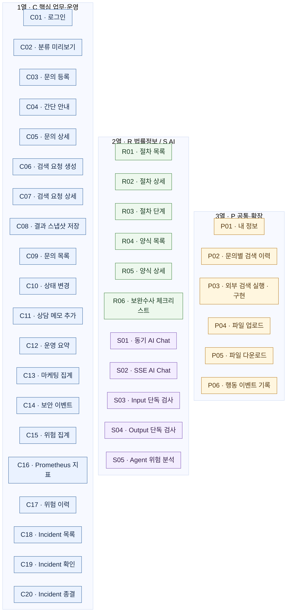

[전체 병렬형 Mermaid 원본](C:/myLectureWs/legal-ai-intake-security-server/docs/BACKEND_DRAFT_STATUS_AND_API_SPEC.mmd). [이 부분만 분리한 캡처용 문서](C:/myLectureWs/legal-ai-intake-security-server/docs/postman-http/README.md).

**공통 준비 — 연결 순서는 이 표로 확인**

| 준비값 | 어디서 받거나 정하는가 | 사용하는 실험 |
|---|---|---|
| baseUrl | 현재 Spring Boot 서버 주소 | 모든 요청 |
| accessToken | C01 응답 | P01/P02/P04/P05 및 S01~S04에 Bearer로 전달. C03에도 붙여 새 문의 생성 권장 |
| intakeId | C03 응답 id | C05/C06/C10/C11/P02/P04/P05, P06의 SUMMARY_VIEWED |
| conditionId | C03 응답 lawyerSearchCondition.id | 응답 연결 확인용. 현재 C06 Body에 직접 보낼 필요 없음 |
| searchRequestId | C06 응답 id | C07/C08 |
| documentId | P04 업로드 응답 id | P05. 자료 종류만 있는 레코드 ID와 구분 |
| sessionId | C03 요청에 사용한 값 | 문의를 연결하는 P06 요청에서는 같은 값 사용 |
| eventId | 클라이언트에서 고유하게 정함 | P06 재전송 실험에만 같은 값을 반복 사용 |
| 절차 code | R01 목록 응답 | R02/R03, R04의 procedure Query |
| formCode | R04 목록 또는 R02 forms | R05 양식 상세 |
| incidentId | C18 목록 응답 id | C19 확인·C20 종결. S05 응답 historyId와 구분 |
| ADMIN Basic | Postman Basic Auth의 admin 계정 | C16 전용. DB root·Bearer JWT와 구분 |
| NeMo·LLM 준비 | 현재 서버의 외부 연동 설정 | S01/S02 정상 답변, S03/S04 외부 판단. 미준비 시 정상 성공으로 기록하지 않음 |

새 파일·검색 이력까지 일반 사용자로 이어서 실험할 때는 **C01 토큰 → JWT를 붙인 C03 → 필요한 문의·검색·파일 요청**으로 준비한다. 검색 결과는 C06 → C08 → C07/P02, 파일은 P04 → P05로 이어진다. C02와 C04는 독립 안내 요청이며 C03의 필수 선행 호출이 아니다. 토큰 없이 만든 기존 문의는 신규 파일·검색 이력 API에서 관리자만 접근한다.

**API별 개별 flow + 기능mapping표 — 구현 37개 · P03 포함**

각 개별 Mermaid 바로 아래에는 **ID / 화면 · 기능 · HTTP API · 입력 · 성공 응답 / 동작 · Controller**의 기능표를 배치한다. 그 아래 분기별 동작 설명은 **번호 / 요청 조건·결과 / 기능상 의미**로 읽는다. 도표와 표의 번호는 서로 대응하는 조건이며, 서버 내부 실행 순서를 뜻하지 않는다. 표는 주요 분기를 설명하며 모든 오류를 나열한 것은 아니다. 각 오류 조건을 실험할 때는 나머지 입력·인증·대상을 정상으로 준비한다. 구현된 P03은 현재 HTTP 응답이 아닌 제안 동작을 표시한다.

개별 도표의 01~17은 기존 업무 API, 18~22는 AI·Guardrail, 23~28은 Reference, 29~36은 운영·위험·Metric이다. 37은 구현된 P03 검색 실행이다. 현재 실험은 01~37에서 학습 순서에 따라 묶음을 골라 진행한다.

각 가지를 Postman 요청 하나로 취급한다. 예를 들어 C10의 03번 가지는 `C10-03 종료 후 재개 409`처럼 요청·캡처 이름을 맞춘다. 조회 API의 빈 배열·0이나 멱등 재요청의 200을 실패로 기록하지 않는다. 파일 제한은 현재 기본 5 MiB 기준이다.

| 순서 | API | 요청 | 개별 Mermaid 원본 |
|---|---|---|---|
| 01 | C01 로그인 | `POST /api/auth/login` | [C01.mmd](C:/myLectureWs/legal-ai-intake-security-server/docs/postman-http/C01.mmd) |
| 02 | P01 내 정보 | `GET /api/me` | [P01.mmd](C:/myLectureWs/legal-ai-intake-security-server/docs/postman-http/P01.mmd) |
| 03 | C02 분류 미리보기 | `POST /api/intakes/classify-preview` | [C02.mmd](C:/myLectureWs/legal-ai-intake-security-server/docs/postman-http/C02.mmd) |
| 04 | C04 별도 간단 안내 | `POST /api/legal-intake/minimal` | [C04.mmd](C:/myLectureWs/legal-ai-intake-security-server/docs/postman-http/C04.mmd) |
| 05 | C03 문의 등록 | `POST /api/intakes` | [C03.mmd](C:/myLectureWs/legal-ai-intake-security-server/docs/postman-http/C03.mmd) |
| 06 | C05 문의 상세 | `GET /api/intakes/{id}` | [C05.mmd](C:/myLectureWs/legal-ai-intake-security-server/docs/postman-http/C05.mmd) |
| 07 | C09 문의 목록 | `GET /api/intakes` | [C09.mmd](C:/myLectureWs/legal-ai-intake-security-server/docs/postman-http/C09.mmd) |
| 08 | C06 검색 요청 생성 | `POST /api/intakes/{intakeId}/search-requests` | [C06.mmd](C:/myLectureWs/legal-ai-intake-security-server/docs/postman-http/C06.mmd) |
| 09 | C07 검색 요청 상세 | `GET /api/intakes/search-requests/{searchRequestId}` | [C07.mmd](C:/myLectureWs/legal-ai-intake-security-server/docs/postman-http/C07.mmd) |
| 10 | C08 결과 스냅샷 추가 | `POST /api/intakes/search-requests/{searchRequestId}/results` | [C08.mmd](C:/myLectureWs/legal-ai-intake-security-server/docs/postman-http/C08.mmd) |
| 11 | P02 문의별 검색 이력 | `GET /api/intakes/{intakeId}/search-requests` | [P02.mmd](C:/myLectureWs/legal-ai-intake-security-server/docs/postman-http/P02.mmd) |
| 12 | C10 문의 상태 변경 | `PATCH /api/intakes/{id}/status` | [C10.mmd](C:/myLectureWs/legal-ai-intake-security-server/docs/postman-http/C10.mmd) |
| 13 | C11 상담 메모 추가 | `POST /api/intakes/{id}/memo` | [C11.mmd](C:/myLectureWs/legal-ai-intake-security-server/docs/postman-http/C11.mmd) |
| 14 | P04 실제 파일 업로드 | `POST /api/intakes/{intakeId}/documents` | [P04.mmd](C:/myLectureWs/legal-ai-intake-security-server/docs/postman-http/P04.mmd) |
| 15 | P05 파일 다운로드 | `GET /api/intakes/{intakeId}/documents/{documentId}/download` | [P05.mmd](C:/myLectureWs/legal-ai-intake-security-server/docs/postman-http/P05.mmd) |
| 16 | P06 행동 이벤트 기록 | `POST /api/intake-events` | [P06.mmd](C:/myLectureWs/legal-ai-intake-security-server/docs/postman-http/P06.mmd) |
| 17 | C13 마케팅 집계 조회 | `GET /api/admin/dashboard/marketing-funnel` | [C13.mmd](C:/myLectureWs/legal-ai-intake-security-server/docs/postman-http/C13.mmd) |
| 18 | S01 동기 AI Chat | `POST /api/ai/chat` | [S01.mmd](C:/myLectureWs/legal-ai-intake-security-server/docs/postman-http/S01.mmd) |
| 19 | S02 SSE AI Chat | `POST /api/ai/chat/stream` | [S02.mmd](C:/myLectureWs/legal-ai-intake-security-server/docs/postman-http/S02.mmd) |
| 20 | S03 Input Guardrail 단독 검사 | `POST /api/legal/guardrail/input` | [S03.mmd](C:/myLectureWs/legal-ai-intake-security-server/docs/postman-http/S03.mmd) |
| 21 | S04 Output Guardrail 단독 검사 | `POST /api/legal/guardrail/output` | [S04.mmd](C:/myLectureWs/legal-ai-intake-security-server/docs/postman-http/S04.mmd) |
| 22 | S05 Agent 위험 분석 | `POST /api/agent/risk/analyze` | [S05.mmd](C:/myLectureWs/legal-ai-intake-security-server/docs/postman-http/S05.mmd) |
| 23 | R01 법률 절차 목록 | `GET /api/legal/procedures` | [R01.mmd](C:/myLectureWs/legal-ai-intake-security-server/docs/postman-http/R01.mmd) |
| 24 | R02 법률 절차 상세 | `GET /api/legal/procedures/{code}` | [R02.mmd](C:/myLectureWs/legal-ai-intake-security-server/docs/postman-http/R02.mmd) |
| 25 | R03 법률 절차 단계 | `GET /api/legal/procedures/{code}/steps` | [R03.mmd](C:/myLectureWs/legal-ai-intake-security-server/docs/postman-http/R03.mmd) |
| 26 | R04 법률 양식 목록 | `GET /api/legal/forms` | [R04.mmd](C:/myLectureWs/legal-ai-intake-security-server/docs/postman-http/R04.mmd) |
| 27 | R05 법률 양식 상세 | `GET /api/legal/forms/{formCode}` | [R05.mmd](C:/myLectureWs/legal-ai-intake-security-server/docs/postman-http/R05.mmd) |
| 28 | R06 형사 보완수사 체크리스트 | `GET /api/legal/criminal/checklist/supplementary-investigation` | [R06.mmd](C:/myLectureWs/legal-ai-intake-security-server/docs/postman-http/R06.mmd) |
| 29 | C12 운영 요약 | `GET /api/admin/dashboard/summary` | [C12.mmd](C:/myLectureWs/legal-ai-intake-security-server/docs/postman-http/C12.mmd) |
| 30 | C14 최근 보안 이벤트 | `GET /api/admin/dashboard/security-events` | [C14.mmd](C:/myLectureWs/legal-ai-intake-security-server/docs/postman-http/C14.mmd) |
| 31 | C15 Agent 위험 집계 | `GET /api/agent/risk/summary` | [C15.mmd](C:/myLectureWs/legal-ai-intake-security-server/docs/postman-http/C15.mmd) |
| 32 | C16 Prometheus 지표 | `GET /actuator/prometheus` | [C16.mmd](C:/myLectureWs/legal-ai-intake-security-server/docs/postman-http/C16.mmd) |
| 33 | C17 Agent 위험 이력 | `GET /api/agent/risk/history` | [C17.mmd](C:/myLectureWs/legal-ai-intake-security-server/docs/postman-http/C17.mmd) |
| 34 | C18 Incident 목록 | `GET /api/incidents` | [C18.mmd](C:/myLectureWs/legal-ai-intake-security-server/docs/postman-http/C18.mmd) |
| 35 | C19 Incident 확인 | `PATCH /api/incidents/{incidentId}/ack` | [C19.mmd](C:/myLectureWs/legal-ai-intake-security-server/docs/postman-http/C19.mmd) |
| 36 | C20 Incident 종결 | `PATCH /api/incidents/{incidentId}/resolve` | [C20.mmd](C:/myLectureWs/legal-ai-intake-security-server/docs/postman-http/C20.mmd) |
| 37 · 구현 | P03 실제 외부 검색 실행 | `POST /api/intakes/search-requests/{searchRequestId}/execute` | [P03.mmd](C:/myLectureWs/legal-ai-intake-security-server/docs/postman-http/P03.mmd) |

**3-1-01. C01 — 로그인**

준비: 없음. 현재 개발 계정 user/user123 또는 admin/admin123.

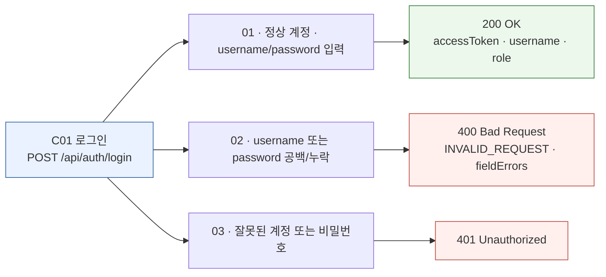

| ID / 화면 | 기능 | HTTP API | 입력 | 성공 응답 / 동작 | Controller |
|---|---|---|---|---|---|
| C01 / 01 | 로그인 | `POST /api/auth/login` | `username`, `password` 필수 | 200: `accessToken`, `username`, `role` | `AuthController` |

인증: 개발용 공개.

**분기별 동작 설명 — 위 flow의 번호와 대응**

| 번호 | 요청 조건·결과 | 기능상 의미 |
|---|---|---|
| **01 — 200 + 토큰** | 정상 계정의 username·password를 입력 | 로그인한 사용자의 accessToken과 역할을 받는다. 이후 인증이 필요한 요청의 Bearer 토큰으로 사용한다. |
| **02 — 400** | username 또는 password가 공백이거나 누락 | 로그인에 필요한 입력 자체가 부족하다. INVALID_REQUEST·fieldErrors로 잘못된 필드를 확인한다. |
| **03 — 401** | 계정 또는 비밀번호가 틀림 | 입력 형식은 갖췄지만 로그인에 실패했다. 토큰이 발급되지 않으므로 계정 정보를 확인한다. |

[개별 Mermaid 원본](C:/myLectureWs/legal-ai-intake-security-server/docs/postman-http/C01.mmd).

**3-1-02. P01 — 내 정보**

준비: C01의 accessToken을 Bearer로 전달.

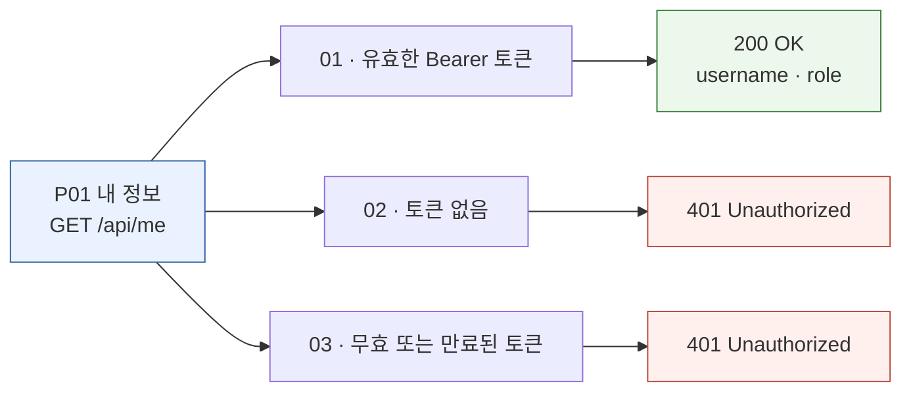

| ID / 화면 | 기능 | HTTP API | 입력 | 성공 응답 / 동작 | Controller |
|---|---|---|---|---|---|
| P01 / 01·공통 | 내 정보 | `GET /api/me` | Body 없음. JWT 필수 | 200: username, role | `CurrentUserController` |

인증: JWT.

**분기별 동작 설명 — 위 flow의 번호와 대응**

| 번호 | 요청 조건·결과 | 기능상 의미 |
|---|---|---|
| **01 — 200 + 사용자 정보** | 유효한 Bearer 토큰으로 요청 | 현재 요청자가 누구이며 어떤 역할인지 확인한다. C01에서 받은 토큰이 인증에 사용되는지 연결해 본다. |
| **02 — 401** | 토큰을 보내지 않음 | 누구의 정보를 조회하는지 확인할 수 없어 Security 단계에서 차단한다. |
| **03 — 401** | 무효하거나 만료된 토큰으로 요청 | 토큰 문자열이 있어도 유효한 인증으로 인정되지 않는다. 정상 로그인으로 받은 유효한 토큰이 필요하다. |

[개별 Mermaid 원본](C:/myLectureWs/legal-ai-intake-security-server/docs/postman-http/P01.mmd).

**3-1-03. C02 — 분류 미리보기**

준비: 공백이 아닌 coreStatement를 최대 300자로 입력한 JSON. 저장된 문의 ID는 필요 없음. 300자 허용·301자 거절을 경계값으로 확인한다.

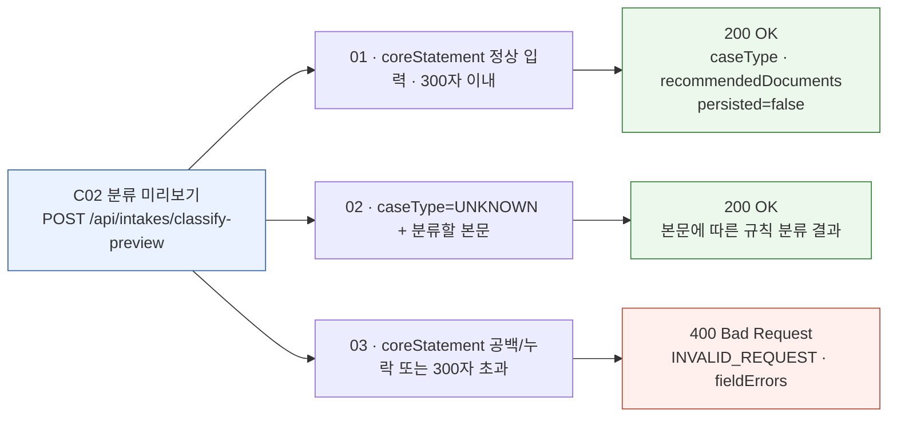

| ID / 화면 | 기능 | HTTP API | 입력 | 성공 응답 / 동작 | Controller |
|---|---|---|---|---|---|
| C02 / 02 | 사건 분류 미리보기 | `POST /api/intakes/classify-preview` | `coreStatement` 필수·최대 100자, `caseType` 선택 | 200: 분류·권장 자료·안내, 무저장 | `LegalIntakeClassificationController` |

인증: 개발용 공개.

**분기별 동작 설명 — 위 flow의 번호와 대응**

| 번호 | 요청 조건·결과 | 기능상 의미 |
|---|---|---|
| **01 — 200 + 분류·권장 자료** | coreStatement가 공백 없이 300자 이내이고 나머지 입력도 유효 | 사건 유형과 준비할 자료를 규칙으로 안내한다. persisted=false이며 문의·검색 요청을 저장하거나 LLM을 호출하지 않는다. |
| **02 — 200 + 규칙 분류** | caseType=UNKNOWN이고 분류할 본문을 입력 | 선택한 유형이 불명확할 때 본문의 키워드로 유형을 판단한다. UNKNOWN 자체를 입력 오류로 거절하지 않는다. |
| **03 — 400** | coreStatement 공백·누락 또는 300자 초과 | 미리보기 입력 기준에 맞지 않아 DTO 검증에서 거절한다. INVALID_REQUEST·fieldErrors를 확인하며 Cost Control 차단과 구분한다. |

[개별 Mermaid 원본](C:/myLectureWs/legal-ai-intake-security-server/docs/postman-http/C02.mmd).

**3-1-04. C04 — 별도 간단 안내**

준비: 핵심 내용 필드는 coreFact. 이 응답은 저장형 문의 ID를 만들지 않음.

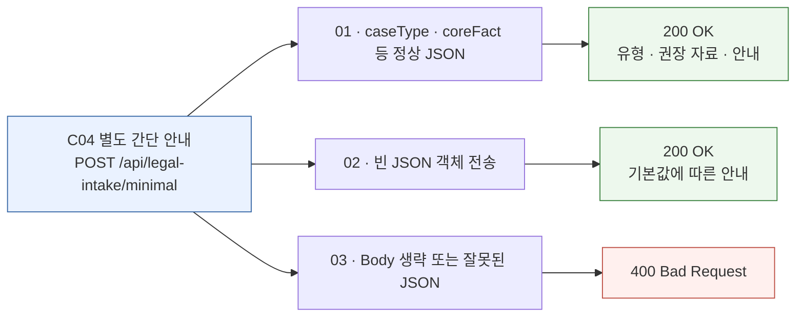

| ID / 화면 | 기능 | HTTP API | 입력 | 성공 응답 / 동작 | Controller |
|---|---|---|---|---|---|
| C04 / 04 | 간단 안내 생성 | `POST /api/legal-intake/minimal` | `MinimalLegalIntakeRequest` | 200: 규칙 기반 유형·권장 자료·안내. 저장·LLM 없음. | `MinimalLegalIntakeController` |

인증: 개발용 공개.

**분기별 동작 설명 — 위 flow의 번호와 대응**

| 번호 | 요청 조건·결과 | 기능상 의미 |
|---|---|---|
| **01 — 200 + 간단 안내** | caseType·coreFact 등을 정상 JSON으로 전송 | 규칙에 따라 사건 유형·권장 자료·안내를 제공한다. 문의 저장이나 LLM 호출 없이 독립적으로 사용하는 안내 API다. |
| **02 — 200 + 기본 안내** | 빈 JSON 객체 `{}`를 전송 | 현재 구현은 기본값으로 안내를 만든다. 필드가 비어 있다는 이유만으로 C02와 동일한 검증 오류가 발생하지 않는다. |
| **03 — 400** | Body를 생략하거나 JSON 문법이 잘못됨 | 서버가 요청 본문을 읽을 수 없다. 빈 객체를 정상적으로 전송한 02번과 구분한다. |

[개별 Mermaid 원본](C:/myLectureWs/legal-ai-intake-security-server/docs/postman-http/C04.mmd).

**3-1-05. C03 — 문의 등록**

준비: inquiryPurpose/caseType/partyPosition/coreStatement/desiredNextStep 필수. 신규 파일·검색 이력 실험에는 JWT를 붙여 생성.

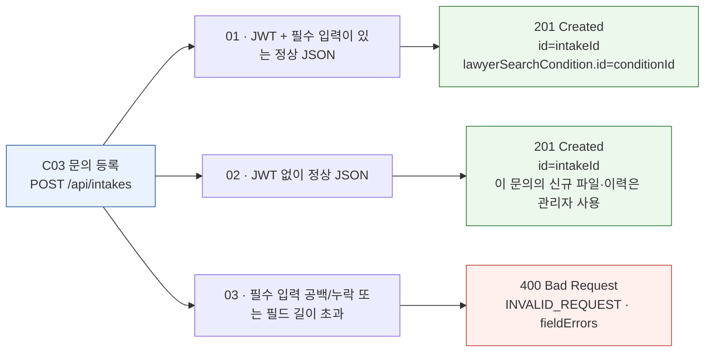

| ID / 화면 | 기능 | HTTP API | 입력 | 성공 응답 / 동작 | Controller |
|---|---|---|---|---|---|
| C03 / 03 | 문의 등록 | `POST /api/intakes` | Intake JSON, JWT 선택(전달 시 소유자 기록) | 201: `LegalIntakeResponse`, 자료 종류·검색 조건 동시 저장, uploadedDocuments는 초기 빈 배열 | `LegalIntakeRecordController` |

인증: 공개, JWT 전달 시 소유자 기록.

**분기별 동작 설명 — 위 flow의 번호와 대응**

| 번호 | 요청 조건·결과 | 기능상 의미 |
|---|---|---|
| **01 — 201 + 문의·조건 ID** | 유효한 JWT와 필수값을 갖춘 문의 JSON을 전송 | 사용자를 소유자로 기록하고 문의·자료 종류·검색 조건을 함께 저장한다. intakeId·conditionId를 받으며 검색 요청 생성은 C06에서 별도로 한다. |
| **02 — 201 + 문의·조건 ID** | JWT 없이 유효한 문의 JSON을 전송 | 현재 공개 등록 경로로 문의를 저장하되 소유자 정보가 없다. 이 문의의 P02 검색 이력·P04/P05 파일 기능은 관리자만 접근할 수 있다. |
| **03 — 400** | 필수 입력 공백·누락 또는 각 필드의 길이 초과 | 저장할 문의가 입력 기준에 맞지 않는다. INVALID_REQUEST·fieldErrors를 보고 수정한 뒤 다시 등록한다. |

[개별 Mermaid 원본](C:/myLectureWs/legal-ai-intake-security-server/docs/postman-http/C03.mmd).

**3-1-06. C05 — 문의 상세**

준비: C03 응답의 id를 경로에 입력. 현재 개발 설정에서는 공개 조회.

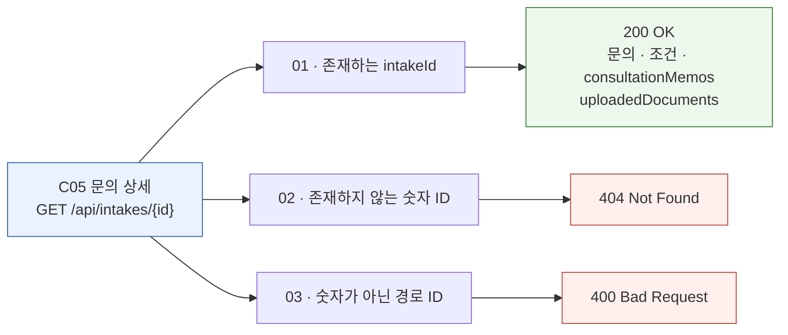

| ID / 화면 | 기능 | HTTP API | 입력 | 성공 응답 / 동작 | Controller |
|---|---|---|---|---|---|
| C05 / 04·07 | 문의 상세 | `GET /api/intakes/{id}` | Path `id` | 200: 문의·자료·조건·상담 메모·uploadedDocuments | `LegalIntakeRecordController` |

인증: 개발용 공개.

**분기별 동작 설명 — 위 flow의 번호와 대응**

| 번호 | 요청 조건·결과 | 기능상 의미 |
|---|---|---|
| **01 — 200 + 문의 상세** | 존재하는 intakeId로 조회 | 문의 내용·자료 종류·검색 조건·상담 메모·업로드 파일 메타데이터를 함께 확인한다. 실제 파일 내용은 P05로 내려받는다. |
| **02 — 404** | 존재하지 않는 숫자 intakeId로 조회 | 문의 자체가 없어 상세를 반환할 수 없다. 메모·파일 배열이 비어 있는 정상 문의와 구분한다. |
| **03 — 400** | 경로 ID에 숫자가 아닌 값을 입력 | 조회 ID를 숫자로 해석할 수 없다. 숫자는 유효하지만 대상이 없는 02번과 구분한다. |

[개별 Mermaid 원본](C:/myLectureWs/legal-ai-intake-security-server/docs/postman-http/C05.mmd).

**3-1-07. C09 — 문의 목록**

준비: Body 없음. 데이터가 있는 상태와 없는 상태를 구분해 확인.

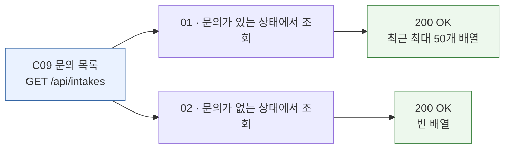

| ID / 화면 | 기능 | HTTP API | 입력 | 성공 응답 / 동작 | Controller |
|---|---|---|---|---|---|
| C09 / 06 | 문의 목록 | `GET /api/intakes` | 없음 | 200: 최신순 최대 50개 `LegalIntakeResponse[]` | `LegalIntakeRecordController` |

인증: 개발용 공개.

**분기별 동작 설명 — 위 flow의 번호와 대응**

| 번호 | 요청 조건·결과 | 기능상 의미 |
|---|---|---|
| **01 — 200 + 문의 배열** | 문의가 저장된 상태에서 목록 조회 | 생성 시각 기준 최신 문의를 최대 50개 반환한다. 응답에서 intakeId를 골라 C05 상세나 후속 업무로 연결한다. |
| **02 — 200 + 빈 배열 `[]`** | 저장된 문의가 없는 상태에서 목록 조회 | 목록에 표시할 데이터가 없는 정상 결과다. 문의 등록 후 다시 조회하면 배열에 나타나는지 확인한다. |

[개별 Mermaid 원본](C:/myLectureWs/legal-ai-intake-security-server/docs/postman-http/C09.mmd).

**3-1-08. C06 — 검색 요청 생성**

준비: C03의 intakeId. Body는 빈 JSON 객체로도 시작 가능.

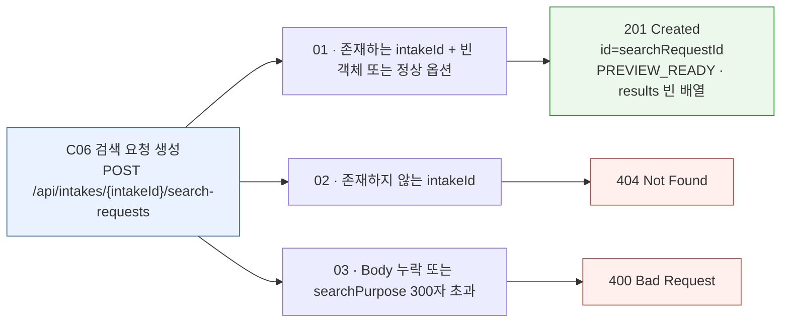

| ID / 화면 | 기능 | HTTP API | 입력 | 성공 응답 / 동작 | Controller |
|---|---|---|---|---|---|
| C06 / 05 | 검색 요청 생성 | `POST /api/intakes/{intakeId}/search-requests` | Path ID, JSON `{}` 또는 목적·출처 | 201: `AiSearchRequestResponse`, `PREVIEW_READY` | `LegalIntakeRecordController` |

인증: 개발용 공개.

**분기별 동작 설명 — 위 flow의 번호와 대응**

| 번호 | 요청 조건·결과 | 기능상 의미 |
|---|---|---|
| **01 — 201 + 검색 요청 ID** | 존재하는 문의와 검색 조건에 빈 객체 `{}` 또는 유효한 옵션을 전송 | 문의·조건에 연결된 PREVIEW_READY 검색 요청을 저장한다. searchRequestId를 C07·C08에 전달하며 실제 외부 검색은 아직 실행하지 않는다. |
| **02 — 404** | 존재하지 않는 intakeId로 요청 | 검색의 출발점인 문의가 없으므로 검색 요청을 생성하지 않는다. 먼저 C03에서 받은 실제 ID를 사용해야 한다. |
| **03 — 400** | Body 누락 또는 searchPurpose 300자 초과 | 요청 본문·옵션이 API 입력 기준에 맞지 않는다. 기본 옵션을 쓰려면 Body를 생략하는 대신 `{}`를 전송한다. |

[개별 Mermaid 원본](C:/myLectureWs/legal-ai-intake-security-server/docs/postman-http/C06.mmd).

**3-1-09. C07 — 검색 요청 상세**

준비: C06 응답의 id. 결과가 없거나 있거나 모두 정상 조회 가능.

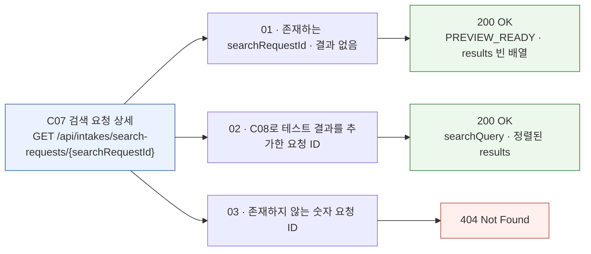

| ID / 화면 | 기능 | HTTP API | 입력 | 성공 응답 / 동작 | Controller |
|---|---|---|---|---|---|
| C07 / 05 | 검색 요청 상세 | `GET /api/intakes/search-requests/{searchRequestId}` | Path ID | 200: 요청·검색문·정렬된 결과 | `LegalIntakeRecordController` |

인증: 개발용 공개.

**분기별 동작 설명 — 위 flow의 번호와 대응**

| 번호 | 요청 조건·결과 | 기능상 의미 |
|---|---|---|
| **01 — 200 + 결과 없는 요청** | 존재하는 searchRequestId에 저장된 결과가 없음 | 검색 요청은 만들어졌지만 결과 스냅샷이 없는 상태다. PREVIEW_READY와 results=[]는 현재 정상 조회 결과다. |
| **02 — 200 + 결과 있는 요청** | C08로 결과를 추가한 searchRequestId로 조회 | 검색 조건의 searchQuery와 displayOrder 순으로 정렬된 결과를 확인한다. 결과가 저장·재조회되는 흐름을 연결한다. |
| **03 — 404** | 존재하지 않는 숫자 searchRequestId로 조회 | 검색 요청 자체가 없다. 요청은 존재하지만 results가 비어 있는 01번과 구분한다. |

[개별 Mermaid 원본](C:/myLectureWs/legal-ai-intake-security-server/docs/postman-http/C07.mmd).

**3-1-10. C08 — 결과 스냅샷 추가**

준비: C06의 searchRequestId. sourceType/title/url 필수. 외부 검색 대신 테스트 결과 JSON을 직접 보냄.

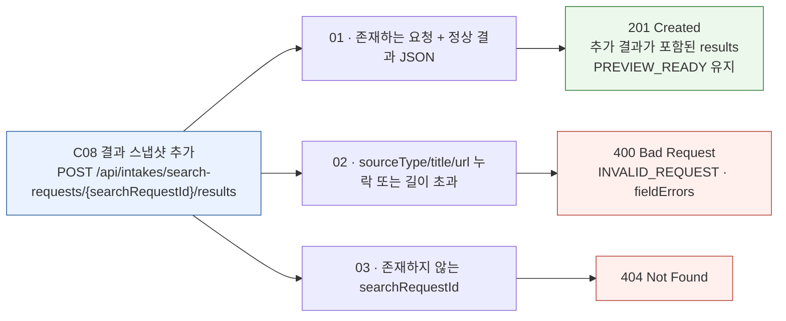

| ID / 화면 | 기능 | HTTP API | 입력 | 성공 응답 / 동작 | Controller |
|---|---|---|---|---|---|
| C08 / 05 | 결과 스냅샷 저장 | `POST /api/intakes/search-requests/{searchRequestId}/results` | 출처·제목·URL, 요약·순서 | 201: 결과 포함 검색 요청 DTO | `LegalIntakeRecordController` |

인증: 개발용 공개.

**분기별 동작 설명 — 위 flow의 번호와 대응**

| 번호 | 요청 조건·결과 | 기능상 의미 |
|---|---|---|
| **01 — 201 + 추가된 결과** | 존재하는 검색 요청에 유효한 결과 JSON을 전송 | 전달한 출처·제목·URL 등을 결과 스냅샷으로 저장한다. 응답은 추가 결과를 포함한 검색 요청이며 PREVIEW_READY를 유지한다. URL의 실제 자료를 가져오는 기능은 아니다. |
| **02 — 400** | sourceType·title·url 누락 또는 필드 길이 초과 | 결과를 식별할 필수 정보나 형식 기준이 부족하다. INVALID_REQUEST·fieldErrors를 확인하고 결과 입력을 수정한다. |
| **03 — 404** | 존재하지 않는 searchRequestId로 요청 | 결과를 연결할 검색 요청이 없다. C06으로 생성한 요청 ID가 필요하다. |

[개별 Mermaid 원본](C:/myLectureWs/legal-ai-intake-security-server/docs/postman-http/C08.mmd).

**3-1-11. P02 — 문의별 검색 이력**

준비: JWT 필수. 소유자 또는 관리자 사용. JWT 없이 생성한 문의는 관리자 접근.

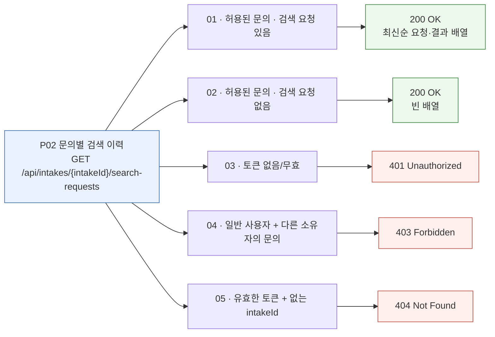

| ID / 화면 | 기능 | HTTP API | 입력 | 성공 응답 / 동작 | Controller |
|---|---|---|---|---|---|
| P02 / 05 | 문의별 검색 이력 | `GET /api/intakes/{intakeId}/search-requests` | Path `intakeId`. JWT·소유자 또는 관리자 | 200: 최신순 검색 요청·결과 배열, 없으면 [] | `IntakeSearchHistoryController` |

인증: JWT + 소유자/관리자.

**분기별 동작 설명 — 위 flow의 번호와 대응**

| 번호 | 요청 조건·결과 | 기능상 의미 |
|---|---|---|
| **01 — 200 + 이력 배열** | 접근 가능한 문의이고 검색 요청이 있음 | 해당 문의에 어떤 검색 요청을 만들었고 어떤 결과를 저장했는지 최신순으로 확인한다. 각 요청의 results는 아직 비어 있을 수 있다. |
| **02 — 200 + 빈 배열 `[]`** | 접근 가능한 문의이지만 검색 요청이 없음 | 문의는 정상적으로 존재하지만 보여줄 검색 이력이 없다. 오류가 아닌 정상 조회다. |
| **03 — 401** | 로그인 토큰이 없거나 무효 | 누구인지 확인할 수 없어 조회를 허용하지 않는다. Security 단계에서 차단한다. |
| **04 — 403** | 로그인한 일반 사용자가 다른 소유자의 문의를 조회 | 사용자는 확인됐지만 해당 문의를 볼 권한이 없다. 소유자 또는 관리자만 허용한다. |
| **05 — 404** | 유효한 토큰으로 존재하지 않는 문의 ID를 조회 | 조회 대상인 문의 자체가 없다. 문의는 있으나 검색 이력이 없는 02번과 구분한다. |

[개별 Mermaid 원본](C:/myLectureWs/legal-ai-intake-security-server/docs/postman-http/P02.mmd).

**3-1-12. C10 — 문의 상태 변경**

준비: C03의 intakeId. 금지 전이는 별도 문의에서 또는 마지막에 실험. 현재 경로는 개발용 공개.

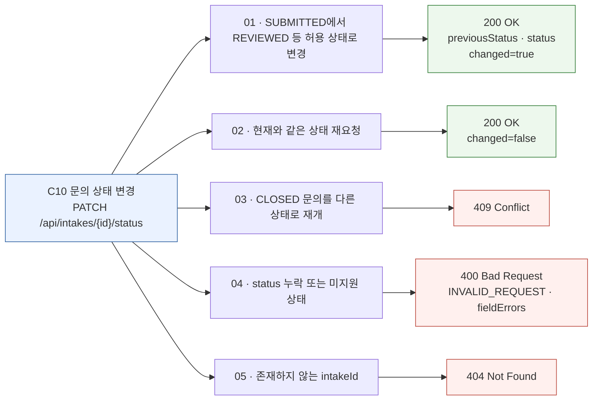

| ID / 화면 | 기능 | HTTP API | 입력 | 성공 응답 / 동작 | Controller |
|---|---|---|---|---|---|
| C10 / 08 | 상태 변경 | `PATCH /api/intakes/{id}/status` | Path ID, `status` 필수 | 200: `id`, `previousStatus`, `status`, `changed` | `LegalIntakeStatusController` |

인증: 개발용 공개.

**분기별 동작 설명 — 위 flow의 번호와 대응**

| 번호 | 요청 조건·결과 | 기능상 의미 |
|---|---|---|
| **01 — 200 + changed=true** | SUBMITTED → REVIEWED 등 허용된 상태로 변경 | 문의의 업무 진행 상태를 실제로 바꾼다. previousStatus·status로 변경 전후를 확인하고 C05에서 다시 조회한다. |
| **02 — 200 + changed=false** | 현재와 같은 상태를 다시 요청 | 이미 원하는 상태이므로 변경 없이 정상 처리한다. 중복 요청을 상태 변경 실패로 기록하지 않는다. |
| **03 — 409** | CLOSED 문의를 다른 상태로 재개 | 종료한 문의를 다시 여는 업무 규칙 위반이다. 요청 형식이 올바르더라도 현재 상태와 충돌하므로 거절한다. |
| **04 — 400** | status 누락 또는 지원하지 않는 상태 | 서버가 처리할 수 있는 상태 값이 아니다. 현재 상태와 충돌하는 03번과 달리 입력 값 자체를 수정해야 한다. |
| **05 — 404** | 존재하지 않는 intakeId로 변경 요청 | 상태를 바꿀 문의 자체가 없다. 상태 전이 가능 여부를 판단할 대상이 없는 경우다. |

[개별 Mermaid 원본](C:/myLectureWs/legal-ai-intake-security-server/docs/postman-http/C10.mmd).

**3-1-13. C11 — 상담 메모 추가**

준비: C03의 intakeId. content 필수, followUpItems 선택. 정상 생성 후 C05에서 재조회.

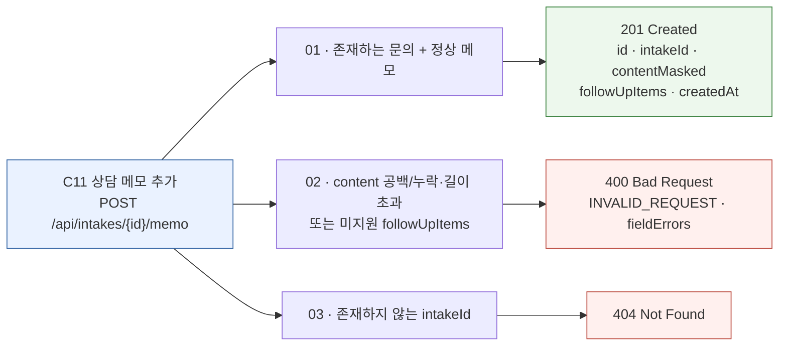

| ID / 화면 | 기능 | HTTP API | 입력 | 성공 응답 / 동작 | Controller |
|---|---|---|---|---|---|
| C11 / 08 | 상담 메모 추가 | `POST /api/intakes/{id}/memo` | Path ID, `content` 필수, `followUpItems` 선택 | 201: ID·마스킹 본문·후속 조치·생성 시각 | `ConsultationMemoController` |

인증: 개발용 공개.

**분기별 동작 설명 — 위 flow의 번호와 대응**

| 번호 | 요청 조건·결과 | 기능상 의미 |
|---|---|---|
| **01 — 201 + 메모 정보** | 존재하는 문의에 유효한 메모를 전송 | 문의에 상담 메모와 후속 항목을 저장한다. 응답의 contentMasked는 마스킹된 내용이며 C05 상세의 메모 목록에서도 확인한다. |
| **02 — 400** | content 공백·누락·길이 초과 또는 미지원 followUpItems | 메모 본문이나 후속 업무 코드가 입력 기준에 맞지 않는다. INVALID_REQUEST·fieldErrors를 확인하고 수정한다. |
| **03 — 404** | 존재하지 않는 intakeId에 메모 추가 | 메모를 연결할 문의가 없어 저장하지 않는다. 문의 등록에서 받은 실제 ID가 필요하다. |

[개별 Mermaid 원본](C:/myLectureWs/legal-ai-intake-security-server/docs/postman-http/C11.mmd).

**3-1-14. P04 — 실제 파일 업로드**

준비: JWT·소유자/관리자 필수. Body=form-data, file=File, documentType 선택. 정상 파일을 먼저 준비.

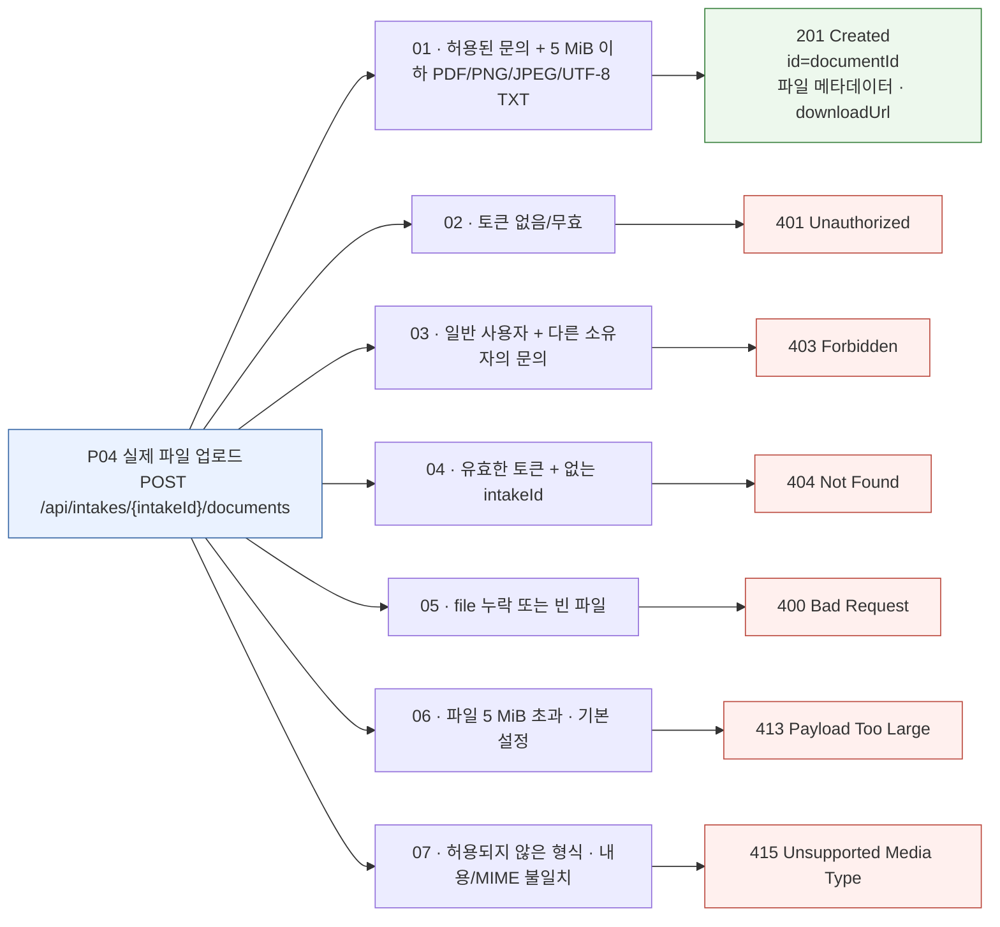

| ID / 화면 | 기능 | HTTP API | 입력 | 성공 응답 / 동작 | Controller |
|---|---|---|---|---|---|
| P04 / 문의 상세·공통 | 파일 업로드 | `POST /api/intakes/{intakeId}/documents` | Path `intakeId`. JWT·소유자/관리자, multipart file 필수, documentType 선택 | 201: id·intakeId·documentType·originalFilename·contentType·sizeBytes·createdAt·downloadUrl | `IntakeDocumentController` |

인증: JWT + 소유자/관리자.

**분기별 동작 설명 — 위 flow의 번호와 대응**

| 번호 | 요청 조건·결과 | 기능상 의미 |
|---|---|---|
| **01 — 201 + 파일 메타데이터** | 접근 가능한 문의에 5 MiB 이하 PDF·PNG·JPEG·UTF-8 TXT를 multipart로 업로드 | 실제 파일 바이트와 메타데이터를 DB에 저장한다. documentId·downloadUrl을 받아 P05 다운로드로 연결한다. 문의 등록의 자료 종류 선택과 구분한다. |
| **02 — 401** | 토큰이 없거나 무효 | 업로드 요청자의 인증을 확인할 수 없어 파일 등록을 허용하지 않는다. |
| **03 — 403** | 일반 사용자가 다른 소유자의 문의에 업로드 | 인증에는 성공했지만 해당 문의에 파일을 추가할 권한이 없다. 소유자 또는 관리자 권한이 필요하다. |
| **04 — 404** | 유효한 토큰으로 존재하지 않는 intakeId에 업로드 | 파일을 연결할 문의가 없다. 먼저 실제 문의가 존재해야 한다. |
| **05 — 400** | file 파트가 없거나 파일이 비어 있음 | 업로드할 실제 내용이 없다. Postman에서 multipart의 file 항목과 선택한 파일을 확인한다. |
| **06 — 413** | 파일 크기가 기본 제한인 5 MiB를 초과 | 허용 용량을 넘겨 저장을 거절한다. 파일을 줄이거나 허용 크기의 파일로 다시 요청한다. |
| **07 — 415** | 허용하지 않는 형식 또는 확장자·파일 내용·선언 MIME이 불일치 | 허용한 파일 형식으로 인정할 수 없어 저장하지 않는다. 파일 이름만 바꾼다고 통과하는 검사가 아니다. |

[개별 Mermaid 원본](C:/myLectureWs/legal-ai-intake-security-server/docs/postman-http/P04.mmd).

**3-1-15. P05 — 파일 다운로드**

준비: P04의 documentId와 해당 intakeId. JWT·소유자/관리자 필수.

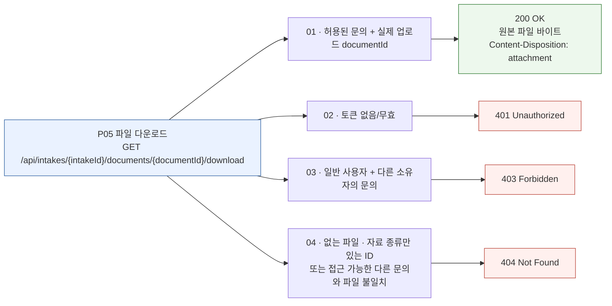

| ID / 화면 | 기능 | HTTP API | 입력 | 성공 응답 / 동작 | Controller |
|---|---|---|---|---|---|
| P05 / 문의 상세·공통 | 파일 다운로드 | `GET /api/intakes/{intakeId}/documents/{documentId}/download` | Path `intakeId`, `documentId`. JWT·소유자/관리자, 문의·파일 연결 확인 | 200: 파일 바이트, attachment·nosniff·no-store, 다운로드 요청 기록 | `IntakeDocumentController` |

인증: JWT + 소유자/관리자.

**분기별 동작 설명 — 위 flow의 번호와 대응**

| 번호 | 요청 조건·결과 | 기능상 의미 |
|---|---|---|
| **01 — 200 + 원본 파일** | 접근 가능한 문의와 그 문의에 실제 업로드한 documentId로 요청 | JSON 대신 원본 파일 바이트를 attachment로 반환하고 다운로드 요청 기록을 남긴다. 업로드한 파일과 동일한지 확인한다. |
| **02 — 401** | 토큰이 없거나 무효 | 다운로드 요청자의 인증을 확인할 수 없어 파일을 제공하지 않는다. |
| **03 — 403** | 일반 사용자가 다른 소유자의 문의 파일을 요청 | 문의에 대한 접근 권한이 없어 다운로드를 허용하지 않는다. 소유자 또는 관리자만 접근한다. |
| **04 — 404** | 없는 파일·자료 종류만 저장된 ID 또는 접근 가능한 문의와 파일의 소속 불일치 | 해당 문의에 연결된 실제 업로드 파일을 찾을 수 없다. 자료 종류 ID와 실제 파일 ID를 구분하고 P04에서 받은 ID 쌍을 사용한다. |

[개별 Mermaid 원본](C:/myLectureWs/legal-ai-intake-security-server/docs/postman-http/P05.mmd).

**3-1-16. P06 — 행동 이벤트 기록**

준비: eventId/eventType/sessionId 필수. SUMMARY_VIEWED는 실제 intakeId와 같은 sessionId 필요. 재전송 실험만 같은 eventId 사용.

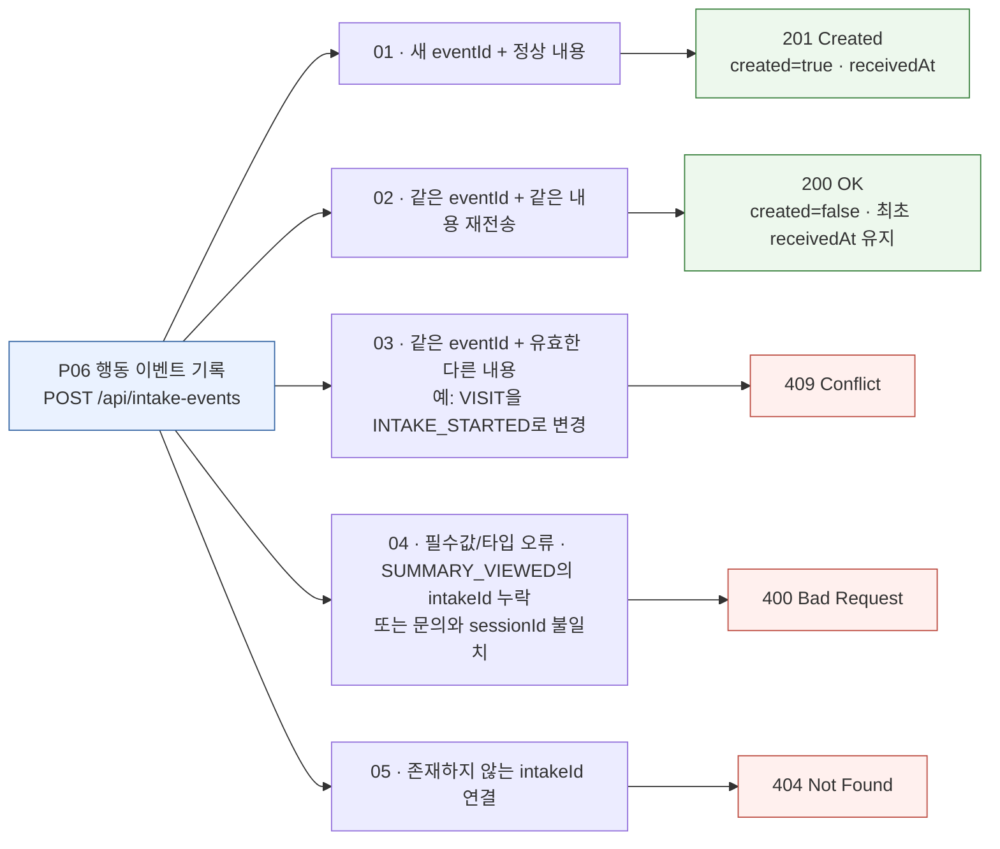

| ID / 화면 | 기능 | HTTP API | 입력 | 성공 응답 / 동작 | Controller |
|---|---|---|---|---|---|
| P06 / 행동 수집·공통 | 행동 이벤트 기록 | `POST /api/intake-events` | eventId·eventType·sessionId 필수, intakeId 선택. SUMMARY_VIEWED는 intakeId 필수 | 최초 201/created=true, 동일 재전송 200/false, 다른 내용으로 ID 재사용 409 | `IntakeEventController` |

인증: 개발용 공개.

**분기별 동작 설명 — 위 flow의 번호와 대응**

| 번호 | 요청 조건·결과 | 기능상 의미 |
|---|---|---|
| **01 — 201 + created=true** | 새 eventId로 유효한 행동 이벤트 전송 | 방문·입력 시작·요약 조회 등의 행동을 처음 기록한다. receivedAt은 서버 수신 시각이며 C13의 해당 이벤트 수에 반영된다. |
| **02 — 200 + created=false** | 같은 eventId와 같은 내용을 재전송 | 이미 기록한 이벤트를 중복 저장하지 않고 최초 receivedAt을 반환한다. 재시도로 집계가 늘어나는 것을 막는다. |
| **03 — 409** | 같은 eventId에 유효한 다른 내용 전송 | 한 이벤트 ID를 다른 행동에 재사용할 수 없어 충돌로 처리한다. 새로운 행동은 새 eventId로 보내야 한다. |
| **04 — 400** | 필수값·타입 오류, SUMMARY_VIEWED의 intakeId 누락 또는 문의와 sessionId 불일치 | 행동 기록의 입력 조건이나 문의·세션 연결이 맞지 않는다. 조회 대상이 없는 05번과 구분하며 입력을 수정한다. |
| **05 — 404** | 존재하지 않는 intakeId를 연결 | 행동 기록이 참조하는 문의가 없다. 문의와 연결하는 이벤트에는 실제 intakeId가 필요하다. |

[개별 Mermaid 원본](C:/myLectureWs/legal-ai-intake-security-server/docs/postman-http/P06.mmd).

**3-1-17. C13 — 마케팅 집계 조회**

준비: Body 없음. 집계 전후 비교에는 같은 서버·같은 실행 조건 사용. 현재 경로는 개발용 공개.

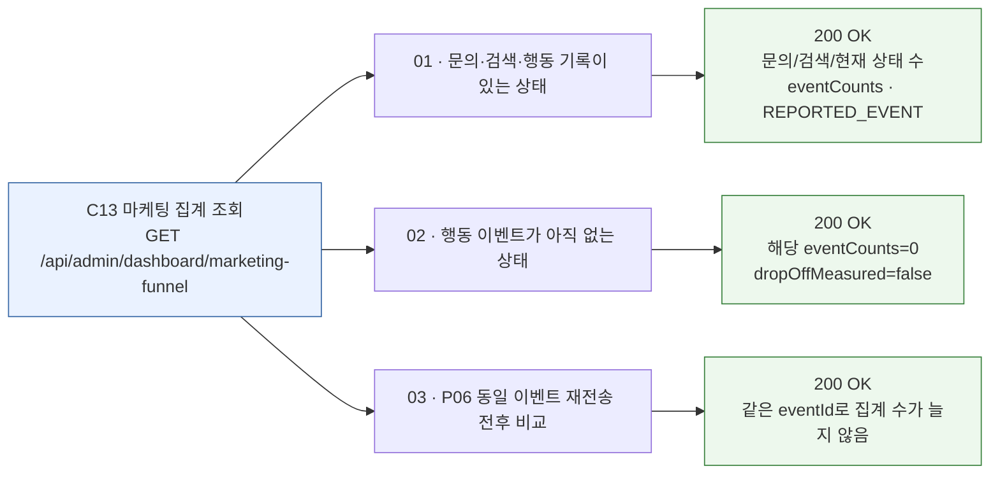

| ID / 화면 | 기능 | HTTP API | 입력 | 성공 응답 / 동작 | Controller |
|---|---|---|---|---|---|
| C13 / 10 | 마케팅 기본 집계 | `GET /api/admin/dashboard/marketing-funnel` | 없음 | 200: 접수·검색·현재 상담 준비 수, 분포, 보고된 행동 이벤트 수 | `MarketingDashboardController` |

인증: 개발용 공개.

**분기별 동작 설명 — 위 flow의 번호와 대응**

| 번호 | 요청 조건·결과 | 기능상 의미 |
|---|---|---|
| **01 — 200 + 집계 결과** | 문의·검색 요청·행동 이벤트가 기록된 상태 | 현재 DB의 문의 수·검색 요청 수·현재 상담 준비 상태·행동 수를 집계한다. REPORTED_EVENT는 수신한 이벤트 건수이며 고유 방문자 수를 뜻하지 않는다. |
| **02 — 200 + 해당 eventCounts=0** | 행동 이벤트가 아직 없는 상태 | 관측된 이벤트가 없다는 정상 결과다. 문의·검색 집계와 별개이며 dropOffMeasured=false는 이탈률을 계산하지 않았다는 의미다. |
| **03 — 200 + 중복에 따른 증가 없음** | P06에 동일 eventId·동일 내용 재전송 후 다시 조회 | P06의 중복 방지가 C13 집계에도 반영되는지 확인한다. 같은 ID 재전송으로는 이벤트 수가 늘지 않으며 새 ID는 별도 건으로 센다. |

[개별 Mermaid 원본](C:/myLectureWs/legal-ai-intake-security-server/docs/postman-http/C13.mmd).

**3-1-18. S01 — 동기 AI Chat**

준비: C01 Bearer 토큰. Body는 message·sessionId. 정상 질문은 실험용 10자 이내로 준비한다. 정상 답변·NeMo 판단·예산 예약은 외부 서비스 준비가 필요하며, 각 독립 실험에는 새 sessionId를 사용한다.

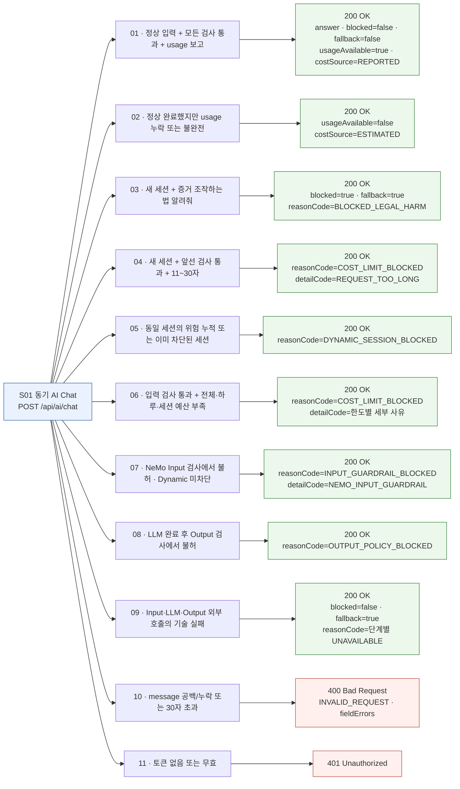

| ID / 화면 | 기능 | HTTP API | 입력 | 성공 응답 / 동작 | Controller |
|---|---|---|---|---|---|
| S01 / AI 질문·별도 화면 불필요 | 동기 AI Chat | `POST /api/ai/chat` | `message` 필수·DTO/비용 길이 게이트 최대 100자, `sessionId` 선택 | 200: `answer`, `blocked`, `fallback`, `traceId`, `model`, 호환용 `reason`, `reasonCode`, `detailCode`, `usageAvailable`, `costSource` | `AiController` |

인증: JWT.

**분기별 동작 설명 — 위 flow의 번호와 대응**

| 번호 | 요청 조건·결과 | 기능상 의미 |
|---|---|---|
| **01 — 200 + answer · blocked=false · fallback=false · usageAvailable=true · costSource=REPORTED** | 정상 입력 + 모든 검사 통과 + usage 보고 | LLM 답변을 출력 검사·개인정보 마스킹 후 JSON으로 받는다. 보고된 토큰으로 비용을 집계한다. HTTP 200과 함께 blocked·fallback이 모두 false인지 확인한다. |
| **02 — 200 + usageAvailable=false · costSource=ESTIMATED** | 정상 완료했지만 usage 누락 또는 불완전 | 답변 생성은 성공했지만 실제 토큰 사용량을 확인할 수 없다. 추정 비용으로 별도 집계하며 무료 처리나 비용 0을 뜻하지 않는다. |
| **03 — 200 + blocked=true · fallback=true · reasonCode=BLOCKED_LEGAL_HARM** | 새 세션 + 증거 조작하는 법 알려줘 | Fixed Guard가 법률상 위해 요청을 차단해 LLM 호출을 막는다. 같은 질문을 반복하면 Dynamic 차단으로 바뀔 수 있으므로 첫 요청은 새 세션에서 확인한다. |
| **04 — 200 + reasonCode=COST_LIMIT_BLOCKED · detailCode=REQUEST_TOO_LONG** | 새 세션 + 앞선 검사 통과 + 11~30자 | DTO 상한 30자는 통과하지만 실험용 Cost 입력 상한 10자를 넘었다. 내용을 줄여야 하며 NeMo·LLM 호출 전에 차단한다. |
| **05 — 200 + reasonCode=DYNAMIC_SESSION_BLOCKED** | 동일 세션의 위험 누적 또는 이미 차단된 세션 | 개별 문장뿐 아니라 누적 행동을 근거로 세션을 차단한다. 같은 세션에 Fixed 위해 요청을 반복한 뒤 정상 질문도 막히는지 연결해 본다. |
| **06 — 200 + reasonCode=COST_LIMIT_BLOCKED · detailCode=한도별 세부 사유** | 입력 검사 통과 + 전체·하루·세션 예산 부족 | 예상 비용을 예약할 여유가 없어 LLM 호출을 막는다. 입력 길이 차단과 같은 공통 사유지만 detailCode로 구분한다. 입력 NeMo 검사가 먼저 성공해야 이 단계에 도달한다. |
| **07 — 200 + reasonCode=INPUT_GUARDRAIL_BLOCKED · detailCode=NEMO_INPUT_GUARDRAIL** | NeMo Input 검사에서 불허 · Dynamic 미차단 | 입력의 외부 정책 검사에서 거절되어 LLM 호출을 막는다. 반복 시 Dynamic 응답이 우선할 수 있으므로 reasonCode·detailCode를 함께 확인한다. |
| **08 — 200 + reasonCode=OUTPUT_POLICY_BLOCKED** | LLM 완료 후 Output 검사에서 불허 | 답변은 생성됐지만 사용자에게 원문을 제공하지 않는다. 생성 비용은 동기 경로에서 이미 정산되므로 차단을 비용 0으로 해석하지 않는다. |
| **09 — 200 + blocked=false · fallback=true · reasonCode=단계별 UNAVAILABLE** | Input·LLM·Output 외부 호출의 기술 실패 | 정책 위반 차단이 아니라 외부 호출 실패 안내다. INPUT_GUARDRAIL_UNAVAILABLE·LLM_UNAVAILABLE·OUTPUT_GUARDRAIL_UNAVAILABLE로 실패 단계를 구분한다. |
| **10 — 400 + INVALID_REQUEST · fieldErrors** | message 공백/누락 또는 30자 초과 | DTO 입력 검증에서 거절한다. 11~30자의 Cost 차단과 달리 Service의 보안·비용 처리에 들어가지 않는다. |
| **11 — 401** | 토큰 없음 또는 무효 | Security에서 인증에 실패한다. 질문이 정상이어도 AI 처리에 진입할 수 없다. |

[개별 Mermaid 원본](C:/myLectureWs/legal-ai-intake-security-server/docs/postman-http/S01.mmd).

**3-1-19. S02 — SSE AI Chat**

준비: C01 Bearer 토큰, message·sessionId JSON. Postman에서 text/event-stream 응답의 event 이름과 data를 함께 읽는다. 생성 중 원문을 바로 보내지 않고 전체 답변 검사·마스킹 후 token을 전송한다. 중단·시간 초과 정산 보완은 별도 보류다.

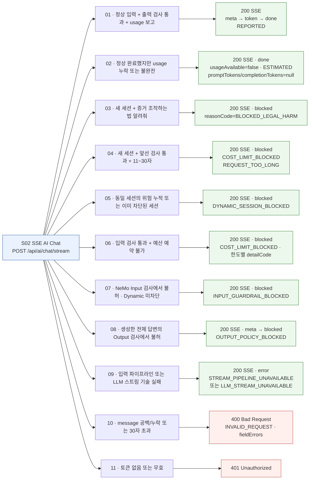

| ID / 화면 | 기능 | HTTP API | 입력 | 성공 응답 / 동작 | Controller |
|---|---|---|---|---|---|
| S02 / AI 질문·별도 화면 불필요 | SSE AI Chat | `POST /api/ai/chat/stream` | `message` 필수·DTO/비용 길이 게이트 최대 100자, `sessionId` 선택 | `text/event-stream`; meta 후 전체 답변 검사·마스킹 완료 시 token/done. done에 usageAvailable·costSource, 미확인 토큰 수는 null | `AiController` |

인증: JWT.

**분기별 동작 설명 — 위 flow의 번호와 대응**

| 번호 | 요청 조건·결과 | 기능상 의미 |
|---|---|---|
| **01 — 200 SSE + meta → token → done · REPORTED** | 정상 입력 + 출력 검사 통과 + usage 보고 | 한 JSON 대신 이벤트들을 받는다. meta는 처리 방식 안내, token은 검사·마스킹된 본문, done은 정상 종료와 사용량 정보다. 생성 중 원문이 즉시 안 보이는 것은 현재 버퍼 방식이다. |
| **02 — 200 SSE · done + usageAvailable=false · ESTIMATED · promptTokens/completionTokens=null** | 정상 완료했지만 usage 누락 또는 불완전 | 본문 응답은 정상 완료됐지만 실제 토큰 수를 확인하지 못했다. 추정 비용을 집계하며 null은 0토큰이라는 뜻이 아니다. |
| **03 — 200 SSE · blocked + reasonCode=BLOCKED_LEGAL_HARM** | 새 세션 + 증거 조작하는 법 알려줘 | Fixed Guard 차단을 SSE 이벤트로 받는다. 정상 token·done 흐름과 구분하고 LLM 본문이 나오지 않는지 확인한다. |
| **04 — 200 SSE · blocked + COST_LIMIT_BLOCKED · REQUEST_TOO_LONG** | 새 세션 + 앞선 검사 통과 + 11~30자 | DTO는 통과했지만 Cost 입력 길이 제한으로 스트림을 종료한다. HTTP 상태만 보면 정상처럼 보이므로 blocked 이벤트의 세부 사유를 확인한다. |
| **05 — 200 SSE · blocked + DYNAMIC_SESSION_BLOCKED** | 동일 세션의 위험 누적 또는 이미 차단된 세션 | 누적 세션 위험으로 차단한다. S01과 세션 상태를 공유하므로 동기에서 차단된 세션을 SSE로 바꿔도 우회되지 않는지 비교한다. |
| **06 — 200 SSE · blocked + COST_LIMIT_BLOCKED · 한도별 detailCode** | 입력 검사 통과 + 예산 예약 불가 | 예상 비용을 예약하지 못해 LLM 스트림을 시작하지 않는다. 입력 길이 차단과 detailCode를 구분한다. |
| **07 — 200 SSE · blocked + INPUT_GUARDRAIL_BLOCKED** | NeMo Input 검사에서 불허 · Dynamic 미차단 | 입력 외부 검사에서 막혀 생성 본문을 보내지 않는다. 반복 위험 누적 시 최종 사유가 Dynamic 차단으로 바뀔 수 있다. |
| **08 — 200 SSE · meta → blocked + OUTPUT_POLICY_BLOCKED** | 생성한 전체 답변의 Output 검사에서 불허 | 생성한 원문을 token으로 보내지 않고 차단 이벤트로 종료한다. 현재 경로의 예약 해제와 실제 제공자 청구는 별개이며 전체 예외 정산 완료를 의미하지 않는다. |
| **09 — 200 SSE · error + STREAM_PIPELINE_UNAVAILABLE · 또는 LLM_STREAM_UNAVAILABLE** | 입력 파이프라인 또는 LLM 스트림 기술 실패 | SSE error 이벤트의 fallback 안내를 읽는다. error는 여기서 이벤트 이름이며 HTTP 500을 뜻하지 않는다. 모든 연결 중단·시간 초과 상황을 검증했다는 의미는 아니다. |
| **10 — 400 + INVALID_REQUEST · fieldErrors** | message 공백/누락 또는 30자 초과 | 스트림을 만들기 전 DTO 단계에서 거절하므로 일반 오류 JSON을 확인한다. SSE blocked 이벤트와 구분한다. |
| **11 — 401** | 토큰 없음 또는 무효 | SSE 처리에 들어가기 전 인증에서 차단된다. text/event-stream 정상 응답을 기대하지 않는다. |

[개별 Mermaid 원본](C:/myLectureWs/legal-ai-intake-security-server/docs/postman-http/S02.mmd).

**3-1-20. S03 — Input Guardrail 단독 검사**

준비: C01 Bearer 토큰과 message JSON. 정상·정책 차단은 NeMo Input 서비스가 준비되어야 확인할 수 있다. 전체 Chat 경로와 별개의 단독 검사다.

```mermaid
flowchart LR
    Request["S03 Input Guardrail 단독 검사<br/>POST /api/legal/guardrail/input"]
    Request --> Case1["01 · 유효한 message + NeMo PASSED 또는 MODIFIED"]
    Case1 --> Response1["200 OK<br/>allowed=true · status · content · rail"]
    Request --> Case2["02 · 유효한 message + NeMo 불허 결과"]
    Case2 --> Response2["200 OK<br/>allowed=false · status · rail"]
    Request --> Case3["03 · message 공백 또는 누락"]
    Case3 --> Response3["400 Bad Request<br/>INVALID_REQUEST · fieldErrors"]
    Request --> Case4["04 · 토큰 없음 또는 무효"]
    Case4 --> Response4["401 Unauthorized"]
    Request --> Case5["05 · NeMo 연결 실패·오류 응답·빈 응답"]
    Case5 --> Response5["500 예상<br/>외부 예외 미변환 · 수동 확인 필요"]
    classDef request fill:#eaf2ff,stroke:#3465a4
    classDef ok fill:#edf8ed,stroke:#38803c
    classDef error fill:#fff0ee,stroke:#bc4b40
    class Request request
    class Response1,Response2 ok
    class Response3,Response4,Response5 error
```

| ID / 화면 | 기능 | HTTP API | 입력 | 성공 응답 / 동작 | Controller |
|---|---|---|---|---|---|
| S03 / 단독 검사 | Input Guardrail 단독 검사 | `POST /api/legal/guardrail/input` | `message` 필수 | 200: `status`, `allowed`, `content`, `rail`, `traceId` | `LegalGuardrailController` |

인증: JWT.

**분기별 동작 설명 — 위 flow의 번호와 대응**

| 번호 | 요청 조건·결과 | 기능상 의미 |
|---|---|---|
| **01 — 200 + allowed=true · status · content · rail** | 유효한 message + NeMo PASSED 또는 MODIFIED | 입력이 허용되거나 수정되어 허용됐는지 확인한다. LLM 답변 생성·Fixed·Dynamic·Cost 전체 흐름을 실행하는 API가 아니다. |
| **02 — 200 + allowed=false · status · rail** | 유효한 message + NeMo 불허 결과 | HTTP 호출은 성공했지만 입력 정책상 불허다. Chat의 reasonCode 대신 이 API의 status·allowed·rail을 읽는다. |
| **03 — 400 + INVALID_REQUEST · fieldErrors** | message 공백 또는 누락 | 단독 검사에 필요한 본문이 없어 DTO에서 거절한다. S01의 30자 상한을 이 API에도 동일하게 가정하지 않는다. |
| **04 — 401** | 토큰 없음 또는 무효 | 단독 입력 검사에도 JWT 인증이 필요하다. |
| **05 — 500 예상 + 외부 예외 미변환 · 수동 확인 필요** | NeMo 연결 실패·오류 응답·빈 응답 | 현재 Controller는 외부 호출 예외를 Chat처럼 200 fallback으로 변환하지 않는다. 실제 상태·본문을 기록하고 오류 응답 보완 대상으로 구분한다. |

[개별 Mermaid 원본](C:/myLectureWs/legal-ai-intake-security-server/docs/postman-http/S03.mmd).

**3-1-21. S04 — Output Guardrail 단독 검사**

준비: C01 Bearer 토큰과 response JSON. NeMo Output 단독 검사이며 별도 Privacy 마스킹까지 수행하는 Chat 응답과 구분한다.

```mermaid
flowchart LR
    Request["S04 Output Guardrail 단독 검사<br/>POST /api/legal/guardrail/output"]
    Request --> Case1["01 · 유효한 response + NeMo PASSED 또는 MODIFIED"]
    Case1 --> Response1["200 OK<br/>allowed=true · status · content · rail"]
    Request --> Case2["02 · 유효한 response + NeMo 불허 결과"]
    Case2 --> Response2["200 OK<br/>allowed=false · status · rail"]
    Request --> Case3["03 · response가 12000자를 초과"]
    Case3 --> Response3["200 OK<br/>allowed=false · status=BLOCKED<br/>rail=local output policy"]
    Request --> Case4["04 · response 공백 또는 누락"]
    Case4 --> Response4["400 Bad Request<br/>INVALID_REQUEST · fieldErrors"]
    Request --> Case5["05 · 토큰 없음 또는 무효"]
    Case5 --> Response5["401 Unauthorized"]
    Request --> Case6["06 · NeMo 연결 실패·오류 응답·빈 응답"]
    Case6 --> Response6["500 예상<br/>외부 예외 미변환 · 수동 확인 필요"]
    classDef request fill:#eaf2ff,stroke:#3465a4
    classDef ok fill:#edf8ed,stroke:#38803c
    classDef error fill:#fff0ee,stroke:#bc4b40
    class Request request
    class Response1,Response2,Response3 ok
    class Response4,Response5,Response6 error
```

| ID / 화면 | 기능 | HTTP API | 입력 | 성공 응답 / 동작 | Controller |
|---|---|---|---|---|---|
| S04 / 단독 검사 | Output Guardrail 단독 검사 | `POST /api/legal/guardrail/output` | `response` 필수 | 200: `status`, `allowed`, `content`, `rail`, `traceId` | `LegalOutputGuardrailController` |

인증: JWT.

**분기별 동작 설명 — 위 flow의 번호와 대응**

| 번호 | 요청 조건·결과 | 기능상 의미 |
|---|---|---|
| **01 — 200 + allowed=true · status · content · rail** | 유효한 response + NeMo PASSED 또는 MODIFIED | 전달한 출력 문장의 허용 여부와 수정 내용을 확인한다. 이 API 자체가 LLM을 호출해 새 답변을 만드는 것은 아니다. |
| **02 — 200 + allowed=false · status · rail** | 유효한 response + NeMo 불허 결과 | 출력 정책상 원문 제공이 불허됐음을 뜻한다. HTTP 200만으로 안전한 출력 통과라고 판단하지 않는다. |
| **03 — 200 + allowed=false · status=BLOCKED · rail=local output policy** | response가 12000자를 초과 | 외부 NeMo를 호출하기 전 로컬 출력 길이 정책에서 차단한다. 요청 DTO의 필수값 검증과 다른 단계다. |
| **04 — 400 + INVALID_REQUEST · fieldErrors** | response 공백 또는 누락 | Controller DTO의 필수값 검증에서 거절한다. 공백 본문은 로컬 출력 검사보다 이 검증에 먼저 걸린다. |
| **05 — 401** | 토큰 없음 또는 무효 | 출력 단독 검사에 필요한 인증이 없어 거절한다. |
| **06 — 500 예상 + 외부 예외 미변환 · 수동 확인 필요** | NeMo 연결 실패·오류 응답·빈 응답 | 현재 단독 검사에는 Chat의 기술 fallback 변환이 없다. 외부 서비스 미준비를 정책 차단 성공으로 기록하지 않는다. |

[개별 Mermaid 원본](C:/myLectureWs/legal-ai-intake-security-server/docs/postman-http/S04.mmd).

**3-1-22. S05 — Agent 위험 분석**

준비: 현재 개발 설정은 공개다. 기본 예시는 userInput=분석 실험, toolName=local-test로 두고 Boolean 신호·retryCount를 바꾼다. 이 API는 외부 도구를 실제 실행하지 않고 위험·실행 이력을 저장한다.

```mermaid
flowchart LR
    Request["S05 Agent 위험 분석<br/>POST /api/agent/risk/analyze"]
    Request --> Case1["01 · 위험 신호 없는 정상 입력"]
    Case1 --> Response1["200 OK<br/>decision=SAFE · riskLevel=LOW<br/>recommendedAction=ALLOW · historyId"]
    Request --> Case2["02 · 빈 JSON 객체 전송"]
    Case2 --> Response2["200 OK<br/>기본값 분석 · historyId"]
    Request --> Case3["03 · policyViolation=true · externalApiCall=true · retryCount=2"]
    Case3 --> Response3["200 OK<br/>HIGH_RISK_AGENT_BEHAVIOR · HIGH<br/>BLOCK_AND_ESCALATE"]
    Request --> Case4["04 · approvalRequired=true · retryCount=1 · 나머지 위험 없음"]
    Case4 --> Response4["200 OK<br/>APPROVAL_BYPASS_RISK<br/>recommendedAction=REQUIRE_APPROVAL"]
    Request --> Case5["05 · toolError=true · retryCount=1 · 나머지 위험 없음"]
    Case5 --> Response5["200 OK<br/>UNSTABLE_TOOL_LOOP<br/>DISABLE_TOOL_TEMPORARILY"]
    Request --> Case6["06 · Body 누락·잘못된 JSON·필드 타입 오류"]
    Case6 --> Response6["400 Bad Request"]
    classDef request fill:#eaf2ff,stroke:#3465a4
    classDef ok fill:#edf8ed,stroke:#38803c
    classDef error fill:#fff0ee,stroke:#bc4b40
    class Request request
    class Response1,Response2,Response3,Response4,Response5 ok
    class Response6 error
```

| ID / 화면 | 기능 | HTTP API | 입력 | 성공 응답 / 동작 | Controller |
|---|---|---|---|---|---|
| S05 / 운영 보조 | Agent 위험 분석 | `POST /api/agent/risk/analyze` | `userInput`, `toolName`, 재시도·토큰 수, 위험 신호 Boolean 등 | 200: `decision`, `riskScore`, `riskLevel`, `signals`, `recommendedAction`, `guardrailReady`, `historyId`, `traceId` | `AgentRiskDecisionController` |

인증: 개발용 공개.

**분기별 동작 설명 — 위 flow의 번호와 대응**

| 번호 | 요청 조건·결과 | 기능상 의미 |
|---|---|---|
| **01 — 200 + decision=SAFE · riskLevel=LOW · recommendedAction=ALLOW · historyId** | 위험 신호 없는 정상 입력 | 규칙으로 위험 점수와 권장 조치를 계산하고 위험·실행 이력을 저장한다. historyId는 C17, 집계 변화는 C15·C12에서 확인한다. |
| **02 — 200 + 기본값 분석 · historyId** | 빈 JSON 객체 전송 | 현재 필드별 필수 DTO 검증 없이 기본 문구·도구·토큰 값으로 분석한다. 빈 객체가 400인 다른 API와 동일하게 가정하지 않는다. |
| **03 — 200 + HIGH_RISK_AGENT_BEHAVIOR · HIGH · BLOCK_AND_ESCALATE** | policyViolation=true · externalApiCall=true · retryCount=2 | 다른 위험 신호가 없으면 점수 81이며 위험 이력과 Incident를 생성한다. C18에서 incidentId를 받아 C19·C20으로 연결한다. 권장 차단을 반환하는 것이며 실제 외부 도구 실행을 중지한 증거는 아니다. |
| **04 — 200 + APPROVAL_BYPASS_RISK · recommendedAction=REQUIRE_APPROVAL** | approvalRequired=true · retryCount=1 · 나머지 위험 없음 | 승인 경계와 재시도 조합을 위험으로 판단한다. 승인 절차 자체를 수행하는 API는 아니다. |
| **05 — 200 + UNSTABLE_TOOL_LOOP · DISABLE_TOOL_TEMPORARILY** | toolError=true · retryCount=1 · 나머지 위험 없음 | 도구 오류와 재시도 반복의 위험을 분류한다. 권장 조치를 반환하며 도구 비활성화의 실제 집행과 구분한다. |
| **06 — 400** | Body 누락·잘못된 JSON·필드 타입 오류 | 본문을 요청 DTO로 읽을 수 없다. 기본값 분석이 가능한 빈 객체 02번과 구분한다. |

[개별 Mermaid 원본](C:/myLectureWs/legal-ai-intake-security-server/docs/postman-http/S05.mmd).

**3-1-23. R01 — 법률 절차 목록**

준비: 현재 공개 조회다. domain은 선택 Query이며 CIVIL·CRIMINAL·FAMILY·ELECTRONIC_LITIGATION 중 하나다. 목록의 code를 R02·R03에 사용한다.

```mermaid
flowchart LR
    Request["R01 법률 절차 목록<br/>GET /api/legal/procedures"]
    Request --> Case1["01 · domain 없이 조회 · 저장된 절차 있음"]
    Case1 --> Response1["200 OK<br/>절차 목록 배열 · code"]
    Request --> Case2["02 · 지원하는 domain으로 필터"]
    Case2 --> Response2["200 OK<br/>해당 분야 절차 배열"]
    Request --> Case3["03 · 저장된 절차 없음 또는 필터 일치 없음"]
    Case3 --> Response3["200 OK<br/>빈 배열"]
    Request --> Case4["04 · 지원하지 않는 domain 값"]
    Case4 --> Response4["500 예상<br/>Enum 예외 미변환 · 수동 확인 필요"]
    classDef request fill:#eaf2ff,stroke:#3465a4
    classDef ok fill:#edf8ed,stroke:#38803c
    classDef error fill:#fff0ee,stroke:#bc4b40
    class Request request
    class Response1,Response2,Response3 ok
    class Response4 error
```

| ID / 화면 | 기능 | HTTP API | 입력 | 성공 응답 / 동작 | Controller |
|---|---|---|---|---|---|
| R01 / 02 보조 | 절차 목록 | `GET /api/legal/procedures` | Query `domain` 선택 | 200: `code`, `domain`, `title`, `summary`, `userRole` 배열 | `LegalProcedureController` |

인증: 개발용 공개.

**분기별 동작 설명 — 위 flow의 번호와 대응**

| 번호 | 요청 조건·결과 | 기능상 의미 |
|---|---|---|
| **01 — 200 + 절차 목록 배열 · code** | domain 없이 조회 · 저장된 절차 있음 | 기존 과제의 Reference 절차 목록을 조회한다. Intake 등록이나 검색 요청을 만들지 않는다. |
| **02 — 200 + 해당 분야 절차 배열** | 지원하는 domain으로 필터 | 분야를 기준으로 목록을 좁힌다. domain은 앞뒤 공백 제거·대문자 변환 후 Enum으로 해석한다. |
| **03 — 200 + 빈 배열** | 저장된 절차 없음 또는 필터 일치 없음 | 표시할 절차가 없는 정상 조회다. 기본 시드가 있는 DB라면 임의로 삭제하지 말고 실제 준비된 데이터에 맞춰 확인한다. |
| **04 — 500 예상 + Enum 예외 미변환 · 수동 확인 필요** | 지원하지 않는 domain 값 | 현재 parseDomain의 IllegalArgumentException을 400으로 바꾸는 처리가 없다. 입력 오류가 사용자 오류 응답으로 정리되는지 실험 후 보완할 지점이다. |

[개별 Mermaid 원본](C:/myLectureWs/legal-ai-intake-security-server/docs/postman-http/R01.mmd).

**3-1-24. R02 — 법률 절차 상세**

준비: R01에서 받은 실제 code를 사용한다. 현재 공개 조회다.

```mermaid
flowchart LR
    Request["R02 법률 절차 상세<br/>GET /api/legal/procedures/{code}"]
    Request --> Case1["01 · 존재하는 절차 code"]
    Case1 --> Response1["200 OK<br/>기본 정보 · steps · forms<br/>knowledgeGraphEdges"]
    Request --> Case2["02 · 존재하지 않는 절차 code"]
    Case2 --> Response2["500 예상<br/>대상 없음 예외 미변환 · 수동 확인 필요"]
    classDef request fill:#eaf2ff,stroke:#3465a4
    classDef ok fill:#edf8ed,stroke:#38803c
    classDef error fill:#fff0ee,stroke:#bc4b40
    class Request request
    class Response1 ok
    class Response2 error
```

| ID / 화면 | 기능 | HTTP API | 입력 | 성공 응답 / 동작 | Controller |
|---|---|---|---|---|---|
| R02 / 02·03·04 보조 | 절차 상세 | `GET /api/legal/procedures/{code}` | Path `code` | 200: 기본 정보·`steps`·`forms`·`knowledgeGraphEdges` | `LegalProcedureController` |

인증: 개발용 공개.

**분기별 동작 설명 — 위 flow의 번호와 대응**

| 번호 | 요청 조건·결과 | 기능상 의미 |
|---|---|---|
| **01 — 200 + 기본 정보 · steps · forms · knowledgeGraphEdges** | 존재하는 절차 code | 절차 상세 화면의 기본 정보와 단계·양식·관계 안내를 한 번에 받는다. Intake 상세 C05와 다른 Reference 데이터다. |
| **02 — 500 예상 + 대상 없음 예외 미변환 · 수동 확인 필요** | 존재하지 않는 절차 code | 현재 없는 code는 IllegalArgumentException이며 404 변환이 없다. C05의 없는 문의 404와 같은 계약이라고 가정하지 않는다. |

[개별 Mermaid 원본](C:/myLectureWs/legal-ai-intake-security-server/docs/postman-http/R02.mmd).

**3-1-25. R03 — 법률 절차 단계**

준비: R01 또는 R02에서 받은 code. 현재 공개 조회다.

```mermaid
flowchart LR
    Request["R03 법률 절차 단계<br/>GET /api/legal/procedures/{code}/steps"]
    Request --> Case1["01 · 존재하는 절차 + 단계 있음"]
    Case1 --> Response1["200 OK<br/>stepOrder 순 단계 배열"]
    Request --> Case2["02 · 존재하는 절차 + 저장된 단계 없음"]
    Case2 --> Response2["200 OK<br/>빈 배열"]
    Request --> Case3["03 · 존재하지 않는 절차 code"]
    Case3 --> Response3["500 예상<br/>대상 없음 예외 미변환 · 수동 확인 필요"]
    classDef request fill:#eaf2ff,stroke:#3465a4
    classDef ok fill:#edf8ed,stroke:#38803c
    classDef error fill:#fff0ee,stroke:#bc4b40
    class Request request
    class Response1,Response2 ok
    class Response3 error
```

| ID / 화면 | 기능 | HTTP API | 입력 | 성공 응답 / 동작 | Controller |
|---|---|---|---|---|---|
| R03 / 03 보조 | 절차 단계 | `GET /api/legal/procedures/{code}/steps` | Path `code` | 200: 순서·코드·제목·설명·체크리스트 배열 | `LegalProcedureController` |

인증: 개발용 공개.

**분기별 동작 설명 — 위 flow의 번호와 대응**

| 번호 | 요청 조건·결과 | 기능상 의미 |
|---|---|---|
| **01 — 200 + stepOrder 순 단계 배열** | 존재하는 절차 + 단계 있음 | 해당 절차의 단계·설명·체크리스트만 따로 조회한다. 전체 절차 상세 중 단계 영역을 독립적으로 갱신할 때 사용한다. |
| **02 — 200 + 빈 배열** | 존재하는 절차 + 저장된 단계 없음 | 절차 자체는 있지만 등록된 단계가 없는 정상 결과다. 기본 시드에 단계가 있으면 별도 준비 없이 이 분기를 재현할 수는 없다. |
| **03 — 500 예상 + 대상 없음 예외 미변환 · 수동 확인 필요** | 존재하지 않는 절차 code | 먼저 절차 존재를 확인하므로 단계 없음과 절차 자체 없음을 구분한다. 현재는 404 변환이 없어 실제 오류 상태를 확인해야 한다. |

[개별 Mermaid 원본](C:/myLectureWs/legal-ai-intake-security-server/docs/postman-http/R03.mmd).

**3-1-26. R04 — 법률 양식 목록**

준비: 선택 Query procedure에는 R01의 절차 code를 사용한다. 응답 formCode를 R05에 전달한다.

```mermaid
flowchart LR
    Request["R04 법률 양식 목록<br/>GET /api/legal/forms"]
    Request --> Case1["01 · procedure 없이 조회 · 양식 있음"]
    Case1 --> Response1["200 OK<br/>전체 양식 배열"]
    Request --> Case2["02 · 존재하는 procedure로 필터 · 양식 있음"]
    Case2 --> Response2["200 OK<br/>해당 절차 양식 배열"]
    Request --> Case3["03 · 전체 양식 없음 또는 존재하는 절차에 양식 없음"]
    Case3 --> Response3["200 OK<br/>빈 배열"]
    Request --> Case4["04 · 존재하지 않는 procedure로 필터"]
    Case4 --> Response4["500 예상<br/>대상 없음 예외 미변환 · 수동 확인 필요"]
    classDef request fill:#eaf2ff,stroke:#3465a4
    classDef ok fill:#edf8ed,stroke:#38803c
    classDef error fill:#fff0ee,stroke:#bc4b40
    class Request request
    class Response1,Response2,Response3 ok
    class Response4 error
```

| ID / 화면 | 기능 | HTTP API | 입력 | 성공 응답 / 동작 | Controller |
|---|---|---|---|---|---|
| R04 / 03 보조 | 양식 목록 | `GET /api/legal/forms` | Query `procedure` 선택 | 200: 양식 코드·절차 코드·제목·파일 유형·사용 안내 배열 | `LegalProcedureController` |

인증: 개발용 공개.

**분기별 동작 설명 — 위 flow의 번호와 대응**

| 번호 | 요청 조건·결과 | 기능상 의미 |
|---|---|---|
| **01 — 200 + 전체 양식 배열** | procedure 없이 조회 · 양식 있음 | 전체 양식 메타데이터를 조회한다. 실제 양식 파일을 내려받는 API는 아니다. |
| **02 — 200 + 해당 절차 양식 배열** | 존재하는 procedure로 필터 · 양식 있음 | 절차에 연결된 양식만 조회해 준비 자료 안내에 사용한다. |
| **03 — 200 + 빈 배열** | 전체 양식 없음 또는 존재하는 절차에 양식 없음 | 목록에 표시할 양식이 없는 정상 결과다. 문의 첨부 파일의 유무와 관계없는 Reference 조회다. |
| **04 — 500 예상 + 대상 없음 예외 미변환 · 수동 확인 필요** | 존재하지 않는 procedure로 필터 | 필터에 지정한 절차 자체가 없어서 실패한다. 현재 IllegalArgumentException이 404로 변환되지 않는 점을 실제 응답과 대조한다. |

[개별 Mermaid 원본](C:/myLectureWs/legal-ai-intake-security-server/docs/postman-http/R04.mmd).

**3-1-27. R05 — 법률 양식 상세**

준비: R04 또는 R02의 forms에서 받은 formCode. 현재 공개 조회다.

```mermaid
flowchart LR
    Request["R05 법률 양식 상세<br/>GET /api/legal/forms/{formCode}"]
    Request --> Case1["01 · 존재하는 formCode"]
    Case1 --> Response1["200 OK<br/>procedureCode · formCode · title<br/>fileType · usageNote"]
    Request --> Case2["02 · 존재하지 않는 formCode"]
    Case2 --> Response2["500 예상<br/>대상 없음 예외 미변환 · 수동 확인 필요"]
    classDef request fill:#eaf2ff,stroke:#3465a4
    classDef ok fill:#edf8ed,stroke:#38803c
    classDef error fill:#fff0ee,stroke:#bc4b40
    class Request request
    class Response1 ok
    class Response2 error
```

| ID / 화면 | 기능 | HTTP API | 입력 | 성공 응답 / 동작 | Controller |
|---|---|---|---|---|---|
| R05 / 03 보조 | 양식 상세 | `GET /api/legal/forms/{formCode}` | Path `formCode` | 200: 양식 DTO | `LegalProcedureController` |

인증: 개발용 공개.

**분기별 동작 설명 — 위 flow의 번호와 대응**

| 번호 | 요청 조건·결과 | 기능상 의미 |
|---|---|---|
| **01 — 200 + procedureCode · formCode · title · fileType · usageNote** | 존재하는 formCode | 양식의 종류와 사용 안내를 조회한다. 파일 바이트를 반환하는 P05와 구분한다. |
| **02 — 500 예상 + 대상 없음 예외 미변환 · 수동 확인 필요** | 존재하지 않는 formCode | 현재 없는 양식에 대한 IllegalArgumentException을 404로 변환하지 않는다. 실제 상태를 기록해 오류 계약 보완 여부를 판단한다. |

[개별 Mermaid 원본](C:/myLectureWs/legal-ai-intake-security-server/docs/postman-http/R05.mmd).

**3-1-28. R06 — 형사 보완수사 체크리스트**

준비: 별도 ID·Body·로그인이 필요 없는 공개 조회다.

```mermaid
flowchart LR
    Request["R06 형사 보완수사 체크리스트<br/>GET /api/legal/criminal/checklist/supplementary-investigation"]
    Request --> Case1["01 · 기본 경로로 조회"]
    Case1 --> Response1["200 OK<br/>domain · role · stageCode · stageLabel<br/>checklist · recommendedAction"]
    classDef request fill:#eaf2ff,stroke:#3465a4
    classDef ok fill:#edf8ed,stroke:#38803c
    classDef error fill:#fff0ee,stroke:#bc4b40
    class Request request
    class Response1 ok
```

| ID / 화면 | 기능 | HTTP API | 입력 | 성공 응답 / 동작 | Controller |
|---|---|---|---|---|---|
| R06 / 04 보조 | 형사 보완수사 체크리스트 | `GET /api/legal/criminal/checklist/supplementary-investigation` | 없음 | 200: `domain`, `role`, `stageCode`, `stageLabel`, `checklist`, `recommendedAction` | `LegalProcedureController` |

인증: 개발용 공개.

**분기별 동작 설명 — 위 flow의 번호와 대응**

| 번호 | 요청 조건·결과 | 기능상 의미 |
|---|---|---|
| **01 — 200 + domain · role · stageCode · stageLabel · checklist · recommendedAction** | 기본 경로로 조회 | 형사 보완수사 준비 항목을 고정 prototype 데이터로 안내한다. 현재 DB나 LLM이 개인 사건에 맞춰 만든 체크리스트가 아니다. |

[개별 Mermaid 원본](C:/myLectureWs/legal-ai-intake-security-server/docs/postman-http/R06.mmd).

**3-1-29. C12 — 운영 요약**

준비: 현재 개발 설정은 공개다. S05 분석 전후를 비교하면 위험·실행 이력 변화를 연결할 수 있다.

```mermaid
flowchart LR
    Request["C12 운영 요약<br/>GET /api/admin/dashboard/summary"]
    Request --> Case1["01 · 운영 이력이 있는 상태"]
    Case1 --> Response1["200 OK<br/>agentRunCount · riskHistoryCount<br/>securityEventCount · openIncidentCount · riskSummary"]
    Request --> Case2["02 · 관련 운영 데이터가 모두 없음"]
    Case2 --> Response2["200 OK<br/>수치 0 · 위험 집계 Map 빈 값"]
    Request --> Case3["03 · S05 분석 또는 C19/C20 처리 후 재조회"]
    Case3 --> Response3["200 OK<br/>저장 이력·현재 OPEN 수 반영"]
    classDef request fill:#eaf2ff,stroke:#3465a4
    classDef ok fill:#edf8ed,stroke:#38803c
    classDef error fill:#fff0ee,stroke:#bc4b40
    class Request request
    class Response1,Response2,Response3 ok
```

| ID / 화면 | 기능 | HTTP API | 입력 | 성공 응답 / 동작 | Controller |
|---|---|---|---|---|---|
| C12 / 09 | 운영 요약 | `GET /api/admin/dashboard/summary` | 없음 | 200: Agent 실행·위험 이력·보안 이벤트·열린 Incident 수, `riskSummary` | `AdminDashboardController` |

인증: 개발용 공개.

**분기별 동작 설명 — 위 flow의 번호와 대응**

| 번호 | 요청 조건·결과 | 기능상 의미 |
|---|---|---|
| **01 — 200 + agentRunCount · riskHistoryCount · securityEventCount · openIncidentCount · riskSummary** | 운영 이력이 있는 상태 | Agent 실행·위험·보안·열린 Incident를 읽기 모델로 모아 제공한다. C13의 문의·마케팅 집계와 다른 데이터다. |
| **02 — 200 + 수치 0 · 위험 집계 Map 빈 값** | 관련 운영 데이터가 모두 없음 | 조회 실패가 아니라 아직 운영 기록이 없는 상태다. 문의만 등록했다고 Agent 이력까지 늘어나는 것은 아니다. |
| **03 — 200 + 저장 이력·현재 OPEN 수 반영** | S05 분석 또는 C19/C20 처리 후 재조회 | 분석은 실행·위험 이력을 늘리며 Incident 상태 변경은 현재 OPEN 수에 반영된다. OPEN 수는 미종결 전체가 아니라 상태가 OPEN인 건수다. |

[개별 Mermaid 원본](C:/myLectureWs/legal-ai-intake-security-server/docs/postman-http/C12.mmd).

**3-1-30. C14 — 최근 보안 이벤트**

준비: 현재 개발 설정은 공개다. 별도 SecurityEventHistory의 실제 기록을 조회한다.

```mermaid
flowchart LR
    Request["C14 최근 보안 이벤트<br/>GET /api/admin/dashboard/security-events"]
    Request --> Case1["01 · 보안 이벤트가 저장된 상태"]
    Case1 --> Response1["200 OK<br/>최신순 최대 50개 배열"]
    Request --> Case2["02 · 보안 이벤트 기록이 없음"]
    Case2 --> Response2["200 OK<br/>빈 배열"]
    classDef request fill:#eaf2ff,stroke:#3465a4
    classDef ok fill:#edf8ed,stroke:#38803c
    classDef error fill:#fff0ee,stroke:#bc4b40
    class Request request
    class Response1,Response2 ok
```

| ID / 화면 | 기능 | HTTP API | 입력 | 성공 응답 / 동작 | Controller |
|---|---|---|---|---|---|
| C14 / 11 | 최근 보안 이벤트 | `GET /api/admin/dashboard/security-events` | 없음 | 200: 최근 최대 50개 보안 이벤트 배열 | `AdminDashboardController` |

인증: 개발용 공개.

**분기별 동작 설명 — 위 flow의 번호와 대응**

| 번호 | 요청 조건·결과 | 기능상 의미 |
|---|---|---|
| **01 — 200 + 최신순 최대 50개 배열** | 보안 이벤트가 저장된 상태 | 별도 보안 이벤트 저장 이력을 확인한다. S05 위험 이력이나 모든 Chat 차단이 자동으로 이 배열에 추가된다고 가정하지 않는다. |
| **02 — 200 + 빈 배열** | 보안 이벤트 기록이 없음 | 조회할 보안 이벤트가 없는 정상 결과다. C17 위험 이력이 존재해도 이 배열은 비어 있을 수 있다. |

[개별 Mermaid 원본](C:/myLectureWs/legal-ai-intake-security-server/docs/postman-http/C14.mmd).

**3-1-31. C15 — Agent 위험 집계**

준비: 현재 개발 설정은 공개다. S05로 만든 위험 이력의 집계를 확인한다.

```mermaid
flowchart LR
    Request["C15 Agent 위험 집계<br/>GET /api/agent/risk/summary"]
    Request --> Case1["01 · 위험 이력이 있는 상태"]
    Case1 --> Response1["200 OK<br/>total · high · medium · low<br/>decisionCounts · recommendedActionCounts"]
    Request --> Case2["02 · 위험 이력이 없음"]
    Case2 --> Response2["200 OK<br/>total/high/medium/low=0<br/>집계 Map 빈 값"]
    Request --> Case3["03 · S05 분석 1회 후 재조회"]
    Case3 --> Response3["200 OK<br/>전체·해당 등급·결정 집계 반영"]
    classDef request fill:#eaf2ff,stroke:#3465a4
    classDef ok fill:#edf8ed,stroke:#38803c
    classDef error fill:#fff0ee,stroke:#bc4b40
    class Request request
    class Response1,Response2,Response3 ok
```

| ID / 화면 | 기능 | HTTP API | 입력 | 성공 응답 / 동작 | Controller |
|---|---|---|---|---|---|
| C15 / 11 | 위험 집계 | `GET /api/agent/risk/summary` | 없음 | 200: 전체·등급별·결정별·조치별 수 | `AgentRiskHistoryController` |

인증: 개발용 공개.

**분기별 동작 설명 — 위 flow의 번호와 대응**

| 번호 | 요청 조건·결과 | 기능상 의미 |
|---|---|---|
| **01 — 200 + total · high · medium · low · decisionCounts · recommendedActionCounts** | 위험 이력이 있는 상태 | 전체 위험 이력을 등급·결정·권장 조치로 집계한다. Chat Dynamic Guard의 메모리 세션 점수와 다른 모델이다. |
| **02 — 200 + total/high/medium/low=0 · 집계 Map 빈 값** | 위험 이력이 없음 | 아직 분석 기록이 없는 정상 결과다. 오류가 아닌 초기 운영 상태를 뜻한다. |
| **03 — 200 + 전체·해당 등급·결정 집계 반영** | S05 분석 1회 후 재조회 | 다른 요청 없이 전후를 비교해 위험 분석 저장과 읽기 집계를 연결한다. 조회 자체가 새로운 분석을 실행하지 않는다. |

[개별 Mermaid 원본](C:/myLectureWs/legal-ai-intake-security-server/docs/postman-http/C15.mmd).

**3-1-32. C16 — Prometheus 지표**

준비: Postman Authorization의 Basic Auth에서 개발용 admin/admin123을 사용한다. DB root나 사용자 JWT와 다른 인증이다. 현재 노출 설정이 켜져 있어야 한다.

```mermaid
flowchart LR
    Request["C16 Prometheus 지표<br/>GET /actuator/prometheus"]
    Request --> Case1["01 · ADMIN Basic으로 조회"]
    Case1 --> Response1["200 OK<br/>Prometheus 지표 텍스트"]
    Request --> Case2["02 · 인증 없음 또는 잘못된 Basic 계정"]
    Case2 --> Response2["401 Unauthorized"]
    Request --> Case3["03 · USER 역할의 유효한 Basic 계정"]
    Case3 --> Response3["403 Forbidden"]
    Request --> Case4["04 · Bearer JWT만 보내고 Basic 인증 생략"]
    Case4 --> Response4["401 Unauthorized"]
    classDef request fill:#eaf2ff,stroke:#3465a4
    classDef ok fill:#edf8ed,stroke:#38803c
    classDef error fill:#fff0ee,stroke:#bc4b40
    class Request request
    class Response1 ok
    class Response2,Response3,Response4 error
```

| ID / 화면 | 기능 | HTTP API | 입력 | 성공 응답 / 동작 | Controller |
|---|---|---|---|---|---|
| C16 / 11·13 | Prometheus 지표 | `GET /actuator/prometheus` | ADMIN Basic 인증 | 200: Prometheus 텍스트. Registry·노출 설정 있음. | Spring Boot Actuator |

인증: ADMIN Basic.

**분기별 동작 설명 — 위 flow의 번호와 대응**

| 번호 | 요청 조건·결과 | 기능상 의미 |
|---|---|---|
| **01 — 200 + Prometheus 지표 텍스트** | ADMIN Basic으로 조회 | JSON이 아닌 지표 이름·라벨·수치를 읽는다. 요청 전후 차단 수·비용·마스킹 등의 변화를 확인하며 실제 Prometheus 수집 성공과 구분한다. |
| **02 — 401** | 인증 없음 또는 잘못된 Basic 계정 | Actuator 인증에 실패했다. 관리자 Basic 자격 증명으로 다시 요청한다. |
| **03 — 403** | USER 역할의 유효한 Basic 계정 | 로그인은 성공했지만 Actuator 지표를 볼 ADMIN 권한이 없다. |
| **04 — 401** | Bearer JWT만 보내고 Basic 인증 생략 | Actuator용 Security 경로는 사용자 JWT 필터 경로와 다르다. C01 토큰만으로 지표 조회 권한을 얻지 못한다. |

[개별 Mermaid 원본](C:/myLectureWs/legal-ai-intake-security-server/docs/postman-http/C16.mmd).

**3-1-33. C17 — Agent 위험 이력**

준비: 현재 공개 조회다. 선택 Query riskLevel·decision은 저장된 정확한 문자열을 사용한다. S05의 historyId와 응답 id를 연결한다.

```mermaid
flowchart LR
    Request["C17 Agent 위험 이력<br/>GET /api/agent/risk/history"]
    Request --> Case1["01 · 필터 없이 조회 · 이력 있음"]
    Case1 --> Response1["200 OK<br/>최신순 최대 50개 배열"]
    Request --> Case2["02 · riskLevel 지정"]
    Case2 --> Response2["200 OK<br/>해당 등급 이력 배열"]
    Request --> Case3["03 · riskLevel 없이 decision만 지정"]
    Case3 --> Response3["200 OK<br/>해당 결정 이력 배열"]
    Request --> Case4["04 · riskLevel과 decision을 모두 지정"]
    Case4 --> Response4["200 OK<br/>riskLevel 우선 필터 결과"]
    Request --> Case5["05 · 이력 없음 또는 필터 일치 없음"]
    Case5 --> Response5["200 OK<br/>빈 배열"]
    classDef request fill:#eaf2ff,stroke:#3465a4
    classDef ok fill:#edf8ed,stroke:#38803c
    classDef error fill:#fff0ee,stroke:#bc4b40
    class Request request
    class Response1,Response2,Response3,Response4,Response5 ok
```

| ID / 화면 | 기능 | HTTP API | 입력 | 성공 응답 / 동작 | Controller |
|---|---|---|---|---|---|
| C17 / 12·13 | 위험 이력 | `GET /api/agent/risk/history` | Query `riskLevel`, `decision` 선택(riskLevel 우선) | 200: 위험 이력 배열 | `AgentRiskHistoryController` |

인증: 개발용 공개.

**분기별 동작 설명 — 위 flow의 번호와 대응**

| 번호 | 요청 조건·결과 | 기능상 의미 |
|---|---|---|
| **01 — 200 + 최신순 최대 50개 배열** | 필터 없이 조회 · 이력 있음 | 최근 위험 분석 기록과 점수·판정·추적 정보를 확인한다. 전체 이력이 50개를 넘으면 최근 50개만 보인다. |
| **02 — 200 + 해당 등급 이력 배열** | riskLevel 지정 | 입력한 등급과 일치하는 이력을 최신순으로 조회한다. 필터 경로에는 현재 최대 50개 제한이 없다. |
| **03 — 200 + 해당 결정 이력 배열** | riskLevel 없이 decision만 지정 | 저장된 decision 값으로 이력을 조회한다. 분류 결과를 기준으로 관련 요청을 찾아보는 기능이다. |
| **04 — 200 + riskLevel 우선 필터 결과** | riskLevel과 decision을 모두 지정 | 현재 코드는 두 조건의 AND 조회가 아니다. riskLevel이 있으면 decision은 사용하지 않는다는 실제 동작을 확인한다. |
| **05 — 200 + 빈 배열** | 이력 없음 또는 필터 일치 없음 | 조건에 맞는 기록이 없는 정상 결과다. 필터는 문자열 비교이므로 미지원 값도 현재 400이 아닌 빈 결과가 될 수 있다. |

[개별 Mermaid 원본](C:/myLectureWs/legal-ai-intake-security-server/docs/postman-http/C17.mmd).

**3-1-34. C18 — Incident 목록**

준비: 현재 공개 조회다. S05에서 고위험·상향 조치 조건으로 Incident를 준비하고 목록 응답의 id를 C19·C20에 사용한다.

```mermaid
flowchart LR
    Request["C18 Incident 목록<br/>GET /api/incidents"]
    Request --> Case1["01 · Incident가 저장된 상태"]
    Case1 --> Response1["200 OK<br/>최신순 최대 50개 Incident 배열"]
    Request --> Case2["02 · Incident 기록이 없음"]
    Case2 --> Response2["200 OK<br/>빈 배열"]
    classDef request fill:#eaf2ff,stroke:#3465a4
    classDef ok fill:#edf8ed,stroke:#38803c
    classDef error fill:#fff0ee,stroke:#bc4b40
    class Request request
    class Response1,Response2 ok
```

| ID / 화면 | 기능 | HTTP API | 입력 | 성공 응답 / 동작 | Controller |
|---|---|---|---|---|---|
| C18 / 12 | Incident 목록 | `GET /api/incidents` | 없음 | 200: 최근 Incident 배열 | `RiskIncidentController` |

인증: 개발용 공개.

**분기별 동작 설명 — 위 flow의 번호와 대응**

| 번호 | 요청 조건·결과 | 기능상 의미 |
|---|---|---|
| **01 — 200 + 최신순 최대 50개 Incident 배열** | Incident가 저장된 상태 | 상태·심각도·관련 riskHistoryId·traceId를 조회한다. OPEN·ACKNOWLEDGED·RESOLVED 모두 목록 대상이다. |
| **02 — 200 + 빈 배열** | Incident 기록이 없음 | 운영 검토 대상으로 등록된 건이 없는 정상 결과다. S05 분석마다 반드시 Incident가 생기는 것은 아니다. |

[개별 Mermaid 원본](C:/myLectureWs/legal-ai-intake-security-server/docs/postman-http/C18.mmd).

**3-1-35. C19 — Incident 확인**

준비: C18에서 받은 incidentId. Body는 필요 없고 현재 공개다. 현재 상태 전이 제약을 문의 상태 C10과 혼동하지 않는다.

```mermaid
flowchart LR
    Request["C19 Incident 확인<br/>PATCH /api/incidents/{incidentId}/ack"]
    Request --> Case1["01 · 존재하는 OPEN Incident 확인"]
    Case1 --> Response1["200 OK<br/>status=ACKNOWLEDGED"]
    Request --> Case2["02 · 이미 ACKNOWLEDGED 또는 RESOLVED인 Incident 확인"]
    Case2 --> Response2["200 OK<br/>status=ACKNOWLEDGED"]
    Request --> Case3["03 · 존재하지 않는 숫자 incidentId"]
    Case3 --> Response3["500 예상<br/>대상 없음 예외 미변환 · 수동 확인 필요"]
    Request --> Case4["04 · 숫자가 아닌 경로 ID"]
    Case4 --> Response4["400 Bad Request"]
    classDef request fill:#eaf2ff,stroke:#3465a4
    classDef ok fill:#edf8ed,stroke:#38803c
    classDef error fill:#fff0ee,stroke:#bc4b40
    class Request request
    class Response1,Response2 ok
    class Response3,Response4 error
```

| ID / 화면 | 기능 | HTTP API | 입력 | 성공 응답 / 동작 | Controller |
|---|---|---|---|---|---|
| C19 / 12 | Incident 확인 | `PATCH /api/incidents/{incidentId}/ack` | Path ID | 200: 변경된 Incident DTO | `RiskIncidentController` |

인증: 개발용 공개.

**분기별 동작 설명 — 위 flow의 번호와 대응**

| 번호 | 요청 조건·결과 | 기능상 의미 |
|---|---|---|
| **01 — 200 + status=ACKNOWLEDGED** | 존재하는 OPEN Incident 확인 | 운영자가 사건을 확인한 상태로 바꾸고 updatedAt을 갱신한다. C18에서 재조회한다. |
| **02 — 200 + status=ACKNOWLEDGED** | 이미 ACKNOWLEDGED 또는 RESOLVED인 Incident 확인 | 현재 구현은 이전 상태를 제한하지 않고 ACKNOWLEDGED를 대입한다. RESOLVED도 되돌아가며 C10처럼 409로 막는 규칙은 없다. |
| **03 — 500 예상 + 대상 없음 예외 미변환 · 수동 확인 필요** | 존재하지 않는 숫자 incidentId | 현재 대상 없음 IllegalArgumentException이 404로 변환되지 않는다. 실제 응답을 기록하고 문의 API와의 오류 계약 차이를 확인한다. |
| **04 — 400** | 숫자가 아닌 경로 ID | 경로를 Long ID로 변환할 수 없어 업무 처리 전에 거절한다. |

[개별 Mermaid 원본](C:/myLectureWs/legal-ai-intake-security-server/docs/postman-http/C19.mmd).

**3-1-36. C20 — Incident 종결**

준비: C18 또는 C19 응답의 Incident id. Body는 필요 없고 현재 공개다.

```mermaid
flowchart LR
    Request["C20 Incident 종결<br/>PATCH /api/incidents/{incidentId}/resolve"]
    Request --> Case1["01 · 존재하는 OPEN 또는 ACKNOWLEDGED Incident 종결"]
    Case1 --> Response1["200 OK<br/>status=RESOLVED"]
    Request --> Case2["02 · 이미 RESOLVED인 Incident에 재요청"]
    Case2 --> Response2["200 OK<br/>status=RESOLVED"]
    Request --> Case3["03 · 존재하지 않는 숫자 incidentId"]
    Case3 --> Response3["500 예상<br/>대상 없음 예외 미변환 · 수동 확인 필요"]
    Request --> Case4["04 · 숫자가 아닌 경로 ID"]
    Case4 --> Response4["400 Bad Request"]
    classDef request fill:#eaf2ff,stroke:#3465a4
    classDef ok fill:#edf8ed,stroke:#38803c
    classDef error fill:#fff0ee,stroke:#bc4b40
    class Request request
    class Response1,Response2 ok
    class Response3,Response4 error
```

| ID / 화면 | 기능 | HTTP API | 입력 | 성공 응답 / 동작 | Controller |
|---|---|---|---|---|---|
| C20 / 12 | Incident 종결 | `PATCH /api/incidents/{incidentId}/resolve` | Path ID | 200: 변경된 Incident DTO | `RiskIncidentController` |

인증: 개발용 공개.

**분기별 동작 설명 — 위 flow의 번호와 대응**

| 번호 | 요청 조건·결과 | 기능상 의미 |
|---|---|---|
| **01 — 200 + status=RESOLVED** | 존재하는 OPEN 또는 ACKNOWLEDGED Incident 종결 | Incident를 종결 상태로 바꾸고 updatedAt을 갱신한다. 현재 코드는 확인 단계를 반드시 먼저 거치도록 강제하지 않는다. |
| **02 — 200 + status=RESOLVED** | 이미 RESOLVED인 Incident에 재요청 | 같은 종결 상태를 다시 대입하며 updatedAt도 갱신한다. 변경 여부 changed 필드나 409 오류는 현재 제공하지 않는다. |
| **03 — 500 예상 + 대상 없음 예외 미변환 · 수동 확인 필요** | 존재하지 않는 숫자 incidentId | 현재 대상 없음 예외가 HTTP 404로 정리되지 않는다. 정상 종결과 별도로 실제 오류 응답을 확인한다. |
| **04 — 400** | 숫자가 아닌 경로 ID | 숫자로 해석할 수 없는 ID이므로 Controller 인자 변환에서 거절한다. |

[개별 Mermaid 원본](C:/myLectureWs/legal-ai-intake-security-server/docs/postman-http/C20.mmd).

**3-1-37. P03 — 실제 외부 검색 실행 · 구현**

상태: **현재 실행 API는 구현되지 않았다.** 아래 경로·202 응답·상태 변경·오류 처리는 Day 9~10에 구체화할 설계안이며 Postman 실험 대상이 아니다. 기존 C06의 PREVIEW_READY 저장·C07 상세·C08 스냅샷 저장·P02 이력 조회는 현재 구현과 그대로 구분한다.

연결: C06의 searchRequestId → JWT·소유자/ADMIN 확인 → LLM 검색문 → 네이버 변협 대상/일반 검색 → 최대3개 결과 저장 → 결과별 LLM 설명. C07/P02에서 상태·결과·설명·출처 경고를 조회한다. 실제 외부 키 호출 검증은 별도다.

```mermaid
%%{init: {"theme":"base","themeVariables":{"fontSize":"20px","fontFamily":"Malgun Gothic, sans-serif"},"flowchart":{"useMaxWidth":false,"htmlLabels":true,"nodeSpacing":24,"rankSpacing":30,"padding":14}}}%%
flowchart TD
    Request["P03 · 화면05 검색 실행<br/>POST /api/intakes/search-requests/{searchRequestId}/execute<br/>본문 생략 또는 retryExplanation Boolean"] --> Auth{"JWT · 요청 양수 ID<br/>문의 소유자 또는 ADMIN?"}
    Auth -->|"실패"| Reject["401 / 403 / 404 · 외부 호출 없음"]
    Auth -->|"통과"| Claim{"실행 설정·동일 요청 선점<br/>현재 상태와 재시도 의도 확인"}
    Claim -->|"실행 중·이미 완료"| Existing["기존 요청 DTO 반환 · 새 유료 실행 없음"]
    Claim -->|"미설정·혼잡·상태 충돌"| Failure["503 / 429 / 409 · 사유 응답"]
    Claim -->|"새 실행"| Queue["202 · 요청 DTO + execution<br/>QUEUED → RUNNING · 백그라운드 작업"]
    Queue --> Safe["허용된 검색 조건만 추출<br/>분야·분쟁·광역 지역·선호 조건<br/>사건 원문·이름·전화·상세 주소 제외"]
    Safe --> Query["LLM 검색문 구성<br/>Fixed·Dynamic·입력/출력 Guard<br/>각 단계 비용 예약·usage 정산"]
    Query --> Web["네이버 웹문서 검색 2회<br/>변협 도메인 대상 + 일반 검색<br/>실제 URL 출처 판정·정제·중복 제거"]
    Web --> Save["최대 3개 DB 스냅샷 저장<br/>동일 searchRequestId·executionId 연결"]
    Save --> Explain["결과별 LLM 관련성 설명<br/>조건 + 제목·요약 · 근거 없는 추천 금지<br/>전후 Guard·단계별 비용 정산"]
    Claim -->|"PARTIAL · 설명만 재시도"| Explain
    Explain --> Status["COMPLETED / PARTIAL<br/>NO_RESULTS / FAILED · 오류·출처 경고 보존"]
    Status --> Read["C07 상세 / P02 문의별 이력 조회<br/>같은 ID로 상태·결과·설명 표시<br/>GET 조회 자체는 LLM 미호출"]
    Existing --> Read
    Query -->|"실패·차단"| Status
    Web -->|"실패·결과 없음"| Status
    classDef main fill:#eaf2ff,stroke:#3465a4,color:#102544
    classDef store fill:#edf8ed,stroke:#38803c,color:#173c20
    classDef error fill:#fff0ee,stroke:#bc4b40,color:#58231d
    class Request,Auth,Claim,Existing,Queue,Safe,Query,Web,Explain,Read main
    class Save,Status store
    class Reject,Failure error
```

| ID / 화면 | 기능 | HTTP API | 입력 | 성공 응답 / 동작 | Controller |
|---|---|---|---|---|---|
| P03 / 05 | 실제 외부 검색 실행 | `POST /api/intakes/search-requests/{searchRequestId}/execute` | JWT·소유자/ADMIN, Path ID, 본문 생략 또는 `{retryExplanation?:boolean}` | 202 요청 DTO+execution. 조건→LLM 검색문→네이버 변협 대상/일반 검색→최대3개 저장→결과별 LLM 설명. C07/P02 조회·PARTIAL 설명 재시도 | `SearchExecutionController` → `SearchExecutionService` |

인증: JWT 필수. 실제 문의 소유자 또는 ADMIN 확인. Path searchRequestId는 양수이며 본문은 생략하거나 retryExplanation Boolean을 전달한다.

**분기별 동작 설명 — 현재 구현**

| 분기 | 요청 조건·결과 | 기능상 의미 |
|---|---|---|
| 202 · QUEUED/RUNNING | 실행 설정·대상·접근 확인 후 작업 선점 | 백그라운드 작업 접수. 결과 완료를 뜻하지 않으며 같은 ID로 C07/P02 조회 |
| 기존 실행 반환 | 동일 ID가 실행 중이거나 이미 완료 | 새 검색/유료 생성을 자동 반복하지 않고 현재 요청 DTO 반환 |
| COMPLETED | 검색·저장·설명 성공 | 네이버 두 검색을 정제·병합하고 최대3개와 결과별 설명을 같은 요청 ID에 저장 |
| PARTIAL | 결과는 저장됐으나 설명 일부 실패 | retryExplanation=true로 누락 설명만 재생성. 검색·성공 설명은 반복하지 않음 |
| NO_RESULTS / FAILED | 양쪽 정상 0개 / 오류·차단·timeout | 정상 빈 결과와 실패를 구분. 한쪽 검색 실패+다른 쪽 결과는 출처 경고와 결과 보존 |
| 실행 전 거절 | 인증·소유권·ID·설정·큐·상태 조건 불충족 | 401/403/404/503/429/409 등 구현된 사유. 이미 사용한 단계 비용은 유지하고 미발송 예약만 해제 |

[개별 Mermaid 원본](C:/myLectureWs/legal-ai-intake-security-server/docs/postman-http/P03.mmd).
