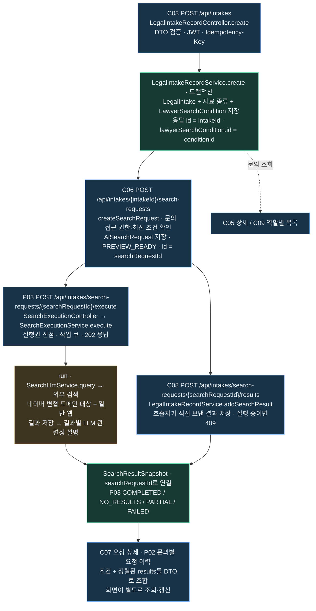
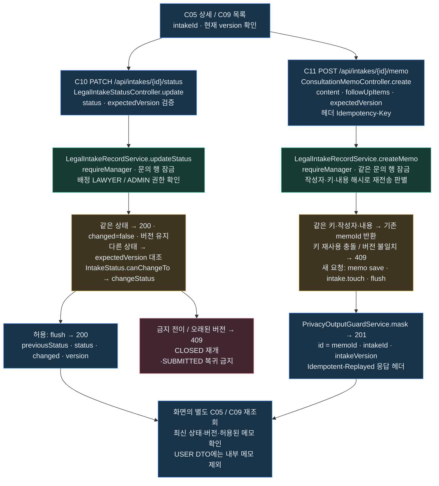
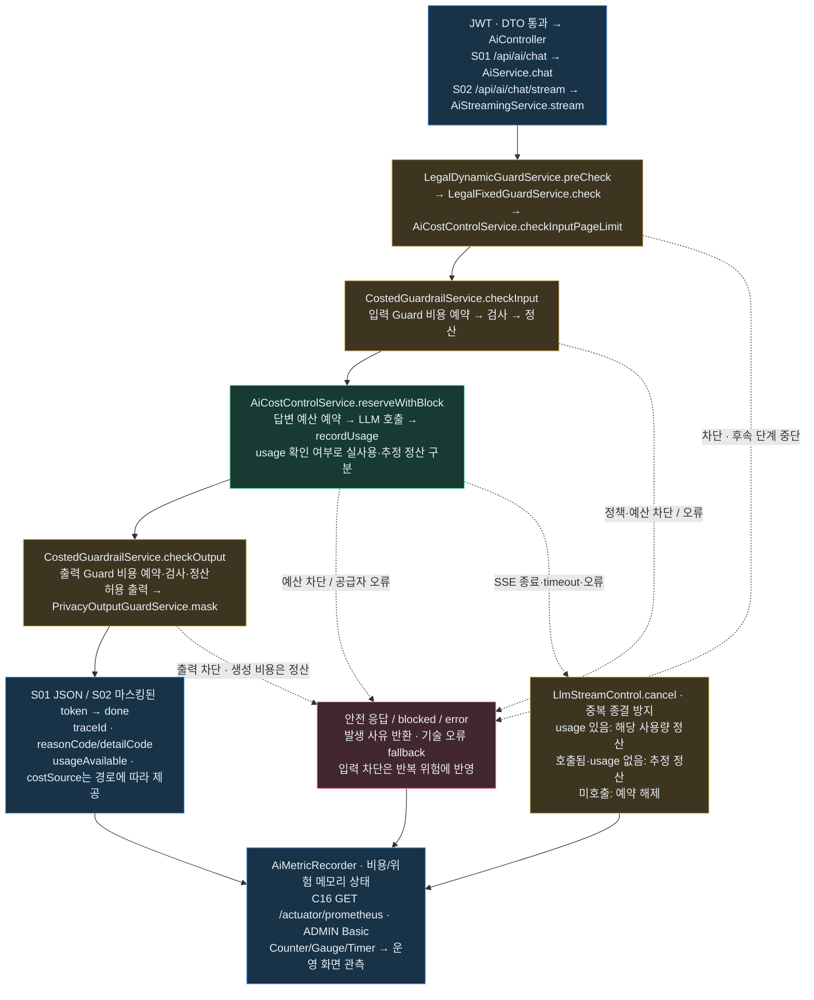

# 백엔드 구체적 흐름 3개

2026-10-25 현재 소스 대조. 실행 서버 재검수나 새 유료 호출을 수행한 문서가 아닙니다. 원본 그림에 P03 실행·현재 권한·재전송·버전 정책을 반영했습니다.

## 1. 문의 등록 → 검색 요청 → 실행·결과 → 이력

- **자동 연쇄 실행이 아닙니다.** C03 저장, C06 요청 생성, P03 실행은 각각 별도 요청입니다. C08 수동 저장과 P03 내부 저장도 별도 경로입니다.
- `conditionId`는 서버가 연결하므로 C06 본문으로 다시 보내지 않습니다. 검색 실행·상세·결과 추가에는 `searchRequestId`, 문의별 이력에는 `intakeId`를 사용합니다.
- 조회·검색 접근은 문의 소유자·배정 변호사·ADMIN 범위입니다. P03의 PARTIAL 상태에서 `retryExplanation:true`를 보내면 저장 결과를 유지하며 미완료 설명만 재시도합니다.

## 2. 상태 변경·상담 메모 → 문의 재조회

- 상태와 메모는 **각각 별도 트랜잭션**이며 서로를 자동 호출하지 않습니다. 동일 문의 행 잠금으로 상태 변경·메모·재배정을 직렬화합니다.
- `expectedVersion`은 현행 호환 정책상 선택값입니다. 보내야 오래된 편집을409로 검출합니다. 같은 상태와 기존 메모 재전송 판별은 버전 검사보다 먼저 수행합니다.
- 메모 키가 없으면 같은 작성자·같은 내용의 기본120초 재전송 추정만 적용하며 영구 멱등 보장이 아닙니다. C11의201은 새 저장과 기존 응답 재전송 모두에 사용하므로 헤더·ID로 구분합니다.

## 3. AI 동기·SSE → 사유·비용·마스킹·지표

- S02는 공급자 원본 조각을 내부 버퍼에 모은 뒤 **전체 출력 검사·패턴 마스킹 후** 전송합니다. 원본 토큰을 실시간으로 그대로 중계하지 않습니다.
- 출력이 차단돼도 이미 생성한 답변 비용은 남습니다. 입력 Guard·답변·출력 Guard는 각각 비용 처리 단계입니다. C16 조회는 LLM을 호출하지 않습니다.
- `reason`은 기존 호환 필드이며 공통 사유·세부 사유가 항상 같은 의미는 아닙니다. `usageAvailable`·`costSource`가 없는 분기에서 임의의0·실측으로 해석하지 않습니다.
- 초기 화면02~04의 규칙·템플릿 안내와 이 S01·S02 AI 파이프라인은 구분합니다. Prometheus는 지표이고, DB 위험 이력·Incident는 별도 저장·조회 경로입니다.

## 코드 대조 진입점

| 흐름 | 확인한 코드 |
|---|---|
| 등록·검색 | `LegalIntakeRecordController`, `LegalIntakeRecordService.create/createSearchRequest/addSearchResult/findSearchRequest/findSearchRequests`, `SearchExecutionController`, `SearchExecutionService.execute/run` |
| 상태·메모 | `LegalIntakeStatusController`, `ConsultationMemoController`, `IntakeAccessService.requireManager`, `LegalIntakeRecordService.updateStatus/createMemo/toMemoResponse`, `IntakeStatus.canChangeTo` |
| AI·SSE | `AiService.chat`, `AiStreamingService.stream/settleInterrupted/flushCompletedResponse`, `CostedGuardrailService`, `AiCostControlService`, `PrivacyOutputGuardService`, `AiMetricRecorder` |
