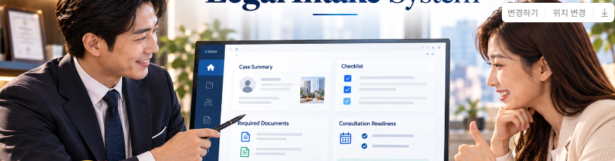

# 운영자 화면 09~12 · 엄지척 공통 헤더

2026-10-20 · V4 · 프롬프트 갱신. 두 첨부 원본은 수정 없이 보관했으며 실제 크롭 이미지를 제작한 것은 아니다.

## 실제 사진 · 두 번째 첨부

## 크롭 구도만 참조 · 첫 번째 첨부

## 공통 적용

- 대상: 09 운영 요약 / 10 마케팅 집계 / 11 보안·위험·비용 지표 / 12 위험 이력·Incident 대응.
- 악수 사진을 엄지척 사진으로 교체한다. 두 번째 첨부를 실제 사진으로 사용하고 첫 번째 첨부는 낮고 긴 헤더 구도만 참고한다.
- 왼쪽 모니터, 두 사람의 표정, 오른쪽 여성의 엄지척을 함께 살린다. 첫 번째와 정확히 같은 비율을 강제해 손을 자르지 않고 필요하면 헤더 높이를 조금 늘린다.
- 원본 상단의 큰 Legal Intake System 제목과 아이콘 줄은 완전히 크롭 밖으로 빼서 잘린 글자가 남지 않게 한다. 모니터 안의 작은 글자는 유지해도 된다.
- 첫 번째 첨부의 변경하기·위치 변경·다운로드 버튼은 이미지 편집 도구다. 제품 화면에 복제하지 않는다.
- 공통 사진은 헤더에만 사용한다. 네 화면의 원본·크롭 초점·높이·배치를 통일하고, 사진을 늘리거나 인물·장면을 새로 생성하지 않는다.
- 화면 제목은 헤더 아래 별도 행에, KPI·필터·표·차트·버튼은 그 아래 흰 패널에 배치한다. 사진이 업무 공간을 과도하게 차지하지 않게 한다.
- 네이비 사이드바, 파랑 강조, 흰 작업 표면은 기존 로그인 브랜드와 연결한다. 활성 메뉴·화면 제목·업무 데이터만 바뀐다.
- 모바일을 나중에 요청하면 표정과 엄지척을 보존하는 조금 더 높은 반응형 크롭을 사용한다.
- React 구현 시 하나의 OperatorLayout / OperatorHeader에서 재사용한다. 이번 작업은 프롬프트 갱신이며 React 코드를 변경하지 않았다.

## 사용법

ChatGPT에 위 두 이미지와 해당 화면의 TXT를 함께 제공한다. 같은 대화에 두 이미지가 이미 보이면 [헤더 수정 프롬프트](09_12_SHARED_HEADER_OVERRIDE_V4.txt)만 붙여 넣어도 된다.

- [09 운영 요약](09_OPERATOR_OVERVIEW.txt)
- [10 마케팅 집계](10_MARKETING_AGGREGATES.txt)
- [11 보안·위험·비용 지표](11_SECURITY_RISK_AND_COST.txt)
- [12 위험 이력·Incident 대응](12_RISK_HISTORY_AND_INCIDENTS.txt)
