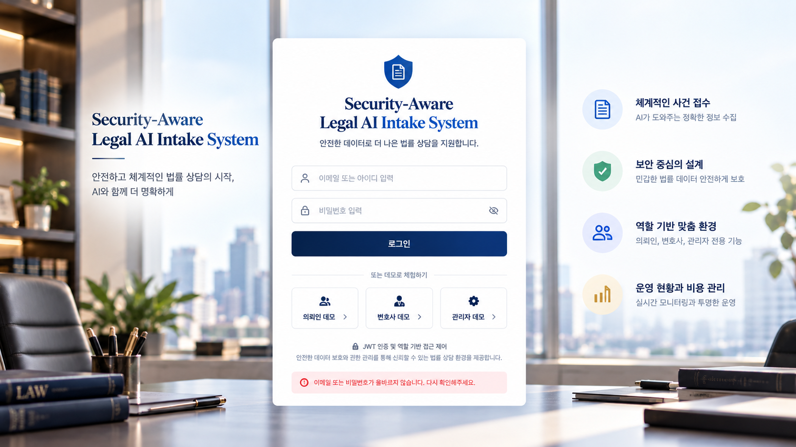
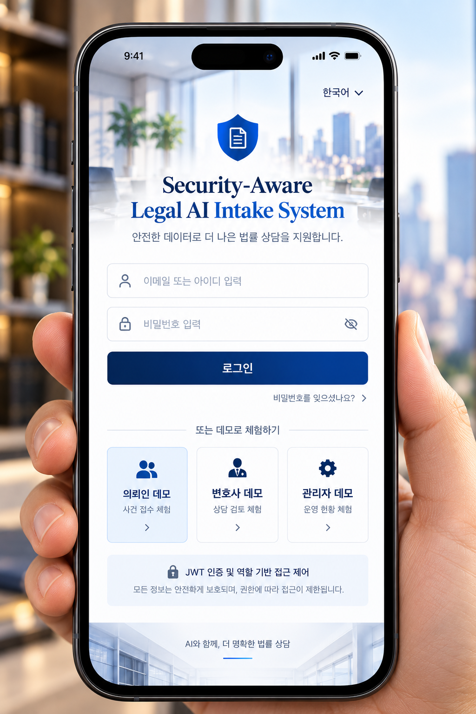

# 채택한 화면 무드 · V2

사용자가 선택한 로그인 시안 2장의 분위기를 화면 02~12에 이어간다. 이전의 중립톤 비교 후보보다 아래 레퍼런스가 우선한다.

## 데스크톱 레퍼런스

## 모바일 레퍼런스

## 핵심 디자인 언어

- 공간: 창가 자연광, 부드럽게 흐린 도시 전망, 따뜻한 목재·책·식물의 법률 사무실.
- 브랜드: 파란 방패·문서 마크, 네이비/로열블루, 영어 브랜드 제목의 세리프 서체.
- 정보: 흰색 또는 거의 불투명한 패널, 읽기 쉬운 한국어 산세리프, 얇은 테두리와 부드러운 그림자.
- 조작: 절제된 네이비→블루 버튼, 파란 라인 아이콘, 옅은 파란 선택 상태.
- 일관성: 화면마다 다른 사무실 사진을 쓰지 않고 하나의 공간 이미지를 배경·헤더·여백에 재사용.

## 구현 가능한 컬러 제안

| 용도 | 색상 |
|---|---|
| 주요 글자·내비게이션 | #0B2148 |
| 강조·버튼 | #0B4AB8 / #1456C8 |
| 콘텐츠 패널 | #FFFFFF |
| 선택 배경 | #EDF4FF |
| 테두리 | #D6DFEC |
| 보조 글자 | #63738B |

색상은 레퍼런스의 무드를 재현하기 위한 제안값이며, 원본 이미지에서 측정한 확정 토큰은 아니다.

## 역할별 적용

| 화면 | 적용 방법 |
|---|---|
| 02~05 의뢰인 | 사무실 배경을 비교적 넓게 살리고, 여백 있는 흰 입력·안내 패널과 한 가지 주요 행동을 강조 |
| 06~08 변호사 | 같은 공간·브랜드를 유지하고 헤더·사이드바를 압축해 흰 작업 표면과 사건 읽기·메모 작성 공간 확보 |
| 09~12 운영자 | 네이비 사이드바와 흰 집계·표·상세 패널을 사용하고 사진은 헤더·가장자리에서 은은하게 표현 |

로그인의 3단 홍보형 구성을 내부 업무 화면마다 반복하지 않는다. 작은 글자나 표 위로 사무실 사진이 비치지 않게 한다. 모바일은 같은 브랜드로 패널을 쌓고 내비게이션을 접되, 실물 휴대폰·손·사진 촬영 프레임을 산출물에 넣지 않는다.

디자인 외관만 반영한다. 참고 이미지의 JWT 보장 문구, 비밀번호 찾기, 언어 선택 등을 구현되지 않은 기능으로 새로 끼워 넣지 않는다. API 매칭·상태·저장/조회 구분은 기존 프롬프트의 계약을 유지한다.

## 추가 적용 · 운영자 09~12 공통 이미지

운영자 화면은 [엄지척 사진 원본](references/09_12_OPERATOR_THUMBS_UP_SOURCE.png)을 공통 가로 헤더로만 재사용한다. [첫 번째 첨부](references/09_12_OPERATOR_HEADER_CROP_REFERENCE.png)는 낮고 긴 크롭 구도의 참조용이다. 모니터·두 사람의 표정·엄지척을 보존하고, 상단 큰 제목·아이콘 줄은 크롭 밖으로 완전히 뺀다. 로그인 이미지는 브랜드·컬러 기준이며 운영자 사진은 이 원본이 우선한다. [상세 적용 지침](09_12_OPERATOR_SHARED_IMAGE_GUIDE.md)을 따른다.
